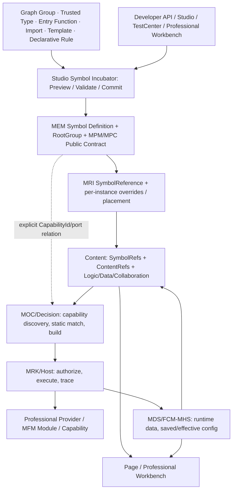

# CxVisual Symbol 体系 #0——总体架构与完整需求 V2.0

> 状态：**完整目标架构与指导开发基线，待负责人审评**；不是已实现/已验收声明。日期：2026-10-31。
> 目标：既让非程序员从图形自然孵化可复用组件，也让六大专业通过统一能力合同复用 Symbol；从总体用途反推接口、Owner、测试而非从控件或类名反推功能。
> 核心理念：**各方面都尽能力展现，便捷友好尽支撑各专业达到目标。**
> 约束：以 `AGENTS.md`、工程组织 V1.2、图元编辑 V1.2、统一模块 #0 V2.0、Decision 注册 #3 V2.0、平台公共能力总目录 V1.0 为上位依据；DOCS/02～04 XLSX 是需求/类/API 校对基线，正式新增公共 API 前须核对相应 Sheet。此稿基于本次已读取的 Markdown/源文件及已公布 Excel 版本，不谎称逐 Sheet 内容已核验。

## 00. 导读：角色、边界与权威导航
| 阅读者 | 必读 | 完成后应能做的事 |
|---|---|---|
| 架构 Owner | 本文 01～06、12～14；#1、#5、#7 | 判别定义边界、同源与冲突；裁决新增合同 |
| Symbol 作者 | #4、#2、#3 | 从 Group/模板/类型/导入孵化，在 Studio 预览并发布 |
| 专业开发者 | #3、#5、#7 | 声明能力、映射数据/事件、不为专业再造组件底座 |
| 编排工程师 | #5、#2 | 通过 Content/公开 Port/Capability 使用 Symbol，定位失败 |
| 平台维护者/测试者 | #6、实施台账、测试矩阵 | 判定升级兼容、权限/版本、实测证据 |

**本文只持总体架构、完整需求、横向追溯和架构不变量。** 工程对象的正式真源归 MEM/组织规格；几何/端点算法归 MVI/图元规范；Capability 描述归 MOC/Decision；配置/数据/运行归各自既有 Owner。本系列 #1～#7 是 Symbol 专属接口与协同合同，不平行改写上位规格。

## 01. 本质定位与不是
- **Group**：`MRCGroup` 是图元层次和空间变换组合，本身可带属性、端口和 Aspect，但不等于全局组件发布。
- **Symbol**：`MEMSymbol` 是**共享、可独立编辑、可复用的视觉/状态/交互组件定义**，有唯一 `RootGroup`，可按需公开属性/端口、绑定数据、描述行为并**引用**专业能力。
- **Symbol 实例**：`MRIResourceReference` 是共享定义在 Page/Content 中的一次使用位置，拥有自己的参数覆写、布局和运行上下文；定义与实例不能同名即同一。
- **Content**：组织业务、资源、数据、编排、子 Content 和 Symbol 引用；没有视觉也合法；复杂业务流程由 `MEMContent + MOL` 持定义，`MOC/Decision` 构建，`MRK` 执行。
- **Capability**：对外行为/数据处理合同（`MOCCapabilityDescriptor`）；**Module**：五类实现载体（Connector/Driver/Compute/Simulation/Service），不应发明第六种 SymbolModule。
- **Workbench/Page**：用户在专业场景中消费 Content 与 Symbol；不得要求一切专业算法先绘制一个 Symbol 才能运行。

**一句话**：Symbol 是专业能力的可视化、交互与复用入口之一，不是全部专业数据、流程或设备执行的根对象。

## 02. 成功标准（由用户实际任务反推）
- D1：开发者从已写好的普通 C# 函数/Provider 出发，一处显式注册即可被 Studio/SDK 发现、查看签名、绑定；纯视觉不需要实现运行 Provider。
- D2：非程序员在画布上组合图元，点“提升为 Symbol”，可预览自动提议的公开属性/端口，选择是否替换原 Group；成功不跳图、不丢线、一次 Undo。
- D3：专业工程师把同一个 Motor/ROI/仪表 Symbol 放到多个 Page/Content，实例数据不同，更新共享定义后外观一致，实例覆写和追踪隔离。
- D4：编排用户从已连接 Data/Control/Event 端口找到适配 Capability，先获得类型、单位、Scope、安全/依赖可解释结论，再通过 Content/MOL 真编排，而不是在 Symbol 里隐式执行任意脚本。
- D5：导入图形、专业库、模板、外部包后，可以先只读预览和诊断；缺程序/设备/权限显示 Unknown 或 NotReady，不弹“导入成功=已可执行”。
- D6：生产级用户可以解释每条操作的来源，追溯 Definition→InstancePath→Port→Content/Flow→Run/Trace→运行结果；坏质量/超时/断开可显示退化，不伪成功。

## 03. 完整能力范围与分层矩阵
| 能力域 | 必备能力 | 上位 Owner / 本系列专题 |
|---|---|---|
| 视觉 | Shape/Text/Image/SVG/Widget、Group、Path/Bezier/Arc、多图层、变换、状态样式、动画、渲染投影 | MRC/MVI/MPW；#1/#2/#4 |
| 组件 | 定义/实例、属性/端口/公开映射、主值建议、实例配置/覆写、复用/多实例、内外引用 | MEM/MPM/MPC/MRI/MTC；#1/#2 |
| 连接 | Data/Control/Event/Command/State/Stream/Resource/Visual 端口、类型/方向、固定/浮动/自由附着、布线/重连 | MPC/MVI；#2/#4 |
| 数据 | 成员/变量/MDS 引用、质量/时效、状态变换、只读运行投影、失联/未知样式 | MPM/MDS/Visual；#2/#5 |
| 交互 | Click/Change/Drag 等事件、请求 Command/Capability、权限检查、响应/诊断 | MVI/现有命令与运行 Host；#2/#5 |
| 逻辑 | 简单视觉规则/状态、纯表达式，复杂流程通过 Content/MOL 调用 | MPM Aspect、MOL/Decision/MRK；#2/#5 |
| 注册 | 注解/入口函数/Fluent/Provider/类型注册，统一 MPM/MOC，白名单信任 | MEM/MPM/MOC/MFM/FCM；#3 |
| 孵化 | Group 提升、图形编辑、类型化创建、脚本/规则配置、模板/导入、测试预览 | Studio/MPW+MEM/MTC/MTI；#4 |
| 专业 | HMI、Automation、Vision、CT3D、Inspection、Simulation 的契约匹配和专业 Viewer 适配 | Professional+各自 Owner；#5 |
| 治理 | 来源、Schema/内容版本、依赖图、变更影响、发布、迁移、审计、权限与工业安全 | MEM/MTI/MOC/MHS/Host；#6 |
| 可验证性 | API/行为/UML、正反/性能/Windows/UIA/HIL、修订状态与证据 | #7、Implementation、Testing |

**四层使用等级**：L0 纯视觉/直接代码；L1 可发现类型/静态描述；L2 可放置、绑定、配置与软件级验证；L3 能力版本、有效配置、授权运行和真实设备状态都可证。不要把等级变成四类不同 Symbol。

## 04. 架构全貌

注意：箭头仅表示业务/使用关系，不代表工程项目引用方向；编译期依赖方向必须按 Owner DAG。不能为了示意图让 Core 引用 Runtime。

## 05. 根本不变量（SYM-I01～SYM-I20）
| 号 | 强制要求 |
|---|---|
| I01 | MEM 的 Project/Page/Content/Symbol/Group/Element 是唯一工程对象真源；不写另一套 Symbol/Graph 文档模型。 |
| I02 | Group/Element 的父子持有不等于 Symbol/Content 的引用；实例不复制定义。 |
| I03 | Symbol 恰有一个 RootGroup；Group 只能拥有视觉 Group/Element，不能擅自拥有业务 ContentRef。 |
| I04 | Symbol 可完全静态；专业算法和无视觉 Content 不依赖 Symbol 存在。 |
| I05 | 单主值建议不强迫所有 Symbol 只有一个数据口，辅助输入、输出、事件合法。 |
| I06 | 内部属性默认为私有；公开成员有稳定 MemberId、类型、映射/兼容约束。 |
| I07 | 声明一次，多处可读；Attribute/Builder/Provider 不许保留分裂的权威 Schema。 |
| I08 | Studio/MPW 不持久存一份 Registry/连接/配置/Undo。 |
| I09 | 端口语义 MPC，附着几何 MVI，运行值 MDS，计划和执行由 Decision/Runtime；数据不串 Owner。 |
| I10 | 业务流程定义在 Content/MOL；Symbol 交互仅发授权请求，不直接执行设备。 |
| I11 | 设备 Real/Virtual/Replay/Unavailable 不能由 UI 默认猜测。 |
| I12 | Capability 已声明、已解析、Ready、Authorized、Completed 各自独立；缺证据保持 Unknown。 |
| I13 | 各步 Preview 不写工程 Revision，Commit 使用统一 MTC 事务；失败不留下半成品。 |
| I14 | 转换/复制/导入保留或明确重映射对象、连接、绑定、资产、Aspect、实例路径。 |
| I15 | 定义升级必须说明兼容面、实例影响、修复映射及回退；运行期禁止静默热替换。 |
| I16 | 属性/端口/配置使用唯一类型、单位、坐标、时基与必要专业校验。 |
| I17 | 查询第三方包元数据不能主动执行入口/构造器；脚本默认 fail-closed。 |
| I18 | 旧四向连接、已有项目、既有 MTI 包及公开映射必须向后兼容。 |
| I19 | 六专业可按需提供专业视觉编辑器/Provider，而不改变公共对象继承链。 |
| I20 | 每条“已完成”带真实源码、固定 SHA、软件/Windows/设备分层证据。 |

## 06. Object 与 Runtime 角色模型
| 身份 | 代表 | 谁拥有 | 什么不属于它 |
|---|---|---|---|
| Type | TypeId, SchemaVersion | MPM 工程类型/可信发布者描述 | 某个具体定义的状态 |
| Definition | MEMSymbol Id | Project 共享定义 | 某台设备的当前值 |
| Instance | MRIResourceReference Id + InstancePath | 拥有该引用的 Content | 一份复制的 RootGroup |
| Port | MPCPort Id/MemberId | 工程定义 | 屏幕坐标 |
| Anchor | 连接端点的视觉附着规则 | MPC 持久合同 + MVI 求解 | 另一个数据端口仓 |
| Capability | CapabilityId/Version | MOC 只读描述、专业提供者 | 设备已经完成操作的保证 |
| Module | MFM ModuleId | 模块/专业 | Symbol 的别名 |
| Run | FlowId/RunId/Trace | MRK/MDS/Host | MEM 的编辑 Revision |

## 07. 跨方面与 Content/编排的关键规则
- **Visual**：定义图形/交互投影；专业 Viewer (CT3D/图像) 可通过 Content/专业宿主适配，不把三维体假装为二维 RootGroup 子节点。
- **Logic**：Symbol 的视觉状态/表达式规则按需；真正分支、循环、任务调度、子流程调用仍由 Content/MOL/MOC/MRK。
- **Data**：定义只存绑定契约/地址映射，运行值、质量、缓存/租约在 MDS；同定义两实例必须独立定位。
- **Collaboration**：事件、Command、消息/设备请求通过现有中心与授权路径传递；Symbol 不复制消息总线和命令中心。
- 允许 Symbol 对外通过公共 Port 连接 Content；连接成功只意味着合同/工程合法，不等于运行必成功。
- 运行结果回流 MDS/MNM/Trace，再由 Symbol 按实例路径重新投影，禁止运行副作用写定义。

## 08. 七个专题文档的唯一责任
| 文件 | 唯一负责 | 不负责 |
|---|---|---|
| [#1 对象](CxVisual_Symbol_01_对象模型与四方面_V2.0.md) | 定义/实例/Aspect/引用结构与约束 | 拆分新工程或运行器 |
| [#2 契约](CxVisual_Symbol_02_公开契约与数据行为_V2.0.md) | 参数/端口/绑定/视觉状态/附着 | 覆盖专业业务流程 |
| [#3 注册](CxVisual_Symbol_03_能力注册与发现_V2.0.md) | 便捷输入归一和发现契约 | 第二个 CapabilityCatalog |
| [#4 孵化](CxVisual_Symbol_04_Studio孵化与创作流程_V2.0.md) | 创建/转换/预览/编辑体验 | 另一套工程 Store |
| [#5 协同](CxVisual_Symbol_05_Content专业编排协同_V2.0.md) | Content/专业/编排/运行/数据贯通 | 替换专业 Provider |
| [#6 治理](CxVisual_Symbol_06_资源版本安全与迁移_V2.0.md) | 库/依赖/版本/风险/迁移 | 绕过 MHS/Host 安全 |
| [#7 API](CxVisual_Symbol_07_全类UML与API合同_V2.0.md) | 类清单/唯一 Owner/API 图/协作时序 | 未核对的公开接口实施声明 |

阶段实装记录：[Implementation 台账](../Implementation/CxVisual_Symbol_实施任务与现状台账_V2.0.md)；证据与反例：[Testing 矩阵](../Testing/CxVisual_Symbol_完整测试与验收矩阵_V2.0.md)。旧 [V1.0 总设计](CxVisual_Symbol体系——总体架构_能力注册发现_Studio孵化与验收_V1.0.md) 保留历史资料，本文是新版入口。

## 09. 六专业与横向跨专业能力合同
| 专业 | 使用 Symbol 的真实意义 | 必保留的专业 Owner |
|---|---|---|
| HMI/SCADA | 电机/阀门/仪表/报警 Faceplate，显示值和操作请求 | 设备点表、MDS 质量/状态、指令联锁 |
| Automation | 输入输出状态、工位、手自动交互/功能块图形 | PLC/运控、协议、实时确定性与权限 |
| Vision | 图像/ROI/测量展示、运行状态与结果交互 | 算法 Provider、图像坐标/FIM、结果来源 |
| Inspection | 检测对象/缺陷/复测的表达与人工判定界面 | 检测编排、专业判定、过程审计 |
| CT3D | 体/三视图/切片/等值面交互工具与状态卡 | Volume Viewer、数据租约、坐标与 GPU |
| Simulation | 实物/虚物的状态控制面板与故障交互 | 时钟/仿真模型/虚实隔离与切换授权 |

新增专业只需提交自己的 Type/Port/Capability/Viewer 适配，**不允许在 Studio 为每个专业硬编码新根型**。

## 10. 八大黄金案例（需求追溯）
| Case | 用户动作到结果 | 特别需要的负例 |
|---|---|---|
| G01 | Group→Symbol→两实例→定义升级→保存重开 | 中间断线/位置漂移/Undo 不完整 |
| G02 | 电机 Faceplate 注册、绑定两 PLC 变量、状态与控制 | Bad/Unknown、无授权真实设备不动作 |
| G03 | Vision ROI Symbol + 检测算法 Capability + 输出 | 图像单位不符/旧结果无效/无结果句柄 |
| G04 | CT3D 切面交互 Symbol + Content/专业 Viewer | 错坐标系/体数据释放/Viewer 不就绪 |
| G05 | Automation 工位/动作 Symbol + Content Flow | 未确认/超时/联锁拒绝仍显示成功 |
| G06 | Simulation 虚拟设备状态 + HMI 实物界面 | 虚拟/实机混线或时钟不一致 |
| G07 | 外部包/脚本/模板导入 + 安全预览 + 实例放置 | 未知 DLL/脚本执行、Schema 冲突被吞 |
| G08 | 多 Content 引用同 Symbol + Loop/Join + Trace/SourceMap | 实例/子流程混淆、重复运行覆盖状态 |

#5 给 G02～G08 的完整时序；#4 给 G01/G07 的完整创作动作；测试矩阵逐项验收。

## 11. 关键用户体验原则
- 快速：一般作者 3～4 个动作就能从 Group 得到可复用 Symbol，属性/端口建议自动生成但公共曝光须确认。
- 可解释：输入“电机”“启动”“Running”“PLC”等词，都能显示相关类型/资源/能力和来源/状态；Unknown 结果不可被隐藏成成功。
- 自然：Studio 以一个 Symbol 管理中心 + 原编辑画布/属性/资源/调试为基础，不增加一个孤立的新 Studio。
- 专业：属性/端口/专有 Viewer 根据可发现的 Schema/专业适配器出现，不要求每位工程师编写 XAML。
- 一致：同一 Symbol 的“纯视觉预览”“数据预览”“模拟/真实运行”明显区分，运行危险动作需现场授权。

## 12. 工程依赖与 OOP/GoF/AOP
- **Composite**：现有 Group/Element；**Flyweight-like shared definition + reference**：共享 Symbol 与 MRI 实例；**Builder/Adapter**：便捷声明和导入转换；**Strategy**：视觉附着与状态映射；**Command**：MTC 编辑与运行 Command 走不同正式 Owner；**Observer/Projection**：MDS/MVI 的只读状态投影。
- 横切：校验、授权、审计、版本/来源、质量、取消/超时、Trace、性能预算在现有核心服务与专业 Host 统一施加；不新增 SymbolSecurityService/CommandBus。
- 当前物理工程基线 26 项；绝不以 Symbol 功能为理由新建工程，除非独立 Owner 决议与依赖图审查通过。

## 13. 推进顺序（先保证纵向合同，再完善局部手势）
1. **D0** 审查实体/场景/端口/类型现状与 Excel 合同，固定术语、Owner 与横向追溯。
2. **D1** #5 两个纵向金样本（HMI Motor + Vision/Automation 之一）验证 Definition→Content→编排→数据/事件→Trace。
3. **D2** 统一注册与只读发现：入口函数/Attribute/显式 Provider；无第二 Registry。
4. **D3** Group→Symbol 的完整提升，公开成员/映射无损，一次事务。
5. **D4** 固定/真实轮廓浮动/自由附着与真实实例 Port。
6. **D5** 孵化 Studio/专业适配、脚本与资源治理、升级迁移。
7. **D6** 多专业/跨工程/Windows/性能/设备分层验证并形成工业发布条件。

项目实际状态、负责人、依赖及证据统一放 Implementation 台账，**不在架构主设计里逐次改写“某 CI 绿了”**。

## 14. 变更裁决与可核实证据
- 对用户已经确认的核心理念、工程对象/Owner、注册唯一性、Content 编排边界、老连接兼容视为已有架构约束；提议新 API/Attribute/附着 Schema 和脚本执行仍为“待设计签收”。
- 任何新需求必须带：Case、需求编号、对象/Owner、数据流、错误边界、迁移策略、测试编号和示例；否则先补齐再排期。
- 同一 API 的事实以当时最新 master 真实文件为准；上位文档与代码冲突应记录差异/证据/裁决，不静默改变现有项目。
- 不将 WPF STA 组件测试冒充操作系统级 UIA，不将模拟器/Loopback 冒充 PLC/X-Ray/CT HIL。
