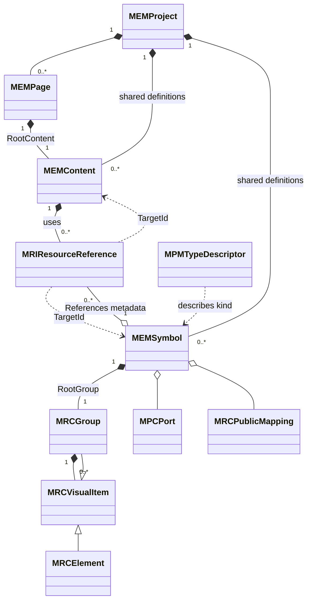

# CxVisual Symbol 体系 #1——对象模型、定义实例与四方面 V2.0

> 日期 2026-10-31；目标规格（待审评）。适用 [#0 总纲](CxVisual_Symbol_00_总体架构与完整需求_V2.0.md)。真实工程定义以 `Mechanism/Core/Engineering/MEMNode.cs`、`MRCVisualItem.cs`、`MPMDefinitionState.cs`、`MRIResourceReference` 等为准；本文不添加第七层 Node。

## 01. 完整对象图及身份

这是**持有与引用视图**而不是可直接编译的 C# 继承声明全集。**`MEMSymbol.References` 与 RootGroup/Children 是不同存储：前者持独立 MRI 引用记录，后者只持视觉子图元**。`MEMEngineeringSession.CheckReference` 允许 Content 或 Symbol 作为引用 Owner，但不能据此推断 Symbol 现已拥有 MRK 子流程运行能力；生产复合语义见 [#8 C01](CxVisual_Symbol_08_真实源码审计与规格冲突_V2.0.md)。准确的类密封与 Parent API 以现有代码为准；禁止将 `ContentRef/SymbolRef` 画成业务“拥有”子定义。

| 对象 | 原始身份 | 持有者 | 说明 |
|---|---|---|---|
| `MEMSymbol` | Guid Id, TypeId | Project 独立共享资源 | 一定义仅一个 RootGroup，另有独立 `References`（MRI）集合，不属于 RootGroup.Children |
| `MRCGroup` | Guid Id | Symbol RootGroup 或其他 Group/Content | 属空间层级；不是业务执行容器 |
| `MRCElement` | Guid Id | Group/Content | 形状/文字/图片/小控件/专业呈现占位 |
| `MRIResourceReference` | Guid Id + TargetId + Kind | Content | 同一定义多实例；参照链是身份的一部分 |
| `MPMProperty/MPCPort` | Owner + MemberId + PortId | 定义者 | 实例只能访问公开成员 |
| `MPMAspect` | Kind + ProviderId + SchemaVersion + Payload | 定义者 | Visual/Logic/Data/Collaboration 按需声明 |
| `MPCConnection` | Id + OwnerId + Endpoints | MEM 所属定义 | 数据语义与 Visual 类型路由分离 |

## 02. 四个正交方面
| 方面 | Symbol 可包含什么 | 如何对接 Content | 唯一运行 Owner |
|---|---|---|---|
| Visual | RootGroup/Element、样式/状态/动画/可视事件 | 显示为共享引用的实例投影 | MVI/Presentation.Wpf（仅投影） |
| Logic | 局部状态/纯规则/事件响应的**声明或外部逻辑引用** | 复杂控制流交给 MEMContent Logic Aspect/MOL | Decision→MRK/专业 |
| Data | 可配置变量/成员映射、类型化读取、质量退化规则 | 由 Content/实例 Scope 提供实际数据源 | MDS、数据 Owner |
| Collaboration | Event/Command/Message 请求的映射及回执展示 | Content/专业声明目标、权限、订阅 | 现有命令/消息/Host |

**不可违反**：`MPMAspectKind.Logic` 可以被声明在不同定义上，但现有完整 MOL 编排的正式持久 Owner 是 `MEMContent`，不能未经裁决把完整 `MOLWiringDefinition` 复制塞进 Symbol 造第二执行语义。

## 03. 统一坐标、作用域和身份解析
- 视觉坐标分**ShapeGeometry local → Group local → Definition local → Instance placement → Scene world → Screen/DIP**。任何一级改变，显示端可重新投影，但不得把临时世界坐标当作定义内持久参数。
- `MRIObjectAddress` + `InstancePath` 精确定位资源/引用链；嵌套 Group 的几何定位和专业变量绑定有不同寻址语义，不应合并成字符串路径推断。
- 两台 Motor 共用 DefinitionId，分别有 InstanceId、绑定 `Variable("plc.motorA.running")` / `Variable("plc.motorB.running")`；运行值不存 `MEMSymbol`。
- 跨 Content 对同一定义的使用，应显式承接 Content 输入、局部变量、公开映射、引用覆盖、坐标转换、版本锁。
- 调用其他 Content 的流程不是把 Content 存到 Symbol Group；通过拥有者 Content 的编排和资源引用表达。

## 04. 合法组织与循环检查
| 关系 | 是否允许 | 验证要求 |
|---|---|---|
| Project 持独立 Symbol | 是 | ID 全工程唯一、稳定 TypeId |
| Symbol 持一个 RootGroup | 必须且唯一 | RootGroup 不能任意删除/换 Parent |
| Group 持 Element/Group | 是 | Parent 唯一、无持有环、变换合法 |
| Group 持 ContentRef/SymbolRef | 当前不允许 | Group 只能拥有视觉 MRCVisualItem；与 Symbol 自持 MRI References 不同 |
| Content 持 SymbolRef | 是 | TargetId 存在且 Kind 正确，公开映射合法 |
| Symbol 自持 MRI SymbolRef/ContentRef | 代码支持声明 | `CheckReference` 验共享目标和引用环；复合运行/公开边界完整行为仍待 ADR 与测试 |
| Content 嵌套 Content | 是 | 拥有树无环；引用环单独校验 |
| 一实例覆盖另一实例的私有值 | 否 | 只可通过正式公开可写成员 |
| Symbol 内直接访问专业 CLR Delegate | 否 | 只有版本化 CapabilityRef/Host 可绑定 |

区分：**拥有无环、资源引用环、运行循环/状态机**。不能用“一切环非法”替代 MOL/专业的合法迭代语义。

## 05. 共享定义/实例与可编辑范围
- **编辑定义**：只修改 Symbol 自身 RootGroup/MPM/MPC/Aspects，对所有实例的未来投影生效；如果变更公开 Schema，必须先影响分析。
- **编辑实例**：只修改 `MRIResourceReference` 允许的 Placement、公开参数/绑定覆盖，不能直接改定义内私有 Element。
- **只读投影**：展开实例显示在 Canvas 的视觉对象可能拥有内部 ElementId + InstancePath，但并不获得可写 Definition 权限。
- **进入定义**：Studio 必须展示面包屑/定义名/来源，编辑时从 Page 返回不能误将当前实例当定义。
- **复制/重映射**：复制引用生成新的 ReferenceId 和允许的覆写，未必复制目标 Symbol；复制定义必须重新分配内部 ID 并重写所有公开 Mapping/Connection/Asset/Aspect 依赖。

## 06. 资源生命周期
1. 描述/类型发现：`MPMTypeDescriptor` 为可安装的**类型**；不能与某个 `MEMSymbol` 共享定义混同。
2. 工程定义创建：明确创建空白或 AddTypedSymbol；新 DefinitionId，RootGroup 受保护。
3. 放置引用：MRI 实例化；继承公共属性，指定 Placement/有效绑定。
4. 运行投影：固定发布 Revision、Config Effective 和运行 Generation 关联；显示状态不写 MEM。
5. 更新定义：仅经工程事务；受影响的引用、连接、实例参数、配置、编排需依赖分析。
6. 导出/导入/迁移：MTI 预览、IdMap、外部依赖策略、版控/错误诊断、Undo 可证。
7. 解除/删除：必须先查反向引用、计划/执行依赖和配置引用，在线使用不可粗暴移除。

## 07. Definition 的公共契约由什么组成
- **Property**：稳定 MemberId、类型、默认值/约束、公开可写性、映射对象及兼容语义。
- **Port**：PortId/MemberId、MPCPortKind/Direction/TypeId/Multiplicity/Contract，公共端口可映射内部 Port。
- **Aspect**：按需附加的版本化扩展声明（含迁移标记），不能把 payload 当任意可执行字节码。
- **CapabilityRef**（建议的**关联语义**）：将已有 CapabilityId/Version/PortMap 关联到 Symbol/Content 的公开请求，不需要并不强迫每个 Symbol 持有它。
- **Visual Attachment**（建议扩展）：Port 的视觉附着策略独立于语义合同；旧四向端口保持兼容。
- **Source**（建议）：来源于系统 Provider、工程孵化、资源包、模板或导入；作为制品元数据，而非第二工程对象树。

## 08. 变更、异常与事务
| 场景 | 期望 |
|---|---|
| 用户创建 Symbol 后取消 | 旧工程 Revision/资源数不变 |
| 新建定义 + 替换 Group 中途失败 | 全回滚，Group、连线、绑定仍原样 |
| 新实例非法覆盖只读成员 | 拒绝，Definition/其他实例不受影响 |
| 删除正在被引用的公开端口 | 影响预览阻止默认删除，可选择显式兼容迁移 |
| 加载未知 Required Aspect | 报精确依赖/版本错误，不把数据吞掉 |
| 未知可选 Aspect | 按原上位迁移合同保留/诊断，不能暗中执行 |
| 当前编辑的 Definition 被并行修改 | expectedRevision 失效，重新 Preview，不自动覆盖 |

## 09. 严格对齐当前真实 API
- `MEMNode.cs` 的 `MEMSymbol.RootGroup` 唯一自动建立；`MRCVisualItem` 继承 `MEMNode` 并实现 `IMPMDefinition`。
- `MRCGroup.Accepts` 当前仅接收 `MRCVisualItem`；不要写 Group 拥有 ContentRef 的代码示例。
- `MPMDefinitionState.cs` 中已包含 `Visual/Logic/Data/Collaboration` 四枚举和 `MPMAspect`。
- `MTCEditSession.Contracts.cs` 有 `DefineProperty/SetProperty/SetOverride/DefinePort/Connect/Reconnect/ExposePort/ExposeProperty/SetAspect`；这是后续增强应优先调用的事务接口。
- `MTIPackages.cs` 中的 `ExtractReusable` 只承接 Content，不能以为已能 Group→Symbol。

## 10. 本专题验收（OBJ-01～OBJ-12）
| 编号 | 必过反证 |
|---|---|
| OBJ-01～03 | 空/类型化 Symbol 恰有一 RootGroup；非法 Parent/拥有环拒绝；保存重开同 ID |
| OBJ-04～06 | 多实例独立覆写；定义编辑投影同步；实例编辑不污染定义 |
| OBJ-07～09 | Group 多层 Transform/Aspect、引用/Map 复制与保存往返、未知 Required Aspect 拒绝 |
| OBJ-10～12 | 导入与撤销、异常 expectedRevision 原子回滚、Content 多重引用定位无歧义 |

**完整实现路径**：见 #7 Owner/API、Implementation D0/D1/D3、Testing OBJ/SYM 交叉验证。
