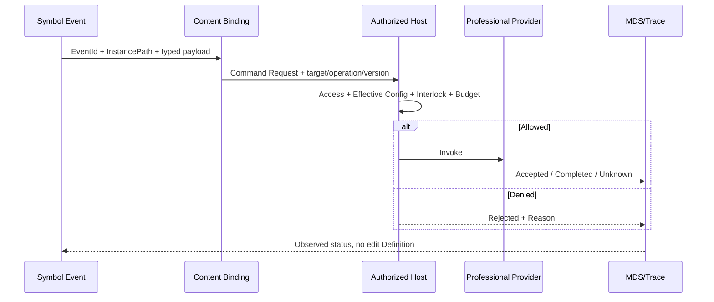

# CxVisual Symbol 体系 #2——公开契约、数据、行为与连接点 V2.0

> 日期 2026-10-31。**设计合同而非已实施 API**；核心类型沿用 `MPMTypeDescriptor/MPMPropertyDescriptor/MPCPortDescriptor/MPCPort/MPMAspect`、`MRCVisualBehavior`、`MPMBinding`、`MPCConnection`。几何精确计算与鼠标手势始终以《工程呈现化体系#图元编辑 V1.2》为权威。
> 参见 [#0 总纲](CxVisual_Symbol_00_总体架构与完整需求_V2.0.md)、[#1 对象](CxVisual_Symbol_01_对象模型与四方面_V2.0.md)、[#5 跨体系](CxVisual_Symbol_05_Content专业编排协同_V2.0.md)。

## 01. 什么叫“公开契约”
Symbol 内部 Group/Element 的几何、绑定、属性和事件是实现细节；跨定义边界必须从 Symbol 公共成员进入。目标采用：
- **公开属性**：稳定 `MemberId`、ValueKind/TypeId、可空/默认值、IsPublic/IsReadOnly/Required、范围/单位/专业约束、实例 Override 许可；映射内部目标必须经 `MRCPublicMapping`。
- **公开端口**：稳定 `MPCPort.Id/MemberId`、`Kind/Direction/TypeId/Multiplicity/MTUContractReference`；`ExposePort` 映射内部 Endpoint，禁止同名字符串穿透私有节点。
- **公开事件/命令**：MPC Event/Command Kind + 请求参数合同；事件是**声明的输出**，实际 Command/Capability 由 Content/授权 Host 持有。
- **主要数据语义**：建议为便捷绑定定义可选 `PrimaryValueMemberId` 元数据或从已公开端口明确选择；**不是**限制 Symbol 只有一个输入输出。
- **可观察状态**：状态名/来源数据/样式规则/质量回退/诊断，不把当前运行值保存到 Definition。
- **公开视觉附着**：某个 MPC Port 的一个或多个可用视觉锚点集合，保持 PortId 和 ConnectionId 不变；纯 Visual 锚点也可仅服务装饰线。

每个公共 Member 的完整描述至少应覆盖：标识、读写方向、来源、类型与单位/坐标/时基、默认值或缺省理由、验证约束、调用/订阅语义、版本、实例可覆写、失败/未知策略、安全级别、编辑权限。优先从现有类型/FCM/MPC 合同派生；缺失的字段应**先出 Schema 差异报告**，不可在 WPF 私自保存。

## 02. 公开合同的结构示例（**语义示例，非发布的 JSON 格式**）
```yaml
typeId: industrial.hmi.motor
schemaVersion: 1
primaryValue: Speed
properties:
  - { memberId: Caption, type: string, public: true, writable: true }
  - { memberId: Speed, type: number, public: true, readOnly: true, unit: rpm }
ports:
  - { memberId: Running, kind: State, direction: Input, typeId: bool, required: true }
  - { memberId: Alarm, kind: State, direction: Input, typeId: bool }
  - { memberId: StartRequested, kind: Event, direction: Output, typeId: motor.start.request }
behavior:
  Running: { true: ShowRunColor, false: ShowStopColor, unknown: ShowOffline }
  StartClick: EmitEvent(StartRequested)
capabilityRef:
  requested: plant.motor.start
  version: 1
```
当前 Core 的 `MPMPropertyDescriptor`/`MPCPortDescriptor` 不一定包含上述所有 YAML 字段；`unit`、`primaryValue`、`behavior` 与 `capabilityRef` 仅为需求视图，不是可直接反序列化或已经实现的成员。真正持久结构依 Owner 的 DOCS/04 与代码裁决。

## 03. 属性、输入、输出与状态的分工
| 类型 | 读写/触发语义 | 典型用途 | 不能做什么 |
|---|---|---|---|
| Property | Definition 默认 / Instance 覆写 / 静态配置 | Caption、颜色主题、阈值 | 直接承载实时共享内存大数据 |
| Data Input | 由 Source/Content/专业绑定推送或求值 | Speed、Temperature、ROI 参数 | 在 Symbol 私藏设备连接 |
| State Input | 质量与时效敏感的已解析运行状态 | Running、Alarm、Connected | Bad/Unknown 自动转 false |
| Data/State Output | 派生/计算的可验证显示或纯数据结果 | 选择结果、用户编辑的 ROI 参数 | 冒充 MRK 任务完成 |
| Event Output | 用户操作或可视状态变化的通知 | Click/StartRequested/SelectionChanged | 跳过授权直接调用 PLC |
| Command Port | 有副作用的明确命令请求/处理者关联 | 启动/停止/重置 | 当作普通 Value 属性绕过权限 |
| Visual Port | 仅视图内几何线条/关系 | 说明箭头/拓扑线 | 默认编译为 MOLLink |

原则：**Direction、Kind、TypeId、Multiplicity** 比视觉位置更重要。匹配失败时按专业 Type/单位/坐标/时基约束返回 Rejected/Unknown，不能只因能画一根线就准许连接。

## 04. 数据绑定解析与质量
1. 静态阶段 `MPMBinding` 允许 Literal/Member/Resource/Variable 等真实类型；检查 Definition/Instance/Content Scope、MemberId、权限、类型及是否公开。
2. 实例解析明确使用 `MRIObjectAddress + InstancePath`；同一 Symbol 被复用两次时不可共享最后一次解析的缓存值。
3. 运行值归 MDS，质量、时效、Run Generation、数据来源、专业单位和必要校准一并投影；不能把坏质量当正常 0/false。
4. 状态建议：`Good` 使用实际值、`Bad` 显示失效、`Stale` 显示最后值但警告、`Unknown` 未知/未配置、`Disconnected` 灰态；具体 Quality 枚举沿用数据 Owner，不在本系列新增冲突枚举。
5. 订阅异常、取消、切换页面、释放数据租约后必须卸载旧更新；超限刷新先合并可视帧，但不得默默丢控制/审计事件。

## 05. 视觉状态和行为
| 层次 | 示例 | 策略 |
|---|---|---|
| 静态视觉 | fill, stroke, path, text, image, transform | MRC 真源，MVI 投影 |
| 状态视觉 | Run/Stop/Alarm/Offline/Unknown | 声明式规则 + 数据质量 |
| 动画 | 闪烁、旋转、报警脉冲、趋势过渡 | MRC/MVI 行为描述、频率预算，退出释放 |
| 用户交互 | 点击、双击、Hover、Drag、Change | `MVIVisualEventRouter` 向授权宿主派发 |
| 安全执行 | Start/Stop/PLC Write/CT Trigger | Capability/MRK/专业 Host + 权限/联锁/回执 |
| 局部计算 | 标签格式/阈值/颜色映射 | 受限表达式或可信纯 Provider，不持久副作用脚本 |

状态规则需要：顺序/优先级、默认值、Unknown 行为、类型化输入、事件防抖、失效处理、来源追踪；同一状态多个规则冲突必须有确定性解析。建议优先处理 Alarm→BadQuality→Offline→Running→Idle 的**示例优先级**，具体专业优先级由配置与业务 Owner 裁决而非平台硬编码。

## 06. Behavior 到 Command 的完整协议

要求用户操作、请求派发、受理、完成、最终设备回读为**不同**状态。点击动画只是局部 UI 响应，不代表真实设备状态已经改变。设备断线/回执超时显示 Unknown，需后续重读或人工核对，禁止自动重发危险命令。

## 07. 端口与视觉锚点（重点）
**当前代码事实**：`MVIVisualAnchors.At(item, side)` 只接受 `north/east/south/west`，返回图元局部**矩形**边中点经 WorldTransform 的世界坐标。`MVIVisualEditor.ConnectVisual/ReconnectVisual` 创建/修改真实 MPC VisualPort/Connection；`MPCVisualRouteKind` 有 Straight/Orthogonal/Manual；**尚无**任意点或真实轮廓浮动端点已发布 API。

**目标附着模式**（候选名称，不等于已实现枚举）：
| 策略 | 持久意图 | 几何解算 | 是否必须落真实轮廓 |
|---|---|---|---|
| FixedSide | side + 可选偏移；旧四向行为不变 | 按局部边中点/定义规则变换 | 否；旧矩形包围盒 |
| FixedLocal | 图元/Group 局部位置或稳定段参数 | 精确局部点→世界点 | 由创作时选择 |
| FloatingOutline | 轮廓策略、角度/偏好法线及可选稳定子路径 | 与目标方向和真实轮廓求交重算 | 是 |
| FreeLocal | 完整局部位置/可选出入法线 | 精确局部点→世界点 | 否 |

**为什么端点附着应在 MPC 关联实体中持久化**：端点属于一个既有 `MPCConnection.Source/Target`，该连接两端可以采用不同附着意图；不能为一次自由拖拽在 WPF 私存某个临时世界点。字段落于 `Port` 还是 `Connection endpoint` 由 Core Owner 按当前 Edit/Store/MTI 一致性裁决；建议优先比较“共享锚点目录 + 连接单端策略”，避免多根匿名 Port。

### 07.1 几何精确性与稳定性
- Shape/Path/Circle/Arc/Bezier 用 Foundation.Geometry 的真实轮廓/变换；碰到开放路径、多轮廓、Self-intersection、退化图形时按可解释策略处理。
- 多候选交点按距离、法线方向、连线路由成本与稳定 ID/参数排序；不能依赖 Scene 遍历的偶然顺序。
- Group/实例变换必须逐级应用，无效/奇异矩阵显式失败；轮廓吸附容差在 WPF DIP 计算，工程几何在 World/Local。
- 鼠标点击提供邻近候选高亮，单击固定/自动浮动由当前工具指定，不应默默将不规则三角形的连线吸附到其矩形中点。
- 线路改变、目标旋转、重新缩放更新投影不修改 MPC PortId/ConnectionId；更换端点通过既有 Reconnect 单事务，取消 Revision 不变。
- Symbol 实例中只有**公开**端口可被外部连接，内部私有 Shape Anchor 只供定义编辑。

### 07.2 端口编辑器体验
左侧选公共 Port（Member/Kind/Direction/Type），中央可拖锚点或沿轮廓选择附着，右侧显示 Attachment 策略/Local 位置/法线/优先级/公开权限；底部显示非法/未知依赖。支持批量添加、删除、预览、撤销，需给出已有连接影响。

## 08. 配置分层与生效
| 层级 | 示例 | Owner |
|---|---|---|
| Type 默认 | Motor 的外观和公开 Schema | MPM 描述 |
| Definition 默认 | RootGroup、公共默认值/样式 | MEM/MPM |
| Instance Override | MotorA.Caption、VariableRef | MRI/MPM/MTC |
| Project/Equipment Config | PLC Endpoint、阈值配方、设备参数 | FCM/MHS + 专业 |
| Runtime Value | MotorA.Running/Speed/Alarm | MDS |
| Preview Ghost | 调色/移动/脚本结果未提交 | Studio/WPF，短命 |

禁止定义/实例覆写绕过设备配置 `Saved→Validated→Effective` 门禁；配置值、敏感凭据和可追溯审计交给正式配置 Owner。

## 09. 公开合同版本演进规则
- **兼容添加**：新增可选属性/端口并提供安全默认，旧实例行为不变；需要 SchemaVersion 变化策略和依赖分析。
- **破坏变更**：删除/改名 MemberId、改变方向/Kind/TypeId/单位、改变默认安全动作，应阻止原位覆盖，提供迁移计划/别名映射/新版本双轨。
- **行为变更**：即使形状不变，旧 Click 绑定到新的能力/命令也可能是破坏性变化；必须追踪和审核。
- **版本冻结**：Definition/Capability/配置/Plan 版本分别锁定；运行中不能由 Studio 即改即热替换。
- **旧四向锚点**：加载旧 Schema 时保持 FixedSide 行为，不允许默默升级成 FloatingOutline 导致外观变化。

## 10. 契约验证与故障码
| 失败分类 | 例子 | 动作 |
|---|---|---|
| CONTRACT_PRIVATE | 外部想绑定内部 Text.Content | 拒绝并建议公开映射 |
| CONTRACT_TYPE | boolean 输入绑定 double 输出 | 拒绝或显式 Adapter |
| CONTRACT_SCOPE | 变量不在实例/Content Scope | 拒绝并定位 Owner |
| CONTRACT_UNIT | ROI 世界毫米与像素混连 | Unknown/Rejected，等待校准 |
| CAPABILITY_MISSING | Symbol 引用的 Provider 未安装 | 可视预览但禁止执行 |
| QUALITY_UNKNOWN | 设备离线、数据失效、未初始化 | 标未知或灰态 |
| ANCHOR_GEOMETRY | 真实轮廓无法求交/变换奇异 | 拒绝提交，不创建孤点 |
| COMMAND_DENIED | 控制操作无有效权限或联锁 | 无副作用，输出审计与 Reason |

错误码名称为**本文件的测试语义标签建议**，不是宣称已存在的实际错误常量；实现时应映射既有错误体系，避免另起平行枚举。

## 11. 最低 API 与测试要求
- 当前 `MTCEditSession.Contracts.cs` 中的 `DefineProperty/SetProperty/DefinePort/ExposeProperty/ExposePort/SetAspect/SetOverride/SetVisualRoute/Connect/Reconnect` 是首选工程编辑接口；新模式前先评估签名扩展与迁移。
- 必测：内部未公开不可绑定；默认值与实例覆写隔离；Bad/Unknown 退化；两实例事件分别指向各自 Content；Span 和 Transformation 不更改语义连接；旧四向可打开/保存/Undo/Redo。
- 测试归档：Testing `SYM-T13～T28`，专题编号 `CON-01～CON-16`：合同验证 01～04、状态/绑定 05～08、事件/命令 09～12、锚点与兼容 13～16。
