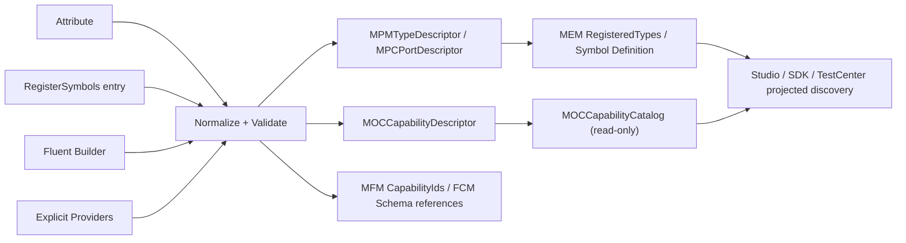

# CxVisual Symbol 体系 #3——便利注册、统一发现与能力中心协同 V2.0

> 日期 2026-10-31；**注册便利性是本体系核心工程质量目标**。上位《Decision #3 专业能力声明、注册及轻量接入 V2.0》已定“注解/Fluent/显式 Descriptor → 唯一归一合同”的方向。本文件仅补充 Symbol 类型与 Capability/资源/包的真实关联，**不建立 SymbolRegistry 或第二个能力中心**。
> 提醒：下文 `CxSymbolAttribute`、`RegisterSymbols`、`ISymbolRegistrationContext`、`UseTrustedAssembly`、`SymbolDescriptorAdapter` 均为**提议 SDK 语法/角色**，不是已存在 API。现有入口为 `IMPMTypeProvider`、`MEMEngineeringSession.RegisterTypes`、`IMOCCapabilityProvider`、`MOCCapabilityCatalog`、`MFMModuleDescriptor`。

## 01. 两条“注册”的真实含义
| 层面 | 注册对象 | 现有 Owner | 会否修改工程 |
|---|---|---|---|
| **可发现的类型/Capability** | 可信程序集/Provider 静态描述、MOC Capability | SDK 组合根 + MOC/Decision | 不应 |
| **安装到某 Project** | `MPMTypeDescriptor`、共享 `MEMSymbol` 或 MTI 资源包 | MEM/MPM/MTI | **会**，需用户权限、Revision/Undo |
| **运行绑定** | 能力版本、实现 Resolver、配置/设备资源 | Host/MRK/专业 Owner | 不应把结果写回工程 |
| **实例使用** | `MRIResourceReference` + 覆写/绑定 | MEM/MRI/MTC | 会 |

**不可合并**：浏览“可注册类型”≠执行 `session.RegisterTypes`。当前该方法实际执行 `Edit("注册工程类型", revision, ...)`，因此 Discovery 阶段不能偷调用它。

## 02. 最终体验：一个入口函数、可选注解、复杂 Provider
目标对开发者尽量简短而不牺牲一致性：
- **入口函数优先**：一个专业程序集/方案声明一个导出入口 `RegisterSymbols(...)`，同一次注册可提供多个 Symbol Type/模板/关联 Capability。
- **注解可选**：简单 CLR 类/属性/端口用少量 Attribute 声明；入口也可选择白名单程序集做只读注解解析。
- **Fluent 可选**：复合模板/动态数据端口配置使用 Builder，但最终生成的还是 `MPMTypeDescriptor`/`MOCCapabilityDescriptor`。
- **显式 Provider 必有**：有状态/Native/跨进程/实时设备必须走 `IMPMTypeProvider`、`IMOCCapabilityProvider`、必要时 `IMRKCapabilityResolver` 及专业配置/权限，不靠反射猜实现。
- **纯图形不必代码注册**：Group 提升和 Studio 规则作者直接创建共享 Definition；可选以后提取成模板/包。

## 03. 现有 API 的正式路径（可核对编译源码）
```csharp
// 存在于 Mechanism.Core 工程类型 API
public interface IMPMTypeProvider
{
    IEnumerable<MPMTypeDescriptor> DescribeTypes();
}
// 真实 Project Session API
// session.RegisterTypes(trustedTypeProvider);  // 会产生工程 Edit/Revision
// session.RegisteredTypes;
// session.FindType(typeId);
// session.AddTypedSymbol(name, typeId);
// session.PlaceSymbol(page.RootContent, symbol, name);

// 存在于 Mechanism.Decision 的能力描述 API
public interface IMOCCapabilityProvider
{
    IEnumerable<MOCCapabilityDescriptor> DescribeCapabilities();
}
// new MOCCapabilityCatalog(providers);  // 离线，不解析 Runtime
// catalog.Find(capabilityId);
// catalog.Search("motor");
```
`MFMModuleDescriptor.CapabilityIds` 用于模块与 Capability 只读关联；真正执行绑定在 Runtime 的 `IMRKCapabilityResolver`。以上路径**并不自动建立** Type ↔ Capability 的强关联，新的 Symbol 入口必须显式表达该关系。

## 04. 三种作者写法（候选 SDK，非现有方法）
### 4.1 推荐：一个显式入口
```csharp
// 【提议语法】传入的是短命注册 Builder，不是全局 ServiceLocator。
public static void RegisterSymbols(ISymbolRegistrationContext context)
{
    context.Symbol("factory.hmi.motor", version: 1, name: "电机")
        .Property("Caption", valueKind: "String", isPublic: true)
        .Input("Running", typeId: "boolean")
        .Input("Alarm", typeId: "boolean")
        .Event("StartRequested", typeId: "motor.start.request")
        .BindCapability("StartRequested", "factory.motor.start", version: 1)
        .VisualDefinition(BuildMotorRootGroup)
        .Build();
}
// 已批准宿主明确调用 RegisterSymbols(context)，单次批量提交描述。
```
API 在定名之前要求：无 `RegisterSymbols` 的“全局静态变量调用”；方法调用可纯做描述组装、不得在注册回调里打开 PLC/访问不受限文件/启动线程；错误收集必须返回每条 Type/Capability 的位置/原因。

### 4.2 最少注解 + 可信白名单
```csharp
// 【提议 Attribute，不是已发布 API】
// [CxSymbol("factory.hmi.motor", Version = 1, Category = "HMI")]
public sealed class MotorSymbolContract
{
    // [CxPublicProperty("Caption", ValueKind = "String")]
    public string Caption { get; set; }

    // [CxInputPort("Running", TypeId = "boolean")]
    public bool Running { get; set; }
}
// 【提议宿主】DiscoverFromTrustedAssembly(typeof(MotorSymbolContract).Assembly)
// 只读反射元数据，不 new 类、不跑 static ctor、不扫描未知 DLL。
```
Attribute 不应被设计成大型配置 DSL；简单元数据可以注解，形状定义/复杂规则放入口函数/Builder，安全约束和运行资源来自专业 Owner。

### 4.3 复杂 Provider 显式组合
```csharp
// 【概念示例】一个专业对象可同时提供静态 MOC 描述与运行 Resolver。
// TypeProvider → 注册 MPM Symbol 类型；CapabilityProvider → MOC 发现。
// Actual execution: Runtime/专业 Host 绑定 IMRKCapabilityResolver。
// 禁止把 Delegate/设备句柄写进 Symbol Definition/MPM Descriptor。
```

## 05. 归一化合同：输入不同，结果唯一


**归一化至少核对**：
1. TypeId/CapabilityId 名称空间、版本、Owner/来源；保留固定项目 TypeId，不允许抢占 `core.*`。
2. 属性 MemberId、TypeId/ValueKind、默认值、Required/ReadOnly/公开性与约束；不把未知单位自动填默认。
3. MPC Port MemberId、Kind、Direction、Multiplicity、Contract 的单位/坐标/时基等已声明语义。
4. 显式 CapabilityRef 的版本、端口映射、数据/命令效果、配置有效条件、专业授权要求。
5. 与 FCMConfig Schema、专业实际 CLR 输入/输出及 Runtime `IMRKCapabilityResolver` 的一致性；无法证明的输出 Unknown，不能用 `object` 强制通过。
6. 重复 ID/同版本不同 Schema 立即拒绝；不同注册途径的**等价描述**可规范化到同一结果，但不得因重复扫描产生两个工程定义。
7. 所有配置值/路径/脚本只作为数据进入 MPM/FCM/MEM；不得把任意程序集句柄/Delegate 序列化为工程 Schema。

**唯一描述的 Owner**：规范化既有 MPM Type + MOC Capability + FCM Schema。短命 `RegistrationPlan`（候选）只用于 Preview/Validate/Commit，不能成为永久中央表。

## 06. 从“注册”到“可发现”的五阶段
| 阶段 | 动作 | 是否触发副作用 | 失败行为 |
|---|---|---|---|
| 1 Discover | 可信插件清单/入口的静态描述、已安装工程类型/资源、外部包只读元信息 | 不执行运行代码，不改 MEM | 缺元数据/未经信任只显示受限信息 |
| 2 Normalize | 将所有来源校验并归一到原 MPM/MOC/FCM | 纯计算 | 全量结构化诊断，重复冲突拒绝 |
| 3 Install | 经用户确认调用 `RegisterTypes`、`MTI.PreviewImport/Import` 或新建共享 Symbol | **工程 Edit** | Revision/权限/Schema 冲突拒绝 |
| 4 Instantiate/Bind | `AddTypedSymbol/PlaceSymbol/SetOverride`，建立 Content 公共端口绑定 | **工程 Edit** | 类型/Scope/连接拒绝 |
| 5 Publish/Run | Host 查 Resolver/能力版本/配置 Effective/Ready/授权 | **真实运行** | 不可用/未知/无授权不执行 |

### 6.1 只读发现的具体数据源
- **A 本工程**：`session.RegisteredTypes`、项目共享 `MEMSymbol`/资源、实例引用与逆向使用索引。
- **B 专业/系统**：白名单已加载专业 Provider 的 `DescribeTypes/DescribeCapabilities`、MFM 描述；不自动进入 Project。
- **C 外部包**：MTI 创建的**只读 Package Session**、来源/依赖/根类型/指纹；只在用户按“导入”时安装。
- **D 已发布组件库**：未来可能有跨项目仓库的制品清单，必须是现有 MTI/类型/能力描述的只读聚合，不能以插件商店替代工程 Store。
- **E 草稿/Group**：当前项目中待提升的视觉选区不是已安装 Type，需要显式 Commit 才成为共享资源。

## 07. 跨目录查询与 Symbol↔Capability 的索引
必须支持双向入口：
1. 搜索 `"Motor"`/专业类别/TypeId/来源 → 类型/本工程定义/包模板；卡片显示可创建、已安装、冲突/缺依赖等。
2. 选一个 Symbol 的公开 Event/Port → 根据**显式关联**检索可选 Capability；运行所需上下文经 Decision 过滤和解释。
3. 从 MOC Capability 的输入/输出/Category → 查“能展示/触发该能力的 Symbol”；若无显式映射，仅给**建议候选**，标注无法证明。
4. 从当前 Content/Port/Workbench 搜索 → 只读适配分数/原因码/修复动作、是否需要 Type/配置/资源/权限；不自动安装。

**查询结果必须区分两个维度**：`SourceKind = System / TrustedProvider / Project / Package / Template / Draft`；`ResourceKind = Type / Definition / Instance / Capability`。这两个维度是 UI 筛选，不强制新增永久 enum/表。

## 08. 版本、Schema 指纹与冲突
- `MPMTypeDescriptor.SameSchema` **当前对 Properties/Ports/Aspects 按下标逐项比较，顺序敏感**，且无通用顺序无关哈希；新增规范化指纹（成员稳定排序、类型/约束/默认值/端口声明/必要 Aspect 版本）只是**目标设计**，实施前必须对历史 Schema 顺序/版本兼容进行回归，不得把未来设计当现有源码行为。详见 [#8 A06](CxVisual_Symbol_08_真实源码审计与规格冲突_V2.0.md)。
- `MDCStaticCatalogSnapshot` 已提供 MOC 静态能力指纹基础，Symbol 不再自制另一个 Capability fingerprint。
- 同一 TypeId/SchemaVersion 由不同 Provider 给出不同合同 → 错误而不是“最后注册者赢”。
- 同 CapabilityId/Version 但运行 Resolver 签名/端口不同 → 构建/发布前拒绝；MOC/MRK 已有部分签名检查，应接入而非重做。
- 定义引用已固定版本但包更新：先报告引用影响、公共成员迁移和 Snapshot/Run 差异，用户确认后工程 Edit；在线不自动换版。
- 注册结果可以被 Studio 缓存成只读投影，但缓存必须标明 SourceVersion/ProjectRevision/CatalogFingerprint；不作唯一权威。

## 09. 开发便利性与安全的平衡
- 默认最低入门成本：一个 `RegisterSymbols`、每个 Symbol 一次 `Symbol(...)` 调用，属性/端口用稳定 MemberId；可以不写任何 Attribute。
- 现有专业 Provider 可以直接适配现有路径，无需为每个旧模块添加一个新基类。
- 每条 Entry/Attribute 的诊断展示**哪个文件/TypeId/MemberId/哪种冲突**；不要只有 `InvalidOperationException("failed")`。
- 对 DLL 的“发现”仅从显式用户信任/可验证清单/宿主安装出发；禁止系统目录广域扫描、随便执行 `Assembly.LoadFrom` 后调用未知静态代码。
- 跨多个专业的程序集即使包含 Symbol、Capability、Config，也不能在注册阶段去执行真实设备操作。
- 用户导入的 SVG/图片/资源包不会因为元数据写了 `CapabilityId` 就拥有执行权；只有可信 Host 明确绑定运行者。

## 10. 统一中心的界面与操作
沿用 `MPWModuleCenterControl` + Studio Symbol 中心的现有布局：
- 查询框搜名字/TypeId/CapabilityId/专业/标签；筛选“可用类型/共享定义/资源包/已发布能力”“已安装/适用/未知/失效”“仅当前专业”。
- 详情页展示：名称/来源/版本/预览、公开 Properties/Ports/主要值/行为、依赖/配置、能力关联、实例使用数、Schema/兼容信息。
- 操作：安装、创建定义、加入 Page/Content、绑定能力、编辑孵化、查看版本/依赖/测试，不是浏览时自动制造工程对象。
- 同一项目可被 Symbol 中心与模块中心双向链接；只读聚合不重复写 CapabilityCatalog。

## 11. 性能与一致性要求
- 可信插件仅在初始化/重新装载时解析元数据，异步/批处理不阻塞 Studio UI；缓存以不可变快照形式保存并有显式过期规则。
- 大批量 Provider 描述要有可配置上限和诊断，沿用 `MPMTypeDescriptor` 的 4096 成员预算与 MOC 当前目录能力上限；后续重定时先测量。
- **目标**：不同注册集合遍历顺序不应改变规范化 Schema 指纹/目录搜索结果。**当前 `SameSchema` 顺序敏感**，D2 必须先解决归一化与历史兼容；不能靠重新排序已有工程 TypeItems 隐式修复。重复输入不可产生不确定 ID 或部分工程修改。
- 工程安装冲突或 Revision stale 要重新 Preview，不能在同一 UI 流程吞异常再继续放置引用。
- UI 读目录不得执行设备检查；可用性/Ready/授权是有成本的分级查询，用户明确触发并保存结果时间/作用域。

## 12. 测试黄金与实施优先级（REG-01～REG-16）
| 编号 | 验收 |
|---|---|
| REG-01～04 | 两种输入写法产生相同 MPM/MPC/MOC 合同；同 ID/不同 Schema 拒绝；非法 core.* 拒绝；无 CLR 构造/设备副作用 |
| REG-05～08 | 仅浏览 Catalog 工程 Revision 不变；安装一次 Edit；两实例创建正常；外部包只读无写入 |
| REG-09～12 | Capability 有静态描述但 Resolver 缺失保持 Unknown；两个专业无 UI 硬编码；旧 Provider 保持兼容；CRC/Hash 稳定 |
| REG-13～16 | 旧 `CxVisionThresholdProvider` 签名一致；MHS Effective/设备权限门禁真实失败；错误码可追；大型目录稳定/限额 |

首选第一个切片：**一个可信入口函数 + 已有 MPM Type、一个 MOC Capability、Studio 搜索/放置/绑定、TestCenter 软件级证据**，再验证注解替代路径。不要先建设复杂插件市场或万能脚本引擎。

## 13. 正式裁决待核点
1. 入口 `RegisterSymbols(...)` 的宿主组合根/接口命名、公共程序集 Owner、可信执行隔离协议。
2. Attribute 可表达的最小字段、自动发现范围以及与已有 FCM Config Attribute 的去重规则。
3. Type↔Capability 关联应存为哪个已有 MPM/专业 Aspect/资源元数据，且如何由 MTI 安全迁移。
4. 数据类型/单位/坐标/时基从 FDT/MTU/FCM 何处推导，禁止为方便再建别名真源。
5. 目录搜索的 3 态/7 态如何分别投影，用户无证据时不可显示 Ready。

这些是**真实新增设计裁决点**，不是待用户重新确认旧有 MEM/Content 边界。
