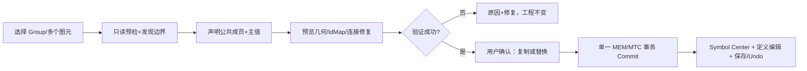

# CxVisual Symbol 体系 #4——Studio 孵化基地、Group 提升与创作流程 V2.0

> 2026-10-31；设计/实现指导，不冒称已交付。现有 `doc.symbol-center`、`StudioShell.SharedResourceCenters`、`StudioViewModel.Engineering`、`SceneView`、`MVIVisualEditor`、`MTCEditSession`、`MTI` 是优先复用点；不建设第二套编辑器/工程文档/Undo。
> 目标：软件开发者有一行入口；工程人员通过图形和属性面板自然创作；各专业按统一 Schema 提供 Editor；完整孵化可保存重开、版本化、测试、复用和审计。

## 01. 用户旅程：五个主操作，全部统一
| 旅程 | 原始输入 | 系统自动准备 | 用户必须决策 | 输出 |
|---|---|---|---|---|
| F1 提升 | 当前画布 Group/合法多选 | 捕获几何/内部声明/外部端点/依赖 | 名称、公开成员、替换/保留 | 共享 `MEMSymbol` + 可选实例 |
| F2 类型化 | 已注册 MPM Symbol Type | 默认属性/端口/形状模板/专业编辑器 | Name、实例源、必要配置 | 正式 Symbol Definition |
| F3 导入 | .cxproj 包、素材、可信模板 | 只读预览、来源/依赖、ImportPlan | 是否信任/如何迁移冲突 | MTI 资源/类型安装 |
| F4 无代码 | 空白画布/图库 | RootGroup 与编辑工具、模板建议 | 图形、公开成员、数据/行为绑定 | 可复用新 Symbol |
| F5 专业/脚本 | 专业组件说明/可信脚本/纯规则 | 解析描述/受限规则/静态类型检查 | 权限、参数、能力关联 | 专业可验证 Symbol/规则 |

## 02. Studio 信息架构（不拆既有 Shell）
```text
Studio Shell / AvalonDock
├─ 左侧：Project 树（Page / Content / Symbol资源）
├─ 中间：Symbol 管理中心（目录 / 本项目 / 包 / 类型）
│         └─ 打开 Definition 后复用现有画布编辑 Document
├─ 左侧或独立 Dock：对象树（RootGroup / Group / Element）
├─ 右侧：孵化 Inspector（七页签 + 根据当前专业显示附加页）
│         视觉 | 公共属性 | 端口/锚点 | 状态/行为 | 配置/脚本 | 资源版本 | 预览/测试
└─ 底部：变更影响 / 错误诊断 / SourceMap / 运行结果
```
普通操作默认只显示画布、常用属性、预览/发布；“高级端口/脚本/版本”折叠但可发现。所有入口的上下文同源：Ribbon、右键、菜单、快捷键、拖放只提供统一操作意图，正式事务交 MTC。

## 03. 一次完整 Group → Symbol 的七步交互

- **Step1** 检查选区同 Parent/Layer、是否允许 Group、锁/权限、当前 Resource/Instance Scope/Revision；选区可以是已有 Group。
- **Step2** 快照选区的 Geometry/Transform、MRC Style、MPM Property、MPC Port/Connection、MPM Aspect、资源/图片、内外绑定/事件。
- **Step3** 建议自动公开**跨选区边界**的成员和 Port；内部临时变量或外观私有实现默认隐藏，用户可精确调整名称/方向/类型/默认。
- **Step4** Preview 显示：RootGroup 内层级和局部/世界变换、旧选区变成新定义后的外观、实例 Placement、外部线路/接口映射、IdentityIdMap、丢失风险、依赖闭包。
- **Step5** 选择“复制创建”（保留原 Group）或“替换当前选区”（创建定义 + SymbolRef），不能为了自动化无确认重写现场页面。
- **Step6** 全部在一次既有工程 Edit/MTC 事务完成；任何异常保持旧数据/Revision/连接身份，Undo 一次还原。
- **Step7** 打开刚生成的 Symbol 定义编辑器，提供预览/测试，并可选择发布/加入库。

### 03.1 为什么不能直接调用 `ExtractReusable`
`MEMEngineeringSession.ExtractReusable(roots, MEMContent owner, name, ...)` 已有针对 Content 直属子对象提取共享 Content 的业务语义，**并非现有 Group→Symbol API**；Symbol 提升需附加 RootGroup/坐标补偿、Visual/Logic/Data 选择性公开、实例替换与外部 MPC 映射。共用 MTI 身份/迁移机制，但不能简单调用旧 API 并把结果强制转型。

### 03.2 内外端口提升详细场景
- 完全内部连接：随 RootGroup 子项迁入 Definition，依旧保持私有，不需要公开。
- 选区内与选区外跨边界连接：在 Preview 中标识外部端点及 MPC Kind/TypeId，用户选择 PublicPort/映射，保留外部 ConnectionId 或给出无法保留的明确诊断。
- 指向外部资源的 Bindings/Assets/Aspects：按 MTI 外部策略 Reject/IncludeClosure/Pin 处理；用户不能选择一个将来必断裂的“假无损”自动模式。
- 旋转/缩放/嵌套 Group：定义局部坐标与替换引用 Placement 必须使任意子图元的最终世界点不变（允许像素容差另列验收）；不能用简单重置 X/Y 代替变换矩阵。
- 被其它 Symbol/Content 已引用或包含运行态设备作用：转换前显示依赖及预期新引用，运行中应拒绝直接替换或需版本化重新发布。

## 04. 孵化编辑器七专题与交互结果
| 面板 | 最小直接可编辑内容 | 依赖系统与输出 |
|---|---|---|
| 视觉 | RootGroup/图元/图层/布局/形状参数/样式/文字/图片 | MRC/MVI/SceneView，正式 MTC |
| 公开合同 | Properties、主值选择、默认/只读、输入输出、Expose 内部成员 | MPM/MPC/MRCPublicMapping |
| 端口与锚点 | 端口身份、Kind/Direction/TypeId、Fixed/Outline/Free 几何 | MPC 描述 + MVI 几何服务 |
| 状态/行为 | Run/Alarm/Offline/Bad 颜色/动画/事件映射 | Visual Behavior + MVI Router |
| 配置/脚本 | FCM Schema/已生效版本/纯规则/可信 Provider 关联 | MHS/FCM、Decision/MRK 授权 |
| 资源/版本 | 来源/Type/Definition/实例清单/依赖/差异、导入/导出 | MEM/MTI/版本元数据 |
| 预览/测试 | 示例数据、多个实例、质量/权限/事件模拟、保存重开 | Studio + TestCenter 同源基建 |

面板基于可注册 Schema 和已有公共控件生成，不因新增 Vision/CT3D/Robot 专业就硬编码新的 Symbol 根类型；专业 Editor 可通过可信扩展槽声明自身能编辑的 TypeId/Aspect。

## 05. 端口与锚点的所见即所得
- 鼠标悬停图元展示四向快捷连接；选择“端口编辑”时出现真实公共 Port 和固定/浮动/自由 Anchor，二者按不同视觉编码。
- 绘制新锚点可以点击**真实轮廓**、输入局部数值、或选择自动求交策略；使用真实 Path/Arc/Bezier 计算，不能假设矩形外框即真实轮廓。
- Anchor 面板编辑方式：SelectPort → AttachKind → Local/Contour/Normal → Preview → MTC Commit；预览不得创建 Port/Connection。
- 端口连接合法性以 MPC Kind/Direction/Contract 为准；改变锚点位置并不改变 PortId。
- 当编辑实例投影时，未公开的定义内端口不出现“可直接连接”；提示进入 Symbol 定义或公开端口。
- 旧工程保持既有四向锚点行为；新增模式需要格式版本/加载回归与 100%～200% DPI 控制柄/连线验收。

## 06. 脚本与可视规则的“孵化”语义
建议按安全等级逐步开放：
- **R0 无代码**：状态颜色、显示隐藏、动画、文本格式/数据映射的声明式规则，无任意代码执行。
- **R1 受限表达式**：现有批准纯表达式/规则计算功能，类型化输入，预算/循环限制，确定性 Preview；无文件/网络/设备命令。
- **R2 可信 C# Provider**：软件开发者在受审工程中编写并发布，由真实专业/Host 绑定 Capability；Studio 只展示注册类型与配置，不同于任意用户贴代码即执行。
- **R3 外部脚本执行**：只有经新的独立安全、语言/隔离、资源/超时、签名与能力批准才能发布；V2.0 **不把该等级当已实现**。

对脚本映射要求：其输入输出必须投影为现有公开属性/端口，不能悄悄增加一份 `ScriptPortRegistry`；出错时指明行号/表达式、类型/数据质量、授权，并允许安全回退。

## 07. 类型/模板/能力来源的统一使用体验
| 来源 | 用户应看到 | 创建到什么 | 权限要求 |
|---|---|---|---|
| 工程内共享 Symbol | 当前定义、实例/引用数、版本 | 新 MRI 引用或打开定义 | 工程 Read/Edit |
| 注册 Symbol Type | 类型/Schema/示例预览/来源 | AddTypedSymbol 后 PlaceSymbol | 安装/编辑确认 |
| 外部 MTI 包 | 依赖/作者/SchemaHash/可迁移性 | PreviewImport/Import 后引用 | 包来源与依赖验证 |
| SVG/图片素材 | 图形内容/边界/格式/资产来源 | MRC Element/Asset，再创作 Symbol | 素材安全检查 |
| 专业模板 | 类型、关联 Capability、设备条件 | 创建 Definition/实例 + 引导配置 | 专业版本/资源/授权 |
| Group 选区 | 视觉 Preview、公开映射建议、IdMap | 正式 MEMSymbol 及可选实例 | 当前 Scope Edit |
| 注解/入口生成 | 原始 Type/Port/Capability 说明与版本 | 安装 Type→创建 Definition | 可信 Provider 准入 |

## 08. 预览、诊断和保存的一致性
- Preview 的永久数据**只读**；短命画布 DragGhost、Form 草稿、规则试算标记源 Revision/SchemaStamp，取消不增工程 Revision。
- 诊断分严重度：Blocking（不能无损提交）、NeedsChoice（用户必须决定）、Warning（可提交但专业副作用未准备）、Info（建议）。
- Commit 前重新核对 SourceRevision/TypeSchema/资源依赖/权限，冲突须重新预览；成功后一次 Undo/Redo 还原全部核心变更。
- 打开/保存/重开必须保留资源、内部 IdMap、公开映射、实例变换、AssetRef、CapabilityRef、附着策略；数据租约/Scene 投影/悬停和 Preview Ghost 不持久化。
- 发布给工程用户之前建议强制执行 G01 纯视觉 / G02 HMI Motor / 一个专业运行适配软件级负例。

## 09. Studio 的四种工作模式
| 模式 | 主要目标 | 不能隐式做的事 |
|---|---|---|
| Author | 编辑 Definition/Group/属性/端口 | 顺手改运行中的实例设备 |
| Bind | 给实例绑定 Content/MDS/Capability/专业配置 | 未经确认自动保存/生效配置 |
| Preview | 给模拟/样本数据，试算样式与行为 | 宣称实际设备执行成功 |
| Diagnose | 看编排/数据/权限/Trace/依赖影响 | 在 UI 绕过 Host 自动修复安全错误 |

Studio 应以画布与属性面板的*当前状态*切换模式，而不是复制四个独立 Editor 工程。Ribbon/上下文菜单启用状态同源于 Scope/Tool/权限/可用接口。

## 10. 使用者的真正快捷动作
- Group 右键“提升为 Symbol”，自动建立 RootGroup/默认值、按真实边界提示“有 2 个外部端口需决定”，用户勾选公开/名字后保存。
- 类型中心搜 `Motor`，一键“创建并放入当前 Page”；若没有工程类型安装，先显示确认和来源/依赖。
- 选中 Symbol 公共 `StartRequested` 端口，查看“绑定可用 Command/Capability”；同名候选多个时按类型/专业/版本排序并解释。
- 选实例 Caption 或变量，显示继承值、实例覆盖、运行值分别属于哪一层，并提供“恢复继承”。
- 一键“预览两实例”，注入不同样本数据和 Good/Bad/Unknown，验证视觉状态不串。
- 右键“查看受影响资源”显示引用/Content/配置/流程/可能的版本升级，不直接删除。

## 11. 交互错误和可访问性
- 连接工具优先端口、几何编辑优先 Bezier 控制柄、选区拖动优先 Group 变换，不能三个模式重叠出现误触发；以现有 `SceneView` 手势规则为基线。
- 画布世界坐标/视口 DIP/屏幕缩放需要区分，至少验证 Windows 100%/125%/150%/200%、多监视器、键盘 Esc/Undo/焦点/禁用状态。
- 对专业缺少 Editor 时显示只读 Schema 和明确原因，不崩溃、不自动反射未知 CLR 控件。
- 批量资源/长列表应虚拟化、渐进搜索；Preview 不冻结画布；性能阈值基于真实测试机测得而非虚构 FPS 指标。
- 错误只打印可复制稳定代码/真实对象 ID/SourceVersion，不输出敏感连接串与密码。

## 12. 本专题验收（UI-01～UI-20）
| 编号 | 目标 |
|---|---|
| UI-01～04 | Group/多选提升成功且不跳图、无损、可 Undo；非法选择拒绝 Revision 不变 |
| UI-05～08 | 类型化/包/模板/无代码创建都生成相同 MEM Symbol、RootGroup/公开合同 |
| UI-09～12 | 端口选择和真实轮廓吸附、自由位置、实例端口公开约束、连接 Identity |
| UI-13～16 | 两实例样本/质量预览、规则错误、脚本无权/资源预算、Version 影响提示 |
| UI-17～20 | 保存重开/切页/焦点/ESC/多 DPI/UIA、Studio/TestCenter 共享控件同源测试 |

## 13. 不做的重复建设
不新造 `StudioSymbolProject`、`SymbolGraph`、`SymbolUndoService`、`SymbolMpcConnectionStore`、`SymbolScriptRuntime`、`SymbolCapabilityCatalog`。工具/面板的增量仅接线到现有正式 Owner。
