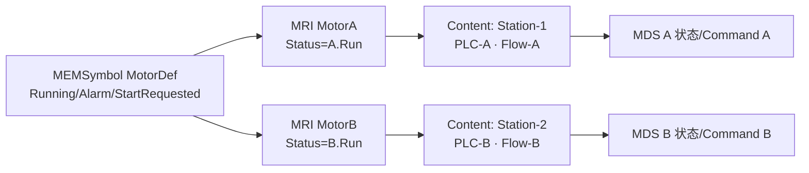
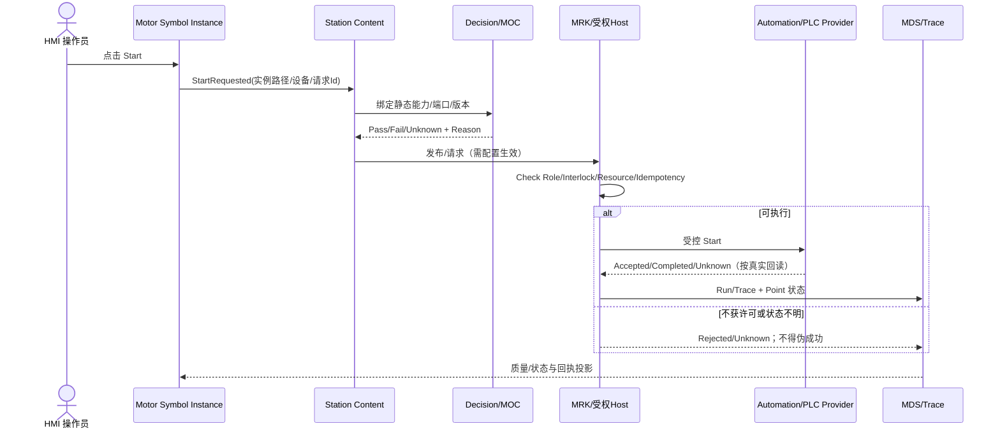

# CxVisual Symbol 体系 #5——Content、专业、编排与运行协同 V2.0

> 日期 2026-10-31；本文件是“**Symbol 为什么值得建设**”的最关键纵向合同。状态：目标设计，接口与实测等级分别以最新工程源和测试记录为准。
> 上位：工程组织 V1.2、统一功能模块 #0 V2.0、Decision #3/#4 V2.0、运行体系与专业规格；衔接 [#0 总纲](CxVisual_Symbol_00_总体架构与完整需求_V2.0.md)、[#1 对象](CxVisual_Symbol_01_对象模型与四方面_V2.0.md)、[#2 公开合同](CxVisual_Symbol_02_公开契约与数据行为_V2.0.md)。

## 01. 核心价值与六条跨体系不变量
- Symbol 为 Content/Workbench 提供“可见、可选、可操作、可绑定”的通用界面；**不要求业务模块依附 Symbol 才能被编排**。
- Content 是业务复用、逻辑 Scope、输入/输出和数据协同的主要容器；Symbol 只通过 `MRIResourceReference` 加入 Content。
- Symbol 与 Capability 是多对多的**显式关联**：一个复杂 Faceplate 可以请求多个已注册 Command/Capability；一个 Capability 可对应多个 Symbol/Content。
- 公开 Port/Property 是唯一穿越定义边界的合法接口；不允许在画布拖一根线后直接穿透内部私有子 Element。
- 过程执行在 MRK/专业 Host，编译/匹配在 Decision/MOC，运行数据在 MDS，配置生效在 MHS；Symbol 不造任何替代 Runtime/Cache。
- **可追踪地址**至少包含定义、实例链、公开成员、关联 Capability/Flow、运行上下文；跨页同名 Symbol 不可串结果。

## 02. Symbol → Content 的完整合同
| 操作 | 输入/输出 | Owner | 失败与补救 |
|---|---|---|---|
| 新建/引用 | Symbol DefinitionId → MRI SymbolRef | MEM/MRI | 类型不符、Definition 缺失必须拒绝 |
| 参数赋值 | Definition 公共 Property → Instance Override | MPM/MTC | 私有/只读/单位非法拒绝 |
| 数据接入 | Content Data/Variable → Symbol Input | MPM/MPC/MDS | 端口类型/Scope/质量诊断 |
| 事件/命令 | Symbol Public Event/Command → Content 协同/流程入口 | MPC/MOL + Command Owner | 未绑定/未授权显示 Unknown/Rejected |
| 流程调用 | Content 内的控制流/Capability 使用 | MOL/MOC/MRK | 校验失败映射至原 Content/Port |
| 运行反馈 | Run/DataRef/Message → Symbol 投影 | MDS/MNM/Visual | 超时/坏质量明确显示，不伪成功 |
| 版本影响 | 修改 Symbol Schema → 引用集和映射 | MEM/MTI/MOC | 提示受影响实例/流程并阻止自动破坏 |

**重要细节**：Content 的父子结构与 Context/Scope 是一套事实；画布排列顺序不等于流程顺序；Element 的视觉线路不等于 `MOLLink`；可视拖线是否是 Data/Control/Event/Visual 由 MPC 类型与专业语义决定。

### 02.1 示例：双电机共享定义

可验证条件：同一个 DefinitionId、两个不同 ReferenceId/InstancePath；`Running` 绑定不同变量；Definition 外观更新影响两个实例而实例参数和控制目标不交叉。

## 03. 统一发现如何服务 Content/专业/编排
1. **发现**：MOC 只读 Catalog 展示 CapabilityId、版本、MPC Ports；MEM 工程/包/注册类型展示 Symbol TypeId/资源，按稳定显式关联做只读 join。
2. **过滤**：Decision 根据来源端口、TypeId、方向/单位/坐标/时基/资源/权限已知信息，标注 Allowed/Rejected/Unknown 和原因；未知不补默认值骗过校验。
3. **选择**：工程用户将 Symbol 放入 Page/Content，或把 Capability 放入 Content/MOL；一方不一定自动创建另一方。
4. **绑定**：公开 Input/Output、业务命令及配置通过既有 MTC 编辑与专业 Binder，用户可以在 Studio 查看来源与依赖。
5. **编译**：MOC 读取版本化 `MEMContent Logic Aspect/MOL` 和关联元数据，输出静态 Plan 与 SourceMap；绝不修改 MEM。
6. **发布**：Host 校验 Schema/版本/Effective 配置/真实资源/安全与权限后装载 MRK；无 Ready/Authorized 仅能软件级或虚拟验证。
7. **观察**：Trace/Run/Data/MNM/配置状态投影给拥有该实例的 Symbol，不写回 Symbol 定义。

## 04. 四种关系分别表示，不能用“连线”一词代替
| 关系 | 定义示例 | 是否有执行语义 |
|---|---|---|
| VisualConnection | 两图元装饰连接（Visual Kind、几何锚点） | 无 |
| DataBinding/PortConnection | 变量、结果、参数、强类型输入输出 | 有数据移动/订阅语义，由对应 Owner 解释 |
| Event/Command Mapping | Click → StartRequested → 已授权命令目标 | 只有 Runtime Host 执行后才有副作用 |
| Content/MOL Flow | Acquire → Inspect → Decide → Report | 明确调度、等待、循环、异常、回写和 SourceMap |

**禁止**：把 RootGroup 中的装饰线变成 MRK 任务依赖；把 Symbol 内一个 `Start` 按钮直接绑定可被任意用户调用的 PLC SDK 委托。

## 05. 数据与配置闭环
- MDS Variable/Frame/DataRef/质量是运行对象；`MPMBinding` 存引用关系、缺失/Bad/Stale 处理策略，专业对图像/Volume 数据的租约仍由 FDT/FIM/Volume Owner 管理。
- FCM Schema 描述配置；MHS Saved/Effective/审计用于真实应用；Symbol 设置默认值、Instance Override 不等于已生效设备配置。
- 数据刷新、订阅、取消、视图关闭与 Run Generation 需保护异步回调；旧 Run/旧 Source 的结果不能覆盖新进程或新图像。
- 公开参数在 Symbol/Content 的输入输出中使用单一 TypeId/MemberId；单位/坐标/时基不等价不能自动转换，需明确 Adapter/专业 Provider。
- 对 GB 级图像/体数据仅传可验证数据引用/句柄/元数据与寿命，不复制到 Symbol JSON/XML 或 WPF 绑定对象。

## 06. HMI/SCADA Motor：用户动作到设备反馈（G02）

必须反证：无授权设备不动作；`Accepted` ≠ `Completed`；设备断线时 Symbol 不显示“已启动”；A/B 两个实例无交叉目标。当前 `PHMFaceplateAuthoring` 为可复用基础，但不声称该完整硬件链现已通过。

## 07. Vision ROI / Inspection：图像交互到检测结果（G03）
- **Definition**：ROI 边框/标注 Symbol，公开 `Geometry/CoordinateFrame/Enabled/ResultState` 等经上位 Schema 允许的合同。
- **Instance/Content**：把 ROI 放进某页/检测 Content；绑定图像 SourceId、专业算法的 ROI 输入、版本化检测方案。
- **编排**：`Capture → Preprocess → Detect → Measure → Review` 由 Content/MOL/MOC/MRK/专业 Vision Provider 组织，ROI 不是独立任务调度器。
- **数据**：运行结果引用包含 RunId/SourceId/坐标变换/质量；显示 Overlay 必须检查图像会话、原图/ROI 坐标/测量单位相符。
- **失败**：Source 被替换、Run 过期、ROI 非法几何、图像单位/标定未知、类型不匹配、输出无效，均需提示并阻止错误展示。
- **验收**：同一 Symbol 在两个图像 Source 上实例隔离，正确绘制结果；结果项目可回溯到 Content/Capability/Run。

## 08. CT3D：二维 Symbol 与三维 Viewer 的正确边界（G04）
- 目前 `MEMSymbol.RootGroup` 对应二维 MRC 视觉层；CT3D 的 Volume、Voxel、切片三维几何、GPU Scene 属专业 Volume Viewer/Geometry/数据租约。
- Symbol 可以做 Viewer 周边的 **MPR 控件、窗口窗位、工具状态、切面位置、标注、3D 操作入口**；真正的三维呈现由专业 `Viewer Provider`/Content Slot 引用。
- 不应因为希望“统一”就把 VTK/OpenTK 体数据、重建结果数组、相机 SceneGraph 硬塞为二维 `MRCElement` XML Payload。
- 公开 `CoordinateFrame/Spacing/WorldToVoxel/VolumeRef` 等必须复用真实专业类型合同和单位/校准/资源预算；不可用纯 string 隐藏不兼容。
- G04 负例：体租约失效、坐标系不兼容、Slice 与 3D 游标不一致、GPU资源耗尽、Viewer 未安装时应显示缺失及回退而非误绘。

## 09. Automation/运动和 Simulation（G05/G06）
- Automation：Symbol 表达状态、界面操作和报警，Content 组织设备/点表/任务与互锁条件；真实控制由 Driver/PLC/安全 Host 完成。
- Simulation：虚拟 Symbol 可以与真实 HMI 共用外观合同，但运行模式/仿真模型版本/种子/虚时钟必须明确，不自动将 Virtual 能力解析为 Real 控制入口。
- 运动场景：手动/自动、Start/Stop/E-Stop、复归/故障确认各是不同权限和物理结果；UI 色彩和按钮不承担安全认证。
- 交叉组合：同一面板显示真 PLC 的采集数据与 Simulation 预测值时要标注数据来源，禁止混为同一 `MDSVariable` 的真实回读。

## 10. Content 子流程、循环与 Trace（G08）
- 一个可复用 Content 可被两个父 Content 引用，内部多个 Symbol 共享定义但运行 Scope 各自独立；`DefinitionId`、`ReferenceId`、`InstancePath`、`FlowId`、`RunId` 必须分开。
- 内部 Loop/Foreach/Branch/Join 的执行语义由 MOL/MOC/MRK 处理，Symbol 只根据实例数据投影状态，不能用画面刷新推动下一步任务。
- SourceMap/Trace 必须从某次运行结果定位到具体 Content 实例链/能力/端口和对应 Symbol，而不是仅按可视名称匹配。
- 撤销工程编辑不追溯清除已发生的设备动作；Run 处于执行中需要版本锁与停止/重部署门禁。

## 11. 专业适配者接口责任（不假定已存在下述符号）
| 专业 Owner 要提供的内容 | 进入公共侧的最低合同 | 可缺省情况 |
|---|---|---|
| 实际能力 Provider | `IMOCCapabilityProvider` 描述，必要时 `IMRKCapabilityResolver` | 纯视觉不需要 |
| Symbol Type | `IMPMTypeProvider`/`MPMTypeDescriptor` | 只作为资源模板也可被导入 |
| 参数/配置 | FCM/MHS 类型化 Schema、Validator、Effective 语义 | 无配置的静态资源可无 |
| 数据适配 | TypeId/单位/坐标/数据质量/引用寿命 | 无数据可无 |
| 可视适配 | 现有 MRC/MPW 或专业 Viewer 插槽 | 纯能力可无 |
| 安全/模拟 | 权限/副作用/互锁/模拟适用范围 | 缺时不可声明生产就绪 |
| 诊断/测试 | CapabilityId、SourceMap、RunId、错误码、已知失败 | 不得以 UI 展示替代测试 |

专业 Provider 可声明多能力、多可视组件，也可同一个 Capability 为多个 Symbol 共用；不要要求一个项目/一个类/一个 Module 只对应一个 Symbol。

## 12. 导入/注册与工作台的闭环
1. 用户从 Studio 全局能力/模块搜索结果找到某 Capability；点击“可用组件”，看到匹配的 Symbol Type/资源/包及版本缺口。
2. 或者先选择一个 Group/Symbol，再从公开 Port 点击“匹配能力”；Decision 使用唯一 MOC 只读目录过滤，不创建工程。
3. 选择匹配后，在草稿中预览：要安装的 Type、要新增的 SymbolRef、要建立的 Content Port/绑定、要修改的配置；全部带 Owner/Revision。
4. 用户确认后分边界提交：工程 MTC 的原子事务、MHS 配置提交/生效、Runtime 发布分别拥有自己的状态；不能跨边界宣称单一“全局原子提交”。
5. 发布/运行成功后 Studio/TestCenter 查看同一 SourceMap/Trace/专业实际状态，发现失败能定位并返回对应孵化页。

## 13. 反例与禁止事项
- 把 Group 中箭头线保存为 `MOLLink`，执行顺序随图形摆放变化。
- Symbol 自身直接 new PLC/相机 SDK、把设备地址/密钥存在公开属性里。
- 未检 CapabilityId/Version/FCM Effective 就允许鼠标点击产生真实写设备。
- 一个共享 Symbol 定义按最后一次变量绑定更新，覆盖其它实例。
- “三维支持”=把 Volume 缩成图片塞进 RootGroup；丢掉体数据坐标与交互。
- 未安装 Provider 自动把所有端口变成无类型 object，静态匹配全部通过。
- 旧 Trace 只按 DisplayName 找对象，两个子 Content 实例定位错误。

## 14. 专题验收（INT-01～INT-20）
| 编号 | 目标与反例 |
|---|---|
| INT-01～04 | Content 两实例资源隔离、定义升级/覆写、公开成员失效阻断、嵌套 Content 地址正确 |
| INT-05～08 | MOC Catalog 与 Symbol Port 关联、单位/方向/版本 Pass/Fail/Unknown、只读发现无 Revision 改动 |
| INT-09～12 | HMI Motor 事件→受控 Host→数据回读，设备断线/无权/未知结果不显示成功 |
| INT-13～16 | Vision ROI/Inspection Source/Run 追踪；CT3D Viewer 适配、坐标失效与租约回收 |
| INT-17～20 | Automation/Simulation 虚实隔离，嵌套 Loop/Foreach SourceMap/Trace 定位，多专业 Windows/实机边界 |

**验收等级**：G0 静态合同、G1 软件级可执行、G2 Windows UI/跨进程、G3 设备 HIL/现场安全；对应证据必须分开记入 Testing，不能以 G1 替 G3。
