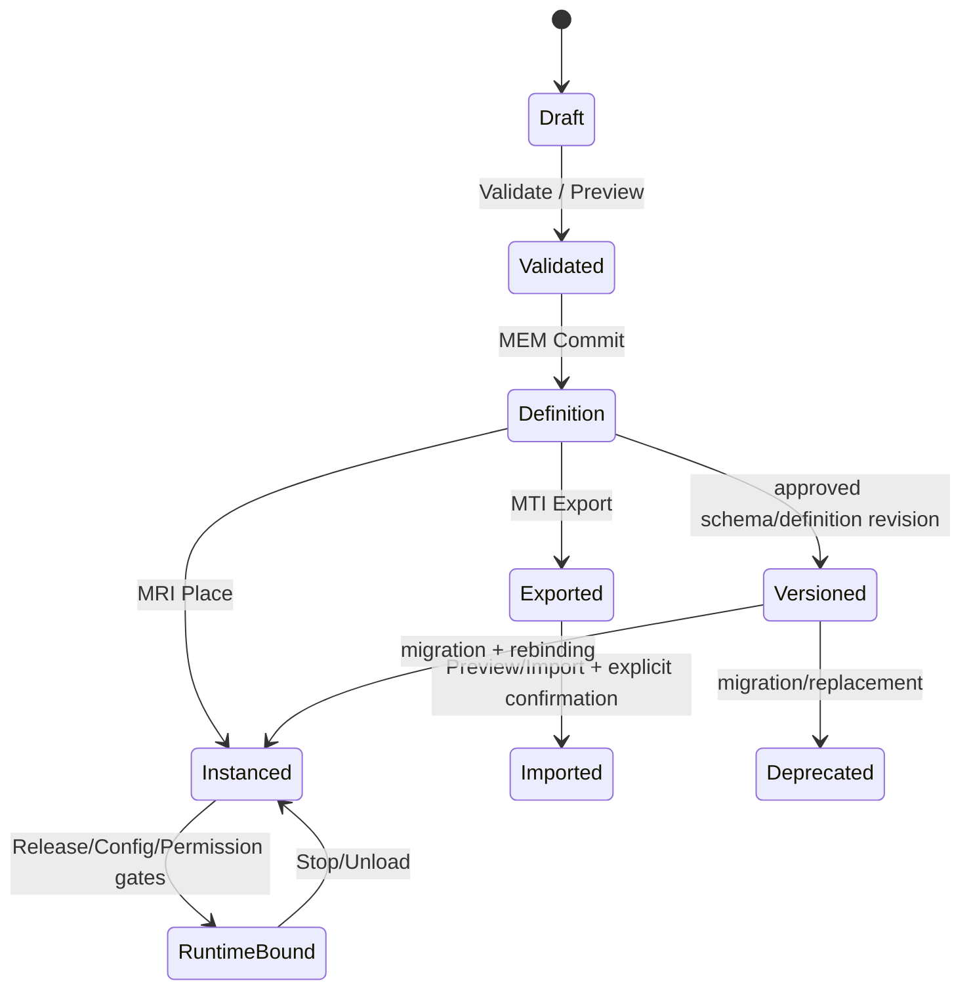

# CxVisual Symbol 体系 #6——资源库、版本、依赖、安全与迁移 V2.0

> 2026-10-31；**完整目标治理合同**，不等于跨项目在线市场、脚本隔离或全量版本迁移已经实装。上位 MEM/MTI/MRI、MPM/MPC、FCM/MHS、Decision/MOC、Runtime/专业安全各为原有唯一 Owner；本文件只定义它们如何共同约束 Symbol。
> 参见 [#0 总纲](CxVisual_Symbol_00_总体架构与完整需求_V2.0.md)、[#3 注册](CxVisual_Symbol_03_能力注册与发现_V2.0.md)、[#4 Studio](CxVisual_Symbol_04_Studio孵化与创作流程_V2.0.md)。

## 01. 六种资源状态不是一个“仓库”
| 资源形态 | 典型例子 | Owner 与操作 |
|---|---|---|
| 注册类型 | `MPMTypeDescriptor`、可信 Provider 的 Symbol Type | 描述独立于工程；`MEM.RegisterTypes` 后进入某 Project |
| 工程共享定义 | `MEMSymbol` / `RootGroup` / PublicMappings | Project 唯一拥有；Instance 只能引用 |
| 工程内实例 | `MRIResourceReference` + Overrides/Placement | Content 拥有，实例定制不污染定义 |
| 外部资源包 | `MTI.ExportPackage` 创建的工程/资源闭包 | MTI 只读加载、`PreviewImport/Import`，不直接执行 |
| 模板/图库 | 预制绘图、专业模板/类型说明 | 原 Type/MTI/专业来源的可追溯投影 |
| 运行制品 | MDS 数据、Volume/Image、Run/Trace/报告 | 专业/数据/Runtime Owner，不是 Symbol 定义资产 |

工程树不应显示外部包或类型描述为已经安装的实体；Studio 全局组件列表是**多源只读聚合**，不是另一个工程资源树。

## 02. 来源（Provenance）与制品契约
目标资源清单（**候选元数据语义**）应具有：
- OriginKind（System/TrustedProvider/Studio/GroupPromotion/MTIPackage/ProfessionalTemplate/ScriptPolicy）。
- Publisher/ProviderId、PackageId（若有）、Schema/ContentHash、TypeId/DefinitionId、版本、创建工具/来源 Commit 或包引用。
- 所需最低 Framework/相关专业组件版本、依赖资源/资产/Capability/配置 Schema、许可证或信任策略（若适用）。
- 扩展点/Provider 的可用性（静态描述、安装、已解析、Ready、Authorized 分开）。
- 更改记录/迁移映射/语义变更摘要与必要安全审查。

字段实际归属须先核对 DOCS/04 和 MTI 当前包元数据；不能为了显示来源就在 `MEMSymbol` 附带未裁决的长期 JSON 自由字段，更不能把认证材料/私钥写入工程。

## 03. 生命周期、发布与引用锁定

这些是**概念状态**，不是当前代码存在的单一状态机类。真正执行须在 MTC、MHS、Host 各自事务和版本门禁内完成；不要虚构一条跨工程、配置和设备的全局数据库事务。

## 04. 应明确分开的六类版本
| 版本 | 谁负责 | 变化风险 |
|---|---|---|
| Type SchemaVersion | MPM | 公开 Properties/Ports/Aspects 不兼容 |
| Symbol DefinitionRevision / 资源制品版本 | MEM/MTI | 外观/映射/绑定/子项变化 |
| CapabilityId + Version + 指纹 | MOC/Decision/专业 | 目标执行行为/端口变化 |
| MHS Saved/Effective Revision | 配置 Owner | 配置未生效/旧配置运行 |
| Plan/Runtime Release Version | Decision/MRK/Host | 计划过期/版本不匹配 |
| Data Run/Generation + SourceId | MDS/专业 | 旧结果覆盖新源/错实例 |

**不要使用一个 Version=1 字段掩盖全部版本差异。** 运行实例应该明确引用构建时确认的组件/能力/配置版本集合；无法确认则 Unbound/Unknown。

## 05. 兼容变更判定（必须含行为，不仅比较 JSON）
| 更改 | 默认级别 | 需要的处理 |
|---|---|---|
| 增加可选样式/文字/公开只读属性且有安全默认 | Compatible Candidate | Snapshot 差异和 UI 回归 |
| 新增强制 Input/Port、删除/重命名 MemberId | Breaking | 实例/Content/映射迁移及用户批准 |
| 修改 Port Direction/Kind/TypeId/Unit/Frame | Breaking | MOC 静态重校验及专业测试 |
| 改 Tooltip、非行为标签 | Usually Compatible | 内容版本更新；必要 UI 快照 |
| 修改 Click→Command 的目标或副作用 | Security Breaking | 安全审批、Plan/Host 重新发布、审计 |
| 变更 Group Transform/Shape 影响视觉连接 | Potential Breaking | 几何/线路对比及旧锚点兼容 |
| 资源删除或包依赖迁移 | Breaking | 反向引用集/MTI 冲突/回退 |
| 提升非公开脚本能力为可信运行 | Security Breaking | 独立签名/隔离/权限审评 |

以上是默认安全建议，实际专业兼容等级由相应 Owner 决议；破坏性变更不允许无提示静默覆盖工程内实例。

## 06. 依赖树与影响分析
- 使用已有 `MEMEngineeringSession.AnalyzeResourceImpact` 作为工程级依赖影响的真实入口，覆盖 DefinitionRef/Content/共享资源与相关引用。
- 需要补齐的 Symbol 专属依赖：公共 Port/Property 具体 MemberId、MPC Connection、CapabilityId/Version、FCM Schema/Effective、源资产/字体/图片、专业 Viewer/类型、脚本/规则引用。
- 影响是**只读报告**：受影响项目/Content/实例/Flow/Port/配置/Studio 页面、兼容性、可自动转换、必须人工干预、无修复路径。
- 缺依赖要继续可见且带 Diagnostic；不能因为某 Provider 不在本机便删除 Symbol 公共 Port。
- 大项目可采用快照/增量索引，但缓存不是第二真源；每份报告包含 ProjectRevision、CatalogFingerprint 与来源集合。

## 07. 导入、导出与迁移策略
1. **只读打开**：外部包浏览期间不能修改当前 Project，不执行脚本/Provider；显示清单/Schema/依赖/来源。
2. **预览**：调用 MTI `PreviewImport`，识别新 ID、已有引用、外部资源策略（Reject/IncludeClosure/Pin）、Unknown Required Aspect、版本与类型冲突。
3. **选择**：用户明确接受导入/包依赖/类型安装或拒绝；尽量不要自动升级在用 Symbol。
4. **提交**：现有 MTI Import/MTC 正式事务，重新映射 Definition/Group/Element/Port/Connection/Binding/Asset/Aspect；对无法重映射的 Aspect 应报错。
5. **验证**：保存/重开文件、实例覆盖、公共成员与可视路线、旧工程往返、Undo/Redo。
6. **发布与运行**：导入不等于获得 Provider 信任、配置生效、设备就绪或操作权限，Host 必须再次核验。

**格式演进**：对新视觉端点 Attachment、脚本元数据、CapabilityRef、PrimaryValue 等新增声明，Core/MTI 需明确版本、兼容迁移和快照语义，禁止 Studio 偷写未被核心识别的文件字段。

## 08. 信任与安全：由输入来源决定能力上限
| 来源 | 默认允许 | 默认禁止 | 升级条件 |
|---|---|---|---|
| 手工绘图/Group 提升 | 纯视觉/公开字段/无副作用规则 | 设备操作、文件/网络/Native 执行 | 显式绑定经批准 Capability |
| SVG/图片/字体 | 受限格式的静态资产 | 远程脚本/外链不受限加载 | 安全资产适配 |
| MTI 资源包 | 只读预览、Schema/资源导入 | 因包中 CapabilityId 就自动执行 DLL | 可信发布者、匹配 Provider/Host |
| 可信 C# Provider | 显式 Schema/Capability/运行实现 | 运行时跳过权限/副作用审查 | 正式 Host/App 审核 |
| Studio 纯规则 | 类型化状态/样式求值 | 反射/IO/多线程/未知代码 | 设计/安全审评 |
| 外部脚本 | 文本查看/签名验证 | 任意粘贴即在 Studio 主进程编译执行 | 独立沙箱/权限/限额/审计设计 |
| 真实 PLC/运动/X-Ray | 显示、受控 Command 请求 | 凭 UI 点击直接操作硬件 | 专业硬安全/联锁/回读与人工许可 |

**注**：给某组件贴“可信”“已签名”标签不证明实际代码已安全，也不替代设备自身硬件联锁。模型辅助生成的脚本也不能因来源为系统自动获准设备写入。

## 09. 密钥、隐私、资源和发布预算
- 设备账号/令牌/站点敏感数据不应作为 Symbol 公开 Property/包元数据；使用正式配置密钥和受控服务引用。
- Runtime 资源预算：脚本 CPU/内存/超时/事件速率、图形纹理/Asset 大小、数据 Buffer/Volume 句柄数量、对象数、嵌套引用深度、订阅/动画频率。阈值由 Owner 经实测裁定，不能直接写没有证据的性能数。
- 热更新/资源卸载必须考虑活跃 Run/订阅/数据租约/共享实例引用；出现无法确认的清理回执标 Unknown，不以“窗口关了”表示工作已停止。
- 不允许导入后远程拉取未固定版本的 Provider 自动更新；在生产使用中所有执行依赖必须可追溯固定。
- GitHub CI/软件模拟/现场 HIL 各有独立发布门禁；安全相关项需要授权现场负责人验收。

## 10. 跨工程共享与长期组件库
**第一阶段**：基于已存在 MTI 包/工程共享资源、正式 Type Provider、只读全局索引。用户可在项目 A 导出一个完整 Symbol 闭包，在项目 B 预览/安装/放置，依赖和身份可追踪。
**第二阶段候选**：集中制品库只提供包/类型/Capability 元数据、版本和下载缓存，实际导入仍经 MTI 与工程注册；不产生并行 Definition Store，生产机不得自动按最新版本拉取。
**第三阶段候选**：跨团队发布审核、弃用与兼容迁移、复现工具链；先用实际项目验证需求，不以“插件平台”名义增加工程数量。
**非常重要**：原工作区的 Symbol ID 不一定可以跨 Project 无冲突原样使用。复制时按 MTI IdMap 策略，外部 Pin 则必须验证同身份/Schema/内容散列。

## 11. 安全与治理反例
- 浏览第三方包时自动触发它的静态入口/脚本。
- 新增同名但不同 TypeId 的端口，运行时按字符串相同误连接。
- 上传资源覆盖既有版本，但不告知 100 个现有实例已失效。
- 连接线端点位置变化时每帧产生新 PortId，导致编排 SourceMap 崩溃。
- UI 将未配置/模拟/真实三类 Provider 统一显示为“可运行”。
- 一个 Symbol Definition 持久保存最新 PLC 回读值，导致第二次工程打开时显示错误设备状态。

## 12. 治理测试（GOV-01～GOV-16）
| 编号 | 验收 |
|---|---|
| GOV-01～04 | 资源身份/类型/实例不混；包只读不改 Project；MTI Clone/IncludeClosure/Pin 兼容；外部依赖断裂明示 |
| GOV-05～08 | 公共 MemberId 删除/类型变更阻断；实例影响查询；定义可回滚；运行版固定 |
| GOV-09～12 | 未知脚本/未知 DLL 不被执行；无权设备请求 fail-closed；敏感数据不落包；双实例数据隔离 |
| GOV-13～16 | 模拟与真实执行隔离、资源卸载、版本冲突、跨工程包与旧四向 Schema 往返 |

**具体运行证据**统一写 [Testing 验收矩阵](../Testing/CxVisual_Symbol_完整测试与验收矩阵_V2.0.md)；本文不写“所有用例已通过”。
