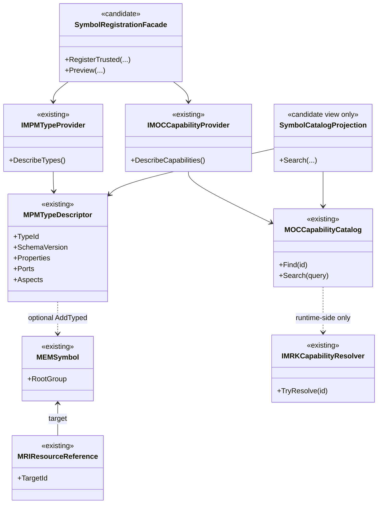
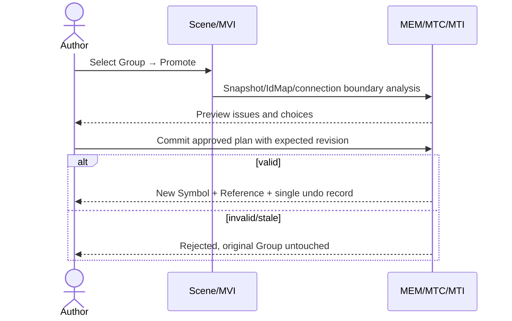
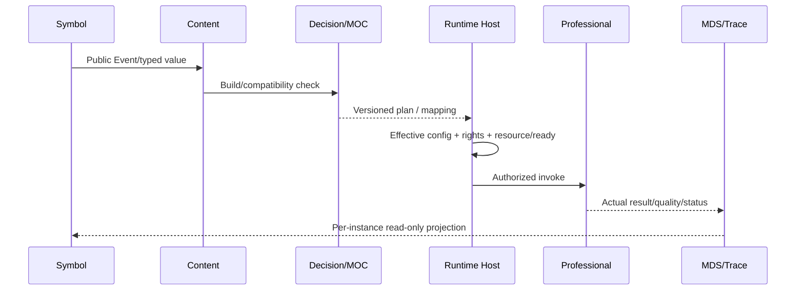

# CxVisual Symbol 体系 #7——完整对象视图、UML、Owner 与 API 合同 V2.0

> 2026-10-31；**指导实现的全类架构**。将“已存在”“建议增强”“候选新增”“不许新增”分开；不是把候选名称宣称为已编译的 C# API。新增类型前先逐表核查 DOCS/04 V6.4 对象 API 表与最新 master，并保持 26 工程的正式 Owner。
> 本文为 [#0 总纲](CxVisual_Symbol_00_总体架构与完整需求_V2.0.md)的工程反推专题，配合 [#5 纵向协同](CxVisual_Symbol_05_Content专业编排协同_V2.0.md)、[Implementation 台账](../Implementation/CxVisual_Symbol_实施任务与现状台账_V2.0.md)。

## 01. 设计方法：先列实际交互，再选对象
对每条 Case 按“用户动作→唯一工程真源→描述/公开契约→只读解析→授权/运行→反馈→失败→回滚”反推对象。优先为已有类型添加单一行为/结构，不为每个页面、职业、专业、Widget 增加一个管理器。

### 01.1 强制类归属审查
- Core/Engineering 对资源、定义/实例、MPM/MPC、事务与序列化负责；不依赖 Decision/Runtime/Studio。
- Mechanism.Visual 负责 Scene Projection、图形编辑、连接点几何/路由，不持久化新的工程对象。
- Mechanism.Decision 的 MOC 负责能力目录、静态规划/版本校验；不要在纯静态能力描述内持 MRK 具体委托。
- Mechanism.Runtime/Host/专业负责 `IMRKCapabilityResolver`、实际执行、Trace；专业硬件联锁在真实设备/专业 Owner。
- Mechanism.Data 与 Foundation 数据/几何/配置 Owner 提供真实值/坐标/类型服务；不受 Symbol 特例控制。
- Mechanism.Presentation.Wpf 负责可复用 WPF Editor/Viewer，Applications.Studio 负责创作流程与 UI 装配；TestCenter 复用同一核心而独立管理测试会话/证据。

## 02. 全类映射表：现有而必须复用
| 类型/族 | 物理位置（最新已核实） | 核心方法/成员 | 状态与本体系职责 |
|---|---|---|---|
| `MEMProject/MEMPage/MEMContent/MEMSymbol` | `Mechanism/Core/Engineering/MEMNode.cs` | `RootContent/RootGroup`、`MEMSymbol.References` 与资源拥有 | **现有**，共享定义唯一根；Symbol 的 MRI 引用记录不属于 RootGroup.Children |
| `MRCVisualItem/MRCGroup/MRCElement` | `Mechanism/Core/Engineering/MRCVisualItem.cs` | Transform、Properties/Ports/Aspects | **现有**，Composite 实体 |
| `MPMAspect/MPMAspectKind/IMPMDefinition` | `Mechanism/Core/Engineering/MPMDefinitionState.cs` | Visual/Logic/Data/Collaboration | **现有**，统一四方面 |
| `MPMTypeDescriptor/IMPMTypeProvider` | `Mechanism/Core/Engineering/MPMTypeDescriptor.cs` | `DescribeTypes`、SchemaVersion、Properties/Ports | **现有**，Type 元数据 |
| `MEMEngineeringSession` | `Mechanism/Core/Engineering/*` | `RegisterTypes/FindType/RegisteredTypes/AddTypedSymbol/PlaceSymbol/Edit` | **现有**，工程真实 API |
| `MPMPropertyDescriptor/MPMBinding` | `Mechanism/Core/Engineering/*` | 默认、公开、绑定类型 | **现有**，避免第二 Schema |
| `MPCPort/MPCPortDescriptor/MPCConnection/MPCEndpoint` | `Mechanism/Core/Engineering/MPCPort.cs` 等 | Kind/Direction/PortId/ConnectionId | **现有**，唯一端口连接真源 |
| `MRCPublicMapping` | `Mechanism/Core/Engineering/MPCPort.cs` | Property/Port Mapping | **现有**，穿越定义边界 |
| `MTCEditSession` | `Mechanism/Core/Engineering/MTCEditSession*.cs` | `DefineProperty/DefinePort/ExposeProperty/ExposePort/SetAspect/SetOverride/Connect/Reconnect` | **现有**，事务/Undo |
| `MRIResourceReference/MRIObjectAddress` | `Mechanism/Core/Engineering/*` | TargetId/InstancePath/Override/Placement | **现有**，引用实例 |
| `MTITransferPlan/MTIPackages` | `Mechanism/Core/Engineering/*` | `PreviewImport/Import/ExportPackage/ExtractReusable` | **现有**；Extract 仅 Content 语义 |
| `MFMModuleDescriptor/MFMModuleKind` | `Mechanism/Core/Modules/MFMModuleContracts.cs` | CapabilityIds、五模块类 | **现有**，Symbol 非 Module |
| `MOCCapabilityCatalog/IMOCCapabilityProvider` | `Mechanism/Decision/MOCCapabilityCatalog.cs` | `Find/Search/DescribeCapabilities` | **现有**，离线能力目录 |
| `MDCDecisionService/MDCStaticCatalogSnapshot` | `Mechanism/Decision/*` | 静态候选匹配、目录指纹 | **现有部分**，按阶段验收 |
| `IMRKCapabilityResolver` | `Mechanism/Runtime/Execution/MRKExecutionCompiler.cs` | TryResolve | **现有**，Runtime binding |
| `MVIVisualAnchors/MVIVisualRouting` | `Mechanism/Visual/Editing/MVIVisualAnchors.cs` | `At/OutwardNormal/Points` | **现有**，四向/路由 |
| `MVIVisualEditor/MVISceneProjection` | `Mechanism/Visual/*` | `ConnectVisual/ReconnectVisual/SetVisualRoute` | **现有**，定义级连接 |
| `MVIVisualEventRouter` | `Mechanism/Visual/Runtime/MVIVisualEventRouter.cs` | `Resolve/Dispatch` | **现有**，事件请求经 Host |
| `MPWModuleCenterControl/SceneView` | `Mechanism/Presentation.Wpf/*` | 只读能力视图、连接交互 | **现有**，共享 UI |
| `StudioShell.SharedResourceCenters` | `Applications/Studio/StudioShell.SharedResourceCenters.cs` | `RegisterStudioSharedResourceTypes` / 资源装配 | **现有**，三来源中心 |
| `PHMFaceplateAuthoring` | `Professional/HMI/PHMFaceplateAuthoring.cs` | `Place` 等 | **现有**，可作 Motor 黄金样本 |

> 路径末尾 `*` 代表文件族，不是已宣称的单文件名。读旧版 `Mechanism/Orchestration` 文档时，应以当前 `Mechanism/Decision` 物理目录为准，不能回退“Logic/Orchestration 分立”旧假设。

**必须补的源码边界**：`MEMEngineeringSession.CheckReference` 允许 `MEMContent` 与 `MEMSymbol` 拥有 MRI ResourceReference；`CheckEndpointScope` 对多级 InstancePath 直接连线拒绝。代码有此声明能力，不代表嵌套复合运行已验收。[#8 审计报告](CxVisual_Symbol_08_真实源码审计与规格冲突_V2.0.md)已将其列为 C01。`MPMTypeDescriptor.SameSchema` 当前顺序敏感；`ExposeProperty` 的 Text 内容映射仍存在真实缺口。

## 03. 候选最小增量类型/API（逐项设计，不全部立刻新建）
| 候选名（非最终签名） | 首选 Owner | 是否需要独立类 | 现有可复用与职责 |
|---|---|---|---|
| `SymbolRegistrationFacade/ISymbolRegistrationContext` | 应用 composition root / 最小 SDK 接口（待 DOCS/04 裁决） | 可能仅静态 Facade+一个 Context | 将入口/Attribute/Fluent 编译为已有 MPM/MOC DTO；不持久保存注册表 |
| `CxSymbolAttribute/CxSymbolEntryAttribute` | 最小公共 SDK 元数据归属待决 | 最多轻量 Attribute | 仅声明/只读发现，禁止自动执行未知 DLL |
| `SymbolTypeCapabilityAssociation` | MPM/专业 Aspect/只读资源关联中择一 | 优先无新实体/使用现有声明 | Type ↔ CapabilityId/Version/公开 Port 映射 |
| `SymbolPromotePreview/Result` | MEM/MTC/MTI、MVI 计算分工 | 仅必要的不可变结果 | 现有 IdMap/TransferPlan/Impact 组合、失败原子性 |
| `VisualEndpointAttachment` | Core MPC 持久合同 + Visual 纯求解 | 需要小 DTO/枚举的可能性高 | FixedSide/FixedLocal/FloatingOutline/FreeLocal 和旧 Schema 兼容 |
| `SymbolBehaviorContract` | 先优先已有 Visual Behavior + MPM Aspect | 未证实缺口前不加 | 纯规则、事件、状态、类型化输出 |
| `SymbolCatalogProjection` | 现有 Studio/MPW 的只读 ViewModel | 不应持久/可内部私有 | Join MPM/MEM/MTI/MOC 元数据，防第二 Registry |
| `SymbolPublishDiagnostics` | MEM/MOC/MHS/Host 的统一只读结果组合 | 仅视图/DTO（必要时） | 明确 Install/Resolved/Ready/Authorized/Unknown 等独立事实 |
| `ProfessionalSymbolEditorAdapter` | 既有专业/WPF 扩展机制 | 复用已有接口优先 | TypeId/Aspect 到专业 Viewer/Inspector 的受信映射 |

新增 API 的必要条件：① 无现成方法/类型承载；② 有至少一条失败的真实用例；③ 确定单一 Owner；④ 旧工程/包迁移可证；⑤ 代码/测试与 DOCS/04 同步更新。

## 04. 禁止引入的平行类/系统
- `GlobalSymbolRegistry` / `SymbolCapabilityCatalog`：MOC 与 MEM 已分别拥有类型/能力真源。
- `SymbolGraph/VisualEdgeStore`：MEM/MPC/MOL 已拥有不同语义的持久化对象/线路。
- `SymbolExecutionEngine/ScriptRuntime`：Runtime/专业承担执行；受限规则须经批准计算 Owner。
- `StudioSymbolProject/StudioUndoManager`：Studio 不自有工程 Store/Undo。
- `SymbolConfigStore/SymbolDataHeap/SymbolMessageBus`：FCM/MHS/MDS/消息中心是唯一 Owner。
- 每个 Symbol 一套 `MotorSymbolRuntime/ValveSymbolRuntime` 的平台级派生链：需要专业差异时用类型化 Provider/Strategy，保留主干组合关系。

## 05. UML：合同、投影与执行分离

上图 SymbolRegistrationFacade 的命名/方法是**目标设计**，不能抄成实际 SDK 调用；实现前应拆分静态描述和运行解析依赖，保证 Decision→Runtime 不逆向引用。

## 06. 核心提议操作签名与不可变结果（概念契约）
下例只是**设计签名**，C# 现有方法签名以真实代码为准，避免诱导调用不存在的 API：
```csharp
// 【候选】只读输入输出 DTO，不直接向项目写入。
// SymbolRegistrationPreview Preview(
//     TrustedProviderSource source,
//     SymbolRegistrationOptions options,
//     MEMProjectSnapshot projectSnapshot,
//     MDCStaticCatalogSnapshot catalogSnapshot);
// Contains: SourceIds, TypeDescriptors, CapabilityRefs, SchemaFingerprints,
// Issues(Severity,Code,TypeId,MemberId), RequiredActions, BaseRevision.

// 【候选】Group→Symbol；核心仍通过原 MEM Session/MTC+MTI 事务。
// SymbolPromotionPreview PreviewPromote(
//     MEMEngineeringSession session, IReadOnlyList<Guid> selection,
//     SymbolPromotionOptions options);
// MTCEditResult<SymbolPromotionResult> Promote(
//     MEMEngineeringSession session, SymbolPromotionPreview validatedPlan);
// Invariants: one Undo, stale rejected, no partial IdMap/Connection/Aspect.

// 【候选】视觉几何仅在 MVI 计算：
// AnchorResolution ResolveAttachment(
//     VisualEndpointAttachment attachment,
//     MVISceneItem item, OptionalConnectionContext context);
// Must not create Port/Connection, must return failure for invalid contour.
```

### 06.1 Preview/Commit 的共同合同
| 字段/条件 | 注册 | 提升 | 导入 | 端点编辑 |
|---|---|---|---|---|
| BaseRevision/SourceStamp | 必需 | 必需 | 必需 | 必需 |
| Resolved Owner/Security | 必需 | 必需 | 必需 | 必需 |
| Type/Port Schema | 必需 | 有 | 必需 | 必需 |
| Asset/External dependencies | 有 | 必需 | 必需 | 有 |
| IdentityMap/ConnectionMap | TypeId 映射 | 必需 | MTI IdMap | 端点/PortId |
| Preview no side effects | 是 | 是 | 是 | 是 |
| Commit atomic within MEM | 是 | 是 | 是 | 是 |
| Full cross-Host atomicity | **不承诺** | **不承诺** | **不承诺** | **不承诺** |

对 `RegisterTypes` 当前返回 `void`、内部完成 Edit 的现实，要决定如何加入 Preview **而不破坏旧签名**：可以先在应用层纯预审已有 Descriptor，再调用原 API；若需要完整事务原子组合，在 Core Owner 评估增加一个高阶 Edit 包装，不能在 Studio 顺序多次写入并声称一次 Undo。

## 07. 边界成员与错误结果
- `ExposeProperty(definition, publicMember, targetAddress, targetMember)`：检查内部 Target 可寻址、类型匹配、公开性/重名/映射链；实例仅覆写公开可写成员。
- `ExposePort(definition, publicMember, targetEndpoint)`：方向/Kind/Type/Contract 和公开 PortId 稳定；Instance 外部连接不能直接引用内部私有 Endpoint。
- `Connect/Reconnect`：同一连接拥有一个 Id，端点可能由局部固定/轮廓浮动/自由附着；错误不能创建孤儿 Port。
- `SetAspect`：ProviderId/SchemaVersion/Payload/RequiresRemap/Required 的版本与重映射策略明确；未知 Required 不跳过。
- `RegisterTypes`：Provider 描述在 Edit 锁外枚举，重入/预算/同 TypeId 冲突拒绝；浏览不调用注册。
- `MOCCapabilityCatalog`：Search/Find 只读，`AvailabilityKnown=false` 表示未查询 Resolver，不是设备不可用。
- `MVIVisualEventRouter.Dispatch`：只发出已声明的事件请求给受权宿主，不自行宣称命令 Completed。
- `MRIResourceReference`：实例 Placement/Overrides 需与目标定义版本和公开 Schema 一致；删除端口先影响分析。
- 错误必须结构化，包含 Code/Severity/Owner/DefinitionId/InstancePath/MemberId/CapabilityId/Revision/RepairHint，允许未知但不得编造成功。

## 08. 三类时序：注册、提升、运行
### 8.1 注册（显式信任）
```mermaid
sequenceDiagram
  participant D as Developer/Trusted Provider
  participant S as SDK Composition Root
  participant M as MPM/MOC metadata
  participant UI as Studio read-only
  participant E as MEM Session
  D->>S: RegisterSymbols / DescribeTypes / DescribeCapabilities
  S->>M: Normalize+validate; no device code
  UI->>M: Search descriptors + source/version
  UI-->>D: Preview + diagnostics
  D->>E: Explicit Install + AddTypedSymbol
  E-->>UI: Revision / Definition
```
### 8.2 Group 提升（一次工程事务）

### 8.3 运行（不混淆按钮与设备）


## 09. 性能、线程与资源合同
- Core 工程编辑由 `MEMEngineeringSession` 当前事务/线程规则驱动；Provider 元数据枚举不应在工程 edit gate 内做长 IO；Widget 仅在 UI 线程处理短期交互。
- MVI 每帧路径/锚点投影尽可能避免修改 Core，必要使用局部缓存/脏矩形/空间索引，其失效基于 Revision/Transform。
- MOC 搜索缓存不可超过可信 Catalog/Revision/SourceStamp 的生存期；复杂匹配可异步但最终仍用最新 Stamp 再校验。
- MRK/设备 IO 不能由 WPF 直接同步阻塞；运行资源租约/取消/超时/背压由既有专业机制控制。
- 同一 Symbol 数百实例需要可验证的渲染/数据/端口独立性和性能基线，阈值由实测数据和设备环境决定，禁止虚构毫秒数。

## 10. 完整开发决策门禁
| 决策 | 需要的输入 | 产出 |
|---|---|---|
| API-01 类型注册 Facade 位置 | 当前 26 工程 DAG、MPM/MOC/FCM Owner | 最小公共入口、无反向 Runtime 依赖 |
| API-02 Type↔Capability 关联元数据 | MPM/MTI 的合法 Schema/Aspect | 正式单一归属、版本迁移 |
| API-03 Group→Symbol 事务 | MTC/MTI ExtractReusable/RootGroup 约束 | 一次 Undo、外部连接/IdMap 无损 |
| API-04 端点附着合同 | MPC 当前 Port/Connection/Store、MVI | Fixed/Floating/Free Schema 与旧线兼容 |
| API-05 专业 Viewer/Editor 注册 | MPW/专业 TypeId 与工作台 | 无硬编码专业分支 |
| API-06 脚本准入 | FCM/权限/Host/发布/审计 | 允许 R0/R1，R2/R3 独立审批 |
| API-07 完整版本/发布闭环 | MEM/MOC/MHS/MRK/MDS | Impact、Stamp、Run/Trace 与回退 |

## 11. API 专题验收（API-01～API-18）
1. API-01～03：老程序集引用/类名/NameSpace 不破，26 工程结构/Owner DAG 验证。
2. API-04～06：所有新 Descriptor 可生成原 MPM/MPC/MOC 描述；旧 Provider 黄金样例行为不变。
3. API-07～09：Preview/Commit 只读与事务不变量、ID 重映射/外部连接、失败回滚。
4. API-10～12：旧 Visual 固定线与新浮动/自由点、公开实例 Port、保存迁移。
5. API-13～15：C# Attribute/入口/Provider 同源类型校验、Capability 静态与 Runtime 签名、Host 真实拒绝。
6. API-16～18：多实例 SourceMap/Trace、跨专业 Viewer/大数据只传 Ref、Windows+TestCenter 反证。

## 12. 本文对 DOCS/04 的应用要求
- 开发时先读取 DOCS/04 V6.4 每个相关对象的目标 Sheet（至少 M01/M02/M03/M04/M05/M07/M38、MOC/Visual 相关归属）；给出 `ClassName/TypeKind/Owner/Base/Methods` 差异表，严格区分已核对源码和提议新类型。
- 任何候选进入正式代码前，应先验证在原 Core/Visual/Decision/Presentation.Wpf 中是否已有相同职责，复用现有前缀/项目命名，拒绝凭本文件候选名称重造新工程。
- 由于本次未能逐表解析完整 XLSX，此阶段**未对候选公共类型作正式类表签收**；实装的 S0 必先补齐。本文已能指导纵向需求和验收，但不能替代最终 Excel Owner 对齐。
