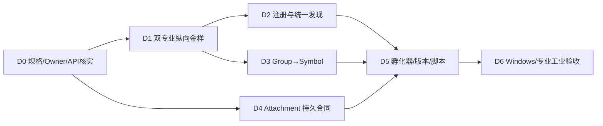

# CxVisual Symbol 体系 #10——需求→对象→Owner→源码→验收追溯与架构检查表 V2.0

> 2026-10-31；这是**架构完整性审查表**，不是进度美化表，也不是将所有候选都强制新增类。以 [#0 总纲](CxVisual_Symbol_00_总体架构与完整需求_V2.0.md)为需求真源，[#8 源码审计](CxVisual_Symbol_08_真实源码审计与规格冲突_V2.0.md)为现实边界，[#7 API](CxVisual_Symbol_07_全类UML与API合同_V2.0.md)为 Owner 合同，[#9 执行手册](CxVisual_Symbol_09_开发者指南与黄金案例执行手册_V2.0.md)为动作步骤。
> 状态说明：`Existing` 有可核实源码片段；`Partial` 局部能力存在但不成完整闭环；`Target` 完整能力尚需实现；`PendingADR` 需要跨 Owner 签收；`NotRun` 没有本次测试证据。仅改文档不得修改实施状态。

## 01. 核心需求全追溯

| ID | 用户真正要的结果 | 正式 Owner / 关键合同 | 当前程度 | 未来测试/金样 |
|---|---|---|---|---|
| R01 | 任意作者可从画图组合得到共享组件 | MRC Group/Element→MEMSymbol，MTC/MTI | Target | G01 T09～12 |
| R02 | 组件有自己的公开属性、端口、状态及交互 | MPM/MPC/MRCBehavior/Expose* | Partial | G01/G02 T13～15/21～25 |
| R03 | 注册好的专业能力不用改 Studio 硬编码即可发现 | IMPMTypeProvider + MOC Provider + 只读投影 | Partial | G02/G03 T01～08 |
| R04 | 简单开发者一个入口函数可注册多个 Symbol | 候选 RegisterSymbols → 现有 MPM/MOC | Target | REG-01～04 |
| R05 | 注解可减少普通类样板，但绝不导致任意 DLL 执行 | 可信 Composition Root + DTO Normalizer | PendingADR | T02～04/T28 |
| R06 | 系统/专业/Studio/导入/模板/Group 来源一致 | MEM/MTI/MPM/MOC/FCM | Partial | G07 T05～16 |
| R07 | Symbol 视觉绘图、变换与编辑方便 | MRC/MVI/SceneView/MPW | Partial | G01 UI-01～12 |
| R08 | 端点可在真实图元轮廓、固定任意点或自由点 | MPC 语义 + Visual Attachment + FGE/MVI 求解 | Target | G01 T17～20 |
| R09 | 端点变更不造成语义 Port/Connection 身份丢失 | MPC/MTC/MTI/Visual 路由 | Partial | T17～20/T41 |
| R10 | 同一 Symbol 在多 Content/Page 多实例隔离 | MRIRef + MPM Override + InstancePath | Partial | G01/G02/G08 T13～16/33～36 |
| R11 | Symbol 可表达视觉状态和 Good/Bad/Stale/Unknown 失效 | MRCBehavior + MDS + 专业数据质量 | Partial | G02/G05 T23～24 |
| R12 | Symbol 事件可触发专业能力但不能绕过授权 | MVI Router→Content→Host/MRK/专业 | Partial | G02/G05 T25～27 |
| R13 | 复杂子流程、循环、等待、恢复仍归 Content 编排 | MEMContent/MOL/MOC/MRK/SourceMap | Existing 基础，集成 Target | G08 T33～36 |
| R14 | Symbol 只读引用的专业数据具有明确 Unit/Frame/Time | MPC MTUContract + MDS/专业 Owner | Partial | G03/G04 T21～24 |
| R15 | HMI Faceplate 真正可显示不同设备状态并可安全操作 | PHMFaceplateAuthoring + 专业受权命令 | Partial | G02 T13～14/23～27 |
| R16 | Vision ROI 与检测过程/结果可追溯 | Vision Provider/FIM/Run/SourceMap | Target（Symbol 集成） | G03 T37 |
| R17 | CT3D Viewer 与二维 Symbol 正交复用 | 专业 CT3D Viewer/VolumeRef/MDS | Target（Symbol 集成） | G04 T38 |
| R18 | Automation/Simulation 支持真实与虚拟状态隔离 | PLC/Driver/Simulation/Host/MDS | Target（Symbol 集成） | G05/G06 T39～40 |
| R19 | 跨层 Symbol/Content/Capability/Module 身份不混 | MEM/MRI/MPM/MOC/MFM | Partial | G08 T33～36 |
| R20 | Symbol 可以持资源引用，但 Group 不获得业务孩子 | MEMSymbol.References/CheckReference/MRCGroup.Accepts | Existing API，策略 PendingADR | G08 T33～34 |
| R21 | 嵌套引用不穿透私有端口 | CheckEndpointScope/ExposePort | Existing 限制 | T21/T34 |
| R22 | 所有定义/实例/公开契约变更可撤销/版本迁移 | MTC Edit/MTI/Impact/Schema | Partial | G01/G07 T12/T15/41 |
| R23 | 导入包/脚本/能力描述不能自动提升真实设备权限 | MTI/MOC/MHS/MRK Host/专业 | Partial，集成 Target | G07 T16/T26～28 |
| R24 | 架构可复用在 HMI/Automation/Vision/CT3D/Inspection/Simulation | Type/Capability/Viewer Adapter + Content | Target | G02～G08 |
| R25 | Studio/SDK/TestCenter 三入口统一调用真实 Owner | MPW+Studio+MEM/MOC+测试夹具 | Partial | T29～32 |
| R26 | 支持发布/依赖/撤销升级/稳定 Schema | MEM/MTI/FCM/MHS/MOC/Host | Target | G07 T35/T41 |
| R27 | 能给架构师看懂全对象关系，给开发者按文件/类施工 | #0～#10、DOCS/04 类/API 表、真实源码 | Partial；Excel Pending | D0/API-01～18 |
| R28 | 工业安全、Windows 与实机验收不冒充 | CI + TestCenter + 专业 HIL | Target | G02/G05 T26～32 |

**要求**：凡新增 Rxx，必须同时指出至少一个 Owner、一个真实使用 Case、一个正例、一个失败例和一个验收编号；否则不得作为“完整设计已覆盖”。

## 02. 三种对象关联：能力映射不能混为一个引用

| 关联 | 源 → 目标 | 何时建立 | 永久真源 | 失效时 |
|---|---|---|---|---|
| Type→Definition | 已安装 MPM TypeId → MEMSymbol | Create/AddTypedSymbol | MEM/MPM | Type 未安装不可创建 |
| Definition→Instance | MEMSymbol.Id → MRIRef.TargetId | PlaceSymbol | MEM/MRI | 指向缺失定义应报错 |
| Symbol→Capability | PublicEvent/Port → CapabilityId/Version/PortMap（候选） | 专业/孵化绑定 | 待 ADR 明确 MPM/Aspect Owner | 可显示，但无法执行 |
| Content→Capability | MOL/Content Logic → MOC Description/Resolver | 编排构建/运行 | MEM/MOL + MOC/Runtime | 构建拒绝/运行 Unknown |
| VisualPort→Anchor | MPCPort/连接端点 → AttachedGeometry（候选） | 编辑锚点/连接 | Core MPC + Visual 纯求解 | 无法解析轮廓时不可连接 |
| DataBinding→ObservedValue | MPM Binding → MDS/专业运行数据 | 实例配置/运行绑定 | MPM 声明/MDS 运行 | Good/Bad/Stale/Unknown |
| UserEvent→Command | Visual Event → Host/受控专业能力 | 运行时经配置/授权 | 命令中心/Host/专业 | Denied/Unknown/Trace |
| Resource→Package | MEM/Assets/Schema → MTI 导出 | 发布与工程共享 | MTI/工程 Store | 未知依赖不隐式执行 |

**重要**：上一列“永久真源”不代表都写到 MEM；设备运行数据不属于工程文件。跨配置、工程和物理设备的“全局一次原子提交”不是本系统能够承诺的事务语义。

## 03. 生命周期状态判定矩阵

| 维度 | 可展示状态 | 判定依据 | 不可推断 |
|---|---|---|---|
| 类型发现 | Discovered/Unknown | 可信 Type Provider/包元数据 | 已安装 |
| 工程注册 | Installed/Missing/Conflict | MEM.RegisteredTypes/SchemaVersion | 设备能运行 |
| 资源引用 | Defined/Instanced/Broken | MEM Resources/MRI References | 配置已生效 |
| 端口连接 | Compatible/Rejected/Unknown | MPC/MTU/Decision 静态校验 | 运行完成 |
| 运行实现 | Resolved/Unresolved/NotChecked | MOC Catalog+Runtime Resolver | Ready/Authorized |
| 配置 | Saved/Validated/Effective/Unknown | FCM/MHS Owner | 现场联锁已通过 |
| 设备 | Ready/NotReady/Unknown | 专业 Owner 实际回读/时间 | User Authorized |
| 用户操作 | Authorized/Denied/Unknown | Host/权限/安全资源 | Completed |
| 动作结果 | Requested/Accepted/Completed/Rejected/Unknown | 专业回执/Trace、设备回读 | UI 动画就是完成 |
| 可视值质量 | Good/Bad/Stale/Unknown | MDS/专业 Data Quality | 0 == 断线 |

显示的“可使用”应由多个维度组成而非一个万能 bool；比如“可绘图/不可运行”，或者“可模拟/实机不可用”。

## 04. 需求驱动的开发优先关系（禁止画图先行掩盖跨层失败）

此图表达门禁的**依赖关系**而非每个团队必须完全串行；D0 所需的 DOCS/02～04 逐表审查不能跳过，D1/D2 可在 Owner 边界固定后分支并行。图元端点算法若不修改 MPC 永久格式，可与注册 SDK 的只读发现并行开展。

## 05. 架构检查清单（评审每个新类/接口时必须回答）

| 审核维度 | 必须回答 | 不接受的回答 |
|---|---|---|
| Requirement | 对应 Rxx/Gxx/Txx 哪些？ | “先有类再找需求” |
| Ownership | 哪个已存在项目和 Owner？是否与 DOCS/04 冲突？ | “新建 SymbolManager 比较方便” |
| Identity | Type/Definition/Instance/Port/Capability/Module/Run 哪个 ID？ | “用 DisplayName 查” |
| Persistence | 保存在 MEM/FCM/MHS/MTI 何处？是否已有相同字段？ | “WPF 临时 dictionary 也能保存” |
| Edit | 能否 Preview/Revision 检查/单次 Undo/失败回滚？ | “先改部分对象再处理错误” |
| Compatibility | 旧类型/包/四向/公开成员/项目怎样迁移？ | “新格式先不管旧项目” |
| Registry | 是否映射现有 MPM/MOC/MFM/FCM？ | “再建一个 SymbolCatalog” |
| Execution | 运行器/Host/专业 Provider 属于谁？ | “Symbol Click 调设备 SDK” |
| Security | 来源信任/权限/Effective/副作用/Fail-closed？ | “UI 按钮灰掉就安全” |
| Observability | 运行者的 SourceMap/InstancePath/Trace/Data Quality？ | “输出 log 字符串就够” |
| Performance | 规模/DPI/异步/数据租约/预算？ | “理论上 O(1) 所以没问题” |
| Evidence | 固定 SHA/测试命令/真实 CI/HIL 结果？ | “我看代码应该通过” |

## 06. 文档自身的完成定义与维护

- **总纲 #0**：仅权威总体需求/不变量/架构地图；不得逐次写 CI 成果。
- **对象 #1、合同 #2、注册 #3、Studio #4、协同 #5、治理 #6、API #7**：分别负责一个稳定的横向范围；其它专题只引用，不复制完整规则。
- **审计 #8**：事实与规格冲突，必须在主干代码改变时更新；历史 SHA 不能冒充实时状态。
- **指南 #9**：真 API 用例可执行；伪 API 必须标注 Proposed；持续添加可复制案例和失败反证。
- **矩阵 #10**：所有 Rxx/Gxx/Txx 的“需求→Owner→证据”索引；变更必须同步 Implementation 与 Testing。
- **Implementation**：唯一实际进度/Owner/commit/阻塞台账；**Testing**：唯一真实 Pass/Fail/NotRun 证据；**Decisions**：待批与已批裁决，禁止静默重决。
- 对于 DOCS/02～04 Excel，待完成的 Sheet/行差异追溯依 #8 和 D0 执行，任何新增公共类没有该核对不得算架构签收。

## 07. 四条最终红线
1. **不创建第二套工程组织、Capability Catalog、Runtime、Script Runtime、持久连接图、消息或配置真源。**
2. **不让视觉表达混同业务执行**：Group/线/动画 ≠ Content/MOL 业务流程及设备确认。
3. **不宣称“已实现”超出最新源码/固定 SHA 实测的边界**：纯文档通过 ≠ Windows/工业通过。
4. **不牺牲开发便利性**：真实作者可以一函数/一个 Provider/一个 Group 或一个 MTI 包进入，同样的系统底座完成检查、创作、复用与调试。
