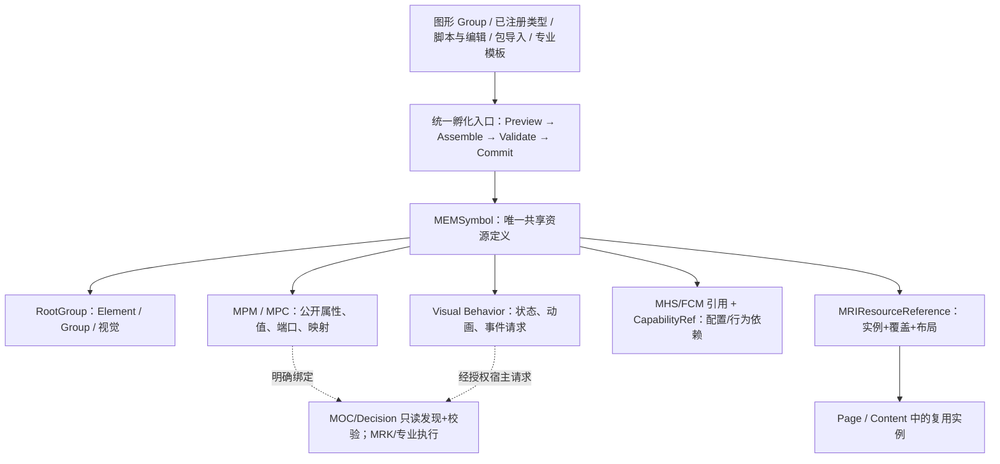
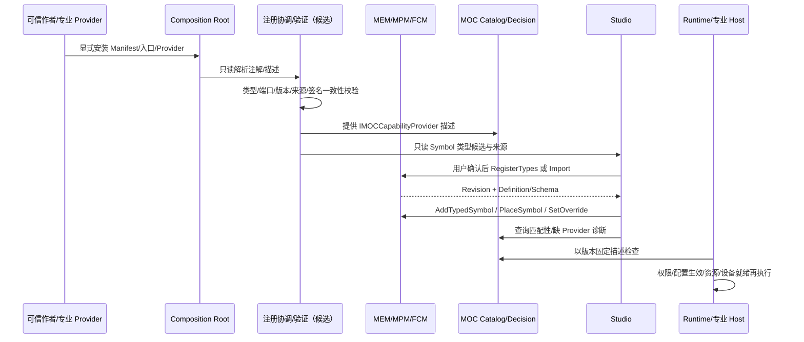

# CxVisual Symbol 体系——总体架构、能力注册发现、Studio 孵化与完整验收 V1.0

> **日期**：2026-10-31。**文档性质**：目标架构与实施合同（待负责人审评），不是已完成的源码/Windows CI/工业验收记录。
>
> **主题**：Group → Symbol 组件化；多来源创作；注解/入口函数/显式 Provider 一次接入；能力中心只读发现；端口/锚点；实例化、依赖、版本、运行安全、Studio/TestCenter 验收。
>
> **最高原则**：各方面都尽能力展现，便捷友好尽支撑各专业达到目标。
>
> **基线**：`AGENTS.md`、`.agents/skills/cxvisual-engineering/SKILL.md`、`DOCS/00`、`DOCS/01～04`、工程组织 V1.2、工程呈现化图元编辑 V1.2、Decision #3 注册 V2.0、统一功能模块 #0 V2.0、Studio Content/Symbol 双中心 2026-10-30 实装报告。DOCS/02～04 的 XLSX 具体类表在实际新增公共 API 前须逐 Sheet 复核。
>
> **当前源码事实截至审查时 master**：本文所有标识为 **现有** 的 API 已从仓库源文件核对；其余均标 **建议/目标**，不得据本文认为已经实装。并行开发变更应以实际落地前最新 master 再核。

## 00. 核心结论与不可突破边界（SYM-I01～I16）

1. **SYM-I01 单一工程真源**：`MEMProject / MEMPage / MEMContent / MEMSymbol / MRCGroup / MRCElement` 与 `MRIResourceReference` 继续是唯一工程对象/引用体系；不创第二套 SymbolTree、Graph 数据库、资源管理系统。
2. **SYM-I02 职责区分**：Group 是视觉组合；Symbol 是共享的视觉/呈现/交互组件定义（`RootGroup`、公开属性、端口、行为及引用）；Content 是可无视觉的多对象/多能力业务组合；Capability 是可发现、可调用的行为合同；Module 是五类运行/功能模块的身份，不等同 Symbol。
3. **SYM-I03 可无逻辑**：静态 Symbol 不必包含 Logic/数据/协同；复杂业务流程优先由 Content/MOL/MOC/MRK/专业 Provider 承担。Symbol 的状态/动画/交互不应因此被降成“只画图”。
4. **SYM-I04 单主要值**：遵守工程构建 V1.2 的 Symbol 主绑定语义（可为复合类型）；允许多个辅助属性、数据/事件/命令端口。此语义是目标增强，不表示已发布 `PrimaryValue` 字段。
5. **SYM-I05 一次声明，多处使用**：Attribute、注册入口、Fluent、显式 Descriptor 是不同输入方法，最终复用现有 `MPMTypeDescriptor`、`MPCPortDescriptor`、`MOCCapabilityDescriptor`、`MFMModuleDescriptor`、FCM Schema；不得分别写入互不一致的 Schema。
6. **SYM-I06 不建第二个能力中心**：只读聚合已有 `MOCCapabilityCatalog` / MFM / MEM 注册类型 / MEM 工程资源 / MTI 包 / 专业注册表的投影；Studio 的“Symbol中心”是孵化与使用入口，不是新的运行中心。
7. **SYM-I07 分离身份**：`TypeId`、`DefinitionId`、`InstanceId`、`CapabilityId`、`PortId`、`ConnectionId`、`ModuleId`、`RunId` 分开；显式关联，不根据同名猜测。
8. **SYM-I08 不靠反射执行设备**：发现不得扫描任意目录/未知 DLL 并实例化；对可信加载的插件仅提取元数据，注册入口仅在明确准入时调用；设备命令由授权 Host/专业 Owner 处理。
9. **SYM-I09 配置与数据分权**：声明/默认值在 MPM/FCM；保存/生效/审计在 MHS/配置 Owner；动态运行值/质量/帧在 MDS；Studio 不把实时值写回定义。
10. **SYM-I10 语义端口与视觉锚点不同**：MPC 端口有方向、类型、单位、复用身份；Anchor 仅是其可编辑/可计算视觉附着位置。改变几何不应重建语义连线。
11. **SYM-I11 精确审计**：能力已声明 ≠ 已解析 ≠ 可配置 ≠ 已生效 ≠ 设备 Ready ≠ 本次获授权。UI 显示原因码和证据。
12. **SYM-I12 复制与提升无损**：Group→Symbol 的坐标、样式、绑定、行为、端口、外部连接和内部 ID，必须先预览转换/映射，再原子提交或拒绝，不静默丢弃。
13. **SYM-I13 有来源与版本**：来自代码、Studio、脚本、导入、模板的资源有稳定来源、Schema/内容指纹、兼容策略、影响分析；不依据本机路径/类名自动发布。
14. **SYM-I14 渐进能力**：开发者可 L0 不注册直接画图/代码使用；L1 可发现类型；L2 可实例化/绑定/测试；L3 挂接已认证专业运行能力。最小使用不强制配置复杂工程。
15. **SYM-I15 Owner 清晰**：Core 持合同和事务、Visual 持几何/求解、Decision 持静态能力目录/匹配、Runtime/专业持执行、Presentation.Wpf 持共享 UI、Studio 持创作流程。
16. **SYM-I16 兼容优先**：老 Symbol、四向端口 `visual.north/east/south/west`、MTI 包、实例覆写、公开映射、MOL/MPC、旧项目往返不可破坏。

## 01. 现状核实：真正已有的可复用底座

| 真实位置 / 类 | 已有能力 | 必须说明的边界 |
|---|---|---|
| `Mechanism/Core/Engineering/MEMNode.cs` | `MEMSymbol`、唯一 `RootGroup`、资源引用/实例 | 没有自动“Group提升为Symbol”的完整操作 |
| `Mechanism/Core/Engineering/MRCVisualItem.cs` | Group/Element 层级、变换；图元可带属性/端口/Aspect/Binding | Group 不能直接当作已发布组件 |
| `Mechanism/Core/Engineering/MPMTypeDescriptor.cs` | `IMPMTypeProvider.DescribeTypes`、`RegisterTypes`、`RegisteredTypes/FindType`；类型包含 Properties/Ports/Aspects | 注册需明确调用；`RegisterTypes` 修改工程 Revision；并非全局零副作用发现器 |
| `Mechanism/Core/Engineering/MTCEditSession.Contracts.cs` | `DefineProperty/DefinePort/ExposeProperty/ExposePort/SetAspect/SetOverride/Connect` | 已注册能力并不自动生成可用交互 |
| `Mechanism/Decision/MOCCapabilityCatalog.cs` | `IMOCCapabilityProvider`、`MOCCapabilityDescriptor`、`Search/Find`、离线查找、三态中的 Known/Available | `RuntimeAvailable` 仅指 Resolver 可解析，非设备就绪/授权 |
| `Mechanism/Core/Modules/MFMModuleContracts.cs` | 五类模块、`MFMModuleDescriptor.CapabilityIds` | Symbol 不是第六种 Module |
| `Mechanism/Presentation.Wpf/Modules/MPWModuleCenterControl.cs` | 能力只读列表/过滤的共享 UI | 不拥有项目资源、注册表及运行实例 |
| `Applications/Studio/StudioShell.SharedResourceCenters.cs` | 本工程/外部包/注册类型三源、创建、导入、实例放置和覆写 | 没有跨源统一孵化、自动能力装配 |
| `Applications/Studio/StudioViewModel.Engineering.cs` | Symbol 创建实例性入口、Group/Ungroup | `CreateSymbol` 仍是 Rectangle + Width 示例级用户体验 |
| `Mechanism/Visual/Editing/MVIVisualAnchors.cs` | 四向矩形边中点，几何变换后重算 | 非任意轮廓点 |
| `Mechanism/Visual/MVIVisualEditor.cs` | 固定端口连线/重连，MPC 身份稳定，路由编辑 | `ConnectVisual` 目前要求可编辑的 Element 定义；实例端需要公开端口 |
| `Professional/HMI/PHMFaceplateAuthoring.cs` | HMI Motor/Valve 使用共享 Symbol、实例 Online 变量覆盖 | 仍有文本映射限制；不代表全部专业行为已贯通 |
| `Mechanism/Core/Engineering/MTIPackages.cs` | MTI `ExportPackage/PreviewImport` 和 `ExtractReusable` | `ExtractReusable` 目前针对 Content，不是 Group→Symbol |

> 与上位规范一致：Decision #3 V2.0 已把“注解/Fluent/Descriptor 归一 + 单次注册”定义为目标；当前仅 MPM 类型显式注册、MOC Provider 静态发现等切片存在。不要把拟议注解/脚本 API 当成已实现。

## 02. 总体模型：从 Group 到可使用的 Symbol



### 02.1 定义、实例与运行态

- **Definition**：拥有稳定 `DefinitionId/TypeId/SchemaVersion`、唯一 RootGroup、内部属性/端口/Aspects、公开契约、依赖及来源，属于 MEM。
- **Instance**：`MRIResourceReference` 存 TargetId、实例 Id、布局变换、公开成员 Override；不复制定义完整图元树。多个实例独立数据/绑定/追踪。
- **Runtime Projection**：从固定工程 Revision、配置 Effective 版本、运行上下文与 MDS 状态生成只读投影，永不把在线数据写回 Definition。
- **CapabilityRef**：建议用*对已有 CapabilityId/Version/Ports 的显式引用/映射*表达 Symbol 的事件与专业能力联系；不在 Symbol 中持久复制 MOC 描述/执行 Delegate。
- **静态 Symbol** 可只有图形；**交互 Symbol** 增加数据映射/状态/事件；**专业 Symbol** 关联外部 Capability；**复合业务** 交给 Content。

### 02.2 Symbol 的外部公开合同

| 维度 | 语义 | 使用现有基础 |
|---|---|---|
| `PrimaryValue` | 建议可选的主要数据/状态语义，支持复合 TypeId | `MPMProperty/MPCPort` + 描述元数据（新增字段需审核） |
| Properties | 名称、稳定 MemberId、类型、默认值、范围、单位、可读写、分组 | `MPMPropertyDescriptor` / FCM（不重复单位真源） |
| Ports | Data / Control / Event / Visual，方向、类型、基数、必填、关联身份 | `MPCPortDescriptor/MPCPort` |
| Bindings | MDS 变量/成员/资源引用，含质量和失效显示策略 | `MPMBinding` + MDS/专业 Resolver |
| Behaviors | 显示状态、动画、事件、请求命令/导航/触发 | `MRCVisualBehaviorDefinition`、`MVIVisualEventRouter` |
| Configuration | 定义参数、实例覆盖、配置保存/生效、权限/设备资源 | MPM + FCM/MHS + 专业 Owner |
| Dependency | 所需模型/图片/脚本/能力/专业 Plugin/最低 Schema | MTI/资源清单、MOC 只读匹配 |
| Provenance | 来源、作者/包、TypeId、Schema 指纹、内容版本、迁移记录 | MEM/MTI 的身份与快照为基础，增强需裁决 |

**规则**：内部图元属性默认私有；作者主动 Expose 或经有证据的向导建议后才能公开。`Text`/复杂值的映射能力先核对实际成员支持情况，不可假定已有。

## 03. 注册架构：多种输入，唯一标准合同

### 03.1 不新增全局 SymbolRegistry/CapabilityRegistry

物理上仍使用：
1. `MPMTypeDescriptor`：注册的是可新建的 Symbol *类型合同*；来自可信 `IMPMTypeProvider` 或拟议简写转换结果。已安装到工程后由 MEM 持久保存。
2. `MOCCapabilityDescriptor`：可执行/可编排能力的类型化元数据；来自 `IMOCCapabilityProvider`，在 `MOCCapabilityCatalog` 中只读检索。仅有关联行为的 Symbol 需要。
3. `MFMModuleDescriptor`：已存在五类模块身份与所提供 `CapabilityIds`；不强迫纯 Symbol 拥有 Module。
4. `FCM/MHS`：配置唯一 Schema、保存/生效和审计；专业配置声明应引用之，而非 Symbol 另起字段库。
5. `MEM/MRI/MTI`：真实 Symbol 资源定义、实例、包及依赖链。

**建议的便捷注册协调器**仅属于可信宿主/SDK **composition root**：将三种作者输入解析为上述既有 DTO 并验证后，分别交原 Owner；仅保留短命的只读查询投影，不持久化新目录，不增加 csproj。Studio 浏览类型时不得偷偷调用 `Session.RegisterTypes` 更改工程。

### 03.2 四种开发者入口 + 三种非代码孵化来源

| 接入方式 | 最佳用途 | 默认流程 |
|---|---|---|
| **A. Attribute 注解**（建议） | 简单类型、属性、端口、简明视觉组件 | 显式信任程序集 → 提取注解元数据 → 标准化校验 → 生成原 MPM/MOC 描述 |
| **B. 入口函数**（建议，首选开发体验） | 项目/专业批量组件、复杂初始化、自动生成标准组件 | 宿主显式调用 `RegisterSymbols(context)` → 声明多个 Symbol/Capability → 校验 |
| **C. Fluent / Builder**（建议） | 条件式参数、通用模板、函数委托、复杂端口关系 | 入口函数内链式声明 → 汇总到标准合同，不存独立 Builder 树 |
| **D. 显式 Provider**（现有基础） | Native SDK/多能力模块/设备/跨进程/高要求专业 | `IMPMTypeProvider`、`IMOCCapabilityProvider`、必要时 `IMRKCapabilityResolver` 分工 |
| **E. Studio 孵化** | 无代码画图、绑定规则、局部交互、草稿升级 | 工程中编辑草稿 → 预览 → MEM 原子提交/生成共享 Symbol |
| **F. 导入** | `.cxproj` 包、可信模板、图像/SVG 转图元、外部设计 | 文件适配/来源验证 → MTI `PreviewImport` → 用户确认 → 导入 |
| **G. Group 提升** | 绘图后组件化、保留旧工程场景 | 选区 → 内外依赖诊断 → 公开接口预览 → 定义+引用替换一次事务 |

*注意*：SVG 只导入图形，不会自动获得“可执行逻辑”；脚本/包导入只有通过专业信任和版本化装载，才可能产生可执行能力。

### 03.3 三种代码风格的拟议开发体验（下面均为目标 SDK 伪代码，非现有 API）

**A. 注解 + 显式可信发现**
```csharp
// 【拟议】只声明元信息；不得在扫描阶段构造类型或触发设备副作用
[CxSymbol("acme.hmi.motor", Version = 1, Name = "电机", Category = "HMI")]
public sealed class MotorSymbolSpec
{
    [CxSymbolProperty("Caption", IsPublic = true)]
    public string Caption { get; set; }

    [CxSymbolPort("Running", TypeId = "bool", Direction = MPCPortDirection.Input)]
    public bool Running { get; set; }

    [CxSymbolEntry] // 唯一约定入口，由显式白名单准入后调用
    public static void Define(ICxSymbolDefinitionBuilder b)
    {
        b.DrawGroup("MotorBody");        // 视觉构建结果归原 MEM RootGroup
        b.Expose("Running", "Lamp", "visible");
    }
}
// 【拟议】宿主显式注册“可信已加载程序集”，不会扫描磁盘任意DLL
symbolBootstrap.UseTrustedAssembly(typeof(MotorSymbolSpec).Assembly);
```

**B. 一个入口函数：最推荐有经验开发者**
```csharp
// 【拟议】入口是纯声明；不要求每个 Symbol 一个 CLR 子类
public static void RegisterSymbols(ICxSymbolRegistrationContext r)
{
    r.Symbol("acme.hmi.motor", 1, "电机")
     .Property("Caption", MPMValueKind.String, isPublic: true)
     .Port("Running", "bool", MPCPortDirection.Input)
     .Port("Alarm", "bool", MPCPortDirection.Input)
     .Visual("MotorBody", BuildMotorDrawing)
     .Expose("Running", "RunLamp", "visible")
     .Build();

    r.Symbol("acme.hmi.valve", 1, "阀门")
     .Visual("ValveBody", BuildValveDrawing).Build();
}
// 【拟议】应用组合根：RegisterTrusted(RegisterSymbols)
```

**C. 最小的现有 API 路径（确有真实 API）**
```csharp
// 已实现：使用 IMPMTypeProvider.DescribeTypes 返回 MPMTypeDescriptor
// session.RegisterTypes(provider);       // 显式工程编辑，会改变 Revision
// session.RegisteredTypes / FindType(id); // 只读查询
// session.AddTypedSymbol(name, typeId);   // 实例化注册的 Symbol 类型定义
// session.PlaceSymbol(owner, symbol, name); // 放置共享定义引用
// new MOCCapabilityCatalog(providers).Search("motor"); // 离线能力发现
```

#### 注解/入口设计的强制简洁规则

- 注解最少只写 **TypeId / Version / Name / Category** 和必须公开的 Property/Port；可以从 CLR/FCM 推导的数据不重复声明；与手写 Descriptor 冲突时**报错**而非猜赢家。
- 标记入口必须签名唯一、公共静态、受控参数；无入口的注解类型可以只生成静态 Schema，但不能伪造视觉图元/运行 Provider。
- 默认推荐显式调用 `RegisterSymbols`；Attribute 是减少模板代码的**可选语法**，不是每次打开 Studio 全磁盘搜索。
- 跨程序集仅通过安装清单/信任列表/显式注册入口发现；按程序集版本缓存元数据，不执行未知构造器/静态入口。
- Fluent 不增加第二套可持久化 Model；最终产物必须能够生成真实 `MPMTypeDescriptor` 及必要的 `MOCCapabilityDescriptor`。
- 所有这些样例要先经 Owner 审查、DOCS/04 类表查重，再确定真实前缀、命名空间与签名；不可直接按示例添加公共类。

### 03.4 注册与发现的两个阶段，不混淆



**分期**：
- **发现期**（无工程写操作）：枚举可信代码的描述、已打开包的只读清单、工程已安装类型/共享资源；即使没有 Runtime 也能显示 `Described`。
- **安装期**（工程事务）：用户选择类型/包，调用 `RegisterTypes` 或 MTI Import；保存 TypeId/Schema、依赖/来源/Revision，并显式返回冲突和迁移诊断。
- **放置期**：新建共享定义或引用实例，不把“选择目录条目”当作“执行模块”。
- **执行期**：专业 Host 匹配 CapabilityId/版本/配置 Effective 和授权；Symbol 只能向受信 Host 发起请求。

### 03.5 核心去重与版本规则

1. `TypeId + SchemaVersion` 与 `CapabilityId + Version` 是不同合同；若显式关联，要求在冻结元数据中记录方向、依赖、来源及一致性证据。
2. 同名但不同 ID 可以共存；同 ID/同版本但属性/端口不一致直接拒绝；同 ID/新版本需要兼容分析与用户确认。
3. 建议为规范化属性、端口、Aspect、类型、单位、默认值生成确定性 `SchemaFingerprint`，不依赖枚举次序、程序集路径或时间戳；`MDCStaticCatalogSnapshot` 已有静态目录指纹能力，应优先复用/对齐。
4. Instance 默认继承 Definition；仅公开、可写参数允许 Override。共享 Definition 升版时列受影响实例/公共映射/连线/专业绑定；不能通过“修改一处就让在线设备自动重启”。
5. 尚未安装/缺 Provider/缺插件/版本不符的 Symbol 应可只读显示和诊断；不能自动假装可执行，也不能静默丢属性。

## 04. 能力中心的发现体验：一个搜索，两个对象视图

建议在现有 **模块/能力中心** 加入“组件/资源”只读关联入口，与现有 **Symbol 管理中心** 双向跳转；允许按照 **能力** 找 Symbol，也允许按照 **Symbol** 找其关联能力，底层仍是同源投影。

| 查询入口 | 搜索结果 | 推荐动作 |
|---|---|---|
| 按名称/专业/TypeId | 注册类型、本工程 Symbol、外部包 Symbol | 预览 → 创建/安装/打开孵化器 |
| 按 CapabilityId/输入输出 | 可用能力 + 使用它的 Symbol | 看端口/约束 → 引用/绑定/转流程 |
| 按当前图形/选区 | 可提升 Group / 可兼容 Symbol 模板 | 提升、替换、升级、保持变换 |
| 按设备/变量/专业 | 满足已知类型、单位、质量、安全约束的组件 | 缺数据/未知标 Unknown，禁止假匹配 |
| 按包来源/版本 | 系统、可信专业插件、工程、导入资源、草稿、已发布 | 对比差异/依赖、固定版本 |

**只读卡片的最小字段**：Name、TypeId/DefinitionId、来源、版本、摘要、主要值、公开 Properties/Ports、预览、依赖、关联 CapabilityId、SchemaHash、可用性原因码。支持中英文词条/标签、收藏/最近、本专业过滤、拖入页面预览；不是“只列 DLL 名和全类名”。

**真实状态至少分**：`Discovered`（看到描述）→ `Installed`（工程有类型/定义）→ `Compatible`（静态匹配）→ `Configured`（配置绑定齐）→ `Effective`（生效）→ `Resolved`（实现可解析）→ `Ready`（真实运行者可用）→ `Authorized`（本次许可）；显示为多维事实，不假造一个简单绿色“已就绪”。未知以 Unknown 标示。诊断显示缺失的 TypeId/MemberId/CapabilityId/版本/资源/权限及修复动作。

**操作便捷性**：普通“创建”只需选择组件、预览、命名，默认属性可直接使用；高级选项折叠。导入成功可直接“创建引用实例”。生成/导入不可执行资源时不弹出虚假的“运行成功”。

## 05. Studio：Symbol 孵化基地（不是第二工程）

建议将 `doc.symbol-center` 保留为“目录与资产管理”；打开某个定义后使用已存在的资源/图形编辑器，补充以文档/状态驱动的孵化面板，避免另建工程保存与 Undo。

**七个面板/页签**：
1. **视觉**：RootGroup、Shape/Path/SVG/Widget、样式、布局、图层、响应式/旋转、Group 提升、预览。
2. **公开属性**：内部/公开列表、TypeId、主值、默认值、范围/单位、公开映射、分组、实例覆写。
3. **端口与连接点**：Data/Event/Control/Visual 分面；Port 身份/类型/方向 + Anchor 几何、连线约束、批量映射。
4. **状态/行为**：状态映射、质量坏值/失联、动画、事件→可信 Command/Capability 请求；复杂流程跳转 Content 编辑器。
5. **配置/脚本**：配置 Schema 引用、生效策略、表达式/规则、受控脚本/专业 Provider 绑定；缺执行者给诊断。
6. **依赖/版本**：定义/实例/包来源、依赖树、Schema 比较、版本升级、影响分析、导入导出。
7. **预览/测试**：样本值 Good/Bad/Unknown、点击事件模拟、两实例数据隔离、端口类型误连、Undo/Redo、保存重开、无授权负例。

UI 只缓存编辑手势与短期预览；真实提交仅 `MEMEngineeringSession.Edit(expectedRevision)`，复用 MTC Undo/Redo 与已有 MPW 组件。Symbol 模板/导入、现有 Group/Content/页面资源应复用统一导航、面包屑、定位与差异编辑。

### 05.1 Group → Symbol 的事务性提升合同

1. 选择同 Parent/合法图层的 Group 或图元，检查锁、实例投影、未保存修改和访问权限。
2. 计算保留世界几何/RootGroup 局部坐标的转换；复制/重映射所有 Visual/Binding/MPM/MPC/Aspect/资产引用与嵌套子项。
3. 以端点/绑定依赖图找出从选区穿越到外部的 Property/Port/Connection；列出“可自动公开、需要人工指定、不可无损”三种结果。
4. 自动建议公开属性/端口，但不可直接把所有内部数据变为 public；由作者明确确认主值、方向、类型、默认值和命名。
5. 对可变换的外部端点，以稳定公开 Port 映射替换；保留合法连接 ID；无法映射或行为闭包缺失时拒绝提交，不能悄悄断线。
6. 在**一次 MTC 事务**中创建 MEMSymbol/RootGroup、复制定义、写映射、放置 `MRIResourceReference`、保持位置/视觉、修复边界引用；成功一次 Undo 完全恢复，失败 Revision 不变。
7. Preview 包含 SourceRevision、IdMap、对象数、断线/绑定/脚本依赖诊断、实例影响与最终几何差异。
8. **不直接把 `ExtractReusable` 当作该 API**：现有提取只实现 Content 路线；在 MTI/MTC 原基础上实现 Symbol 专用语义。
9. “仅复制并创作 Symbol”与“替换原 Group”可作为两个选项；两者都需来源追踪与完整映射。

## 06. 连接点体系：语义 Port + 视觉 Attachment

### 06.1 已实现 vs 目标

- **现有**：`visual.north/east/south/west` 为本地图元**矩形边中点**、旋转缩放后求世界点；`ConnectVisual/ReconnectVisual` 生成/复用 MPC Visual Port；直线/正交/Manual Waypoint 已实装。
- **目标**：每条连接的每个端点可具有 **FixedSide / FixedLocal / FloatingOutline / FreeLocal** 附着策略（名称仅为候选），并可组合；FixedLocal 用自定义局部坐标，FloatingOutline 真实 Shape/Path/Bezier/圆弧轮廓重算，FreeLocal 允许不在轮廓上。
- **要害**：`MPC.PortId` 仍是语义端点身份；附着策略、坐标/轮廓参数属于相关连接端点或 Visual 描述，而不是在 WPF 中另外保存永久线头。
- **原则**：如果用户按轮廓上鼠标落点创建连接，按当前工具选择“吸附为固定轮廓点”或“沿轮廓浮动”；显式自由模式才允许真正脱离轮廓。

### 06.2 求解、兼容与 Symbol 实例

1. Geometry Owner 提供局部真实轮廓及合法参数；Visual/MVI 求局部/世界轮廓交点、法线、稳定排序和 DIP 容差；避免把任意形状用 AABB 假装精确轮廓。
2. Group、Symbol 根与子图元多层 Transform 正确合成；实例端由已公开 Port 的内部 Anchor 经 `MRIResourceReference.InstancePath + Placement` 映射到世界坐标，不允许直接连私有图元成员。
3. 视觉纯连线与 Data/Control/Event 专业连线应在 UI 区分颜色/类型/作用域，不因为能拖线就改变数据执行逻辑。
4. 保存时保留 PortId、ConnectionId、地址与稳定附着参数；移动、旋转、缩放、形变只触发投影重算；换端点需要既有 MTC Reconnect。
5. 兼容旧四向连接，不改变其默认语义；新增附着 Schema 在 Core Owner 复核持久化、MTI 迁移、复制 IdMap、未知字段拒绝/降级策略后落地。
6. 拖动中预览/吸附候选和永久定义分离；非法端点/无法求轮廓/退化路径/交叉冲突给出可读诊断，不创建孤立 Port。
7. 固定连接点、自由点、浮动点可独立测试；DPI/多屏、高缩放、Bezier/Arc/自交多轮廓与旋转 Group 必须有真实 UI 验收。

## 07. 数据、逻辑、脚本、行为与工业安全

### 07.1 Symbol 的行为分层

- **纯视觉层**：Style/Visibility/Geometry、简单状态机式显示、动画，主状态由只读 MDS/绑定求值；使用现有 Visual Behavior。
- **交互层**：点击/变化/拖动产生事件请求；`MVIVisualEventRouter.Dispatch` 需要受授权宿主，默认无 Host 返回 0；Symbol 不是执行 PLC/射线/运动控制的 Owner。
- **数据与规则层**：Member/Variable 绑定、纯规则/阈值/表达式，优先复用 MPM/已批准 MOL 表达式、数据转换与专业规则；不编造不可审核的通用 eval。
- **执行层**：需要采图、AI/CT 处理、工作流、资源租约、命令/消息时，引用真实 Capability/Content/专业 Provider，经 MOC/Decision 校验、MRK/Host 执行。Symbol 负责呈现/交互，不代替 Content。
- **配置层**：Definition 默认与 Instance Override 是两级；配置 Save/Effective/Version/权限归 MHS/FCM；实时帧与质量归 MDS。

### 07.2 脚本的可用范围与拒绝策略

- 首选**受限声明式规则**：表达式或表驱动的状态/样式/事件绑定；无文件/网络/反射/原生命令；在孵化器中可验证和预览。
- 可信 C# / 插件代码仅作为**审核发布的专业 Provider**运行；默认不允许从任意导入包中的源码即时编译并与 Studio 同进程执行。
- 如果未来开放脚本引擎，需明确语言、SchemaVersion、脚本内容哈希、静态分析、执行时间/内存/事件频率预算、权限/签名/隔离（必要时进程边界）、确定性与重放，以及失败后 fail-closed。
- 不把“脚本验证通过”误当 PLC/设备命令获准；真实副作用、幂等、授权、现场确认和 Unknown 结果仍归专业与 Host。

### 07.3 专业适配最低内容

| 专业 | Symbol 典型资源 | 明确依赖 |
|---|---|---|
| HMI/SCADA | 电机、阀门、仪表、趋势、报警、Faceplate | MDS Point/质量、MHS、受控命令、历史 |
| Automation | 功能块外观、设备状态、工位、机械动作控制 UI | PLC/Channel/Protocol、权限、联锁、MRK |
| Vision/Inspection | ROI 标注、检测状态/缺陷、相机状态、结果卡片 | FIM/专业 Provider、测量空间单位、结果引用 |
| CT3D | 体对象、MPR 控制、分割/表面状态卡片 | 体数据/坐标、GPU/内存资源、专业 Viewer |
| Simulation | 仪表/执行器代理、虚实状态切换 | 模拟模型版本、时钟、模式与能力契约 |
| 其他专业 | 通过同一 MPM/MPC/Capability 契约接入 | 不要求在 Studio 写硬编码分支 |

## 08. 关键对象/类归位（OOP / GoF / AOP）

| 角色 / API | 现有/候选 | Owner | 职责与防重复约束 |
|---|---|---|---|
| `MEMSymbol / MEMContent / MRCGroup / MRCVisualItem` | 现有 | Mechanism.Core | Composite 持有/引用；不改继承链 |
| `IMPMTypeProvider / MPMTypeDescriptor / MPCPortDescriptor` | 现有 | Mechanism.Core | 类型、参数、端口合同和工程注册 |
| `MTCEditSession / MTITransferPlan / MRIResourceReference` | 现有 | Mechanism.Core | 唯一事务、迁移/身份映射、实例 |
| `MOCCapabilityCatalog / IMOCCapabilityProvider` | 现有 | Mechanism.Decision（当前源码所在） | 只读能力目录与 Schema 查询；不执行 |
| `MFMModuleDescriptor` | 现有 | Mechanism.Core.Modules | 五类模块与能力关联，不造 SymbolModule |
| `MVIVisualAnchors / MVIVisualRouting` | 现有 | Mechanism.Visual | 可扩充真实轮廓/自由锚点求解 |
| `MVIVisualEventRouter` | 现有 | Mechanism.Visual | 命令请求按授权 Host 派发 |
| `MPWModuleCenterControl`、共享视觉操作控件 | 现有 | Mechanism.Presentation.Wpf | 同源只读显示/编辑操作，禁私有真源 |
| `CxSymbolAttribute` / `CxSymbolEntryAttribute`（命名候选） | 目标 | 拟经 04 对齐选定 Core/SDK 小合同 | 仅编写期声明、静态元数据，无执行权 |
| `ISymbolRegistrationContext`（命名候选） | 目标 | 宿主组合/SDK Facade | 将入口/Fluent/Attribute 转给**已有** MPM/MOC；非注册中心或数据仓 |
| `SymbolPromotionPreview/Result`（命名候选） | 目标 | Mechanism.Core/Visual 按职责拆 | 可重映射证明、提交结果，不复制 MTI 引擎 |
| `VisualEndpointAttachment`（命名候选） | 目标 | Core 有限持久合同 + Visual 几何求解 | 按原 MPC Connection 端点扩展，不造永久 Edge 表 |
| `Studio Symbol Incubator`（界面角色） | 目标 | Applications.Studio + MPW | 创作/预览/诊断，只调用正式 Session/Provider |

- **OOP**：Symbol/Group/Element 复用 Composite；实例通过 Reference 组合，避免扩展为继承出几百个设备 Symbol 子类。
- **GoF**：Builder 将便捷声明转为现有不可变 Descriptor；Adapter 接入导入格式/不同 Provider；Strategy 处理固定/浮动几何、绑定/样式；Command 通过既有 MTC 实现撤销；Observer/事件仅由现有 MDS/消息体系完成，不造第二总线。
- **AOP 横切**：注册/导入/发布的鉴权、输入校验、版本指纹、资源预算、审计、Trace、配置状态及失联回退是共性切面；由现有服务/宿主统一施加，Symbol 不能绕过。
- **新增公共合同门禁**：实际编码前逐项查 DOCS/04、当前 csproj 所在及仓库最新 Owner 决议；只增必要最小类，不为本设计表中所有候选新建类型。

## 09. 一致性、发布与兼容生命周期

1. **Draft**：Studio 临时创作，未发布；无运行副作用、可撤销。
2. **Registered Type**：可信提供者的 Schema 可发现；不意味着已有工程定义。
3. **Definition**：MEM 正式资源，可实例化、导出，保留工程 Revision/Id。
4. **Validated/Published**（目标等级）：公共契约、依赖、版本、跨专业绑定与必要安全审核通过；发布不等于直接运行。
5. **Instance**：引用已固定定义/兼容版本，独立参数、数据范围和连接。
6. **Runtime**：按项目、能力、配置 Effective/运行 Plan 版本固定执行；热升级应先影响分析、再获授权。
7. **Deprecated/Migrated**：旧资源只读可见，提供变更差异/迁移预览；未知 Aspect/缺依赖必须报告，不能静默清除。

**四种版本需分开**：`SchemaVersion`、`Definition/Package Version`、`Config Saved/Effective Revision`、`Runtime Plan/Capability Version`。来源清单只记录稳定可复核的身份/哈希，不将本机工作目录当依赖身份。

## 10. 可实现的阶段工作包（不重做现有工程）

| 阶段 | 具体交付 | 必过门禁 |
|---|---|---|
| **S0 对齐与审计** | 对齐 DOCS/02～04、MEM/MPC/MVI/MOC、Studio/TestCenter，冻结术语/接口和当前 SHA | 源码事实清单、旧四向与已注册类型黄金测试 |
| **S1 轻注册和统一发现** | 一次 `RegisterSymbols` 便捷入口（含最小 Attribute 可选）、规范化原 MPM/MOC 描述、只读搜索/来源、诊断 | 真实第二专业不用改硬编码 UI；目录/工程注册/运行签名一致 |
| **S2 孵化与 Group→Symbol** | 选择 Group、预览依赖/公开属性、原子提升为 Symbol/引用、编辑与保存 | 复杂 Group、嵌套变换/边界连接、Undo/Redo/复制/包往返无损 |
| **S3 端口和连接点** | 公开端口/自定义 FixedLocal/FloatingOutline/FreeLocal、精确几何重算、实例连接 | 旧四向兼容、旋转 Group/Path/Bezier、多实例连线保持身份 |
| **S4 行为/脚本/专业** | 视觉规则、数据质量/配置、生效、事件授权、真实 Provider 绑定、可信脚本路径 | 无授权不执行；好/坏值和控制结果可定位；真实专业 Owner 验证 |
| **S5 库/版本/工业验收** | 导入/发布/依赖变更、差异迁移、规模/性能、跨 PC、HIL | 固定 SHA Windows CI + UIA + 实机证据分别列出；无硬件不得宣称通过 |

### 10.1 可执行验收矩阵（SYM-T01～T32）

| 编号 | 反证/正证 | 完成标准 |
|---|---|---|
| T01–T04 | 单入口/注解/显式 Provider 注册同一类型；重复/冲突/超预算 | 同一 Schema 一致、冲突拒绝、无未知 DLL 扫描 |
| T05–T08 | 离线无运行者搜索；安装/浏览不混；跨专业查询；目录更新 | Discover 不改 Revision；Install 单次事务；Unknown 可见 |
| T09–T12 | Group 提升含嵌套变换、Style、Binding、Aspect、Port | IdMap 完整、视觉不跳、外部连接保持、不可无损拒绝 |
| T13–T16 | 同 Symbol 两实例不同 MDS/配置、公开属性覆盖、包导入导出 | 定义不被污染；保存重开/Undo/Redo；未公开不可覆盖 |
| T17–T20 | 四向旧线、任意固定、轮廓浮动、自由点、固定/浮动混接 | 端口和连线 ID 稳定；圆/三角/Bezier 真轮廓；旧 Schema 往返 |
| T21–T24 | 错向/错类型/错单位/坏质量/缺能力/缺版本 | 编辑/编译前可靠拒绝或 Unknown，不编造自动修复 |
| T25–T28 | 事件请求、PLC 命令无授权、异常/未知确认、脚本权限与预算 | 默认 fail-closed；授权 Host 仍校验；无双执行路径 |
| T29–T32 | Studio WPF DPI/失焦/多屏/拖拽、TestCenter、规模基准/Windows、设备 HIL | 有固定 SHA、OS/.NET48、日志、截图/UIA 与设备证据；未测明确标记 |

### 10.2 三个必须真跑通的黄金案例

- **G1：纯视觉**：不写代码画复杂 Group → 公开 Caption/Color → 生成 Symbol → 2 页三实例 → 修改定义 → 所有引用正确更新/独立覆写 → 保存重开。
- **G2：HMI Motor**：用现有 `PHMFaceplateAuthoring`/真实 MPM 注册改进接入；Online/Running/Alarm/主值、两设备点位、Bad/Unknown 灰态、点击请求、授权否定、安全审计；不得把演示点击视为真实设备执行。
- **G3：Vision/Automation 跨专业**：通过唯一入口注册一个计算能力和一个受控设备状态 Symbol，Studio 搜到相同 TypeId/CapabilityId/端口；一次实际数据链通过 MDS/MOC/MRK；没有设备仅跑软件级/仿真，物理闭环另列 HIL。

**验收证据必须包括**：commit SHA、Windows CI URL/Result、测试命令、实际输出、Source/Revision/Capability/Schema hash、失败原因、回归范围及设备环境；仅设计/单元模拟/排队 workflow 不得标工业已通过。

## 11. 与现有正式文档的分工与后续裁决项

- **本文件**唯一负责 Symbol 体系总架构、注册发现便利性、孵化、Group 提升、Symbol 级集成验收；不覆盖《统一决策#3》Capability 规范、《图元编辑 V1.2》几何详细数学、《组织体系 V1.2》工程真源、统一配置/运行/数据 Owner。
- 开发前按最新 `master` 核对 DOCS/02～04 Excel 对象合同以及 `Mechanism.Core / Visual / Decision / Studio` 实际类，更新本文件的“现有/候选”状态和测试证据。
- **提请负责人最终确认的默认建议**：① 优先正式入口函数 + 可选 Attribute，不以反射扫描为主；② 免费绘图/纯声明规则默认允许，任意 C# 脚本默认不允许运行；③ 视觉点支持 FixedSide/FixedLocal/FloatingOutline/FreeLocal 四策略且默认轮廓吸附；④ Symbol 以单主值为语义建议，非强制所有类型必须设置；⑤ 新版本不自动替换在线运行实例。
- 若负责人调整这些方案，按 ADR 单独记录后修改本文，不暗中改变上位 Owner、已有格式或运行安全。

## 附录 A. 关键真实源码索引

- `Mechanism/Core/Engineering/MEMNode.cs`、`MRCVisualItem.cs`、`MPMTypeDescriptor.cs`、`MPMDefinitionState.cs`、`MTCEditSession.Contracts.cs`、`MTIPackages.cs`
- `Mechanism/Core/Modules/MFMModuleContracts.cs`、`Mechanism/Decision/MOCCapabilityCatalog.cs`、`Mechanism/Decision/MDCStaticCatalogSnapshot.cs`
- `Mechanism/Visual/Editing/MVIVisualAnchors.cs`、`Mechanism/Visual/MVIVisualEditor.cs`、`Mechanism/Visual/MVISceneProjection.cs`
- `Mechanism/Presentation.Wpf/SceneView.cs`、`Mechanism/Presentation.Wpf/Modules/MPWModuleCenterControl.cs`
- `Applications/Studio/StudioShell.SharedResourceCenters.cs`、`Applications/Studio/StudioShell.ModuleCenter.cs`、`Applications/Studio/StudioViewModel.Engineering.cs`
- `Professional/HMI/PHMFaceplateAuthoring.cs`、`Tests/ArchitectureSmoke/Visual/Editing/VisualShapeEditingTests.cs`

## 附录 B. 状态说明

**现有**：仓库中有真实类型/方法体；**部分实现**：局部链路存在，未覆盖本设计目标；**建议/目标**：尚未确认签名及实现；**待验证**：尚无本次固定 SHA 的测试证据。本文未修改代码，且不宣称新 SDK、脚本执行、安全发布与浮动连接已完成。
