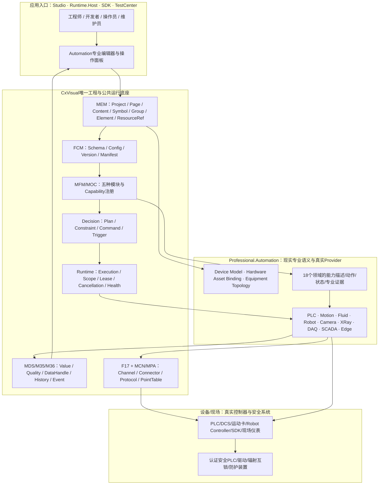
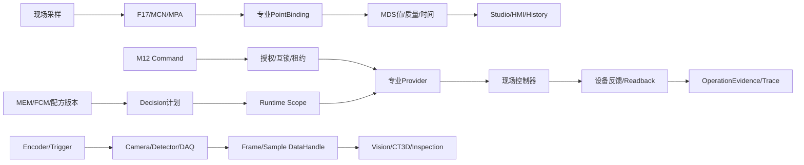
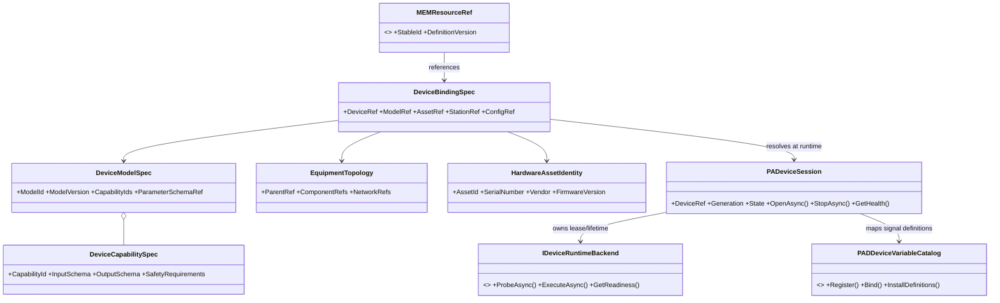
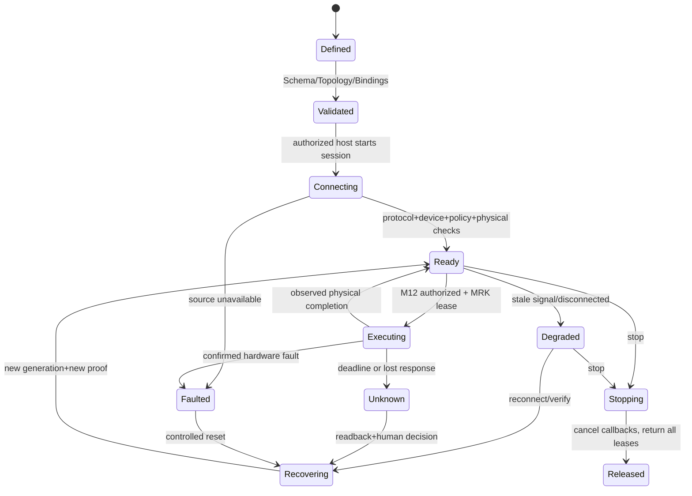
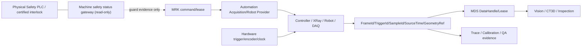

# CxVisual Automation——09 全类总体架构、UML与对象交互合同 V1.0
> 2026-10-30｜完整设计候选（G0 Design）｜不表示源码实现或Owner新增已获批。与 #00～#08 V1.1、Implementation/Testing V1.1 联合使用。
> 源于 DOCS/01 架构宪法、DOCS/00 协同入口、五张核心规格 V2.1、统一规格基线 V2.2 中 `01_Workbench专业方面`/`01A_Automation现实对象映射`/`01B_Automation实体分类全表`、Automation专业需求与真实仓库。仓库最新 V4.9/V2.01/V6.4 原 XLSX及 `04Automation.png` 图内项目目前未能直接解码，相关P编号与FQN待批准对照，不伪称核准。
> 本文为架构视图和核心方法契约；**唯一全类候选清单**在 [#10 全类字典](CxVisual_专业自动化体系%2310完整类接口枚举字典与API合同_V1.0.md)。所有候选类型标记【C】，已在 .csproj 编译并确认的类型标记【E】，旧源码仅可迁移标记【R】，公共Owner已有职责标记【O】。

## 1. 一张图看懂：工业工程与真实设备的两个世界

**图的箭头表示工作流/调用与资源关系，不表示程序集互相依赖。** 正式程序集方向由 `.csproj` 和 Owner 决定：Automation 可以引用必要的公共合同，Mechanism/Core/Runtime 不得反向引用 Professional.Automation。部分场景中的硬件 SDK 不需要建立虚假的 F17 Channel。

## 2. 五个正交架构面与四条数据流
| 方面 | 唯一真源 | Automation专业贡献 | 不允许 |
|---|---|---|---|
| 工程定义 | MEM/FCM | 设备型号、工位、物理与逻辑资产绑定、工业参数和拓扑 | 第二棵设备/工程树、当前值存在Definition |
| 连接接入 | F17/MCN/MPA/MFM | 工业设备地址语义、Vendor SDK、会话校验、设备状态 | 第二个Channel/Modbus栈、假EmptyChannel |
| 能力执行 | MOC/M12/MRK/Decision | 专业状态、动作参数、过程完成、物理结果与异常恢复 | AutomationFlowRuntime/CommandCenter复制品 |
| 采集与证据 | MDS/M35/M36/Imaging/DataHandle | 质量、时间、触发、测量、设备专有结果 | 第二个Current/Historian/消息中心 |
| 交互与交付 | Studio/Presentation/Runtime.Host/Simulation | 专业Editor与Faceplate贡献、FAT/SAT、维护、版本约束 | 在设备DLL内维护WPF窗口业务状态 |



## 3. 不重复公共对象的全类分工
| 类别 | 真实公共类/合同（已核对示例） | Automation特有类型候选 |
|---|---|---|
| Config/Module | `MFMDriverModuleConfiguration`, `IMFMDriverModule`, `MFMDriverBackendKind` | `DeviceModelSpec`, `DeviceBindingSpec`, `DeviceReadinessEvidence`, `PADeviceSession` |
| Connector/Protocol | `IMCNConnectorModule`, `MPAProtocolOperationRequest`, `MPAPointDefinition`, `IFTRChannel` | `PlcPointMapping`, `IoSignalDescriptor`, 设备专用读/写Backend |
| Variables | `MDSVariableTable`, `IMDSVariableProvider`, `MDSVariableDefinition`, `MDSVariableProviderSample` | 已有 `PADDeviceVariableCatalog/Definition/Provider`；新增仅专业转换与采样策略 |
| Command/Runtime | 以实际M12/MRK中可编译FQN为准（需逐API查重） | `AxisMoveParameters`, `CylinderActionParameters`, `ExposureProgram`, 各专业完成证据 |
| Data/History/Trace | 以MDS/M35/M36实际FQN为准 | `AcquisitionFrameMetadata`, `MeasurementUncertaintySpec`, `AlarmSourceSpec` |
| UI/Checks | 现有 `TCTDriverReadinessPanel` / Studio模块入口 | 专业设备/点表/运动/过程/采集/维护UI贡献，**不在Automation DLL** |

## 4. UML-A：设备建模、现实资产与运行Session

**关键约束**：`DeviceRef ≠ AssetId ≠ EndpointId ≠ SessionId`；设备可多通道，同通道可服务多设备，型号可复用，Session每次重连改变Generation；MEM工程身份不可由专业类另造一份。

## 5. UML-B：能力组合模型（不推倒现有MFM/MOC）

```mermaid
classDiagram
  class IMFMDriverModule { <<existing E>> +DeviceRef }
  class IMCNConnectorModule { <<existing E>> +RequestAsync() +ReadDevicePointAsync() +WriteDevicePointAsync() }
  class DeviceCapabilitySpec { +CapabilityId +Version +ParameterSchemaRef +ResultSchemaRef }
  class IPlcPointOperations { <<candidate>> +ReadAsync() +RequestWriteAsync() }
  class IMotionDeviceOperations { <<candidate>> +HomeAsync() +MoveAsync() +StopAsync() }
  class IFluidActuationOperations { <<candidate>> +ExtendAsync() +RetractAsync() +ObserveAsync() }
  class IRobotDeviceOperations { <<candidate>> +MoveJAsync() +MoveLAsync() +GetPoseAsync() }
  class IAcquisitionDeviceOperations { <<candidate>> +ArmAsync() +TriggerAsync() +StopAsync() }
  class ITestMeasurementOperations { <<candidate>> +StartTestAsync() +ReadEvidenceAsync() }
  IMFMDriverModule <|.. IMotionDeviceOperations : if SDK backend
  IMFMDriverModule <|.. IRobotDeviceOperations : if SDK backend
  IMFMDriverModule <|.. IAcquisitionDeviceOperations : if SDK backend
  IMCNConnectorModule <-- IPlcPointOperations : if protocol backend
  DeviceCapabilitySpec --> IFluidActuationOperations
  DeviceCapabilitySpec --> ITestMeasurementOperations
```

**注意**：箭头是能力角色，不是要求C#接口继承图中每一条接口。是否暴露 `I*` 取决于真实多实现/测试需求；不为每个实体创建一套工厂、策略、适配器及管理器。

## 6. UML-C：正交状态图与控制时序


```mermaid
sequenceDiagram
 actor O as 工程师/服务
 participant C as M12命令
 participant R as MRK安全策略/Lease
 participant P as Automation Provider
 participant H as 控制器/物理设备
 participant D as MDS/Trace
 O->>C: Invoke(DeviceRef,CapabilityId,Params,Deadline)
 C->>R: Validate auth/mode/interlock/version/resource
 R->>P: Dispatch+Generation+Lease
 P->>H: Send command
 H-->>P: Ack (not PhysicalDone)
 P->>H: Read status/position/pressure/exposure state
 H-->>P: Readback or silence
 alt physical result confirmed
  P-->>D: Observed evidence + timestamps + quality
  P-->>C: Completed with physical evidence
 else timeout / inconsistent state
  P-->>D: UnknownOutcome and trace
  P-->>C: Unknown; no blind retry
 end
 C-->>O: status, refusal or remediation
```

## 7. UML-D：X-Ray/Robot/DAQ数据链与安全边界

**明确**：PC软件只做操作授权、专业动作和状态观测，不实现认证EStop、安全驱动制动、辐射硬联锁或硬实时触发。

## 8. API总合同（只定义可复用语义，不冒称现有签名）
```csharp
// 目标合同示例，必须先绑定现有 M12/MRK/MFM/MOC 的已编译 API，禁止照抄成第二套通用命令中心。
public sealed class DeviceCapabilityInvocationSpec
{
    public string DeviceRef { get; set; }
    public string CapabilityId { get; set; }
    public string ExpectedConfigVersion { get; set; }
    public string ExpectedSessionGeneration { get; set; }
    public string PrincipalId { get; set; }
    public DateTime DeadlineUtc { get; set; }
    public object TypedParameters { get; set; } // 演示槽位；正式API需强类型Schema/已有Request
}
// Run/Result/Lease/Trace使用既有机制合同，不为此定义 PAACommandResult/MRK替身。
```
| 契约 | 必须包含 | 不能省略 |
|---|---|---|
| Definition | Id、ModelRef、SchemaRevision、ExpectedOwner、Station/AssetRefs | 模型与实例同一身份会导致串话 |
| Provider | 描述/设备探针/Setup/Stop/Health/Release | DLL存在不能返回DeviceReady |
| Operation | CommandId/CorrelationId/Deadline/Principal/Lease/ExpectedGeneration | ACK/发送不等于物理完成 |
| Observation | SourceTime/ReceivedTime/Quality/Value/Revision/SourceId | 断线不能默认为Good或零值 |
| Evidence | PhysicalObservedAt/DeviceState/Readback/Calibration/Environment | Sim不能伪装G2/G3 |
| Debug | ErrorCode、Owner、Path、Phase、Trace、Remediation | 单一“启动失败”没有可维护性 |

## 9. 设计模式如何落地
| 模式 | 目标 | 最小角色 | 禁用用法 |
|---|---|---|---|
| Factory/Abstract Factory | 创建厂商SDK或专业驱动 | 复用MFM/MOC Provider/模块注册工厂 | 每一种气缸再建专有工厂 |
| Strategy | 多品牌Motion/DAQ等替换策略 | 专业Backend或现有驱动能力 | 通用网络协议栈整体复制 |
| State | Axis/Fluid/Recipe/Session 专业状态 | 明确State+guard+transition+evidence | 一个`bool IsRunning`代表所有状态 |
| Command | 统一请求/拒绝/结果与取消 | M12正式接口+专业参数 | AutomationCommandBus复制品 |
| Observer | 变量、诊断、报警、Frame 订阅 | MDS/M36接口 | 硬件回调直接阻塞WPF |
| Composite | Machine/Station设备组件结构 | MEM节点与专业引用 | 将物理资产做成可变全局单例 |
| AOP | 身份/互锁/租约/时限/审计/Trace | M12/MRK已有执行切面 | 每个驱动各实现另一套权限检查引擎 |

## 10. 全类与工程映射的四道闸
**Gate-A 规格**：逐行确认 P01～P18 与 DOCS/02 V4.9、03 V2.01、04 V6.4、04Automation图；18领域由 V2.2 直接读取，不把其编号臆造成现行Pxx。
**Gate-B 查重**：对 #10 中每个候选先查现有 `FQN/Assembly/Method`；已有同义对象时合并字段/使用引用，禁止候选直接落类。
**Gate-C 真实实施**：一个垂直案例包含配置+Provider+状态+命令+PhysicalEvidence+API+Studio+TestCenter；无SDK/硬件必须明示 G2/G3 Blocked。
**Gate-D 工业交付**：六大工业案例、Windows x64、资源稳定、HIL、安全审核、文档及版本追溯齐全，才评估工业就绪。

## 11. 全类状态标记与统计规则
`【E】` 已在本次核查的正式 .csproj 编译列表或其显式引用中核对源码；`【O】` 已有公共Owner负责（并非每个精确FQN都在本轮复核）；`【R】` ReferTo/七仓有源码但在目标程序集不生效；`【C】` 必要性候选；`【ADR】` 唯一Owner/接口争议须先审批。**概念/实体/设备SKU ≠ C# class**。统计以 #10 清单中类型键为准，不用历史1409条映射计算代码规模。

## 12. 参考与关联文件
- `DOCS/Architecture/CxVisual_专业自动化体系#00～#08_*V1.1.md`；`DOCS/Implementation/CxVisual_专业自动化体系#实施与成熟资产复用指南_V1.1.md`；`DOCS/Testing/CxVisual_专业自动化体系#全功能与工业验收矩阵_V1.1.md`。
- `DOCS/Codebases/01_ccxx.md`、`02_device_communicator.md`、`03_gcl3.md`，以及 `ReferTo/DeviceVariable`、`cx-vision-x2/Drivers`、`cx-cct-x3`。
- `DOCS/Decisions/CxVisual_F17_Channel下沉与唯一归属裁决_V1.0.md` 和功能模块五类、Decision合并裁决。
