# CxVisual 通用三维视觉工作台——整体架构与 UML V2.0（R5 需求驱动全类设计评审版）

> **身份：唯一三维总体架构主文档；R5先从用户目标推导完整目标对象，再比较现状，仍属架构评审候选，不等于新增公共API/Owner已批准。** 本次审核日期：2026-10-29；源码核对基线：`master@0487b050f73fff9b3efe03e561ca017b9a02e16a`；本轮仅修改设计与导航，未重新编译、运行测试或在线复核历史CI。
> **核心原则：各方面都尽能力展现，便捷友好尽支撑各专业达到目标。**  
> **阅读顺序**：§0～2（需求推导/26项能力）→§3～6（Owner、数据、对象、GPU、专业计算）→**附录E（完整目标类职责、协作关系与26项对应）**→§7～8（工业操作/接口时序）→§9～14（源码、证据、实施、决议）；附录A/B为专题UML，C为原文存在性索引，D为实施检查表。
> **状态图例**：【E】现有源码、【R】现有类需调整、【N】候选新增、【P】远期规划、【T】固定提交自动测试、【H】真实GPU/工业样本尚未实证。**E≠T，T≠H**。  
> **不可突破**：F/M/P和28项目/135子方面Owner、唯一MEM工程真源、CT3D与MPW不形成循环引用、TestCenter只验收、ReferTo/Vision只读，不另建第二套资源/命令/执行/Undo/专业数据体系。  
> **需求来源更新**：用户2026-10-29提供两张目标截图，直接可读范围为**R11～R64，共54条**；R01～R10与R65～R90共36条仍无原文。截图是需求证据，不是其中提及SDK已安装或功能已实现的证据。DOCS/04本轮定向读取F_Geometry/F_Volume/M_Visual/M_PresentationWpf，发现F06/F07与F12的Mesh候选重叠；DOCS/02～04尚未完成全Sheet交叉裁决，新增Owner仍按ADR处理。
> **单一维护规则**：本文件是26项能力、架构决定与实施状态的唯一总体维护入口。旧V0.1能力表仅作历史来源；Implementation/Migration/Testing保留事实与测试证据，不另更新竞争性“完成率”表。


---

## 0. 读者导览：5 分钟理解全局

**一句话定位：** 以高精度三维数据为真源，让工业工程师在一个统一工作空间中完成**导入→空间标定→观察→重建/表面确定→拟合/配准→测量/GD&T→CAD 对比→缺陷与材料分析→判定/报告→重放与自动化**，同时支持独立应用、Studio 嵌入和 Headless SDK。

**需要立即记住的四条：**

1. **数据≠显示。** `FVO` 原始体素、专业 Mesh/CAD/测量结果是事实；2D/3D Texture、LOD、色谱和截图仅为显示投影。工业精度不从预览反推。
2. **Scene≠工程树。** 当前`MEMNode/MEMContent`及MEM工程机制管资源、稳定引用、版本、持久化和Undo；`CxNode`仅作历史称呼，不恢复旧类。MVI的3D Scene管会话内可视对象、选择、工具和相机；专业结果归CT3D/Inspection。
3. **算法≠渲染。** 专业算法可独立 Headless 运行和测试；`MPW` 只负责 WPF、场景绘制及 GPU 资源。渲染不作为计量精度依据。
4. **借平台之力而不再造平台。** 任务、命令、数据交换、结果、日志、安全、插件、工程化复用现有机制；小范围的 MPW 帧调度不等于新建专业任务 Runtime。

### 0.1 一页速览与读者导航

| 读者关心 | 从这里看 | 核心输出 |
|---|---|---|
| 产品能做什么 | 第 1～2 章 | 全景图、26 项能力地图 |
| 由谁负责、怎样协作 | 第 3～6 章 | F/M/P Owner、数据/空间/Scene/算法/RHI 边界 |
| 工业操作怎样串起来 | 第 7～9 章 | 四条完整业务链、接口/时序/状态图 |
| 明天开发和验收做什么 | 第 9～14 章 | 真实源码、26项主追踪、证据门禁、P0～S5和ADR；附录C追踪R01～R90 |


### 0.2 六个核心设计——一张表把 Owner 与真源说清楚

**图例：**“唯一真源”指本项目不能再创建另一份具备提交权的同语义数据。会话中的显示投影/不可变快照可以多份，但必须携带 SourceRef/Revision 且禁止反向修改专业数值。

| 核心设计 | 唯一事实 / Owner | 如何协作 | 不采用的方案 |
|---|---|---|---|
| ① 三维对象与场景 | 原始体素 FVO；专业结果 CT3D；Scene会话 MVI；持久工程 MEM | `SourceRef + SpatialFrame + Style` 组成可视项 | “一个万能3DObject持有全部数据”或第二工程树 |
| ② 空间坐标与计量 | FVO原始索引/Spacing；FGE数值变换（3D仍待Owner核准）；CT3D计量语义 | `Voxel → Physical → Part/Fixture → CAD`；始终保留单位、方向和精度 | 以OpenGL坐标、屏幕坐标、R8预览直接计量 |
| ③ 算法契约与组合 | CT3D专业算法/结果，MRK/FCR既有任务与资源机制 | `TypedInputs + Params + Cancellation + Quality → ResultRef` | 新建CT3D私有万能GraphExecutor |
| ④ 场景交互与动画 | MVI会话相机/三刀/选择/工具；MEM持久的关键帧定义 | Studio、独立宿主和 MPW 共享意图与修订；Renderer仅读快照 | WPF相机、GL相机各自作为长期真源 |
| ⑤ 资源与性能 | FVO原值/缓存；MPW GL Context/显存；既有资源租约与运行监测 | 资源预算、代次、取消、Lease；分块与LOD为逐阶段能力 | UI持有所有GB原始数组，或无界复制/队列 |
| ⑥ 专业计算独立 | CT3D数值与Inspection业务判断分责 | 分割→Surface→Fit→Registration→Measurement→Deviation→Inspection；结果由MVI投影 | 将所有步骤塞进MPW或“万能Process()” |

**三条架构不变量：** 数据真值不从显示反推；工程提交只走 MEM；专业算法没有 WPF 依赖。这三条同时作为自动架构测试合同。

---

### 0.3 R5：先从需求推导架构，再评价现有实现

**产品不是“Volume Viewer加若干算法按钮”，而是共享同一数据、空间、对象选择和结果链的工业三维分析工作空间。** 这不是要求一次实现全部类，而是要求在实现局部功能之前能解释完整系统中每个角色由谁承担。

| 用户目标 | 推导出的必要对象与边界 | 缺少时会出现什么问题 |
|---|---|---|
| R14/R58 多种对象自由组合 | 数据资产与可视实例分离；Volume、点云、Mesh、Surface、CAD、Mask、ROI、结果共用Scene和Frame引用 | 只能显示一份Volume；CAD、点云成为另一个窗口，工具不能共用 |
| R15/R18 独立、嵌入、API且非单体 | Headless专业Session、UI无关ViewSession、可嵌入MPW组合控件、应用组合根 | 业务依赖窗口；SDK需启动TestCenter；换宿主就复制功能 |
| R21/R46～R53 精度与追溯 | 有版本的资产引用、原值租约、坐标链、标定证据、算法定义、不可变结果及质量策略 | “看着对”却不能说明量值来自哪里，修改标定后旧结果仍冒充有效 |
| R27/R47/R48/R59 工具互操作 | 稳定选择集、局部子元素引用、物理ROI、类型化算法输入、结果投影 | 拟合、配准、偏差工具各持一套临时点，依靠人工导出再导入 |
| R28/R54～R56 动画与重放 | 持久Timeline/Track/Keyframe、临时Playback、同一Scene的显示覆盖层、离线帧导出 | 只会旋转相机，无法编辑/保存装配、剖切或分析过程动画 |
| R23/R43 大数据与自动化 | 分块源/预算/取消、原值与显示双通道、MRK任务绑定、确定性结果提交 | GB数组到处复制；UI退出就丢任务；旧结果覆盖新数据 |
| R57 二维成熟能力复用 | FVO切片产出FIM像素，复用MVI图像会话/工具和MPWImageViewer；补Slice↔Physical映射 | 三维切片重写缩放/ROI/测量，二维工具坐标不能回到三维原值 |
| R60～R64 未来扩展 | 扩展描述、时间样本引用、场/体网格交换的边界 | 提前把AI业务塞进内核，或以后必须破坏现有三维对象模型 |

**目标对象主链：** `MEM中的Case/算法/ROI/动画定义 → CT3DCaseSession解析资产与专业操作 → 不可变专业Result → 宿主转换为MVI显示引用/投影 → MPW绘制`；`MRK`从同一工程定义编译/绑定专业操作，`Inspection`消费同一专业结果作业务判定。工程身份、运行数据、可视身份三个概念互相关联，不能互相替代。

附录E给出各角色的具体类/值对象/方法与关联。完整指**职责闭合、输入输出可衔接、生命周期可解释**，不以新增类型数量为目标，也不把所有候选一次生成为空壳。

## 1. 产品总览：目标、层级及非目标

### 1.1 一张全景图（业务协作概念图，**不是** csproj 引用图）

**图 01｜CxVisual 通用三维视觉工作台全景。** 图内向下表示功能依赖与消费关系；横向表示协作领域。可视化和专业计算相互消费**引用/结果**，彼此不依赖对方程序集。

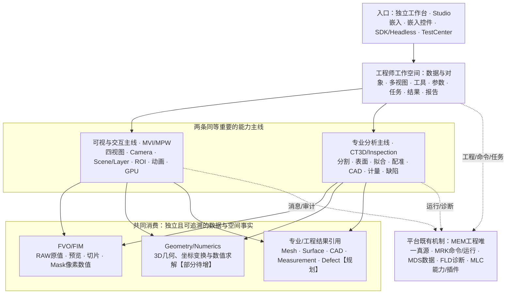

**为什么这样分：** 避免以 `MPWVolumeOpenGlControl` 为中心导致 Surface、CAD、GD&T 和 Headless 算法被塞进渲染类；也避免把场景对象提升为新的持久资源树。现有 F/M/P 的工程数量和 Owner 不变。


### 1.1.1 典型工程师看到的四个工作区（交互体验，不是四套程序）

| 工作区 | 左侧对象与数据 | 中央视图 | 右侧工具/属性 | 底部输出 |
|---|---|---|---|---|
| 数据与预览 | CT文件、Volume、源格式与空间元信息 | 2D正交+3D四视图 | Spacing、窗宽、切片、GPU、数据质量 | 原始/预览分辨率、警告、任务进度 |
| 表面与计量 | Mask、Surface、Mesh、几何Feature | 三维叠加、局部剖切 | 表面策略、拟合约束、单位、Datum/公差 | 误差/残差、测量报告与来源 |
| CAD 与质量 | CT/CAD/配准及偏差结果 | 叠加、剖面、偏差色谱 | 基准、配准、正负公差与统计 | 超差区域、缺陷列表、报告 |
| 算法与自动化 | 输入Ref、任务链、参数快照、Case | 输入/中间/输出可切换观察 | 步骤、取消、重跑、质量阈值 | 耗时、Trace、错误、审计与版本 |

实际落地采用**同一 MPW 多视图基础和工作台宿主可组合面板**，工具之间共享对象选择与专业结果引用；TestCenter 为验证镜像，不应另做专用功能版本。

### 1.2 产品形态及约束

| 形态 | 用户价值 | 实施约束 |
|---|---|---|
| 独立工作台 | 数据导入、测量、分析、比较、导出完整操作 | 宿主装配正式 CT3D / MVI / MPW，不复制算法 |
| Studio 专业工作区 | 工程方案、配方、算法步骤、历史、可发布运行 | 工程 Save/Undo/Ref 由 MEM 等既有机制负责 |
| MPW 可嵌入控件 | 3D Viewer、多视图和交互组件 | API 可在不启动 TestCenter 下复用 |
| CT3D Headless SDK | 算法测试、服务器计算、批量任务 | 不引用 WPF/GL，输入输出和生命周期明确 |
| TestCenter | 真实功能、数值、异常、UI、GPU 分级验收 | **消费者而非生产实现者** |

**非目标：** 不复制 VTK/ITK 全部体系，不创建 `UniversalObject` 包打天下，不建立 CT3D 私有第二套 Graph Runtime，不凭 UI 截图宣称计量正确，不将 OpenGL 3.3 路径无条件等价于硬件合格。

---

## 2. 能力组成：完整 26 项与六大能力域

**图 02｜能力地图。** A～F 是产品能力分组，不代表新增六个物理工程；方框顺序是主要消费链，跨组协作允许双向使用**稳定引用与结果契约**。

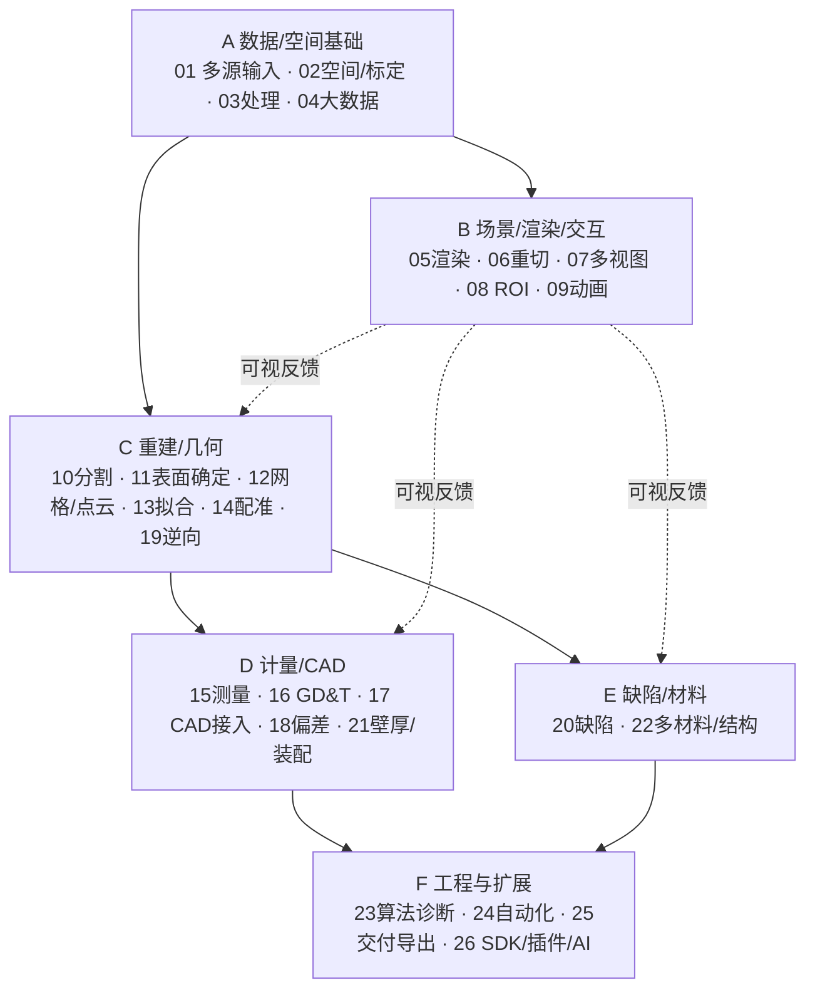

### 2.1 六领域的职责与交付边界

| 域 | 产品能做什么 | 主要输入→输出 | 目标 Owner / 可复用基础 | 与其他域的边界 |
|---|---|---|---|---|
| A 数据与空间 | 各类数据导入、质量检测、原值/预览分离、标定、分块/LOD | 文件/内存/流→Volume/Geometry/CAD Ref + SpatialFrame | FVO/FIM/FGE/FNU；格式属专业接入 | RAW原值不属于Scene或GPU；CAD B-Rep不是FVO体素 |
| B 可视与交互 | MPR、体绘、切面、ROI、选择、图层、动画、画质 | 引用+视图状态→实时视口/渲染帧/交互意图 | MVI/MPW/FVO取样 | UI会话不是永久专业结果；MPW不做测量真值 |
| C 重建与几何 | 分割、表面确定、网格点云、拟合、配准、逆向 | Volume/Mask/Points→Surface/Mesh/Fit/Transform | CT3D + FGE/FNU | 基础算子通用可下沉，专业工艺/精度策略留CT3D |
| D 精密计量与 CAD | 距离/厚度/GD&T、真实CAD、CT-CAD偏差、装配 | 校准模型+CAD+Datum→数值/色谱/质量记录 | CT3D；Inspection判定 | 数值结果≠显示色谱；Inspection不替代几何算法 |
| E 材料与缺陷 | 气孔裂纹、夹杂、多材料、分部件和结构统计 | 原值/Mask/Surface→缺陷列表/统计 | CT3D + Inspection | 分割标签≠最终质量判定 |
| F 工程集成 | 算法调试、任务编排、报告、SDK、插件/AI | Case/参数/算法→任务、Trace、Report、Artifact | MRK/MDS/MEM/FLD/MLC + CT3D | 复用平台真源，不建第二执行器/资源树 |

### 2.2 设计深度要跟任务价值走

先让 **CT 原值→表面→拟合→物理测量** 成为可重现的专业闭环，再扩展真实 CAD 对比、缺陷/壁厚；同时维护已有四视图/GPU。不应按 26 个名称创建同等空类和菜单。

### 2.3 各项能力的最小输入—输出—操作合同（目标态）

下表只描述**目标操作语义**，不是当前全部可点、可执行。每项的真实 Owner/文件与证据见第10章，专业算法运行不依赖操作界面。

| № | 核心输入 | 输出/结果 | 典型用户操作 |
|---|---|---|---|
| 01 | RAW/文件/内存/流 | VolumeRef/预览 | 导入、批量打开、数据检验 |
| 02 | Volume元信息、标定件 | Frame/Spacing/Quality | 空间信息与坐标检查 |
| 03 | Volume/ROI、参数 | 处理后体/切面 | 滤波、裁剪、重采样 |
| 04 | 原值Volume+预算 | Chunk/LOD/Preview | 交互质量与高精度模式切换 |
| 05 | Volume/几何+显示样式 | GPU体绘/MIP/网格帧 | 透明度、光照、材质、显隐 |
| 06 | Volume+Plane/Path | MPR/斜切/厚层像素 | 拖三刀、切层、任意切定义 |
| 07 | Volume+ViewState | 四视图/十字线 | 缩放、平移、全屏、联动 |
| 08 | 空间ROI/对象+工具意图 | ROI定义/选择/标注 | 拾取、绘制、编辑、保存 |
| 09 | Camera/模型状态+Keyframes | 3D回放/视频 | 时间轴、播放、暂停、爆炸图 |
| 10 | Volume+Mask算法参数 | Mask/Labels/区域 | 选材料、分割与检视 |
| 11 | Volume/Mask+方法参数 | Surface+质量证据 | 表面阈值、质量评定 |
| 12 | Surface/Points/Mesh | 网格/点云/拓扑指标 | 重建、修复、网格检查 |
| 13 | 点/面/约束 | Feature+FitResidual | 选取几何、拟合、约束调整 |
| 14 | CT几何+CAD/基准 | Transform+RegistrationQuality | 人工基准、自动ICP、局部配准 |
| 15 | Feature+Datum+单位 | 尺寸/角度/面积/体积 | 测量工具、标注、结果表 |
| 16 | Feature+Datum+Tolerance | GD&T结果与判定依据 | 公差编辑、偏差统计 |
| 17 | STEP/IGES/SW/Parasolid | B-Rep/Assembly+源引用 | 导入、装配树、实体显隐 |
| 18 | CT/Surface+CAD+Transform | 偏差场/色谱/超差区域 | 对齐、差异、剖切、报告 |
| 19 | Points/Mesh/Surface | 拟合曲面/NURBS/参数模型 | 曲面重建与误差检查 |
| 20 | Volume/Labels/Surface | DefectResult/三维缺陷列表 | 缺陷定位、分类、复核 |
| 21 | Surface(s)+装配公差 | Thickness/Gap/Interference | 最薄点、干涉检查 |
| 22 | Volume+材料分类/Mask | Material/ComponentStats | 材料选择、分部件统计 |
| 23 | 算法/参数+输入Ref | 中间结果/Trace/指标 | 实验、调试、对比、复跑 |
| 24 | Task模板+Case/Ref | BatchResult/质量判定 | 批量启动、取消、重试 |
| 25 | 各种数据/ResultRef | RAW/PNG/Mesh/CAD/报告/视频 | 导出向导、版本追溯 |
| 26 | 能力描述/SDK/模型 | 扩展算法或服务接口 | 插件管理、SDK调用、AI模型选择 |

---

## 3. 模块架构：Owner、程序集依赖、真实状态

### 3.1 Owner 与不得越界的责任

| 所在物理项目（现有） | 主要负责 | 当前确认的代表实现 | 必须避免 |
|---|---|---|---|
| `Foundation/Imaging`（FIM） | 二维像素缓冲、基础图像、Slice结果像素 | FIMImageBuffer、FIM图像 API【E】 | CT工艺、OpenGL、HALCON对象作为通用公开类型 |
| `Foundation/Volume`（FVO） | 体素/RAW/原值/预览/取样/切片/传递函数数值 | `FVOVolumeData`、`FVORawVolumeLoader`、`FVOSliceImageBuilder`、`FVOUnmanagedRawVolumeBuffer`【E】 | 相机、CAD、公差、WPF窗口 |
| `Foundation/Geometry`（FGE） | 跨专业几何基元、变换、空间运算 | 2D及`FGEPoint3D/FGEVector3D/FGETriangleMesh3D`【E】；通用3D变换/点云【N】 | 完整工业CT工艺/计量业务 |
| `Foundation/Numerics`（FNU） | 线代、统计、求解、拟合数学原语 | SVD/最小二乘、权重最小二乘等【E】 | 把通用线代名义冒充圆柱/ICP/GD&T专业算法 |
| `Mechanism/Visual`（MVI） | UI无关的三刀、相机、ViewSession、Scene、交互、选择 | `MVIVolumeViewState/MVI3DCameraState/MVI3DSceneState/MVI3DSceneItem`及2D投影【E】；完整ViewSession/工具【N】 | WPF/OpenGL具体句柄、专业CT结果真值、第二工程树 |
| `Mechanism/Presentation.Wpf`（MPW） | WPF控件、多视图、输入和GPU资源/绘制 | `MPWVolumeFourViewWorkbenchControl`、`MPWVolumeOpenGlControl`、编辑面板【E】 | 专业算法真源或CT3D类硬引用 |
| `Professional/CT3D` | CT3D工艺、参数、算法、Surface/CAD/计量与结果引用 | 渲染设置/加载、`CT3DSurfaceSphereAnalysis/CT3DVoxelBoundaryMeshExtractor/CT3DMeshPlaneAnalysis`【E】；Case/CAD/GD&T【N/P】 | 依赖WPF、制造另一套FVO Volume |
| `Professional/Inspection` | 产品/质量业务判定、检验结果、报告/追溯 | 目前三维分析无闭环证据【P】 | 将所有3D数值计算迁成业务判定代码 |
| Studio/独立宿主 | 组装上下文、操作导航、工程/Session绑定 | 宿主能力按实际工程核查 | 新算法实现、第二套 Undo |
| `Tests/TestCenter` | 测试入口、手工验收、硬件专项 | 消费正式MPW Host；TCT仍承担专业调用与投影装配示例【E/R】 | 长期保有正式GPU启停或唯一专业装配实现 |

### 3.2 物理依赖和职责关系必须分两幅图

**图 03｜目前可核实的物理依赖核心子图。** 实线是已检查 `.csproj` 的现有引用；不代表图外全部工程引用。

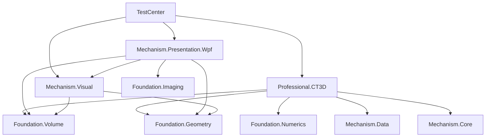

**图 04｜目标协作：调用方向≠项目依赖。** `CT3D` 与 `MPW` 通过**宿主装配/中立数据契约**通信；专业结果引用经过投影进入场景，而不是互相新加项目引用。

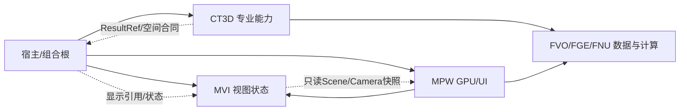

**需解释的冲突：** 工程 Skill 旧版写“MPW does not need Foundation.Volume”，但当前 `Mechanism/Presentation.Wpf/*.csproj` **实际已引用** FVO；不能擅自按旧文字删除已用依赖。以最新已审查源码与正式 Owner 决议评审该差异；详见第14章 ADR-01。


### 3.3 已核查真实 `.csproj` 的关键依赖（区别于概念图）

| 编译工程 | 当前关键引用 | 约束 |
|---|---|---|
| FVO | FIM、FNU | 不能引用MVI/MPW/CT3D，原值和取样应独立 |
| FGE | Foundation.Core | 3D几何扩展时不得引入 CT3D 专业语义 |
| MVI | FVO、FIM、FGE、Mechanism.Core/Data | 只能放UI无关的交互状态/投影，不引用 MPW 或 CT3D |
| MPW | MVI、FVO、FIM、FGE、Mechanism.Core/Data、基础设施 | 可读取基础显示数据与视图状态；不直接引用 CT3D |
| CT3D | FVO、FGE、FNU、Foundation.Data、Mechanism.Core/Data | 当前**不引用 MVI/MPW**；新增Case与算法须遵守实际 DAG |
| TestCenter | 消费上述正式工程 | GPU Host已在MPW；专业组合示例仍需抽为正式宿主可复用路径 |

注意：旧工程 Skill 的“MPW不需要 FVO”与当前真实 `.csproj` 不完全一致，是 **ADR-01**，不能为了追求表面整齐擅自删除现有依赖。新建专业调用桥接层也不是解决方法；应用宿主是天然组合根。

---

### 3.4 目标全类模型与当前文档的差距结论

| 方面 | R4已具备的正确骨架 | R5需要补实的设计 |
|---|---|---|
| 多对象 | Case/View分离、Scene引用 | 资产/可视实例/子元素三个身份、无Volume场景、多Volume主切片源、解析和租约边界 |
| 空间 | Voxel→Physical→CAD概念链 | 稳定Frame身份与Revision、变换边有效域、Slice映射、标定变化失效、保存重开 |
| 专业计算 | Inputs/Params/Quality/Result一般合同 | 各26项的具体算子、参数、结果与依赖；拟合模式/基准/GD&T/偏差质量分别表达 |
| 渲染 | Volume/Scene/GPU/ChangeSet | 中立投影协议、体与Mesh深度/透明混合、拾取ID、资源预算与真实帧版本 |
| 工具 | 选择/ROI操作意图 | 子元素选择、拖拽预览事务、切片二维ROI到三维ROI、工具能力匹配 |
| 动画 | Timeline概念 | Track/Keyframe/TargetBinding、播放覆盖层、确定性Seek、视频帧导出 |
| 工程化 | MEM/MRK/MDS复用原则 | 当前可调用API、缺失的大Artifact固定引用、操作绑定、保存失败/结果过期的完整闭环 |

本轮不重写F/M/P，不增加项目，不改算法源码。通用几何Owner存在**实际待裁决项**：DOCS/04的F06列有`FSGMeshTopology/FSGPointSet3`、F07列有`FCTCoordinateFrame3D/FCTRigidTransform3D`，F12同时列有`FVMTriangleMesh/FVMPointCloudBuffer`候选；当前源码已有FGE的`FGETriangleMesh3D/FGEPoint3D/FGEVector3D`。附录E以当前FGE实体复用为首选建议，**不得因此再实现FVM/FSG同义副本，新增点云/变换的最终公开名称及Owner须经ADR-02统一**。

## 4. 数据、坐标与资源：26 项专业计算共用的基础

### 4.1 数据类型与唯一事实

| 数据/对象 | 数据真源 | 显示层仅允许做什么 | 规划事项 |
|---|---|---|---|
| 原始 Volume（Byte/UInt16/Float32） | FVO，原始尺寸、标量、Spacing、非托管Buffer | 根据预算生成预览与纹理 | 完整物理方向矩阵、超大Region请求 |
| MPR与任意切 | FVO取样；像素图由FIM表征 | 显示位图、窗宽/伪彩和Crosshair | 曲面重切/厚层投影 |
| Mask/Label Volume | 通用标量/标签容器倾向FVO；CT3D拥有工艺语义【待裁决】 | 颜色编码、不透明度 | 真实3D标签和连通域 |
| PointCloud/Mesh/Surface | 通用结构优先FGE，专业提取元数据CT3D【待裁决】 | 三角化/采样/LOD/拾取代理 | 3D拓扑、法线、空间精度验证 |
| CAD B-Rep/Assembly | CT3D专业CAD接入及外部SDK受控Handle | 绘制三角网格、装配层级 | SDK授权、装配与拓扑ID映射 |
| 测量/偏差/缺陷/GD&T | CT3D专业Result，Inspection业务判定 | 标注、色谱、表格、可见性 | 量值、质量证据、单位、阈值、回溯 |
| GPU Texture/Shader/Buffer | MPW按Context拥有 | 易失缓存，丢失可重建 | 显存预算/泄漏验证 |

**原始精度铁律：** 多 GB CT 原始量值及空间坐标是计量唯一输入；GPU 8-bit 预览/ROI屏幕选择是展示或输入意图，必须反算到**有版本、单位和精度信息的原始数据域**才可提交专业计算。


#### 原值、高清切片与可测量数据的边界（本次新增硬合同）

已确认 `FVOVolumeData.Voxels` 是用于交互的 R8 显示数据，`HasOriginalRawData` 表示非托管完整原始缓冲已就绪；`GetScalarByOriginalIndex()` 在没有原始缓冲时允许通过显示预览估算数值，**不能把该方法的返回值单独当成“已保证无损”**。`HasOriginalVoxels` 仅说明缓存达到原始分辨率，数据是否量化必须结合来源及实际加载路径判定。

- **显示模式**：可以用 Preview R8、LOD、缓存降级，须显示“预览/非计量”，但不得静默标记为校准过的工业测量。
- **专业计量模式**：算法必须先验证完整原始 Byte/UInt16/Float32 是否可读、原始值/空间标定/方向/来源版本是否可信；不满足时返回明确 `PrecisionUnavailable`（建议错误语义，而非现有枚举），禁止悄悄用R8插值补数。
- **缓冲接管现状【E】**：`SetRawBuffer()`已检查格式/长度/关闭状态，同对象重复接管幂等；严格读取已有`TryGetOriginalScalar/GetOriginalScalarRequired`。这些源码事实不等于任意线程可并发替换Volume。
- **原值租约现状【E】**：`AcquireOriginalScalarLease()`以SafeHandle引用保护整段RAW读取，租约捕获不可变SpatialFrame；Volume释放后已取得租约仍可读。同一租约的`Dispose`不得与读取并发；源身份/修订校验、通用分块租约与多GB压力验收另行完成。

**图 05a｜精度域不能混用：**

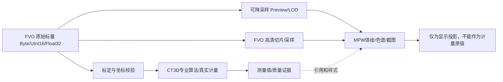


### 4.2 空间坐标链（数值先于显示）

**图 05｜Index → World → CAD → Display 的空间合同。** 物理计算使用 double、明确单位；GPU 可做 origin rebasing/float，不得逆向污染计量。

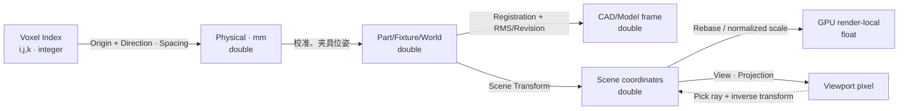

**物理变换建议定义（非已实现 API）：** 对列向量约定 `P_physical = Origin + Direction × diag(SpacingX,SpacingY,SpacingZ) × P_voxel`；任意目标 `T_CAD_from_Part × T_Part_from_Physical × P_physical`。命名必须含 `from/to`，合成与逆变换严格按同一约定；单位换算与右/左手系转换为显式操作。体素中心取 `i,j,k` 还是 `i+0.5,j+0.5,k+0.5` 必须由校准/格式合同裁决，不在算法中暗自假定。

**当前已落地的子合同【E】：** `FVOVolumeSpatialFrame`以整数索引表示体素中心、正Spacing、行优先Direction、列向量运算，支持正交旋转/镜像及逆变换；默认Frame未标定。`FGEPoint3D/FGEVector3D`已存在。**尚缺的完整合同【N】：** 跨资产的稳定Frame身份、标定版本、Part/CAD变换链与有效域、导入格式中心/边界适配及保存重开。通用变换名称按ADR-02复核，不能重复制造FVO与FGE两套空间真源。

### 4.3 Asset / Result / Provenance 与工程Resource关系

**图 06｜身份与所有权：引用而非复制。** 一个专业结果可在多个Scene显示，多个视图从一份原始数据消费。

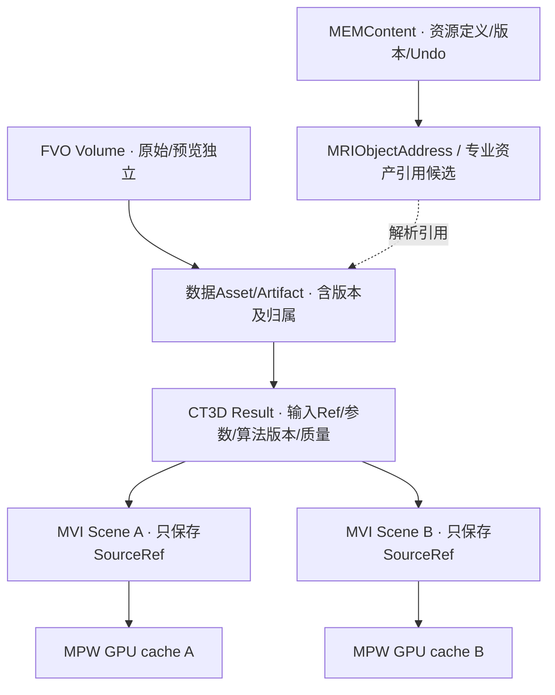

**结果最小可信字段（建议语义，不是已实现的公共API）：** `ResultId, InputRef[] + Revision/Hash, AlgorithmId/Version, ParametersHash, SpatialFrame, Unit, AccuracyEvidence, CreatedAt, Outcome/Validity, DiagnosticsCorrelationId`。工业判定额外保存Datum、容差、缺陷分类/复核与规则版本。现有MRIObjectAddress表达工程地址，MDS Heap管理运行值；**尚无可直接复用的统一大Artifact引用协议**，具体补齐见E.2/E.7，不把GB数据内嵌工程负载。

### 4.4 超大数据与内存/显存合同

- **FVO**：原值映射、按Region访问、CPU缓存/预览生成、分块读取和取消；禁止以 `byte[]` 强制装入所有高精度多GB原值。
- **CT3D**：高精度算法声明所需Region和精度、结果可恢复性、资源预算及取消；若算法需要全量体，必须显式预算/磁盘溢出策略。
- **MPW**：按GpuEpoch拥有Volume/Bricks/Geometry纹理和VAO/VBO；预算、淘汰、失败重建属于显示缓存。
- **共享不变量**：`AcquireLease→Use→Release`；引用可能超过旧体数据的寿命时，旧资产只能在全部Lease结束后释放。缓存命中不改变SourceRevision。

---

## 5. 场景、渲染、交互、四视图与动画

### 5.1 Case 与 ViewSession 必须分离

**图 07｜核心对象类图（少而明确，状态说明即是实现建议）。** 聚合表示引用专业数据；组合表示会话拥有自身可视状态；不是宣告新增类已实现。

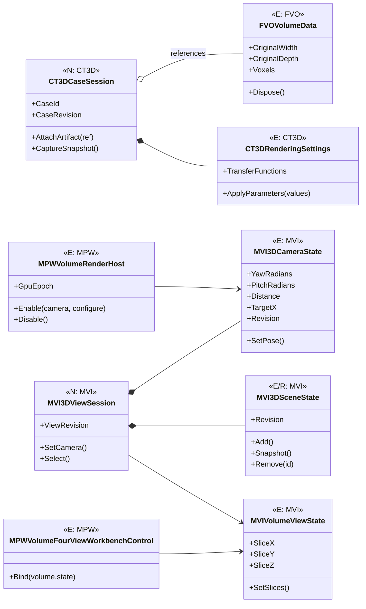

**执行约束：** Case仅协调专业引用/版本，不拥有第二份FVO原始数组；ViewSession仅维护Camera/Selection/Scene，不复制CT3D Result；一个Case可同时被多个ViewSession使用。当前Camera尚无完整Projection/Fov可配置合同，目标归E.3的Viewport；既有`MVISceneItem/MVISceneProjection`二维工程投影不改作3D通用父类。


### 5.1.1 Case、会话、工程资源不是同一个对象

| 名称 | 身份与寿命 | 唯一拥有的内容 | 不应持有 |
|---|---|---|---|
| MEMContent + `CT3DCaseDefinition`【Core既有，专业Schema候选】 | 持久定义；工程保存、引用、版本 | Case定义、规则/算法资源引用、工程操作历史 | GPU句柄、当前鼠标、GB数组 |
| `CT3DCaseSession`【N】 | 一次专业工作进程/打开案例 | 当前专业上下文、数据与结果引用、精度/输入修订 | 第二份Volume数组、MEM Undo树 |
| `MVI3DViewSession`【N】 | 一个视图/多视图会话 | Camera、Scene、Selection、Tools、PlaybackCursor | 专业计量值、CAD B-Rep原件 |
| `MPWVolumeRenderHost`【E/R】 | 一个WPF渲染宿主 | GPU启停/回退/代次；Context和资源仍主要在GL控件内 | 专业数据真源、工程身份 |

专业Case应由既有MEM资源承载专业Schema；本轮未核到可直接采用的`CasePackage`同名正式类，不能当作已有SDK。**会话是运行态组合，不是工程持久对象。** 单一Case对多个ViewSession采用SourceRef/Revision与投影，关闭视图不能Dispose仍被其它会话使用的原始数据。

### 5.2 场景对象、ROI 和图层的轻量组合

`MVI3DSceneItem【E/R】`现有Id、Kind、SourceRef/Revision、SpatialFrameRef、显隐及透明度，`MVI3DSceneState`已有选择与快照；LocalToWorld、稳定子元素选择、拾取和通用投影仍待扩展。目标覆盖 Volume / Slice / PointCloud / Mesh / Surface / CAD / ROI / Measurement / Analysis。组装层级确有需要时增加组合引用，而非先建几十种Layer子类。**专业测量对象的量值来自 CT3D，不来自 MVI 屏幕空间标注。**

- **选择/拾取**：Screen Ray→View/Scene→对象局部/World→SourceRef，命中结果携带源版本；底层计算需可回到物理 mm。
- **ROI**：临时交互草稿归 MVI；长期工程 ROI 定义通过 MEM 保存，算法消费已校验坐标与对象引用；不建新的 UndoStack。
- **Camera**：MVI唯一状态，WPF和GL只做矩阵与设备缓存；多视图允许各有Camera，可用 LinkGroup 同步目标/缩放或切片。
- **Animation**：Camera/切面/装配爆炸/对象透明度/缺陷回放共享 `Timeline` 意图；工程关键帧定义存工程资源，运行播放游标归 ViewSession；视频输出走正式导出接口。


### 5.2.1 从选中对象到运行算法的统一交互链

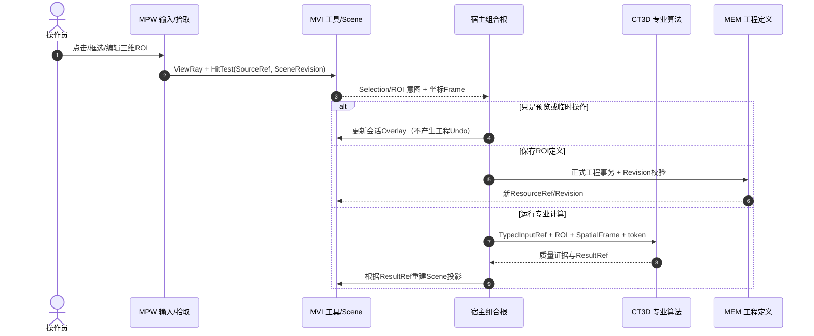

**易用性约束：** 视图/对象的选择应可在多个工具间保持；切换GPU/WPF不丢Camera和三刀；Esc与失去鼠标捕获要取消未提交草稿；不创建三维专用 Undo/CommandStore。每个交互图元必须能追溯到 SourceRef、Frame 与来源Revision。

### 5.3 渲染体系：保留现有 WGL Raymarch，逐步支持混合场景

**图 08｜可组合RenderPass与数据来源（目标，非当前完整实现）。** `Volume/Slice/Mesh/CAD/Overlay` 各有显示策略但共用 Camera、资源预算和帧调度。

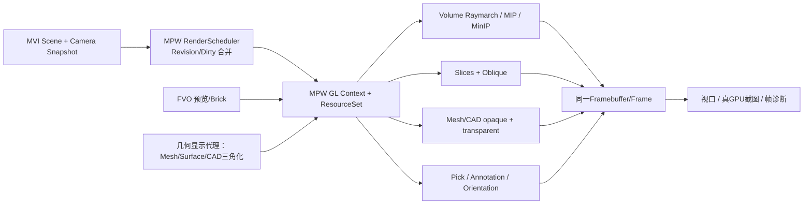

**真实现状：** `MPWVolumeOpenGlControl`【E/R】包含WGL OpenGL 3.3、Raymarch、纹理、Shader、Mesh/点绘制及释放；`MPWVolumeRenderHost/MPWVolumeRenderScheduler`【E】已提供启停、回退与帧失效合并。下一步按真实需要抽`MPWGlContext/MPWGlResourceSet`【N】，扩展中立Scene投影与深度/透明组合；继续使用现有Shader/Geometry。无第二个真实Backend之前不强制`IRenderBackend`；WPF空间切面是**降级观察模式**，不等价于GPU体绘。

### 5.4 GPU生命周期与重试合同

**图 09｜GPU State Machine。** `Disposed` 不能复活；重试必须创建新Context/GpuEpoch。所有Shader/Texture/VAO在其Context有效线程释放，且所有退出路径清理有幂等保证。

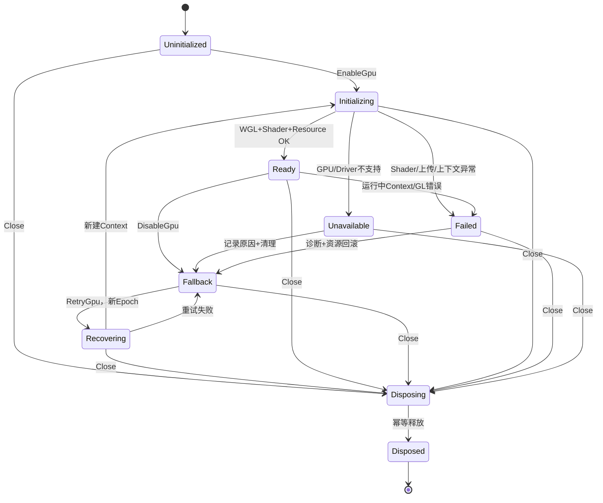

GL调用目前须在所属 WPF Dispatcher/HwndHost 线程发生，不能 `Task.Run(GL.*)`。释放时即使 `wglMakeCurrent` 失败也要完成尽可能安全的 Win32/OS 资源释放并记录不可确认的 GPU 清理残留；不谎称“无泄漏”。

---

## 6. 专业三维算法：从数据到可复现结果

### 6.1 标准算法合同（推荐语义）

| 字段/阶段 | 最低要求 | 与平台的关系 |
|---|---|---|
| Inputs | Volume/Mask/Mesh/CAD引用、SourceRevision/Hash、Frame/标定版本、单位、数据域 | 工程地址复用MRIObjectAddress，运行值复用MDS，专业大资产协议按E.2/E.7补齐；不复制GB数组 |
| Parameters | 强类型、校验、版本、参数快照/Hash、可重复性设置 | 专业参数归CT3D，不在MPW维护副本 |
| Execute | 同步/异步、进度、取消、预算、错误与失败恢复 | 复用MRK/FCR等现有机制；简单算子不强制大型Job对象 |
| Outputs | 新ResultRef + 定量Value/Geometry + 空间合同 + Provenance | 原子注册，失败不发布半成品 |
| Quality | 样本数、残差、RMS、Max、置信区间/不确定度、算法有效域 | 依据算法是否适用提供具体指标，不能统一伪造RMS |
| Display | 可选择映射为SceneItem + 色谱/注释 | MVI/MPW是消费者，显示风格不改原结果 |

**图 10｜标准有类型算法流水线（Headless 可用）。** “执行与诊断”是平台协作而不是 CT3D 自建第二条调度器。

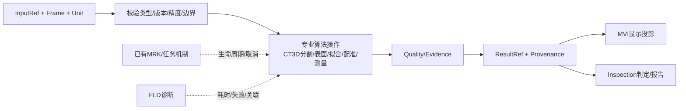

### 6.2 六个算法专题的设计理由及分界

| 专题 | 关键算法/对象 | 质量与错误边界 | 首个应做的有效用例 |
|---|---|---|---|
| 分割与多材料 | 阈值、区域生长、连通域、Mask、材料Label | 材料灰度重叠、连通性、边界体素、内存预算 | 已知孔洞合成体：标签体积/连通域与真值一致 |
| 表面确定与Mesh | 梯度、自适应、亚体素、三角网格、法线/孔洞质量 | 表面偏差/粗糙/拓扑/法线/各向异性 | 校准球/阶梯块：表面距离、体积偏差可量化 |
| 几何特征与拟合 | 平面/球/圆柱/自由面，LSQ、加权、鲁棒/约束拟合 | 退化点集、离群点、单位、置信区间 | 基准圆柱：拟合轴与直径误差/残差输出 |
| 配准与CAD | 基准配准、特征/ICP、CAD B-Rep、装配/关联 | 坐标手性、自由度不足、匹配收敛、变换有效域 | 两件已知变换的CAD/CT：恢复位姿与RMS |
| 精密测量/GD&T | Datum体系、尺寸、真圆度/圆柱度/平面度、形位公差 | Datum构造、规范定义、误差传播、复核阈值 | 带工程图公差的校准工件输出量值+判定 |
| 缺陷、壁厚与装配 | 孔隙/裂纹/夹杂、最短壁厚/间隙、干涉、多部件 | 分割/表面误差向厚度传播、薄壁假阳性 | 标定空腔与厚度阶梯件，统计与人工真值对照 |

**强调两件事：** （a）`等值面` 不能自动证明“高精度表面确定”；（b）`FNULeastSquares` 类基础数学存在，不代表 CT3D 的鲁棒几何拟合、ICP 或 GD&T 已经完成。


### 6.2.1 专业算法的最小运行结构（契约示例，不是现有类型）

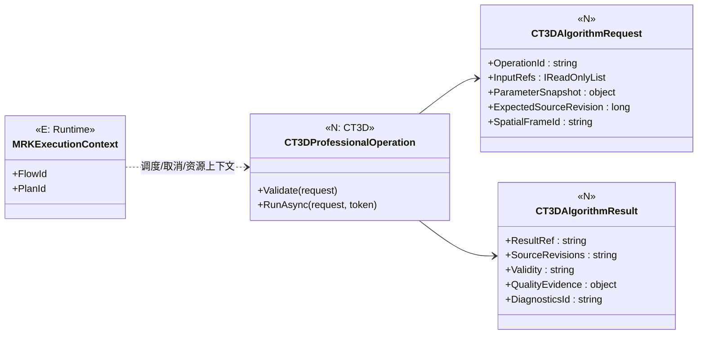

不要为所有小函数强制建立 `IAlgorithm/Adapter/Facade/Provider` 四层；首个Surface/Fit工作包允许真实的直接静态/服务算子，达到多个可复用操作且确有组合需要时，再提炼统一接口。算法输出必须**包含质量与失败原因**，不把裸浮点数误当精密计量成品。

### 6.3 CAD / SolidWorks 接入必须分层

`STEP/IGES` 导入的几何表示、`Parasolid` 内核原生拓扑、`SolidWorks` 原生格式/装配/特征需要不同且真实可用的 SDK 与许可。文档只给出数据能力和边界，不假定 SDK 已装或许可有效。`CAD B-Rep → TriangulatedProxy` 仅用于渲染；最终偏差/计量应以明确校验过的几何模型和容差为准。

---

## 7. 四条工业典型场景（输入 → 操作 → 输出 → 验收）

### 7.1 场景 A｜CT → 表面 → 拟合 → 测量 → GD&T

| 步骤 | 输入→输出 | Owner与操作 | 验收判据 |
|---|---|---|---|
| 1 打开/校准 | RAW+元信息→Volume/SpatialFrame | FVO + CT3D加载，UI选择数据 | 原值、轴向、单位、尺寸和Spacing一致 |
| 2 表面确定 | Volume/Mask→Surface/质量 | CT3D，MVI显示阈值/边界预览 | 亚体素定位误差/残差有量化 |
| 3 几何拟合 | Surface点→Feature（平面/圆柱） | CT3D/FNU/FGE，UI选点/区域 | 参数估计、约束、异常点与残差 |
| 4 尺寸 | Feature+Datum→Measurement | CT3D，MVI渲染尺寸标注 | mm值、单位与源样本版本一致 |
| 5 GD&T | Feature+Datum+Tolerance→Result | CT3D；Inspection业务判定 | 与工程图定义相同的真值和公差规则 |

**图 11｜专业精度闭环。** 虚线是可视反馈，不是算法源输入替代。

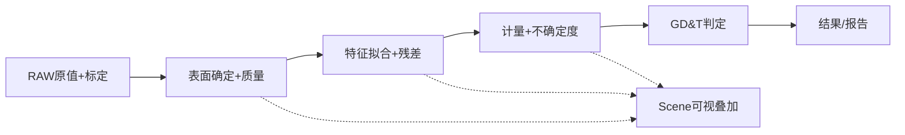

### 7.2 场景 B｜CT + CAD → 配准 → 偏差 → 报告

| 步骤 | 输入→输出 | Owner与操作 | 验收判据 |
|---|---|---|---|
| CT和CAD装载 | 原值CT与CAD B-Rep/装配 | FVO/CT3D、文件格式授权 | 单位/坐标/拓扑标签可辨 |
| 粗/精配准 | Surface/CAD+约束→Transform | CT3D+FGE/FNU，UI选Datum | 变换方向、收敛残差、对齐精度 |
| 名义-实际偏差 | 对齐后几何→signed distance field | CT3D数值、MVI/MPW热力色谱 | 正负号、样本密度、超差面积/体积 |
| 报告 | 结果+阈值+溯源→Report | Inspection/CT3D/既有工程机制 | 重新打开、同参数重算、可追溯 |

**图 12｜配准与报告的目标时序。** 专业结果在没有图形窗口时也必须能形成。

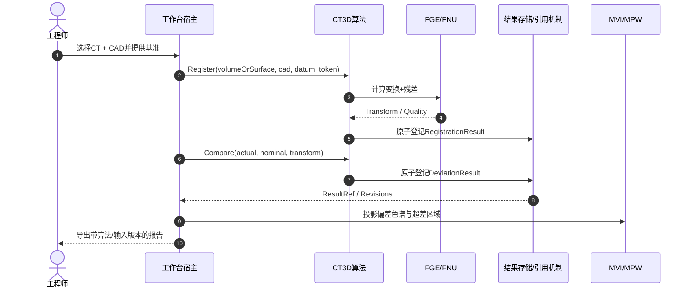

### 7.3 场景 C｜CT → 分割 → 缺陷 / 壁厚 / 多材料

| 步骤 | 输入→输出 | Owner | 验收判据 |
|---|---|---|---|
| 多材料分割 | Volume→LabelVolume/MaterialRegions | CT3D工艺 + FVO通用容器（待Owner复核） | 混合灰阶、孔隙/材料界面错分率 |
| 缺陷识别 | Mask/Volume/Surface→DefectResult | CT3D | 3D体积、数量、位置、细长比、连通性/误检漏检 |
| 壁厚/装配 | Surface(s)→Thickness/Gap/Interference | CT3D | 边界误差传播、最薄点及位置、物理单位 |
| 质量判定 | 专业结果+产品规则→InspectionResult | Inspection | 阈值版本、复核状态、工件ID及追溯 |

### 7.4 场景 D｜多对象显示 → 交互 → 动画 → 保存重放

| 步骤 | 输入→输出 | Owner | 验收判据 |
|---|---|---|---|
| 建立场景 | Volume+Surface+CAD+Defect Ref→SceneItems | MVI；宿主解析SourceRef | 改显示显隐不修改专业数据 |
| 多视图和工具 | 选中对象/三刀/相机→ViewRevision | MVI状态+MPW视口 | 相机切GPU/WPF不跳变，多视口联动可选择 |
| 动画 | Timeline/Keyframe→Playback | 工程定义和MVI运行态分别拥有 | 时间轴、播放/暂停、装配爆炸、多视图同步 |
| 保存重放 | 资源引用/变换/视图定义→Project/Case Manifest | MEM及已有Artifact机制 | 关闭重开引用稳定，过期来源有诊断；不复制RAW |

**业务体验原则：** 工程师围绕“数据/对象/算法/结果”完成连续操作，不能在26张互不认得对方的测试页面间手工搬结果。

---

## 8. 接口、事件、命令、变更集与时间线程

### 8.1 八项实施合同与可直接查找的现有API（目标合同≠已实现SDK）


**本节是全文唯一实施合同总表**：每项明确真源、最小输入输出、异常及可复现验证；具体工程路径见第9章，能力ID见第10章。下列【N/P】签名或行为只是建议，不是现有公共API。

| ID | 必要输入→输出及真源 | 主要Owner/现状 | 失败规则与第一批验收 |
|---|---|---|---|
| **C01 原始精度** | 原始体素/SourceRevision→无损标量或`PrecisionUnavailable` | FVO：`FVOVolumeData`【E/R】 | 只有R8预览不得作计量；UInt16/Float32数值、同句柄及错误ByteLength反例 |
| **C02 空间与单位** | Voxel/Spacing/Origin/Direction→Physical→Part/CAD Frame | FVO来源Frame【E】；通用Frame身份/链【N】；FGE/FNU数学、CT3D基准 | 手系、单位、方向、体素中心、奇异变换拒绝；往返残差有阈值 |
| **C03 身份/结果** | MEM资源Ref+SourceRevision+算法上下文→ResultRef/有效性 | MEM真源【E】；CT3D CaseSession【N】 | 旧输入失效标Stale；不得创建第二份Project/Undo/体数据 |
| **C04 Scene/交互** | SourceRef+Frame+MVI状态→可视Scene/选择/相机 | SceneState/SceneItem/Camera/VolumeView【E】；完整工具/ViewSession【N】 | 多视图一致、坐标回环与Undo；不得持有专业数值真值 |
| **C05 GPU资源** | 预览+设置+ViewSnapshot→GL帧/显式Fallback错误 | `MPWVolumeOpenGlControl/MPWVolumeRenderHost`【E/R】 | Context线程、半初始化/重复关闭/失败恢复；WPF切面不算Raymarch |
| **C06 参数变化** | `CT3DRenderingParameterValues`→LUT/Uniform/Scene Flags+Revision | Settings/ChangeSet与MPWVolumeRenderScheduler【E/R】；完整版本向量【N】 | 校验失败整体拒绝；Uniform-only不上传LUT；已提交/已应用/已呈现版本分开 |
| **C07 专业算法** | 输入Ref+Frame+Params+取消→Surface/Fit/Measure等Result+Quality | 离散边界/Mesh/球/局部平面【E】；完整算法族见E.5【N/P】 | 退化、不收敛、精度缺失和取消不得成功提交；Headless正反例 |
| **C08 工程交付** | 专业结果Ref→MEM持久化/MRK任务→重开与报告 | 既有MEM/MRK/MDS/诊断【E】；3D纵切片【P】 | 版本/授权/Trace可追溯；不自建第二套运行与消息体系 |

**已确认可查的正式API**：`CT3DVolumeLoadService.LoadRawPreviewAsync`、`MVIVolumeViewState.SetSlices`、`CT3DRenderingSettings.ApplyParameters`/`ApplyParametersWithChangeSet`、`MPWVolumeOpenGlControl.SetVolume`/`UpdateTransfer`/`CaptureFrame`。**`CaptureCaseSnapshot`、`ProjectScene`、`EnqueueRender`、`PrecisionUnavailable`均属拟议接口/语义，待Owner/测试批准**。如现有真实签名有差异，必须以源文件为准，不凭文档补造方法。

**最小事务纪律**：专业参数先验证再提交；Volume切换旧请求先取消并进行RequestEpoch过滤；后台RAW计算使用现有原值Lease并补齐外层来源/标定版本校验；GPU失败保留最新合法参数/数据快照供重建；工程保存仅经既有MEM机制。算法结果发布与场景通知分开，通知异常不倒灌为伪成功或伪回滚。

### 8.2 渲染变更分类与Revision

| 变化 | 数据归属 | MPW所需操作 | 禁止行为 |
|---|---|---|---|
| VolumeData | FVO/Case | 更新Preview或Bricks、变更GpuEpoch关联 | 保留前一份纹理而冒用新数据 |
| Transfer/LUT | FVO曲线+CT3D设置 | 重建并上传 LUT | 仅改采样/材质却重新扫描整个体 |
| Uniform/Lighting | CT3D设置 | glUniform更新+合帧 | 重上传体纹理 |
| Slice/Oblique | MVI+FVO | 更新切面位置/取样纹理 | 维护第二三刀位置 |
| Camera | MVI唯一相机 | 更新View/Projection | GPU/WPF分别存独立Camera真源 |
| SceneGeometry | 结果Ref + MVI Scene | 变更相关VAO/VBO、拾取加速结构 | 改变专业Mesh/CAD原值 |

建议使用 `CaseDataRevision, SettingsRevision, ViewRevision, SceneRevision, GpuEpoch` 的**版本向量**；每个 Owner 自己发版本，MPW只缓存“已经上传/显示”的序号。`RenderSnapshot`是一次显示所需的只读投影、无编辑权。

### 8.3 渲染参数时序

**图 13｜UI→CT3D→MPW更新时序。** Validation失败保持旧设置；GL失败不让合法专业设置丢失，恢复后按最新Snapshot重放。

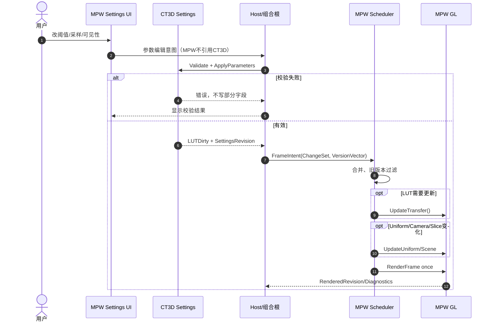

### 8.4 体数据切换与资源释放时序

**图 14｜加载B替换A（目标事务）。** CPU来源提交与GPU显示分开；加载失败保留A，B来源提交后GPU失败显示B的明确WPF回退，禁止把A纹理标为B。旧资产释放受既有RAW租约保护，统一来源版本合同仍待补齐。

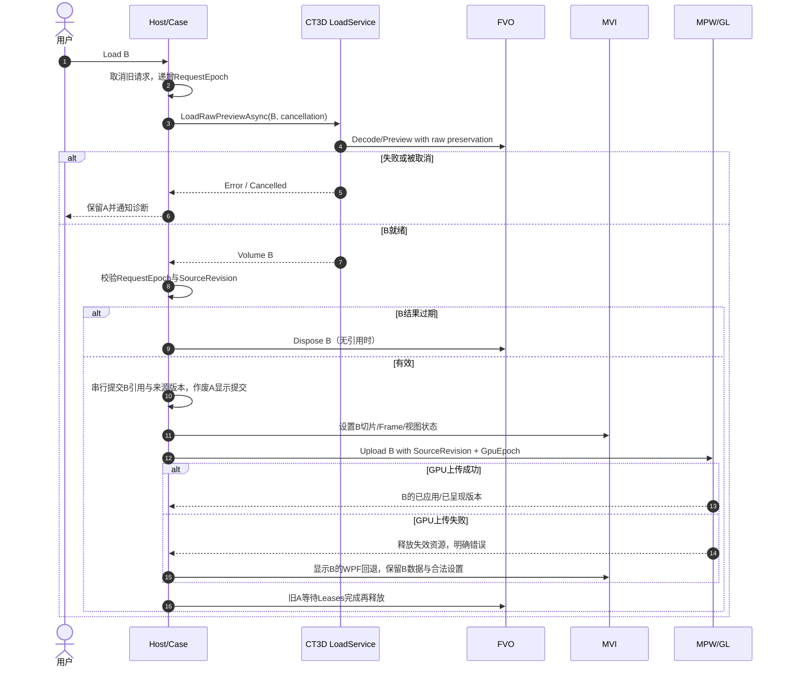

### 8.5 生命周期/多线程/AOP运行原则

- **WPF Dispatcher**：持有 WPF 控件和目前的 WGL Context；GL CRUD/Render/ReadPixels 均在正确 Context 所属线程上。
- **算法后台线程**：只读 SourceLease、不可变输入、取消/进度，不能触碰 WPF/GL；提交前校验 Revision/SourceRef，旧结果显式Discard。
- **工程事务**：持久变更只走既有 MEM 授权/Undo/Revision；专业结果提交与可视通知分离，“通知失败”不应被错误解释成“事务回滚”。
- **显存/内存**：Budget + Lease + Eviction + Epoch独立记录。目标退出：取消旧请求→停止提交新帧→解绑Scene订阅→GPU在所属线程释放→结束任务并归还Lease→释放原值。当前SafeHandle租约也允许先Dispose Volume、物理释放延后至最后租约归还；这不等于Volume任意并发修改安全。Context失效递增Epoch，禁止旧回调更新新资源。
- **AOP/GoF**：State用于GPU生命周期；Observer用于MVI变化；Command复用MRK；Composite仅Scene有真实分组时；Strategy在第二个真实算法/渲染后端出现后引入；显式日志/性能/安全边界复用FLD/FCR/MRK，不在Shader热循环织入反射或代理。

---

## 9. 现有代码 → 拟议改造（开发者查找入口）

| 文件（相对仓库根） | 当前真实类/职责 | 本版动作 | 优先级 |
|---|---|---|---|
| `Foundation/Volume/Data/FVOVolumeData.cs` | 原值、预览、SpatialFrame、严格读取与原值租约入口【E】 | 补来源/标定修订与统一提交合同 | P0 |
| `Foundation/Volume/IO/FVORawVolumeLoader.cs` | RAW及内存来源、预览加载【E】 | 格式/字节序/取消/原值保真加强 | P0 |
| `Foundation/Volume/Memory/FVOUnmanagedRawVolumeBuffer.cs`、`FVOOriginalScalarLease.cs` | 非托管原值/SafeHandle、任务级RAW读取保护【E】 | 分块租约/多GB预算压力、并发使用边界验证 | P0/P2 |
| `Foundation/Volume/Slicing/FVOSliceImageBuilder.cs` | 正交切片、原像素映射【E】 | 与三维坐标规范双向一致 | P0 |
| `Foundation/Volume/Slicing/FVOObliqueSliceBuilder.cs` | 任意切采样【E】 | 后续厚层/曲面重切非本阶段 | P3 |
| `Foundation/Volume/TransferFunctions/FVOVolumeTransferFunctions.cs` | 单一传递函数控制点/LUT【E】 | 禁止新建第二曲线真源 | P1 |
| `Foundation/Geometry/` | 2D与double 3D点/向量/索引Mesh【E】 | 通用Frame/变换/点云查重并核ADR-02；不重复新增点与Mesh | P0/P3 |
| `Foundation/Numerics/LinearAlgebra/FNULinearAlgebra.cs` | 线性代数基础【E】 | 作为拟合/配准数学底座，不冒称专业算子 | P3 |
| `Mechanism/Visual/Volume/MVIVolumeViewState.cs` | 三刀/视口状态与MVI3DCameraState相机真源【E】 | 已供WPF与OpenGL绑定；后续Scene/保存重开 | P0/P1 |
| `Mechanism/Visual/MVISceneItem.cs` | 既有2D工程可视投影【E】 | 不改造成3DScene公共父类 | 约束 |
| `Mechanism/Presentation.Wpf/Volume/Views/MPWVolumeFourViewWorkbenchControl.cs` | 可嵌入四视图【E】 | 作为正式显示组合控件扩展，不复制 | P1 |
| `Mechanism/Presentation.Wpf/Volume/Views/MPWVolumeSliceSceneControl.cs` | WPF空间切面；有局部相机【E/R】 | 消费MVI相机，同视角WPF fallback | P1 |
| `Mechanism/Presentation.Wpf/Volume/Rendering/OpenGl/MPWVolumeOpenGlControl.cs` | WGL/GL/输入/相机矩阵/截图【E/R】，已消费统一MVI相机 | 进一步抽Context/Resource及Scheduler/Scene，保留GLSL | P1/P2 |
| `Mechanism/Presentation.Wpf/Volume/Rendering/OpenGl/MPWVolumeShaderSources.cs` | GLSL Raymarch源码【E】 | 原版语义/画质保真，渐进拓展RenderPass | P1 |
| `Mechanism/Presentation.Wpf/Volume/Editors/MPWVolumeRenderingParametersControl.cs` | GPU参数输入界面【E】 | 不保有CT3D设置真源 | P1 |
| `Professional/CT3D/Visualization/Rendering/CT3DRenderingSettings.cs` | Settings/Apply/ChangeSet/ParameterRevision【E+历史T】 | 保留现有API；补外部曲线变更捕获与MPW版本消费，不再重复创建ChangeSet | P2 |
| `Professional/CT3D/Visualization/Loading/CT3DVolumeLoadService.cs` | RAW预览/完整缓存异步服务【E】 | 版本取消/资源交换时序正式化 | P0/P1 |
| `Tests/TestCenter/Manual/Volume/TCTManualVolumeGpu.cs` | 正式MPW RenderHost消费者、CT3D ChangeSet参数桥接【E】 | 仅保留用户输入/状态与测试；未来MPW Scheduler取代局部dirty | P1/P2 |
| `ReferTo/Vision/{CxECT3DViewer,CxECTVolumeCore,CxECTVolumeWinForms}` | 成熟旧行为参考【只读】 | 只对照迁移、画质、命令、相机与精度，不编辑 | 全程 |

---

## 10. 26项能力追踪矩阵（需求编号→Owner→源码→证据→验收）

**说明：** R19～R45共27条，R19+R20共同映射能力01，形成26项；R46～R59深化精度、组合和动画要求；**新截图补齐R60～R64的未来扩展，见E.9，不提升当前交付范围**。R01～R10/R65～R90仍缺原文。E+T为源码及历史测试，E仅源码，P规划，H硬件/工业缺口；CI仅适用第11章固定SHA。本表描述现状，附录E描述目标，不能互相替代。

| № | 能力 | 可核要求编号* | Owner | 可查找入口（`Foundation/`等前缀省略） | 当前判定 | 下轮关键验收 |
|---|---|---|---|---|---|---|
| 01 | 多源输入 | R19–20 | FVO/CT3D | FVO/IO/FVORawVolumeLoader.cs | E+T；其他格式P | 原值多位深/RAW异常，DICOM/NRRD/CAD逐格式实测 |
| 02 | 空间与质量 | R21、R52 | FVO/FGE/CT3D | FVO/Spatial/FVOVolumeSpatialFrame.cs | 物理Frame/方向与正逆变换E；可信源标定接入P | 各向异性/旋转/镜像、真实CT标定与回环误差 |
| 03 | 处理与变换 | R22 | FVO/CT3D/FNU | FVO/Slicing/FVOObliqueSliceBuilder.cs | 插值E；通用3D处理P | 滤波重采样、原值容差与区域边界 |
| 04 | 大数据/LOD | R23、R53 | FVO/MPW | FVO/Memory/FVOOriginalScalarLease.cs | SafeHandle原值租约E；GPU LOD P | >2GB压力、并发租约/取消、GPU显存预算 |
| 05 | 可视化/渲染 | R24 | MPW/CT3D | MPW/Volume/Rendering/OpenGl/MPWVolumeOpenGlControl.cs、MPWVolumeSurfaceProjection.cs | Raymarch/Host E；Surface点/索引Mesh双渲染E，硬件H待实测 | Mesh与Volume遮挡/透明混合、CAD与GPU像素对照 |
| 06 | MPR与任意切 | R25 | FVO/MVI | FVO/Slicing/FVOSliceImageBuilder.cs | 正交/任意切E+T | 曲面重切、厚层投影与真实RAW |
| 07 | 四视图联动 | R26、R57 | MVI/MPW | MVI/Volume/MVIVolumeViewState.cs | 四视图/十字线E+T；统一Camera E | 鼠标/DPI/窗口变化与视角保真 |
| 08 | 3D ROI/标注 | R27、R58 | MVI/MEM/CT3D | MVI/Volume/MVI3DSceneState.cs | 场景对象引用/选择E；3D ROI编辑P | 专业ROI编辑/持久化/Undo/物理坐标回环 |
| 09 | 动画/时序 | R28、R54–56 | MVI/MPW/MEM | MPW/Volume/Views/MPWVolumeSliceSceneControl.cs | 相机E；完整动画P | 关键帧/时间轴/装配动画/视频与重开 |
| 10 | 分割/提取 | R29 | CT3D/FVO | CT3D/ [拟新增] | P | Mask/连通域/标定标签量值 |
| 11 | 表面确定 | R30、R46 | CT3D/FGE/FNU | CT3D/Analysis/CT3DSurfaceSphereAnalysis.cs、CT3DVoxelBoundaryMeshExtractor.cs | 原值离散点及体素外露面E；早期UInt16 Mesh --volume T | 亚体素等值面、材料边界与工业真值 |
| 12 | 点云/网格 | R31 | FGE/CT3D | FGE/Meshes/FGETriangleMesh3D.cs；CT3D/Analysis/CT3DVoxelBoundaryMeshExtractor.cs | 真实双精度共享顶点/索引Mesh、法向、边/顶点bow-tie非流形、连通面壳数、带符号体积E；固定SHA UInt16真值T | 亚体素、修补/简化/LOD、真实GPU面片与精度实测 |
| 13 | 几何拟合 | R32、R47 | CT3D/FNU/FGE | CT3D/Analysis/CT3DSurfaceSphereAnalysis.cs、CT3DMeshPlaneAnalysis.cs；FNU/LinearAlgebra/FNULinearAlgebra.cs | 球体SVD及局部Mesh任意向PCA平面拟合E；固定SHA 24497fe2 的 --volume/WPF T；后续跨Frame负例待核 | 完整ROI拾取、圆柱/鲁棒/约束拟合、工业标准件残差及不确定度 |
| 14 | 几何配准 | R33、R48 | CT3D/FGE/FNU | FNU/LinearAlgebra/FNULinearAlgebra.cs | 基础数值E；ICP P | 变换已知真值/坐标链/收敛残差 |
| 15 | 尺寸测量 | R34、R51 | CT3D/FGE | CT3D/Analysis/CT3DSurfaceSphereAnalysis.cs | 球径毫米初步数值E；完整工业计量P | 基准/标定/精度/不确定度与量具对照 |
| 16 | GD&T | R35 | CT3D/Inspection | CT3D/ [拟新增] | P | 各形位公差语义、Datums及工业量具对照 |
| 17 | CAD集成 | R36、R50 | CT3D/专业SDK | CT3D/ [需确认SDK] | P/H许可未核 | STEP/IGES/Parasolid/SW拓扑/装配/单位 |
| 18 | CT-CAD差异 | R37、R49 | CT3D/Inspection | CT3D/ [拟新增] | P | 正负偏差、超差区域、差异统计与报告 |
| 19 | 逆向工程 | R38 | CT3D/FGE | FGE/ [拟新增NURBS基础] | P | 点云→曲面/NURBS及误差与可编辑性 |
| 20 | 三维缺陷 | R39 | CT3D/Inspection | CT3D/ [拟新增] | P | 气孔/裂纹3D真值、误检漏检、复核 |
| 21 | 壁厚/装配 | R40 | CT3D/Inspection | CT3D/ [拟新增] | P | 最薄壁厚/间隙/干涉的物理真值 |
| 22 | 多材料/部件 | R41 | CT3D/FVO | CT3D/ [拟新增] | P | 材料边界、分部件统计、标签一致性 |
| 23 | 算法实验调试 | R42 | CT3D/FLD/TestCenter | Tests/TestCenter/Manual/Volume/ | 测试基础E；专业调试P | 输入输出/中间结果/性能/取消/异常 |
| 24 | 批量自动化 | R43 | MRK/CT3D/Inspection | MRK/Execution/ [既有运行] | 平台底座E；3D链P | 重复性、版本固定、故障恢复、真实任务 |
| 25 | 数据输出报告 | R44 | CT3D/Inspection/MPW | FVO/IO/FVOObliqueSliceExporter.cs | PNG/Raw切面E；完整交付P | 网格/CAD/报告/视频及可复核来源 |
| 26 | SDK/插件扩展 | R45、R59；R60～62未来约束 | MLC/CT3D/专业 | CT3D/ + MLC/Modules/ | 平台机制E；完整3D SDK P；本阶段不开发AI | Schema/授权/ABI、厂商对象隔离；AI只留模型/质量扩展点 |

**矩阵补充说明：** `...26项能力映射与实施验收_V0.1.md`仅作历史，本章是唯一26项状态表。追踪记录至少包含RequirementId、原文/截图Hash、Owner、SourcePath、CaseId、CI-SHA、硬件证据、状态/日期。当前可见R11～R64，不据此推断完整需求只有64条；历史90索引中的其余36项仍待来源核实。

### 10.1 需求真实性与缺口台账

| 要求范围 | 实证状态 | 处理策略 |
|---|---|---|
| R11～R18 | 用户截图中产品形态与总目标可读 | 作为本架构全局约束（不与26项单独算法一一对应） |
| R19～R45 | 用户截图含27条说明、合并R19+R20后对应26大能力 | 已在上表按原编号对应，完整覆盖26项 |
| R46～R59 | 用户截图列出高精度/几何/配准/CAD/多材料/动画/复用等深化要求 | 已与相关能力行交叉索引；对不完全对应的条款保留全文核验 |
| R60～R64 | 2026-10-29用户第二张截图直接可读 | AI仅预留、4D/DVC、体网格/仿真扩展，具体边界见E.9 |
| R01～R10；R65～R90 | **未取得可逐字核实的原文，共36条** | 保留未知，不凭推断签收 |

---

## 11. 证据与 CI：历史通过不能推出本版工业验收

本轮R5仅做需求驱动架构设计及源码静态核对，**没有重新执行Windows Build、数值/UI测试、GPU或工业验收，也未在线复核Actions**。以下固定提交与运行状态来自仓内既有实施台账；不宣称它们证明当前HEAD或R5候选类已经实现。后续应在对应台账按新SHA更新，避免在总纲逐次追加互相冲突的“本轮”状态。

| 历史实现/验证范围 | 仓内记录的固定证据 | 适用边界与详细事实来源 |
|---|---|---|
| 严格原值/缓冲安全、MVI相机绑定 | `b5b9ca8e`；专项通过而默认ExecutionPolicy失败，整体Workflow FAIL | [P0原值/相机记录](../Implementation/CxVisual_通用三维视觉工作台%23P0原值安全与MVI统一相机首轮实现_V1.0.md)；不冒称全绿 |
| 正式MPW GPU Host | `47ec90e9`；旧版记载Graphics PASS | [P1生命周期记录](../Implementation/CxVisual_通用三维视觉工作台%23P1正式GPU生命周期迁回MPW_V1.0.md)；不是实体显卡全配置签收 |
| ChangeSet/调度、RAW租约与空间Frame | 当前有源码；各增量须按所属SHA查验 | [P2调度](../Implementation/CxVisual_通用三维视觉工作台%23P2渲染变化合并与版本调度_V1.0.md)、[C02 Frame](../Implementation/CxVisual_通用三维视觉工作台%23C02原始体素空间Frame首批实装_V1.0.md)及P0租约补录 |
| 离散边界/球拟合、MVI多对象及点投影 | 专业服务和WPF/GL接线有源码 | [V01记录](../Implementation/CxVisual_通用三维视觉工作台%23V01原值边界球拟合与MVI多对象引用首包_V1.0.md)；不是亚体素/工业计量通过 |
| UInt16体素Mesh与拓扑 | `f7a9c771` / Run `40681318710`；后续bow-tie `e77cae8d9` / `40687637635` | [V02记录](../Implementation/CxVisual_通用三维视觉工作台%23V02原值三角Mesh与拓扑质量闭环_V1.0.md)第三/六节；后加断言不能借旧SHA |
| Float32非有限值保护 | `4d6c558c` / Run `40687957944`，台账记SUCCESS | V02第七节；合成负例不代表真实Float32 CT标定通过 |
| 局部平面PCA-SVD、Headless与真实WPF路径 | `24497fe2` / Run `40691495873`，台账记Release x64/Smoke/WPF SUCCESS | V02第八/九节；随后`3a27e161`跨Frame断言及`dc58b341`CI路径补强须另核；不是GD&T/工业不确定度签收 |

### 11.1 证据等级

| 等级 | 允许的表述 | 不允许推断 |
|---|---|---|
| D0 规划 | UML/需求已写明 | 不能说类已经存在 |
| D1 源码 | 文件/方法已检查 | 不能说运行成功 |
| D2 编译 | 对应SHA的Windows x64 编译通过 | 不能说UI功能可用 |
| D3 数值/自动测试 | 同SHA测试、日志、Case可复现 | 不能说实GPU画质或工业测量准确 |
| D4 真实WPF UI | 真窗口事件/控件/截图或UIA通过 | 不能替代GPU芯片驱动实测 |
| D5 真实GPU | 显卡/驱动/截图/显存/重入证据 | 不能替代工业CT/量具真值 |
| D6 工业场景 | 真实CT/ECT与CAD、量具/真值、HIL/复核 | 仅覆盖被测配置与样本，不自动涵盖全部设备 |

### 11.2 固定证据引用与截至本次查询的状态（2026-10-28）

| 被验证对象 | 固定SHA或Run | 实际证据 | 不得外推 |
|---|---|---|---|
| R5当前源码核查 | `0487b050f73fff9b3efe03e561ca017b9a02e16a` | 静态抽查FVO/FGE/FNU/MVI/MPW/CT3D及MEM/MDS实际边界 | 本轮未执行Build/测试/硬件，不将历史PASS外推到当前HEAD |
| CT3D ChangeSet首包 | [`f0efc6d`](https://github.com/oudream/cx-visual-x3/commit/f0efc6dbe52b71e16bac3058e499a960e6cb0246) + [Windows Imaging #40651508924](https://github.com/oudream/cx-visual-x3/actions/runs/40651508924) | Release x64构建、`--volume`数值回归与真实WPF三维空间切面均PASS | 不说明GPU显卡、CAD计量已通过 |
| 同一首包运行 | [Runtime #40651508951](https://github.com/oudream/cx-visual-x3/actions/runs/40651508951)、[Engineering #40651508904](https://github.com/oudream/cx-visual-x3/actions/runs/40651508904) | 对应工作流PASS | 不是3D全产品E2E |
| 同一首包Studio | [Studio S1 #40651508929](https://github.com/oudream/cx-visual-x3/actions/runs/40651508929) | 构建通过，但配置组合布局STA断言FAIL | 与CT3D改动因果关系未成立，不能说全绿 |
| 历史配置底座 | [#40653205687](https://github.com/oudream/cx-visual-x3/actions/runs/40653205687)、[#40653205684](https://github.com/oudream/cx-visual-x3/actions/runs/40653205684) | 旧版记录的独立配置和Config L1通过 | 不是本轮HEAD/Imaging/实GPU验证 |
| 旧四视图迁移 | [Windows Imaging #40270816787](https://github.com/oudream/cx-visual-x3/actions/runs/40270816787)、[#40271273307](https://github.com/oudream/cx-visual-x3/actions/runs/40271273307) | 旧提交WPF/三刀正例 | 不是今日HEAD与工业机器测量验收 |

**R5源码状态摘要：** Settings/ChangeSet/ParameterRevision、严格原值、RAW租约、FVO Frame、MVI Camera/Scene、MPW Host/Scheduler、CT3D离散球/Mesh/平面均有源码。可变设置子对象仍需显式通知；Scheduler本地Revision/Epoch不等于完整版本向量或PresentedRevision；大数据固定引用、正式专业宿主、ROI/持久化、高阶算法和硬件验收仍有缺口。目标类关系见附录E。

### 11.3 ReferTo 保真审计边界

旧功能审计应沿用 `DOCS/Testing/CxVisual_通用三维视觉工作台#ReferTo功能保真审计与验收矩阵_V1.0.md` 的 R01～R32；它覆盖RAW、原值、四视图、十字线、GLSL、截图、传递函数、任意切、参数和释放。对照 **入口→真实按钮/命令→Owner动作→数据变化→渲染/结果→正反测试**。  
保留`ReferTo/Vision`只读。GPU生命周期已经回到MPW，统一相机与基础Scene已有源码。当前重点是正式组合宿主、专业资产/Frame/结果持久合同、ROI与工具组合、混合渲染、大数据预算及工业算法/硬件证据；旧功能保真仍需持续回归。


### 11.4 三维测试的五道独立门禁

| Gate | 具体入口或活动 | PASS需要什么 | 常见误判 |
|---|---|---|---|
| G1 数值与结构 | Windows `CxVisual.Tests.ArchitectureSmoke.exe --volume` + DAG | 同SHA的Volume、CT3D LUT/ChangeSet、空间等正反例 | 类存在即算通过 |
| G2 真WPF交互 | `--volume-viewer-smoke`、真实鼠标/控件UIA | 三刀/视口/切换/截图/关闭后释放 | 模拟无UI方法调用冒充操作 |
| G3 真实GPU | `--volume-gpu-smoke` + 目标GPU/驱动 | 真实WGL/GLSL帧、故障注入、纹理/显存/反复开关 | WPF三切面等于Raymarch |
| G4 工业数值 | 校准件、CAD参照、量具/真值 | 原始精度、坐标方向/单位、Surface与测量统计误差 | GPU像素效果好就代表测量准 |
| G5 工程与自动化 | Studio保存/重开+Case回放+MRK+Inspection | 资源版本/Undo/ResultRef/Trace/报告一致，可重跑 | 每个TCT页面单独有按钮就算全链路 |

任何 Gate 失败需分类为本轮、并行或历史原因；记录固定SHA和日志。**目标产品签收至少G1～G5相应能力全部具备，且真实机器的证据只对所测配置有效。**

---

## 12. 实施路线、依赖关系和交付物

**图 15｜分阶段依赖和质量门禁。** 不是开26条平行的、没有实证的小项目。

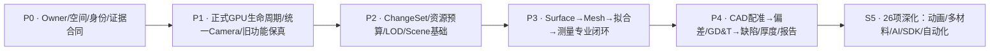

| 阶段 | 首选纵切片 | 交付件（不以空类型替代功能） | 通过门槛 |
|---|---|---|---|
| P0 架构基线 | FVO缓冲安全与原值精度门禁、3D Frame/单位合同、Case/View单真源 | 本文评审、ADR、Owner/DAG合同、固定版追踪、3D数值真值Case | 禁止循环引用、重复真源，三刀/RAW回归不倒退 |
| P1 当前成熟能力工业化 | 迁出TCT的GPU生命周期、MVI Camera→两Renderer | MPW RenderHost/Context/ResourceSet，TestCenter真消费 | Windows Release x64、真WPF/GL失败回退、重启/截图/释放，实卡专项单独验 |
| P2 持续渲染大数据 | ChangeSet/Revision/LOD/预算/渐进渲染 | GL帧调度与缓存、重复上传计数、Lease、诊断 | 取消与过期版本、显存/内存、峰值性能、多GB不同位深 |
| P3 第一个专业闭环 | 真实 CT Surface→Fit→Measure（含ROI） | 有质量报告的Surface/Mesh/Fit/Measurement + 叠加显示 | 标定球/柱、各向异性/噪声、残差与物理真值对照 |
| P4 计量与质量闭环 | CAD↔CT配准→偏差/GD&T→Defect/Thickness | 实CAD B-Rep、变换链、超差统计、质量报告和可追溯发布 | SDK许可/硬件、工装数据、计量标准/复核/工业Case |
| S5 深化扩展 | 复杂CAD/逆向/动画/4D/多材料/AI/SDK/批处理 | 逐能力闭环交付，保持原Versioned Resource Graph | 每项目需求×实现×真值×Windows/现场证据全链签收 |

**首个专业闭环的实际交付顺序**：V01 原始精度/坐标真值→V02 Surface点与质量→V03 球/柱/平面拟合和物理测量→V04 ResultRef/Scene显示与MEM保存重开→V05 CAD/缺陷深化；各阶段都要求至少一个正例、一个失败反例、固定SHA与对应Gate证据。专业数值可在无WPF环境先验证；实GPU画质另立专项，不互相代替。

**不新增工程的原则：** 每阶段先查既有项目和 `DOCS/02～04` Owner 表；必要最少类直接进入既有 `FVO/FGE/MVI/MPW/CT3D` 目录。CI红灯先判本轮、并行开发或历史问题，不修改其他协作者结果。

---

## 13. 开发合同：命名、GoF/AOP、异常与可测试性

### 13.1 核心设计思想

| 思想 | 何时应用 | 明确不做 |
|---|---|---|
| OOP/组合 | Case引用Artifacts、ViewSession组合Camera/Scene、MPW组合Context/Resource | 不新建全功能`Universal3DObject`继承体系 |
| GoF State | GPU启停、失败回退、交互小状态 | 不为每个枚举值强行新增一个State类 |
| GoF Observer | MVI事件、SceneRevision和已渲染版本通知 | 不另造全局MessageBus |
| GoF Command | 专业动作以统一MRK命令中心暴露，工程修改走MEM事务 | 不建CT3D私有Command/UndoStack |
| GoF Composite | 有真实Group/Assembly时引入SceneItem分组 | 不为每类Volume/Mesh分配十几个空派生层 |
| Strategy/Factory | 真实多算法/后端需求和可复现测试出现后 | 不提前造多套未实证Backend |
| AOP显式治理 | 算法/命令/资源边界的审计、取消、日志、性能 | 不在逐体素/GL热路径反射或动态代理 |

### 13.2 最低测试/反证清单

- **原值与坐标**：原体素Byte/UInt16/Float32、端序、各向异性、方向矩阵、坐标往返；删除源文件/超大RAW/取消加载正常失败。
- **GPU**：HwndHost尚未建好就关闭、Context半初始化、Shader编译失败、重复关开、Driver只支持1.1、GPU截屏验证；不可把WPF SliceFallback写成GPU PASS。
- **交互**：三刀、单窗/四窗、Camera切换不跳、ROI鼠标捕获丢失/取消、对象跨层拾取及命令状态准确。
- **计算**：拟合退化、离群点、配准不收敛、CAD单位不一致、GD&T依据错误、漏检/误检；每个算法固定金标准样本。
- **并发**：多次Load A→B→C/旧结果迟到、UI关闭后回调、跨线程GL调用拒绝、Lease延后释放、观察者抛异常不污染已提交结果。
- **可重现性**：同参数/同资源版本重新运行一致、源资产改变使旧结果Stale，保存重开保留ResultRef、AlgorithmVersion、准确度证据。

---

## 14. 待裁决 ADR 与文档维护约定

| ADR | 问题与建议 | 决定前必须查验 |
|---|---|---|
| ADR-01 | MPW→FVO已是实际依赖，但旧Skill存在“不需要”表述；保留现行DAG，不擅删 | 当前 `.csproj` 实际使用与DOCS/02～04工程归属 |
| ADR-02 | 3D空间/网格数据进入 FGE 还是其他已有基础Owner | DOCS/02～04 对 3D数据、SpatialFrame/Geometry、单位的Owner与API |
| ADR-03 | CaseDefinition→MEMContent，CaseSession→专业数据引用/租约；结果接入现有Core/Data | MRIObjectAddress/MPMAspect/Heap实际API，专业Payload及版本/Hash合同；不假定DataHandle已有 |
| ADR-04 | CT3D↔MVI协作经过宿主，是否绝不添加CT3D→MVI项目引用 | 当前csproj引用DAG及接口可复用性；优先宿主组合 |
| ADR-05 | CAD/Parasolid/SolidWorks输入策略、SDK/授权及B-Rep真值 | 实DLL、签署许可、x64/ABI、STEP/IGES样本、拓扑单测 |
| ADR-06 | GPU/CPU任务预算、LOD切换策略和精度质量档位 | 工业数据规模、实际显卡/驱动、原始精度红线 |
| ADR-08 | CT3D当前不引用MVI，`CT3DCaseSession` 是专业会话还是宿主可组合接口 | 现有CT3D/MPW/MVI依赖DAG；优先宿主装配，避免CT3D↔MPW引用循环 |
| ADR-09 | UI中的Session/Case/Scene配置保存哪些字段，何种行为进MEM Undo | 现有MEM工程资源、MVI二维Scene、运行态与保存重开用例 |
| ADR-10 | FVO原值读取出现Preview回退时如何强制拒绝计量 | 原值来源/格式/缓存生命周期、Byte/UInt16/Float32 精度反例 |
| ADR-07 | 原始需求及可追踪主键 | 新截图可核R11～R64；R01～R10/R65～R90仍缺原文，不推断不存在 |
| ADR-11 | 大Artifact固定引用与结果提交，按E.7补现有资源机制 | MEMAssetReference 64MiB/256MiB、MPMAspect 4MiB预算；外部URI/Hash、失败清理、重开/导入重映射；不得自建资源平台 |

### 14.1 长期维护规则

每次实质更新至少追加：**文档版本/日期、固定HEAD、涉及Owner、实际文件路径、能力编号/要求编号、旧行为保真、测试Case、Windows CI run URL、真实GPU/工业样本证据、剩余风险与ADR**。不得只记录Commit数，不得让“UML里有类”变成“代码已实现”。本V2.0应与对应迁移台账、26项映射及专项GPU/业务验收矩阵互相链接，不取代它们。

### 14.2 核查与参考入口

- 主仓库：<https://github.com/oudream/cx-visual-x3>；R5源码核查固定SHA：`0487b050f73fff9b3efe03e561ca017b9a02e16a`。
- 架构铁律：`AGENTS.md`、`.agents/skills/cxvisual-engineering/SKILL.md`、`DOCS/00`、`DOCS/01～04`（02～04大Excel内容待逐Sheet核验）。
- 既有专题：`DOCS/Architecture/CxVisual_专业视觉体系#通用三维视觉工作台——26项能力映射与实施验收_V0.1.md`。
- 成熟迁移：`DOCS/Migration/CxVisual_通用三维视觉工作台#成熟源码整体迁移——逐文件归属与保真验收清单_V1.0.csv`，及 `DOCS/Implementation/*通用三维视觉工作台*`。
- 验收：`DOCS/Testing/CxVisual_通用三维视觉工作台#ReferTo功能保真审计与验收矩阵_V1.0.md`，`...#ReferTo成熟功能保真审计与按钮命令验收_V1.0.md`。
- 用户提供原版设计 V2.0审阅稿；旧 ReferTo `CxECT3DViewer/REQUIREMENTS.md` 与 `CxECTVolumeWinForms/Rendering/RenderingArchitecture.md`，其代码只读。
- 原理参考：VTK 对象/数据处理-可视化管线、ITK 数据/流式处理/分割配准、计算机图形学的坐标/相机/渲染/数据结构；仅用于思想对照，不代表项目已集成其库或提供许可。

---

## 附录 A. GPU 资源对象 UML（详细设计，非总览）

本图为GPU内部拆分目标。OpenGlControl/ShaderSources/VolumeRenderScheduler已存在；Context/ResourceSet独立类仍为候选，GlApi当前是内部实现。实际Host持有Scheduler，不能按图再造另一份调度器。

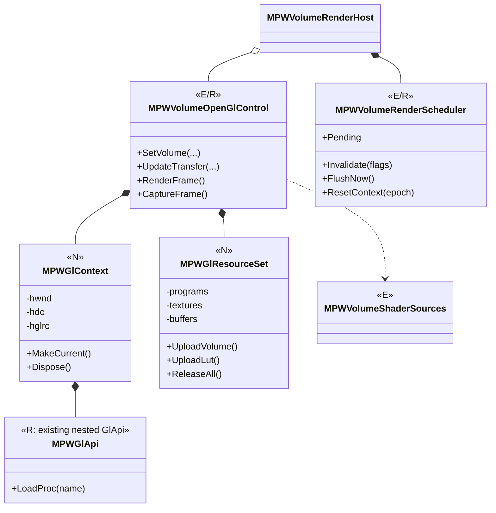

**限制条件：** GPU删除操作须同Context且在正确线程执行；半初始化和重复Dispose可恢复；RenderScheduler仅负责帧与失效合并，不承担 MRK 专业Job职责；FBO/RenderPass/多Backend有真实需求再引入。

## 附录 B. 专业结果构成（偏向组合而非深继承）

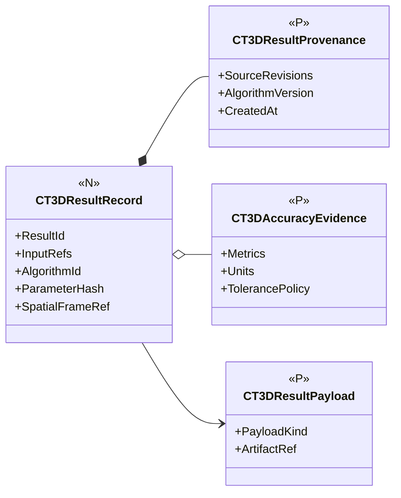

结果可以包含Surface、Registration、Measurement、Deviation、Defect等专业类型，但默认只统一**来源/质量/不可变引用**，不强迫所有业务Payload继承抽象基类。以上类型全是建议，落类前须核对现有 DataHandle/Artifact/Result 机制是否已经实现同义协议。

**基线候选结论：** 整体采用“**高精度数据与空间真源 → 专业算法资产/结果 → 独立3D Scene/ViewSession → MPW实时渲染；以MEM/MRK/MDS等平台机制支撑工程与自动化**”的职责分界。以完整26项作为长期产品地图，以最小纵向可验闭环推进；未批准的新增接口、完整90条原文、真实GPU/工业数据验收必须继续标注为待核项。


---

## 附录 C｜历史R01～R90索引的原文存在性及26项映射

**要求来源说明：** 本表是原文存在性与能力对照，摘要不是逐字全文。2026-10-29截图可读R11～R64；R01～R10/R65～R90仍留空。截图及SHA256见下方来源记录；26能力见第10章、全类目标见附录E；R19和R20共同归能力01。截图需求的覆盖不等于实现或验收。

| 本轮直接来源 | 可见范围 | 原文件SHA256 |
|---|---|---|
| [目标与26项、深化要求截图](Assets/CT3D_Requirements_R11-R59_20261029.png) | R11～R59 | `7acf8b09d802d0fc8d3ba50862a568b88d0d5a9af78aa8fd9ac63219190e5e3c` |
| [深化要求与未来扩展截图](Assets/CT3D_Requirements_R46-R64_20261029.png) | R46～R64 | `8365c7b265ba361a660828fdf6d15ab4f14c20ace0527a0e7855227f846355dd` |

原图仅归档作需求证据，未修改像素。R60的“本阶段不开发具体AI功能”为产品范围约束；表内待实现类是此次设计提案，不是已实施声明。

| 原始编号 | 可核见内容摘要（非全文） | 能力№ | 指向 | 条文证据 |
|---|---|---|---|---|
| R01 | **原文待补** | — | 暂不归属、不得凭推断签收 | 未核 |
| R02 | **原文待补** | — | 暂不归属、不得凭推断签收 | 未核 |
| R03 | **原文待补** | — | 暂不归属、不得凭推断签收 | 未核 |
| R04 | **原文待补** | — | 暂不归属、不得凭推断签收 | 未核 |
| R05 | **原文待补** | — | 暂不归属、不得凭推断签收 | 未核 |
| R06 | **原文待补** | — | 暂不归属、不得凭推断签收 | 未核 |
| R07 | **原文待补** | — | 暂不归属、不得凭推断签收 | 未核 |
| R08 | **原文待补** | — | 暂不归属、不得凭推断签收 | 未核 |
| R09 | **原文待补** | — | 暂不归属、不得凭推断签收 | 未核 |
| R10 | **原文待补** | — | 暂不归属、不得凭推断签收 | 未核 |
| R11 | 平台目标/三维工作台 | 全局 | 全局约束 | 截图可核 |
| R12 | 工业CT/检测/CAD应用 | 全局 | 全局约束 | 截图可核 |
| R13 | 可视化/交互/算法调试 | 全局 | 全局约束 | 截图可核 |
| R14 | Volume/PointCloud/Mesh/CAD多对象 | 全局 | 全局约束 | 截图可核 |
| R15 | 独立/嵌入/API | 全局 | 全局约束 | 截图可核 |
| R16 | 完整可靠便捷 | 全局 | 全局约束 | 截图可核 |
| R17 | NET48/WPF | 全局 | 全局约束 | 截图可核 |
| R18 | 避免单体应用 | 全局 | 全局约束 | 截图可核 |
| R19 | RAW/DICOM/NRRD/TIFF/点云/网格/CAD | 01 | 能力追踪表第10章 | 截图可核 |
| R20 | 文件/内存/指针/共享内存/流/批量 | 01 | 能力追踪表第10章 | 截图可核 |
| R21 | 数据质量/间距/方向/坐标 | 02 | 能力追踪表第10章 | 截图可核 |
| R22 | 滤波降噪/重采样/裁剪 | 03 | 能力追踪表第10章 | 截图可核 |
| R23 | 大数据LOD/GPU/缓存 | 04 | 能力追踪表第10章 | 截图可核 |
| R24 | 体绘/MIP等值面/几何渲染 | 05 | 能力追踪表第10章 | 截图可核 |
| R25 | MPR/任意切/厚层 | 06 | 能力追踪表第10章 | 截图可核 |
| R26 | 四视图与定位 | 07 | 能力追踪表第10章 | 截图可核 |
| R27 | 3D ROI/标注/图层 | 08 | 能力追踪表第10章 | 截图可核 |
| R28 | 动画/时间轴 | 09 | 能力追踪表第10章 | 截图可核 |
| R29 | 分割/多材料Mask | 10 | 能力追踪表第10章 | 截图可核 |
| R30 | 表面确定/亚体素 | 11 | 能力追踪表第10章 | 截图可核 |
| R31 | 点云/网格处理 | 12 | 能力追踪表第10章 | 截图可核 |
| R32 | 拟合与特征 | 13 | 能力追踪表第10章 | 截图可核 |
| R33 | 配准/ICP | 14 | 能力追踪表第10章 | 截图可核 |
| R34 | 距离/体积/厚度测量 | 15 | 能力追踪表第10章 | 截图可核 |
| R35 | GD&T形位公差 | 16 | 能力追踪表第10章 | 截图可核 |
| R36 | CAD/SolidWorks集成 | 17 | 能力追踪表第10章 | 截图可核 |
| R37 | CT/CAD偏差 | 18 | 能力追踪表第10章 | 截图可核 |
| R38 | 逆向工程/NURBS | 19 | 能力追踪表第10章 | 截图可核 |
| R39 | 三维缺陷 | 20 | 能力追踪表第10章 | 截图可核 |
| R40 | 壁厚/装配 | 21 | 能力追踪表第10章 | 截图可核 |
| R41 | 多材料/部件结构 | 22 | 能力追踪表第10章 | 截图可核 |
| R42 | 算法实验/诊断 | 23 | 能力追踪表第10章 | 截图可核 |
| R43 | 批量与自动化 | 24 | 能力追踪表第10章 | 截图可核 |
| R44 | 导出与报告 | 25 | 能力追踪表第10章 | 截图可核 |
| R45 | SDK/插件/扩展 | 26 | 能力追踪表第10章 | 截图可核 |
| R46 | 表面确定须有精度质量评价 | 11 | 能力追踪表第10章 | 截图可核 |
| R47 | 最小二乘/鲁棒/约束拟合 | 13 | 能力追踪表第10章 | 截图可核 |
| R48 | 人工/自动/局部配准与变换 | 14 | 能力追踪表第10章 | 截图可核 |
| R49 | CAD偏差/色谱/超差统计 | 18 | 能力追踪表第10章 | 截图可核 |
| R50 | SolidWorks原文件可信接入 | 17 | 能力追踪表第10章 | 截图可核 |
| R51 | 单位基准公差误差溯源 | 15 | 能力追踪表第10章 | 截图可核 |
| R52 | 体素/物理/世界/视图/CAD坐标 | 02 | 能力追踪表第10章 | 截图可核 |
| R53 | 原值与降采样分离 | 04 | 能力追踪表第10章 | 截图可核 |
| R54 | 相机/模型/剖切/关键帧动画 | 09 | 能力追踪表第10章 | 截图可核 |
| R55 | 装配/缺陷/测量动画 | 09 | 能力追踪表第10章 | 截图可核 |
| R56 | 时间轴/编辑/视频 | 09 | 能力追踪表第10章 | 截图可核 |
| R57 | 四视图直接复用 | 07 | 能力追踪表第10章 | 截图可核 |
| R58 | 对象/ROI/标注自由组合 | 08 | 能力追踪表第10章 | 截图可核 |
| R59 | 工具互操作与组合 | 26 | 能力追踪表第10章 | 截图可核 |
| R60 | 预留AI智能三维；本阶段不开发具体AI功能 | 26扩展边界 | E.9 | 本轮截图可核 |
| R61 | 后续AI去噪、超分、伪影修复、智能分割/缺陷识别 | 03/10/20未来扩展 | E.9 | 本轮截图可核 |
| R62 | 后续智能测量、几何识别、模型推荐/辅助分析 | 13/15/23未来扩展 | E.9 | 本轮截图可核 |
| R63 | 预留真实4D、位移/形变及数字体相关分析 | 跨能力时间/场扩展 | E.9 | 本轮截图可核 |
| R64 | 预留体网格、有限元交换、仿真及数字孪生扩展 | 12/25/26与Simulation | E.9 | 本轮截图可核 |
| R65 | **原文待补** | — | 暂不归属、不得凭推断签收 | 未核 |
| R66 | **原文待补** | — | 暂不归属、不得凭推断签收 | 未核 |
| R67 | **原文待补** | — | 暂不归属、不得凭推断签收 | 未核 |
| R68 | **原文待补** | — | 暂不归属、不得凭推断签收 | 未核 |
| R69 | **原文待补** | — | 暂不归属、不得凭推断签收 | 未核 |
| R70 | **原文待补** | — | 暂不归属、不得凭推断签收 | 未核 |
| R71 | **原文待补** | — | 暂不归属、不得凭推断签收 | 未核 |
| R72 | **原文待补** | — | 暂不归属、不得凭推断签收 | 未核 |
| R73 | **原文待补** | — | 暂不归属、不得凭推断签收 | 未核 |
| R74 | **原文待补** | — | 暂不归属、不得凭推断签收 | 未核 |
| R75 | **原文待补** | — | 暂不归属、不得凭推断签收 | 未核 |
| R76 | **原文待补** | — | 暂不归属、不得凭推断签收 | 未核 |
| R77 | **原文待补** | — | 暂不归属、不得凭推断签收 | 未核 |
| R78 | **原文待补** | — | 暂不归属、不得凭推断签收 | 未核 |
| R79 | **原文待补** | — | 暂不归属、不得凭推断签收 | 未核 |
| R80 | **原文待补** | — | 暂不归属、不得凭推断签收 | 未核 |
| R81 | **原文待补** | — | 暂不归属、不得凭推断签收 | 未核 |
| R82 | **原文待补** | — | 暂不归属、不得凭推断签收 | 未核 |
| R83 | **原文待补** | — | 暂不归属、不得凭推断签收 | 未核 |
| R84 | **原文待补** | — | 暂不归属、不得凭推断签收 | 未核 |
| R85 | **原文待补** | — | 暂不归属、不得凭推断签收 | 未核 |
| R86 | **原文待补** | — | 暂不归属、不得凭推断签收 | 未核 |
| R87 | **原文待补** | — | 暂不归属、不得凭推断签收 | 未核 |
| R88 | **原文待补** | — | 暂不归属、不得凭推断签收 | 未核 |
| R89 | **原文待补** | — | 暂不归属、不得凭推断签收 | 未核 |
| R90 | **原文待补** | — | 暂不归属、不得凭推断签收 | 未核 |

## 附录 D｜开发者核对清单

### D.1 第一个不破坏现有四视图的垂直改造路径

```mermaid
flowchart LR
 A["核对V2.0 Owner/ADR"] --> B["FVO原值安全与精度门禁"]
 B --> C["MVI单Camera，MPW两模式消费"]
 C --> D["MPW GPU生命周期从TCT正式收敛"]
 D --> E["CT3D ChangeSet接入帧合并调度"]
 E --> F["体数据/空间真值 → Surface → Fit → Measurement"]
 F --> G["CAD/偏差/缺陷/报告，按Case实证"]
```

**R5推荐最小下一工作包：** 不重复实现已有SetRawBuffer保护/严格读取/RAW租约。优先完成稳定资产/Frame/结果身份、Core大Artifact固定引用与专业Case Schema，使已有RAW→Mesh/平面支持保存关闭重开、来源失效和复算；并让正式宿主消费同一专业路径。工作包与反例见E.10，新增公共Owner/API仍先按ADR裁决。

### D.2 每轮 PR/直提 master 核对项

- [ ] 记录开始和提交时的最新 HEAD、并行提交差异，`ReferTo/`无改动；中文提交、不得强推覆盖。
- [ ] 逐条回答“Owner是谁、谁写真源、谁只读投影、跨工程依赖是否新增”。
- [ ] 新类型以【N】标记至源代码出现；源代码出现后仍要分别说明编译、自动测试、UI、GPU与现场证据等级。
- [ ] 算法说明输入输出、单位/Frame、来源版本、原始精度、结果质量、异常取消和资源所有权。
- [ ] GPU说明Context线程、GpuEpoch、幂等释放、重复装载、截图真伪与实卡证据。
- [ ] 26×90追踪条目更新，保留未核实原文，不因功能界面可见就填“通过”。
- [ ] Windows x64编译与结构/Owner DAG、`--volume`、WPF真控件、GPU实机（如条件具备）分别留证。

### D.3 文档维护的三种层级

1. **本文是高层“是什么/在哪里/如何协作/如何验收”的唯一三维总体入口**；不承载每个GL调用和数学推导的所有细节。
2. 旧 UML V1.0 GPU/State/Sequence 及 `DOCS/Implementation` 保留为**专题详细设计和代码证据**，与本文保持超链接与版本对应。
3. `DOCS/Migration` 的逐文件48项复用台账、`DOCS/Testing` 的R01～R32功能保真及专项CI是验收事实来源，不与架构稿相互代替。

**R5评审结论：** 既有F/M/P边界和三条不变量继续作为约束；现有Frame/Camera/Scene/Host/Lease不再标为全新候选，附录E中扩展的完整公共协议仍需ADR/Owner批准。需求可核范围已扩到R11～R64，其余36条未知；完整功能、GPU/工业计量及工程交付不能由设计推出通过。本轮完成的是需求驱动的设计优化与静态校准。

**修订记录（单一主文）**：V2.0原稿→R2读者层次与追踪→R3接口合同与时序→R4章节收敛→**R5（2026-10-29）：按用户截图R11～R64反推全类职责，补对象/空间/投影/工具/算法/动画/工程交付协作，校准已有源码状态**。保留本路径为唯一总纲；本轮设计未代表新增接口批准或代码验收。

## 附录 E｜由目标推导的完整类职责与协作设计（R5）

### E.0 怎样理解“全类”及本轮核查范围

这里展开的是**目标完整系统需要的主要类、接口、值对象与枚举角色**；不展开每个事件参数、私有缓存节点、错误枚举成员和厂商内部类。表中同一行列出的多个名字均有各自职责，紧密相关值对象可以同文件，不能机械转换为一类一文件或一类一项目。未列状态的候选统一为【N】，未来项明确【P】；【E/R】表示复用现有类型再演进，不表示所列目标成员已经存在。

核查过的源：当前FVO/FGE/FNU、MVI图像/体会话、MPW图像/体控件、CT3D Analysis、MEM工程/资产/类型声明、MDS Heap、MRK执行/命令合同；参考`ReferTo/Vision/CxECT3DViewer/REQUIREMENTS.md`、`CxECTVolumeWinForms/Rendering/RenderingArchitecture.md`及旧体数据/相机实现路径。旧源码提供原值/四视图/渲染复用证据，**没有据此宣称已具备CAD、工业表面确定或GD&T**。

**当前平台实际约束：** `MRIObjectAddress/MEMContent/MPMAspect/MEMAssetReference/MDSDataHeap`存在；未找到可直接当作统一大数据协议使用的`DataHandle/CasePackage`同名正式类型。`MEMAssetReference`当前单资产上限64MiB、工程总静态资产预算256MiB，`MPMAspect`负载上限4MiB；大RAW不能直接塞入这两个容器。MDS Heap采用值快照/Adapter机制，也不能假定`Set(volume)`会自动获得零复制原生租约。下文的专业引用与外部Artifact固定定位属于**待实现协议**，必须接回既有工程定义及MDS数据生命周期，而不是创建独立资源平台。

### E.1 数据、空间、几何的基础类

| 类型角色与建议类名 | Owner / 状态 | 核心成员或操作（目标） | 所有权与约束 |
|---|---|---|---|
| `FVOVolumeData`、`FVORawVolumeLoader`、`FVOUnmanagedRawVolumeBuffer` | FVO【E/R】 | 原始尺寸/格式、预览、加载、严格读取、接管与释放 | Volume拥有原值缓冲；Scene不拥有原始数组 |
| `FVOOriginalScalarLease` | FVO【E/R】 | `ReadScalar`、捕获时SpatialFrame、Dispose | 任务级只读RAW；同租约释放与读不得并发；来源修订还须外层固定 |
| `FVOVolumeSpatialFrame`、`FVOVoxelCoordinate3D`、`FVOPhysicalPoint3D` | FVO【E/R】 | 原始索引中心↔mm、Spacing/Origin/Direction、标定状态 | 表达来源映射，不管理CAD/夹具的完整Frame图 |
| `FVOVolumeRegion`、`FVOVolumeReadRequest` | FVO【N】 | 原始索引范围、分辨率/标量要求、插值/边界策略 | 精确请求与Preview请求显式区分；使用long验证尺寸乘积 |
| `IFVOVolumeRegionSource`、`FVOVolumeRegionLease` | FVO【N】 | `ReadRegionAsync(request, token)`；数据布局、Stride/端序、Dispose | 文件/映射/流的通用区域访问；块租约可来自既有RAW，不复制第二全体积 |
| `FVOVolumeCachePolicy`、`FVOVolumeCache` | FVO【N】 | CPU字节预算、块键、固定块与淘汰 | 键含AssetId/Revision/Region/精度；在用块不可淘汰；接现有预算监控 |
| `FVOLabelVolumeData` | FVO【N，Owner待核】 | 标签类型、分块、背景值、整数Region读取 | 容器只管分类值；材料名称与分割工艺归CT3D；标签重采样不做灰阶线性插值 |
| `FVOSliceImageBuilder`、`FVOObliqueSliceBuilder` | FVO【E/R】 | 正交/任意切原值采样、FIM输出 | 原值切片与窗宽后的显示像素分离 |
| `FVOSliceSamplingMap` | FVO【N】 | 输出像素→Voxel/Physical，采样平面/厚度/曲线路径、有效域 | 映射与该次Slice一起不可变返回；厚层/曲面图通常不是单个仿射平面 |
| `FGEPoint3D`、`FGEVector3D`、`FGETriangleMesh3D` | FGE【E/R】 | double坐标、索引、拓扑/法向、面积及受限体积 | FGE不把所有坐标固定为mm；Mesh质量不等于工业精度 |
| `FGEPointCloud3D`、`FGEPolyline3D` | FGE【N，ADR-02】 | 只读点/属性、分块枚举、可选有序曲线 | 与F12候选点云缓冲查重；大点云不能强制一次复制全量 |
| `FGEPlane3D`、`FGELine3D`、`FGECircle3D`、`FGESphere3D`、`FGECylinder3D`、`FGECone3D` | FGE【N，ADR-02】 | 解析几何值、投影/求交所需几何属性 | 对应F06既有候选，保留一个身份；不含拟合方法/残差/公差 |
| `FGENurbsCurve3D`、`FGENurbsSurface3D` | FGE【N，ADR-02】 | 阶数、节点矢量、控制点/权重、参数域、Evaluate/Derivative | 纯参数几何表示；修剪/拓扑/B-Rep由CAD Kernel负责；逆向拟合策略留CT3D，成熟后端可用适配查询避免复制内核 |
| `FGEAffineTransform3D`、`FGERigidTransform3D` | FGE【N，ADR-02】 | `TransformPoint/Vector/Normal`、Compose、TryInverse | 对应F07候选；刚体禁止缩放，法向使用适用的逆转置；单位转换显式 |
| `FGECoordinateFrame3D`、`FGEFrameReference`、`FGETransformChain` | FGE【N，ADR-02】 | 稳定FrameId/Revision/Unit；有向From/To变换边及正逆合成 | Frame数学元数据不持有MEM树；标定证据引用由专业/工程附着；拒绝矛盾路径 |
| `FGESpatialQuery3D` | FGE【N】 | 射线命中、最近点/三角面、距离与加速索引 | 通用数学查询；专业CAD最近点由真实B-Rep后端提供 |
| `FNULinearAlgebra`、`FNUPcaPlaneResult` | FNU【E/R】 | SVD/求解/正交平面结果 | 仅数值；新鲁棒、约束、非线性求解扩展同一FNU能力，不在CT3D复制求解器 |

**Frame适配纪律：** 原始Volume继续只持有现有FVO空间映射。通用Frame模型若获批准，以适配/引用暴露同一来源映射，不让两个对象同时可写Spacing/Direction。场景可视实例的摆放变换仅影响显示；执行配准或计量须显式选用已批准的专业变换结果。

### E.2 专业资产、Case与结果的类

| 建议类 | Owner / 状态 | 关键字段与操作 | 谁可以修改/提交 |
|---|---|---|---|
| `CT3DAssetReference` | CT3D【N】 | AssetId、TypeId、SourceRevision、ContentHash、FrameReference、可选MRIObjectAddress | 是专业数据引用值，不是新工程节点；重开保留身份，复制显示不产生新资产 |
| `CT3DInputBinding` | CT3D【N】 | RoleId、类型化资产引用、可选ROI/子元素引用 | 操作Schema验证输入角色/数量/类型；拒绝裸字符串文件路径当完整身份 |
| `CT3DCaseDefinition` | CT3D【N】 | 输入、专业操作/参数、基准/ROI/规则引用、输出策略 | 专业Schema DTO存MEMContent的既有声明中；不自带Save/Undo |
| `CT3DCaseSession` | CT3D【N】 | `OpenInputs/Resolve/Execute/CaptureSnapshot/Close`；已打开资产及结果的临时索引 | 不引用MVI/MPW；委托已有数据Owner取Lease；关闭后等待任务/租约，不能代替MRK调度 |
| `ICT3DAssetResolver` | CT3D【N】 | 校验引用/Hash/Revision，解析为所需Volume/Geometry/CAD受控读取对象 | 宿主注入；会话索引不成为第二持久资源目录；缺源显式Missing |
| `CT3DArtifactLocation`、`CT3DArtifactIO` | CT3D【N】 | 受控相对URI/Hash/长度/格式；写临时数据、校验、完成后返回固定定位 | 只编码/读取专业大Payload；复用既有存储/权限/数据生命周期，不能自建全局Artifact服务 |
| `CT3DOperationDefinition<TParameters>` | CT3D【N】 | OperationId/Version、Inputs、强类型参数、质量策略、依赖引用 | 配方/工程定义；由MEM持久化，模板展开不是另一套可写流程图 |
| `CT3DOperationRequest<TParameters>`、`CT3DOperationContext` | CT3D【N】 | 冻结定义/输入修订；Cancellation、Progress、预算、关联ID、租约访问 | 由直接SDK调用或MRK适配创建；Context不保存WPF/GL对象 |
| `CT3DResultRecord<TPayload>`、`CT3DResultProvenance` | CT3D【N】 | ResultId、类型化Payload/大Payload引用、输入/标定/算法/参数版本、完成状态、内容Hash | 提交后不可变；先完整生成Payload再发布引用；现有专用Result逐步接入而非一次破坏API |
| `CT3DQualityEvidence`、`CT3DQualityPolicy` | CT3D【N】 | 带名称/单位/方法的指标、适用域、预算；可用/不足/拒绝的证据 | 不强制所有算法给RMS；样本残差、偏差、误检率与不确定度分开 |
| `CT3DResultValidity` | CT3D【N，值/枚举】 | Valid、Uncalibrated、Stale、MissingSource、Invalid等推导状态 | 从固定结果与当前依赖比较得出，不篡改旧结果“原来算了什么” |
| `CT3DRoiDefinition`、`CT3DSubelementReference` | CT3D【N】 | Frame引用；点/线/平面/球/盒/自由区域；Mesh顶点/面索引或CAD拓扑ID及源Revision | 物理ROI持久定义走MEM；拓扑变化后索引失效，不能按旧数字选到另一片面 |
| `CT3DDatumSystem`、`CT3DCalibrationReference` | CT3D【N】 | Datum A/B/C及约束自由度、基准建立方法、标定资源/版本/适用条件 | 计量语义，不能以Camera轴或任选三点自动冒充合法Datum |

来源引用应包含**数据修订与标定修订**。当前FVO原值/Frame可被替换而没有统一SourceRevision提交合同；在完成该合同前，由宿主串行固定输入快照、取得租约并校验请求代次，不能声称只传一个`long`就已经全链路防过期。

**图E1｜工程定义、专业会话与不可变结果（目标类关联，泛型实参省略；虚线不是新增项目引用）。**

```mermaid
classDiagram
  class MEMContent {
    <<E Core>>
  }
  class CT3DCaseDefinition {
    <<N Schema>>
    +Inputs
    +Operations
  }
  class CT3DCaseSession {
    <<N Headless>>
    +Resolve()
    +Execute()
    +Close()
  }
  class CT3DAssetReference {
    <<N Value>>
    +AssetId
    +SourceRevision
    +ContentHash
    +FrameReference
  }
  class CT3DOperationDefinition {
    <<N Typed Parameters>>
  }
  class CT3DResultRecord {
    <<N Typed Payload>>
    +ResultId
    +PayloadReference
  }
  class CT3DResultProvenance {
    <<N>>
    +InputVersions
    +CalibrationVersion
    +AlgorithmVersion
    +ParametersHash
  }
  MEMContent ..> CT3DCaseDefinition : 版本化负载经专业Codec解释
  CT3DCaseDefinition *-- CT3DOperationDefinition
  CT3DCaseDefinition o-- CT3DAssetReference : 固定引用值
  CT3DCaseSession ..> CT3DCaseDefinition : 消费快照
  CT3DCaseSession --> ICT3DAssetResolver : 注入
  ICT3DAssetResolver ..> FVOOriginalScalarLease : 按数据类型受控取得
  CT3DCaseSession --> CT3DResultRecord : 形成提交提案
  CT3DResultRecord *-- CT3DResultProvenance
  CT3DResultProvenance o-- CT3DAssetReference : 固定输入
```

Core只保存中立Schema/字节和身份，不引用CT3D CLR类。CaseSession索引专业资源和操作上下文，原值/几何仍归数据Owner；任务调度和资源并发管理复用MRK/F19。

### E.3 Scene、选择、工具及二维互操作类

| 建议类 | Owner / 状态 | 关键成员/操作 | 协作规则 |
|---|---|---|---|
| `MVI3DViewSession` | MVI【N】 | Scene、Viewports、Selection、ToolController、PlaybackState | 一个Case可有多个视图会话；不拥有专业Payload；通过注入读取显示投影 |
| `MVI3DSceneState`、`MVI3DSceneItem` | MVI【E/R】 | 当前引用/样式/选择；扩LocalToScene、显示Kind及SourceBinding | 一个资产可显示多次，VisualId各异；专业测量不使用可视实例摆放代替配准 |
| `MVI3DSourceBinding` | MVI【N】 | 从专业/工程引用投影的SourceId/Revision/Hash、FrameId/Revision | 复制的是引用值；不重新生成专业身份，不把CT3D类型放入MVI |
| `MVI3DViewportState`、`MVI3DViewLinkGroup` | MVI【N】 | 独立视口Camera/Projection/尺寸、可选共享目标/比例/切片 | 共享世界定位；不要求透视Camera与2D图窗使用相同像素缩放值 |
| `MVI3DCameraState`、`MVIVolumeViewState` | MVI【E/R】 | 相机、主切片源、三刀和正交视口 | 零Volume也能看CAD/点云；多Volume显式指定主切片源，其余靠空间链叠加 |
| `MVI3DSelectionSet`、`MVI3DHit` | MVI【N】 | VisualId/SourceBinding/子元素ID、源版本、命中点/法向/深度 | 当前单SelectedId向集合演进；视觉命中转专业输入前校验Frame和原值域 |
| `MVI3DToolController`、`IMVI3DTool` | MVI【N】 | Activate、Pointer/Key、Preview、CommitIntent、Cancel | 一套互斥工具状态；不执行专业算法/保存工程；Esc/丢捕获撤销草稿 |
| `MVI3DNavigationTool`、`MVI3DSelectionTool`、`MVI3DRoiTool`、`MVI3DTransformTool` | MVI【N】 | 导航、对象/子元素选择、ROI几何草稿、显示位姿草稿 | 工具类别参数化，不为每种ROI重复一套输入基础设施 |
| `MVI3DInteractionIntent` | MVI【N】 | 操作类别、目标引用、ExpectedRevision、草稿几何、提交意图 | 宿主根据Schema路由MEM编辑或CT3D操作；不通过反射调用任意方法 |
| `MVIImageSession/Viewport/TransformState/DisplayState`、`MVIImageOverlayStore` | MVI【E/R】 | 原结果图、缩放/旋转/显示、二维Overlay | 直接复用；三维Slice叠加需携带SamplingMap及源Revision |
| `MVISliceImageBinding` | MVI【N】 | Slice像素、FVO SamplingMap、SourceBinding、SliceRevision | `像素逆显示变换→采样映射→物理坐标`；二维自由ROI可生成限定厚度的专业ROI |
| `MPWImageViewerControl`、`MPWVolumeSliceViewportControl`、`MPWVolumeFourViewWorkbenchControl` | MPW【E/R】 | 真二维Viewer+切片联动+四槽布局 | 已存在二维复用链；补通专业ROI和质量信息，不复制Viewer逻辑 |

**显示引用不等于渲染数据。** MVIScene保存SourceBinding，宿主解析后提供下节的中立投影；Surface、Measurement、CAD的专业Payload不得为了“统一场景”继承MVISceneItem。

### E.4 中立显示投影、渲染与宿主类

| 建议类 | Owner / 状态 | 关键成员/操作 | 职责边界 |
|---|---|---|---|
| `MVI3DRenderSnapshot`、`MVI3DRenderItem` | MVI【N】 | Scene/View/Source/Frame修订、变换、只读样式、投影引用、PickId | 一帧一致投影；不含GL句柄、CT3D专用Result或编辑权 |
| `MVI3DGeometryProjection`、`MVI3DVolumeProjection`、`MVI3DOverlayProjection` | MVI【N】 | FGE只读几何/块引用、FVO预览/显示参数、线/字/色谱等中立显示数据 | 几何显示精度与原始精度单列；大缓存从可释放Lease消费，Snapshot不是GB防御复制 |
| `CT3DSceneProjector` | **应用组合根**【N】 | `Project(专业Result, 显示样式)`→MVI投影及引用；绑定/解绑通知 | 类虽带CT3D前缀，位于现有Studio专业装配代码；CT3D与MPW都不硬引用对方；可由嵌入宿主采用相同规则 |
| `MPW3DWorkbenchControl` | MPW【N】 | 对象/工具/参数/多视图/结果/Timeline的可组合槽位，绑定ViewSession | 通用嵌入组合控件；装配现有四视图和ImageViewer；专业面板由宿主提供，不引用CT3D |
| `MPWVolumeRenderHost`、`MPWVolumeRenderScheduler` | MPW【E/R】 | Enable/Disable/回退、Epoch、Dirty合并、AppliedRevision | 后续贯通完整Snapshot版本向量与PresentedRevision；不成为业务任务执行器 |
| `MPWGlContext`、`MPWGlResourceSet` | MPW【N】 | WGL上下文/线程、按ContextEpoch的Shader/Texture/VBO所有权及释放 | 从现有GL控件渐进抽取；明确初始化失败与幂等退出 |
| `MPW3DRenderPlan` | MPW【N】 | 帧内Pass依赖、深度约定、透明合成、最终捕获 | 明确Volume光线在不透明Mesh深度终止及透明交错策略；不能只顺序Draw宣称遮挡正确 |
| `MPWVolumeRenderPass`、`MPWGeometryRenderPass`、`MPWOverlayRenderPass`、`MPWPickRenderPass` | MPW【N】 | 体积分/MIP、几何、标注、对象/子元素拾取 | 是真实混合场景出现后对现有绘制的提取，不预造第二Backend；ID拾取不走色谱量化 |
| `MPWGpuCachePolicy`、`MPWGpuResourceCache` | MPW【N】 | GPU预算/峰值/固定资源/淘汰；键含Source、精度、Epoch | GPU预算与CPU预算分别记账；量测源不因显示LOD改变 |
| `MPW3DObjectPanel`、`MPW3DToolPanel`、`MPW3DResultPanel`、`MPW3DTimelineControl` | MPW【N】 | 通用对象树、工具可用性、只读结果、轨道编辑意图 | 对象树是Scene/工程投影；TreeView不能自创第二份持久对象结构 |
| `CT3DWorkbenchContext`、`CT3DWorkbenchViewModel` | 现有Studio专业组合根【N】 | 专业Session↔ViewSession；动作路由、状态/进度、参数编辑提案 | 不含体素循环/拟合/GPU CRUD；现有TCT示例迁为正式消费路径后TCT仅作验收 |

**物理依赖建议保持：** CT3D→FVO/FGE/FNU/Core/Data；MVI→Core/Data及所需Foundation；MPW→MVI及所需Foundation；Studio/Runtime.Host等宿主按已有项目职责装配。`CT3DSceneProjector`的位置有意落在组合根，不能因类名而误移入CT3D后追加CT3D→MVI引用。外部嵌入者也可实现同一投影合同；若将来确需可分发公共专业投影模块，应先评审现有项目可容纳的Owner，不自动新建桥接项目。

**图E2｜一个专业资产、多个可视实例与多个视口（类关联，不是程序集图）。**

```mermaid
classDiagram
  CT3DWorkbenchContext o-- CT3DCaseSession : 专业上下文
  CT3DWorkbenchContext *-- MVI3DViewSession : 视图可独立关闭
  CT3DWorkbenchContext --> CT3DSceneProjector : 组合根装配
  CT3DSceneProjector ..> CT3DResultRecord : 读取专业结果
  CT3DSceneProjector ..> MVI3DRenderSnapshot : 产生中立投影
  MVI3DViewSession *-- MVI3DSceneState
  MVI3DViewSession *-- MVI3DSelectionSet
  MVI3DViewSession *-- MVI3DToolController
  MVI3DViewSession *-- MVI3DViewportState : 多视口
  MVI3DViewportState o-- MVI3DCameraState : 可经LinkGroup联动
  MVI3DSceneState *-- MVI3DSceneItem : 多可视实例
  MVI3DSceneItem *-- MVI3DSourceBinding : 同一资产可重复引用
  MVI3DRenderSnapshot o-- MVI3DRenderItem : 同一版本快照
  MPW3DWorkbenchControl --> MVI3DViewSession : 绑定
  MPW3DWorkbenchControl *-- MPWVolumeRenderHost
  MPWVolumeRenderHost *-- MPWVolumeRenderScheduler
  MPWVolumeRenderHost --> MVI3DRenderSnapshot : 只读消费
  MPWVolumeRenderHost --> MPW3DRenderPlan : 绘制组合
```

SceneItem保存投影引用，Snapshot持有该帧需要的数据借用；绘制完成归还借用，Scene保留引用仍可在缓存淘汰后重建。专业资产寿命不由某个SceneItem是否可见决定。

### E.5 26项能力对应的具体专业类、参数与结果

下表的算子除明确【E】外均为【N】；方法名表达目标签名语义，不是可复制运行的现有SDK。表中的`…Parameters/…Result`是具体类型名，输入源及Frame/Revision在E.2合同中统一携带，不在每行重复。同步小算子与异步长操作均可有直接SDK入口，GUI/批处理调用同一实现。

| 能力 | 具体类/方法 | 参数与结果类型 | 深度合同与主要依赖 |
|---|---|---|---|
| 01 输入 | `CT3DVolumeLoadService`【E/R】；`ICT3DDataImporter.Probe/ReadAsync`；`CT3DDicomImporter`、`CT3DNrrdImporter`、`CT3DTiffStackImporter`、`CT3DGeometryImporter` | `CT3DImportRequest/CT3DImportResult` | RAW复用FVO；记录端序/数组布局/空间及缺元信息；文件/指针/共享内存/流的Copy/Borrow/Transfer寿命明确，外部可变内存须先冻结或版本锁定 |
| 02 空间/质量 | `CT3DSpatialCalibration.Validate/Apply` | `CT3DCalibrationParameters/CT3DCalibrationResult` | 标定资源/日期/有效域/单位与误差；数学用FVO/FGE/FNU，不能以IsCalibrated布尔值替代证据 |
| 03 体处理 | `CT3DVolumeProcessing.ProcessAsync` | `CT3DVolumeProcessingParameters/CT3DVolumeProcessingResult` | 滤波/增强/裁剪/重采样的步骤类型、边界、插值和Frame变化明确；基础Region算子归FVO/FNU；输出派生资产不覆盖原始输入 |
| 04 大数据 | FVO RegionSource/Cache、MPW GpuCache；`CT3DOperationContext`预算 | `FVOVolumeReadRequest`、现有MDS预算接口的适配 | 需求跨层，不另造万能大数据Manager；CPU/GPU/临时盘分别预算，超限返回明确失败/有定义的分块策略 |
| 05 渲染 | 现有GL控件/Host；MPW RenderPlan/Pass | `MVI3DRenderSnapshot`、现有`CT3DRenderingSettings`的中立投影 | 支持Volume/点云/Mesh/CAD混合；CT3D设置经宿主映射，MPW不持有专业类 |
| 06 重切 | 现有FVO正交/任意切；`CT3DReformatting.ReformatAsync` | `CT3DReformatParameters/CT3DReformatResult` | 平面/曲面路径、厚层平均/MIP/MinIP的采样定义及输出SamplingMap；不声称投影像素可唯一反推体内点 |
| 07 多视图 | 现有四视图；MVI ViewSession/ViewLinkGroup | Viewport、主切片源、链接策略 | 多Volume须配准到共享Frame；无体数据时普通3D视口可独立存在 |
| 08 ROI/标注 | MVI RoiTool/SelectionSet；`CT3DRoiEvaluator.Evaluate` | `CT3DRoiDefinition/CT3DRoiEvaluationResult` | 点/线/面/球/盒/自由区域、包含/边界规则和Mask生成；可视草稿与正式ROI分离 |
| 09 动画 | E.6的AnimationDefinition/Track/Player/VideoExporter | `MVI3DAnimationDefinition/MVI3DAnimationFrame` | 相机、对象、剖切、透明度、装配与分析结果联动；不能只有Camera旋转 |
| 10 分割 | `CT3DSegmentation.SegmentAsync` | `CT3DSegmentationParameters/CT3DSegmentationResult` | 阈值/区域生长/连通性/多材料策略，输出LabelVolume与区域；质量记录边界触碰/未确定材料 |
| 11 表面确定 | `CT3DSurfaceDetermination.DetermineAsync`；现有`CT3DSurfaceSphereAnalysis.SampleBoundary`仅基线【E】 | `CT3DSurfaceParameters/CT3DSurfaceResult/CT3DSurfaceQuality` | 阈值/梯度/自适应/多材料界面/亚体素方法可替换；标量场、定位法、参考件偏差和不确定度；不能用Marching Cubes名称代替质量论证 |
| 12 点云/Mesh | `CT3DGeometryProcessing.ProcessAsync`；现有`CT3DVoxelBoundaryMeshExtractor`【E/R】 | `CT3DGeometryProcessingParameters/CT3DGeometryProcessingResult` | 点云重建/平滑/简化/修补/法向；输出新几何及拓扑/几何偏移证据；不得靠“修补成功”自动认证完整工件 |
| 13 特征/拟合 | 现有`CT3DSurfaceSphereAnalysis/CT3DMeshPlaneAnalysis`【E/R】；`CT3DFeatureFitting.Fit` | `CT3DFitParameters/CT3DFitResult/CT3DFitQuality` | 点/线/平面/圆/球/柱/锥/曲面；LSQ/鲁棒/约束模式、权重/采样/退化/残差；FGE存解析形状，FNU做数值，CT3D解释质量 |
| 14 配准 | `CT3DRegistration.RegisterAsync` | `CT3DRegistrationParameters/CT3DRegistrationResult` | 人工/Datum/特征/ICP/局部，固定与移动输入、From/To Frame、自由度、初值、对应点、停止/收敛/有效域；不能只返回矩阵 |
| 15 测量 | `CT3DMeasurement.Measure` | `CT3DMeasurementDefinition/CT3DMeasurementResult/CT3DMeasurementUncertainty` | 距离/角度/面积/体积/直径/厚度/间隙；绑定特征、基准、单位、方法/误差预算；现有球径/点面距只是局部【E】 |
| 16 GD&T | `CT3DGdtEvaluation.Evaluate` | `CT3DGdtDefinition/CT3DGdtResult` | 公差种类、采用的规则版本/修饰符、Datum建立、特征提取/关联、评定域与质量；专业偏差和Inspection产品合格判定分开 |
| 17 CAD | `ICT3DCadKernel`、`CT3DCadImportService` | `CT3DCadImportParameters/CT3DCadModel/CT3DCadAssembly/CT3DCadTopologyReference` | 中立B-Rep受控Handle、装配实例/拓扑ID/单位、Tessellate/ClosestPoint；STEP/IGES优先，原生SW/Parasolid以真实SDK/许可为前提 |
| 18 名义实际 | `CT3DCadComparison.CompareAsync` | `CT3DDeviationParameters/CT3DDeviationResult` | 先固定Registration；采样密度、名义面/边匹配、符号法向、最大搜索域、超差统计；保存数值偏差场，色谱仅投影 |
| 19 逆向 | `CT3DReverseEngineering.ReconstructAsync` | `CT3DReverseParameters/CT3DReverseResult` | 分片/边界连续性/曲面拟合/NURBS/参数化；输出误差和拓扑约束，不把渲染三角化称为可编辑CAD |
| 20 缺陷 | `CT3DDefectAnalysis.AnalyzeAsync` | `CT3DDefectParameters/CT3DDefectResult/CT3DDefectRecord` | 气孔/裂纹/夹杂/疏松的3D体积/连通性/位置/形状、来源Mask与人工复核；误检漏检按样本评估 |
| 21 壁厚/装配 | `CT3DThicknessAnalysis.AnalyzeAsync`、`CT3DAssemblyAnalysis.AnalyzeAsync` | `CT3DThicknessParameters/CT3DThicknessResult`、`CT3DAssemblyParameters/CT3DAssemblyResult` | 法向/最短距离/局部球等方法显式；厚度与两部件间隙不同语义；最薄点、不可判区域、干涉/配合质量 |
| 22 材料/部件 | `CT3DMaterialAnalysis.AnalyzeAsync` | `CT3DMaterialParameters/CT3DMaterialResult/CT3DComponentRecord` | 标签到材料/部件实例的映射、混合边界、界面/体积分数；多工件先分部件后报告单工件量值 |
| 23 实验/调试 | `CT3DExperimentDefinition/CT3DExperimentComparison` | 固定输入/算法/参数集合、各Run结果引用与Trace | 步进/暂停/任务状态消费现有MRK调试；中间结果显式捕获预算，不在GPU/UI中复制执行器 |
| 24 批处理 | `CT3DBatchDefinition/CT3DBatchResult`；宿主`CT3DOperationBindings` | 输入集合、模板引用、失败/重试/输出策略 | 绑定现有MRK命令/能力执行；工程流程仍MEM Logic；运行进度由MRK，结果数据归MDS及专业Artifact |
| 25 导出/报告 | `CT3DExportService.ExportAsync`；Inspection报告服务；MPW视频导出 | `CT3DExportRequest/CT3DExportResult` | 原值/切面/Mesh/CAD/测量/报告分别声明格式、版本及精度；导出后校验可读，不能把截图当可复算专业结果 |
| 26 SDK/扩展 | `CT3DOperationDescriptor`、宿主Bindings、既有模块/插件机制 | 输入/输出Schema、后端/格式能力、版本/精度/许可、线程与内存合同 | VTK/ITK/HALCON/OpenCV/CAD仅可选实现；不能让厂商对象成为所有公开Payload的必需类型；AI遵守E.9 |

**拟合的结构细化：** `CT3DFitParameters`组合`CT3DFitModelKind`、`CT3DFitEstimationKind`、类型化约束/权重和QualityPolicy；`CT3DFitResult`用有判别类型的解析几何Payload，保留`CT3DSubelementReference[]`和采样信息，不以`object Parameters/object Geometry`掩盖类型合同。不同模型确有不同参数时再拆具体参数类，不强制全部继承万能Feature。

**最小替换接口仅设在真实变化点：** 数据Importer、CAD Kernel、资产Resolver、可选专业方法后端；不为每个静态算法加Facade/Adapter/Manager/Provider四层。以上`CT3DFeatureFitting`等服务是算子集合的Owner，不是26套互不相识的子平台。

**CAD生命周期：** `CT3DCadModel`对外仅暴露中立、版本化的拓扑与几何查询，内部原生Handle的Dispose/租约、SDK线程亲和性、x64 ABI及许可失败由具体Kernel承担；必要时使用既有F19/MRK专用执行通道，不能把COM/SDK句柄序列化进MEM或在任意线程查询。拓扑ID至少绑定源文件Hash、导入/内核版本及装配实例，重导入后映射失败必须显式失效。

### E.6 动画、时间轴与视频不是相机控件的附属按钮

| 建议类 | Owner / 状态 | 核心合同 |
|---|---|---|
| `MVI3DAnimationDefinition`、`MVI3DAnimationTrack`、`MVI3DKeyframe` | MVI【N，Schema DTO】 | 帧率/时长/Track，目标稳定引用、属性通道、关键帧时间/值/插值；定义通过MEM持久化，不在MVI创建独立库 |
| `MVI3DAnimationBinding` | MVI【N】 | 绑定Camera、可视实例Transform、ClipPlane、Opacity、可见性；分析过程轨道引用已产生的Result及显示时段 |
| `MVI3DAnimationEvaluator`、`MVI3DAnimationFrame` | MVI【N】 | `Evaluate(definition, time, baseSnapshot)`纯求值；旋转插值、时序和边界明确；输出只读临时显示覆盖 |
| `MVI3DPlaybackState`、`MVI3DAnimationPlayer` | MVI【N】 | Play/Pause/Seek/Stop/Rate、注入时间源、订阅生命周期 |
| `MPW3DTimelineControl` | MPW【N】 | 编辑轨道/关键帧仅发意图；正式修改走MEM，拖动过程是预览 |
| `MPW3DVideoExporter`、`MPW3DVideoExportOptions` | MPW【N】 | 固定资源/Snapshot、`t=n/fps`逐帧求值、GL所属线程渲染/捕获、有界队列编码/取消，记录实际编码器及输出质量 |

播放不会逐帧写MEM，不改变专业测量Mesh或配准结果。装配爆炸是显示位姿覆盖；物理变形分析是另一个专业计算问题。停止恢复基准快照，手动相机操作按策略暂停/退出播放；视频导出与实时预览共享求值器，但不依赖Dispatcher计时漂移。缺帧/资源未就绪时按导出策略等待或失败，不静默复用旧画面。

```mermaid
classDiagram
  MVI3DAnimationDefinition *-- MVI3DAnimationTrack
  MVI3DAnimationTrack *-- MVI3DKeyframe
  MVI3DAnimationTrack *-- MVI3DAnimationBinding
  MVI3DAnimationPlayer *-- MVI3DPlaybackState
  MVI3DAnimationPlayer --> MVI3DAnimationEvaluator : 按时刻求值
  MVI3DAnimationEvaluator ..> MVI3DAnimationDefinition : 读取
  MVI3DAnimationEvaluator --> MVI3DAnimationFrame : 临时显示覆盖
  MVI3DViewSession o-- MVI3DAnimationPlayer
  MPW3DTimelineControl --> MVI3DAnimationDefinition : 编辑提案经MEM提交
  MPW3DVideoExporter --> MVI3DAnimationEvaluator : 固定帧时刻
  MPW3DVideoExporter --> MPWVolumeRenderHost : 所属线程绘制与捕获
```

### E.7 Inspection、工程和执行的实际连接点

| 类型/职责 | Owner / 状态 | 连接方式与不能越界之处 |
|---|---|---|
| `CT3DInspectionRuleSet/CT3DInspectionDecision/CT3DReviewRecord` | Inspection【N，专业Schema】 | 消费CT3D量值/缺陷与质量证据，绑定产品/规则/阈值版本；数值有效性不足输出Uncertain/ReviewRequired，不默认Passed |
| `CT3DInspectionReport`、`CT3DReportService` | Inspection【N】 | 汇总量值/基准/质量/规则/复核/图像和来源；报告数据与版式分离，不重新计算几何 |
| `MEMEngineeringSession/MTCEditSession/MRIObjectAddress` | Core【E/R】 | 唯一工程编辑、地址和Save/Undo；普通独立工作台若要工程保存也装配该Session，而非另存可写Case树 |
| `CT3DEngineeringTypeProvider` | CT3D【N】 | 实现当前`IMPMTypeProvider.DescribeTypes()`提供`MPMTypeDescriptor`；Case/Operation/ROI/Datum Schema及中立Animation引用，不新建MEMNodeKind |
| `CT3DEngineeringCodec` | CT3D【N】 | 专业DTO↔MPMAspect/属性；声明引用重映射、未知字段/缺插件保真；不解码MVI动画DTO，Core不引用CT3D解码器 |
| `MVI3DViewTypeProvider`、`MVI3DViewDefinitionCodec` | MVI【N】 | 通过同一Core扩展机制声明/编码视图与动画Schema；宿主和CT3D只保存其稳定引用，不引入CT3D→MVI依赖 |
| `CT3DResultCommitProposal` | CT3D【N】 | 固定输入/标定/参数版本、已完成Artifact定位、拟登记结果 | 由宿主校验后调用MEM事务；结果文件写成功与工程引用登记是两个步骤，不伪称跨文件原子事务 |
| `MDSDataHeap/MDSDataStack/MDSDataBudget/FDTDataAdapterRegistry` | 原Owner【E/R】 | 保存类型化引用/小型只读结果，必要时实现专业安全Adapter；原生句柄经受控借用，不假定Heap替代FVO SafeHandle租约 |
| `MRKExecutionEngine/MRKExecutionContext/MRKCommandCenter` | Runtime【E/R】 | 调度、资源/取消/进度、命令与Trace；CT3D专业服务保持直接可调用 |
| `CT3DOperationBindings` | Studio/Runtime.Host组合根【N】 | 将现有MRK命令/能力描述绑定CT3D函数及MDS引用；GUI、自动任务和SDK三入口使用同一专业算法 |

**大Artifact缺口必须正面解决：** 目前`MEMAssetReference`是有预算的内嵌静态字节，不是多GB外部文件引用。下一实施包应在既有Core资源/声明机制内批准固定外部Artifact描述、依赖Hash和引用重映射；CT3D提供专业Payload codec/来源验证，宿主注入允许的存储位置。未完成之前，可把小型专业定义存MPMAspect并明确外部数据受限，但不能宣称已经完成可移植大Case保存。

**提交/恢复合同：** 计算在临时输出完成→校验Payload与Hash→重新核对输入/标定/参数版本→工程事务登记结果引用→通知投影。计算取消/过期不发布；事务失败保留可清理的未引用Artifact并记诊断；工程成功而显示失败仍保留结果，重建投影可恢复。保存工程失败不应误报本次数值计算失败，也不能显示“已保存”。

### E.8 用一个完整操作推演全部类能否协同

场景：导入UInt16 CT和CAD→切片框选局部区域→确定表面→拟合圆柱→建立基准配准→偏差/尺寸→质量复核→动画报告→保存重开。

```mermaid
sequenceDiagram
  autonumber
  actor U as 工程师
  participant H as 宿主Context与MRK绑定
  participant E as MEM工程定义
  participant C as CT3DCaseSession与算子
  participant D as 原值租约与专业Artifact
  participant V as MVI会话与二维工具
  participant W as MPW显示
  participant I as Inspection
  U->>H: 导入CT和CAD，检查空间与质量
  H->>C: Import + 固定输入与标定版本
  C->>D: 读取原值或CAD受控Handle
  C-->>H: AssetReferences + Frame链 + Diagnostics
  H->>E: 登记专业定义和固定数据引用
  H->>V: 绑定Scene与SliceSamplingMap
  V-->>W: 统一视图状态与显示投影
  U->>W: 在二维切片或三维中选ROI
  W->>V: 原始输入事件与命中
  V-->>H: 物理ROI或子元素选择意图
  H->>E: 提交ROI定义和专业参数
  H->>C: 冻结输入，Surface/Fit/Registration/Measure请求
  C->>D: 在预算内取得原值/几何租约并完成计算
  D-->>C: 完整Payload与质量证据
  C-->>H: ResultCommitProposal
  alt 输入或标定已变化
    H->>H: Discard或标Stale，不覆盖新结果
  else 输入仍匹配
    H->>E: 正式登记Result引用
    H->>I: 量值 + 质量 + 产品规则版本
    I-->>H: Decision或ReviewRequired
    H->>V: 投影专业结果、偏差色谱与标注
    V-->>W: 合并Scene/View/Source修订后显示
  end
  U->>H: 编辑动画并保存、关闭重开
  H->>E: 保存定义/轨道/结果引用与版本
  H->>C: 解析固定资产；缺源/Hash变化明确诊断
  H->>V: 从定义重建Scene；恢复播放时间不恢复旧GPU句柄
```

这条链的判据是：工具之间只传有版本的引用、坐标与参数；可以从任一步的Result继续处理，也可Headless执行；修改源Frame/ROI/拟合方法后依赖结果失效；旋转Camera、改色谱或播放爆炸动画不改变专业量值。**当前只实现了其中部分RAW、Mesh、球/平面与显示链，圆柱、CAD、完整ROI及持久交付仍为目标。**

### E.9 R60～R64扩展点：预留边界，本阶段不实现AI

| 要求 | 现在必须保持的架构条件 | 未来候选【P】 |
|---|---|---|
| R60～R62 AI去噪/超分/伪影/分割/识别/推荐 | OperationDescriptor允许后端/模型版本、精度域/预算/质量声明；模型输出为派生资产，永不覆盖原值；当前无AI算法交付任务 | `CT3DAiModelReference/CT3DAiOperationParameters`，按既有插件/Compute模块接入 |
| R63 真实4D、位移/形变、DVC | 资产引用允许显式时间样本与TimeBase；Frame链可固定样本时刻；动画播放不等于动态数据处理 | `CT3DTimeSeriesReference/CT3DDisplacementField/CT3DDvcResult`；真实时间同步、配准/插值与误差验证另立专业实施 |
| R64 体网格/有限元/仿真/孪生 | SurfaceMesh与VolumeMesh不同TypeId；专业引用可交换，不让CT3D取代Simulation Owner | `CT3DVolumeMeshExport`及Simulation侧导入合同；节点/单元/材料/单位/Frame映射 |

### E.10 以闭环而非类数安排实施

| 工作包 | 最小实际交付 | 验收重点 |
|---|---|---|
| R5-A 引用/空间/持久化 | 批准ADR-02/03/09/11，专业输入/结果/Frame稳定身份、外部Artifact、Case定义Schema | 小型真实RAW→Mesh/平面→保存关闭→重开与复算；丢文件、改Hash、改标定、导入重映射反例 |
| R5-B 正式复用宿主 | 将TCT专业组合规则落为正式Context/投影，嵌入同一MPW控件 | 独立入口/Studio/SDK调用同一算法；无Volume与多对象；TCT不成为唯一工作流实现 |
| R5-C ROI与算法组合 | Slice映射、子元素选择、物理ROI，Surface与拟合策略/质量合同 | 二维ROI→三维原值；局部拟合→测量；退化/离群/跨Frame/旧拓扑拒绝 |
| R5-D 混合渲染与动画 | 中立Snapshot、Volume/Mesh深度/透明、Timeline与确定性导出 | 实GPU遮挡/拾取、反复重建与资源预算；动画保存重开、视频逐帧版本一致 |
| R5-E 工业高阶能力 | CAD/配准/偏差/GD&T/缺陷/厚度逐条纵切片 | 真实SDK与样本、计量依据及误差、Inspection规则/复核/报告、MRK批任务 |

上述次序允许独立的数值和GPU专项交错推进，不要求等全部LOD完成才验证专业计算。每包在既有项目内按需要实现必要类型，配套正反例、固定SHA Windows证据与适用的G1～G5；本附录不构成一次性迁移全部候选类的代码授权。
