# CxVisual 通用三维视觉工作台——整体架构与 UML V2.0（R4 收敛评审版）

> **身份：唯一三维总体架构主文档；内容已收敛，仍属正式基线候选，不等于所有ADR已批准。** 审核日期：2026-10-28；本次源码核对基线：`master@321b0525f957413144df03ee9aee3e33a1a4f69f`；提交后须以最终Commit再次核对。  
> **核心原则：各方面都尽能力展现，便捷友好尽支撑各专业达到目标。**  
> **阅读顺序**：§0～2（5分钟总览/26项能力）→§3～6（Owner、数据、对象、GPU、专业计算）→§7～8（工业操作/接口时序）→§9～14（源码、证据、实施、决议）；附录A/B为专题UML，C为90条原文存在性索引，D为实施检查表。  
> **状态图例**：【E】现有源码、【R】现有类需调整、【N】候选新增、【P】远期规划、【T】固定提交自动测试、【H】真实GPU/工业样本尚未实证。**E≠T，T≠H**。  
> **不可突破**：F/M/P和28项目/135子方面Owner、唯一MEM工程真源、CT3D与MPW不形成循环引用、TestCenter只验收、ReferTo/Vision只读，不另建第二套资源/命令/执行/Undo/专业数据体系。  
> **证据限制**：DOCS/02～04三份大型规格的全Sheet/Owner逐项核验仍未完成；原始90条仅R11～R59可由截图核对，R01～R10与R60～R90缺可核原文。本书保留49条可核摘要和41条缺证索引，不伪造原文、接口或硬件验收。  
> **单一维护规则**：本文件是26项能力、架构决定与实施状态的唯一总体维护入口。旧V0.1能力表仅作历史来源；Implementation/Migration/Testing保留事实与测试证据，不另更新竞争性“完成率”表。


---

## 0. 读者导览：5 分钟理解全局

**一句话定位：** 以高精度三维数据为真源，让工业工程师在一个统一工作空间中完成**导入→空间标定→观察→重建/表面确定→拟合/配准→测量/GD&T→CAD 对比→缺陷与材料分析→判定/报告→重放与自动化**，同时支持独立应用、Studio 嵌入和 Headless SDK。

**需要立即记住的四条：**

1. **数据≠显示。** `FVO` 原始体素、专业 Mesh/CAD/测量结果是事实；2D/3D Texture、LOD、色谱和截图仅为显示投影。工业精度不从预览反推。
2. **Scene≠工程树。** `MEM/CxNode` 管工程资源、稳定引用、版本、持久化和 Undo；`MVI` 的 3D Scene 管会话内可视对象、选择、工具和相机；专业结果归 `CT3D/Inspection`。
3. **算法≠渲染。** 专业算法可独立 Headless 运行和测试；`MPW` 只负责 WPF、场景绘制及 GPU 资源。渲染不作为计量精度依据。
4. **借平台之力而不再造平台。** 任务、命令、数据交换、结果、日志、安全、插件、工程化复用现有机制；小范围的 MPW 帧调度不等于新建专业任务 Runtime。

### 0.1 一页速览与读者导航

| 读者关心 | 从这里看 | 核心输出 |
|---|---|---|
| 产品能做什么 | 第 1～2 章 | 全景图、26 项能力地图 |
| 由谁负责、怎样协作 | 第 3～6 章 | F/M/P Owner、数据/空间/Scene/算法/RHI 边界 |
| 工业操作怎样串起来 | 第 7～9 章 | 四条完整业务链、接口/时序/状态图 |
| 明天开发和验收做什么 | 第 9～14 章 | 真实源码、26项主追踪、证据门禁、P0～S5和ADR；附录C追踪R01～R90 |


### 0.2 六个核心设计——一张表把 Owner 与真源说清楚

**图例：**“唯一真源”指本项目不能再创建另一份具备提交权的同语义数据。会话中的显示投影/不可变快照可以多份，但必须携带 SourceRef/Revision 且禁止反向修改专业数值。

| 核心设计 | 唯一事实 / Owner | 如何协作 | 不采用的方案 |
|---|---|---|---|
| ① 三维对象与场景 | 原始体素 FVO；专业结果 CT3D；Scene会话 MVI；持久工程 MEM | `SourceRef + SpatialFrame + Style` 组成可视项 | “一个万能3DObject持有全部数据”或第二工程树 |
| ② 空间坐标与计量 | FVO原始索引/Spacing；FGE数值变换（3D仍待Owner核准）；CT3D计量语义 | `Voxel → Physical → Part/Fixture → CAD`；始终保留单位、方向和精度 | 以OpenGL坐标、屏幕坐标、R8预览直接计量 |
| ③ 算法契约与组合 | CT3D专业算法/结果，MRK/FCR既有任务与资源机制 | `TypedInputs + Params + Cancellation + Quality → ResultRef` | 新建CT3D私有万能GraphExecutor |
| ④ 场景交互与动画 | MVI会话相机/三刀/选择/工具；MEM持久的关键帧定义 | Studio、独立宿主和 MPW 共享意图与修订；Renderer仅读快照 | WPF相机、GL相机各自作为长期真源 |
| ⑤ 资源与性能 | FVO原值/缓存；MPW GL Context/显存；既有资源租约与运行监测 | 资源预算、代次、取消、Lease；分块与LOD为逐阶段能力 | UI持有所有GB原始数组，或无界复制/队列 |
| ⑥ 专业计算独立 | CT3D数值与Inspection业务判断分责 | 分割→Surface→Fit→Registration→Measurement→Deviation→Inspection；结果由MVI投影 | 将所有步骤塞进MPW或“万能Process()” |

**三条架构不变量：** 数据真值不从显示反推；工程提交只走 MEM；专业算法没有 WPF 依赖。这三条同时作为自动架构测试合同。

---

## 1. 产品总览：目标、层级及非目标

### 1.1 一张全景图（业务协作概念图，**不是** csproj 引用图）

**图 01｜CxVisual 通用三维视觉工作台全景。** 图内向下表示功能依赖与消费关系；横向表示协作领域。可视化和专业计算相互消费**引用/结果**，彼此不依赖对方程序集。

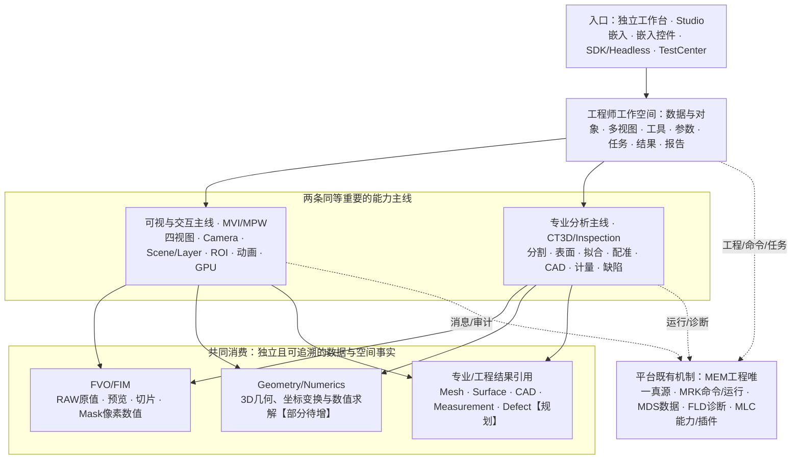

**为什么这样分：** 避免以 `MPWVolumeOpenGlControl` 为中心导致 Surface、CAD、GD&T 和 Headless 算法被塞进渲染类；也避免把场景对象提升为新的持久资源树。现有 F/M/P 的工程数量和 Owner 不变。


### 1.1.1 典型工程师看到的四个工作区（交互体验，不是四套程序）

| 工作区 | 左侧对象与数据 | 中央视图 | 右侧工具/属性 | 底部输出 |
|---|---|---|---|---|
| 数据与预览 | CT文件、Volume、源格式与空间元信息 | 2D正交+3D四视图 | Spacing、窗宽、切片、GPU、数据质量 | 原始/预览分辨率、警告、任务进度 |
| 表面与计量 | Mask、Surface、Mesh、几何Feature | 三维叠加、局部剖切 | 表面策略、拟合约束、单位、Datum/公差 | 误差/残差、测量报告与来源 |
| CAD 与质量 | CT/CAD/配准及偏差结果 | 叠加、剖面、偏差色谱 | 基准、配准、正负公差与统计 | 超差区域、缺陷列表、报告 |
| 算法与自动化 | 输入Ref、任务链、参数快照、Case | 输入/中间/输出可切换观察 | 步骤、取消、重跑、质量阈值 | 耗时、Trace、错误、审计与版本 |

实际落地采用**同一 MPW 多视图基础和工作台宿主可组合面板**，工具之间共享对象选择与专业结果引用；TestCenter 为验证镜像，不应另做专用功能版本。

### 1.2 产品形态及约束

| 形态 | 用户价值 | 实施约束 |
|---|---|---|
| 独立工作台 | 数据导入、测量、分析、比较、导出完整操作 | 宿主装配正式 CT3D / MVI / MPW，不复制算法 |
| Studio 专业工作区 | 工程方案、配方、算法步骤、历史、可发布运行 | 工程 Save/Undo/Ref 由 MEM 等既有机制负责 |
| MPW 可嵌入控件 | 3D Viewer、多视图和交互组件 | API 可在不启动 TestCenter 下复用 |
| CT3D Headless SDK | 算法测试、服务器计算、批量任务 | 不引用 WPF/GL，输入输出和生命周期明确 |
| TestCenter | 真实功能、数值、异常、UI、GPU 分级验收 | **消费者而非生产实现者** |

**非目标：** 不复制 VTK/ITK 全部体系，不创建 `UniversalObject` 包打天下，不建立 CT3D 私有第二套 Graph Runtime，不凭 UI 截图宣称计量正确，不将 OpenGL 3.3 路径无条件等价于硬件合格。

---

## 2. 能力组成：完整 26 项与六大能力域

**图 02｜能力地图。** A～F 是产品能力分组，不代表新增六个物理工程；方框顺序是主要消费链，跨组协作允许双向使用**稳定引用与结果契约**。

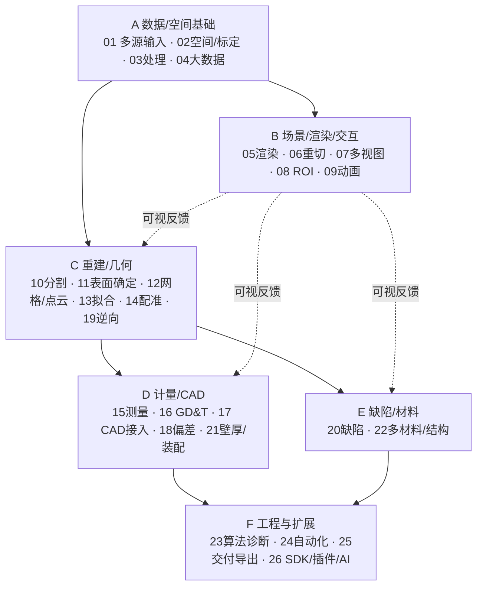

### 2.1 六领域的职责与交付边界

| 域 | 产品能做什么 | 主要输入→输出 | 目标 Owner / 可复用基础 | 与其他域的边界 |
|---|---|---|---|---|
| A 数据与空间 | 各类数据导入、质量检测、原值/预览分离、标定、分块/LOD | 文件/内存/流→Volume/Geometry/CAD Ref + SpatialFrame | FVO/FIM/FGE/FNU；格式属专业接入 | RAW原值不属于Scene或GPU；CAD B-Rep不是FVO体素 |
| B 可视与交互 | MPR、体绘、切面、ROI、选择、图层、动画、画质 | 引用+视图状态→实时视口/渲染帧/交互意图 | MVI/MPW/FVO取样 | UI会话不是永久专业结果；MPW不做测量真值 |
| C 重建与几何 | 分割、表面确定、网格点云、拟合、配准、逆向 | Volume/Mask/Points→Surface/Mesh/Fit/Transform | CT3D + FGE/FNU | 基础算子通用可下沉，专业工艺/精度策略留CT3D |
| D 精密计量与 CAD | 距离/厚度/GD&T、真实CAD、CT-CAD偏差、装配 | 校准模型+CAD+Datum→数值/色谱/质量记录 | CT3D；Inspection判定 | 数值结果≠显示色谱；Inspection不替代几何算法 |
| E 材料与缺陷 | 气孔裂纹、夹杂、多材料、分部件和结构统计 | 原值/Mask/Surface→缺陷列表/统计 | CT3D + Inspection | 分割标签≠最终质量判定 |
| F 工程集成 | 算法调试、任务编排、报告、SDK、插件/AI | Case/参数/算法→任务、Trace、Report、Artifact | MRK/MDS/MEM/FLD/MLC + CT3D | 复用平台真源，不建第二执行器/资源树 |

### 2.2 设计深度要跟任务价值走

先让 **CT 原值→表面→拟合→物理测量** 成为可重现的专业闭环，再扩展真实 CAD 对比、缺陷/壁厚；同时维护已有四视图/GPU。不应按 26 个名称创建同等空类和菜单。

### 2.3 各项能力的最小输入—输出—操作合同（目标态）

下表只描述**目标操作语义**，不是当前全部可点、可执行。每项的真实 Owner/文件与证据见第10章，专业算法运行不依赖操作界面。

| № | 核心输入 | 输出/结果 | 典型用户操作 |
|---|---|---|---|
| 01 | RAW/文件/内存/流 | VolumeRef/预览 | 导入、批量打开、数据检验 |
| 02 | Volume元信息、标定件 | Frame/Spacing/Quality | 空间信息与坐标检查 |
| 03 | Volume/ROI、参数 | 处理后体/切面 | 滤波、裁剪、重采样 |
| 04 | 原值Volume+预算 | Chunk/LOD/Preview | 交互质量与高精度模式切换 |
| 05 | Volume/几何+显示样式 | GPU体绘/MIP/网格帧 | 透明度、光照、材质、显隐 |
| 06 | Volume+Plane/Path | MPR/斜切/厚层像素 | 拖三刀、切层、任意切定义 |
| 07 | Volume+ViewState | 四视图/十字线 | 缩放、平移、全屏、联动 |
| 08 | 空间ROI/对象+工具意图 | ROI定义/选择/标注 | 拾取、绘制、编辑、保存 |
| 09 | Camera/模型状态+Keyframes | 3D回放/视频 | 时间轴、播放、暂停、爆炸图 |
| 10 | Volume+Mask算法参数 | Mask/Labels/区域 | 选材料、分割与检视 |
| 11 | Volume/Mask+方法参数 | Surface+质量证据 | 表面阈值、质量评定 |
| 12 | Surface/Points/Mesh | 网格/点云/拓扑指标 | 重建、修复、网格检查 |
| 13 | 点/面/约束 | Feature+FitResidual | 选取几何、拟合、约束调整 |
| 14 | CT几何+CAD/基准 | Transform+RegistrationQuality | 人工基准、自动ICP、局部配准 |
| 15 | Feature+Datum+单位 | 尺寸/角度/面积/体积 | 测量工具、标注、结果表 |
| 16 | Feature+Datum+Tolerance | GD&T结果与判定依据 | 公差编辑、偏差统计 |
| 17 | STEP/IGES/SW/Parasolid | B-Rep/Assembly+源引用 | 导入、装配树、实体显隐 |
| 18 | CT/Surface+CAD+Transform | 偏差场/色谱/超差区域 | 对齐、差异、剖切、报告 |
| 19 | Points/Mesh/Surface | 拟合曲面/NURBS/参数模型 | 曲面重建与误差检查 |
| 20 | Volume/Labels/Surface | DefectResult/三维缺陷列表 | 缺陷定位、分类、复核 |
| 21 | Surface(s)+装配公差 | Thickness/Gap/Interference | 最薄点、干涉检查 |
| 22 | Volume+材料分类/Mask | Material/ComponentStats | 材料选择、分部件统计 |
| 23 | 算法/参数+输入Ref | 中间结果/Trace/指标 | 实验、调试、对比、复跑 |
| 24 | Task模板+Case/Ref | BatchResult/质量判定 | 批量启动、取消、重试 |
| 25 | 各种数据/ResultRef | RAW/PNG/Mesh/CAD/报告/视频 | 导出向导、版本追溯 |
| 26 | 能力描述/SDK/模型 | 扩展算法或服务接口 | 插件管理、SDK调用、AI模型选择 |

---

## 3. 模块架构：Owner、程序集依赖、真实状态

### 3.1 Owner 与不得越界的责任

| 所在物理项目（现有） | 主要负责 | 当前确认的代表实现 | 必须避免 |
|---|---|---|---|
| `Foundation/Imaging`（FIM） | 二维像素缓冲、基础图像、Slice结果像素 | FIMImageBuffer、FIM图像 API【E】 | CT工艺、OpenGL、HALCON对象作为通用公开类型 |
| `Foundation/Volume`（FVO） | 体素/RAW/原值/预览/取样/切片/传递函数数值 | `FVOVolumeData`、`FVORawVolumeLoader`、`FVOSliceImageBuilder`、`FVOUnmanagedRawVolumeBuffer`【E】 | 相机、CAD、公差、WPF窗口 |
| `Foundation/Geometry`（FGE） | 跨专业几何基元、变换、空间运算 | 当前已核对以2D类为主【E】；3D primitives/mesh【N】 | 完整工业CT工艺/计量业务 |
| `Foundation/Numerics`（FNU） | 线代、统计、求解、拟合数学原语 | SVD/最小二乘、权重最小二乘等【E】 | 把通用线代名义冒充圆柱/ICP/GD&T专业算法 |
| `Mechanism/Visual`（MVI） | UI无关的三刀、相机、ViewSession、Scene、交互、选择 | `MVIVolumeViewState`、已有2D `MVISceneItem`【E】；3D Scene【N】 | WPF/OpenGL具体句柄、专业CT结果真值、第二工程树 |
| `Mechanism/Presentation.Wpf`（MPW） | WPF控件、多视图、输入和GPU资源/绘制 | `MPWVolumeFourViewWorkbenchControl`、`MPWVolumeOpenGlControl`、编辑面板【E】 | 专业算法真源或CT3D类硬引用 |
| `Professional/CT3D` | CT3D工艺、参数、算法、Surface/CAD/计量与结果引用 | `CT3DRenderingSettings`、`CT3DRenderingChangeSet`、`CT3DVolumeLoadService`【E】；Case/算法【N/P】 | 依赖WPF、制造另一套FVO Volume |
| `Professional/Inspection` | 产品/质量业务判定、检验结果、报告/追溯 | 目前三维分析无闭环证据【P】 | 将所有3D数值计算迁成业务判定代码 |
| Studio/独立宿主 | 组装上下文、操作导航、工程/Session绑定 | 宿主能力按实际工程核查 | 新算法实现、第二套 Undo |
| `Tests/TestCenter` | 测试入口、手工验收、硬件专项 | `TCTManualVolumeGpu`仍含GPU协调【E/R】 | 长期保有正式GPU启停/资源协调 |

### 3.2 物理依赖和职责关系必须分两幅图

**图 03｜目前可核实的物理依赖核心子图。** 实线是已检查 `.csproj` 的现有引用；不代表图外全部工程引用。

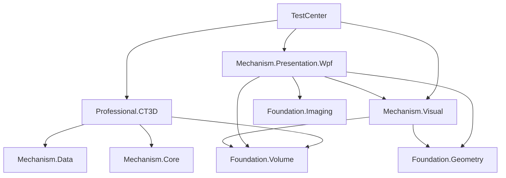

**图 04｜目标协作：调用方向≠项目依赖。** `CT3D` 与 `MPW` 通过**宿主装配/中立数据契约**通信；专业结果引用经过投影进入场景，而不是互相新加项目引用。

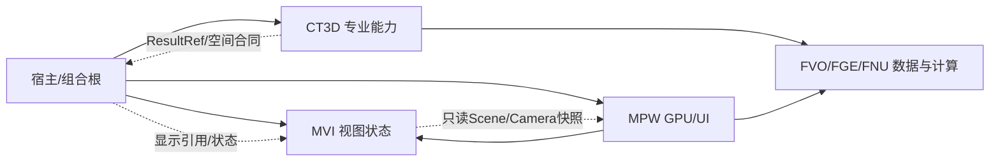

**需解释的冲突：** 工程 Skill 旧版写“MPW does not need Foundation.Volume”，但当前 `Mechanism/Presentation.Wpf/*.csproj` **实际已引用** FVO；不能擅自按旧文字删除已用依赖。以最新已审查源码与正式 Owner 决议评审该差异；详见第14章 ADR-01。


### 3.3 已核查真实 `.csproj` 的关键依赖（区别于概念图）

| 编译工程 | 当前关键引用 | 约束 |
|---|---|---|
| FVO | FIM、FNU | 不能引用MVI/MPW/CT3D，原值和取样应独立 |
| FGE | Foundation.Core | 3D几何扩展时不得引入 CT3D 专业语义 |
| MVI | FVO、FIM、FGE、Mechanism.Core/Data | 只能放UI无关的交互状态/投影，不引用 MPW 或 CT3D |
| MPW | MVI、FVO、FIM、FGE、Mechanism.Core/Data、基础设施 | 可读取基础显示数据与视图状态；不直接引用 CT3D |
| CT3D | FVO、Foundation.Data、Mechanism.Core/Data | 当前**不引用 MVI/MPW**；新增Case与算法须遵守实际 DAG |
| TestCenter | 消费上述正式工程 | 现存 TCT GPU 生产职责属于待迁移债务 |

注意：旧工程 Skill 的“MPW不需要 FVO”与当前真实 `.csproj` 不完全一致，是 **ADR-01**，不能为了追求表面整齐擅自删除现有依赖。新建专业调用桥接层也不是解决方法；应用宿主是天然组合根。

---

## 4. 数据、坐标与资源：26 项专业计算共用的基础

### 4.1 数据类型与唯一事实

| 数据/对象 | 数据真源 | 显示层仅允许做什么 | 规划事项 |
|---|---|---|---|
| 原始 Volume（Byte/UInt16/Float32） | FVO，原始尺寸、标量、Spacing、非托管Buffer | 根据预算生成预览与纹理 | 完整物理方向矩阵、超大Region请求 |
| MPR与任意切 | FVO取样；像素图由FIM表征 | 显示位图、窗宽/伪彩和Crosshair | 曲面重切/厚层投影 |
| Mask/Label Volume | 通用标量/标签容器倾向FVO；CT3D拥有工艺语义【待裁决】 | 颜色编码、不透明度 | 真实3D标签和连通域 |
| PointCloud/Mesh/Surface | 通用结构优先FGE，专业提取元数据CT3D【待裁决】 | 三角化/采样/LOD/拾取代理 | 3D拓扑、法线、空间精度验证 |
| CAD B-Rep/Assembly | CT3D专业CAD接入及外部SDK受控Handle | 绘制三角网格、装配层级 | SDK授权、装配与拓扑ID映射 |
| 测量/偏差/缺陷/GD&T | CT3D专业Result，Inspection业务判定 | 标注、色谱、表格、可见性 | 量值、质量证据、单位、阈值、回溯 |
| GPU Texture/Shader/Buffer | MPW按Context拥有 | 易失缓存，丢失可重建 | 显存预算/泄漏验证 |

**原始精度铁律：** 多 GB CT 原始量值及空间坐标是计量唯一输入；GPU 8-bit 预览/ROI屏幕选择是展示或输入意图，必须反算到**有版本、单位和精度信息的原始数据域**才可提交专业计算。


#### 原值、高清切片与可测量数据的边界（本次新增硬合同）

已确认 `FVOVolumeData.Voxels` 是用于交互的 R8 显示数据，`HasOriginalRawData` 表示非托管完整原始缓冲已就绪；`GetScalarByOriginalIndex()` 在没有原始缓冲时允许通过显示预览估算数值，**不能把该方法的返回值单独当成“已保证无损”**。`HasOriginalVoxels` 仅说明缓存达到原始分辨率，数据是否量化必须结合来源及实际加载路径判定。

- **显示模式**：可以用 Preview R8、LOD、缓存降级，须显示“预览/非计量”，但不得静默标记为校准过的工业测量。
- **专业计量模式**：算法必须先验证完整原始 Byte/UInt16/Float32 是否可读、原始值/空间标定/方向/来源版本是否可信；不满足时返回明确 `PrecisionUnavailable`（建议错误语义，而非现有枚举），禁止悄悄用R8插值补数。
- **缓冲接管边界**：`FVOVolumeData.SetRawBuffer()` 在本轮核查的 `master` 仍直接释放旧Buffer再赋值，尚未有严格字节长度/重复接管保护；相关修复候选此前**未成功合入**。必须先做同句柄、非法尺寸、关闭、并发使用反例。
- **异步后续**：`AcquireLease` 是目标合同，**当前 FVO 并未提供完整可证明的多线程租约API**。不得在文档画出Lease就宣称CPU文件映射已线程安全。

**图 05a｜精度域不能混用：**

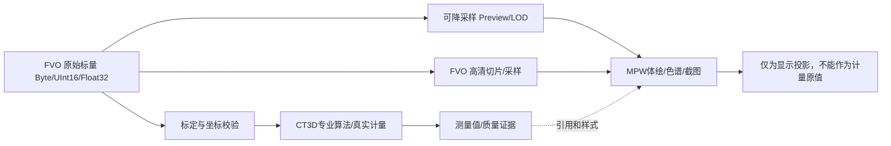


### 4.2 空间坐标链（数值先于显示）

**图 05｜Index → World → CAD → Display 的空间合同。** 物理计算使用 double、明确单位；GPU 可做 origin rebasing/float，不得逆向污染计量。

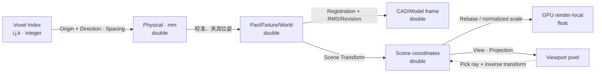

**物理变换建议定义（非已实现 API）：** 对列向量约定 `P_physical = Origin + Direction × diag(SpacingX,SpacingY,SpacingZ) × P_voxel`；任意目标 `T_CAD_from_Part × T_Part_from_Physical × P_physical`。命名必须含 `from/to`，合成与逆变换严格按同一约定；单位换算与右/左手系转换为显式操作。体素中心取 `i,j,k` 还是 `i+0.5,j+0.5,k+0.5` 必须由校准/格式合同裁决，不在算法中暗自假定。

**规范合同：** 体素**中心/边界**如何定义、列/行主序、矩阵左/右乘、轴向、手性、原点、负Spacing合法性、单位换算、方向矩阵正交误差、Registration有效域、逆变换失败均需专项规格和反例。`FGETransform3D`、`FGEPoint3D`、`FVOVolumeSpatialMetadata` 是【N候选】，当前 FGE 主要为 2D，先查 02～04 Owner 再落类。

### 4.3 Asset / Result / Provenance 与工程Resource关系

**图 06｜身份与所有权：引用而非复制。** 一个专业结果可在多个Scene显示，多个视图从一份原始数据消费。

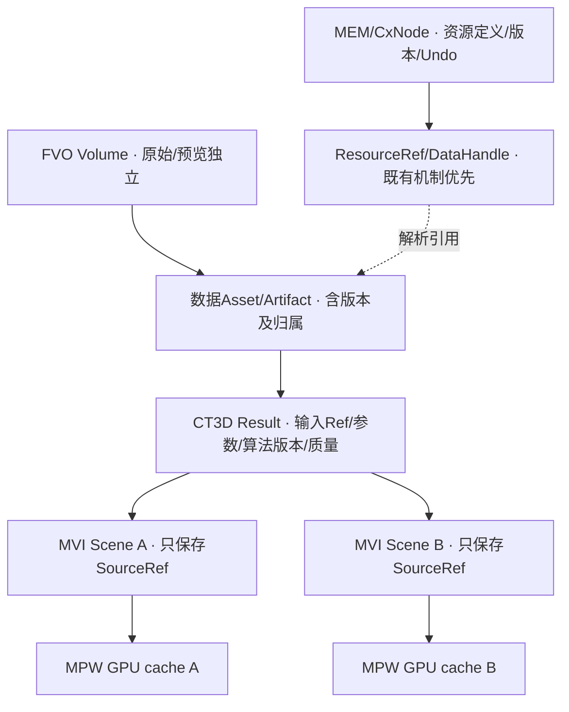

**结果最小可信字段（建议语义，不是已实现的公共API）：** `ResultId, InputRef[] + Revision/Hash, AlgorithmId/Version, ParametersHash, SpatialFrame, Unit, AccuracyEvidence, CreatedAt, Outcome/Validity, DiagnosticsCorrelationId`。工业判定须额外保存 Datum、容差、缺陷分类/复核与规则版本。数据大对象使用已有 DataHandle/Artifact 契约或其合规扩展，不把 GB 数据内嵌普通工程 JSON。

### 4.4 超大数据与内存/显存合同

- **FVO**：原值映射、按Region访问、CPU缓存/预览生成、分块读取和取消；禁止以 `byte[]` 强制装入所有高精度多GB原值。
- **CT3D**：高精度算法声明所需Region和精度、结果可恢复性、资源预算及取消；若算法需要全量体，必须显式预算/磁盘溢出策略。
- **MPW**：按GpuEpoch拥有Volume/Bricks/Geometry纹理和VAO/VBO；预算、淘汰、失败重建属于显示缓存。
- **共享不变量**：`AcquireLease→Use→Release`；引用可能超过旧体数据的寿命时，旧资产只能在全部Lease结束后释放。缓存命中不改变SourceRevision。

---

## 5. 场景、渲染、交互、四视图与动画

### 5.1 Case 与 ViewSession 必须分离

**图 07｜核心对象类图（少而明确，状态说明即是实现建议）。** 聚合表示引用专业数据；组合表示会话拥有自身可视状态；不是宣告新增类已实现。

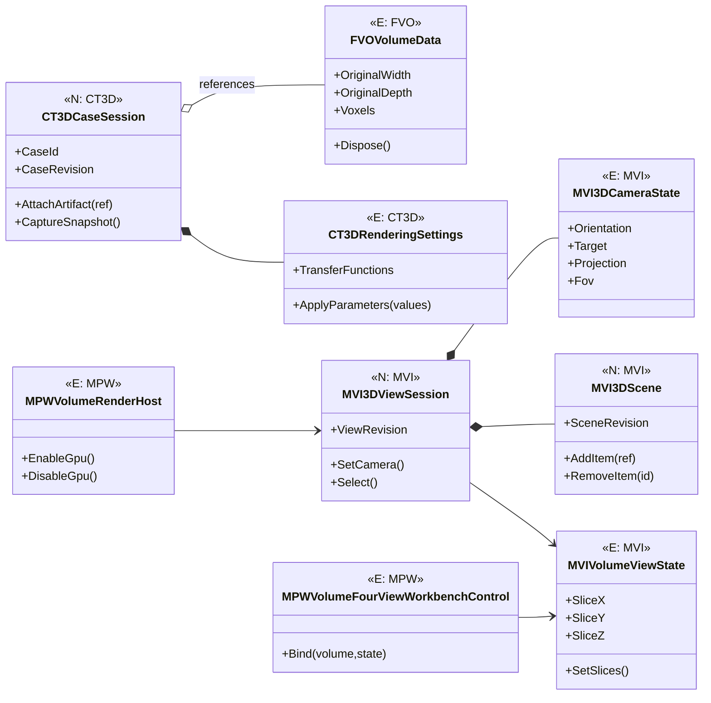

**执行约束：** Case 仅协调专业引用/版本，不拥有第二份 FVO 原始数组；ViewSession 仅维护多视图 Camera/Selection/Scene，不复制 CT3D Result；一个 Case 可同时被多个 ViewSession 使用。`MVISceneItem`/`MVISceneProjection` 现有 **二维工程投影** 不宜直接改成 3D 通用父类。


### 5.1.1 Case、会话、工程资源不是同一个对象

| 名称 | 身份与寿命 | 唯一拥有的内容 | 不应持有 |
|---|---|---|---|
| `MEM Resource/CasePackage`【既有机制】 | 持久定义；工程保存、引用、版本、发布 | Case Manifest、规则/算法资源引用、工程操作历史 | GPU句柄、当前鼠标、GB数组 |
| `CT3DCaseSession`【N】 | 一次专业工作进程/打开案例 | 当前专业上下文、数据与结果引用、精度/输入修订 | 第二份Volume数组、MEM Undo树 |
| `MVI3DViewSession`【N】 | 一个视图/多视图会话 | Camera、Scene、Selection、Tools、PlaybackCursor | 专业计量值、CAD B-Rep原件 |
| `MPWVolumeRenderHost`【N】 | 一个WPF渲染宿主 | WGL Context、GPU资源、渲染生命周期 | 专业数据真源、工程身份 |

`Case` 在平台中已有正式 CasePackage 语义，不能因为新建 `CT3DCaseSession` 就凭空增加新的持久Case库。**会话是运行态组合，不是工程持久对象。** 单一 Case 对多个 ViewSession 的支持采用 SourceRef/Revision + 订阅投影，关闭视图不能 Dispose 仍被其它会话使用的原始数据。

### 5.2 场景对象、ROI 和图层的轻量组合

`MVI3DSceneItem【N】` 建议使用 `VisualId, Kind, SourceRef, LocalToWorld, Style, Visibility, Pickability, Selection`，显示类型覆盖 Volume / Slice / PointCloud / Mesh / Surface / CAD / ROI / Measurement / Analysis。组装层级确有需要时增加 `GroupItem【P】` Composite，而非先建几十种 Layer 子类。**专业测量对象的量值来自 CT3D，不来自 MVI 屏幕空间标注。**

- **选择/拾取**：Screen Ray→View/Scene→对象局部/World→SourceRef，命中结果携带源版本；底层计算需可回到物理 mm。
- **ROI**：临时交互草稿归 MVI；长期工程 ROI 定义通过 MEM 保存，算法消费已校验坐标与对象引用；不建新的 UndoStack。
- **Camera**：MVI唯一状态，WPF和GL只做矩阵与设备缓存；多视图允许各有Camera，可用 LinkGroup 同步目标/缩放或切片。
- **Animation**：Camera/切面/装配爆炸/对象透明度/缺陷回放共享 `Timeline` 意图；工程关键帧定义存工程资源，运行播放游标归 ViewSession；视频输出走正式导出接口。


### 5.2.1 从选中对象到运行算法的统一交互链

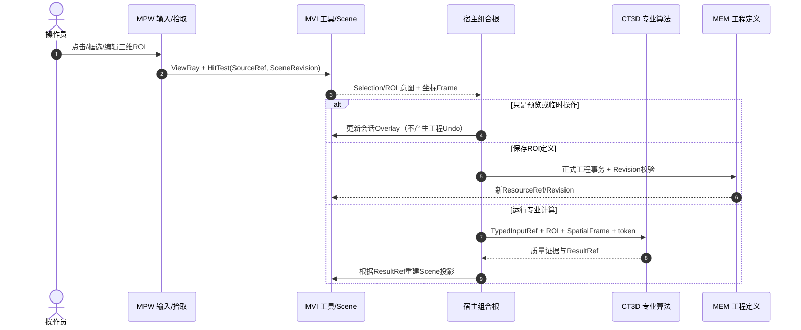

**易用性约束：** 视图/对象的选择应可在多个工具间保持；切换GPU/WPF不丢Camera和三刀；Esc与失去鼠标捕获要取消未提交草稿；不创建三维专用 Undo/CommandStore。每个交互图元必须能追溯到 SourceRef、Frame 与来源Revision。

### 5.3 渲染体系：保留现有 WGL Raymarch，逐步支持混合场景

**图 08｜可组合RenderPass与数据来源（目标，非当前完整实现）。** `Volume/Slice/Mesh/CAD/Overlay` 各有显示策略但共用 Camera、资源预算和帧调度。

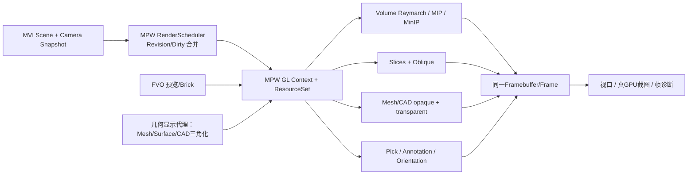

**真实现状：** `MPWVolumeOpenGlControl`【E/R】包含 WGL OpenGL 3.3、GLSL Raymarch、纹理、Shader、Buffer、Camera输入、截图、资源释放。未来先从当前类渐进抽 `MPWGlContext【N】`、`MPWGlResourceSet【N】`、`MPWRenderScheduler【N】`；`MPWVolumeShaderSources/MPWVolumeGeometry`【E】继续使用。无第二个真实Backend之前不强制 `IRenderBackend`；WPF空间切面是**降级观察模式**，不等价于GPU体绘。

### 5.4 GPU生命周期与重试合同

**图 09｜GPU State Machine。** `Disposed` 不能复活；重试必须创建新Context/GpuEpoch。所有Shader/Texture/VAO在其Context有效线程释放，且所有退出路径清理有幂等保证。

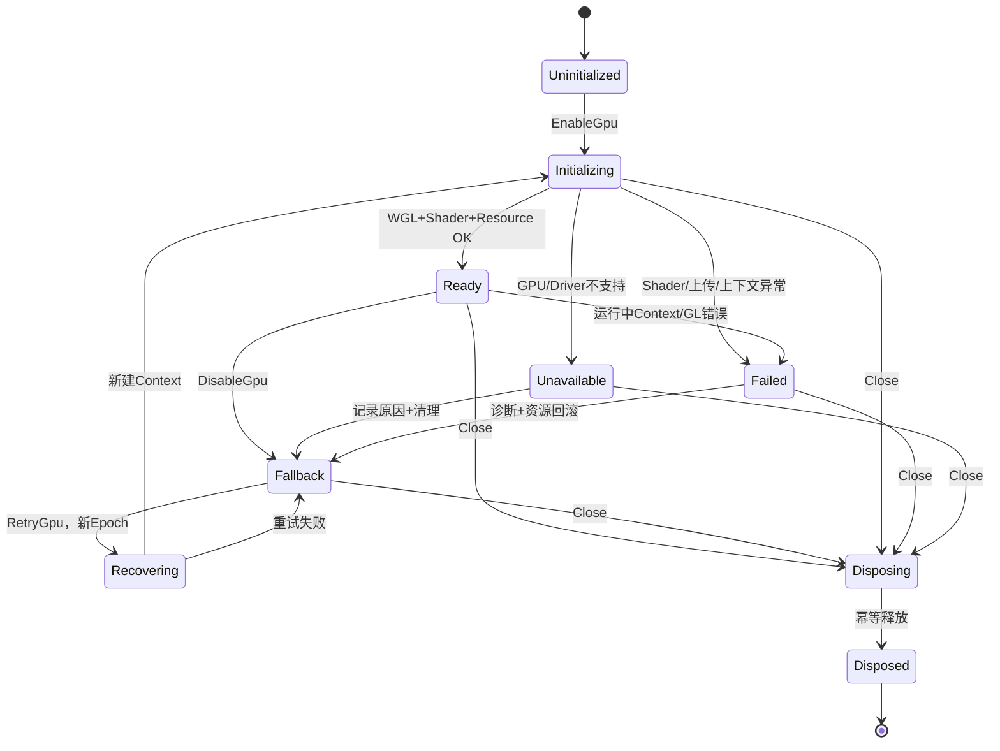

GL调用目前须在所属 WPF Dispatcher/HwndHost 线程发生，不能 `Task.Run(GL.*)`。释放时即使 `wglMakeCurrent` 失败也要完成尽可能安全的 Win32/OS 资源释放并记录不可确认的 GPU 清理残留；不谎称“无泄漏”。

---

## 6. 专业三维算法：从数据到可复现结果

### 6.1 标准算法合同（推荐语义）

| 字段/阶段 | 最低要求 | 与平台的关系 |
|---|---|---|
| Inputs | ArtifactRef / Volume/Mask/Mesh/CAD、SourceRevision、Frame、单位、数据域 | 重用现有DataHandle/ResourceRef，不能复制整份GB数组 |
| Parameters | 强类型、校验、版本、参数快照/Hash、可重复性设置 | 专业参数归CT3D，不在MPW维护副本 |
| Execute | 同步/异步、进度、取消、预算、错误与失败恢复 | 复用MRK/FCR等现有机制；简单算子不强制大型Job对象 |
| Outputs | 新ResultRef + 定量Value/Geometry + 空间合同 + Provenance | 原子注册，失败不发布半成品 |
| Quality | 样本数、残差、RMS、Max、置信区间/不确定度、算法有效域 | 依据算法是否适用提供具体指标，不能统一伪造RMS |
| Display | 可选择映射为SceneItem + 色谱/注释 | MVI/MPW是消费者，显示风格不改原结果 |

**图 10｜标准有类型算法流水线（Headless 可用）。** “执行与诊断”是平台协作而不是 CT3D 自建第二条调度器。

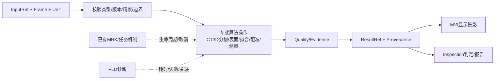

### 6.2 六个算法专题的设计理由及分界

| 专题 | 关键算法/对象 | 质量与错误边界 | 首个应做的有效用例 |
|---|---|---|---|
| 分割与多材料 | 阈值、区域生长、连通域、Mask、材料Label | 材料灰度重叠、连通性、边界体素、内存预算 | 已知孔洞合成体：标签体积/连通域与真值一致 |
| 表面确定与Mesh | 梯度、自适应、亚体素、三角网格、法线/孔洞质量 | 表面偏差/粗糙/拓扑/法线/各向异性 | 校准球/阶梯块：表面距离、体积偏差可量化 |
| 几何特征与拟合 | 平面/球/圆柱/自由面，LSQ、加权、鲁棒/约束拟合 | 退化点集、离群点、单位、置信区间 | 基准圆柱：拟合轴与直径误差/残差输出 |
| 配准与CAD | 基准配准、特征/ICP、CAD B-Rep、装配/关联 | 坐标手性、自由度不足、匹配收敛、变换有效域 | 两件已知变换的CAD/CT：恢复位姿与RMS |
| 精密测量/GD&T | Datum体系、尺寸、真圆度/圆柱度/平面度、形位公差 | Datum构造、规范定义、误差传播、复核阈值 | 带工程图公差的校准工件输出量值+判定 |
| 缺陷、壁厚与装配 | 孔隙/裂纹/夹杂、最短壁厚/间隙、干涉、多部件 | 分割/表面误差向厚度传播、薄壁假阳性 | 标定空腔与厚度阶梯件，统计与人工真值对照 |

**强调两件事：** （a）`等值面` 不能自动证明“高精度表面确定”；（b）`FNULeastSquares` 类基础数学存在，不代表 CT3D 的鲁棒几何拟合、ICP 或 GD&T 已经完成。


### 6.2.1 专业算法的最小运行结构（契约示例，不是现有类型）

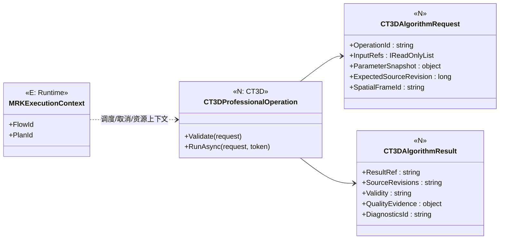

不要为所有小函数强制建立 `IAlgorithm/Adapter/Facade/Provider` 四层；首个Surface/Fit工作包允许真实的直接静态/服务算子，达到多个可复用操作且确有组合需要时，再提炼统一接口。算法输出必须**包含质量与失败原因**，不把裸浮点数误当精密计量成品。

### 6.3 CAD / SolidWorks 接入必须分层

`STEP/IGES` 导入的几何表示、`Parasolid` 内核原生拓扑、`SolidWorks` 原生格式/装配/特征需要不同且真实可用的 SDK 与许可。文档只给出数据能力和边界，不假定 SDK 已装或许可有效。`CAD B-Rep → TriangulatedProxy` 仅用于渲染；最终偏差/计量应以明确校验过的几何模型和容差为准。

---

## 7. 四条工业典型场景（输入 → 操作 → 输出 → 验收）

### 7.1 场景 A｜CT → 表面 → 拟合 → 测量 → GD&T

| 步骤 | 输入→输出 | Owner与操作 | 验收判据 |
|---|---|---|---|
| 1 打开/校准 | RAW+元信息→Volume/SpatialFrame | FVO + CT3D加载，UI选择数据 | 原值、轴向、单位、尺寸和Spacing一致 |
| 2 表面确定 | Volume/Mask→Surface/质量 | CT3D，MVI显示阈值/边界预览 | 亚体素定位误差/残差有量化 |
| 3 几何拟合 | Surface点→Feature（平面/圆柱） | CT3D/FNU/FGE，UI选点/区域 | 参数估计、约束、异常点与残差 |
| 4 尺寸 | Feature+Datum→Measurement | CT3D，MVI渲染尺寸标注 | mm值、单位与源样本版本一致 |
| 5 GD&T | Feature+Datum+Tolerance→Result | CT3D；Inspection业务判定 | 与工程图定义相同的真值和公差规则 |

**图 11｜专业精度闭环。** 虚线是可视反馈，不是算法源输入替代。

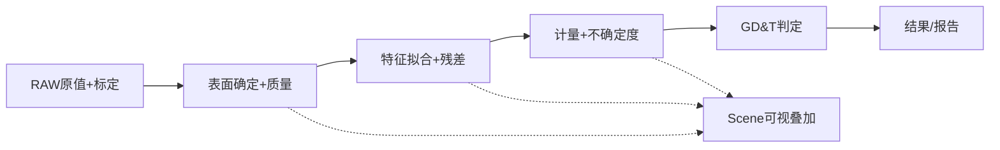

### 7.2 场景 B｜CT + CAD → 配准 → 偏差 → 报告

| 步骤 | 输入→输出 | Owner与操作 | 验收判据 |
|---|---|---|---|
| CT和CAD装载 | 原值CT与CAD B-Rep/装配 | FVO/CT3D、文件格式授权 | 单位/坐标/拓扑标签可辨 |
| 粗/精配准 | Surface/CAD+约束→Transform | CT3D+FGE/FNU，UI选Datum | 变换方向、收敛残差、对齐精度 |
| 名义-实际偏差 | 对齐后几何→signed distance field | CT3D数值、MVI/MPW热力色谱 | 正负号、样本密度、超差面积/体积 |
| 报告 | 结果+阈值+溯源→Report | Inspection/CT3D/既有工程机制 | 重新打开、同参数重算、可追溯 |

**图 12｜配准与报告的目标时序。** 专业结果在没有图形窗口时也必须能形成。

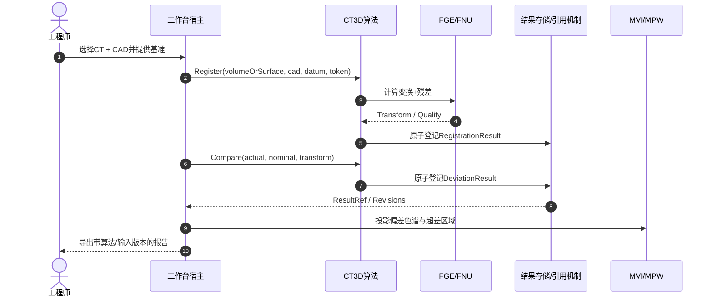

### 7.3 场景 C｜CT → 分割 → 缺陷 / 壁厚 / 多材料

| 步骤 | 输入→输出 | Owner | 验收判据 |
|---|---|---|---|
| 多材料分割 | Volume→LabelVolume/MaterialRegions | CT3D工艺 + FVO通用容器（待Owner复核） | 混合灰阶、孔隙/材料界面错分率 |
| 缺陷识别 | Mask/Volume/Surface→DefectResult | CT3D | 3D体积、数量、位置、细长比、连通性/误检漏检 |
| 壁厚/装配 | Surface(s)→Thickness/Gap/Interference | CT3D | 边界误差传播、最薄点及位置、物理单位 |
| 质量判定 | 专业结果+产品规则→InspectionResult | Inspection | 阈值版本、复核状态、工件ID及追溯 |

### 7.4 场景 D｜多对象显示 → 交互 → 动画 → 保存重放

| 步骤 | 输入→输出 | Owner | 验收判据 |
|---|---|---|---|
| 建立场景 | Volume+Surface+CAD+Defect Ref→SceneItems | MVI；宿主解析SourceRef | 改显示显隐不修改专业数据 |
| 多视图和工具 | 选中对象/三刀/相机→ViewRevision | MVI状态+MPW视口 | 相机切GPU/WPF不跳变，多视口联动可选择 |
| 动画 | Timeline/Keyframe→Playback | 工程定义和MVI运行态分别拥有 | 时间轴、播放/暂停、装配爆炸、多视图同步 |
| 保存重放 | 资源引用/变换/视图定义→Project/Case Manifest | MEM及已有Artifact机制 | 关闭重开引用稳定，过期来源有诊断；不复制RAW |

**业务体验原则：** 工程师围绕“数据/对象/算法/结果”完成连续操作，不能在26张互不认得对方的测试页面间手工搬结果。

---

## 8. 接口、事件、命令、变更集与时间线程

### 8.1 八项实施合同与可直接查找的现有API（目标合同≠已实现SDK）


**本节是全文唯一实施合同总表**：每项明确真源、最小输入输出、异常及可复现验证；具体工程路径见第9章，能力ID见第10章。下列【N/P】签名或行为只是建议，不是现有公共API。

| ID | 必要输入→输出及真源 | 主要Owner/现状 | 失败规则与第一批验收 |
|---|---|---|---|
| **C01 原始精度** | 原始体素/SourceRevision→无损标量或`PrecisionUnavailable` | FVO：`FVOVolumeData`【E/R】 | 只有R8预览不得作计量；UInt16/Float32数值、同句柄及错误ByteLength反例 |
| **C02 空间与单位** | Voxel/Spacing/Origin/Direction→Physical→Part/CAD Frame | FVO来源/FGE-FNU空间数学/CT3D基准；3D Frame【N】 | 手系、单位、方向、体素中心、奇异变换拒绝；往返残差有阈值 |
| **C03 身份/结果** | MEM资源Ref+SourceRevision+算法上下文→ResultRef/有效性 | MEM真源【E】；CT3D CaseSession【N】 | 旧输入失效标Stale；不得创建第二份Project/Undo/体数据 |
| **C04 Scene/交互** | SourceRef+Frame+MVI状态→可视Scene/选择/相机 | `MVIVolumeViewState`【E】，3D Scene/Camera【N】；MPW消费 | 多视图一致、坐标回环与Undo；不得持有专业数值真值 |
| **C05 GPU资源** | 预览+设置+ViewSnapshot→GL帧/显式Fallback错误 | `MPWVolumeOpenGlControl`【E/R】、正式RenderHost【N】 | Context线程、半初始化/重复关闭/失败恢复；WPF切面不算Raymarch |
| **C06 参数变化** | `CT3DRenderingParameterValues`→LUT/Uniform/Scene Flags+Revision | `CT3DRenderingSettings`【E+历史T】；MPW Scheduler【N】 | 校验失败整体拒绝；Uniform-only不上传LUT；已提交/已呈现版本分开 |
| **C07 专业算法** | 输入Ref+Frame+Params+取消→Surface/Fit/Measure等Result+Quality | CT3D/FGE/FNU，专业算子【N/P】；借MRK执行 | 退化、不收敛、精度缺失和取消不得成功提交；Headless正反例 |
| **C08 工程交付** | 专业结果Ref→MEM持久化/MRK任务→重开与报告 | 既有MEM/MRK/MDS/诊断【E】；3D纵切片【P】 | 版本/授权/Trace可追溯；不自建第二套运行与消息体系 |

**已确认可查的正式API**：`CT3DVolumeLoadService.LoadRawPreviewAsync`、`MVIVolumeViewState.SetSlices`、`CT3DRenderingSettings.ApplyParameters`/`ApplyParametersWithChangeSet`、`MPWVolumeOpenGlControl.SetVolume`/`UpdateTransfer`/`CaptureFrame`。**`CaptureCaseSnapshot`、`ProjectScene`、`EnqueueRender`、`PrecisionUnavailable`均属拟议接口/语义，待Owner/测试批准**。如现有真实签名有差异，必须以源文件为准，不凭文档补造方法。

**最小事务纪律**：专业参数先验证再提交；Volume切换旧请求先取消并进行RequestEpoch过滤；跨CPU任务引用原值须经有效Lease（当前仍待实现）；GPU失败保留最新合法参数/数据快照供新Context重建；工程保存仅经既有MEM事务。算法结果发布与场景通知分开，通知异常不倒灌为伪成功或伪回滚。

### 8.2 渲染变更分类与Revision

| 变化 | 数据归属 | MPW所需操作 | 禁止行为 |
|---|---|---|---|
| VolumeData | FVO/Case | 更新Preview或Bricks、变更GpuEpoch关联 | 保留前一份纹理而冒用新数据 |
| Transfer/LUT | FVO曲线+CT3D设置 | 重建并上传 LUT | 仅改采样/材质却重新扫描整个体 |
| Uniform/Lighting | CT3D设置 | glUniform更新+合帧 | 重上传体纹理 |
| Slice/Oblique | MVI+FVO | 更新切面位置/取样纹理 | 维护第二三刀位置 |
| Camera | MVI唯一相机 | 更新View/Projection | GPU/WPF分别存独立Camera真源 |
| SceneGeometry | 结果Ref + MVI Scene | 变更相关VAO/VBO、拾取加速结构 | 改变专业Mesh/CAD原值 |

建议使用 `CaseDataRevision, SettingsRevision, ViewRevision, SceneRevision, GpuEpoch` 的**版本向量**；每个 Owner 自己发版本，MPW只缓存“已经上传/显示”的序号。`RenderSnapshot`是一次显示所需的只读投影、无编辑权。

### 8.3 渲染参数时序

**图 13｜UI→CT3D→MPW更新时序。** Validation失败保持旧设置；GL失败不让合法专业设置丢失，恢复后按最新Snapshot重放。

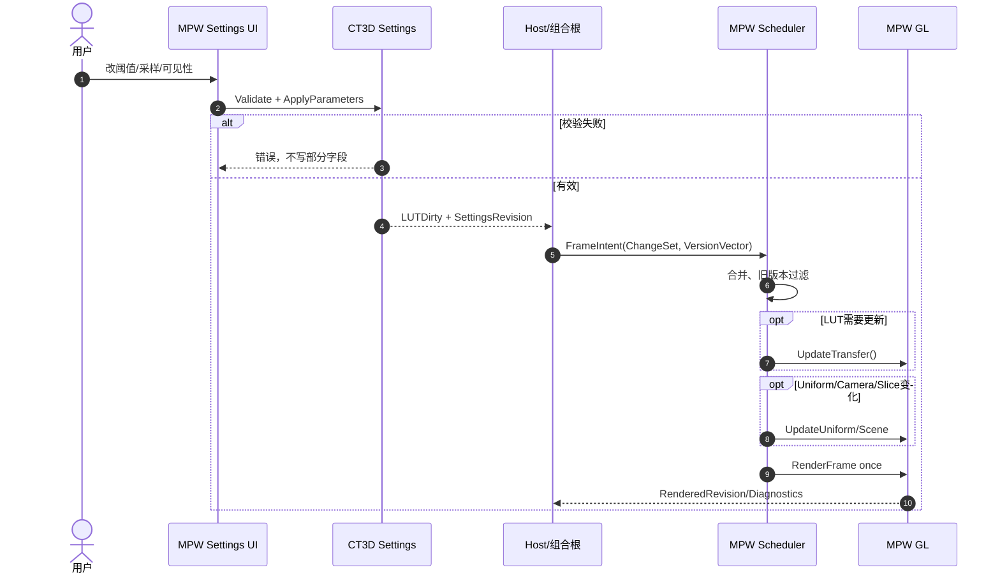

### 8.4 体数据切换与资源释放时序

**图 14｜加载B替换A。** 新数据成为当前主源之前，旧数据保持可用；提交新Case后，旧资产继续等待使用者释放 Lease。

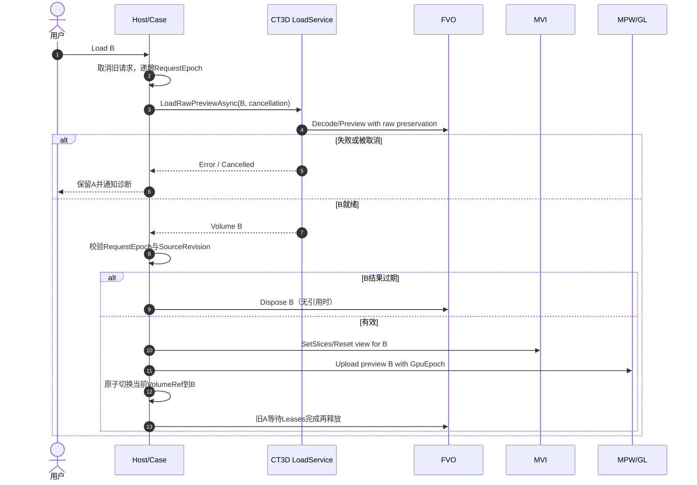

### 8.5 生命周期/多线程/AOP运行原则

- **WPF Dispatcher**：持有 WPF 控件和目前的 WGL Context；GL CRUD/Render/ReadPixels 均在正确 Context 所属线程上。
- **算法后台线程**：只读 SourceLease、不可变输入、取消/进度，不能触碰 WPF/GL；提交前校验 Revision/SourceRef，旧结果显式Discard。
- **工程事务**：持久变更只走既有 MEM 授权/Undo/Revision；专业结果提交与可视通知分离，“通知失败”不应被错误解释成“事务回滚”。
- **显存/内存**：Budget + Lease + Eviction + Epoch 独立记录，**目标释放顺序** `取消旧请求→停止提交新帧→解绑Scene订阅→GPU资源在其Context线程释放→等待有效Lease结束→释放FVO原值`。**Lease尚未完成，不得当作已有线程安全保护**；Context失效应递增Epoch并禁止旧回调更新新资源。
- **AOP/GoF**：State用于GPU生命周期；Observer用于MVI变化；Command复用MRK；Composite仅Scene有真实分组时；Strategy在第二个真实算法/渲染后端出现后引入；显式日志/性能/安全边界复用FLD/FCR/MRK，不在Shader热循环织入反射或代理。

---

## 9. 现有代码 → 拟议改造（开发者查找入口）

| 文件（相对仓库根） | 当前真实类/职责 | 本版动作 | 优先级 |
|---|---|---|---|
| `Foundation/Volume/Data/FVOVolumeData.cs` | 原值、预览、Spacing、安全缓冲接管、严格无损标量读取【E】 | 维持真源；后续补SourceLease和空间Frame | P0 |
| `Foundation/Volume/IO/FVORawVolumeLoader.cs` | RAW及内存来源、预览加载【E】 | 格式/字节序/取消/原值保真加强 | P0 |
| `Foundation/Volume/Memory/FVOUnmanagedRawVolumeBuffer.cs` | 非托管/映射原值、ByteLength和SafeHandle读取保护【E】 | 跨任务SourceLease与多GB压力验收仍待完成 | P0/P2 |
| `Foundation/Volume/Slicing/FVOSliceImageBuilder.cs` | 正交切片、原像素映射【E】 | 与三维坐标规范双向一致 | P0 |
| `Foundation/Volume/Slicing/FVOObliqueSliceBuilder.cs` | 任意切采样【E】 | 后续厚层/曲面重切非本阶段 | P3 |
| `Foundation/Volume/TransferFunctions/FVOVolumeTransferFunctions.cs` | 单一传递函数控制点/LUT【E】 | 禁止新建第二曲线真源 | P1 |
| `Foundation/Geometry/` | 当前2D primitives/transforms为主【E】 | **建议**新增Double精度3D点/变换/网格，先核Owner | P0/P3 |
| `Foundation/Numerics/LinearAlgebra/FNULinearAlgebra.cs` | 线性代数基础【E】 | 作为拟合/配准数学底座，不冒称专业算子 | P3 |
| `Mechanism/Visual/Volume/MVIVolumeViewState.cs` | 三刀/视口状态与MVI3DCameraState相机真源【E】 | 已供WPF与OpenGL绑定；后续Scene/保存重开 | P0/P1 |
| `Mechanism/Visual/MVISceneItem.cs` | 既有2D工程可视投影【E】 | 不改造成3DScene公共父类 | 约束 |
| `Mechanism/Presentation.Wpf/Volume/Views/MPWVolumeFourViewWorkbenchControl.cs` | 可嵌入四视图【E】 | 作为正式显示组合控件扩展，不复制 | P1 |
| `Mechanism/Presentation.Wpf/Volume/Views/MPWVolumeSliceSceneControl.cs` | WPF空间切面；有局部相机【E/R】 | 消费MVI相机，同视角WPF fallback | P1 |
| `Mechanism/Presentation.Wpf/Volume/Rendering/OpenGl/MPWVolumeOpenGlControl.cs` | WGL/GL/输入/相机矩阵/截图【E/R】，已消费统一MVI相机 | 进一步抽Context/Resource及Scheduler/Scene，保留GLSL | P1/P2 |
| `Mechanism/Presentation.Wpf/Volume/Rendering/OpenGl/MPWVolumeShaderSources.cs` | GLSL Raymarch源码【E】 | 原版语义/画质保真，渐进拓展RenderPass | P1 |
| `Mechanism/Presentation.Wpf/Volume/Editors/MPWVolumeRenderingParametersControl.cs` | GPU参数输入界面【E】 | 不保有CT3D设置真源 | P1 |
| `Professional/CT3D/Visualization/Rendering/CT3DRenderingSettings.cs` | Settings/Apply/ChangeSet/ParameterRevision【E+历史T】 | 保留现有API；补外部曲线变更捕获与MPW版本消费，不再重复创建ChangeSet | P2 |
| `Professional/CT3D/Visualization/Loading/CT3DVolumeLoadService.cs` | RAW预览/完整缓存异步服务【E】 | 版本取消/资源交换时序正式化 | P0/P1 |
| `Tests/TestCenter/Manual/Volume/TCTManualVolumeGpu.cs` | 正式MPW RenderHost消费者、CT3D ChangeSet参数桥接【E】 | 仅保留用户输入/状态与测试；未来MPW Scheduler取代局部dirty | P1/P2 |
| `ReferTo/Vision/{CxECT3DViewer,CxECTVolumeCore,CxECTVolumeWinForms}` | 成熟旧行为参考【只读】 | 只对照迁移、画质、命令、相机与精度，不编辑 | 全程 |

---

## 10. 26项能力追踪矩阵（需求编号→Owner→源码→证据→验收）

**说明：** `R19～R45` 共27条原始文字，**R19+R20共同映射“多源输入”能力01**，因此与26项产品能力一一对应；`R46～R59` 是截图所见重点深化条款，按语义关联；`R01～R10/R60～R90` 原文未取得，不把缺失条文伪填成已覆盖。`E+T` 指源码存在及**历史**自动测试证据，`E`仅源码存在，`P`为规划，`H`为真实GPU/工业验证缺口。所有表内CI参看第11章固定SHA证据。

| № | 能力 | 可核要求编号* | Owner | 可查找入口（`Foundation/`等前缀省略） | 当前判定 | 下轮关键验收 |
|---|---|---|---|---|---|---|
| 01 | 多源输入 | R19–20 | FVO/CT3D | FVO/IO/FVORawVolumeLoader.cs | E+T；其他格式P | 原值多位深/RAW异常，DICOM/NRRD/CAD逐格式实测 |
| 02 | 空间与质量 | R21、R52 | FVO/FGE/CT3D | FVO/Data/FVOVolumeData.cs | Spacing E；完整方向P | 各向异性、轴向、坐标回环、标定误差 |
| 03 | 处理与变换 | R22 | FVO/CT3D/FNU | FVO/Slicing/FVOObliqueSliceBuilder.cs | 插值E；通用3D处理P | 滤波重采样、原值容差与区域边界 |
| 04 | 大数据/LOD | R23、R53 | FVO/MPW | FVO/Memory/FVOUnmanagedRawVolumeBuffer.cs | 映射E+T；GPU LOD P | >2GB压力、峰值内存、GPU预算/取消 |
| 05 | 可视化/渲染 | R24 | MPW/CT3D | MPW/Volume/Rendering/OpenGl/MPWVolumeOpenGlControl.cs、MPWVolumeSurfaceProjection.cs | Raymarch/Host E；Surface点云GL framebuffer与WPF回退E，H待实测 | 完整Mesh/CAD混合绘制、硬件像素对照 |
| 06 | MPR与任意切 | R25 | FVO/MVI | FVO/Slicing/FVOSliceImageBuilder.cs | 正交/任意切E+T | 曲面重切、厚层投影与真实RAW |
| 07 | 四视图联动 | R26、R57 | MVI/MPW | MVI/Volume/MVIVolumeViewState.cs | 四视图/十字线E+T；统一Camera E | 鼠标/DPI/窗口变化与视角保真 |
| 08 | 3D ROI/标注 | R27、R58 | MVI/MEM/CT3D | MVI/Volume/MVI3DSceneState.cs | 场景对象引用/选择E；3D ROI编辑P | 专业ROI编辑/持久化/Undo/物理坐标回环 |
| 09 | 动画/时序 | R28、R54–56 | MVI/MPW/MEM | MPW/Volume/Views/MPWVolumeSliceSceneControl.cs | 相机E；完整动画P | 关键帧/时间轴/装配动画/视频与重开 |
| 10 | 分割/提取 | R29 | CT3D/FVO | CT3D/ [拟新增] | P | Mask/连通域/标定标签量值 |
| 11 | 表面确定 | R30、R46 | CT3D/FGE/FNU | CT3D/Analysis/CT3DSurfaceSphereAnalysis.cs | 原值离散边界E，MPW Surface点叠加E；本批自动回归待核 | 亚体素表面、网格拓扑、精度/工业真值 |
| 12 | 点云/网格 | R31 | FGE/CT3D | FGE/ [拟新增3D Mesh] | P | 网格拓扑/修补/点云重建质量 |
| 13 | 几何拟合 | R32、R47 | CT3D/FNU/FGE | CT3D/Analysis/CT3DSurfaceSphereAnalysis.cs、FNU/LinearAlgebra/FNULinearAlgebra.cs | SVD球拟合/残差E；其他专业拟合P | 约束/鲁棒/退化、工业标准件残差与不确定度 |
| 14 | 几何配准 | R33、R48 | CT3D/FGE/FNU | FNU/LinearAlgebra/FNULinearAlgebra.cs | 基础数值E；ICP P | 变换已知真值/坐标链/收敛残差 |
| 15 | 尺寸测量 | R34、R51 | CT3D/FGE | CT3D/Analysis/CT3DSurfaceSphereAnalysis.cs | 球径毫米初步数值E；完整工业计量P | 基准/标定/精度/不确定度与量具对照 |
| 16 | GD&T | R35 | CT3D/Inspection | CT3D/ [拟新增] | P | 各形位公差语义、Datums及工业量具对照 |
| 17 | CAD集成 | R36、R50 | CT3D/专业SDK | CT3D/ [需确认SDK] | P/H许可未核 | STEP/IGES/Parasolid/SW拓扑/装配/单位 |
| 18 | CT-CAD差异 | R37、R49 | CT3D/Inspection | CT3D/ [拟新增] | P | 正负偏差、超差区域、差异统计与报告 |
| 19 | 逆向工程 | R38 | CT3D/FGE | FGE/ [拟新增NURBS基础] | P | 点云→曲面/NURBS及误差与可编辑性 |
| 20 | 三维缺陷 | R39 | CT3D/Inspection | CT3D/ [拟新增] | P | 气孔/裂纹3D真值、误检漏检、复核 |
| 21 | 壁厚/装配 | R40 | CT3D/Inspection | CT3D/ [拟新增] | P | 最薄壁厚/间隙/干涉的物理真值 |
| 22 | 多材料/部件 | R41 | CT3D/FVO | CT3D/ [拟新增] | P | 材料边界、分部件统计、标签一致性 |
| 23 | 算法实验调试 | R42 | CT3D/FLD/TestCenter | Tests/TestCenter/Manual/Volume/ | 测试基础E；专业调试P | 输入输出/中间结果/性能/取消/异常 |
| 24 | 批量自动化 | R43 | MRK/CT3D/Inspection | MRK/Execution/ [既有运行] | 平台底座E；3D链P | 重复性、版本固定、故障恢复、真实任务 |
| 25 | 数据输出报告 | R44 | CT3D/Inspection/MPW | FVO/IO/FVOObliqueSliceExporter.cs | PNG/Raw切面E；完整交付P | 网格/CAD/报告/视频及可复核来源 |
| 26 | SDK/插件AI | R45、R59 | MLC/CT3D/专业 | CT3D/ + MLC/Modules/ | 平台机制E；3D SDK P | 授权/ABI、插件隔离、AI模型与效果 |

**矩阵补充说明：** 仓库中的 `...26项能力映射与实施验收_V0.1.md` 仅是历史映射，本章才是当前唯一26项能力状态表。原始 90 条完整追踪应以独立可维护的 RequirementId、原文Hash、Owner、SourcePath、CaseId、CI-SHA、HardwareEvidence、状态/日期为主键补充。当前仅有 **R11～R59** 的截图可核摘要，表内 R编号不能倒推缺失条文。

### 10.1 需求真实性与缺口台账

| 要求范围 | 实证状态 | 处理策略 |
|---|---|---|
| R11～R18 | 用户截图中产品形态与总目标可读 | 作为本架构全局约束（不与26项单独算法一一对应） |
| R19～R45 | 用户截图含27条说明、合并R19+R20后对应26大能力 | 已在上表按原编号对应，完整覆盖26项 |
| R46～R59 | 用户截图列出高精度/几何/配准/CAD/多材料/动画/复用等深化要求 | 已与相关能力行交叉索引；对不完全对应的条款保留全文核验 |
| R01～R10；R60～R90 | **未取得可逐字核实的完整原文** | 不凭猜测生成41条；待取得原文件后补原文/Hash/验收Case，作为评审门禁 |

---

## 11. 证据与 CI：历史通过不能推出本版工业验收

> **2026-10-28 Surface显示增量**：CT3D球拟合产生的来源版本化离散边界点，经`MPWVolumeSurfaceProjection`映射到标准化体空间；既有`MPWVolumeOpenGlControl`新增同帧GL点绘制/独立VBO，`MPWVolumeSliceSceneControl`新增批量WPF点Mesh，TestCenter真正调用分析并接通`MVI3DSceneState`显隐和Volume切换清理。窗口UInt16合成球与WPF/GL回退路径测试已写入。编译/窗口/真显卡需核对应版本Actions；记录见`DOCS/Implementation/CxVisual_通用三维视觉工作台#V01原值边界球拟合与MVI多对象引用首包_V1.0.md`。**不是已完成Mesh/CAD叠加、全部场景样式或工业计量认证。**

> **2026-10-28 专业纵切片源码记录**：CT3D新增基于FVO租约的离散六邻域边界采样和复用FNU SVD的球体初步拟合，结果有毫米半径/直径、RMS残差、条件数、SourceRef/Revision；MVI新增Scene3D可视引用、显隐、透明度和选择，TestCenter消费正式Scene，Headless合成球与负例已写入测试。详见`DOCS/Implementation/CxVisual_通用三维视觉工作台#V01原值边界球拟合与MVI多对象引用首包_V1.0.md`。**本轮新代码尚无完成的Windows/真实GPU/工业精度签收，不能标T或H通过。**


> **2026-10-28 本轮实装补录（源码 D1；后续Windows/硬件结果须按实际Run升级）**：MPW正式新增`MPWVolumeRenderScheduler`，现有`MPWVolumeRenderHost`已接入`Revision/AppliedRevision/ContextEpoch`，TestCenter将CT3D ChangeSet映射到LUT/Uniform/Scene刷新；FVO新增`FVOVolumeSpatialFrame`并由`FVOVolumeData.SpatialFrame`唯一持有，默认未标定、显式变换具备双精度与正反例；FVO新增`FVOOriginalScalarLease`并公开`AcquireOriginalScalarLease()`，后台算法可在Volume释放后依赖SafeHandle租约读取真实RAW。实现与负例见`DOCS/Implementation/` P2/C02记录和`Tests/ArchitectureSmoke/Integration/`的FVO/MPW专项。上述实装不意味着FGE通用三维CAD Frame Owner已裁决，也不表示Surface/测量/CAD功能或NVIDIA/AMD/Intel硬件已通过验收。


> **2026-10-28 代码增量（R4 主文同步）**：`b5b9ca8e` 已提交FVO严格原值、安全缓冲接管、MVI3DCameraState与WPF/GL BindCamera（Windows Imaging在该SHA的Release x64、`--volume`、`--imaging`已通过，但默认ExecutionPolicyTests失败，整体Workflow为FAIL）；`47ec90e9` 将MPWVolumeRenderHost状态机/启停/释放迁回正式MPW，其Windows Graphics工作流PASS；`35dcaa52` 在TCT消费CT3D变化集并加固GPU清理后WPF回退，完整CI仍以对应SHA后续具体Job记录为准。上述证据**不等于真实GPU或工业CT已验收**。


### 11.1 证据等级

| 等级 | 允许的表述 | 不允许推断 |
|---|---|---|
| D0 规划 | UML/需求已写明 | 不能说类已经存在 |
| D1 源码 | 文件/方法已检查 | 不能说运行成功 |
| D2 编译 | 对应SHA的Windows x64 编译通过 | 不能说UI功能可用 |
| D3 数值/自动测试 | 同SHA测试、日志、Case可复现 | 不能说实GPU画质或工业测量准确 |
| D4 真实WPF UI | 真窗口事件/控件/截图或UIA通过 | 不能替代GPU芯片驱动实测 |
| D5 真实GPU | 显卡/驱动/截图/显存/重入证据 | 不能替代工业CT/量具真值 |
| D6 工业场景 | 真实CT/ECT与CAD、量具/真值、HIL/复核 | 仅覆盖被测配置与样本，不自动涵盖全部设备 |

### 11.2 固定证据引用与截至本次查询的状态（2026-10-28）

| 被验证对象 | 固定SHA或Run | 实际证据 | 不得外推 |
|---|---|---|---|
| 当前源码核查 | [`e4c03f5e6b07`](https://github.com/oudream/cx-visual-x3/tree/e4c03f5e6b07be531f96255063159a50b89804a2) | 本文核对FVO/FGE/FNU/MVI/MPW/CT3D工程与源码 | 该HEAD未见统一Imaging+GPU全项重新验收 |
| CT3D ChangeSet首包 | [`f0efc6d`](https://github.com/oudream/cx-visual-x3/commit/f0efc6dbe52b71e16bac3058e499a960e6cb0246) + [Windows Imaging #40651508924](https://github.com/oudream/cx-visual-x3/actions/runs/40651508924) | Release x64构建、`--volume`数值回归与真实WPF三维空间切面均PASS | 不说明GPU显卡、CAD计量已通过 |
| 同一首包运行 | [Runtime #40651508951](https://github.com/oudream/cx-visual-x3/actions/runs/40651508951)、[Engineering #40651508904](https://github.com/oudream/cx-visual-x3/actions/runs/40651508904) | 对应工作流PASS | 不是3D全产品E2E |
| 同一首包Studio | [Studio S1 #40651508929](https://github.com/oudream/cx-visual-x3/actions/runs/40651508929) | 构建通过，但配置组合布局STA断言FAIL | 与CT3D改动因果关系未成立，不能说全绿 |
| 较新配置底座 | [#40653205687](https://github.com/oudream/cx-visual-x3/actions/runs/40653205687)、[#40653205684](https://github.com/oudream/cx-visual-x3/actions/runs/40653205684) | 当前核查SHA下独立配置和Config L1通过 | 不是Imaging/实GPU验证 |
| 旧四视图迁移 | [Windows Imaging #40270816787](https://github.com/oudream/cx-visual-x3/actions/runs/40270816787)、[#40271273307](https://github.com/oudream/cx-visual-x3/actions/runs/40271273307) | 旧提交WPF/三刀正例 | 不是今日HEAD与工业机器测量验收 |

**最新源码增量：** `CT3DRenderingSettings.cs` 现有 `CT3DRenderingChangeFlags(TransferLut/Uniforms/Scene)`、`CT3DRenderingChangeSet`、`ParameterRevision`、`ApplyParametersWithChangeSet()` 和 `NotifyTransferFunctionsChanged()`；已实现参数分类，但直接写可变子对象不会自动产生Revision，且 MPW 尚未按版本向量消费。此状态在全表中按【E+T，部分】标记。**FVO SafeHandle尺寸校验与严格原值读取已提交代码（b5b9ca8e）；相机绑定、MPW RenderHost和ChangeSet接入亦已提交（47ec90e9、35dcaa52）；原值SourceLease、GPU显卡实测与P2统一调度仍待完成。**

### 11.3 ReferTo 保真审计边界

旧功能审计应沿用 `DOCS/Testing/CxVisual_通用三维视觉工作台#ReferTo功能保真审计与验收矩阵_V1.0.md` 的 R01～R32；它覆盖RAW、原值、四视图、十字线、GLSL、截图、传递函数、任意切、参数和释放。对照 **入口→真实按钮/命令→Owner动作→数据变化→渲染/结果→正反测试**。  
保留 `ReferTo/Vision` 只读。当前正式三维主要缺口不是“旧版没有复制过来”，而是生产GPU生命周期仍在TCT协调、统一相机和场景不成熟、硬件/原始精度/工业高阶算法无足够签收证据。


### 11.4 三维测试的五道独立门禁

| Gate | 具体入口或活动 | PASS需要什么 | 常见误判 |
|---|---|---|---|
| G1 数值与结构 | Windows `CxVisual.Tests.ArchitectureSmoke.exe --volume` + DAG | 同SHA的Volume、CT3D LUT/ChangeSet、空间等正反例 | 类存在即算通过 |
| G2 真WPF交互 | `--volume-viewer-smoke`、真实鼠标/控件UIA | 三刀/视口/切换/截图/关闭后释放 | 模拟无UI方法调用冒充操作 |
| G3 真实GPU | `--volume-gpu-smoke` + 目标GPU/驱动 | 真实WGL/GLSL帧、故障注入、纹理/显存/反复开关 | WPF三切面等于Raymarch |
| G4 工业数值 | 校准件、CAD参照、量具/真值 | 原始精度、坐标方向/单位、Surface与测量统计误差 | GPU像素效果好就代表测量准 |
| G5 工程与自动化 | Studio保存/重开+Case回放+MRK+Inspection | 资源版本/Undo/ResultRef/Trace/报告一致，可重跑 | 每个TCT页面单独有按钮就算全链路 |

任何 Gate 失败需分类为本轮、并行或历史原因；记录固定SHA和日志。**目标产品签收至少G1～G5相应能力全部具备，且真实机器的证据只对所测配置有效。**

---

## 12. 实施路线、依赖关系和交付物

**图 15｜分阶段依赖和质量门禁。** 不是开26条平行的、没有实证的小项目。

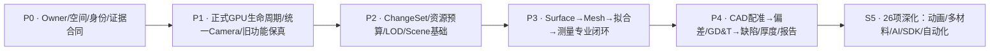

| 阶段 | 首选纵切片 | 交付件（不以空类型替代功能） | 通过门槛 |
|---|---|---|---|
| P0 架构基线 | FVO缓冲安全与原值精度门禁、3D Frame/单位合同、Case/View单真源 | 本文评审、ADR、Owner/DAG合同、固定版追踪、3D数值真值Case | 禁止循环引用、重复真源，三刀/RAW回归不倒退 |
| P1 当前成熟能力工业化 | 迁出TCT的GPU生命周期、MVI Camera→两Renderer | MPW RenderHost/Context/ResourceSet，TestCenter真消费 | Windows Release x64、真WPF/GL失败回退、重启/截图/释放，实卡专项单独验 |
| P2 持续渲染大数据 | ChangeSet/Revision/LOD/预算/渐进渲染 | GL帧调度与缓存、重复上传计数、Lease、诊断 | 取消与过期版本、显存/内存、峰值性能、多GB不同位深 |
| P3 第一个专业闭环 | 真实 CT Surface→Fit→Measure（含ROI） | 有质量报告的Surface/Mesh/Fit/Measurement + 叠加显示 | 标定球/柱、各向异性/噪声、残差与物理真值对照 |
| P4 计量与质量闭环 | CAD↔CT配准→偏差/GD&T→Defect/Thickness | 实CAD B-Rep、变换链、超差统计、质量报告和可追溯发布 | SDK许可/硬件、工装数据、计量标准/复核/工业Case |
| S5 深化扩展 | 复杂CAD/逆向/动画/4D/多材料/AI/SDK/批处理 | 逐能力闭环交付，保持原Versioned Resource Graph | 每项目需求×实现×真值×Windows/现场证据全链签收 |

**首个专业闭环的实际交付顺序**：V01 原始精度/坐标真值→V02 Surface点与质量→V03 球/柱/平面拟合和物理测量→V04 ResultRef/Scene显示与MEM保存重开→V05 CAD/缺陷深化；各阶段都要求至少一个正例、一个失败反例、固定SHA与对应Gate证据。专业数值可在无WPF环境先验证；实GPU画质另立专项，不互相代替。

**不新增工程的原则：** 每阶段先查既有项目和 `DOCS/02～04` Owner 表；必要最少类直接进入既有 `FVO/FGE/MVI/MPW/CT3D` 目录。CI红灯先判本轮、并行开发或历史问题，不修改其他协作者结果。

---

## 13. 开发合同：命名、GoF/AOP、异常与可测试性

### 13.1 核心设计思想

| 思想 | 何时应用 | 明确不做 |
|---|---|---|
| OOP/组合 | Case引用Artifacts、ViewSession组合Camera/Scene、MPW组合Context/Resource | 不新建全功能`Universal3DObject`继承体系 |
| GoF State | GPU启停、失败回退、交互小状态 | 不为每个枚举值强行新增一个State类 |
| GoF Observer | MVI事件、SceneRevision和已渲染版本通知 | 不另造全局MessageBus |
| GoF Command | 专业动作以统一MRK命令中心暴露，工程修改走MEM事务 | 不建CT3D私有Command/UndoStack |
| GoF Composite | 有真实Group/Assembly时引入SceneItem分组 | 不为每类Volume/Mesh分配十几个空派生层 |
| Strategy/Factory | 真实多算法/后端需求和可复现测试出现后 | 不提前造多套未实证Backend |
| AOP显式治理 | 算法/命令/资源边界的审计、取消、日志、性能 | 不在逐体素/GL热路径反射或动态代理 |

### 13.2 最低测试/反证清单

- **原值与坐标**：原体素Byte/UInt16/Float32、端序、各向异性、方向矩阵、坐标往返；删除源文件/超大RAW/取消加载正常失败。
- **GPU**：HwndHost尚未建好就关闭、Context半初始化、Shader编译失败、重复关开、Driver只支持1.1、GPU截屏验证；不可把WPF SliceFallback写成GPU PASS。
- **交互**：三刀、单窗/四窗、Camera切换不跳、ROI鼠标捕获丢失/取消、对象跨层拾取及命令状态准确。
- **计算**：拟合退化、离群点、配准不收敛、CAD单位不一致、GD&T依据错误、漏检/误检；每个算法固定金标准样本。
- **并发**：多次Load A→B→C/旧结果迟到、UI关闭后回调、跨线程GL调用拒绝、Lease延后释放、观察者抛异常不污染已提交结果。
- **可重现性**：同参数/同资源版本重新运行一致、源资产改变使旧结果Stale，保存重开保留ResultRef、AlgorithmVersion、准确度证据。

---

## 14. 待裁决 ADR 与文档维护约定

| ADR | 问题与建议 | 决定前必须查验 |
|---|---|---|
| ADR-01 | MPW→FVO已是实际依赖，但旧Skill存在“不需要”表述；保留现行DAG，不擅删 | 当前 `.csproj` 实际使用与DOCS/02～04工程归属 |
| ADR-02 | 3D空间/网格数据进入 FGE 还是其他已有基础Owner | DOCS/02～04 对 3D数据、SpatialFrame/Geometry、单位的Owner与API |
| ADR-03 | CaseSession的运行身份如何引用MEM与DataHandle，何处拥有专业结果 | MEM Resource/EmbeddedObject/Artifact，MDS生命周期，CT3D既有接口 |
| ADR-04 | CT3D↔MVI协作经过宿主，是否绝不添加CT3D→MVI项目引用 | 当前csproj引用DAG及接口可复用性；优先宿主组合 |
| ADR-05 | CAD/Parasolid/SolidWorks输入策略、SDK/授权及B-Rep真值 | 实DLL、签署许可、x64/ABI、STEP/IGES样本、拓扑单测 |
| ADR-06 | GPU/CPU任务预算、LOD切换策略和精度质量档位 | 工业数据规模、实际显卡/驱动、原始精度红线 |
| ADR-08 | CT3D当前不引用MVI，`CT3DCaseSession` 是专业会话还是宿主可组合接口 | 现有CT3D/MPW/MVI依赖DAG；优先宿主装配，避免CT3D↔MPW引用循环 |
| ADR-09 | UI中的Session/Case/Scene配置保存哪些字段，何种行为进MEM Undo | 现有MEM工程资源、MVI二维Scene、运行态与保存重开用例 |
| ADR-10 | FVO原值读取出现Preview回退时如何强制拒绝计量 | 原值来源/格式/缓存生命周期、Byte/UInt16/Float32 精度反例 |
| ADR-07 | 原始90条逐字文档及可追踪主键 | 当前仅可确认R11～R59，须补R01～R10、R60～R90原文，不能猜 |

### 14.1 长期维护规则

每次实质更新至少追加：**文档版本/日期、固定HEAD、涉及Owner、实际文件路径、能力编号/要求编号、旧行为保真、测试Case、Windows CI run URL、真实GPU/工业样本证据、剩余风险与ADR**。不得只记录Commit数，不得让“UML里有类”变成“代码已实现”。本V2.0应与对应迁移台账、26项映射及专项GPU/业务验收矩阵互相链接，不取代它们。

### 14.2 核查与参考入口

- 主仓库：<https://github.com/oudream/cx-visual-x3>；本次固定SHA：`e4c03f5e6b07be531f96255063159a50b89804a2`。
- 架构铁律：`AGENTS.md`、`.agents/skills/cxvisual-engineering/SKILL.md`、`DOCS/00`、`DOCS/01～04`（02～04大Excel内容待逐Sheet核验）。
- 既有专题：`DOCS/Architecture/CxVisual_专业视觉体系#通用三维视觉工作台——26项能力映射与实施验收_V0.1.md`。
- 成熟迁移：`DOCS/Migration/CxVisual_通用三维视觉工作台#成熟源码整体迁移——逐文件归属与保真验收清单_V1.0.csv`，及 `DOCS/Implementation/*通用三维视觉工作台*`。
- 验收：`DOCS/Testing/CxVisual_通用三维视觉工作台#ReferTo功能保真审计与验收矩阵_V1.0.md`，`...#ReferTo成熟功能保真审计与按钮命令验收_V1.0.md`。
- 用户提供原版设计 V2.0审阅稿；旧 ReferTo `CxECT3DViewer/REQUIREMENTS.md` 与 `CxECTVolumeWinForms/Rendering/RenderingArchitecture.md`，其代码只读。
- 原理参考：VTK 对象/数据处理-可视化管线、ITK 数据/流式处理/分割配准、计算机图形学的坐标/相机/渲染/数据结构；仅用于思想对照，不代表项目已集成其库或提供许可。

---

## 附录 A. GPU 资源对象 UML（详细设计，非总览）

本图保留前一版 V2.0 GPU 类职责的正确部分，供 P1 实现时使用。除现有 `MPWVolumeOpenGlControl`、`MPWVolumeShaderSources` 外，图中标注的对象都是**建议**，当前不得宣称已存在。

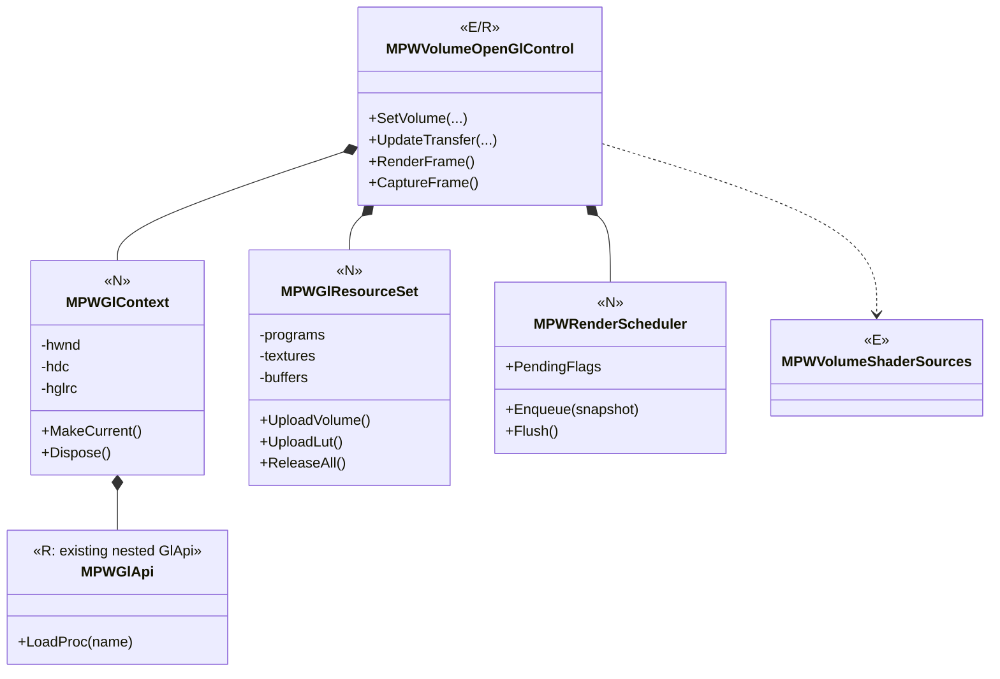

**限制条件：** GPU删除操作须同Context且在正确线程执行；半初始化和重复Dispose可恢复；RenderScheduler仅负责帧与失效合并，不承担 MRK 专业Job职责；FBO/RenderPass/多Backend有真实需求再引入。

## 附录 B. 专业结果构成（偏向组合而非深继承）

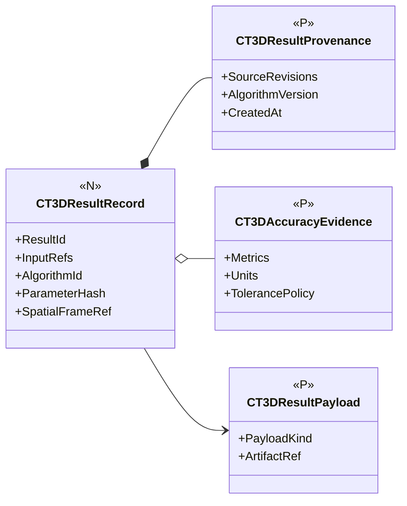

结果可以包含Surface、Registration、Measurement、Deviation、Defect等专业类型，但默认只统一**来源/质量/不可变引用**，不强迫所有业务Payload继承抽象基类。以上类型全是建议，落类前须核对现有 DataHandle/Artifact/Result 机制是否已经实现同义协议。

**基线候选结论：** 整体采用“**高精度数据与空间真源 → 专业算法资产/结果 → 独立3D Scene/ViewSession → MPW实时渲染；以MEM/MRK/MDS等平台机制支撑工程与自动化**”的职责分界。以完整26项作为长期产品地图，以最小纵向可验闭环推进；未批准的新增接口、完整90条原文、真实GPU/工业数据验收必须继续标注为待核项。


---

## 附录 C｜R01～R90 原文存在性及26项映射索引

**要求来源说明：** 这是“需求原文存在性与能力对照表”，不是虚构的90条正式全文。`R11～R59` 的“摘要”是用户截图中可核见条目的简述，**不是逐字原文**；`R01～R10/R60～R90` 未取得权威原文，留空；26能力映射见第10章。正式需求原文/ID/Hash/验收Case/证据须在取得源文件后逐字补录，尤其应注意R19和R20共同归入能力01。

| 原始编号 | 可核见内容摘要（非全文） | 能力№ | 指向 | 条文证据 |
|---|---|---|---|---|
| R01 | **原文待补** | — | 暂不归属、不得凭推断签收 | 未核 |
| R02 | **原文待补** | — | 暂不归属、不得凭推断签收 | 未核 |
| R03 | **原文待补** | — | 暂不归属、不得凭推断签收 | 未核 |
| R04 | **原文待补** | — | 暂不归属、不得凭推断签收 | 未核 |
| R05 | **原文待补** | — | 暂不归属、不得凭推断签收 | 未核 |
| R06 | **原文待补** | — | 暂不归属、不得凭推断签收 | 未核 |
| R07 | **原文待补** | — | 暂不归属、不得凭推断签收 | 未核 |
| R08 | **原文待补** | — | 暂不归属、不得凭推断签收 | 未核 |
| R09 | **原文待补** | — | 暂不归属、不得凭推断签收 | 未核 |
| R10 | **原文待补** | — | 暂不归属、不得凭推断签收 | 未核 |
| R11 | 平台目标/三维工作台 | 全局 | 全局约束 | 截图可核 |
| R12 | 工业CT/检测/CAD应用 | 全局 | 全局约束 | 截图可核 |
| R13 | 可视化/交互/算法调试 | 全局 | 全局约束 | 截图可核 |
| R14 | Volume/PointCloud/Mesh/CAD多对象 | 全局 | 全局约束 | 截图可核 |
| R15 | 独立/嵌入/API | 全局 | 全局约束 | 截图可核 |
| R16 | 完整可靠便捷 | 全局 | 全局约束 | 截图可核 |
| R17 | NET48/WPF | 全局 | 全局约束 | 截图可核 |
| R18 | 避免单体应用 | 全局 | 全局约束 | 截图可核 |
| R19 | RAW/DICOM/NRRD/TIFF/点云/网格/CAD | 01 | 能力追踪表第10章 | 截图可核 |
| R20 | 文件/内存/指针/共享内存/流/批量 | 01 | 能力追踪表第10章 | 截图可核 |
| R21 | 数据质量/间距/方向/坐标 | 02 | 能力追踪表第10章 | 截图可核 |
| R22 | 滤波降噪/重采样/裁剪 | 03 | 能力追踪表第10章 | 截图可核 |
| R23 | 大数据LOD/GPU/缓存 | 04 | 能力追踪表第10章 | 截图可核 |
| R24 | 体绘/MIP等值面/几何渲染 | 05 | 能力追踪表第10章 | 截图可核 |
| R25 | MPR/任意切/厚层 | 06 | 能力追踪表第10章 | 截图可核 |
| R26 | 四视图与定位 | 07 | 能力追踪表第10章 | 截图可核 |
| R27 | 3D ROI/标注/图层 | 08 | 能力追踪表第10章 | 截图可核 |
| R28 | 动画/时间轴 | 09 | 能力追踪表第10章 | 截图可核 |
| R29 | 分割/多材料Mask | 10 | 能力追踪表第10章 | 截图可核 |
| R30 | 表面确定/亚体素 | 11 | 能力追踪表第10章 | 截图可核 |
| R31 | 点云/网格处理 | 12 | 能力追踪表第10章 | 截图可核 |
| R32 | 拟合与特征 | 13 | 能力追踪表第10章 | 截图可核 |
| R33 | 配准/ICP | 14 | 能力追踪表第10章 | 截图可核 |
| R34 | 距离/体积/厚度测量 | 15 | 能力追踪表第10章 | 截图可核 |
| R35 | GD&T形位公差 | 16 | 能力追踪表第10章 | 截图可核 |
| R36 | CAD/SolidWorks集成 | 17 | 能力追踪表第10章 | 截图可核 |
| R37 | CT/CAD偏差 | 18 | 能力追踪表第10章 | 截图可核 |
| R38 | 逆向工程/NURBS | 19 | 能力追踪表第10章 | 截图可核 |
| R39 | 三维缺陷 | 20 | 能力追踪表第10章 | 截图可核 |
| R40 | 壁厚/装配 | 21 | 能力追踪表第10章 | 截图可核 |
| R41 | 多材料/部件结构 | 22 | 能力追踪表第10章 | 截图可核 |
| R42 | 算法实验/诊断 | 23 | 能力追踪表第10章 | 截图可核 |
| R43 | 批量与自动化 | 24 | 能力追踪表第10章 | 截图可核 |
| R44 | 导出与报告 | 25 | 能力追踪表第10章 | 截图可核 |
| R45 | SDK/插件/扩展 | 26 | 能力追踪表第10章 | 截图可核 |
| R46 | 表面确定须有精度质量评价 | 11 | 能力追踪表第10章 | 截图可核 |
| R47 | 最小二乘/鲁棒/约束拟合 | 13 | 能力追踪表第10章 | 截图可核 |
| R48 | 人工/自动/局部配准与变换 | 14 | 能力追踪表第10章 | 截图可核 |
| R49 | CAD偏差/色谱/超差统计 | 18 | 能力追踪表第10章 | 截图可核 |
| R50 | SolidWorks原文件可信接入 | 17 | 能力追踪表第10章 | 截图可核 |
| R51 | 单位基准公差误差溯源 | 15 | 能力追踪表第10章 | 截图可核 |
| R52 | 体素/物理/世界/视图/CAD坐标 | 02 | 能力追踪表第10章 | 截图可核 |
| R53 | 原值与降采样分离 | 04 | 能力追踪表第10章 | 截图可核 |
| R54 | 相机/模型/剖切/关键帧动画 | 09 | 能力追踪表第10章 | 截图可核 |
| R55 | 装配/缺陷/测量动画 | 09 | 能力追踪表第10章 | 截图可核 |
| R56 | 时间轴/编辑/视频 | 09 | 能力追踪表第10章 | 截图可核 |
| R57 | 四视图直接复用 | 07 | 能力追踪表第10章 | 截图可核 |
| R58 | 对象/ROI/标注自由组合 | 08 | 能力追踪表第10章 | 截图可核 |
| R59 | 工具互操作与组合 | 26 | 能力追踪表第10章 | 截图可核 |
| R60 | **原文待补** | — | 暂不归属、不得凭推断签收 | 未核 |
| R61 | **原文待补** | — | 暂不归属、不得凭推断签收 | 未核 |
| R62 | **原文待补** | — | 暂不归属、不得凭推断签收 | 未核 |
| R63 | **原文待补** | — | 暂不归属、不得凭推断签收 | 未核 |
| R64 | **原文待补** | — | 暂不归属、不得凭推断签收 | 未核 |
| R65 | **原文待补** | — | 暂不归属、不得凭推断签收 | 未核 |
| R66 | **原文待补** | — | 暂不归属、不得凭推断签收 | 未核 |
| R67 | **原文待补** | — | 暂不归属、不得凭推断签收 | 未核 |
| R68 | **原文待补** | — | 暂不归属、不得凭推断签收 | 未核 |
| R69 | **原文待补** | — | 暂不归属、不得凭推断签收 | 未核 |
| R70 | **原文待补** | — | 暂不归属、不得凭推断签收 | 未核 |
| R71 | **原文待补** | — | 暂不归属、不得凭推断签收 | 未核 |
| R72 | **原文待补** | — | 暂不归属、不得凭推断签收 | 未核 |
| R73 | **原文待补** | — | 暂不归属、不得凭推断签收 | 未核 |
| R74 | **原文待补** | — | 暂不归属、不得凭推断签收 | 未核 |
| R75 | **原文待补** | — | 暂不归属、不得凭推断签收 | 未核 |
| R76 | **原文待补** | — | 暂不归属、不得凭推断签收 | 未核 |
| R77 | **原文待补** | — | 暂不归属、不得凭推断签收 | 未核 |
| R78 | **原文待补** | — | 暂不归属、不得凭推断签收 | 未核 |
| R79 | **原文待补** | — | 暂不归属、不得凭推断签收 | 未核 |
| R80 | **原文待补** | — | 暂不归属、不得凭推断签收 | 未核 |
| R81 | **原文待补** | — | 暂不归属、不得凭推断签收 | 未核 |
| R82 | **原文待补** | — | 暂不归属、不得凭推断签收 | 未核 |
| R83 | **原文待补** | — | 暂不归属、不得凭推断签收 | 未核 |
| R84 | **原文待补** | — | 暂不归属、不得凭推断签收 | 未核 |
| R85 | **原文待补** | — | 暂不归属、不得凭推断签收 | 未核 |
| R86 | **原文待补** | — | 暂不归属、不得凭推断签收 | 未核 |
| R87 | **原文待补** | — | 暂不归属、不得凭推断签收 | 未核 |
| R88 | **原文待补** | — | 暂不归属、不得凭推断签收 | 未核 |
| R89 | **原文待补** | — | 暂不归属、不得凭推断签收 | 未核 |
| R90 | **原文待补** | — | 暂不归属、不得凭推断签收 | 未核 |

## 附录 D｜开发者核对清单

### D.1 第一个不破坏现有四视图的垂直改造路径

```mermaid
flowchart LR
 A["核对V2.0 Owner/ADR"] --> B["FVO原值安全与精度门禁"]
 B --> C["MVI单Camera，MPW两模式消费"]
 C --> D["MPW GPU生命周期从TCT正式收敛"]
 D --> E["CT3D ChangeSet接入帧合并调度"]
 E --> F["体数据/空间真值 → Surface → Fit → Measurement"]
 F --> G["CAD/偏差/缺陷/报告，按Case实证"]
```

**推荐最小下一工作包：** 不改全部架构，先审查并修复 `FVOVolumeData.SetRawBuffer()` 同句柄接管与缓冲长度检查，在 `FVOVolumeTests` 增加正反例；然后明确专业算法无损标量读取的可测试合同。该小包不能代替后续真正的Lease/空间标定/显存预算。

### D.2 每轮 PR/直提 master 核对项

- [ ] 记录开始和提交时的最新 HEAD、并行提交差异，`ReferTo/`无改动；中文提交、不得强推覆盖。
- [ ] 逐条回答“Owner是谁、谁写真源、谁只读投影、跨工程依赖是否新增”。
- [ ] 新类型以【N】标记至源代码出现；源代码出现后仍要分别说明编译、自动测试、UI、GPU与现场证据等级。
- [ ] 算法说明输入输出、单位/Frame、来源版本、原始精度、结果质量、异常取消和资源所有权。
- [ ] GPU说明Context线程、GpuEpoch、幂等释放、重复装载、截图真伪与实卡证据。
- [ ] 26×90追踪条目更新，保留未核实原文，不因功能界面可见就填“通过”。
- [ ] Windows x64编译与结构/Owner DAG、`--volume`、WPF真控件、GPU实机（如条件具备）分别留证。

### D.3 文档维护的三种层级

1. **本文是高层“是什么/在哪里/如何协作/如何验收”的唯一三维总体入口**；不承载每个GL调用和数学推导的所有细节。
2. 旧 UML V1.0 GPU/State/Sequence 及 `DOCS/Implementation` 保留为**专题详细设计和代码证据**，与本文保持超链接与版本对应。
3. `DOCS/Migration` 的逐文件48项复用台账、`DOCS/Testing` 的R01～R32功能保真及专项CI是验收事实来源，不与架构稿相互代替。

**版本审阅结论：** 本文的产品能力分组、当前已确认F/M/P物理边界和三条不变量可供开发**作为约束**；新增3D Frame/Case/Scene/专业算法API仅为候选，不得在未复核DOCS/02～04相应Owner与ADR前提升为已批准公共规范。R01～R10、R60～R90还缺原文，真实GPU与工业计量的G3～G5证据待补。**这是内容收敛完成，不是完整功能或全部ADR审批完成。**

**修订记录（单一主文）**：V2.0原稿→R2改进读者层次、26项及需求追踪→R3加入C01～C08/详细时序→**R4把R3增补并入§8/§12/§14，删除重复章节，缩减并归一化入口**。后续不再建立“R5附加文件”，在本路径原位修订并记录固定SHA、Owner/ADR、测试证据。
