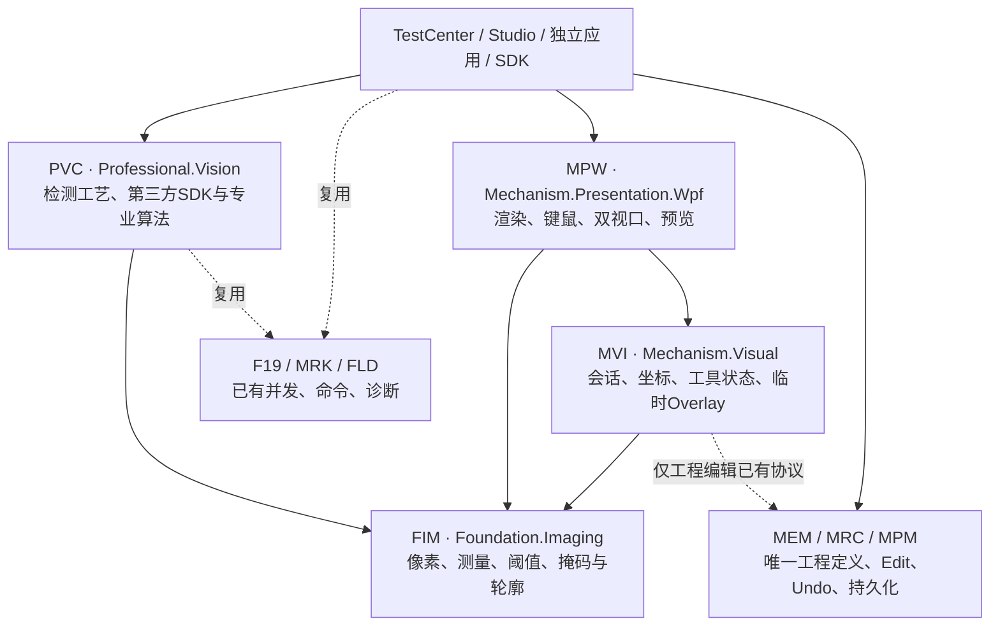
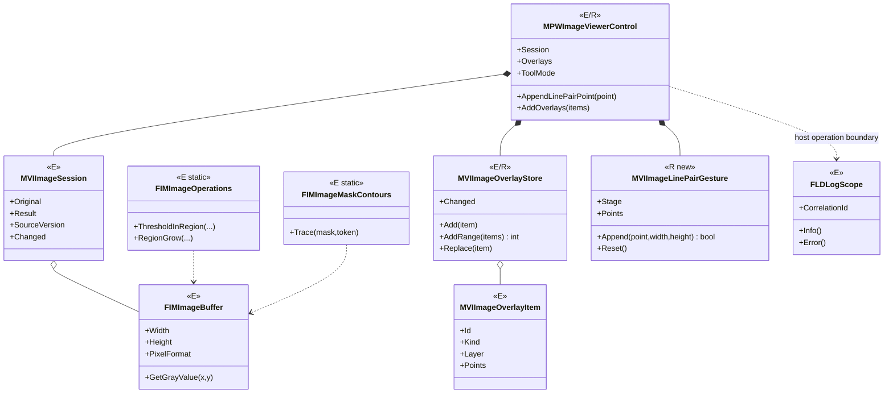
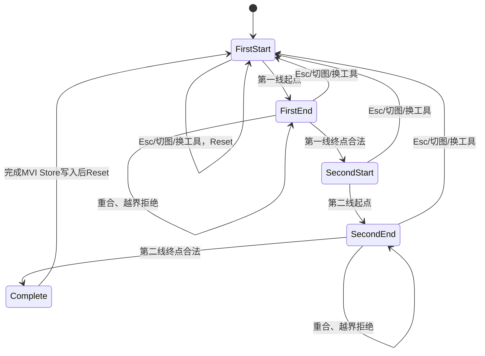
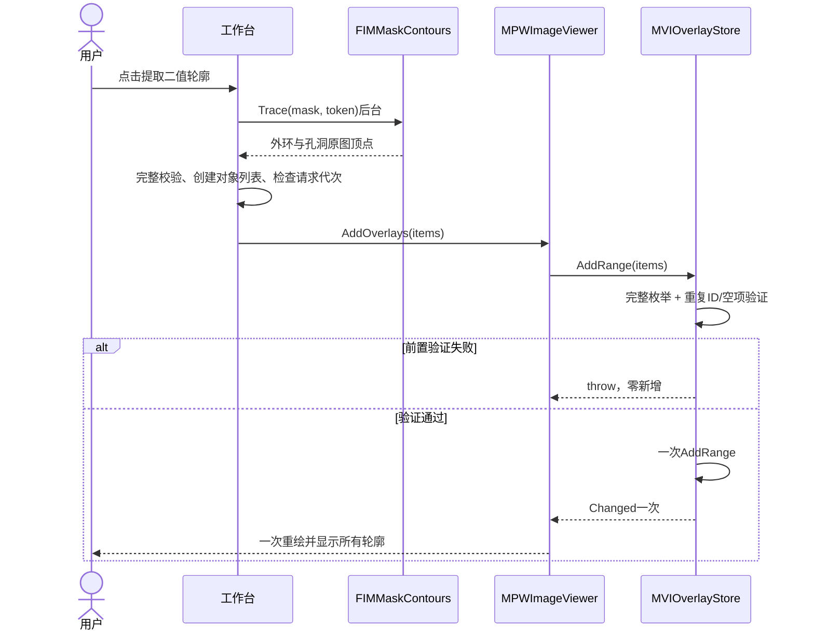
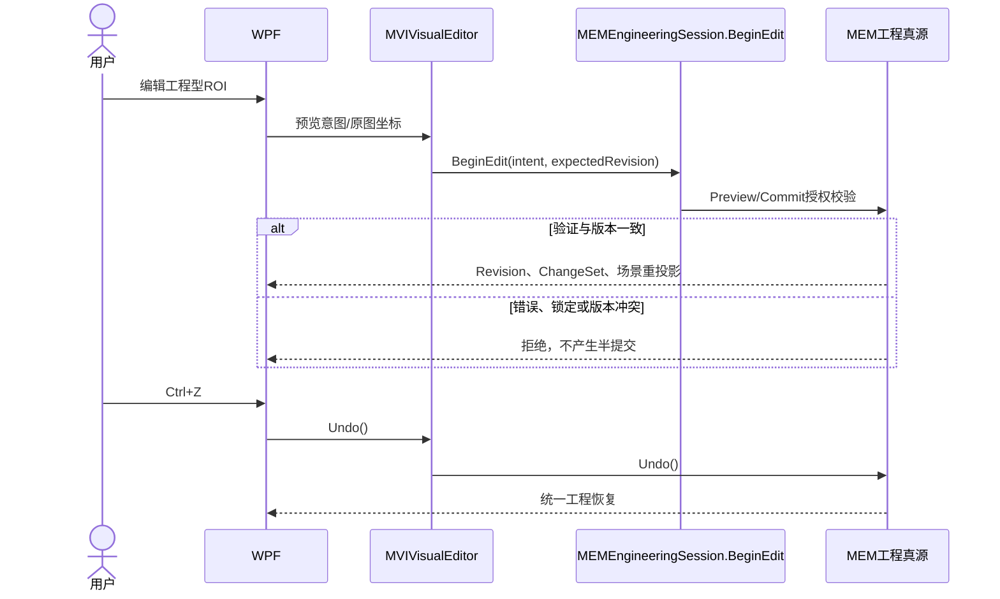
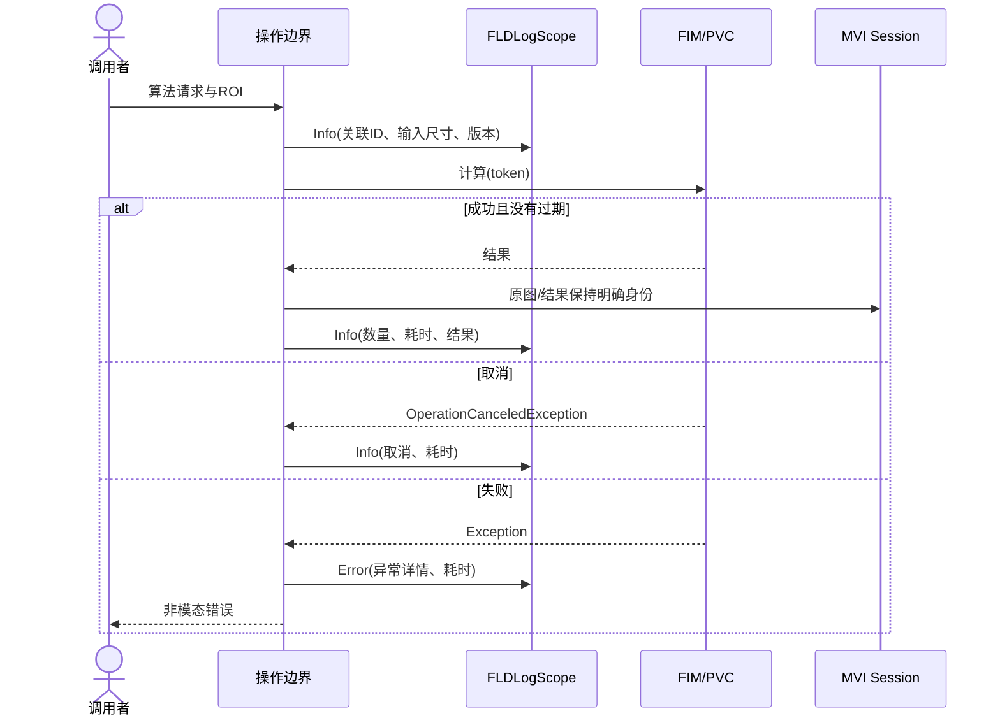

# CxVisual 专业视觉体系——通用二维视觉工作台 OOP / GoF / AOP 与 UML 实施设计 V1.1

> 日期：2026-10-28。状态：**核心Owner和设计约束确认，首轮State/Observer/AOP代码实施中；其余均为待开发候选**。
> 来源：用户审议V1.0 UML后要求复核并执行；核对 `AGENTS.md`、工程Skill、`DOCS/00～04`导航、二维视觉工作台V1.0、图元编辑V1.2、FIM/MVI成熟复用规范、真实源码。
> 本文不创建新项目，不更改MEM唯一工程真源，不增加图像专属Undo/Executor/适配器层。Windows和现场结论只以固定SHA实际CI记录为准。

## 1. 三个设计原则与复核结论

1. **OOP（高内聚和组合优先）**：`FIMImageBuffer`拥有原始像素副本；`MVIImageSession`拥有浏览会话和异步版本；`MVIImageOverlayStore`是唯一临时会话叠加集合；`MPWImageViewerControl`负责WPF输入、渲染与投影；`PVC`拥有专业工艺、SDK算法；工程化图元只由MEM/MRC/MPM拥有持久身份及提交权。
2. **GoF按实际变化点使用**：已存在 Observer（Session、Overlay.Changed）；状态演进选用State思想，由具名手势对象维护阶段，不为每个简单工具引入一套接口；工程编辑使用既有MEM Command/Transaction；复合工程图元复用MRC Group/VisualItem；确有多套可替换专业算法后才引入 Strategy。
3. **AOP采用显式操作边界治理**：使用现有`FLDLogScope`和关联ID，在图像分析任务入口、成功、失败、取消记录像素维度、版本、耗时；并发及工程授权复用F19/MRK/MEM。不得在像素热循环织入反射、代理或日志；不得为AOP另建总线/TaskScheduler。

**本轮V1.0 UML修正**：把笼统 `ApplyBatch(edits)` 落地成语义明确的 `MVIImageOverlayStore.AddRange(items)`；把普遍`IMVIImageGesture`候选收敛为可验证的`MVIImageLinePairGesture`，稳定再评估通用接口；`MVIImageRequestGuard`保留为候选，先复用现有SourceVersion、原图引用和TCT epoch+CancellationToken。文档中出现的“N（候选）”不是已实现。

## 2. UML-01 五方面组件图

箭头表达调用/复用意图，不意味着引入图外项目或任何新的Foundation→Mechanism反向依赖。

## 3. UML-02 核心对象类图（E=已存在、R=本轮扩展）

`MVIImageLinePairGesture`为MVI内部短命草稿的唯一状态；MPW的`_polygonDraft`只是显示兼容投影，不是第二份工程对象。原图坐标用FGE数据类型，与WPF Point明确转换。

## 4. UML-03 Ls2Ls交互State图

不变量：只有第四点完成才创建唯一正式叠加项；退化输入不增加草稿；允许两条线共享端点；左右Pane复用同一原图坐标手势；换图与工具切换取消所有未提交点。

## 5. UML-04 轮廓批量与GoF Observer时序

边界：新增仅为临时Overlay，非MEM事务；通知监听者抛异常属于**已提交后的观察者故障**，并不能作为“验证失败时零提交”宣传。大规模WPF Polygon自身的渲染成本仍需性能评测；一次Changed不是自动等于大图流畅。

## 6. UML-05 正式工程编辑与唯一Undo（后续待集成）

**注意本图未交付**：图像ROI→MEM持久图元的Schema/ID/资源投影映射尚需单独实现与真实保存重开测试。MVI临时Overlay Store禁止存储工程Undo历史。

## 7. UML-06 AOP观测边界

已实施的观测落点为TCT轮廓操作边界，未来正式专业宿主调用应重用FLD，不在TestCenter内部发明第二日志系统。

## 8. 分阶段实施与状态（2026-10-28）

| 工作包 | 现行落点 | 状态（以代码/CI为准） | 不得冒充 |
|---|---|---|---|
| A-01 原子AddRange与Observer | MVI Store、MPW、TCT轮廓、数值/WPF测试 | 代码已提交；CI按最新工作流确认 | 不等于MEM工程事务 |
| A-02 Ls2Ls State交互 | MVI独立Gesture、MPW复用、数值/WPF回归 | 代码已提交；CI按最新工作流确认 | 不等于所有工具实现State |
| A-03 AOP操作观测 | TCT轮廓调用`FLDLogScope` | 代码已提交；没有现场日志收集实测 | 不等于完整平台可观测性 |
| B-01 异步请求守护 | 现有SourceVersion、引用身份和CancellationToken | 已有基础，统一化待评审 | 不等于跨进程取消 |
| B-02 编辑态与自然工具 | Bezier、复杂ROI、就地文本、多DPI | 待实施 | 不得说已完成 |
| C-01 工程ROI正式映射 | MEM/MRC/MPM、MVIVisualEditor | 待实施与保存重开验证 | 无第二工程树/Undo |
| D-01 专业策略和算法验收 | PVC、HALCON/OpenCV、旧Viewer | 待专业SDK/同图数据验证 | 不等于硬件现场Passed |

## 9. 专项正反验收

- MVI数字测试：Ls2Ls FirstStart→Complete 四阶段、退化/越界/NaN拒绝、不污染状态、Reset。
- MVI Store：`AddRange`空集合不通知；正常N元素一次通知；null/已存在ID/批内重复/枚举器中途异常全部零新增且原快照不变。
- WPF真实控件：双轮廓批量添加仅一次Observer通知、两Polygon真实渲染；拒绝重复ID保持数量；阈值掩码→提取轮廓→CSV身份与面积回环仍通过。
- AOP：源码校验使用正式FLD，并在后续单独测试可配Sink、CorrelationId、出错分类、性能和取消事件；不可把日志代码存在当作已完整验收。
- 后续独立测试：左右Pane物理鼠标、Esc、lost capture、多DPI、16位/大图性能、工程Undo+保存重开、HALCON专业结果对照。

## 10. 执行约束

严格遵守28项目/135子方面Owner、ReferTo只读、中文提交、直接master、Windows .NET48 x64专项与默认回归；一切测试结果标注对应固定SHA、工作流和剩余问题。禁止无实际替换需求的Strategy/Factory、泛用Adapter/Facade/Wrapper、多余Provider、空接口和层层委托。
