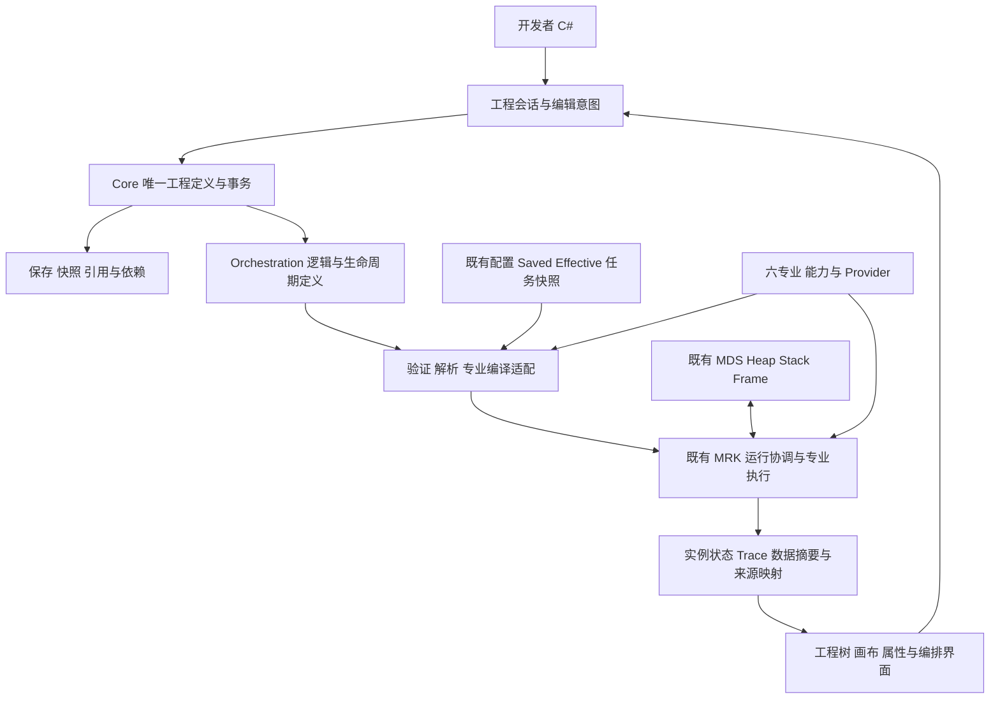
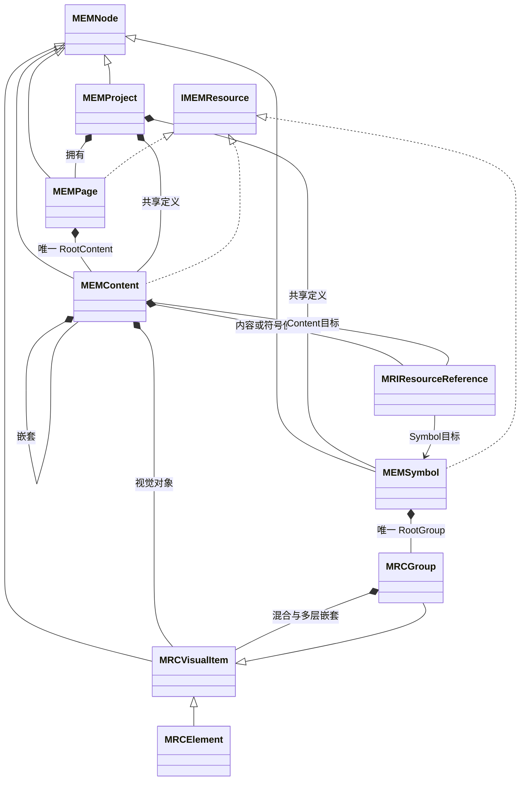

# CxVisual 统一工程组织体系：完整架构设计与开发使用指南 V1.1

> **H01实施更新（2026-10-17）**：用户已正式确认D01～D04，最终视觉层为MRCVisualItem→MRCElement/MRCGroup，Content/Symbol使用MEM前缀。以下候选签名/旧源码审计保留历史，不覆盖用户最终模型；当前可运行API、真实测试、边界与进度见[H01实现与验收](../Testing/CxVisual_工程组织体系_H01_实现与验收_V1.0.md)。不再等待同一架构确认。
>
> **后续实施更新（2026-10-18）**：用户已授权自动依次完成H02～H07。H02已增加BeginEdit/Preview/Commit、GetSnapshot与稳定定义/实例地址，真实案例、本机测试及本次Windows CI成功证据见[H02验收](../Testing/CxVisual_工程组织体系_H02_实现与验收_V1.0.md)。此段是当时的H02阶段进展记录，并非最新master的实施完成度；后续以实际源码、对应验收报告和CI为准。

> 日期：2026-10-17；在 V1.0 上增补复核，保留六角色、八案例、28项需求及源码/历史验证记录；不重新建设对象体系。
> 本轮 x3：`master / ea6205b8ff4c9557efd56935f61430b2a49f7a23`（已正常合并 GitHub master `604718869e704d8ab943d6e593eeeb274afe657d`）；x2 本地/GitHub master：`2626734d0fd5e67ac50fd0621532173cec39b939`。x3 Core/Visual 及专业/运行源码相对此前 V1.0 审计基线 `464b2e8d1575736a1885e01ac00a239e22f29c79` 无变化；新远端变化是 TestCenter 验收/归档，不据此虚报本轮CI。
> 上述提交号是V1.1设计审查时点的历史基线。2026-10-18更新：H00 D01～D04已确认，H01已实施；本轮真实源码/测试结果与剩余范围见H01报告。§4/§9/附录的旧审计证据只对应各自注明的提交，不能作为当前源码行号使用。
> 性质：长期设计与分阶段实施规范。当前实际API与后续候选合同分开；V1.0作为历史版本保留，已有未跟踪V0.2草稿保留。

配套交付（同一体系，不是四套规范）：

- [x2 → x3 工程组织复用映射 V1.1](CxVisual_统一工程组织体系_x2至x3复用映射_V1.1.md)：R01～R50、关键属性/方法、真实测试与固定源码链接。
- [H00～H07 分阶段实施与验收指导 V1.1](CxVisual_统一工程组织体系_H00至H07分阶段实施与验收指导_V1.1.md)：每阶段类型/Owner、顺序、案例、TDD与客观完成标准。
- [H00 架构待裁决清单 V1.1](CxVisual_统一工程组织体系_架构待裁决清单_V1.1.md)：Node/Resource、Project资源导航、Group继承、Element定位、便利API、事件与格式取舍。

> **2026-10-18 协同设计补充**：编排定义、逻辑类、编译/执行、Studio调试与SourceMap的完整共识集中于下文 §7.4；候选 MOL/MOC/Region 类型非已实现API。不新增平行的专项体系文档。

## 0. 先读：现在能做什么，怎样使用本指南

当前已有核心工程入口包括 `MEMEngineering.Create/Open`、Page/Content/Symbol、可视Group/Element、共享资源引用、增量Id索引、统一Edit/Undo/Redo及工程存储。2026-10-18 已删除旧14个 Cx 工程类，正式工程入口为MEM/MRC/MTC；迁移记录见[旧Cx工程体系清理与迁移](../Testing/CxVisual_旧Cx工程体系清理与迁移记录_V1.0.md)。可执行入门程序仍可参见[H01QuickStart](../../Examples/EngineeringOrganization/H01QuickStart.cs)，但历史示例若引用已删除类型，必须优先按当前源码修订。

当前不能据此认定已具备：参数化引用实例渲染、一般属性/端口编辑、四Aspect通用持久化、工程到MRK完整翻译、跨工程包、未知插件保真、完整x2 format6迁移、账户授权和生产恢复。Session对象是只读实时身份，固定版快照/长草稿/保存时继续编辑属于后续阶段。

### 0.1 状态与证据

| 标记 | 含义 | 不代表什么 |
|---|---|---|
| 当前 API | 本轮实际源文件中有相应公开声明，示例注明其验证编号 | 不自动代表所有边界已测或现场可用 |
| 已实现（有限范围） | 有具体方法体及对应行为说明 | 不外推到所有节点、资源或专业 |
| 部分实现 | 核心行为存在，指定范围仍缺失 | 不能按完整需求验收 |
| 规划中 / 建议 API | 源码没有该入口，或本稿提出的契约设计 | 不可直接复制到当前程序集编译 |
| 待验证 | 尚无本轮对应行为/环境证据 | 旧 CI、旧仓记录不能代替本轮实测 |

文中的“目标规则”依据统一模型、V4.9和工程规范；D01～D04以用户最终确认及下列UML为准。D05～D07的完整事件/迁移/分组算法按原Owner后续验收，不阻断H01。旧候选签名不得冒充已实现API。

### 0.2 阅读与入门路径

- 软件开发者：先读§2对象关系及[H01真实API与可执行示例](../Testing/CxVisual_工程组织体系_H01_实现与验收_V1.0.md)，再对照§4旧Cx兼容面；需要运行流程时读§8.8的独立运行示例。
- 工程编排用户：先读 §3 操作过程、§6 六角色、§8 案例；先使用当前 Studio 的矩形/保存功能，目标流程编辑器尚未完成。
- 专业开发者：读 §5 类型与扩展、§7 协同、§8.5～8.8；不要通过修改 CxNodeKind 或持久化 SDK 句柄接入能力。
- 维护者与审查者：读 §9 追溯矩阵、§10 兼容/冲突、§11 实测与自审、§12 来源及附录。

本指南包含必要概念、代码、目标结构和差距。准备开发时先读H00及对应阶段；配套复用映射和实施指南是本主文档的详细证据/工作单，不建立另一套对象与阶段。

## 1. 目标、原则和整体架构

### 1.1 目标与明确边界

工程组织体系描述“工程是什么、由什么组成、引用谁、如何组合、使用哪个版本、怎样找到来源”。它为各机制及专业提供共同的工程身份、所有权、资源、编辑和持久化基础。

配置值与生效由 FCM/MHS/MVB 管理；运行数据由 MDS Heap/Stack/Frame 等拥有；编排定义由 Orchestration 负责；实际运行由现有 MRK/FCR 与专业适配负责。工程保存不等于配置生效、启动执行、设备接受命令或正式发布。

遵守既有 F/M/P、28 项目/135 子方面 Owner 规范。当前仓库结构脚本实际检查 31 项目，包含后续测试工程；本稿不据此修改产品项目规划或增加新项目。

### 1.2 必须保持的不变量

1. 只有一份权威工程定义；Parent/Children、引用和连接各有唯一存储位置。
2. `Project/Page/Content/Symbol/Group/Element` 是组织主线，**不是所有对象都必须穿过的强制六层链**。
3. 拥有、引用、调用、连接和运行实例分别表达；引用不转移目标所有权。
4. 图拓扑是同一工程逻辑关系的表达/编译投影，不再建第二套持久 Graph 业务树。
5. Definition → 固定快照/解析模型/编译制品 → Runtime；可变编辑对象不直接进入在途生产任务。
6. 四 Aspect 按需装配；简单符号不被强制附加逻辑、通信或运行实例。
7. 普通操作经过同一提交管线，界面不绕过结构/引用/版本/权限检查。
8. 专业保留算法、设备和执行语义；Core 不引用 Professional，Visual 不依赖 WPF/Runtime，运行可 headless。
9. 数据端口、控制推进、状态、事件、命令和流的语义可检查，不靠画布位置猜测。
10. 设计、声明、编译、自动测试、虚拟目标及真实设备验收分别记录。

### 1.3 整体架构图（目标职责，含现有部件）



以上为职责协作图，不表示 Core 直接引用所有框，也不表示图中的目标桥接已实现。实际 Core 只有基础节点/事务；Orchestration 当前项目仅有 AssemblyInfo。MRK 已有代码编排编译，但尚无持久 CxNode 工程到完整计划的桥接。

### 1.4 V1.1 最后收敛：哪些确认、哪些仍待裁决

确认保留：唯一工程定义、四Aspect按需、零页面后台工程、Foundation/Mechanism各一个现有Core项目、原配置/数据/运行Owner，以及H01～H07的既有阶段。新增H00只收敛核心结构。

| 裁决项 | 当前确定方案 | 与V1.0的差异及后续动作 |
|---|---|---|
| D01 Node与Resource | Page/Content/Symbol实现只读IMEMResource，Entry仍作登记与存储元数据 | 不再仅让用户通过Entry找所有对象；独立/内嵌/外部分类明确，无第二资源树 |
| D02 Group继承 | MRCVisualItem : MEMNode；Element/Group为兄弟派生类 | 用户已确认；Group拥有类型化VisualItem混合集合，Element为视觉叶 |
| D03 Element定位 | 图元/显示表达；非视觉算法/控制/IoT通过Content与Logic/Data/Collaboration组织 | 不继续把所有业务能力泛化成Element；继承x2按需业务Aspect |
| D04 API易用性 | Session便利方法＋Project强类型只读投影，复杂操作仍Edit | 减少普通场景的根/句柄/事务细节，不开放可写实体/List |
| D05/D06/D07 | 提交观察与UI事件分工；x2旧格式显式适配；组变换基础依赖 | 历史事件/动态化/未知保真不因新API而消失；几何API现实、完整迁移/事件Owner需阶段确认 |

下文UML已同步用户最终裁决及H01生产模型。历史比较保留在H00文档，不能据其旧Group:Element推荐重新改变现有继承。

## 2. 完整工程组织模型

### 2.1 权威对象、从属记录与投影

| 对象 | 职责与目标成员 | 所有权/实例及生命周期 | 当前事实 |
|---|---|---|---|
| Project | 工程身份、资源/依赖登记、页面、共享定义及版本策略 | 工程定义根；不拥有设备活跃会话或产品运行数据 | MEMProject分类投影/索引查询已实现；完整依赖锁后续 |
| Page | 专业工作视图、尺寸/背景/导航、唯一RootContent | 根内容归页面；页面不是Runtime必需入口 | 自动唯一根/保护已验证；Workbench/背景等后续 |
| Content | 业务组合、复用、作用域与逻辑边界 | 嵌套或共享定义；不强制视觉 | MEMContent拥有嵌套Content/VisualItem及引用；完整Aspect后续 |
| Symbol | 可复用组件定义；RootGroup、公开属性/端口 | 定义与使用位置分离 | MEMSymbol自动唯一根、最小引用已验证；参数/端口后续 |
| Group | 视觉组合、局部变换、选择/布局边界 | 只含Group/Element；不是业务作用域 | MRCGroup:MRCVisualItem，混合嵌套、局部变换与命中已验证 |
| Element | 视觉叶；公共可视操作来自MRCVisualItem | 无拥有子项；业务无显示可用Content | MRCElement抽象，MRCRectangle为H01实际图元 |
| ContentReference / SymbolReference | 使用身份、目标定义、版本与覆盖 | 从属于Content，不复制目标Children | MRIResourceReference已实现独立Id/TargetId/Kind/Owner及往返；版本/覆盖后续 |
| ResourceEntry | 元信息与存储登记 | 不拥有业务节点，不是第二资源树 | GetResourceEntry按需返回元数据快照；外部制品目录/独立版本后续 |
| Property/Port/Connection/Aspect | 对象的契约和能力定义 | 从属于同一工程，拥有者、版本和序列化明确 | 配置/运行端有相关契约，Core 通用模型未完成 |
| 工程树/Outline/画布/依赖图 | 不同任务的导航和投影 | 可重建，不独立保存可写业务真源 | 当前场景投影只遍历整个树的矩形 |
| Runtime Instance/Scope/Result | 某次执行的状态、数据与证据 | MRK/MDS/专业拥有，按运行和目标释放 | 存在内核实现；未完整映射至工程视图 |

### 2.2 包含、引用和实例图



本图是H00已批准并由H01落地的结构。CxNode为无状态源码兼容基类，旧Cx对象就是相应MEM/MRC实体，不并列存储另一棵树。Workbench仍是专业编辑上下文，不新增第七种节点；页面专业元数据后续补齐。

### 2.3 合法关系：目标与当前分开

| 关系 | 目标规则 | 当前H01行为（完整策略在Session内） |
|---|---|---|
| Project → Page/共享定义/资源 | 允许；独立资源可以无页面 | Page/Content/Symbol合法，空工程合法 |
| Page → 根内容 | 恰好一个Content；自动建立 | 单根受保护，公开编辑不能删/移根 |
| Content → Content | 可嵌套，单 Parent，无拥有环 | 允许 |
| Content → 引用/Group/Element | 支持业务复用和视觉内容；引用有自己身份 | 已支持；旧CxContent内嵌CxSymbol仅限显式legacy兼容 |
| Symbol → Group | 恰好一个RootGroup | 自动创建、单根受保护 |
| Group → Group/Element | 允许；只做视觉组合 | 允许 |
| Group → Symbol/Content | 不允许；需要业务组合时用 Content | 不允许 |
| Kind.Element → 任意子节点 | 不允许；Group与Element同继承MRCVisualItem | 不允许，重复Id/双父/拥有与引用展开环原子拒绝 |

**符号嵌套的正确用法**：通过嵌套 Content 组织多个 SymbolReference，或在 Symbol 的 RootGroup 内嵌套视觉 Group/Element。不能为满足“嵌套符号”而悄悄允许 Group 拥有 SymbolReference/业务子流程。若确需另一种符号实例包含语义，必须形成单独兼容裁决。

### 2.4 四 Aspect 怎样融合

| Aspect | 表达什么 | Owner 与使用方式 | 不能放什么 |
|---|---|---|---|
| Visual | 布局、几何、样式、显示状态/Viewer 绑定 | Visual 定义/投影，专业贡献渲染，WPF 仅适配 | 正在运行的控件、显存或设备句柄 |
| Logic | 流程、状态机、规则引用、触发和调用 | Orchestration/Logic 提供语义，按专业模型编译 | 另一套可写 GraphNode 树、不可序列化 Func |
| Data | 端口、Schema、绑定及作用域声明 | 数据/变量 Owner 解析，运行时注入 DataContext | 当前 Flow 的 Heap/Stack 内容和大型数组 |
| Collaboration | 跨对象/跨专业调用、资源/契约引用和边界 | 稳定 Capability/Resource/Contract 引用 | 对其它专业内部类、远端对象指针的直接持有 |

数据或逻辑专业可使用同一 Content 而没有视觉；一个状态灯可只有 Visual/Data。定义端只存“如何绑定/调用”，执行数据和当前状态留在实例侧。

### 2.5 工程树与逻辑图共存

工程资源浏览器回答“有什么资源”；对象 Outline 回答“当前资源内部拥有什么”；逻辑图回答“怎样推进和传数据”；运行视图回答“哪一次执行发生了什么”。同一对象 ID 在这些视图中关联，选择、查找、诊断能互相跳转。

树中第一个孩子不是自动先执行；布局移动不改变依赖；引用图不改变 Parent。SourceMap 应固定“资源/定义版本＋实例引用链＋节点/端口”到计划步骤的映射；再与 FlowId/WorkId 关联。重复使用同一模板必须能区分使用位置和运行次数。

## 3. 工程全过程、资源与一致性

### 3.1 创建、打开、编辑、保存、运行、发布

| 阶段 | 用户动作与体系责任 | 当前入口/限制 |
|---|---|---|
| 创建 | 选模板、名称/专业；建立合法根和必要占位；也允许无页面后台工程 | CreateSample 可用；通用 Create/AddPage/AddResource 待补 |
| 打开 | 校验格式/Schema/插件/依赖；恢复身份；未知内容保真；迁移显式预览 | Load 仅 schema 1 XML；不具备通用迁移或未知插件保真 |
| 编辑 | 准备草稿、预检影响、同一提交管线、形成历史/通知和未保存状态 | Element Add/Remove/Move；一般结构/引用/属性编辑待补 |
| 保存 | 固定指定工程修订，保存成功返回 SavedRevision；失败保持可恢复旧文件 | 同步 Save，有同目录临时替换；无 SavedRevision 结果及完整并发保护 |
| 运行检查 | 解析绑定，固定定义/配置/能力/目标版本，按模型编译 | MRK 代码定义可编译运行；工程 XML 不会自动转成流程 |
| 启动/运行 | 初始化、服务、产品触发、主/子流程；可查状态/数据/原因 | MRK 会话/触发/内核存在，完整工程生命周期桥接待补 |
| 发布 | 构建依赖闭包与证据，目标预检，授权 Stage→安全点 Activate，失败回退 | 有内存 Plan 发布/授权/版本租约；不是完整工程部署服务 |
| 关闭 | 处理未保存修改；释放创作订阅/草稿；按宿主策略处理在途业务 | 当前 Studio 更换 Editor；无完整工程关闭协调 |

新建、模板和导入都应进入同一结构校验；“保存了工程”“已编译”“发布被接纳”“版本已激活”“设备生效确认”分别反馈。

### 3.2 资源、模板、库和跨工程协作

Project 登记页面、共享 Content、Symbol、流程、模型、配方绑定、设备定义、标定等独立制品。内嵌 Element/ROI 等归宿主资源；普通值不因可选中就提升为独立工程资源。外部模型/静态文件可固定版本/散列引用；运行产生的图像/Volume/报告是数据或 Artifact，不复制进节点 XML。

- 模板：实例化生成新工程/对象 ID，并保留模板来源；模板占位不得伪造已连接设备。
- Symbol/Content 库：保存定义、公开成员、依赖和版本；拖入默认创建引用实例。
- 独立复制：重新分配所复制集合的 ID，重映射其内部引用；外部引用按明确策略保留/导入/拒绝。
- 提取复用：先预览公开属性/端口与外部连接，再建立定义并以引用替换原内容；整体可撤销。
- 跨工程：导入依赖闭包并检测 ID/版本冲突，或引用只读固定版本包；跨工程 Move 不能偷偷搬走来源工程资源。
- 协作：发布库/包是分发固定制品；多用户同时修改需要版本冲突与合并规则。当前 Revision 不是跨进程协作锁，不承诺在线共同编辑。

### 3.3 作用域与寻址

| 范围 | 可拥有/声明 | 查找与共享规则 |
|---|---|---|
| 工程级 | 全局资源、共享定义、依赖、配置身份绑定 | 稳定工程/资源/对象 ID；不使用进程全局 CurrentProject |
| 页面级 | RootContent、页面参数与导航上下文 | 页面切换不换对象身份；页面间调用用引用 |
| 内容级 | 局部名称、变量/资源可见性、公开边界、子流程参数 | 先按显式作用域和映射解析；私有成员不可由外部字符串穿透 |
| 对象级 | 属性、端口、专业能力绑定 | 稳定 MemberId/PortId；显示名可改，不是身份 |
| 引用实例级 | 目标定义、固定版、参数/位置差异 | 引用链确定使用位置；不写回共享定义 |
| 运行级 | Session/Flow/Frame、Local/Pending/Committed/Heap | 由 MRK/MDS 拥有；不从工程 Parent 链自动继承数据 |

建议地址含 ProjectId、ResourceId、ObjectId，必要时附实例引用链及 DefinitionVersion。新 x3 使用 Guid；x2 字符串 ID 显式映射并保留来源。物理资产 ID、部署目标 ID、产品 SN、FlowId 与工程对象 ID 分开关联。

拥有环、多 Parent、重复 ID 永远非法。展开型 Content 引用环应拒绝；变量反馈、状态机循环和资源依赖环按模型分别验证，不能把“所有环非法”推广到整个系统。当前 MRK DAG 不接受有环依赖，不等于状态机需求应被删掉。

### 3.4 编辑、历史、增量与线程

目标管线：领域动作 → 草稿/变更集 → 结构/引用/权限/版本检查 → 一次提交 → Revision/ChangeSet → 索引与视图。一次用户意图对应一个历史单元；拖动过程预览，确认时提交；取消预览不改真源。

目标由 Core M07 维护领域提交、逆变更和唯一领域历史，Visual M37 维护 UI 选择/导航与历史呈现（§5.4）。当前 CxVisualEditor 仅记录经过其 Run 的操作；直接 Session.Apply 不自动入历史。应用不能混用多个 Editor 操作同一 Document 后仍假设历史总是正确。

当前 Commit 有 expectedRevision 检查，**没有线程同步/CAS 提交保证**；调用方须串行使用。同一内存树的逆操作补偿不等于数据库事务、跨文件原子保存或设备补偿。目标后台修改先计算提案，再在明确 Revision 上提交；冲突显示差异，不能覆盖新修改。

增量 ChangeSet 可用于通知、索引/视图刷新、历史和差异；当前 XML 每次全量保存。增量磁盘日志、崩溃恢复与压缩尚未设计实现，不能把 CxChangeOperation 列表直接称为可靠 WAL。

### 3.5 持久化、迁移和部署设计

当前格式：`CxVisualProject(schema=1, revision)` → `Node(id, kind, name)`；Element 另存 x/y/width/height。Load 禁用 DTD/XmlResolver，检查 schema，恢复六类节点并校验已有规则。没有引用、端口、Aspect、未知字段、资源版本和完整 Schema 迁移。

目标制品结构（建议格式，不是当前输出）：

```text
ProjectPackage/
  Manifest                   # 工程身份、格式版本、资源/插件依赖、散列
  Definitions/               # 唯一工程定义，内嵌对象随所属资源保存
  Libraries/                 # 固定版本引用或随包带出的依赖
  ConfigBindings/            # 配置身份/层级契约，敏感值使用既有 SecretRef
  Evidence/                  # 环境、Case、结果及证据引用
  Artifacts/                 # 可选编译/静态制品，体数据等按引用管理
```

深审后的格式/保存并发规则已明确为 §5.7 的单 ZIP/XML 容器目标；本次不改变当前 XML 实现。迁移按“读旧版 → 原件备份/散列 → 确定性 ID/成员映射 → 新版验证 → 临时输出/回读 → 明确切换”实施；未知插件保留原负载但阻断所需能力的运行；降级不支持时明确拒绝。

发布包固定工程修订、资源/插件/Schema、配置来源向量、编译器/模型/Provider、目标要求与验证证据。部署遵守平级 App-Vx.y 与独立 AppData，不把构建 Output 当成正式发布目录。回滚也生成可审计切换；在途任务保留原版，设备切换/Readback 由专业与授权边界确认。

## 4. V1.1编写时的历史源码审计（当前H01入口见实施报告）

### 4.1 工程与编辑：逐类型核查

| 类型 | 当前公开属性/方法 | 真实职责与限制 | 源码 |
|---|---|---|---|
| CxNode（abstract） | Id:Guid、Name、Parent、Kind、只读 Children；Find(Guid)、Allows(parent,child) | Find 递归遍历；Attach/Detach 为 internal；不含 Ref/Aspect/资源索引 | [CxNode.cs](../../Mechanism/Core/CxNode.cs) |
| CxProject/CxPage/CxContent/CxSymbol/CxGroup | 各自构造函数 `(Guid id,string name)`、Kind；继承基类 | 五个 sealed 薄节点；new 对象不自动挂入工程 | [Core](../../Mechanism/Core/CxProject.cs) |
| CxElement | 构造 `(Guid,string,double x,double y,double width,double height)`；X/Y/Width/Height | 拒绝 NaN/Infinity 和非正宽高；SetPosition 为 internal，无公开 Resize | [CxElement.cs](../../Mechanism/Core/CxElement.cs) |
| CxNodeKind（enum） | Project/Page/Content/Symbol/Group/Element | 工程种类；不能替代专业 TypeId | [NodeKinds.cs](../../Mechanism/Core/NodeKinds.cs) |
| CxProjectDocument | Project、Revision:int；Commit(IList<CxChangeOperation>,int expectedRevision) | 批次逆序补偿/最终树验证；不处理通用资源、引用或授权 | [CxProjectDocument.cs](../../Mechanism/Core/CxProjectDocument.cs) |
| CxEngineeringSession | 构造(Document)、Document、Apply(operations,expectedRevision) | 仅转发 Commit；没有 Edit/AddPage/Open/SaveAsync/Watch/Close | [CxEngineeringSession.cs](../../Mechanism/Core/CxEngineeringSession.cs) |
| CxChangeOperation / CxChangeKind | Add(parentId,element)、Remove(id)、Move(id,x,y)；AddElement/RemoveElement/MoveElement | Move 是改坐标，不是 Reparent；操作没有任意属性写入能力 | [CxChangeOperation.cs](../../Mechanism/Core/CxChangeOperation.cs) |
| CxCommitResult | Success、ErrorCode、Message、Revision、InverseOperations；Reject(code,revision) | 无泛型 Value、Issues 集合或 ChangeSet；不能照抄旧稿相应成员 | [CxCommitResult.cs](../../Mechanism/Core/CxCommitResult.cs) |
| CxDocumentFactory | CreateSample()、FirstGroup(document) | 创建固定六层样例和两个矩形；FirstGroup 取全树第一个组 | [CxDocumentFactory.cs](../../Mechanism/Core/CxDocumentFactory.cs) |
| CxDocumentSerializer | static Save(document,path)、Load(path) | 同步 schema 1 XML；临时文件替换不是完整包/迁移服务 | [CxDocumentSerializer.cs](../../Mechanism/Core/CxDocumentSerializer.cs) |
| CxVisualEditor | Document、CanUndo/CanRedo、Scene；AddRectangle、Move、Remove、Undo、Redo | UI 无关；每 Editor 自己的历史；AddRectangle 自动选 FirstGroup | [CxVisualEditor.cs](../../Mechanism/Visual/CxVisualEditor.cs) |
| CxSceneProjection / CxSceneItem | Project(document)、HitTest(items,point)；Id/Name/Bounds | 将全工程 Element 平铺，不过滤当前 Page 或实例上下文 | [CxSceneProjection.cs](../../Mechanism/Visual/CxSceneProjection.cs) |

当前业务调用应检查 CxCommitResult.Success，并在失败时使用 ErrorCode/Message。代码不能调用 internal Attach、new 若干节点后假设已经形成工程，或将 AddRectangle 当作指定 Page/Group 的通用创建入口。

### 4.2 可协作的真实类型族

| 类型族/接口/枚举 | 已有入口与功能 | 必须保留的限制 |
|---|---|---|
| MRKCodeRuntimeBuilder / MRKCodeFlowBuilder | Capability、Capability<T>、CapabilityForRequest<TReq,TResult>、Flow、Step、Subflow、Add、Freeze、Build | 代码优先的进程内定义；不是工程文件存储 |
| MRKCodeRuntimeBlueprint / MRKDevelopmentRuntime | FlowIds、BuildForDevelopment、StartFlow、RunAsync、RunRequestAsync、StopAsync | 单引擎/Worker 复用；停止需 await；生产不绕过授权 |
| IMRKCapabilityResolver / IMRKFlowCompileCatalog | TryResolve、TryGet；Blueprint 实现两者 | 解析仍需契约/版本/Provider 上下文；不是完整插件目录 |
| MRKStepCompileRequest / MRKFlowCompileDefinition | 依赖、能力/子流程、输入、策略、资源/组、专用线程等 | 瞬时编译输入，不是新的持久节点树 |
| MRKExecutionOrchestrationCompiler / MRKExecutionPlanCompiler | Compile；递归子流程展开/诊断并编成既有计划 | 没有完整工程 Aspect → Catalog 的适配 |
| IMRKExecutionEngine / MRKExecutionEngine | Submit、StartFlow/带数据/控制入口、StopAsync | 共用 F19；不负责工业算法或硬件安全 |
| MRKExecutionPlan / MRKExecutionStep | 只读步骤关系、InlineSubflow；DataOutputs、EnableDataContext | 当前基础是 DAG 与声明的组合语义，不代表任意流式/状态机均可编译 |
| MRKInputSource（enum） | FlowInput/StepResult/**StepOutput** | 旧稿只列两项已经过时；StepOutput 通过显式绑定读具名输出 |
| MRKFlowHandle / MRKFlowResult | Completion、RequestCancel、GetSnapshot；State/Error/Results/CommittedOutputs/GetCommittedOutput<T> | 单结果 Results 与成功导出具名输出分别处理；取消请求不等于设备停止 |
| MRKExecutionPlanPublisher / MRKPlanPublishAction | CompileAndStageBlueprint/Orchestration、TryActivate、StageRollback；Stage/Activate/Rollback | 受保护软件 PlanSlot 的进程内发布，不是跨机台工程部署 |
| MRKRuntimeSession/FlowMetadata/FlowSnapshot/StepObservation | 会话接纳、产品/关联 ID、状态/等待原因 | Ready 不代表所有设备初始化完成；无完整工程地址映射 |
| IMDSDataContext / MDSDataContext | Get/TryGet、Set、Return、Search/Inspect、Heap/文件/转移入口 | Return 暂存，由 Runtime 确认成功后提交；不让普通节点手动提交 |
| MDSDataStack/Frame/Heap、MDEExecutionDataScope | Flow 已提交输出、节点 Local/Pending、显式 Heap 与 Scope 生命周期 | 不强迫每个输出经 Heap；DataSpace 是作用域协作概念，不增设另一数据管理器 |
| MDSDataBinding / MDSBindingSource / IMDSExternalBindingResolver | 常量、当前槽、节点输出、Heap、变量、工程资源、表达式 | 变量/工程资源/表达式转给既有 Owner；绑定对象不是新数据库 |
| FCMConfigReference / MHSConfigService / MVBConfigAtomicLayerProfile<T> | 配置身份、Open、编辑/保存/生效、层级合成与任务快照 | Saved/Effective/TaskPinned 分离，层级可自定义；工程不得重做配置服务 |
| FCRWorker/WorkHandle/DedicatedExecutor；FCRWorkState/FCROverflowPolicy | 调度、队列/等待、专用同步 SDK 线程及接纳策略 | 是基础执行能力，不变成节点的 Runtime 字段 |

代码位置和测试见 §9、§11；附录给出 Core/Visual 公开声明的源级索引。此清单不枚举每个无关配置字段或全部测试框架类型，以免掩盖工程组织接口的真正差距。

## 5. V1.1候选契约（最终用户模型及H01源码优先）：两个项目、统一前缀与完整操作闭环

**本节保留2026-10-17的完整候选合同，作为后续阶段输入；D01～D04已经用户最终确认，H01实际子集见验收报告。** 不能因为类型同名就认定本节所有重载已实现；句柄/地址、长草稿、通用属性/端口等按后续阶段落地。§4、§8的REAL示例和附录保留旧`Cx*`兼容事实。日常开发先用MEMEngineering/Session便利面，复杂操作用同一事务。

### 5.1 两个现有项目与命名裁决

| 现有项目、命名空间 | 本体系新增/归并内容 | 明确的依赖与排除 |
|---|---|---|
| `Foundation/Core/CxVisual.Foundation.Core.csproj`；`CxVisual.Foundation.Core` | F01：`FOIStableId`，通用非空 Guid 值语义、解析/格式化；从 `CxStableId` 兼容演进 | 仅 BCL；没有 Project/Page、工程状态、工程文件格式、工程结果或运行服务 |
| `Mechanism/Core/CxVisual.Mechanism.Core.csproj`；`CxVisual.Mechanism.Core` | M01～M08/M38：唯一工程定义、资源/引用、属性/端口契约、草稿/提交、验证、工程文件与模板导入导出；本节所有 `M*`/`IM*` 类型 | 引用既有 Foundation.Core/Data，后者已是当前依赖；H03组变换如需现有Foundation.Geometry引用，按H00 D07确认后接入，当前尚无此边；不新增工程项目，不引用 Visual/WPF/Runtime/Professional |

这里的“两项目”约束针对**工程组织新增代码**，并不把 FCM/MDS/MRK、专业 Provider 或 WPF 控件搬到 Core。保存工程格式的 IO 可以由 Mechanism.Core 使用 BCL 完成；不为“基础各一个”把工程语义下沉 Foundation，也不额外建设 Foundation 工程存储服务。

前缀依据 V6.4 的 `F_Core/M_Core` 分组取 `FOI(F01)、MEM(M01)、MRC(M02)、MRI(M03)、MPM(M04)、MPC(M05)、MTU(M06)、MTC(M07)、MVE(M08)、MTI(M38)`。接口采用 **`I`＋归属前缀**，例如 `IMEMProjectStore`、`IMPMTypeProvider`，不采用 `MEMI*`。类、结构、枚举、结果类型均遵守；方法、参数和稳定 TypeId 不机械添加前缀。工作簿含 `Cx*` 和旧接口顺序混用，本次按用户明确要求统一新契约，**不宣称旧工作簿所有名字已一致**。

只建两个项目内的有实际实现内容的目录：Foundation.Core 的 `Identity/`；Mechanism.Core 的 `Engineering/、Reuse/、References/、Contracts/、Transactions/、Validation/、Persistence/`。目录不是新程序集，前缀与下表 Owner 是归属依据。暂不采用的扩展不先生成空类。

### 5.2 权威定义和公共类型：逐项职责

表内成员均为目标公开只读属性；可写字段、集合和构造路径为内部实现。`IReadOnlyList<T>`/`IReadOnlyDictionary<K,V>` 的底层不得暴露可变引用；载荷字节读写须复制。构造工厂/编辑入口返回有效对象，不允许调用者通过 `new MEMNode` 绕过不变量。

| 类型（形态 / Owner） | 必要成员、职责和身份 |
|---|---|
| `FOIStableId`（struct / F01） | `Guid Value`；构造非空、`NewId()`、`Parse(string)`、`TryParse(string,out FOIStableId)`、值相等/哈希、固定 `N` 格式；`default` 必须视为非法。工程 API 保留 Guid，避免强制包装所有调用 |
| `MEMNode`（abstract / M01） | 已批准且已实现：Id/Name/TypeId/Kind/只读Parent及导航；Children由派生拥有者投影，叶共用空集合。基类不存Properties/Aspects/Ports/References/Connections，不预分配集合/事件；后续能力放实际拥有者并按需创建 |
| `MEMProject / MEMPage`（sealed / M01） | Project 为唯一根，拥有 Page/共享定义/外部资源记录，附资源清单；Page 有 `WorkbenchId`、`RootContentId`。Page 根自动创建且不能独立删除 |
| `MEMContent / MEMSymbol / MRCVisualItem / MRCGroup / MRCElement` / M01,M02 | Content/Symbol直继MEMNode；MRCVisualItem承载公共视觉能力，Group/Element分别派生。Page.RootContent、Symbol.RootGroup等实际导航以H01源码为准；公开成员/端口映射仍为后续规划。无界面业务用Content，不强制图元 |
| `MEMResourceEntry`（sealed / M01） | `Id`、`Name`、`TypeId`、`RootObjectId?`、`OwnerId`、`ArtifactUri?`、`Version`、`Hash`、`Dependencies`、`Lifecycle`。本地资源 Id 等于其根节点 Id；外部静态制品无本地业务根。清单按根 Id 索引，不再拥有另一份节点 |
| `MEMLifecycleDescriptor`（sealed / M01） | `Kind`、稳定 `ResolverId/CompilerId/ProviderId`、依赖地址；仅描述所需解析/编译/外部生命周期。没有 Start/Stop、活动句柄或线程 |
| `MRIObjectHandle`（struct / M03） | `SessionId/ResourceId/ObjectId`，临时/已提交句柄统一形态；不序列化、不拥有节点、不含可变实体；不能跨会话使用 |
| `MRIObjectAddress`（sealed / M03） | `ProjectId/ResourceId/ObjectId`、只读 `InstancePath`（引用 Id 顺序）、可选固定资源版/散列；可序列化。本地编辑地址可不固定资源版；外部依赖必须固定版/散列 |
| `MRIReference`（sealed / M03） | `Id/Name/OwnerId/Kind/Target`、只读 `Overrides/Aspects`、`PropertyMappings`、`PortMappings`；Content/Symbol 使用是此记录的种类，不再建立一套可写 InstanceNode；可由统一快照查询引用 Id |
| `MEMObjectView`（sealed / M01） | `Id/Kind/Node/Reference/ExternalResource/Connection`；后四者恰有一个主记录非空，覆盖可寻址对象，避免把引用强转节点。节点根的资源元数据从 Snapshot.ResourceEntries 取；这是只读视图而非新增实体 |
| `MRIResolveResult`（sealed / M03） | `Status/Revision/Address/Object/Issues`；Object 为 MEMObjectView，失败不返回“第一个近似对象”；实例链上的有效覆盖通过只读投影表达，不能用修改目标定义代替实例差异 |
| `MEMProjectSnapshot`（sealed / M01） | `ProjectId/Revision/Project/ResourceEntries/RequiredExtensions/StoreToken`；深度冻结的同一文档投影，用于读、保存、验证、编译；不是第二个编辑入口 |
| `MPMValue`（sealed / M04） | `TypeId/SchemaVersion` 和规范化不可变值载荷；`Text/Number/Boolean/Json` 工厂；复用 FCM 编解码/FDT 类型校验，不注册另一套 CLR 类型目录 |
| `MPMBinding`（sealed / M04） | `Kind`＋值或稳定来源；静态 `Literal/Configuration/Variable/Resource/Member` 工厂；保存值来源意图，不求值/应用配置、不持有运行变量 |
| `MPMAspect`（sealed / M04） | `Kind/TypeId/SchemaVersion/Required`＋原始负载；`Json(...)` 工厂。未知插件保持同一个 Aspect 的原始字节/类型/版，不再建 Unknown 对象树 |
| `MPMTypeDescriptor / MPMPropertyDescriptor`（sealed / M04） | 类型 Id、Schema、支持节点种类、默认定义、公开成员/端口、绑定类型、单位/默认/约束/编辑提示、稳定契约来源；投影现有配置/数据契约，禁止把显示名作为 MemberId |
| `MPCPortDescriptor / MPCPortEndpoint / MPCConnection`（sealed / M05） | 端口的 Id、Kind、Direction、Multiplicity、TypeId、单位/坐标/可空/传递契约；端点=`Address+PortId`；连接=`Id+OwnerContentId+Source+Target+AdapterId?`。转换必须显式声明，不自动吞掉类型或单位冲突 |
| `MRCPublicMapping`（sealed / M02） | `PublicId` → 定义内部的 `Target+MemberId/PortId`，固定映射类别；公开属性/端口和实例覆盖复用同一寻址，不字符串穿透私有成员 |
| `MTUContractReference`（sealed / M06） | `UnitId/CoordinateFrameId/TimeBaseId/CalibrationAddress?`；只引用现有单位/坐标/标定服务，不在本轮再建单位或变换引擎 |
| `MTCEditSession`（sealed / M07） | `BaseRevision/State`、目标操作、Preview/Commit/Dispose；持有隔离草稿，只有会话提交器可发布 |
| `MTCChangeOperation`（sealed / M07） | `KindCode/Target/Payload`；稳定操作码和 MPMValue 载荷，由 Core 唯一生成，覆盖新增/删除/改父/属性/引用/端口/映射/扩展；不是可绕过校验执行的命令对象 |
| `MTCEditException`（sealed / M07，继承 Exception） | `Issues`；草稿动作的预期领域拒绝，Edit 捕获转换为失败结果；长编辑调用方可捕获、检查并放弃草稿；不吞掉其它回调编程异常 |
| `MTCChangeSet`（sealed / M07） | `Id/Intent/ActorId/BeforeRevision/AfterRevision/AffectedAddresses`、`IReadOnlyList<MTCChangeOperation> Forward/Inverse`；逆操作持有该固定版恢复所需完整值/身份，同一原子提交事实，供历史、索引和 UI 消费 |
| `MTCEditResult<T>`（sealed / M07） | `Success/Value/Revision/ChangeSet/Issues`；Value 仅成功有效；空变更成功返回原 Revision、无 ChangeSet/历史/通知。失败不暴露可用临时句柄 |
| `MEMResult<T>`（sealed / M01） | 非编辑操作的 `Success/Value/Issues`；打开、关闭、导出等采用它；不以 null/异常代替所有业务失败 |
| `MEMSaveResult`（sealed / M01） | `Success/SavedRevision/Location/StoreToken/Issues`；失败不更新 LastSavedRevision；磁盘结果与内存提交分开 |
| `MVEIssue / MVEValidationReport`（sealed / M08） | Issue 的 `Code/Message/Severity/Stage/Address?/MemberId?/RelatedAddresses/FixHint`；Report 的 `Revision/Issues/CanSave/CanRun`；问题可定位、可聚合，缺 Provider 不伪装为有效 |
| `MTITransferPlan / MTITransferResult`（sealed / M38） | Plan 固定来源快照/散列、目标 BaseRevision、选择集、依赖闭包、IdMap、外部策略、Issues；Result 为根句柄集合/IdMap/来源记录；一个导入、复制、提取动作只有一次提交 |
| `MEMExecutionHandoff`（sealed / M01） | 固定 Snapshot、选定入口地址、目标 Id、依赖锁/配置绑定清单；可作运行桥接输入，**不含执行器或不透明 CLR 编译制品** |

`MEMEngineering` 是静态工厂；`MEMEngineeringSession` 是具体会话门面；`MEMEngineeringOptions` 是宿主装配参数；`MEMFileProjectStore` 是默认文件实现。派生索引/包含策略/引用展开是 Core 内部服务，不为每个内部算法再加公共接口。§5.6 才列真正的扩展边界。

**共享资源与树的唯一性**：本地共享 Content/Symbol 直接归 Project 拥有，ResourceEntry 仅登记该根；页面 RootContent 归 Page，不额外登记为第二个独立资源。对象/引用/连接/资源记录在工程内共享唯一 Guid 空间，根登记复用同一 Id 是“同一身份的元数据”，不是冲突。外部制品记录归 Project 或指定 Content 作用域；页面/对象私有资源以其 OwnerId 控制可见性，不把图像运行结果提升为工程节点。

### 5.3 枚举、错误与版本：封闭结构，开放专业语义

下列数值是**新格式与新契约**的显式值；实现时固定并写兼容测试，不能套用到旧 `CxNodeKind/CxChangeKind` 的数值。没有把专业算法、设备型号、能力或流程模型做成封闭枚举。

| 目标枚举 / Owner | 成员与数值 |
|---|---|
| `MEMNodeKind` / M01 | Project=1, Page=2, Content=3, Symbol=4, Group=5, Element=6 |
| `MEMResourceScope` / M01（D01待确认） | Standalone=1, Embedded=2, PinnedExternal=3；只是资源能力范围，不形成新拥有树 |
| `MEMObjectKind` / M01 | Node=1, Reference=2, ExternalResource=3, Connection=4 |
| `MEMLifecycleKind` / M01 | ValueObject=1, DefinitionOnly=2, Resolved=3, Compiled=4, Runtime=5, ExternalRuntime=6, SharedService=7 |
| `MEMSessionState` / M01 | Open=1, Closing=2, Closed=3；加载失败不产生可用会话 |
| `MEMClosePolicy` / M01 | RejectIfDirty=1, Save=2, Discard=3；默认 RejectIfDirty |
| `MEMAccessAction` / M01 | Read=1, Edit=2, Save=3, Export=4, PrepareRun=5；真实设备执行/部署另由既有系统授权 |
| `MRIReferenceKind` / M03 | Content=1, Symbol=2；资源/变量/配置是 Binding 来源，不重复发明第四/第五种实例树 |
| `MRIReferenceStatus` / M03 | Resolved=1, Missing=2, VersionMismatch=3, WrongType=4, ForbiddenCycle=5, AccessDenied=6, UnknownType=7 |
| `MPMAspectKind` / M04 | Visual=1, Logic=2, Data=3, Collaboration=4 |
| `MPMBindingKind` / M04 | Literal=1, Configuration=2, Variable=3, Resource=4, Member=5 |
| `MPCPortKind` / M05 | Data=1, Event=2, Command=3, Flow=4, Resource=5, Visual=6；Stream/State 由 Data 的契约细化 |
| `MPCPortDirection / MPCPortMultiplicity` / M05 | Input=1, Output=2, Bidirectional=3 / One=1, Many=2 |
| `MRCMappingKind` / M02 | Property=1, Port=2 |
| `MTCEditState` / M07 | Draft=1, Committed=2, Aborted=3, Disposed=4 |
| `MTCDeletePolicy` / M07 | RejectIfUsed=1, RemoveLocalUsages=2；默认 RejectIfUsed，不提供无声 Force |
| `MVEIssueSeverity / MVEValidationStage` / M08 | Info=1, Warning=2, Error=3 / Structure=1, Save=2, Run=3 |
| `MTIExternalReferencePolicy` / M38 | Reject=1, Pin=2, IncludeClosure=3；默认 Reject |

错误 Code 使用稳定字符串扩展：`org.structure.invalid`、`org.root.protected`、`org.reference.used`、`org.reference.cycle`、`org.reference.missing`、`org.version.conflict`、`org.handle.foreign`、`org.handle.expired`、`org.property.type`、`org.port.incompatible`、`org.extension.missing`、`org.access.denied`、`org.store.conflict`、`org.store.io`、`org.session.closed`、`org.history.unavailable`。程序按 Code 分支，UI 翻译 Message；不得以中文文案作协议。

工程 Revision 保持非负 int；到 `int.MaxValue` 拒绝新增提交并报告升级需要，不回绕。资源 `Version` 是发布版字符串，`Hash` 是固定字节散列；配置/计划版本维持原体系。未知结构枚举拒绝加载；已知结构中未知扩展 TypeId/Schema 的原负载保留，按 Required 和检查阶段阻断所需操作。

### 5.4 轻便入口：完整创建、查询、编辑、保存、关闭

以下为**目标签名目录，不是当前可编译类声明**；省略实现体和只读类型构造细节。表中的完整类型名均在 §5.1 的命名空间中。BCL 使用 `System`、`System.Collections.Generic`、`System.Threading`、`System.Threading.Tasks`。

| 门面 / Owner | 目标签名与默认行为 |
|---|---|
| MEMEngineering / M01 | `static MEMEngineeringSession Create(string name, MEMEngineeringOptions options = null)`：内存工程、Revision=0、无页面、未保存；默认注册 core 类型与文件 Store |
| 同上 | `static Task<MEMResult<MEMEngineeringSession>> OpenAsync(string location, MEMEngineeringOptions options, CancellationToken cancellation)`：格式检查/依赖检查/迁移报告；不静默覆盖原件 |
| MEMEngineeringOptions / M01 | `Store`、`Extensions`、`AccessPolicy`、`ActorId`；默认 Store 为 MEMFileProjectStore；默认仅本机可信创作授权；不可信插件/远端宿主必须注入策略，null 选项不能变成远端匿名授权 |
| MEMEngineeringSession / M01 | `Guid SessionId`、`MEMSessionState State`、`int Revision`、`int? LastSavedRevision`、`bool IsDirty`、`string Location`、`bool CanUndo/CanRedo`；`MEMProjectSnapshot GetSnapshot()` |
| 同上 / M07 | `MTCEditResult<T> Edit<T>(string intent, Func<MTCEditSession,T> build)`；`MTCEditResult<bool> Edit(string intent, Action<MTCEditSession> build)`；默认绑定进入回调前的 Revision |
| 同上 / M07 | `MTCEditSession BeginEdit(string intent, int expectedRevision)`；`MTCEditResult<bool> Undo(int expectedRevision)`；`MTCEditResult<bool> Redo(int expectedRevision)` |
| 同上 / M03 | `MRIObjectHandle GetHandle(Guid objectId)`；`MEMResult<MEMObjectView> Read(MRIObjectHandle target)`；`MRIObjectAddress GetAddress(MRIObjectHandle target)`；`MRIResolveResult Resolve(MRIObjectAddress address)`；`IReadOnlyList<MRIObjectAddress> FindUsages(MRIObjectAddress target)` |
| 同上 / M01,M07 | `IDisposable Watch(Action<MTCChangeSet> observer)`；同一会话全部提交都进入这条通知，调用者可按地址过滤 |
| 同上 / M03 | `Task<MVEValidationReport> ResolveDependenciesAsync(CancellationToken cancellation)`：在锁外读取已登记、固定版的依赖到只读缓存；完成后不改变工程 Revision；被替换依赖须重新校验 |
| 同上 / M08 | `MVEValidationReport Validate(MVEValidationStage stage)`：固定一个 Revision，无设备副作用 |
| 同上 / M01 | `Task<MEMSaveResult> SaveAsync(CancellationToken cancellation)`；无 Location 返回问题；`Task<MEMSaveResult> SaveAsAsync(string location, CancellationToken cancellation)`；成功才更换会话 Location，保留 ProjectId；复制新工程用模板/导入，不用 SaveAs 偷换身份 |
| 同上 / M01 | `MEMResult<MEMExecutionHandoff> PrepareRun(MRIObjectAddress entry, string targetId)`：固定定义与依赖检查；不启动设备/Runtime |
| 同上 / M01 | `Task<MEMResult<bool>> CloseAsync(MEMClosePolicy policy, CancellationToken cancellation)`；实现 `IDisposable` |

`Read/GetSnapshot/Resolve` 返回深度冻结视图；`MEMNode` 的定义与快照采用同一形状，但不共享可写实例。GetHandle/GetAddress 参数无效为编程异常；Read/Resolve 对删除/缺资源以结果说明。GetSnapshot 要求整个工程的读取授权，禁止返回残缺树伪装完整工程；无权时抛 UnauthorizedAccessException。其它返回结果的查询按 Code 拒绝或过滤不可见对象。名称搜索可由快照显式范围查询，Ordinal 比较；重名允许，歧义返回全部候选，永不把名字当路径身份。

**历史的唯一入口**：M07 拥有结构提交、逆变更及其线性历史记录；M37 保留 UI 编辑意图、选择/导航历史和显示。现有 CxVisualEditor 的领域撤销栈必须在迁移时改为调用此会话，不能保留第二个能对同一文档独立回放的栈。此设计细化领域一致性与 UI 历史边界，不让 Core 引用 Visual。旧代码在完成迁移前仍只有当前有限行为。

### 5.5 草稿动作：所有结构与实例操作经过同一提交

| MTCEditSession 目标签名 | 结构、返回与约束 |
|---|---|
| `MRIObjectHandle AddPage(string workbenchId, string name)` | 自动 Page+RootContent，返回 Page；只需指定稳定工作台 Id，不强制专业插件才能创建 core 页面 |
| `MRIObjectHandle GetRootContent(MRIObjectHandle page)` | 获取草稿或既有 Page 的唯一根；不会自动选择第一页面 |
| `MRIObjectHandle AddContent(MRIObjectHandle parent, string name)` | parent 为 Project（共享根）或 Content（私有组合）；不允许插到 Group |
| `MRIObjectHandle AddSymbol(string name)`；`MRIObjectHandle GetRootGroup(MRIObjectHandle symbol)` | 自动共享 Symbol+唯一 RootGroup；默认归 Project；局部使用通过引用表达 |
| `MRIObjectHandle AddGroup(MRIObjectHandle parent, string name)` | parent 为 Content/Group；Symbol 的根只能由工厂建立 |
| `MRIObjectHandle AddElement(MRIObjectHandle parent, string typeId, string name)` | parent 为 Content/Group，按已注册类型生成默认定义；默认 `core.element` 不带视觉 |
| `MRIObjectHandle AddResource(string typeId, string name)` | 独立资源工厂声明Content/Symbol根与默认字段；视觉Element工厂用于AddElement，不直接成为Project拥有根（D03待确认）；返回根句柄；静态外部资产走 AddArtifact，Page 走 AddPage；不让根 Group 绕过 Symbol |
| `MRIObjectHandle AddArtifact(MRIObjectHandle owner, string typeId, string name, string uri, string version, string hash)` | 已固定外部静态资源记录；不读取/启动 URI，不把本机绝对路径当可发布依赖 |
| `MRIObjectHandle PlaceContent(MRIObjectHandle parent, MRIObjectAddress definition, string name)`；`PlaceSymbol(...)` 同参 | parent 只能为 Content；返回有独立 Id 的引用使用句柄；目标类型/可见性/版本/展开环统一检查 |
| `MRIObjectAddress GetAddress(MRIObjectHandle target)` | 可为本草稿新对象生成持久地址；只有提交成功后才可保存/外传，失败不能作为有效引用 |
| `void Rename(MRIObjectHandle target, string name)` | 名称 Trim 后 FormC 规范化、1～128 个 UTF-16 code unit、无控制字符；改名不改 Id/引用 |
| `void Reparent(MRIObjectHandle target, MRIObjectHandle newParent, int index)` | 同工程移所有权/次序；不能移工程根、受保护根或造成环；必要依赖/外部连接预检；index 为目标最终列表的 0 起始位置 |
| `MRIObjectHandle Group(IReadOnlyList<MRIObjectHandle> selection, string name)`；`IReadOnlyList<MRIObjectHandle> Ungroup(MRIObjectHandle group)` | 选择同一Content/Group内至少两个可编辑视觉对象，保留世界变换/顺序/图层；一次事务；奇异变换/映射或端口占用拒绝。UI预览/命中测试由Visual负责；继承按D02确认 |
| `void Remove(MRIObjectHandle target, MTCDeletePolicy policy = MTCDeletePolicy.RejectIfUsed)` | 默认拒绝被引用对象；RemoveLocalUsages 的影响须 Preview，不能删除外部包或其它工程 |
| `void SetProperty(MRIObjectHandle target, string memberId, MPMBinding binding)` | 写定义属性；稳定 MemberId/类型/单位检查；只在提交中写定义，不应用配置 |
| `void SetOverride(MRIObjectHandle instance, string publicMemberId, MPMBinding binding)` | 只写该实例公开覆盖；`void ClearOverride(MRIObjectHandle instance, string publicMemberId)` 恢复继承；不向目标定义写回 |
| `void SetAspect(MRIObjectHandle target, MPMAspect aspect)`；`void RemoveAspect(MRIObjectHandle target, string typeId)` | 节点同 Kind 可有多个不同 TypeId，同 TypeId 唯一；引用上仅可附实例 Visual/声明覆盖，不注入第二份目标 Logic；所需扩展/Schema 验证 |
| `void SetLifecycle(MRIObjectHandle resource, MEMLifecycleDescriptor lifecycle)` | 只描述编译/解析/提供者契约；ValueObject 不被强制变运行对象 |
| `void DefinePort(MRIObjectHandle target, MPCPortDescriptor port)`；`void RemovePort(MRIObjectHandle target, string portId)` | 类型/单位/公开性/占用检查；删已连端口先显式断连 |
| `void Expose(MRIObjectHandle definition, MRCPublicMapping mapping)`；`void Unexpose(MRIObjectHandle definition, string publicId)` | Content/Symbol 公开成员/端口；删除被使用映射必须先迁移使用者 |
| `MPCPortEndpoint Endpoint(MRIObjectHandle objectOrInstance, string portId)` | 从当前草稿生成含实例链端点；读取已存在端点可用 GetAddress 构造；不让示例依赖来历不明的 scanOutput 变量 |
| `Guid Connect(MRIObjectHandle ownerContent, MPCPortEndpoint source, MPCPortEndpoint target, string adapterId = null)`；`void Disconnect(Guid connectionId)` | 唯一连接从属于共同可见 Content；跨内容内部连线必须经公开映射；数据线不自动生成控制推进线 |
| `void Retarget(MRIObjectHandle instance, MRIObjectAddress newDefinition)` | 固定新版引用，先检查覆盖/映射兼容；不支持的升级原子拒绝而非清空差异 |
| `MVEValidationReport Preview()`；`MTCEditResult<bool> Commit()`；`void Dispose()` | Preview 不发布；显式长编辑只能成功提交一次；Dispose 未提交即 Aborted，不保存/运行 |

`PlaceSymbol(...)` 的完整 CLR 签名为 `MRIObjectHandle PlaceSymbol(MRIObjectHandle parent, MRIObjectAddress definition, string name)`；`ClearOverride` 为 `void ClearOverride(MRIObjectHandle instance, string publicMemberId)`。所有上述动作的返回值只是草稿句柄，提交失败后无效。没有另一个 AddNode/Attach/反射写字段的后门。

布局是 `core.rectangle`/`core.placement` Visual 契约的属性：例如 SetProperty 的 `x/y/width/height`，不引入含糊的 Move。无视觉业务不调用 AddElement，以Content及能力定义组织；`core.element`仅作兼容视觉占位契约，不充当算法/IoT通用节点（D03待确认）。默认矩形尺寸由类型默认值提供，位置与其它属性同一事务。Group 变换和 Element 局部坐标复用 Geometry 及 MTU 契约，不能把 CT 世界坐标混作屏幕像素。

### 5.6 专业扩展、值来源、公开映射与编译边界

只有 Store、类型/默认定义工厂、语义校验、授权、外部固定依赖读取和版本迁移存在可替换实现；无需对每个节点、每次编辑或每个专业建一套 Manager。以下是**目标接口**（合法 C# 声明；尚无实现）：

```csharp
// [建议契约 CONTRACT-01] namespace CxVisual.Mechanism.Core
public interface IMEMProjectStore
{
    Task<MEMResult<MEMProjectSnapshot>> LoadAsync(string location, CancellationToken cancellation);
    Task<MEMSaveResult> SaveAsync(string location, MEMProjectSnapshot snapshot,
        string expectedStoreToken, CancellationToken cancellation);
}
public interface IMPMTypeProvider
{
    IReadOnlyList<MPMTypeDescriptor> Describe();
    // 只调用已绑定草稿的合法动作；资源根由调用方预分配，失败整批丢弃。
    void Initialize(string typeId, MRIObjectHandle root, MTCEditSession draft);
    MVEValidationReport Validate(MEMProjectSnapshot snapshot, MVEValidationStage stage);
}
public interface IMEMAccessPolicy
{
    MEMResult<bool> Check(string actorId, MEMAccessAction action, MRIObjectAddress target);
}
public interface IMRIExternalResolver
{
    // 只读固定包，expectedHash 必填；不得递归打开一个可写创作会话。
    Task<MEMResult<MEMProjectSnapshot>> LoadPinnedAsync(string artifactUri,
        string version, string expectedHash, CancellationToken cancellation);
}
public interface IMTIMigration
{
    int FromSchema { get; }
    int ToSchema { get; }
    MEMResult<byte[]> Transform(byte[] sourcePackage);
}
```

`MRIObjectAddress.Local(Guid projectId,Guid resourceId,Guid objectId)` 生成本地定义地址；`Pinned(Guid projectId,Guid resourceId,Guid objectId,string version,string hash,IReadOnlyList<Guid> instancePath)` 生成固定目标地址。引用实例的内部地址优先由 Endpoint/GetAddress 投影产生；外部地址不能转换为本地可写句柄。

MEMEngineeringOptions 在 Create/Open 时复制冻结，之后修改原选项不影响会话；禁止全局可写 CurrentProject。`MEMEngineeringOptions.Extensions` 为 `IReadOnlyList<IMPMTypeProvider>`；`ExternalResolver` 为 `IMRIExternalResolver`；`Migrations` 为 `IReadOnlyList<IMTIMigration>`。注册得到冻结的 TypeId/Schema 目录，重复注册拒绝；已打开会话不随全局插件卸载改变类型语义。活动会话引用插件时由 M40 拒绝卸载或要求先关闭，不在 Core 重做插件管理。类型默认工厂不能递归 Initialize 同一根、提交、IO 或启动设备；超限/循环/异常使整个草稿失败。

扩展作者的构造路径也必须闭合：`MEMResult<T>.Ok(T value,IReadOnlyList<MVEIssue> issues = null)` / `.Fail(IReadOnlyList<MVEIssue> issues)`；`MEMSaveResult.Saved(int revision,string location,string storeToken,IReadOnlyList<MVEIssue> issues = null)` / `.Failed(IReadOnlyList<MVEIssue> issues)`；`MVEIssue` 构造 `(string code,string message,MVEIssueSeverity severity,MVEValidationStage stage,MRIObjectAddress address,string memberId,string fixHint,IReadOnlyList<MRIObjectAddress> relatedAddresses)`；`MVEValidationReport` 构造 `(int revision,IReadOnlyList<MVEIssue> issues)`。CanSave 仅在 Structure/Save 无 Error 时为 true；CanRun 要求全部阶段无 Error。未知所需插件报 Run 阶段 Error，可保真保存，不能启动。Success=false 至少一个 Error；成功可以带 Warning，不能丢失 Load 的迁移/缺插件警告。Check 只有 Success=true 且 Value=true 才允许，其余均拒绝并给 Code。

`MPMTypeDescriptor` 构造 `(string typeId,int schemaVersion,MEMNodeKind rootKind,IReadOnlyList<MPMPropertyDescriptor> properties,IReadOnlyList<MPCPortDescriptor> ports)`；`MPMPropertyDescriptor` 构造 `(string memberId,string typeId,bool required,bool isPublic,MPMBinding defaultBinding,MTUContractReference contract)`；可选显示/约束元数据采用已有 Schema 的投影。`MEMLifecycleDescriptor.Create(MEMLifecycleKind kind,string resolverId,string compilerId,string providerId,IReadOnlyList<MRIObjectAddress> dependencies)`；`MTUContractReference` 构造 `(string unitId,string coordinateFrameId,string timeBaseId,MRIObjectAddress calibrationAddress)`，未声明项可 null。不存在有效默认的专业参数必须显式报告缺失。

自定义 Store 通过 `MEMFileProjectStore.ReadPackage(System.IO.Stream stream)` / `WritePackage(System.IO.Stream stream,MEMProjectSnapshot snapshot)` 复用相同格式编解码和结构验证，不要求公开 Snapshot 的可变构造器。接口返回载荷不等于可信：会话接纳时仍验证身份/根/依赖/授权。IMTIMigration 在隔离的复制字节上做 FromSchema→ToSchema 转换，输出必须经过同一 ReadPackage 校验后才生成快照；声明未知扩展必须按原字节保真。迁移接口不是绕过节点工厂的可写工程入口；异常/超限保留原件并拒绝迁移。

专业根按D03推荐区分：业务流程/设备服务优先Content，视觉部件Symbol/Element；TypeDescriptor声明RootKind，不能把所有算法当Element。非视觉编排动作优先Content的Logic Aspect，视觉Element允许事件/行为引用业务能力；类型工厂补齐必要端口/缺省值。能力工厂和检查实现仍在 Professional/原机制 Owner，宿主将 Provider 实例注入 Core 接口，Core 不引用它们的程序集。

`MPMValue` 的精确工厂：`Text(string)`、`Number(double)`（有限数）、`Boolean(bool)`、`Json(string typeId, int schemaVersion, string json)`。`MPMBinding` 工厂：`Literal(MPMValue)`、`Configuration(string sourceId,string memberId)`、`Variable(MRIObjectAddress)`、`Resource(MRIObjectAddress)`、`Member(MRIObjectAddress,string memberId)`。Json 负载经过既有 codec/类型约束；保留已知 Schema 外扩展字段，不允许序列化 CLR Type/Func/活动对象。普通代码不传 `object`；配方来源仍由 FCM 决定优先级，Variable 由 MDS/MVB 运行时解析。

`MPMAspect.Json(MPMAspectKind kind,string typeId,int schemaVersion,string json,bool required)` 生成声明；`MRCPublicMapping.Property(string publicId,MRIObjectAddress target,string memberId)` 与 `.Port(string publicId,MRIObjectAddress target,string portId)` 生成公开映射。`MPCPortEndpoint` 构造为 `(MRIObjectAddress address,string portId)`；端口描述构造为 `(string id,MPCPortKind kind,MPCPortDirection direction,MPCPortMultiplicity multiplicity,string typeId,MTUContractReference contract)`。nullable/default 等精细约束由类型契约补充，不以 UI 控件属性替代它们。

**运行接续的输入已经确定，翻译语义仍归原 Owner**：先 ResolveDependenciesAsync，再 PrepareRun 产出 MEMExecutionHandoff；宿主以固定快照分派 Orchestration/专业定义翻译器，转换为现有 MRK 能力目录/编译输入，并记录每步 `工程地址+实例链→StepId`。编译结果、DebugSession、PlanSlot 和运行句柄继续使用 MRK 当前类型，不为这份文档再定义一个 `ICxResourceCompiler<object>` 或跨层万能制品。不能据此声称 Logic Aspect 到全部 MRK/专业模型的翻译已经设计完毕或已实现；相应适配开发是单独验收门槛 H07。

### 5.7 持久化、增量、导入/导出：明确到可实现的契约

默认新增文件为**单一 ZIP 容器 `.cxproj`，内部 UTF-8 XML manifest 与分资源 XML**；不用额外 JSON 依赖，不改当前 schema 1 的 XML 输出行为。ZIP 只是存储容器，不是第二套项目模型。Mechanism.Core 后续实现需要显式 BCL `System.IO.Compression` 引用，此次不修改 csproj。

```text
engineering.cxproj
  manifest.xml                  # format=2, ProjectId, Revision, Extension/Dependency锁
  definitions/{resourceId}.xml   # Page或共享定义唯一根，包含内嵌对象/实例/端口/连接
  payloads/{hash}.bin            # 未知扩展/静态内嵌载荷；长度与散列受检
  artifacts/{hash}/...           # 可选固定静态资产；无 Flow图像/Heap/设备句柄
```

本地工程只存一次 Project 头与各资源根；manifest 的根索引与对象内容通过 Id 一一对应。定义文件顺序稳定（拥有次序是语义、不可按名乱排）；扩展负载完整保留。外部 URI 只能是已批准的相对包定位或宿主允许的固定资源来源；校验 ZIP 路径穿越、解压大小/条目数/载荷长度、DTD/XmlResolver、散列与重复 Id。不使用 BinaryFormatter、任意反射类型激活或 URI 自动执行。

1. Save 固定快照 s；同路径异步队列只允许一个保存器，保存 Token 防止外部覆盖。首次写要求路径不存在；覆盖必须匹配 Load/上次保存得到的 Token。SaveAs 到不同已有文件默认拒绝，由显式维护工作流先检查处理，不能默默覆盖。
2. 同目录唯一随机临时文件 → 完整写/Flush → 校验/回读 → 支持原子替换的文件系统上 Replace/首次 Move。目标不支持可靠替换时返回明确限制，保留旧件；不采用先删旧件的降级策略。网络盘原子性须目标环境验收。
3. 替换前取消：删除临时文件、原件不变；替换已经成功：返回成功收据，即使此时收到取消也不伪报未保存。失败不改 Token/LastSavedRevision/Location。多进程通过 Token/文件锁保护，**不是跨工程分布式事务**。
4. 保存 s 成功只更新 LastSavedRevision=s.Revision；期间若出现更新 t，IsDirty 仍为 true。Undo/Redo 也产生新 Revision，所以即使内容回到旧样仍按版本标记脏；不以浅引用相等猜测。
5. 最初全量写包，提交 ChangeSet 只作为内存通知/差异；没有默认可靠 WAL 或自动崩溃重放承诺。以后增量存储不能改变同一权威提交接口。
6. Load schema1 进入显式迁移：保留旧 Guid、几何和来源；多根页面/符号需预览映射，不能偷偷合并导致语义改变；无法确定的旧结构只读并报告问题。原件不覆盖，另存新格式才确认迁移。Open 的返回 Issues 包含迁移与未知扩展信息。

| MEMEngineeringSession 的目标转移 API（M38） | 语义 |
|---|---|
| `Task<MEMResult<MTITransferPlan>> PreviewImportAsync(string packagePath, MTIExternalReferencePolicy externalPolicy, CancellationToken cancellation)` | 验证来源/依赖闭包/来源散列、预分配新 Id、列出冲突；不写当前工程 |
| `MTCEditResult<MTITransferResult> Import(MTITransferPlan plan, MRIObjectHandle destination, string intent)` | 再核对目标 Revision/来源固定性/目的容器，单次结构事务；失败无部分导入 |
| `MEMResult<MTITransferPlan> PreviewDuplicate(IReadOnlyList<MRIObjectHandle> selection, MTIExternalReferencePolicy externalPolicy)` | 默认所有被复制的拥有对象/引用/连接新 Id；内部引用重映射，外部按策略 |
| `MTCEditResult<MTITransferResult> Duplicate(MTITransferPlan plan, MRIObjectHandle destination, string intent)` | 不复制活动运行对象、不跨工程 Move；复用同一转移引擎 |
| `Task<MEMResult<bool>> ExportAsync(IReadOnlyList<MRIObjectAddress> roots, string path, MTIExternalReferencePolicy externalPolicy, CancellationToken cancellation)` | 固定版只读包与依赖锁；Id 保留为包内定义身份，导入时再分配本地身份 |
| `MTCEditResult<MRIObjectHandle> ExtractReusable(IReadOnlyList<MRIObjectHandle> selection, string name, IReadOnlyList<MRCPublicMapping> publicMappings)` | 选择必须位于同一 Content、无非法边界穿透；形成共享 Content 并用引用替代原位置，外连按公开映射重接；一事务、可撤销 |

导出一个 Project 就是工程模板源；用 PreviewImport+Import 在 Create 的空工程中实例化，生成新 Project/对象 Id 并保留来源映射。没有必要再增加第二套 TemplateProject/LibraryProject 类。导入必须由 destination 确定作用域；不接受“保留重复 Id”默认选项。Pin 使用版本+散列+来源记录，升级为显式 Retarget；多工程在线协同仍是后续独立能力。

### 5.8 生命周期、权限与线程：不能留给各调用方猜测

| 场景 | 必须遵守的行为与实现责任 |
|---|---|
| 会话/草稿 | Open→Closing→Closed。Close(RejectIfDirty) 默认拒绝脏工程；Save 策略等待成功才关闭，失败回到 Open；Discard 必须由调用者明确选择。Closing 禁止新编辑，等待已接纳保存完成；取消未完成关闭回到 Open |
| Dispose | 无 IO、不运行设备、可重复；脏工程直接 Dispose 抛 InvalidOperationException 并保持会话可用，提示用 CloseAsync 显式选择；已成功 Close 后 Dispose 只释放订阅/缓存；不在析构器中偷偷保存或丢弃 |
| 原子提交 | 每会话一个写闸门；草稿在 BaseRevision 隔离构建，提交锁内再次检查 Revision/授权/结构/绑定/版本再整体交换；拒绝不改真源/历史/索引。不可将当前内部逆补偿实现直接宣传为这个新保证 |
| 回调失败/长编辑 | Edit 回调禁止 IO/await/设备操作；MTCEditException 转成失败 Issues，其它异常使草稿 Aborted 并将原异常向上传播。参数错误抛 ArgumentException；取消异步操作遵守保存提交点规则。BeginEdit 过期草稿返回冲突，不能自动覆盖 |
| 标识/句柄 | 草稿先分配 Guid，提交后保留；只有创建该草稿能提前使用这些句柄，其他草稿不可见。失败/取消则在该会话永久失效；关闭后全部失效。跨会话只能通过持久地址解析再取得新句柄；地址的实例链只允许从拥有根沿合法引用逐段展开，不能伪造越权路径 |
| 撤销/重做 | 在当前 Revision 上应用逆/正变更，重新经过同一校验/授权并生成新 Revision；新编辑清空 redo。不能撤销保存 IO/配置生效/设备动作；历史默认仅本会话，重开不伪造旧撤销栈 |
| 通知 | 提交后锁外按 Revision 顺序投递；通知异常记录刷新错误不回滚已成功提交。观察者不可同步重入 Edit，需排队后发意图；Watch.Dispose 保证后续不再接纳该观察者回调，已在执行回调允许完成 |
| 读取/解析 | 深度冻结快照可跨线程读；解析使用固定 Revision 与依赖锁，外部包先异步装载到只读依赖集合，不在提交锁内访问网络。PrepareRun 失败返回可定位问题，不抢先启动 |
| 权限 | Read/Resolve/查询过滤无权对象；Edit/Commit/Save/Export/PrepareRun 逐次检查主体和地址，拒绝不泄漏受限内容；默认本机可信只作开发体验，不是工业账户数据库。运行/生产授权继续交给原体系 |
| 编辑与在途任务 | 工程关闭只释放创作会话；已接纳 Handoff 的快照由宿主持有，是否停止/排空由 MRK/专业负责。切换工程、产品、配方、模式由宿主固定绑定版本后接续，不把它们做成修改 Project.Name |

资源对象的 Kind 只决定“是否需解析/编译/实例化”，不驱动 Core 自动 Start。可重建的索引/投影/编译缓存按固定版失效；静态制品清理必须计算依赖闭包且不能删除在途或外部资源。M39/M40 继续拥有部署/插件生命周期。

### 5.9 目标开发者入门：一个门面、一个编辑回调

以下程序展示**下一步目标 API**；`core.canvas`、`core.rectangle` 由 Core 内建 Provider 提供定义默认值，WPF 渲染仍由原 Visual/Studio 负责。不是当前程序集可运行示例；实际可运行入门仍看 REAL-01/02。

```csharp
// [建议API TARGET-01] 完整调用流程；Main 可由宿主 await。
using System;
using System.Threading;
using System.Threading.Tasks;
using CxVisual.Mechanism.Core;

public static class TargetEngineeringGuide
{
    public static async Task BuildAndReopenAsync(string path)
    {
        var project = MEMEngineering.Create("第一个工程");
        var created = project.Edit("建立操作页", edit =>
        {
            var page = edit.AddPage("core.canvas", "操作页");
            var root = edit.GetRootContent(page);
            var lamp = edit.AddElement(root, "core.rectangle", "状态灯");
            edit.SetProperty(lamp, "x", MPMBinding.Literal(MPMValue.Number(20)));
            edit.SetProperty(lamp, "y", MPMBinding.Literal(MPMValue.Number(40)));
            return lamp;
        });
        if (!created.Success) throw new InvalidOperationException(created.Issues[0].Code);
        Guid lampId = created.Value.ObjectId;
        var saved = await project.SaveAsAsync(path, CancellationToken.None);
        if (!saved.Success) throw new InvalidOperationException(saved.Issues[0].Code);
        var closed = await project.CloseAsync(MEMClosePolicy.RejectIfDirty, CancellationToken.None);
        if (!closed.Success) throw new InvalidOperationException(closed.Issues[0].Code);
        project.Dispose();

        var opened = await MEMEngineering.OpenAsync(path, null, CancellationToken.None);
        if (!opened.Success) throw new InvalidOperationException(opened.Issues[0].Code);
        var reopened = opened.Value;
        var modified = reopened.Edit("重命名状态灯", edit =>
            edit.Rename(reopened.GetHandle(lampId), "运行状态"));
        if (!modified.Success) throw new InvalidOperationException(modified.Issues[0].Code);
        var resaved = await reopened.SaveAsync(CancellationToken.None);
        if (!resaved.Success) throw new InvalidOperationException(resaved.Issues[0].Code);
        var reclosed = await reopened.CloseAsync(MEMClosePolicy.RejectIfDirty, CancellationToken.None);
        if (!reclosed.Success) throw new InvalidOperationException(reclosed.Issues[0].Code);
        reopened.Dispose();
    }
}
```

失败后故意保留会话供调用者检查/修复或显式 Discard；示例不在 finally 中无条件丢弃未保存工作。应用层还须捕获 IO/取消/回调编程异常并提供重试/退出。这里明确处理每次领域结果，不以隐藏的 `EnsureSuccess()` 假设入口掩盖失败。

工程用户对应过程：新建空工程→新增操作页（自动根）→拖两个矩形/库符号（缺省尺寸）→属性面板改值/选绑定→问题列表定位→保存→关闭→重开继续。工程树/画布/属性面板都调用上述会话；用户不必填写 Guid、RootContent、引用链、版本 Token 或编译类名。复杂选项在“公开成员/依赖/部署检查”按需展开。

### 5.10 旧 API 迁移与覆盖检查

| 当前真实入口 | 目标归并与兼容要求 |
|---|---|
| CxStableId | FOIStableId 复用相同 Guid/格式，保留旧转换；不把旧序列化字符串当新对象 |
| CxNode 与六类 | 逐步迁移为 MEMNode/MEMProject/MEMPage/MRC* 唯一实体；旧访问器做同一实体的只读适配，不能同时持有第二套可写 CxNode 树 |
| CxProjectDocument.Commit / CxEngineeringSession.Apply | 旧操作码/签名保留兼容适配，进入同一 MTC 提交器；完成迁移前不得混用新旧真源。旧 MoveElement 仍只改坐标，新 Reparent 另名 |
| CxDocumentFactory / Serializer | 默认类型/合法根与 MEMEngineering 工厂统一；schema1 Load 是迁移输入，原 Save 原格式行为在兼容期保留；不静默重解释文件 |
| CxVisualEditor | 领域历史转为唯一会话 Undo/Redo/Watch，Visual 保留选择/布局预览/导航；当前项目引用 Core 的方向不变 |
| 旧文档 CxReference/CxAspect/ICx* 候选 | 以本节 MRI/MPM/IM* 契约替换设计名字；不声称这些旧候选已发布需要兼容 |

历史 FQN/TypeId 的稳定映射、schema1→2 测试及旧矩形 UI 兼容必须随代码一并提交；不为加前缀进行全仓机械重命名。C# 只读包装可适配旧外观；不能用双写同步维持两份实体。

| 审核目标 / 角色需求 | 确定的目标契约与操作链 | 尚需开发/验收的证据 |
|---|---|---|
| 完整组织模型、CAP-ORG01/02 | 六节点＋资源登记＋MRIReference＋MPCConnection，Add/Place/Expose/Reparent/Remove/Extract | H01/H02/H03；唯一根、实例独立、同义往返 |
| 引用/作用域、CAP-ORG03 | Address/Handle/Resolve/FindUsages、固定外部包与端点实例链 | H02/H04；跨会话/缺版/环/删除保护 |
| 资源/生命周期/持久化 | ResourceEntry/Lifecycle/Handoff、Store Token/Save、M38 transfer | H04/H05/H07；未知保真、IO故障、关闭/在途分离 |
| R1 软件开发者 D01～D14 | Create/Open→Edit→Read/Watch→Save/Close；复杂需求用 BeginEdit/转移/PrepareRun | H01～H07；TARGET-01 源码级真实运行后才能升级为当前 API |
| R2 专业开发者 | IMPMTypeProvider 默认定义/类型/验证＋四 Aspect/公开端口/固定能力引用 | H03/H07；Vision/CT/IoT 各自规则与翻译不以通用 Json 代替 |
| R3 编排用户 E01～E14 | 同一会话的树/画布/属性/实例下钻/连线/问题跳转，明确保存/运行/发布反馈 | H06/H07；无需手填内部标识；WPF 尚待实现 |
| R4 调试工程师 | Address+InstancePath、固定快照/Issue、Handoff→MRK SourceMap/DebugSession | H07；重复使用同一组件仍可区分实例和执行次数 |
| R5 生产操作用户 | 宿主选择固定工程/产品/配方/模式→PrepareRun→现有授权运行/安全切换 | H07；组织只提供定义/来源，设备确认与在途租约归原 Owner |
| R6 平台维护者 | StoreToken/依赖锁、迁移/导入计划/IdMap、授权与未知保真、发布包来源 | H04/H05/H07；不将进程内保存误作在线协作或部署验收 |

深审结论：**这些契约能够承载本指南的组织、资源/引用和六角色创作需求；当前源码尚不能做到。** 工程组织的开发边界已经收敛，待H00关键结构确认后可以从 H01 开始实现；全部专业的执行翻译、生产部署、硬件安全和完整 UI 仍须各 Owner 后续验收。不要把“有统一 Json/接口”当作已经定义全部专业语义，也不要等六专业全部完成才交付最小可保存工程。


### 5.11 资源能力与便捷面：V1.1的推荐增量

H00 D01建议 `MEMPage/MEMContent/MEMSymbol : MEMNode, IMEMResource`（Content/Symbol各自已有继承名按D02不受影响）；接口含Id/Name/TypeId/StorageRootId/Scope，Scope=Standalone/Embedded/PinnedExternal。Project.Pages/Contents/Symbols 是唯一拥有集合的只读分类投影；Project.Resources 默认列独立资源；FindResource可显式包含嵌入内容。本地Entry登记同一根，不复制字段/树；外部静态资产没有Node根，以已有登记提供只读资源适配。

H00 D04建议 Session 的 AddPage(name)、AddContent(parent,name)、AddSymbol(name)、AddRectangle(pageOrContentOrGroup,...)、PlaceSymbol、Rename、Group/Ungroup 等单操作方法；返回相应MTCEditResult，内部只委托一次Edit。Session.Project返回当前冻结MEMProject，旧快照不自动更新；每次需读当前版须重新取Project/GetSnapshot。不新增可写facade树、隐式环境事务或六套Builder。

| 场景 | V1.0基础入口 | V1.1建议的轻便入口与严谨性 |
|---|---|---|
| 创建页＋图元 | Edit→AddPage→GetRootContent→AddElement→SetProperty | AddPage(name)＋AddRectangle(page,...); 自动根/默认尺寸，仍校验/授权/单提交 |
| 了解工程 | 需要遍历Kind/资源Entry | Project.Pages/Contents/Symbols/Resources/FindResource，只读投影无重复真源 |
| 定义复用 | 必须理解definition/instance/address | 库拖放默认PlaceSymbol/PlaceContent；普通用户只填公开参数，复制另给明确操作 |
| 批量/长编辑 | Edit/BeginEdit/Preview/Commit | 保留；便利方法不在Edit内部再次启动事务，使用同一draft动作 |
| 保存/重开 | SaveAs/Open及每次结果处理 | 保留相同接口和失败反馈；未保存不静默关闭，不把Save当配置生效/运行 |

完整易用示例 EASE-01、两种继承比较、资源UML与场景见[待裁决清单](CxVisual_统一工程组织体系_架构待裁决清单_V1.1.md)；底层完整调用程序TARGET-01仍保留。普通开发者不必先理解句柄实现，跨工程、实例展开和长编辑才学习Address/Revision；类型安全和一致性不是省略失败检查。

## 6. 六种角色：期望、操作、能力与差距

### 6.1 R1 软件开发者（重点）

| 期望编号 | 期望与操作 | 必需能力 | 当前差距/可用替代 |
|---|---|---|---|
| D01 | 一份小程序创建工程，少依赖即可开始 | 合法工厂/模板、headless 会话 | 目前从 CreateSample 或 XML 导入开始 |
| D02 | 选目标页面/容器后添加对象 | 类型化句柄、AddPage/Add/目标校验 | 只能 FirstGroup 的 AddRectangle；不能指定页面 |
| D03 | 批量修改全部成功或全部失败 | Edit/事务/预检/结果 | 仅 Element 三种操作有批次补偿 |
| D04 | 自然查询、重命名、移动、复制 | Read/稳定地址/索引/克隆/引用重映射 | Find(Guid) 有；重命名/Reparent/Clone 缺失 |
| D05 | 复用组件并隔离实例差异 | 定义/引用/覆盖/公开接口 | x3 Core 无对应实现 |
| D06 | 连接公开输入输出而非操作内部 List | 端口/连接契约与作用域 | 运行端端口存在，工程端未形成闭环 |
| D07 | 代码和界面编辑能接续 | 单定义、共同提交和历史 | 仅当前 Editor 的基础操作可共用 |
| D08 | 保存加载不丢身份/扩展 | Snapshot/Store/Schema/回读检查 | 节点/矩形 XML 可用，扩展保真不足 |
| D09 | 普通业务直接调用或简洁运行 | MRK Builder、typed request、结果处理 | 独立代码流程可用；不能自动保存成工程 XML |
| D10 | 普通数据只用 Get/Set/Return | 运行注入 Frame、端口绑定与输出提交 | MDS/MRK 已有；工程参数选择器未完整接入 |
| D11 | 后台生成/修改不覆盖用户新编辑 | 明确 Revision、串行提交/冲突 | 当前需调用者自行串行；无后台草稿合并 |
| D12 | 错误能处理，资源/订阅能释放 | Issues、关联 ID、Scope/Stop/Dispose | 运行有 Handle/Trace；Core 仅字符串错误 |
| D13 | 示例可复制、可编译、可自动回归 | 完整 using/引用/命令、失败断言 | 本指南提供当前示例并报告实际验证，目标示例不伪装 |
| D14 | 项目/插件升级有明确兼容路径 | 依赖/Schema/迁移和未知类型保真 | 当前 Core 缺完整实现 |

推荐过程：先跑 §8.1 的基础工程 → §8.2 保存/修改/重开 → §8.8 的独立运行 → 将需求对应 §9 缺口，不从不存在的 Edit API 开始排查编译错误。

### 6.2 R2 专业能力开发者

期望：业务实现一次；提供稳定输入输出/参数、版本和错误；声明设备/内存/GPU/线程/取消/真实完成约束；允许 C++/Go/远端服务适配，不强制重写；提供专业编辑与编译、虚拟 Provider 和边界用例。

操作：实现算法或 Provider → 声明契约/版本 → 注册能力/类型/规则 → 代码运行验证 → 接入工程资源/端口/专业编译 → 保存依赖及真实证据。算法事实与 Inspection 最终判定分别输出。

当前可用：MRK Capability/Resolver、专用 SDK 执行器、配置 Schema、Data Adapter/FileLoader、CPU Vision 类。缺口：Core 通用专业 Type/Aspect/端口/资源注册、工程快照到原编译器的专业适配、插件生命周期及工程界面消费。普通对象包进 Func 或可序列化 object 不等于专业能力已完整接入。

### 6.3 R3 工程编排用户（重点）

| 期望编号 | 实际操作与期望反馈 | 当前情况 |
|---|---|---|
| E01 | 打开总览看入口、主阶段、长期服务和异常出口 | 尚无完整工程总览/生命周期视图 |
| E02 | 从模板创建，只填业务必要项 | Studio New 创建固定样例 |
| E03 | 按业务搜索能力，查看端口/参数/依赖 | 未有完整能力库和专业资源浏览器 |
| E04 | 拖入、放置、连线、填参数 | 矩形添加/拖动有；业务端口/连线缺 |
| E05 | 设置主/子流程、条件/并行/等待/触发 | 内核有部分能力；真实 Flow 编辑 UI 未完成 |
| E06 | 看到参数来源、单位、数据质量和覆盖范围 | 配置编辑有部分能力；与工程对象关联未闭环 |
| E07 | 分清引用、复制、实例参数与共享定义 | Core/素材交互待实现 |
| E08 | 修改前预览，随时取消/撤销/重做 | 基础矩形历史可用；一般结构/影响预览缺 |
| E09 | 未完成也能保存；问题可定位；重开继续 | XML 节点保存可用，复杂草稿/未知插件缺 |
| E10 | 用样例/虚拟目标验证，真实运行前检查目标 | 代码/测试有虚拟行为；工程级目标选择未完 |
| E11 | 选择一个产品实例，看运行位置/等待原因 | MRK 观察存在；工程叠加和实例导航缺 |
| E12 | 超时/失败后知道能否重试/续跑/停止 | 内核有策略/取消/补偿；生产恢复语义要专业确认 |
| E13 | 改参数看清保存/生效/在途版本 | 配置有对应机制；工程版关联与 UI 未闭环 |
| E14 | 打包交给同事，能定位缺依赖/升级影响 | 当前无完整工程包/交接/部署 UI |

目标过程：模板 → 无页面资源与页面 → 放置共享组件 → 端口/参数绑定 → 整体流程 → 问题列表 → 样例运行 → 实例定位 → 目标预检/授权发布 → 交接。默认只展示必要参数，线程组/队列/亲和等在需要时展开；默认约束来自能力，不猜测设备可并发。

当前 Studio 的可操作最短路径如下，按 MainWindow.xaml/StudioViewModel 源码核对，**本轮未做真实 WPF 交互验收**：

1. 构建 `Applications/Studio/CxVisual.Studio.csproj`（相同 Debug/x64 参数），启动 `Output/Debug/x64/CxVisual.Studio.exe`。
2. 点“新建工程”得到固定样例；当前没有完整未保存保护，重要修改先保存。
3. 点“添加矩形”，鼠标选中/拖动或点“右移20”；右侧显示图元数、选中对象和 Revision。
4. 点“撤销/重做”，检查位置与数量；这只覆盖现有矩形命令。
5. 点“保存XML”，默认保存到程序目录 `Data/demo-project.xml`；“加载XML”读取同一路径并新建 Editor。当前没有任意路径文件选择器，其他路径使用程序 API Load(path)。
6. “配置编辑 V2.4”等入口操作独立配置服务和 StudioDemo 机台上下文，不把配置写进该工程 XML。
7. “发布示例配置 (L4)”和“回滚发布”当前处理器主要显示尚未接入/操作指引，不能因按钮存在就认定完整发布已实现。

### 6.4 R4 调试工程师

期望：从工程对象找到其定义/使用者/运行实例，从某个 FlowId 找到版本/产品/输入输出/日志/等待原因；可检查分支、资源、队列和耗时；断点/单步只在允许的逻辑或专业安全点；故障包可复现。

过程：选择目标与运行实例 → 看快照/Trace/数据摘要 → 跳转来源/公开绑定 → 重现失败 → 选择契约支持的恢复动作 → 留证据。已有 MRK 调试控制、快照、Journal/Trace、MDS Search/Inspect 与 TestCenter 观察；缺完整 SourceMap、WPF 联动和专业故障语义覆盖。Inspect 不自动加载大型文件，调试暂停不等于停止设备。

### 6.5 R5 生产操作用户

期望：工程、产品/配方、运行模式与目标明确；启动失败原因具体；当前执行版与候选版可辨；停止请求和设备确认分别显示；报警/超时有可执行处置，不要求理解框架。

过程：选择已批准工程包 → 选产品/配方 → 预检设备/模式/权限 → 在安全边界切换 → 启动接纳 → 查看结果/报警 → 停止接纳并处理在途 → 确认结束。当前仅有运行门禁/软件计划切换/配置机制等底层，**不存在完整生产工程切换 UI/发布闭环**；不能把 Studio 的 Load XML 当生产切换。

### 6.6 R6 平台维护者

期望：唯一 Owner/依赖 DAG 可查；类型/Schema/插件/能力/资源版本有 Manifest；迁移可审查/回退；权限、敏感值和审计不绕过；包、工厂、订阅和大资源生命周期可维护。

过程：检查依赖/版本 → 导入旧工程并预览迁移 → 在隔离目标回归 → 固定包与证据 → 授权部署/观察 → 按策略回滚/清理。当前有结构/依赖脚本、配置/运行审计和测试；Lifecycle 项目仍是壳，通用工程迁移/部署/插件注册需补。不得用“文件里已有 TypeId”替代兼容和加载行为验收。

## 7. 与其它体系的协同、Owner 和依赖

### 7.1 Owner 与实际调用方式

| 体系 | 唯一职责/Owner | 工程组织保存/提供 | 实际协作方式与差距 |
|---|---|---|---|
| 工程 Core | M01～M08/M38；身份/组织/引用/契约/事务 | 定义、资源、端口/覆盖与固定快照 | 当前基础节点/事务；其余按 §9 补齐 |
| 配置 | Foundation.Data FCM；Mechanism.Data MHS/MVB | 配置身份/层级/成员绑定，候选运行需固定版本 | Open/编辑/Commit/按边界生效/CaptureForTask；不在工程内实现 ConfigManager |
| 运行数据 | Foundation.Data FDT；Mechanism.Data MDS/MDE | 仅数据绑定与类型、作用域声明 | 节点 Input/Local/Pending → 成功 Output 入 Flow Stack；共享/文件才显式 Heap；不序列化活跃容器 |
| 逻辑 | Mechanism.Logic M11/M12 | 表达式/规则/命令/事件引用 | 专业解析/授权；当前工程与逻辑定义衔接不足 |
| 可视化编排 | Orchestration M18～M25 | 拓扑、触发、子流程、跨模型调用 | 代码 Blueprint/Catalog 已有；项目壳和持久 Aspect 编辑待接入 |
| 统一运行 | Runtime M26～M34，F19 执行基础 | 固定快照、依赖与工程来源 | MRK Builder/Compiler/Engine/Session；工程到计划映射仍缺 |
| 通信/专业能力 | Connectivity 公共契约，六专业具体 Provider | 端点/能力/资源/目标与专业定义引用 | 外部设备会话与真实完成条件由专业保证；不能把图上连接当硬件 ACK |
| Visual/WPF/Studio | M16/M17/M37 与 UI 适配/宿主 | 同一对象视图、编辑意图、选择/导航 | Core 无 UI；专业 Viewer 通过贡献接口装配，不让 WPF 持有第二工程树 |
| 生命周期 | Lifecycle M39/M40 | Schema/资源/插件版本、包依赖和迁移意图 | 当前尚无完整实现，需按规范渐进接入 |
| 测试与证据 | 生产契约＋Tests/TestCenter | 对象位置、环境、版本、Case 及证据关联 | Tests 可以引用生产项目，生产不得引用 TCT |

### 7.2 依赖方向与跨专业语义

Foundation 不向上引用；Mechanism 不依赖 Professional 实现；Core 不引用 Visual/WPF/Runtime；Visual 无 UI；Professional 通过公共契约使用机制；宿主装配依赖。候选 Orchestration→Core、Runtime→Orchestration 的引用要按实际编译适配需要审 DAG，本次不改 csproj。当前 Runtime 已引用 Data 等实际项目，以项目文件为准。

六专业分别保留：Automation 的控制器/设备/联锁，HMI 的 Binding/状态/交互，Vision 的 typed 流/标定/GPU，CT 的几何/重建/大作业，Inspection 的产品质量/复检/长期业务，Simulation 的虚拟时钟/确定性/虚实路由。IoT 属 Automation/通信能力，AI 推理通过专业能力或服务接入，不因重要就增加一级 Workbench。

跨专业通过 ResourceRef、Capability/Invocation、Command、State、Event、Stream、Result、Artifact 引用协作。Command 要明确结果/权限/超时，State 有质量/时戳，Event 是事实，Stream 有容量/顺序/背压；不能统一成一条没有语义的 EventBus。

### 7.3 数据与配置的当前规则：避免沿用旧稿

1. DataSpace 是协作/作用域概念；现在实际 API 为 MDS Heap/Stack/Frame/Context 与 MDE Scope，不新增 DataSpaceManager。
2. 普通数据由端口直连；Get/Set/Return 为开发者主要入口；Return 是 Pending，不是提交。
3. 已提交 Output 由 Flow Stack 保活；当前为保守 Flow 生命周期，不宣称最后消费者精确回收。
4. 显式共享、转移或文件定位才进 Heap；Move 转移所有权，Copy 独立复制，Unload 不删磁盘原文件。
5. 不以 DataRef/Lease 作为普通数据必经入口。未来非托管/GPU/跨进程生命周期另由专业适配验证。
6. 配置层级是可定义的 Name/ScopeId/Priority 契约，不能强行固定为工程树的四层继承。
7. 保存工程、保存配置、生效配置、固定任务参数是不同动作/版本；联合操作未实现原子协调时显示部分完成，不能假装统一回滚。

当前 MDSDataBinding.ValueType 使用 CLR Type；未来持久工程应保存稳定 TypeId/Schema 与来源引用，再在已校验插件环境解析为 CLR Type。不能直接序列化活动 Type、委托、DataContext 或外部 Provider 指针，也不能把“Binding 类存在”认作工程保存绑定已完成。


### 7.4 编排—运行—调试一体化：统一逻辑类型、运行、界面及问题追溯（2026-10-18）

> **本节是唯一跨体系设计依据**。补充 §7.1～7.3，不另建「统一逻辑体系」或第二套 Graph/ExecutionEngine。H06/H07 负责落实；运行体系文档继续维护引擎实现细节，Studio 既有界面基线继续维护视觉规范。**本节中 MOL、MOC、Region 和 Invocation 候选类均属于待实现设计，不能冒充已实现。**

**核心目标：一份工程定义、一套编译执行语义、一张图三种模式（编辑、观察、调试）；任一实际运行实例可回到准确的工程逻辑、资源实例和迭代位置，同时生产路径保持轻量。**

#### 7.4.1 五类职责的唯一归属

| 职责 | 归属与项目 | 权威对象及边界 |
|---|---|---|
| 工程组织 | Mechanism.Core | MEMProject/Page/Content/Symbol、唯一所有权和资源引用、Session/Snapshot/Revision |
| **逻辑定义** | Mechanism.Core 持久化 Logic Aspect；Orchestration 提供语义/解析 | 结构化控制定义、表达式、参数、端口/连线；不新建独立工程树，不以 WPF 节点或 CLR 委托作为持久定义 |
| 编排编译 | Mechanism.Orchestration 负责工程定义适配，复用 Mechanism.Runtime 已有 MRK Compiler | 固定工程快照 → 验证 → MRKCompileRequest/FlowDefinition → ExecutionPlan + SourceMap；不再自造 Compiler/执行计划体系 |
| **运行执行** | Mechanism.Runtime（MRK），配合 F19 | Flow/Step、条件、子流程、并行、资源、取消、补偿、执行身份、Trace；不得从 UI 线程驱动执行 |
| 数据与显示 | Mechanism.Data（MDS）；Visual/Presentation.Wpf/Applications.Studio | Stack/Heap/迭代帧与运行数据；同一逻辑图编辑、运行覆盖、断点调试的投影，UI 不保存第二份逻辑 |

现有 Mechanism.Logic M11/M12 承担的表达式、规则/命令需先核对并复用。Mechanism.Orchestration 截至本节审查仍只有基本程序集骨架；它的 Owner 规划不代表已有逻辑类型实现。

#### 7.4.2 逻辑能力完整矩阵（定义、编译、运行一一对应）

| 用户看见的控制结构 | 定义语义 | 编译/运行实际行为 | 当前基础与缺口 |
|---|---|---|---|
| Sequence 顺序 | 任务及显式依赖关系 | DAG Dependencies 调度 | MRK 已有；MEM 的 Parent/Children 顺序**不代表**执行顺序 |
| If / ElseIf / Else | 互斥 Case、条件与默认分支 | Branch 选中一个出口，未选支 Skipped，Join 正确汇合 | Guard、Skipped、AllowSkippedDependencies 已有；完整持久化定义待接 |
| Switch / Case | 枚举/表达式多路选择与 Default | 多路 Branch | 待补定义/编译 |
| For | 初始化、条件、步进、循环体、上限 | 一段 Loop 区域，多次激活步骤 | MRKExecutionOperations.Loop 仅是单步内有限委托循环，**不是**多 Step Loop |
| While / DoWhile | 判断条件、前测/后测、退出预算 | 同一个 Loop Region，不同判断时序 | 多节点动态循环待实现 |
| Foreach | 集合、迭代项、顺序/并行及背压 | 每项独立调用上下文，有限并行 | 待实现 |
| Parallel / Join | All/Any/FirstSuccess、失败/跳过策略 | 现有 MRK 并发、汇合和尾部结算 | 核心已具备；工程定义待适配 |
| Await / Event / Wait | 等待条件、超时、取消、重连语义 | MRK 异步机制与触发/等待 | 基础已有，不能假定硬实时确认 |
| Subflow / Invoke | 子流程资源、实例链、公开参数、输出契约 | 现有子流程编译内联/调用 | 现有编译基础；工程实例映射待完成 |
| Try/Catch/Finally 与 Retry | 错误边界、补偿、幂等策略 | MRK 异常/补偿/重试及结构化恢复区域 | 策略部分已有，区域语义待完成 |
| Break / Continue / Return | 控制区域或调用的退出 | 退出/继续当轮，保持数据提交与异常语义 | 待完成 |

**实现上的硬约束**：目前 MRKExecutionEngine 一个 Flow 的每个 StepId 只注册一次 Task。给 DAG 连返回线不能实现多节点循环；循环执行必须能**重复激活步骤，区分每轮调用身份与局部数据，正确处理资源、取消、异常及上限**。既有 Condition/Loop 工具不得被误写为完整编排实现。

#### 7.4.3 逻辑定义类/接口/枚举归位（明确候选与现有）

| 类型 | Owner | 核心职责与方法 | 状态 |
|---|---|---|---|
| MEMContent、MPMAspectKind.Logic、MPMAspect | Core | Content 逻辑宿主、按需附着、Schema/载荷 | **已存在** |
| MPCPort、MPCConnection、MPMProperty | Core | 参数和端口，控制/数据/事件线及类型语义 | **已存在** |
| MOLLogicDefinition（类） | Core，Logic Aspect 的模型投影 | Root、Version、Validate() | 建议 |
| MOLControlBlock（类） | Core | Id、Kind、Children、Options、SourceAddress；可被工程地址追踪 | 建议；默认**不继承 MEMNode**，避免第二树 |
| MOLControlKind（枚举） | Core | Sequence、Branch、Loop、ForEach、Parallel、Invoke、Wait、Try、Exit | 建议 |
| MOLBranchMode（枚举）+ MOLBranchCase（类） | Core | If/Switch、Condition、Body、Default | 建议 |
| MOLLoopMode（枚举）+ MOLLoopDefinition（类） | Core | For/While/DoWhile；Initialize、Condition、Next、Body、MaxIterations | 建议 |
| MOLExpression（类） | Core 或复用既有 Logic 契约 | 表达式、稳定TypeId/变量地址、类型校验；**不得持久化活动委托** | 建议，先去重 |
| MOLExitKind（枚举） | Core | Break、Continue、Return | 建议 |
| MOCEngineeringCompiler（类） | Orchestration | Compile(fixedSnapshot, entryContentId, resolver) → MOCCompiledPlan；只适配，不另造执行器 | 建议 |
| MOCCompiledPlan + MOCSourceMap（类） | Orchestration | MRKExecutionPlan、工程/资源版本、StepId→定义+实例来源、反向索引 | 建议 |
| MRKStepCompileRequest、MRKFlowCompileDefinition | Runtime | 编译器临时输入，不是持久化工程对象 | **已存在** |
| MRKExecutionOrchestrationCompiler、MRKExecutionPlan/Step | Runtime | 子流程/依赖展开、编译、固定计划 | **已存在** |
| MRKExecutionEngine、MRKExecutionContext | Runtime | 原生执行、调度、Flow上下文 | **已存在** |
| MRKExecutionOperations.Condition/Loop | Runtime | 单 Step 内条件或有限循环委托 | **已存在，范围有限** |
| MRKControlRegion（类） | Runtime | 一次编译、多轮执行的结构化控制区，复用已有 MRK 调度内核 | 建议 |
| MRKInvocationContext（类） | Runtime | InvocationId、Iteration、父调用、局部数据帧 | 建议 |
| MRKExecutionTrace、MRKExecutionDebugController | Runtime | 有界 Trace、断点/单步/恢复 | **已存在** |
| MDSDataStack、MDSDataHeap | Data | 入参、出参、局部变量、共享数据、生命周期 | **已存在** |

**少而清楚**：不是每种 C# 语法各建一个执行器。If/Switch 共用 Branch，For/While/DoWhile 共用 Loop，专业行为始终通过 Capability/Provider 接入。MOL、MOC 仅表示目标归类，待核源码后确定实际名称/数量；不得因前缀好看而创建同义类型。

#### 7.4.4 界面显示也要归位：一张图，三种使用模式

| 使用模式 | Studio 表现 | 状态真源 |
|---|---|---|
| **编辑编排** | Sequence 连线；If 菱形/Case出口；For/While 循环容器；Subflow 下钻；端口/属性编辑 | MEMContent Logic Aspect，通过工程 Session 统一 Edit/Undo/Redo/Save |
| **运行观察** | 原图覆盖 Running、Completed、Skipped、WaitingResources、Failed、耗时、选中分支、当前迭代 | MRK StepSnapshot/Trace，固定 SourceMap；不修改工程定义 |
| **调试定位** | 选择 Flow/工位/迭代，点击出错节点看参数来源、输入输出摘要、错误及子流程内部 | MRK Debug + MDS作用域 + SourceMap；安全点/权限控制生产暂停 |

建议最少的 UI 投影构件：MOLFlowCanvas（Presentation.Wpf，优先复用现有画布）、MOLBlockViewModel（Studio，按需创建）、MOLBlockTemplateSelector（Presentation.Wpf，仅按种类选择图形）、MOLFlowLayout（Visual/Studio，布局与逻辑分离）、MOLRuntimeOverlay（Studio，状态覆盖）。**这些均非已存在声明；不为每个逻辑枚举新建一个 WPF 项目/控件**。业务 HMI 图元仍走 MRCVisualItem；逻辑块不为绘制目的继承 MRCVisualItem。

运行与 WPF 线程隔离，关闭 Studio 不影响 Flow；大流程采用可见区虚拟化、仅变化区域重绘和批量有界状态通知。Trace 断线出现 Gap 必须重取状态快照。

#### 7.4.5 SourceMap、执行身份和轻量调试契约

**从设计到实际运行的唯一链路：**

    MEMContent / Logic Aspect / MOL 控制块
          ↓ 固定 Snapshot + 工程Revision + 配置/资源版本
    MOCEngineeringCompiler（工程→MRK编译适配）
          ↓ MRKStepCompileRequest / MRKFlowCompileDefinition
    既有 MRKExecutionOrchestrationCompiler
          ↓ MRKExecutionPlan + SourceMap（一起冻结）
    MRKExecutionEngine → FlowId → StepId + InvocationId + Iteration
          ↓ MRK Trace / MDS输出摘要
    Studio 在同一张编排图中反查定义块 + 使用实例路径

- **DefinitionId/NodeId** 是工程的定义身份；**MRIObjectAddress** 包含 ProjectId、ResourceId、ObjectId、InstancePath；**PlanId+Revision** 定位发布的执行计划；**FlowId** 定位一次流程；**StepId** 是编译后的步骤；**InvocationId** 定位同一步骤的某次实际执行；**Iteration** 定位本轮。这些身份不能互相替代。
- 编译优化、子流程展开和结构化控制区域可以让一个逻辑块对应多个执行步骤，也可能让一个步骤承担入口/汇合等辅助角色。SourceMap 最终应支持 Step→多个来源角色以及工程对象→多个 Step，**不能只以一个 Dictionary 声称已经完整实现**。
- 当前 MRKExecutionTrace 记录 StepId/State/Sequence/Timestamp，MRKStepObservation 记录 WorkId/Reason；它还不能证明循环每轮 Invocation/数据快照都已经有完整事实记录。生产最小诊断仍须能关联失败的工程来源、Plan/Flow/Invocation/错误原因。
- **观察级别目标**：L0关键身份+失败+必要耗时；L1步骤状态/等待原因；L2参数及输入输出摘要/分支/迭代；L3受限专项快照。**当前未实现统一L0～L3开关，不得冒充代码现状**。采图数据/CT Volume/AI Tensor 记录引用、规格和摘要，不默认复制到 Trace。
- 单步/断点应发生在 Worker 提交及设备资源申请前的安全点，工业设备暂停与生产计划切换均需授权；草稿 Revision 改动不影响已有 Flow 的固定计划和配置来源。

#### 7.4.6 X-Ray端到端示例：同一结构用于编排、运行和定位

    Project: XRayInspection
      ├─ Page: MainPage
      └─ Content: InspectFlow（唯一可复用定义）
          └─ Logic: Acquire → ForEach(工位或图像)
                         → Preprocess(Subflow)
                         → Parallel(AIInspect,CVInspect)
                         → Join(All) → Judge
                         → If(IsOK) {OutputOK} Else {Retry受限 / OutputNG}
      StationA, StationB 各自引用 InspectFlow，并有独立参数覆盖

编译前固定工程资源/引用版本；由 MOCEngineeringCompiler 把持久化条件、端口和实际能力解析为 MRK 编译输入；Plan 与 SourceMap 一并冻结。**当前引擎已支持 DAG、Guard、Parallel 和子流程展开，但上述动态 ForEach 多轮区域不是已实现功能**，必须先补 Region/Invocation 才能称为完整案例。

例如 StationB 第 37 张图 AI 检测超时，调试系统依靠 PlanRevision、FlowId、展开StepId、InvocationId、Iteration、InstancePath、ErrorCode 定位到「StationB→InspectFlow→AIInspect→第37轮」，而不是通过名字模糊搜索日志。UI 在原节点上显示 Failed，点击后下钻参数来源、输入输出摘要、调用链和实际等待/失败原因；不复制大图像到全局事件队列。

**当前可真实调用的代码构建入口**是 MRKCodeRuntimeBuilder（提供的 Capability 必须已有真实委托），MRKDevelopmentRuntime.RunAsync/StartFlow、MRKExecutionTrace.ReadSince 等；开发入口的 Step/Flow 不等于已从 MEMContent 自动编译的工程流程。现有 MRKExecutionOperations.Loop 可用于单个动作内部有界循环，但不能替代多步骤的结构化编排循环。

#### 7.4.7 后续实施与真实验收（不另立第五/第六份文档）

1. **工程真源**：保存、关闭、重开的 MEMContent Logic/端口/表达式/实例覆盖保持语义，C# 开发者与 Studio 编排引用同一个 Capability/Provider，不存在第二套权威流程树。
2. **条件/分支**：If/ElseIf/Switch/Join 的条件求值、未选分支 Skipped 和失败传播有实测，实时界面能解释“为什么未执行”。
3. **循环**：跨多个 Step 的 For/While/DoWhile/Foreach 真正多次执行，每轮 Invocation/Frame 区分；Break/Continue/Return/取消/最大次数、并行 Foreach 背压验收。禁止以 DAG 回边或单动作 Loop 代替。
4. **可追踪性**：同一 Content 两个使用实例、多轮子流程/并行分支，在 Flow 失败后从真实 Trace 反查正确的 MRIObjectAddress+InstancePath+Iteration；Plan版本必须固定。
5. **同图调试**：编辑画布、运行覆盖、调用下钻共用稳定来源；UI断线/关闭、恢复及 Trace Gap 不影响实际执行。调试不占有已申请的设备资源。
6. **性能与安全**：关UI/开基础观察/开详细调试分别实测吞吐、延迟、分配、GC、缓冲上限；生产不能默认复制大型数据或频繁阻塞写日志。未知外部操作状态和硬件实际停机不能用任务取消结果冒充安全成功。
7. **按现有工作包落地**：H06 接入 Studio 原有界面体系；H07 首先完成「保存重开纯CPU工程→编译→MRK→SourceMap→Studio观察」，再逐专业扩展 Vision/CT/Automation/Inspection。具体测试名称和CI记录留在原 H06/H07 文档与测试报告。

**维护原则**：此处写全部跨体系的定义、映射和类归属；运行内核自己的线程调度/发布/补偿细节仍见原运行体系主文档；Studio具体交互/画布视觉细节见既有 Studio 设计；实施顺序和证据见原 H06/H07。**其他文档只短链到本节，不重复拷贝整张类表。**


## 8. 八个完整使用案例

各案例都给出目标、结构、过程、API 分类和运行/持久化边界。当前 API 的完整程序标记 `REAL-*`，建议 API 明确标注；测试结果统一记录在 §11，不能仅因代码位于本章就视作已验证。

### 8.1 最简单工程：一个页面、三个矩形（REAL-01）

**目标**：不依赖设备建立可编辑、可保存的工程，验证身份、Undo/Redo 和重开。

```text
Demo Project
└─ Main Page
   └─ Main Content
      └─ Rectangle Symbol       # 当前样例拥有的普通 Symbol，不是共享实例
         └─ Drawing Group
            ├─ Detector
            ├─ Source
            └─ Status          # 本例新增
```

当前工厂自动创建前两个 Element；本例增加第三个，移动后撤销/重做，再保存和加载。中间 Content/Symbol/Group 来自现有工厂，不能假装当前允许 Page 直接拥有 Element。

```csharp
// [当前API REAL-01] 完整控制台程序；参数为输出目录。
using System;
using System.IO;
using CxVisual.Mechanism.Core;
using CxVisual.Mechanism.Visual;

public static class RealProjectGuide
{
    public static void Main(string[] args)
    {
        string dir = args.Length == 0 ? "Output/Debug/x64/OrganizationGuideAudit" : args[0];
        Directory.CreateDirectory(dir);
        var document = CxDocumentFactory.CreateSample();
        var editor = new CxVisualEditor(new CxEngineeringSession(document));
        Require(editor.AddRectangle("Status", 10, 20, 30, 40));
        Guid id = editor.Scene[editor.Scene.Count - 1].Id;
        Require(editor.Move(id, 90, 100));
        Require(editor.Undo());
        Require(editor.Redo());
        string path = Path.Combine(dir, "guide-project.xml");
        CxDocumentSerializer.Save(document, path);
        CxProjectDocument loaded = CxDocumentSerializer.Load(path);
        if (loaded.Project.Id != document.Project.Id || loaded.Revision != document.Revision)
            throw new InvalidOperationException("工程身份或修订未往返保持");
        var reopened = new CxVisualEditor(new CxEngineeringSession(loaded));
        var element = loaded.Project.Find(id) as CxElement;
        if (reopened.Scene.Count != 3 || element == null || element.X != 90 || reopened.CanUndo)
            throw new InvalidOperationException("加载结果或会话历史边界错误");
        Console.WriteLine("PASS REAL-01 rectangles=3 revision=" + loaded.Revision);
    }
    private static void Require(CxCommitResult result)
    {
        if (!result.Success) throw new InvalidOperationException(result.ErrorCode + ":" + result.Message);
    }
}
```

重开的历史为空是当前会话边界，不是“历史持久化失败”；文件只保存定义。工程运行目前只可用 Studio/SceneProjection 显示这些矩形，**保存这个 XML 不会自动执行检测逻辑**。复用可复制整个文件为另一个工程，但不能据此获得共享 Symbol 引用。

### 8.2 开发者批量创建、保存、加载、修改（REAL-02）

**目标**：直接使用 Session.Apply，而非绕过事务修改 Parent/Children。前置结构仍由样例工厂建立；没有通用页面创建 API。

```text
样例工程的 Drawing Group
└─ DeveloperElement：Add → 保存 → Load → Move
```

```csharp
// [当前API REAL-02] 完整控制台程序；批次操作不自动进入 Visual 历史。
using System;
using System.IO;
using CxVisual.Mechanism.Core;

public static class RealTransactionsGuide
{
    public static void Main(string[] args)
    {
        string dir = args.Length == 0 ? "Output/Debug/x64/OrganizationGuideAudit" : args[0];
        Directory.CreateDirectory(dir);
        var document = CxDocumentFactory.CreateSample();
        var session = new CxEngineeringSession(document);
        CxGroup group = CxDocumentFactory.FirstGroup(document);
        var element = new CxElement(Guid.NewGuid(), "DeveloperElement", 1, 2, 10, 20);
        CxCommitResult added = session.Apply(new[] {
            CxChangeOperation.Add(group.Id, element),
            CxChangeOperation.Move(element.Id, 5, 6)
        }, document.Revision);
        if (!added.Success) throw new InvalidOperationException(added.ErrorCode);
        string path = Path.Combine(dir, "developer-project.xml");
        CxDocumentSerializer.Save(document, path);
        var loaded = CxDocumentSerializer.Load(path);
        var reopened = new CxEngineeringSession(loaded);
        CxCommitResult moved = reopened.Apply(new[] {
            CxChangeOperation.Move(element.Id, 7, 8)
        }, loaded.Revision);
        if (!moved.Success || ((CxElement)loaded.Project.Find(element.Id)).X != 7)
            throw new InvalidOperationException("修改加载后的工程失败");
        CxDocumentSerializer.Save(loaded, path);
        Console.WriteLine("PASS REAL-02 revision=" + loaded.Revision);
    }
}
```

预期：Add+Move 一批只提升一次 Revision，加载后 Move 再提升一次。不存在目标、错修订等返回失败。开发者不要将这个局部闭环当成所有节点都支持结构事务；若需 Undo，使用同一 CxVisualEditor 的受支持操作，不能给 Session.Apply 再补一份手工 UI 树。

### 8.3 多页面、多内容、多符号的工程（REAL-03＋目标补充）

**目标**：组织两个页面并保持独立 ID；目标进一步支持共享工位、实例参数和页面导航。

```text
Project
├─ Page A → Content A → Owned Symbol A → RootGroup → Element A
└─ Page B → Content B → Owned Symbol B → RootGroup → Element B
目标另有：共享检测单元定义，A/B 通过 ContentReference 使用
```

当前没有 public AddPage。下面通过公开 XML Load 导入一个明确的 schema 1 模板，是**当前格式导入示例**，不是推荐生产系统绕过未来的编辑会话。两个 Symbol 是独立拥有对象，不是共享模板的两个实例。

```csharp
// [当前API REAL-03] 完整控制台程序；用当前 XML 格式创建两页。
using System;
using System.IO;
using System.Xml.Linq;
using CxVisual.Mechanism.Core;
using CxVisual.Mechanism.Visual;

public static class RealMultiPageGuide
{
    public static void Main(string[] args)
    {
        string dir = args.Length == 0 ? "Output/Debug/x64/OrganizationGuideAudit" : args[0];
        Directory.CreateDirectory(dir);
        string path = Path.Combine(dir, "multi-page.xml");
        new XDocument(new XElement("CxVisualProject",
            new XAttribute("schema", 1), new XAttribute("revision", 0),
            Node("Project", "Two pages", Page("A"), Page("B")))).Save(path);
        var document = CxDocumentSerializer.Load(path);
        if (document.Project.Children.Count != 2 || CxSceneProjection.Project(document).Count != 2)
            throw new InvalidOperationException("多页面结构未保持");
        CxDocumentSerializer.Save(document, path);
        Console.WriteLine("PASS REAL-03 pages=2 rectangles=2");
    }
    private static XElement Page(string name)
    {
        var element = Node("Element", name + " rectangle");
        element.Add(new XAttribute("x", 10), new XAttribute("y", 20),
            new XAttribute("width", 100), new XAttribute("height", 60));
        return Node("Page", name, Node("Content", name + " content",
            Node("Symbol", name + " symbol", Node("Group", "RootGroup", element))));
    }
    private static XElement Node(string kind, string name, params XElement[] children)
    {
        return new XElement("Node", new XAttribute("id", Guid.NewGuid()),
            new XAttribute("kind", kind), new XAttribute("name", name), children);
    }
}
```

使用过程：按当前格式导入 → 选择页面/容器的功能需上层自行实现 → 修改受支持 Element → 保存重开。当前 SceneProjection 会将两页全部平铺，AddRectangle 只写第一组；完整多页面编辑器必须补当前页面上下文及定向编辑。共享复用、导航/页面参数和内容多层公开契约属于目标设计。

### 8.4 符号库、实例参数、嵌套和跨工程复用（建议）

**目标**：同一 Motor 定义用在两台设备，修改参数只影响当前实例；共享升级可查看影响；跨工程带依赖或固定版本引用。

```text
Project.Resources
├─ Symbol Motor@1：RootGroup → Group → 灯/文字/按钮 Element
└─ Page.Main → RootContent
   └─ Content Cabinet
      └─ Content Row
         ├─ SymbolRef Motor-A → Motor@1；Device=PumpA
         └─ SymbolRef Motor-B → Motor@1；Device=PumpB
```

创建/使用：创作定义并声明公开 Device/State/StartCommand → 保存库版本 → 两次放置 → 各自绑定设备 → 验证公开映射 → 下钻实例/定义并返回 → 保存工程 → 升级前比较使用者。嵌套发生在 Content/视觉 Group 层，不突破 Symbol 唯一 RootGroup 规则。

```csharp
// [建议API CASE-04] engineering 为 MEMEngineeringSession；root 为 MRIObjectHandle。
// motorDefinition、deviceA/deviceB 为已解析的固定 MRIObjectAddress；目标定义已公开 Device。
engineering.Edit("放置两个电机面板", edit =>
{
    var cabinet = edit.AddContent(root, "Cabinet");
    var row = edit.AddContent(cabinet, "Row");
    var a = edit.PlaceSymbol(row, motorDefinition, "Motor-A");
    var b = edit.PlaceSymbol(row, motorDefinition, "Motor-B");
    edit.SetOverride(a, "Device", MPMBinding.Resource(deviceA));
    edit.SetOverride(b, "Device", MPMBinding.Resource(deviceB));
});
```

AddContent 与上述句柄/库版本/公开成员均是建议接口。保存要保留实例 Id、TargetVersion、覆盖、映射和依赖；跨工程导入必须重映射内部 ID、处理已有版本并验证来源。运行时两条实例链分别关联设备状态。**当前 x3 不支持这个闭环**；可复用 x2 的引用、克隆/重映射和保护删除行为，但需适配 Guid/XML 及 Owner。

### 8.5 视觉检测：采图、算法、结果及界面

**目标**：工程组织相机资源、算法/参数、检测流程、结果和 HMI；当前先验证真实 CPU 检测与 MRK 适配。

```text
VisionProject
├─ Resources：CameraDefinition / DetectorConfig / Model或Calibration
├─ Content Inspection：Acquire → Detect → Result（目标端口/流程）
└─ Page.Operator：ImageViewer / Overlay / ResultFaceplate
运行数据：Frame 及结果属于 Flow/MDS；不放进 Page XML
```

当前下面程序使用固定像素作为离线输入，经真实阈值/四邻接算法检测，返回标量缺陷数；**没有相机采集、AI/GPU、图像端口或完整 HMI**。专业配置使用现有服务；运行步骤共享同一 MRK 引擎。

```csharp
// [当前API REAL-04] 完整控制台程序；输出目录中存本例独立配置。
using System;
using System.IO;
using System.Threading;
using System.Threading.Tasks;
using CxVisual.Mechanism.Data.Configuration;
using CxVisual.Mechanism.Runtime.Execution;
using CxVisual.Professional.Vision;

public static class RealVisionGuide
{
    public static void Main(string[] args)
    {
        string dir = args.Length == 0 ? "Output/Debug/x64/OrganizationGuideAudit" : args[0];
        var service = new MHSConfigService(Path.Combine(dir, "VisionConfig"));
        var config = service.ForMachine("GuideVision").Open<CxVisionInspectionOptions>();
        using (var edit = config.BeginEdit("设置离线检测参数"))
        {
            edit.WorkingCopy.PixelDepth = CxVisionPixelDepth.Bits8;
            edit.WorkingCopy.GrayThreshold = 200;
            edit.WorkingCopy.MinDefectArea = 2;
            edit.WorkingCopy.MaxDefectArea = 100;
            edit.WorkingCopy.UseAi = false;
            var saved = edit.CommitAsync(CancellationToken.None).GetAwaiter().GetResult();
            if (!saved.Success) throw new InvalidOperationException(saved.ErrorCode);
        }
        config.ApplyPendingAtTaskBoundary();
        var detector = new CxVisionInspectionRuntime(config);
        var frame = new CxVisionGrayFrame(5, 3, CxVisionPixelDepth.Bits8,
            new ushort[] {210,210,0,0,0,210,0,0,0,0,0,0,0,0,250});
        var runtime = new MRKCodeRuntimeBuilder()
            .Capability<int>("Detect", (context, token) =>
            {
                token.ThrowIfCancellationRequested();
                using (var task = detector.BeginInspection())
                    return Task.FromResult(task.Inspect(frame).Regions.Count);
            })
            .Flow("Vision.Offline", f => f.Step("detect", "Detect")).Build();
        try
        {
            var result = runtime.RunAsync("Vision.Offline").GetAwaiter().GetResult();
            if (result.State != MRKFlowState.Completed || (int)result.Results["detect"] != 1)
                throw new InvalidOperationException("离线检测失败", result.Error);
            Console.WriteLine("PASS REAL-04 defects=1");
        }
        finally { runtime.StopAsync().GetAwaiter().GetResult(); }
    }
}
```

完整工程过程：新增相机/模型资源 → 公开输入输出/资源约束 → 连接采集/检测/输出 → HMI 绑定结果 → 固定配置/模型/标定版本 → 样例验证 → 实机预检。工程保存描述/引用，配置服务保存参数，图像/Overlay 由数据与专业管理；重开后重新解析能力和目标。模型、ROI、标定可以作为固定版本库资源复用。当前尚无持久工程到上述流程与界面的全链路。

### 8.6 CT：采集、重建、三维处理、显示与共享（目标）

**目标**：组织扫描配方、几何/标定、投影、重建 Job、Volume 处理和 MPR/体绘；保持长任务固定版本并允许大数据延迟加载。

```text
CTProject.Resources：Scanner / Geometry@v / Calibration@v / Recipe@v
Content.Scan：Prepare → AcquireProjections → ReconstructJob → Analyze3D
Page.View：ProjectionViewer / MPR / VolumeViewer / Progress
数据：Projection/Volume 端口直连；确需文件/共享时使用 Heap Locator
```

过程：绑定扫描设备/几何/配方 → 声明重建能力及 GPU/内存/目标 → 组织子流程 → 设置 Volume 输出/Viewer 数据绑定 → 固定几何和参数 → 运行并查看进度/取消边界 → 保存定义和制品引用 → 重开按需 Load，复用重建/分析定义。

```csharp
// [建议API CASE-06] 需要 CT Provider，三项 definition 为固定 MRIObjectAddress。
// root/pageRoot 为 MRIObjectHandle；输出与输入使用专业已公开的稳定 PortId。
engineering.Edit("建立CT业务组合", edit =>
{
    var scan = edit.PlaceContent(root, scanDefinition, "Scan");
    var reconstruct = edit.PlaceContent(root, reconstructionDefinition, "Reconstruct");
    var view = edit.PlaceContent(pageRoot, viewerDefinition, "CT Viewer");
    edit.Connect(root, edit.Endpoint(scan, "projections"),
        edit.Endpoint(reconstruct, "projections"));
    // volumeVariable 是工程内已声明的 Volume 数据输出地址，由数据/专业适配绑定。
    edit.SetOverride(view, "VolumeSource", MPMBinding.Variable(volumeVariable));
    // 数据连线不隐含控制流；在各自 Logic Aspect 中另行声明。
});
```

扫描与重建的投影端口连接在上例具体化；Viewer 用已声明的 Volume 数据来源绑定，翻译器将重建输出与该声明关联。不在两个独立页面/资源之间硬造共同 Content，也不允许直接穿透页面内部。句柄和端点必须带当前实例上下文，不能因为复用同一算法就共享活跃作业。当前 x3 CT3D 有配置模型；MDS 有文件定位/Load/Unload 与自定义安全适配；未实现完整 CT 重建/Viewer 工程。现行默认二进制 Loader 不等于 CT 格式/ROI 算法。x2 CT 和 cx-cct-x3 的 VolumeDocument/原始 Volume 与显示缓存分离行为可作为专业适配来源，不能照搬其 UI 或宣称已接入 x3。

### 8.7 IoT/自动化：设备、通信、变量、流程与监控（目标）

**目标**：后台服务可以无页面长期运行，设备状态/变量持续更新，操作命令有回执，监控界面可选。

```text
AutomationProject
├─ Resources：PLC/Camera/Gateway 定义、Channel/Protocol绑定、点表、配方
├─ Service Content：Connect / Subscribe / Monitor / Alarm
├─ Product Content：等待到站 → 设备动作 → 检测调用 → 结果回写
└─ 可选 Page：Mimic / Faceplate / Trend
```

过程：导入设备与点表 → 明确通道/协议/Provider/部署目标 → 绑定变量与质量/时戳 → 定义启动/长期订阅/产品触发/关闭 → 加入命令权限和外部完成条件 → 用虚拟 Provider 验证 → 实机预检并运行。不能把长期 IoT 订阅简化成跑一次 Start→End。

```csharp
// [建议API CASE-07] 非页面资源和业务组合；不是现有自动化Driver SDK。
engineering.Edit("组织网关与设备工程", edit =>
{
    var plc = edit.AddResource("automation.plc", "PLC-01");
    var gateway = edit.AddResource("automation.gateway", "Gateway-01");
    var monitor = edit.PlaceContent(serviceRoot, monitorDefinition, "Monitor");
    edit.SetOverride(monitor, "DeviceResource",
        MPMBinding.Resource(edit.GetAddress(plc)));
    edit.SetOverride(monitor, "GatewayResource",
        MPMBinding.Resource(edit.GetAddress(gateway)));
});
```

配置保存端点/点表/参数；工程保存绑定/生命周期/权限意图；运行实例管理重连、订阅和结果。跨工程复用监控定义时重新绑定设备，不复用旧工程活跃连接。当前 Automation 有配置模型、MRK 有资源/关联/外部结果追踪基础，但 Connectivity/Logic 等项目仍主要为壳，工业协议/设备联调和这些 UI 没有完整接入。gcl3/device_communicator 的设备与协议会话可保留外部进程/服务，通过稳定契约适配。

### 8.8 综合工程：多专业、多子流程与协同运行

**目标**：Inspection 管理产品与质量，Automation 负责采集设备，Vision/CT 提供算法，HMI 观察，Simulation 复用同一工程绑定虚拟目标。

```text
Project
├─ Resources：产品/配方、设备、Vision/CT方案、虚拟目标、依赖版本
├─ Content ProductFlow
│  ├─ Acquisition 子流程 → Vision 子流程
│  ├─ 必要时 CT 子流程 → Inspection 判定/证据/MES
│  └─ 超时/结果未确认/人工复核路径
└─ Pages：操作总览 / 图像与CT Viewer / 调试证据
```

完整过程：各专业提供公开契约 → 保存共享子流程 → 组合产品流程并声明资源/数据/参数 → 检查依赖/目标 → 固定版本运行 → 选择产品实例追踪 → 保存证据及工程包 → 再加载/授权部署。复用是引用专业公开方案，不让 Inspection 调 Vendor SDK 或拥有专业算法。

下面是真实的**代码子流程组织示例**，用标量运算验证组合/请求/结果；其名字和算术不代表实现了多专业工业业务。Blueprint 尚不能作为工程资源自动保存和加载。

```csharp
// [当前API REAL-05] 完整控制台程序；两个子流程通过同一引擎执行。
using System;
using System.Threading.Tasks;
using CxVisual.Mechanism.Runtime.Execution;

public static class RealRuntimeGuide
{
    public static void Main(string[] args)
    {
        var blueprint = new MRKCodeRuntimeBuilder()
            .CapabilityForRequest<int, int>("Read", (request, token) => Task.FromResult(request))
            .Capability<int>("Analyze", (context, token) => Task.FromResult(20))
            .Flow("AcquirePart", f => f.Step("read", "Read"))
            .Flow("AnalyzePart", f => f.Step("analyze", "Analyze"))
            .Flow("Product", f => f.Subflow("acquire", "AcquirePart")
                .Subflow("analysis", "AnalyzePart", "acquire"))
            .Freeze();
        var runtime = blueprint.BuildForDevelopment();
        try
        {
            var result = runtime.RunAsync("Product", 7).GetAwaiter().GetResult();
            if (result.State != MRKFlowState.Completed ||
                (int)result.Results["acquire.read"] != 7 ||
                (int)result.Results["analysis.analyze"] != 20)
                throw new InvalidOperationException("子流程执行失败", result.Error);
            Console.WriteLine("PASS REAL-05 subflows=2 result=20");
        }
        finally { runtime.StopAsync().GetAwaiter().GetResult(); }
    }
}
```

对具名输出使用当前 `MRKExecutionStep.dataOutputs`、`MRKInputSource.StepOutput` 和 `context.Data.Get/Return`，不要绕开端口查询其它节点私有数据；§7 已给出现行保活/提交规则。工程资源固定身份到子流程展开步骤的 SourceMap、产品最终判定、MES 幂等及人工恢复，仍属于缺口和专业验收范围。

发布侧当前调用形状如下。`publisher` 由可信宿主注入授权策略、受保护 PlanSlot、安全点；本片段不包含生产环境配置，**不属于 REAL-01～05 的独立程序**：

```csharp
// [当前API片段 PUB-01] 需可信Host提供 publisher、principal、blueprint 和新修订。
MRKPlanPublicationReceipt receipt = publisher.CompileAndStageBlueprint(
    principal, "Product", blueprint, nextRevision);
if (!receipt.Accepted) throw new InvalidOperationException("发布编译未被接纳");
bool activated = publisher.TryActivate(principal);
// false 可能表示尚未达到激活条件；不得显示“设备已生效”。
```

此处是进程内计划的授权 Stage/Activate；完整工程包、目标部署和设备确认需 §3.5 的发布流程。不能因 Builder.Build 可开发运行就让生产按钮绕过 Publisher/Gateway。

### 8.9 案例共用的编译运行方法

REAL-01～05 都是独立程序，命名空间引用以各段 using 为准；传统 .NET Framework 4.8、C# 7.3、x64。先构建本仓解决方案，再在相同输出目录或可解析相依程序集的位置运行。不能用 `dotnet run` 假设当前传统 .NET Framework 工程是 SDK-style。

```powershell
$vswhere = Join-Path ${env:ProgramFiles(x86)} 'Microsoft Visual Studio/Installer/vswhere.exe'
$msbuild = & $vswhere -latest -products '*' -requires Microsoft.Component.MSBuild -find 'MSBuild/**/Bin/MSBuild.exe' | Select-Object -First 1
# 先构建本章示例的依赖闭环，不要求 TestCenter 的 NUnit 包：
& $msbuild .\Tests\ArchitectureSmoke\CxVisual.Tests.ArchitectureSmoke.csproj /m:1 /t:Build /p:Configuration=Debug /p:Platform=x64
# 将一个 REAL-* 完整程序单独保存为 GuideExample.cs：
$csc = Join-Path (Split-Path $msbuild) 'Roslyn/csc.exe'
$out = Join-Path (Get-Location) 'Output/Debug/x64'
$refs = Get-ChildItem -LiteralPath $out -Filter 'CxVisual*.dll' | ForEach-Object { '/r:' + $_.FullName }
& $csc /nologo /langversion:7.3 /platform:x64 /target:exe "/out:$out/GuideExample.exe" /r:System.Xml.Linq.dll $refs .\GuideExample.cs
& "$out/GuideExample.exe" (Join-Path (Get-Location) 'Output/Debug/x64/OrganizationGuideAudit/ExampleData')
```

示例文件只用于验证/开发者自己的测试项目，不纳入本次业务代码修改。PUB-01 与建议 API 不应混入完整程序直接编译；前者需要宿主上下文，后者需要先实现并审定对应契约。

完整解决方案的 TestCenter 使用已声明的 NUnit 4.4.0 / NUnit.Engine.Api、Engine 3.22.0，CI 在 Build 前执行 TestCenter 项目的 `/t:Restore`。需要完整解决方案时，在具备依赖源访问的环境另行执行：

```powershell
& $msbuild .\Tests\TestCenter\CxVisual.TestCenter.csproj /t:Restore /p:Configuration=Debug /p:Platform=x64
if ($LASTEXITCODE -ne 0) { throw '依赖还原失败，不能视作完整构建通过' }
& $msbuild .\CxVisual.Unified.sln /m:1 /t:Build /p:Configuration=Debug /p:Platform=x64
```

本轮未先还原的全解 Build 在 NUnit 引用处失败；随后尝试还原约 172 秒仍停留于“正在确定要还原的项目”，本轮中止且未取得还原成功证据。这不是五个工程示例已失效，也不能据此确定具体网络/还原图故障原因。聚焦项目包含本文使用的 Core/Visual/Runtime/Data/Vision 并已构建通过。本次不修改包版本或项目文件来掩盖还原前提。

## 9. 最新源码审计与完整追溯

### 9.1 源码/测试索引

| 索引 | 源码位置与关键事实 | 直接测试/验证位置 |
|---|---|---|
| S01 | [CxNode](../../Mechanism/Core/CxNode.cs)：六类关系、Guid/Parent/Children/Find、internal Attach/Detach | [ArchitectureSmoke Program](../../Tests/ArchitectureSmoke/Program.cs)：HierarchyTransactionPersistence |
| S02 | [CxProjectDocument](../../Mechanism/Core/CxProjectDocument.cs)：Commit、树验证、逆操作补偿 | 同上：失败回滚、错修订拒绝；REAL-02 |
| S03 | [CxEngineeringSession](../../Mechanism/Core/CxEngineeringSession.cs)：仅 Apply | REAL-02；当前无通用 Edit/Create/SaveAsync |
| S04 | [CxDocumentFactory](../../Mechanism/Core/CxDocumentFactory.cs)：固定样例/FirstGroup | REAL-01、REAL-02 |
| S05 | [CxDocumentSerializer](../../Mechanism/Core/CxDocumentSerializer.cs)：schema 1 XML | HierarchyTransactionPersistence；REAL-01～03 |
| S06 | [CxVisualEditor](../../Mechanism/Visual/CxVisualEditor.cs)：矩形操作、每 Editor 历史 | Program.UndoRedo/RejectedCommand；REAL-01 |
| S07 | [CxSceneProjection](../../Mechanism/Visual/CxSceneProjection.cs)：全树矩形平铺 | REAL-03；无按页面/引用实例投影验收 |
| S08 | [MRKDeveloperRuntime](../../Mechanism/Runtime/Execution/MRKDeveloperRuntime.cs)：Builder/Blueprint/DevelopmentRuntime | [RuntimeDeveloperExperienceTests](../../Tests/ArchitectureSmoke/RuntimeDeveloperExperienceTests.cs)；REAL-05 |
| S09 | [MRKExecutionComposition](../../Mechanism/Runtime/Execution/MRKExecutionComposition.cs)、[Compiler](../../Mechanism/Runtime/Execution/MRKExecutionCompiler.cs) | ExecutionCompilerTests、ExecutionFlowTests；REAL-05 |
| S10 | [MRKExecutionPlan](../../Mechanism/Runtime/Execution/MRKExecutionPlan.cs)、[Ports](../../Mechanism/Runtime/Execution/MRKExecutionPorts.cs)、[Engine](../../Mechanism/Runtime/Execution/MRKExecutionEngine.cs) | ExecutionPortTests、RuntimeDataLifecycleTests；具名输出/取消/边界测试 |
| S11 | [MRKExecutionPublishing](../../Mechanism/Runtime/Execution/MRKExecutionPublishing.cs)、[RuntimeAccess](../../Mechanism/Runtime/Execution/MRKRuntimeAccess.cs) | Blueprint 生产发布、RuntimeSession/Identity 等现有测试；不是工程部署验收 |
| S12 | [MHSConfigSection](../../Mechanism/Data/Configuration/MHSConfigSection.cs)、[AtomicLayerProfile](../../Mechanism/Data/Configuration/MVBConfigAtomicLayerProfile.cs) | ConfigurationIntegrationTests、ConfigArchitectureCompletionTests 等；REAL-04 |
| S13 | [MDSDataContext](../../Mechanism/Data/RuntimeData/MDSDataContext.cs)、[Stack](../../Mechanism/Data/RuntimeData/MDSDataStack.cs)、[Bindings](../../Mechanism/Data/RuntimeData/MDSDataBindings.cs) | RuntimeDataLifecycleTests、RuntimeDataStorageTests、ExecutionDataScopeTests |
| S14 | [StudioViewModel](../../Applications/Studio/StudioViewModel.cs)、[MainWindow](../../Applications/Studio/MainWindow.xaml.cs) | 本轮只读 UI 源码；未人工验收 WPF |
| S15 | [Vision CPU Runtime](../../Professional/Vision/CxVisionInspectionRuntime.cs)、[Options](../../Professional/Vision/CxVisionInspectionOptions.cs) | REAL-04；实际像素结果，非 AI/相机/现场证据 |
| S16 | [Orchestration csproj](../../Mechanism/Orchestration/CxVisual.Mechanism.Orchestration.csproj)、[Lifecycle csproj](../../Mechanism/Lifecycle/CxVisual.Mechanism.Lifecycle.csproj) | 当前仅编入 AssemblyInfo，不能作为完整功能证据 |
| S17 | [自动化配置](../../Professional/Automation/CxAutomationDeviceOptions.cs)、[CT 配置](../../Professional/CT3D/CxCtReconstructionOptions.cs) | 配置检查有测试；没有完整 PLC/CT 执行验收 |
| S18 | [Runtime Host](../../Applications/Runtime.Host/Program.cs)、[UnifiedRuntimeHost](../../Applications/Runtime.Host/UnifiedRuntimeHost.cs) | demo/save/load/vision 与 Blueprint 宿主入口；本轮不宣称全套部署/恢复 |

下表中的“源码检索未见”指本轮当前 x3 的相关 Core/Visual/Orchestration 源文件及项目编译项，不把 x2 同名类或 V6.4 候选列成已实现。测试标记 V* 对应 §11 实际执行记录；测试文件存在与本轮执行通过仍分开描述。

### 9.2 28 项核心能力：需求 → 对象 → 方法 → 源码 → 状态 → 证据 → 缺口

CapabilityId 直接取 V4.9 `02C_Mechanism细节!C6:F33`，不替换为其它旧稿 CA- 前缀，也不由类数量推导覆盖率。

| 使用需求 / CapabilityId | 工程对象 | 类/接口/方法及源码索引 | 当前状态 | 验证依据 | 待完善 |
|---|---|---|---|---|---|
| 创建/打开/关闭 CAP-ORG01-001 | Project | CxProject/Factory/CreateSample、Serializer.Load；S03～05 | 部分实现 | V03、V04 REAL-01/02 | 通用新建、关闭/未保存/宿主协调 |
| 页面唯一根 CAP-ORG01-002 | Page/Content | CxPage/CxNode.Allows；S01 | 部分实现 | 基础层级测试，不验证唯一根 | 尺寸/专业归属、唯一 RootContent |
| 独立制品 CAP-ORG01-003 | Resource | 当前无通用 ResourceEntry/Store；S01/05/16 | 规划中 | 源码范围检索 | 独立创建/版本/比较/发布与非页面资源 |
| 拥有树 CAP-ORG01-004 | 全部节点 | CxNode/Document；S01/02 | 部分实现 | V03 层级/回滚；V04 | 公开一般 Add/Remove/Reparent、并发提交 |
| 克隆 CAP-ORG01-005 | 定义/资源 | 未见工程 Clone/Duplicate API | 规划中 | x2 来源有；x3 无对应验收 | 深浅复制、ID/内部外部引用策略 |
| 修改与撤销 CAP-ORG01-006 | Document/历史 | Commit、Editor.Undo/Redo；S02/06 | 部分实现 | V03、V04 REAL-01/02 | 所有入口共享历史、一般操作/观察一致性 |
| 往返保真 CAP-ORG01-007 | 定义/扩展 | Serializer.Save/Load；S05 | 部分实现 | V03、V04 REAL-01～03 | 引用/端口/Aspect/未知字段与故障保存 |
| 显式依赖 CAP-ORG01-008 | ResourceDependency | Core 未见通用依赖声明；S16 | 规划中 | 配置/运行依赖不是工程依赖证明 | 依赖闭包、排序/缺失/影响 |
| 全工程枚举 CAP-ORG01-009 | 节点/资源 | Children/Find、SceneProjection；S01/07 | 部分实现 | V04 两页/元素 | 资源/引用/连接/Aspect 全量稳定枚举 |
| 内容组合 CAP-ORG02-001 | Content | CxContent、Allows；S01 | 部分实现 | 现有 Content→Content 源码 | Ref/Element/作用域/公开接口与编辑 |
| 内容引用 CAP-ORG02-002 | ContentReference | x3 无；目标 §5 | 规划中 | x2 UnifiedObjectModel，有行为来源 | 稳定目标、版本、缺失引用、编译 |
| 符号定义 CAP-ORG02-003 | Symbol/Group | CxSymbol、Allows；S01/04 | 部分实现 | 样例与 V03/V04 | 唯一 RootGroup、共享定义及公开接口 |
| 符号实例 CAP-ORG02-004 | SymbolReference | x3 无；普通 CxSymbol 是拥有对象 | 规划中 | 不把两次深复制当实例证明 | 实例身份/状态/地址/参数隔离 |
| 公开属性 CAP-ORG02-005 | Content/Symbol | 配置有元数据，Core 未有统一公开成员 | 规划中 | S12 只证明配置能力 | MemberId、可见/只读、兼容与访问 |
| 公开端口 CAP-ORG02-006 | Content/Symbol | MRKExecutionInput/Output；S10 | 部分实现（运行侧） | V03 端口测试 | 工程端六类契约、持久连接、公开映射 |
| 端口映射 CAP-ORG02-007 | 公共/内部端点 | MRK 具名输入/输出；S10/13 | 部分实现（运行侧） | V03 的具名输出/子流程屏障 | 工程引用实例端点和公开映射 |
| 实例覆盖 CAP-ORG02-008 | 引用实例 | MVB 层级配置；S12 | 部分实现（协作侧） | V03 配置测试 | 工程实例到固定配置/成员的绑定 |
| 复用下钻 CAP-ORG02-009 | 引用/定义 | 当前 Studio 仅元素选择；S14 | 规划中 | UI 源码检查，未做交互测试 | 保留调用链的进入/返回/运行定位 |
| 作用域 CAP-ORG02-010 | Content/Symbol | MDE/MDS 运行 Scope；S13 | 部分实现（运行侧） | V03 Scope/隔离测试 | 工程名称/资源/连接作用域与运行映射 |
| 稳定 ID CAP-ORG03-001 | 节点/引用/资源 | CxNode.Id、XML id；S01/05 | 部分实现 | V03、V04 身份往返 | 新增引用/资源身份、旧字符串迁移 |
| 稳定地址 CAP-ORG03-002 | ObjectAddress | 当前只用 Guid Find；S01 | 规划中 | Find 不等于跨资源地址 | 资源/实例链/版本、地址格式与解析 |
| 全工程索引 CAP-ORG03-003 | ProjectIndex | Find 是递归遍历；S01 | 部分实现 | 源码算法审查 | 类型/名称/资源索引、修订与增量 |
| 引用解析 CAP-ORG03-004 | 四类引用 | x3 Core 无通用 Resolver；配置已有特定引用 | 规划中 | S12 不能替代本需求 | 工程/库/版本解析和范围 |
| 坏引用保真 CAP-ORG03-005 | Missing/Unknown | schema 1 未保存该记录；S05 | 规划中 | 源码字段/读取分支审查 | 占位、原 Target/负载保留、修复路径 |
| 依赖图 CAP-ORG03-006 | 派生依赖投影 | MRK DAG 是执行依赖；S09/10 | 规划中（工程侧） | 运行 DAG 检查不等于工程资源图 | 分类环、发布排序、影响分析 |
| 查找使用 CAP-ORG03-007 | 引用/连接/调用 | x3 Core 未见 FindUsages | 规划中 | 源码范围检索 | 反向索引、删除/升级影响 |
| 搜索/定位 CAP-ORG03-008 | Resource/对象视图 | Studio.Select/Find；S01/14 | 部分实现 | 源码声明；未交互验收 | 跨资源搜索/Reveal 和歧义诊断 |
| 运行映射 CAP-ORG03-009 | 定义/实例/Flow | MRK 元数据/快照已有；S08～11 | 部分实现 | V03 执行身份测试 | 工程 SourceMap、定义版本与实例链 |

### 9.3 跨体系需求的追溯

| 使用需求 | 对象/方法与源码 | 状态与验证 | 剩余工作 |
|---|---|---|---|
| D09：简单 C# 运行/子流程 | Builder/Freeze/RunAsync；S08/09 | 有限已实现，V03/REAL-05 | 持久工程编辑/编译桥接 |
| D10：输入输出直连/原子发布 | StepOutput、Data.Get/Return、Frame.Commit；S10/13 | 核心已实现，V03 | 工程绑定 UI、专业类型/格式接入 |
| 配置保存与任务固定 | MHS/MVB；S12 | 有限已实现，V03/REAL-04 | 工程版/实例绑定及联合操作解释 |
| E05/E11：图形编排/调试 | Orchestration 项目、Studio、MRK Debug/Trace | 部分底层，UI 规划中 | 正常/异常界面闭环与 SourceMap |
| R5：生产切换/发布 | Publisher/Gateway/PlanSlot；S11 | 软件级已有，V03 | 工程包/目标预检/设备确认/部署授权 |
| R6：迁移、插件、资源包 | Lifecycle/Serializer；S05/16 | 部分格式，整体规划中 | Schema/依赖 Manifest、未知内容、注册/升级 |
| 六专业真实集成 | Vision CPU；S15；Automation/CT 配置 S17 | Vision 离线子集实测，其余不能外推 | 各专业可执行用例、设备与跨专业验收 |

### 9.4 从机制与专业外部检查覆盖

机制按 Owner 分组检查：Core M01～M08/M38；Data M09/M10/M35/M36；Logic M11/M12；Connectivity M13～M15；Visual M16/M17/M37；Orchestration M18～M25；Runtime M26～M34；Lifecycle M39/M40。总计 40 个类别。已给出共同组织和协作入口，**不是全部机制细节已实现或测试**。

| 专业范围（共 73 子方面） | 组织基础可统一提供 | 必须保留/验证的专业差异 |
|---|---|---|
| Automation P01～P18 | 资源/资产关联、能力、配置、命令/变量绑定 | 协议会话、触发/回执、控制器/联锁与真实停止 |
| HMI P19～P29 | Page/Symbol/属性、导航/状态连接 | 质量/时戳、动画/刷新、操作 Readback、报警历史和 Viewer |
| Vision P30～P42 | Pipeline/ROI/模型/标定资源、端口和版本 | 连续帧、背压/GPU/Batch、图像坐标与结构化算法事实 |
| CT3D P43～P53 | 几何/扫描/重建参数、Job/Volume/Viewer 引用 | 大数据分块/显存/多进程、专业重建和长任务恢复边界 |
| Inspection P54～P65 | 产品/配方、工位/路线、能力调用、证据 | SN/质量判定/人工审核/MES 幂等与业务恢复 |
| Simulation P66～P73 | 原工程、场景/输入/预期和虚拟绑定 | 虚拟时钟、确定性回放、HIL/SIL/Twin 和真实输出隔离 |

完整性应逐级证明：准确表达并保真保存 → 能检查/解析且保留专业编译语义 → 目标执行与故障可解释 → 六专业及跨专业有复现证据。通用节点或 Func 能容纳专业对象，不等于这四步完成；不能用 CPU Vision 一个案例替代其它专业。

## 10. 冲突、缺失与优化顺序

### 10.1 必须正视的差异

| 编号 | 审查发现 | 处理方向；不在本次改业务代码 |
|---|---|---|
| C01 | 已确定统一主线被误读为强制线性六层 | 关系由 §2.3 校验；简单业务按需装配，无页面资源合法 |
| C02 | CxPage/CxSymbol 类存在，但根非空/唯一未验证 | 完善工厂/提交/加载三处相同不变量，旧 XML 显式迁移 |
| C03 | Content 当前拥有 Symbol 节点，缺 Content/Symbol 引用 | 引入受控引用/版本/覆盖，逐份定义迁移；不无提示改变旧对象含义 |
| C04 | Group 只能 Group/Element，用户又期待嵌套 Symbol | 用 Content 组合/引用和视觉 Group 嵌套；不随意放宽 Group |
| C05 | 反向 API 设计把工程创建写得比源码完整 | 当前/建议严格分栏；不能调用 internal Attach，不能伪造 AddPage |
| C06 | Core 收据无 Value/Issues，旧伪代码直接访问 | 仅建议泛型包装/诊断；当前示例用 Success/ErrorCode/Message |
| C07 | Move 名称有歧义 | 保留原改坐标语义；新 Reparent 单独定义、保持序列化编码 |
| C08 | Session.Apply 与 Editor 私有 Run 不共用历史 | 采用 §5.4 的 M07 唯一领域历史、M37 UI 历史呈现，不让 Core 依赖 Visual |
| C09 | expectedRevision 被误认为线程安全 | 规范调用方串行；按 §5.8 实现写闸门/冻结快照/冲突与重入规则 |
| C10 | Scene/FirstGroup 没有页面上下文 | 补定向容器创建、按页面/实例投影与选择恢复；REAL-03 只证明加载结构 |
| C11 | Save 全量/固定 .tmp，并发及降级替换未全面保障 | 定义保存快照和 SavedRevision、同目标协调/恢复；不能宣称跨文件原子性 |
| C12 | Blueprint/编译计划被误当持久工程 | 只作固定代码快照/运行制品；唯一工程定义桥接同一 Catalog/Compiler |
| C13 | 单一 DAG 会压缩流式、状态机和长期工作流 | 按模型/生命周期注册专业编译扩展；保留公共接纳/追踪，不造第二通用调度器 |
| C14 | 旧数据稿 DataRef/Lease 与现行 Heap/Stack 默认相冲突 | 以最新 V2.0/源码为准；普通端口直连，显式 Heap，Return 待成功提交 |
| C15 | 保存/配置生效/软件激活/实机确认被混用 | 各版本及回执独立；联合操作明确部分完成、补偿和对账 |
| C16 | 28 项目规范与当前结构检查 31 项不一致 | 保留产品规划及新增测试工程现实；不因数量改 Owner 或删除测试 |
| C17 | x2 字符串 ID/JSON format 6 与 x3 Guid/XML schema 1 不兼容 | 保留历史来源映射/Schema/未知类型，单独迁移决策与回读测试 |
| C18 | 简单元数据/Codec 尚不足完整插件生命周期 | M40 负责注册冲突/版本/依赖/卸载；M39 负责包/升级；组织不再建 Manager |
| C19 | 当前 Element 必须带矩形几何，纯逻辑/数据对象也会承担视觉字段 | 保留当前构造兼容，目标几何按 Visual Aspect 装配，稳定身份不依赖画布 |
| C20 | 当前 Document.Commit/Session.Apply 无工程主体授权上下文 | 不向不受信任插件/远端暴露底层可写入口；目标在读取、提交、保存/导出统一检查授权，不只隐藏 UI 按钮 |

### 10.2 分批优化，先闭环再增加类型

1. **P0 工程真源**：唯一根/合法包含、一般创建/定位、资源/引用身份、结构事务和公开一致性；对应 CAP-ORG01/02/03 基础项。
2. **P0 保存/使用**：共享定义与实例差异、公开端口/映射、快照/保真保存、问题列表、定向页面/容器；先走通一个“能保存重开”的业务组件。
3. **P1 工程到运行**：固定配置/能力/依赖版本，定义到计划的 SourceMap、相同编译器与 MRK/MDS，失败/取消与数据输出边界。
4. **P1 三案例协同**：PLC+HMI、双工位 Vision、CT 长任务，分别覆盖无页面服务/数据流/大数据与专业生命周期。
5. **P2 维护生产**：包/迁移/专业扩展/目标预检/授权部署/交接与跨工程协作，再形成六专业的完整证据。

只提交一个可运行且失败边界明确的能力增量，不按 V6.4 待审核类型总数一次建空壳。普通开发者的目标是少量领域动作，工程师的目标是少填业务参数、看清整体和问题；性能/易用性通过必要概念、重复代码、手填项、定位步数、加载/保存耗时度量，不虚构“80%已覆盖”或固定毫秒承诺。

### 10.3 尚缺的关键验收

| 验收组 | 正例与必须包含的反例 | 当前证据边界 |
|---|---|---|
| 结构 | 自动唯一根、合法嵌套；重复 ID/多父/环/空根/多根原子拒绝 | 仅基础树、Element 批次补偿已测 |
| 一般编辑 | 结构 Move、重命名、删除/撤销；引用被使用、跨工程句柄、失败回调 | 当前只覆盖三种 Element 操作 |
| 复用 | 同定义双实例、嵌套引用、内部重映射、外部共享、公开映射/升级 | x3 缺完整实现；x2 测试只作迁移素材 |
| 持久化 | 所有定义/引用/覆盖/扩展往返；缺插件、未知字段、保存中断、并发保存 | 当前只证明 schema 1 基础字段 |
| 版本/协作 | 陈旧草稿/后台提案冲突，保存时继续编辑，在途固定版 | 运行/配置部分已测；工程会话完整行为缺 |
| 编译/运行 | 工程保存加载后同义编译，多实例 SourceMap，缺能力/版本/目标拒绝 | 代码 Blueprint/运行内核有测试，工程桥接没有 |
| 六专业 | §9.4 每专业正常、失败/取消、虚实切换和交接；跨专业产品案例 | 本轮只实测 CPU Vision 子集/标量流程 |
| 发布/恢复 | 包/依赖/权限、安全点、回滚、重复命令、未确认结果、断电/外部副作用 | 内存 Plan 发布不是正式部署/崩溃恢复证据 |
| 真实 UI | 多页面/对象选择、拖拽/参数/连线/诊断跳转/实例下钻与返回 | 本轮未操作 WPF，不以 headless 代替 |

### 10.4 下一步开发分批与准入门槛

H00是结构确认前置；H01～H07 是**计划验收**，本次未执行这些尚未实现的行为。全部新组织实现只改 Foundation.Core/Mechanism.Core；既有 Tests 工程承载回归，不为此新增项目。原 Visual/WPF/Runtime 的消费适配按原 Owner 后续实施，不能因“两项目”而反向引用它们。

| 门槛与开发次序 | 必须交付的闭环与反例 | 六角色/使用需求对应 |
|---|---|---|
| H01 身份、模型、门面与最小文件闭环 | FOI 解析/default拒绝；Create→AddPage自动根→Element→Read→Save→Open；空工程合法；双父/重复Id/非法包含/保护根原子拒绝；无视觉对象无需几何 | R1 D01/D02/D04；R3 E02/E04；最简单工程 |
| H02 事务、地址、历史 | Edit/BeginEdit、一次提交/通知、Reparent/Rename/Remove；失败句柄失效/跨会话拒绝；双草稿冲突；Undo/Redo生成新版；重入与观察者异常不破坏提交；不存在双撤销栈 | R1 D03/D07/D11/D12；R3 E08；R4对象定位 |
| H03 资源、复用和契约 | 同一定义双实例、公开覆盖互不影响；Content嵌套/引用环/缺版/删除保护；Expose/端口/单位匹配及拒绝穿透；Provider默认定义工厂无副作用；Symbol根/视觉布局 | R1 D05/D06；R2；R3 E03/E06/E07；复杂工程与组件库 |
| H04 文件与维护 | 所有定义/实例/连接/未知载荷往返；保存期间新编辑仍脏；Token冲突/首次已有文件/取消提交点/断写/不支持原子替换；Close三策略、权限、资源长度限制；schema1几何/Id兼容 | R1 D08/D14；R3 E09；R6维护；保存重开 |
| H05 转移与复用 | Import/Duplicate/Extract/Export闭环；依赖闭包/原来源/IdMap保留；外部Reject/Pin/IncludeClosure；陈旧计划拒绝、内部重映射、无部分导入；新工程模板Id不同 | R1 D04/D14；R3 E07/E14；R6迁移与交接 |
| H06 使用体验与现有 UI 接续 | TARGET-01 变成真实可编译执行用例；现有矩形 UI 领域历史接同一会话；页面/容器定向、拖拽预览、库引用/副本有明确反馈、问题跳转；代码保存后GUI重开和反向接续 | R1 D07/D13；R3 E01/E04/E08/E09/E14；需要原Visual/Studio消费适配，非组织核心实现可冒充 |
| H07 专业与生产接续 | 固定 Handoff/依赖/配置来源→原编译器；双实例 SourceMap；Vision/CT/IoT 失败/取消、长期服务/大数据与可选页面；独立页面用绑定共享数据；工程关闭与在途分离；生产切换/授权/实际目标确认 | R1 D09/D10；R2；R3 E05/E10～E13；R4/R5/R6；需要原编排/运行/专业/部署Owner实现 |

完整阶段类型清单、复用来源、TDD和完成标准以[H00～H07实施指导](CxVisual_统一工程组织体系_H00至H07分阶段实施与验收指导_V1.1.md)为本节细化。H00未批准前不得编码。H01本身必须包含基本真实文件闭环；H04负责完整加固，不能以“未来H04再保存”为由跳过。首个代码提交应完成 H01及其所需最小事务/IO：**空工程→新页→叶对象→一次原子编辑→保存重开，保持旧矩形兼容**，并明确未完成的 H02/H04 边界。之后做资源/双实例，再做转移与专业接续。不能先把全部类型写成空壳，再用“项目已编译”宣称完成。

易用性验收采用可观察任务：新开发者只读本指南，完成 TARGET-01，不接触内部 Parent/List/临时文件；编排用户完成“新建→拖库组件两次→只改其中一个→保存重开→定位一个缺失绑定”，不填内部 Id/根/Token。测量需要手填的业务项、额外概念、重复代码与完成步骤；默认值不可把设备/权限/专业参数的缺失伪装成有效。

## 11. 验证记录与深审

### 11.1 前次实际执行（保留历史证据，本次不冒充重跑）：2026-10-17，审计基线 464b2e8

前次使用 Windows x64、VS2022 MSBuild 17 工具、.NET Framework 4.8/C# 7.3。日志/示例源码/结果位于本机 `Output/Debug/x64/OrganizationGuideAudit/`；日志为本地证据，不宣称远端 CI 本次通过。示例执行使用正常 Windows 权限；默认沙箱曾出现启动异常，正常权限重跑通过，不将那次失败归因于工程 API 已失效。

| 编号 | 命令/内容 | 前次实际结果 | 证据/限制 |
|---|---|---|---|
| V01 | MSBuild CxVisual.Unified.sln /m:1 /t:Build /p:Configuration=Debug /p:Platform=x64 | **失败，exit 1**：TestCenter CS0246，NUnit/相关 Attribute/TestPackage 未解析 | build.log / build-console.log；当前项目已声明 PackageReference，CI 另有 Restore 步骤；未取得成功还原，不报全解通过 |
| V02 | 同参数构建 Tests/ArchitectureSmoke/CxVisual.Tests.ArchitectureSmoke.csproj | **通过，exit 0**；包含本文示例所需依赖 | focused-build.log；不是 TestCenter/所有发布制品验收 |
| V03 | CxVisual.Tests.FoundationSmoke.exe --concurrency；CxVisual.Tests.ArchitectureSmoke.exe | **均通过，exit 0** | foundation-concurrency.log：PASS F19 concurrency tests；architecture-smoke.log：PASS architecture tests (UI-free visual editing and contract checks) |
| V04 | 从本指南提取 REAL-01～05，逐个 csc /langversion:7.3 /platform:x64 编译并运行 | **5/5 编译、5/5 执行通过，全部 exit 0**；PUB-01 另在具备宿主形参的夹具中编译通过 | example-results.json、publication-snippet.log；未编译建议 API，未执行生产发布 |
| V05 | Build/Verify-Structure.ps1；Build/Verify-OwnerDependencies.ps1 | **通过**：31 项目、76 引用、无非法向上边/环 | structure.log、dependencies.log、DependencyAudit.csv |
| V06 | 本指南链接、代码分类/围栏、表格、需求编号、当前 API 源索引与导航检查 | **通过**：六角色/八案例、28 项需求、138 个本地链接、83 个源行链接及三处导航 | document-check.json；不把文档静态检查当作功能或专业验收 |
| V07 | MSBuild Tests/TestCenter/CxVisual.TestCenter.csproj /t:Restore /p:Configuration=Debug /p:Platform=x64 | **未完成**：约 172 秒仅输出“正在确定要还原的项目”，前次主动中止 | nunit-restore.log；不推断确定故障原因，不虚报 Restore/完整方案成功 |

V04 的直接输出：

```text
PASS REAL-01 rectangles=3 revision=4
PASS REAL-02 revision=2
PASS REAL-03 pages=2 rectangles=2
PASS REAL-04 defects=1
PASS REAL-05 subflows=2 result=20
```

ArchitectureSmoke 在一个 Main 内实际执行包括：ExecutionFlow/Compiler、RuntimeDeveloperExperience、Placement、DataScope、RuntimeDataLifecycle/Storage、Journal、Control/Policy/Trigger/Compensation、Group/Port/Identity、Session/Coordination、配置集成与工程 HierarchyTransactionPersistence/UndoRedo/RejectedCommand。未为这些子测试虚构独立次数或覆盖率。

### 11.2 前次文档自审（本次深化内容见 §11.4）

| 维度 | 前次核查和已做修正 | 保留的诚实边界 |
|---|---|---|
| 完整性 | 六角色、八案例、28 项核心需求、机制/六专业、资源/运行/迁移/部署均有对应章节与追溯 | 包/迁移/专业接入等尚需实施，文档覆盖不等于实现覆盖 |
| 一致性 | 统一主线与合法关系分开；纠正唯一根/内部 Attach、Move 含义、独立 Symbol、历史入口和数据新规则 | Workbench 的旧物理归属分歧保留记录，目标采用 Project 资源登记/页面 WorkbenchId，不擅自增加节点 |
| 可实现性 | 5 个当前程序从文档原文提取编译运行；复用现有 Builder/Compiler/配置/数据，不另建执行或数据管理器 | 目标签名已由 §5 深化，但尚未形成兼容/扩展实现；工业硬件、跨进程与完整工程桥接待验收 |
| 易用性 | 入门路径、using/工具链/运行方法、真实结果与失败处理明确；案例先小后大 | 当前只能完整跑通有限功能，明确指出不得调用的目标 API |
| 证据 | 固定 SHA/文档版本、实际命令/结果与源码位置；记录完整构建失败 | 不使用他次 CI、历史生产经验或 TestCenter 旧记录冒充前次成功 |

### 11.3 完成边界

本次交付是完整指南与源码审计，不是完成所有待实施功能。没有修改业务代码、csproj、包版本或已确定原则；没有访问真实设备、进行完整 WPF 交互验收、触发部署或宣称新提交 CI 成功。后续代码任务须先确认H00，再按阶段指南实施；本轮不得自动启动H01。

### 11.4 V1.1 本轮两次自审与证据边界

第一轮检查架构/继承/拥有与资源/项目DAG/历史遗漏（已执行）：发现V1.0不足以体现x2的结构事务、地址刷新、批量删除、克隆重映射、事件传播、属性与视觉动态化；已以R01～R50逐项记录来源、保留/改造/不迁移理由及阶段。发现Group继承/Element定位与新资源能力有重大结构影响，已列D01～D07，并标为待确认，未改源码。还核对了现有CxAffine2D实际只有Identity/Transform，把组变换依赖列为D07，防止误以为几何库已提供完整组合/逆变换。

第二轮检查新开发者与编排用户（已执行）：保留五个真实程序/八案例，补轻便API比较与EASE-01；明确H01真实保存重开、H02通用编辑与通知、H04完整IO边界；每阶段列类型/Owner/具体动作/反例/客观验收。复杂操作仍进入同一Edit，不通过API便利性绕过真源/授权/版本/引用一致性。

本轮实际结果（2026-10-17）：

| 检查 | 实际结果与限制 |
|---|---|
| 远端与源码 | x2 ls-remote核对2626734；x3 fetch并正常合并6047188，审计基线ea6205b；组织/运行/专业源码相对此前未变 |
| 文档与追溯 | 4份V1.1交付与3处导航检查通过：201个本地链接、61个固定x2源码链接、50条复用映射、8阶段、7待裁决、6角色/8案例/28需求；代码围栏与源行锚有效 |
| 目标签名/示例编译 | 根据签名目录生成临时参考声明，csc /langversion:7.3 编译 Foundation.Reference.dll、Mechanism.Reference.dll、Proposed.Examples.dll 均exit0；后者含TARGET-01和CASE-04/06/07。参考声明方法体为不支持执行的占位，**没有运行它们，绝不作为实现/行为证据**；H00便利面/继承仍待确认 |
| 项目结构与依赖 | Verify-Structure：31项目通过；Verify-OwnerDependencies：76引用、无非法向上边/环；D07建议依赖尚未添加，不把本次检查当作它已获批准 |
| 版本与范围 | V1.0内容未改变；5个真实程序及PUB-01代码块原文保留；业务源文件、csproj、SDK/包未修改；git diff --check通过 |

证据保存在本机忽略输出目录 `Output/Debug/x64/OrganizationGuideAudit/DeepReview/`：static-review.json、v11-final-check.json、参考声明/示例源码与编译输出；生成/核查脚本在其上级目录，供本地复核。它们不是业务程序集或已提交测试，不要求后续使用者依赖这些临时输出。

§11.1的编译/Smoke/REAL示例是前次证据，本轮未重跑业务测试。x2测试源码/Compile项/多项入口注册已核查，未构建/运行旧仓测试。H00～H07均未完成代码验收；新文档提交未推送，因此没有本提交的新远端CI结果。

## 12. 权威来源、版本及历史复用

### 12.1 四大基线与工程规范

“最新”以本轮 fetch 后 master 中实际文件为准。四份主基线仍是下列版本；同目录另有其它架构工作簿，不能只因版本号相似便替换其权威范围。

| 来源 | 核对范围与证据身份 | SHA256（本轮文件内容） |
|---|---|---|
| [01 架构宪法 V1.0 Review](../01_CxVisual_平台灵魂与架构宪法_V1.0_Review.md) | 资源/生命周期、六专业、跨域、编译/运行/部署约束；Review 状态；历史 Graph 用语按后续唯一对象原则解释 | 7abb97c0ad1ec6160d466a72febd5459eba7c7d81196187d41db01e3bccbb3ea |
| [02 统一规格 V4.9](../02_CxVisual_01至05_统一规格基线_V4.9_Foundation_Mechanism_ProfessionalDomain_轻量黑底彩色边框.xlsx) | 02C_Mechanism细节!C6:F33 的 28 项；02B_Mechanism!A6:H45 的 40 类；01_Workbench_ProfessionalDomain!A7:G79 的六专业 73 项 | 71a9fc40543fe2552821ea57ba00dd2d0f8e667ca91b5718efca6e4b90f8252e |
| [03 阶段与原归属 V2.01](<../03_CxVisual_三方面逐阶段 · 原结构归属完善 V2.01.xlsx>) | M1_统一工程 的旧记录/AG～AI 处置与复用字段；保留候选/待审核状态，不当作已完成 | b8c1ec4bb8639a210bdbe3de88e5335055b8fc3732cc34145e8e56680236f4d9 |
| [04 F/M 对象 API V6.4](<../04_CxVisual Foundation与Mechanism 统一架构与对象API设计规格 V6.4.xlsx>) | M_Core、M_Visual、M_Orchestration、M_Runtime 及 Owner；M_Core 273 项是待审核来源，不是本次必须创建的类数 | d582f686f4b5b77fd60525ee7b13f08b0eb37b82d0c83fe644c5a2ccf04ba90d |
| [工程项目代码与资源规范 V1.0](../CxVisual_统一工程项目代码与资源规范_V1.0.md) | 135 子方面/项目 Owner、依赖、WPF/headless、输出/部署、验证边界；本轮读 §0～4 与相关约束 | 作为工程规范，不作为功能通过记录 |

### 12.2 较新专项决议与历史设计的取舍

本轮对x2组织源码、测试及V1.3历史基线的深化见配套复用映射；其中R01～R50优先用于迁移分析，不把旧仓文档自称“正式”当作x3结构变更的批准。

- [运行时数据完整总文档 V2.0](CxVisual_运行时数据体系_完整设计与实施总文档_V2.0.md)：V1.0审计时已引入，明确 Heap/Stack 所有权、端口直连与 M1～M5 实施边界；替代旧 DataRef/Lease 默认入口的引用口径。
- [配置完整设计 V2.4](<CxVisual_统一配置体系——完整设计与验收 V2.4.md>)：配置身份/Schema、层级、Saved/Effective/TaskPinned、编辑及权限；与 [实施侧 V2.4](../Implementation/CxVisual_统一配置体系_完整设计与验收_V2.4.md) 和源码对照，不将两份同版本文档的设计要求全视为已实施。
- [运行简洁入口与编排共源](CxVisual_统一运行体系_开发者简洁入口与编排共源_V0.1.md)：Builder/Blueprint、开发与授权发布的当前入口；旧六角色运行稿仍用于目标，源码/本轮测试用于状态。
- [统一对象与多维能力 V1.1](../统一对象模型与多维能力架构/CxVisual_统一对象模型与多维能力架构设计_V1.1.md)：六节点、按需 Aspect、Graph 投影、复用与 RuntimeProjection 的设计依据；其 Workbench 拥有关系与现有代码不一致，已在 §2 标明。
- V0.2 工程综合讨论稿：本工作目录有未跟踪的历史草稿，使用其角色/外部覆盖思路并重新核对源码；其旧 SHA、建议 API 和旧数据类型不能作为最新实现证明。本次不删除或提交该用户文件。

### 12.3 前次七仓复用核查（定向静态审查，未在本次重复审计）

| 仓库与本地核对基线 | 前次实际看到的相关来源 | 复用建议与未核实部分 |
|---|---|---|
| x3：464b2e8d1575 | Core/Visual、MRK、MDS/FCM/MHS、Studio、测试/项目文件 | 唯一新平台主仓；前次结果见 §11 |
| cx-visual-x2：2626734d0fd5 | Platform/Core/CxNode*.cs、CxNodePolicy、UnifiedObjectModel、Projects/Symbols；Persistence/Project/CxNodeSerializer；Archs 统一对象 V1.3 | 复用结构/引用/克隆/事务/未知类型行为与反例；字符串 ID、format 6 JSON、可写集合及旧 UI 依赖要适配；前次未重跑 x2 测试 |
| cx-vision-x2：8caf9e8cbc6f | CxECTStudio/Business/ProjectPageBusiness.cs、CheckPageModels 等工程/点检入口 | 前次命中的 ProjectPageBusiness 是静态显示样例，不是完整生产工程存储实现；不能以它证明可直接迁移 |
| gcl3：511ea4af40f0 | src/vdi/protocol_base.h、terminal_base.h、measure_base.h 的设备/协议/测点边界 | 作为分布式 ICS 适配线索，前次只定位相关声明，不做全仓行为/现场审计 |
| ccxx | D:/cyg/ccxx 前次不存在；只读 [既有档案](../Codebases/01_ccxx.md)，档案基线 26cecfb02e86 | 没有前次实体源码/编译证据，不声称已迁移或复测；通用线程/传输不必翻译重写 |
| device_communicator：18b5313d8c0c | tk/iot.go 的 IotDeviceTable 以及会话类型定向定位 | 设备/点模型与协议会话可保留外部服务；前次未核实全部业务持久化/部署 |
| cx-cct-x3：24ba15c9e312 | volume_viewer/domain/volume_document.h：原始 Volume 与显示缓存/交互降采样分离 | 复用数据/显示边界，保留原生专业库；没有前次重建、VTK、GPU 或现场验证 |

历史生产经验按仓库导航中的负责人说明保留；前次静态命中不否定其生产资产身份，也不使新平台自动继承原系统验收。源码路径均相对各历史仓根，只有 x3 的前次运行结果按 §11 认定。

## 附录 A. Core/Visual 当前公开声明源级索引

以下索引由审计基线的真实源文件生成，只列工程组织与场景/编辑相关文件；声明位置便于核查，完整行为和可用性仍以正文及实测为准。内部 Attach/Detach 不列为外部 API。


| 当前公开声明（源级形状） | 位置 |
|---|---|
| `public enum CxChangeKind` | [CxChangeKind.cs:L6](../../Mechanism/Core/CxChangeKind.cs#L6) |
| `public sealed class CxChangeOperation` | [CxChangeOperation.cs:L6](../../Mechanism/Core/CxChangeOperation.cs#L6) |
| `public CxChangeKind Kind` | [CxChangeOperation.cs:L12](../../Mechanism/Core/CxChangeOperation.cs#L12) |
| `public Guid Id` | [CxChangeOperation.cs:L13](../../Mechanism/Core/CxChangeOperation.cs#L13) |
| `public Guid ParentId` | [CxChangeOperation.cs:L14](../../Mechanism/Core/CxChangeOperation.cs#L14) |
| `public CxElement Element` | [CxChangeOperation.cs:L15](../../Mechanism/Core/CxChangeOperation.cs#L15) |
| `public double X` | [CxChangeOperation.cs:L16](../../Mechanism/Core/CxChangeOperation.cs#L16) |
| `public double Y` | [CxChangeOperation.cs:L17](../../Mechanism/Core/CxChangeOperation.cs#L17) |
| `public static CxChangeOperation Add(Guid parentId, CxElement element)` | [CxChangeOperation.cs:L18](../../Mechanism/Core/CxChangeOperation.cs#L18) |
| `public static CxChangeOperation Remove(Guid id)` | [CxChangeOperation.cs:L23](../../Mechanism/Core/CxChangeOperation.cs#L23) |
| `public static CxChangeOperation Move(Guid id, double x, double y)` | [CxChangeOperation.cs:L27](../../Mechanism/Core/CxChangeOperation.cs#L27) |
| `public sealed class CxCommitResult` | [CxCommitResult.cs:L6](../../Mechanism/Core/CxCommitResult.cs#L6) |
| `public static CxCommitResult Reject(string errorCode, int revision)` | [CxCommitResult.cs:L14](../../Mechanism/Core/CxCommitResult.cs#L14) |
| `public bool Success` | [CxCommitResult.cs:L18](../../Mechanism/Core/CxCommitResult.cs#L18) |
| `public string ErrorCode` | [CxCommitResult.cs:L19](../../Mechanism/Core/CxCommitResult.cs#L19) |
| `public string Message` | [CxCommitResult.cs:L20](../../Mechanism/Core/CxCommitResult.cs#L20) |
| `public int Revision` | [CxCommitResult.cs:L21](../../Mechanism/Core/CxCommitResult.cs#L21) |
| `public ReadOnlyCollection<CxChangeOperation> InverseOperations` | [CxCommitResult.cs:L22](../../Mechanism/Core/CxCommitResult.cs#L22) |
| `public sealed class CxContent : CxNode` | [CxContent.cs:L4](../../Mechanism/Core/CxContent.cs#L4) |
| `public CxContent(Guid id, string name) : base(id, name)` | [CxContent.cs:L6](../../Mechanism/Core/CxContent.cs#L6) |
| `public override CxNodeKind Kind` | [CxContent.cs:L7](../../Mechanism/Core/CxContent.cs#L7) |
| `public static class CxDocumentFactory` | [CxDocumentFactory.cs:L7](../../Mechanism/Core/CxDocumentFactory.cs#L7) |
| `public static CxProjectDocument CreateSample()` | [CxDocumentFactory.cs:L9](../../Mechanism/Core/CxDocumentFactory.cs#L9) |
| `public static CxGroup FirstGroup(CxProjectDocument document)` | [CxDocumentFactory.cs:L24](../../Mechanism/Core/CxDocumentFactory.cs#L24) |
| `public static class CxDocumentSerializer` | [CxDocumentSerializer.cs:L10](../../Mechanism/Core/CxDocumentSerializer.cs#L10) |
| `public static void Save(CxProjectDocument document, string path)` | [CxDocumentSerializer.cs:L12](../../Mechanism/Core/CxDocumentSerializer.cs#L12) |
| `public static CxProjectDocument Load(string path)` | [CxDocumentSerializer.cs:L32](../../Mechanism/Core/CxDocumentSerializer.cs#L32) |
| `public sealed class CxElement : CxNode` | [CxElement.cs:L4](../../Mechanism/Core/CxElement.cs#L4) |
| `public CxElement(Guid id, string name, double x, double y, double width, double height) : base(id, name)` | [CxElement.cs:L6](../../Mechanism/Core/CxElement.cs#L6) |
| `public override CxNodeKind Kind` | [CxElement.cs:L11](../../Mechanism/Core/CxElement.cs#L11) |
| `public double X` | [CxElement.cs:L12](../../Mechanism/Core/CxElement.cs#L12) |
| `public double Y` | [CxElement.cs:L13](../../Mechanism/Core/CxElement.cs#L13) |
| `public double Width` | [CxElement.cs:L14](../../Mechanism/Core/CxElement.cs#L14) |
| `public double Height` | [CxElement.cs:L15](../../Mechanism/Core/CxElement.cs#L15) |
| `public sealed class CxEngineeringSession` | [CxEngineeringSession.cs:L6](../../Mechanism/Core/CxEngineeringSession.cs#L6) |
| `public CxEngineeringSession(CxProjectDocument document)` | [CxEngineeringSession.cs:L8](../../Mechanism/Core/CxEngineeringSession.cs#L8) |
| `public CxProjectDocument Document` | [CxEngineeringSession.cs:L10](../../Mechanism/Core/CxEngineeringSession.cs#L10) |
| `public CxCommitResult Apply(IList<CxChangeOperation> operations, int expectedRevision)` | [CxEngineeringSession.cs:L11](../../Mechanism/Core/CxEngineeringSession.cs#L11) |
| `public sealed class CxGroup : CxNode` | [CxGroup.cs:L4](../../Mechanism/Core/CxGroup.cs#L4) |
| `public CxGroup(Guid id, string name) : base(id, name)` | [CxGroup.cs:L6](../../Mechanism/Core/CxGroup.cs#L6) |
| `public override CxNodeKind Kind` | [CxGroup.cs:L7](../../Mechanism/Core/CxGroup.cs#L7) |
| `public abstract class CxNode` | [CxNode.cs:L8](../../Mechanism/Core/CxNode.cs#L8) |
| `public Guid Id` | [CxNode.cs:L19](../../Mechanism/Core/CxNode.cs#L19) |
| `public string Name` | [CxNode.cs:L20](../../Mechanism/Core/CxNode.cs#L20) |
| `public CxNode Parent` | [CxNode.cs:L21](../../Mechanism/Core/CxNode.cs#L21) |
| `public abstract CxNodeKind Kind` | [CxNode.cs:L22](../../Mechanism/Core/CxNode.cs#L22) |
| `public ReadOnlyCollection<CxNode> Children` | [CxNode.cs:L23](../../Mechanism/Core/CxNode.cs#L23) |
| `public CxNode Find(Guid id)` | [CxNode.cs:L42](../../Mechanism/Core/CxNode.cs#L42) |
| `public static bool Allows(CxNodeKind parent, CxNodeKind child)` | [CxNode.cs:L53](../../Mechanism/Core/CxNode.cs#L53) |
| `public sealed class CxPage : CxNode` | [CxPage.cs:L4](../../Mechanism/Core/CxPage.cs#L4) |
| `public CxPage(Guid id, string name) : base(id, name)` | [CxPage.cs:L6](../../Mechanism/Core/CxPage.cs#L6) |
| `public override CxNodeKind Kind` | [CxPage.cs:L7](../../Mechanism/Core/CxPage.cs#L7) |
| `public sealed class CxProject : CxNode` | [CxProject.cs:L4](../../Mechanism/Core/CxProject.cs#L4) |
| `public CxProject(Guid id, string name) : base(id, name)` | [CxProject.cs:L6](../../Mechanism/Core/CxProject.cs#L6) |
| `public override CxNodeKind Kind` | [CxProject.cs:L7](../../Mechanism/Core/CxProject.cs#L7) |
| `public sealed class CxProjectDocument` | [CxProjectDocument.cs:L7](../../Mechanism/Core/CxProjectDocument.cs#L7) |
| `public CxProjectDocument(CxProject project, int revision)` | [CxProjectDocument.cs:L9](../../Mechanism/Core/CxProjectDocument.cs#L9) |
| `public CxProject Project` | [CxProjectDocument.cs:L17](../../Mechanism/Core/CxProjectDocument.cs#L17) |
| `public int Revision` | [CxProjectDocument.cs:L18](../../Mechanism/Core/CxProjectDocument.cs#L18) |
| `public CxCommitResult Commit(IList<CxChangeOperation> operations, int expectedRevision)` | [CxProjectDocument.cs:L20](../../Mechanism/Core/CxProjectDocument.cs#L20) |
| `public sealed class CxSymbol : CxNode` | [CxSymbol.cs:L4](../../Mechanism/Core/CxSymbol.cs#L4) |
| `public CxSymbol(Guid id, string name) : base(id, name)` | [CxSymbol.cs:L6](../../Mechanism/Core/CxSymbol.cs#L6) |
| `public override CxNodeKind Kind` | [CxSymbol.cs:L7](../../Mechanism/Core/CxSymbol.cs#L7) |
| `public enum CxNodeKind` | [NodeKinds.cs:L4](../../Mechanism/Core/NodeKinds.cs#L4) |
| `public sealed class CxVisualEditor` | [CxVisualEditor.cs:L9](../../Mechanism/Visual/CxVisualEditor.cs#L9) |
| `public CxVisualEditor(CxEngineeringSession session)` | [CxVisualEditor.cs:L20](../../Mechanism/Visual/CxVisualEditor.cs#L20) |
| `public CxProjectDocument Document` | [CxVisualEditor.cs:L22](../../Mechanism/Visual/CxVisualEditor.cs#L22) |
| `public bool CanUndo` | [CxVisualEditor.cs:L23](../../Mechanism/Visual/CxVisualEditor.cs#L23) |
| `public bool CanRedo` | [CxVisualEditor.cs:L24](../../Mechanism/Visual/CxVisualEditor.cs#L24) |
| `public ReadOnlyCollection<CxSceneItem> Scene` | [CxVisualEditor.cs:L25](../../Mechanism/Visual/CxVisualEditor.cs#L25) |
| `public CxCommitResult AddRectangle(string name, double x, double y, double width, double height)` | [CxVisualEditor.cs:L27](../../Mechanism/Visual/CxVisualEditor.cs#L27) |
| `public CxCommitResult Move(Guid id, double x, double y)` | [CxVisualEditor.cs:L34](../../Mechanism/Visual/CxVisualEditor.cs#L34) |
| `public CxCommitResult Remove(Guid id)` | [CxVisualEditor.cs:L36](../../Mechanism/Visual/CxVisualEditor.cs#L36) |
| `public CxCommitResult Undo()` | [CxVisualEditor.cs:L50](../../Mechanism/Visual/CxVisualEditor.cs#L50) |
| `public CxCommitResult Redo()` | [CxVisualEditor.cs:L58](../../Mechanism/Visual/CxVisualEditor.cs#L58) |
| `public static class CxSceneProjection` | [CxSceneProjection.cs:L8](../../Mechanism/Visual/CxSceneProjection.cs#L8) |
| `public static ReadOnlyCollection<CxSceneItem> Project(CxProjectDocument document)` | [CxSceneProjection.cs:L10](../../Mechanism/Visual/CxSceneProjection.cs#L10) |
| `public static Guid? HitTest(IList<CxSceneItem> items, CxPoint2D point)` | [CxSceneProjection.cs:L17](../../Mechanism/Visual/CxSceneProjection.cs#L17) |
| `public sealed class CxSceneItem` | [CxSceneItem.cs:L6](../../Mechanism/Visual/CxSceneItem.cs#L6) |
| `public CxSceneItem(CxElement source)` | [CxSceneItem.cs:L8](../../Mechanism/Visual/CxSceneItem.cs#L8) |
| `public Guid Id` | [CxSceneItem.cs:L13](../../Mechanism/Visual/CxSceneItem.cs#L13) |
| `public string Name` | [CxSceneItem.cs:L14](../../Mechanism/Visual/CxSceneItem.cs#L14) |
| `public CxRect2D Bounds` | [CxSceneItem.cs:L15](../../Mechanism/Visual/CxSceneItem.cs#L15) |

本附录索引 18 个源文件、83 条公开声明行；不计 private HistoryEntry 的公开字段，不把源级计数当作功能覆盖率。
