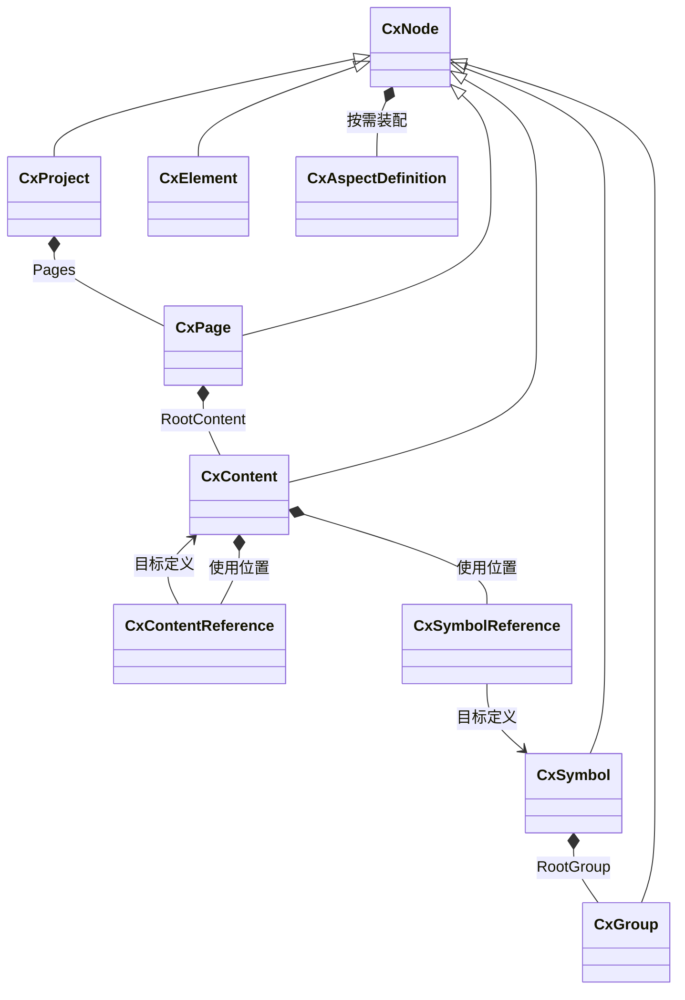

# CxVisual 统一工程组织体系：需求与类型体系综合设计 V0.2

> 日期：2026-10-16。
> 状态：以软件开发者、工程编排用户体验为出发点的**设计讨论稿**，不是正式 API 冻结或已实现声明。
> 本轮源码核对基线：x3 `master / 34c275cddbf8e3cb1e61e28151a13cbe81a682b8`；x2 `master / 2626734d0fd5e67ac50fd0621532173cec39b939`。
> 外部覆盖复核：x3 `master / 294f07690312d612a9996fc56ad1c8b72d4bc436`；按 V4.9 的 40 个机制子方面和六专业/73 个专业子方面进行类别与契约审查，结论见 §12.12。未完成全部专业源码审计或逐项行为验收。
> 本轮只编写文档。示例中的 Edit、Place、Duplicate 等调用均为**候选伪 C#**，不能当作当前可编译代码；最终应扩展/适配既有 CxEngineeringSession、事务和引用机制，避免平行管理器。
> 文档口径：本文件接替 V0.1，作为本专题唯一综合稿；融合 DEV/ENG 角色期望、整体流程、候选类/接口/枚举、源码复用差距与 ORG-UX-01～30。其他配置/数据/运行文档保留其原有职责，不在本轮删除或合并整个仓库文档。
> 阅读顺序：§0 看角色期望，§1～3 看整体边界与结构，§4～11 看使用和行为，§12 看反推的类型及契约，§13 看验收，§14～16 看待裁决项、实施次序与证据。

## 0. 从两类用户的日常工作开始

软件开发者想表达：“在当前工程创建一个检测页面，放入两个共用定义的工位，连接公开端口，保存。”不希望为此处理 ID 生成、父指针、集合更新、引用路径修复、索引重建、撤销命令和 XML/JSON。

工程编排用户想表达：“新建页面，拖入工位，连接信号，填业务参数，验证并运行。”不希望先认识内部的 RootContent、Resolver、Mutation、DTO、DataHeap 或 ExecutionPlan。

共同目标是：**业务动作直接表达；组织语义一致；结构维护由平台完成；失败原因能定位到对象；保存重开后仍是同一个工程。**

本稿提出的默认方向：一个工程会话，一组领域动作，一条编辑提交管线；代码、工程树、画布与属性面板调用同一组动作。高级 DOM、资源打包和自定义迁移接口分层开放。

“简单”不以类数或最短代码行数判断。要同时检查：必须记住的概念、重复的样板、隐藏副作用、失败后的恢复步骤，以及是否需要同时维护两套数据。

### 0.1 软件开发者的完整期望

本稿将使用平台写业务的开发者作为主要角色，同时覆盖其向工程编排端提供专业能力的工作。原运行讨论稿中的 R1、R2 仍保留原来的职责区分；下表的合并视角不改变类型 Owner。一次直接调用、持久工程创作和宿主扩展是按需使用的三个入口，不要求每个开发者先学会整个框架。

| ID | 开发者希望完成的事 | 平台应承担的复杂性与可观察结果 |
|---|---|---|
| DEV-01 | 从可运行的小例子开始，明确最少依赖 | 示例说明宿主如何提供会话/能力及如何释放；普通算法调用无需先建页面或完整工程，工程编辑无需先启动设备 |
| DEV-02 | 用正常同步函数或异步函数实现业务 | 接入规则明确区分 CPU 工作、异步 IO、阻塞 SDK、专用线程和外部服务；保留真实完成/取消边界，不统一包装成 Task.Run |
| DEV-03 | 写一次能力，供代码和编排复用 | 输入输出、参数、错误及约束来自同一份显式契约；接入适配可存在，业务算法无需复制；不声称任意函数都能自动推导成合法节点 |
| DEV-04 | 用少量领域动作创建或批量生成工程 | 平台维护合法根、身份、引用、索引、通知及撤销；同一批变更成功后整体可见，失败无结构残留 |
| DEV-05 | 在同一工程组合多个专业能力 | 通过公开端口和资源引用连接，契约冲突在检查时定位；普通业务不依赖另一专业的内部类或 Vendor SDK |
| DEV-06 | 把组合封装成可复用单元并升级 | 对外属性、端口、依赖和实例差异有明确边界；修改定义可查看使用者，升级可比较并报告不兼容 |
| DEV-07 | 表达主流程、子流程、触发及生命周期 | 能区分工程启动/结束、长期服务与每产品流程；定义可以保存和编译，不要求调用方维护另一套可写流程树 |
| DEV-08 | 简单任务直接执行，复杂任务声明约束 | 既有执行体系处理排队、按资源串行、并发上限、超时与关联；默认来自能力契约，具体策略仍由业务选择 |
| DEV-09 | 在后台或无界面宿主使用相同能力 | 核心创作、验证、加载与执行契约不依赖 WPF 控件、Dispatcher 或静态 CurrentProject；宿主装配和线程边界有文档 |
| DEV-10 | 获取可处理的错误和可追踪的运行结果 | 区分编辑、持久化、编译、执行和外部结果未确认；包含对象/实例位置、版本及关联信息，允许追踪原始异常 |
| DEV-11 | 正确管理任务、订阅和大数据生命周期 | 释放/退订规则明确，图像和体数据通过既有引用/租约传递；取消请求、执行终结和外部设备确认分别可见 |
| DEV-12 | 在编辑、运行和后台提案间保持一致性 | 读取版本明确，陈旧提交有冲突；保存结果与当前编辑版本可区分，运行实例固定使用其定义和参数快照 |
| DEV-13 | 本地调试和自动化回归不依赖现场设备 | 可按契约选择虚拟/回放 Provider 和样例数据，断言结果与失败路径；不支持的模拟能力明确标记，测试入口可 headless |
| DEV-14 | 插件、旧工程与新版本能够渐进接入 | 类型/契约/Schema/依赖可声明和诊断；未知内容可保真，迁移有差异和恢复依据，新增能力无需修改多个平行注册表 |

开发者不应反复手写的工作包括：ID/父指针同步、索引重建、第二套端口表、第二套执行状态、每个功能自己的队列与日志管理器。专业开发者仍须声明实际线程限制、资源边界和外部完成条件，框架不能猜测这些事实。

### 0.2 工程编排用户的完整期望

用户熟悉工艺和设备，期望使用业务名称、参数和连接完成工程。这里覆盖其创作和调试维护任务；生产操作授权及设备安全责任沿用既有运行体系，不因角色合并而放宽。

| ID | 工程编排用户希望完成的事 | 界面应支持的动作与反馈 |
|---|---|---|
| ENG-01 | 打开工程就知道它做什么、怎样运行 | 总览展示说明、入口、主阶段、长期服务、关键资源及当前工程版本；可下钻和返回，不必先展开全部对象 |
| ENG-02 | 从模板建立能继续修改的工程 | 只填必要业务信息；合法根、ID 和默认结构自动建立；模板的设备/参数占位和未满足条件明确标记 |
| ENG-03 | 找到可用组件并选择适合的版本 | 按业务类别搜索素材，查看用途、输入输出、依赖、示例及兼容性；缺插件或设备能力时说明原因 |
| ENG-04 | 通过放置、连线和参数完成业务组合 | 端口方向、类型、必填项和允许值直接呈现，候选连接经过校验；不要求手填内部地址或维护 GUID |
| ENG-05 | 表达真实的整体运行脉络 | 设置启动入口、事件/周期/人工触发、顺序、条件、并行、等待、子流程与结束；长期服务和单次业务具有不同范围 |
| ENG-06 | 看懂数据从哪里来、结果交给谁 | 区分控制推进与数据绑定，显示参数来源、单位、有效范围和实例归属；缺数据与等待执行分别诊断 |
| ENG-07 | 两次使用同一组件，又能分别配置 | 放置引用、独立复制、编辑实例及编辑共享定义的效果可辨认；升级前能查看影响，内外层导航保留调用上下文 |
| ENG-08 | 放心修改已经做好的工程 | 拖动/批量编辑可预览、取消和撤销；重命名/移动保留引用；删除、换定义和连接变化显示受影响对象 |
| ENG-09 | 工程尚未做完也能保存，稍后继续 | 草稿问题保留并可定位；保存/重开、导入/导出及资源依赖保持一致；运行阻断项与可保存问题明确区分 |
| ENG-10 | 先用样例验证，再选择实际运行目标 | 运行方式、数据来源、目标设备和版本清楚显示；缺能力不能启动，模拟结果带来源，不把模拟通过当作实机通过 |
| ENG-11 | 看清某一次业务为什么慢、错或卡住 | 选择产品/流程实例，看到执行位置、等待对象、输入输出、耗时、分支及错误；点击可定位到实例和对应定义 |
| ENG-12 | 对超时、失败、取消和恢复有把握 | 能配置业务处理路径，看到请求中、执行结束、外部结果未确认等区别；重试/续跑需能力支持及重复副作用检查 |
| ENG-13 | 调试与改参数的影响范围可控 | 在允许的逻辑/专业安全点调试；当前编辑、已保存、运行版本及生效范围可见；修改不悄悄改变在途任务 |
| ENG-14 | 把工程交给同事或带到现场继续维护 | 带出说明、资源版本、依赖和验证证据；目标环境差异可检查，缺插件可修复；接手者能定位入口及修改影响 |

用户日常主要接触工程、组件、连接、参数、流程和运行结果。版本、依赖和高级执行策略在需要决策时展示；框架根节点、线程组和数据堆等内部概念不成为入门前提。

### 0.3 两个角色共同依赖的使用规则

1. **同一业务含义**：代码调用与图形入口使用同一能力契约；创建、编辑、检查、执行的结果可比较。代码中的任意控制流不承诺自动反编译成可编辑工程图；需要可视化接续时，使用共同的工程/编排定义入口。
2. **渐进使用**：普通调用可直接得到结果；只有需要持久组合、图形编辑、版本复用时，才进入对应工程能力。高级设置按需展开，约束摘要始终可查。
3. **默认有依据**：默认值来自模板、类型和能力契约；来源与覆盖关系可查看。设备能否并行、是否允许重试等不可凭界面便利猜测。
4. **运行事实可解释**：设计连接、任务已提交、任务完成和外部动作已确认分别呈现；问题先回答哪里、为什么和可采取什么动作。
5. **修改影响可见**：区分当前实例、共享定义、当前编辑版、保存版和运行版；危险或破坏兼容的变更提供影响预览，普通可撤销操作保持直接。
6. **上下文连续**：工程总览、资源浏览、内部结构、流程、属性与运行视图关联同一身份；跳转携带实例/版本并支持返回，不依赖用户记忆路径。
7. **故障可以接续处理**：保留未知内容和缺失引用，给出修复位置；保存失败、编译失败和运行失败保留各自证据，不显示笼统的成功。
8. **轻便可度量**：统计必要概念、手填项、重复代码/配置、从总览到故障的操作数及加载耗时；与三个实际案例的当前操作基线比较，数值目标待测量后确定。

### 0.4 按用户闭环安排需求优先级

以下为候选交付次序，不代表本轮批准实施或已有完成度。

| 优先级 | 应完整走通的用户闭环 | 主要期望 |
|---|---|---|
| P0 基本使用 | 加载已声明能力，创建/打开工程，组合一个带入口和失败出口的流程，检查、保存重开，在虚拟目标运行并定位失败 | DEV-01～05、07、09～13；ENG-01～06、08～12 的基础路径 |
| P1 日常复用维护 | 双实例差异、共享升级、子流程、声明并行与资源约束、版本冲突和依赖交接 | DEV-06、08、12、14；ENG-07、13、14 及复杂路径 |
| P2 专业扩展 | 大工程性能、复杂迁移、自定义编辑器及扩展诊断，按真实专业案例增加 | DEV-14 和 ENG-14 的高级路径 |

P0 的范围可以小，但不能省掉失败处理、版本说明、取消边界和真实能力校验。后续同一需求的基础与高级路径应分别记录验证证据。

## 1. 范围、Owner 与现状

本体系重点覆盖既有 `Mechanism.Core` 的 M01 工程对象/资源组织、M02 功能组合复用、M03 引用/地址/索引；按需协作 M04 属性元数据、M05 端口连接、M07 事务、M08 验证、M38 模板导入。此范围不等于一次实现 Core 表中全部候选类型。

| 边界 | 本体系负责 | 复用的其他体系 |
|---|---|---|
| 组织定义 | 对象身份、所有权、共享定义、引用、资源归属、依赖 | Foundation 标识/值类型和已批准公共契约 |
| 定义编辑 | 创建、删除、移动、复制、引用、连接、事务、可解释变更 | Visual 编辑历史及 WPF 输入/呈现适配 |
| 配置 | 保存对配置身份、版本策略的设计绑定 | FCM/MHS 的配置存储、授权与生效；不另写 ConfigManager |
| 运行 | 提供已验证、版本明确的定义快照与对象定位 | 现有 Runtime/Orchestration 编译、调度、取消、调试 |
| 过程数据 | 定义公开输入/输出及其绑定 | 现有数据 Scope、Context、Ref、Lease；不把图像/体数据塞进工程对象 |
| 测试 | 给出可定位、可复现的组织行为契约 | TestCenter 执行、断言、证据；生产程序集不得引用 TCT |

不增加解决方案项目，不增加一级 Workbench，不建立独立持久化 Graph/Runtime 业务树。

### 1.1 已看到的事实与差距

| 项目 | 已核对的源码事实 | 本稿如何使用 |
|---|---|---|
| x2 CxNode | 基于现有强类型集合投影导航，支持结构操作、Policy、地址、引用、事务通知 | 复用行为与边界，不默认逐文件原样移入 x3 |
| x2 复用与持久化 | 有 ContentReference、SymbolReference、克隆重映射、工程 JSON/包及格式迁移 | 将已有正反例转为新平台验收素材 |
| x2 编辑入口 | Page/Group/Symbol 创作经过 Command；底层仍有可写 List 和需 Bind/Rebuild 的旧入口 | 收敛普通调用入口，不能让业务开发者负责补索引/修父指针 |
| x3 Core | 六种节点、基础父子规则、Element 增删移动事务、Revision、XML schema 1 | 保留现有可用行为，明确与目标 RootContent/Ref 模型的差距 |
| x3 周边体系 | 配置、运行、数据、测试正在独立增构 | 先对齐共享身份与契约，避免组织体系再次包办它们的生命周期 |

旧版文档中的测试通过记录属于历史证据；本轮没有重新构建或运行 x2/x3 行为测试。

### 1.2 工程组织应呈现整体运行脉络

产品需求覆盖“有哪些东西、相互怎样关联、整体怎样运行、某次运行到了哪里”。工程总览需关联下列三种关系，但不把它们混成一套父子顺序：

| 关系 | 回答的问题 | 权威定义/执行职责 |
|---|---|---|
| 组织归属 | 对象属于哪个工程、资源和组合边界 | Core 的唯一工程对象与引用模型 |
| 引用与依赖 | 使用哪个组件定义、设备资源、配置或专业能力 | 既有身份、资源引用、端口/绑定和依赖契约 |
| 执行关系 | 由谁触发、先后/条件/并行如何推进、何时结束 | Orchestration 持有编排定义；Runtime 编译/执行并提供实例事实 |

工程树中的先后位置不自动等于执行顺序。流程图是同一工程定义的编辑/观察视角；执行计划是派生结构，均不能另建独立可写的持久业务树。此产品体验需要 Core、Orchestration、Runtime、专业能力及 Studio 协作，不扩大 M01/M02/M03 的实现 Owner。

整体脉络至少包含：

- **工程生命周期**：启动入口、配置/依赖检查、初始化依赖、进入可运行状态、停止接纳新业务及清理；部分初始化失败时能说明已完成项与可执行清理。
- **长期活动**：通信会话、设备监测、报警等与单产品流程分开表达生命周期，通过显式事件、数据和能力契约协作。
- **单次业务**：人工/事件/周期触发，主流程阶段、子流程、顺序、条件、并行、等待/汇合和业务终态；支持按产品/批次/请求区分实例。
- **资源和数据脉络**：每步使用的能力、设备、配置版本、输入输出及作用域；并行规则来自真实资源约束，不从画布位置推导。
- **异常与结束**：超时、失败、取消的业务路径及清理责任；重试、续跑和补偿须明确适用性与副作用，未支持时不展示为可用动作。
- **运行回看**：从版本和具体实例出发，关联当前阶段、等待原因、数据结果、故障、追踪证据与定义位置。

示意业务：工程启动并初始化设备 → 开始接纳产品 → 每件产品执行“采集 → 检测 → 判定 → 输出” → 等待下一件。设备监控持续运行；关闭时先按策略停止接纳并处理在途任务，再释放相关会话。具体停止顺序、重试和实机动作由业务及专业契约确定，不由示意箭头暗含。

总览默认呈现入口、关键阶段、后台服务和异常出口；进入阶段后显示内部细节，返回时保留选择、实例和版本。需求中的“整体可见”不要求把所有节点挤到一张画布，也不要求每个函数或后台活动都先包装成完整可视化流程。

## 2. 两类用户接触的最小概念

| 日常概念 | 软件开发者看到 | 工程编排用户看到 | 平台维护的语义 |
|---|---|---|---|
| 工程 | 注入的当前工程会话 | 工程名称、打开/保存/关闭 | ProjectId、Revision、资源与依赖 |
| 页面 | 创建/获取页面；默认根可直接使用 | 新建页面、页面标签 | 唯一 RootContent、Workbench 归属 |
| 对象 | 有类型的对象句柄与只读快照 | 选中的对象、属性 | Definition 身份、Owner、局部名称 |
| 可复用定义 | 已解析的 Content/Symbol 定义引用 | 素材库中的可复用组件 | 共享定义、版本与公开契约 |
| 放置 | Place，一个新的使用位置 | 从素材库拖入 | 新 InstanceId，引用既有 DefinitionId |
| 复制 | Duplicate，明确独立副本 | 复制/粘贴为独立副本 | 新 ID、内部引用重映射策略 |
| 修改 | 一次 Edit 及提交结果 | 一次操作/确认；支持撤销 | 统一校验、原子提交、变更与历史 |

RootContent、RootGroup 默认由合法创建动作建立，普通用户不必手动创建，但仍可在结构检查器查看。它们不能退化成可随意删除的普通文件夹。

Workbench 首先表达“在哪个专业环境处理页面”。候选默认沿用注册定义与 Page 归属标识；是否成为物理 CxNode 仍待定，界面分组不自动成为新的所有权节点。

## 3. 融合后的体系结构与使用入口

整个工程从同一份定义出发：对象和引用表达组织，按需装配的 Aspect 表达可视化/逻辑/数据/协作能力，编译形成稳定计划，Runtime 产生执行实例，实例事实按来源地址回到工程视图。

```text
开发者代码 / 工程树 / 画布 / 参数面板
                 ↓ 同一领域动作
CxEngineeringSession → CxProjectDocument（唯一提交与 Revision）
                 ↓
CxNode + 引用 + 公开属性/端口 + 按需 Aspect
        ├─ 组织、资源、属性、连接：Core
        └─ 生命周期、逻辑拓扑、触发：Orchestration 定义
                 ↓ 冻结、解析、验证、编译
MRK 公共流程计划 / 专业编译制品 → 既有运行协调与专业执行适配
                 ↓ Flow/Step 快照、Trace 与来源映射
Studio 中的工程总览 / 流程 / 属性 / 运行观察
```

图中的调用跨层由宿主装配。Core 不引用 Orchestration/Runtime；Visual 不引用 Runtime；运行观察经 Studio 装配层呈现。撤销历史由既有 UI 无关 CxVisualEditor 消费提交事实，Core 提供逆变更和合法性校验。类型与依赖候选详见 §12，箭头不表示当前源码已实现全部链路。

### 3.1 使用方式收敛

| 方式 | 优点 | 代价 | 当前建议 |
|---|---|---|---|
| 业务直接 new 节点、改 List/Parent、调用 Rebuild | 底层灵活 | 顺序敏感，容易绕过事务、引用保护和撤销 | 限制为迁移/底层受控能力，不作为普通入口 |
| 在既有工程会话上提供领域动作与 Edit | 动词接近业务，代码与 UI 可共享提交语义 | 需要清晰定义句柄、草稿与错误结果 | **作为首选讨论方向** |
| 单独 fluent Builder 或文本 DSL | 批量生成工程表达紧凑 | 容易产生第二套验证、生命周期和转换模型 | 有实际生成/导入需求时作为同一 Edit 的适配层 |
| 每个专业独立建工程管理器 | 局部开发快 | 跨专业引用、保存、撤销和索引难以统一 | 不采用平行工程真源 |

不为了“只有一行”引入进程全局 `CurrentProject`。会话由宿主提供，窗口/后台任务显式持有自己的工程上下文；多工程打开时不能串写。

## 4. 软件开发者：用领域动作表达意图

日常可从三个层次进入：直接调用已接入能力；通过既有运行入口提交需要调度/追踪的业务；通过工程会话建立可保存、可视化编排的组合。三个层次共用专业实现及其声明约束，不能将原始函数直接调用冒充已获得 Runtime 的排队、资源门禁和完整追踪。调用入口应说明其实际保障范围。

以下全部为目标体验，不是当前 API。`engineering` 是宿主提供的工程会话；`stationDefinition` 是调用方取得的、经解析和契约检查的共享定义句柄。类型名、前缀及完整签名仍需按 Owner 审核。

### 4.1 创建页面并放置两个工位

```csharp
// 一次用户意图，一个提交；RootContent、ID、索引由平台维护。
var result = engineering.Edit("创建双工位检测页面", edit =>
{
    var page = edit.AddPage("inspection", "检测线");
    var root = edit.GetRootContent(page);
    var left = edit.PlaceContent(root, stationDefinition, "工位 A");
    var right = edit.PlaceContent(root, stationDefinition, "工位 B");
    edit.SetPlacement(left, x: 40, y: 60);
    edit.SetPlacement(right, x: 460, y: 60);
    return page;
});

if (!result.Success)
{
    ShowIssues(result.Issues); // 可定位的错误；失败不留下半个页面。
    return;
}
var pageRef = result.Value;   // 只有成功结果中的句柄才可交给后续操作。
```

推荐普通编辑使用作用域明确的同步回调：回调内仅操作编辑草稿，无设备 IO、文件写入、等待用户或 `await`。回调返回后由唯一事务管线校验和提交，业务不需要手动 Rollback、重建索引或向 UI 发第二份通知。

同一 Edit 内创建的句柄可相互引用；失败后全部失效，不得作为成功对象逃逸。一次性编辑与长时间面板编辑复用相同草稿、验证与提交能力，不能实现两套事务。

### 4.2 获取、定位与修改

```csharp
var page = engineering.Read(pageRef); // 读取已提交只读快照。
var site = engineering.Read(siteRef); // 使用稳定身份，不保存树行号。

var renamed = engineering.Edit("重命名工位", edit =>
    edit.Rename(siteRef, "工位 A-视觉检测"));

using (var watch = engineering.Watch(siteRef, change => Refresh(change)))
{
    // 生命周期由使用者持有；变化来自已提交事实。
}
```

普通调用按已持有的对象/引用定位，不反复手写字符串路径。名称搜索、显示路径和导入文本仍允许使用，但必须说明搜索范围；同名或多候选时返回歧义诊断，不能默认取第一个。

只读快照不暴露可写底层 List。编辑必须回到 Edit 或受控编辑会话；`page.Children.Add(...)` 不能成为隐藏的第二提交入口。

### 4.3 一致的结果与诊断

候选默认：普通单动作与批量 Edit 都返回成功状态、提交 Revision、操作关联标识和可定位的 Issues；有返回对象时，只在成功后提供有效句柄。至少区分不存在、错工程、包含关系非法、引用被使用、端口不兼容、版本冲突、权限不足与持久化失败。

预检可返回受影响对象、使用者和变更摘要，供代码或同一个 UI 预览面板使用。预检通过不预留提交权；实际提交仍检查权限、版本和不变量。错误展示优先回答“哪里、为什么、如何修复”，不要求用户阅读序列化 DTO 或内部堆栈；技术诊断另由授权入口获取。

### 4.4 连接与业务绑定

```csharp
var linked = engineering.Edit("连接工位公开接口", edit =>
{
    edit.Connect(sourceEndpoint, targetEndpoint);
});
```

`sourceEndpoint`、`targetEndpoint` 是对象地址与稳定 PortId 组成的 `CxPortEndpoint`，来自同一份已声明端口描述，优先通过类型化成员/选择器取得。动态插件可使用稳定 PortId 并通过运行前校验；不要求所有用户安装代码生成器，不再手写第二套 UI 端口表。

设计阶段保存的是连接定义。参数值使用配置体系，运行值使用数据体系，执行使用 Runtime；连接成功不意味着设备已下发或取得硬件 ACK。

### 4.5 保存、撤销与后台编辑

```csharp
editor.Undo(); // 宿主为该文档提供的唯一 CxVisualEditor 历史。
editor.Redo();
var saved = await engineering.SaveAsync(cancellationToken);
```

编辑提交成功表示当前工程内存版本改变，**不等于磁盘保存成功**。UI 必须保留未保存标志；保存成功返回明确 SavedRevision。保存期间新提交仍存在时，较旧快照保存成功也不能清除较新修改的未保存标志。

有交互历史的宿主为每文档挂接一个 CxVisualEditor，记录该会话成功提交的 ChangeSet，代码编辑和界面编辑共用该历史。headless 宿主可不启用历史；Core 不依赖 Visual，亦不存第二份撤销栈。当前 CxVisualEditor 只记录经过其私有 Run 的操作，统一消费外部提交仍是待扩展项；历史记录失败应暴露并重新同步，不能伪报数据提交失败。

长时间编辑从指定 Revision 开始，提交时检查该版本和相关定义版本。后台任务须先算出提案，再回到同一提交入口；遇到冲突返回可审查差异，不自动覆盖用户新修改。

## 5. 工程编排用户：操作对象，不维护框架

### 5.1 正常工作路径

1. 打开工程，选择专业工作环境，点击“新建页面”。默认生成合法根内容与基础页面信息。
2. 从素材库拖入“检测工位”。这是使用共享定义；工位获得自己的实例身份和实例属性。
3. 拖入第二个工位。两者可定位到同一共享定义，各自参数、位置和运行数据保持隔离。
4. 点击公开端口连线，填写少量业务绑定；不要求输入 GUID、实例地址或维护端口类型字符串。
5. 打开“验证”，点击错误直接定位到对象、属性、引用或连接。可保存的草稿问题与阻止运行的问题分别显示。
6. 保存、关闭、重新打开；对象位置、引用、实例差异、连接和专业归属保持等价。
7. 运行时在同一对象/逻辑视图叠加状态；查看共享定义与定位某个运行实例是两个明确动作。

### 5.2 界面与代码共用一组语义

| UI 动作 | 对应意图 | 自动处理 | 用户应能看懂的反馈 |
|---|---|---|---|
| 新建页面 | AddPage | 唯一根、Workbench 归属、默认尺寸与 ID | 新页面及一次撤销项 |
| 拖入素材 | PlaceContent / PlaceSymbol | 新引用实例，保留共享定义 | 素材来源、版本与“定位定义” |
| 复制为独立副本 | Duplicate | 新 ID 和内部引用重映射 | “独立副本”，不冒充共享使用 |
| 重命名 | Rename | 引用仍以稳定 ID 解析 | 对象显示名改变，连接不丢 |
| 跨父容器拖动 | Move | 包含规则、坐标、地址与依赖检查 | 预览目标及引用影响，失败恢复原位 |
| 连线 | Connect | 端口方向、类型、可见性、作用域检查 | 明确的错误原因与可定位端点 |
| 删除 | Remove | 被引用目标检查与影响预览 | 谁还在使用；不默认级联删除 |
| 提取为可复用组件 | ExtractReusable | 保存所选组织及公开边界，按受控方案替换为引用 | 对外端口/属性与受影响连接预览 |
| 撤销/重做 | Undo / Redo | 复用提交与合法性检查 | 操作名称、成功或无法继续的原因 |

“组合”必须区分视觉组合与功能组合。仅有图形时可建议 Group；包含 Content、引用或业务公开边界时建议 Content，并在操作前显示“视觉组合/功能组合”及结果预览。不得悄悄改类型、拆散引用或把 Symbol 放进不合法的 Group。

Ctrl+C/Ctrl+V、素材拖入和“复制定义”不强行复用同一种深复制：它们分别表达独立复制、放置引用、创建独立定义。UI 可以少展示术语，但操作结果和来源必须可查。

### 5.3 两个角色接续完成一个双工位工程

1. 开发者提供采集、检测和输出能力，声明端口、参数、单位、错误、设备资源及并发/取消限制；提供一组样例和虚拟/回放适配。若依赖真实 SDK，不伪造模拟支持。
2. 工程师从模板创建工程，总览显示初始化、产品入口、工位 A/B、后台监控和结束路径。未绑定相机等必要项进入问题列表。
3. 工程师将共享检测单元放置两次，分别选择相机和阈值，连接输入输出；只填写业务差异。按资源声明决定两工位能否并发，不能因复制了实例就默认可并发。
4. 两人均可从代码或界面检查同一工程；失败项定位到具体实例/参数/端口。未完成草稿可以保存，运行阻断项不能靠保存绕过。
5. 选择虚拟目标与样例数据运行，固定本次定义和参数版本；选择某个产品实例查看实际分支和结果。模拟证据记录 Provider 与数据来源。
6. 人为制造检测超时，定位其等待对象及失败路径，修正参数或能力后重跑新的实例；旧实例证据保留，不能覆盖成新运行的成功结果。
7. 比较两工位结果和隔离性，保存并重开工程，再交给另一名使用者从总览找到入口、依赖、版本和问题。切换真实设备需另做目标预检和现场验证。

后续应分别记录开发者提供能力所需的代码/元数据、工程师的必要手填项和操作步骤。以两人能顺利交接、定位和复现为验收依据，不把仅能演示正常路径视为完成。

## 6. 统一动作：少概念，明确语义

| 动作 | 默认含义 | 不允许隐含发生 |
|---|---|---|
| Add | 创建并拥有一个新对象 | 同时修改某个共享定义 |
| Place | 创建对已有定义的一次使用 | 深复制目标所有 Children |
| Move | 改变同工程内的所有权位置，保留对象身份 | 自动跨工程带走其他对象的资源 |
| Duplicate | 创建独立新身份；重映射所复制集合内部的引用 | 将外部共享目标无条件复制或重定向 |
| ExtractReusable | 将选定边界组织为可复用定义 | 不预览就改变外部连接与含义 |
| EditDefinition | 在明确的定义编辑上下文修改共享内容 | 用户以为改实例，实际影响所有使用者 |
| EditInstance | 修改允许的实例差异/绑定 | 写回共享定义内部任意路径 |
| Remove | 删除目标并检查引用影响 | 静默删除全部使用者、文件或运行设备 |

跨工程操作默认作为带依赖预览的 Import/Export，而不是普通 Move。需要映射引用、插件及版本、资源依赖；无法表达的引用可原样保留并标记不可解析，不虚构可运行结果。

候选默认采用固定定义版本/工程修订上的确定解析。存在新共享版本时提示比较和升级影响，不在打开工程或开始任务时无提示升级。具体版本锁定粒度仍需裁决。

## 7. 一条编辑管线支撑所有入口

```text
代码调用 / 工程树 / 画布 / 属性面板 / 导入适配器
                         ↓
             同一个工程会话与操作上下文
                         ↓
        草稿或变更集 → 预检 → 引用/权限/版本校验
                         ↓
           既有事务能力的原子提交或完整失败
                         ↓
        Revision + ChangeSet + 撤销依据 + 已提交通知
                         ↓
            索引、各视图投影与未保存状态刷新
```

组织对象是 Definition 真源；索引、树行、画布场景和搜索结果是可重建投影。允许为性能建立派生缓存，但缓存不能形成独立可写组织模型。

必须保证：

- 提交前失败：原工程、引用和索引保持提交前等价，不发布成功通知。
- 提交后观察者失败：记录为观察/刷新错误，不把已被其他观察者看到的提交偷偷撤销；提供当前 Revision 的重新读取与刷新入口。
- 观察回调不在结构写锁内调用用户代码，不依赖监听器回调顺序；退订后行为与并发边界须定义并测试。
- 用户动作与 ChangeSet 之间有关联标识；正常单动作默认形成一个撤销单元，批量 Edit 形成一个整体单元。
- Undo/Redo 经过同一合法性和引用保护，不以后台静默覆盖解决冲突。原型阶段的纯内存事务不能被宣称为跨文件/跨进程原子提交。

候选默认由会话协调同一工程的串行提交，后台使用明确 Revision 的只读快照；不因此宣称底层 CxNode 可被任意线程直接修改。嵌套 Edit 和回调重入在语义确定前明确拒绝，不隐式拆成多笔提交；UI 线程调度由 WPF 适配器完成。

属性输入与拖动高频预览可以暂存在编辑会话，预览不生成每像素一笔历史；确认时提交，取消或关闭时可丢弃。合并历史的条件与范围显式定义，不能跨对象或用户意图随意合并。

## 8. 身份、路径、句柄和作用域

| 概念 | 建议语义 | 日常是否需要手写 |
|---|---|---|
| DefinitionId / NodeId | 在工程及持久化契约范围内稳定标识定义对象 | 否，由创建和迁移维护 |
| Reference/InstanceId | 某个定义的一次使用；多个实例有不同身份 | 否，但诊断可查看 |
| ProjectId / ResourceId | 确定解析上下文与独立制品 | 由宿主/资源选择器提供 |
| 显示名 / 路径 | 便于人理解、搜索和导航，可随重命名/移动改变 | 可用于交互查询，不作为唯一真源 |
| Revision / DefinitionVersion | 校验编辑、运行快照与引用升级 | 默认由会话携带，冲突时展示 |
| Runtime InstanceAddress | 区分页面、复用链和运行会话下的实际实例 | Runtime 生成，组织视图只读定位 |

对象句柄携带工程及对象身份，必要时携带预期版本；不是 WPF 控件引用、长期持有可写实体或拼接的显示路径。过期句柄、已删除对象、错工程句柄必须失败并可诊断。

移动同一对象不能因为包含路径改变就产生新定义身份；缓存路径、外部地址和索引由平台同步更新。相同 DefinitionId 在两个引用实例中不等于同一个 Runtime 实例地址。

新增对象使用新 ID；Duplicate 的内部 ID 重映射须覆盖端口、局部引用及必要图层。撤销恢复原对象时保留原身份，不能拿被删除的 ID 随意标识另一份对象。

保留现有 ID 和序列化兼容是迁移约束。x2 的字符串 ID 与 x3 的 Guid 不在本稿中强制统一；也不因为底层表示不同就新增两套用户可见对象身份。

## 9. 引用、复用与编辑定义的自然体验

1. 素材拖入默认保留引用：用户能看见“来自哪个定义”，支持“定位定义”和“查看使用者”。
2. 双击实例默认打开实例允许编辑的内容；“编辑共享定义”是明确入口，并展示影响数量与版本。
3. 只公开业务属性与端口作为稳定边界。实例差异按稳定 MemberId/PortId 绑定，不鼓励依赖定义内部层级路径。
4. 删除、换定义、收窄公开端口或升级版本前显示影响；不能自动删掉不认识的覆盖值或连线。
5. 内容所有权环、引用环、缺失目标、错类型、错项目、错版本分别诊断；坏引用保留原 Target 身份，用户可修复。
6. 内部视觉细节变化应尽可能保持公开契约稳定。契约破坏时需要迁移和验证，不由 UI 猜测新旧端口“名称相近”。

读取共享定义与修改实例并非两套模型：同一对象引用记录目标，实例差异单独归属；渲染和编译生成当前使用上下文的投影，不复制一棵持久目标树。

## 10. 与其他四个体系的协作

| 用户想做的事 | 组织体系提供 | 其他体系继续负责 |
|---|---|---|
| 两工位共用检测模板 | 同一定义、两个引用实例、公开边界与稳定身份 | 配置提供各工位参数及任务固定版本 |
| 一张图分两路检测 | 组织端口和连接定义，保留设计归属 | 数据体系提供引用/租约；Runtime 执行分支与 Join |
| 运行时查看工位状态 | Definition ↔ Instance 定位信息 | Runtime 提供实际状态、Trace 和调试；UI 叠加展示 |
| 保存工程 | 定义、引用、布局、绑定和所需资源描述 | 配置与数据独立持久契约；不序列化活跃句柄/显存 |
| 验证和复盘 | 问题地址、操作记录、定义版本和依赖摘要 | TestCenter 收集结果及证据，不接管工程真源 |

组织体系不能承诺“提交工程即让实机参数生效”。设计提交、保存、生效和运行快照应显示各自版本；跨体系操作未实现一致性协调时，必须暴露部分完成及补偿边界。

### 10.1 三类工程中的自然操作

| 场景 | 开发者/工程师希望表达 | 组织体系应省去的工作 | 不能省略的反馈 |
|---|---|---|---|
| PLC + HMI 泵站 | 放入同一泵组件的两次使用，将公开变量/命令端口绑定到不同设备 | 每台泵复制一棵定义、手工改 ID 和刷新控件树 | A/B 的绑定和实例身份可查；连线不意味着 PLC 已接受写入 |
| 双工位 Vision | 共用检测单元定义，各自绑定产品参数，升级公共显示或公开契约 | 分别维护两个视觉树和两份流程业务定义 | 位置/参数差异隔离；升级影响与在途任务版本可解释 |
| 长任务 CT | 组合采集、重建、结果展示 Content，设计时连接公开数据端口 | 自行维护编排树、对象树和大数据内存的一致性 | Volume 通过数据引用关联；执行中的旧快照不被工程编辑改写 |

三类场景都使用 Add、Place、Connect、Edit、Save 的共同语言；专业插件只补充有业务含义的素材、属性、端口与验证规则，不另建工程入口。

## 11. 易用性分级与性能约束

| 层级 | 用户任务 | 默认需要接触 |
|---|---|---|
| L0 普通创作 | 新页面、放置、重命名、连线、保存 | 一个会话、对象句柄、动作结果 |
| L1 批量与复用 | 多对象 Edit、实例差异、Duplicate | 编辑范围、共享定义、提交结果 |
| L2 受控扩展 | 模板提取、公开契约、插件对象 | 契约描述、依赖/影响预览 |
| L3 专用工具 | 跨工程导入、升级迁移、诊断修复 | 显式策略、兼容报告和权限 |
| L4 框架维护 | 内部 DOM、索引、序列化适配 | 完整不变量与事务协作契约 |

不让 L0 用户承担 L3/L4 的手工修复工作；也不为了 L0 简便而取消高级工具表达复杂需求的能力。

性能目标先定义度量再定数值：创建/移动/复制耗时、提交分配、索引更新、保存体积、UI 预览帧时间和订阅数量。普通属性读取不能隐式保存/编译整个工程；展开树不能加载全部图像或 CT 体数据。按实际变更维护派生视图，是否增量索引或局部快照由基准决定，不在本稿宣称零复制或 O(1)。

取消语义分开：取消拖动/草稿不改已提交定义；取消保存保留可恢复稳定磁盘版本；取消运行交由 Runtime。不能把一个 CancellationToken 当成三者已经一致回滚的证据。

## 12. 从角色期望反推类、接口与枚举体系

### 12.1 反推原则与状态标记

先找“必须保存的事实、必须执行的动作、可替换的边界和真正互斥的状态”，再决定类型。实体/值和提交结果使用类；只在存在外部实现、IO 或专业规则差异时引入接口；稳定的有限集合使用枚举。可扩展 TypeId、CapabilityId、PortId 和错误码使用稳定标识，不能为每个插件增加一个枚举成员。

下列命名均为候选，尚未冻结 FQN：Core 使用现有 `CxVisual.Mechanism.Core`；编排定义使用 `CxVisual.Mechanism.Orchestration`；MRK 保持 `CxVisual.Mechanism.Runtime.Execution`。`[现有]` 表示本轮在 x3 看到声明，`[扩展]` 表示沿用现有类型但新增成员/行为待实现，`[适配]` 表示 x2/规格有对应概念、需要迁移裁决，`[候选]` 表示本稿反推的落点。任何标记都不等于本轮已编译或测试通过。

普通业务开发主要接触工程会话、对象句柄和操作结果；能力开发者按需提供描述、规则及执行适配；其余类型大多由平台维护。类型清单是实现分工，不能变成用户必须依次构造的对象清单。

### 12.2 持久事实：六种节点、引用和按需能力

| 类型与形态 | 唯一 Owner / 状态 | 必要成员或不变量 | 存在理由 |
|---|---|---|---|
| `CxNode` 抽象类；`CxProject`、`CxPage`、`CxContent`、`CxSymbol`、`CxGroup`、`CxElement` 类 | Core；基类/Project/Page 归 M01，Content/Symbol/Group/Element 归 M02；[扩展] | 保留 Guid Id、Name、Kind、只读 Parent/Children；Project 聚合页面和共享定义；Page 唯一 RootContent；Symbol 唯一 RootGroup；Group 仅含 Group/Element；Element 为叶子 | 对应组织事实，不为流程、工位、设备类别再造平行基类 |
| `CxReference` 抽象类；`CxContentReference`、`CxSymbolReference` 类 | Core M03 基类、M02 专用引用；[适配] | 引用自身 Id、只读归属、TargetAddress、VersionBinding、公开成员覆盖；重复放置产生不同引用 Id，目标定义不转移归属 | 共享定义与使用位置分离，支持实例差异及定位 |
| `CxObjectAddress` 值语义类；`CxObjectHandle` 不可变类 | Core M03；[适配]/[候选] | 地址含 ProjectId、ResourceId、ObjectId 和必要引用实例链/定义版；句柄携带地址、可选预期 Revision；定义地址与实例链分别可查；值比较和错误工程检查明确 | 跨资源稳定寻址，普通调用不用拼路径；句柄不是可写实体 |
| `CxResourceEntry` 元数据类 | Core M01；[适配] | ResourceId、ResourceTypeId、SchemaVersion、ResourceVersion、依赖引用；本地组织定义由 RootAddress 指向，外部定义/静态制品由固定版本的外部引用指向，两种承载方式明确互斥 | 可独立于 Page 存在；外部制品不伪造图形根；登记不复制节点内容或形成另一份所有权 |
| `CxAspectDefinition` 抽象类；`CxUnknownAspect` 保真类 | Core M04 扩展载体；[候选] | AspectTypeId、SchemaVersion、唯一宿主归属；具体字段由对应专业/机制 Owner 定义；未知类型保留原类型、版本与原始负载 | Core 可承载扩展而不反向引用编排/专业；仅有实际能力才装配 |

引用是有身份的从属记录，不因此增加第七种 CxNodeKind；其归属由拥有者的受控引用集合维护，与节点一同纳入事务、索引、克隆和持久化。`Children` 只导航拥有节点；完整工程枚举还应包括引用、连接和 Aspect 内从属记录，不能因它们不是 CxNode 而漏存/漏查。

下面只表示候选核心结构，省略属性、端口与其他合法拥有关系；实线组合为拥有，指向定义的关联为引用。



Content 的拥有节点、引用和连接各有唯一存储位置，四种 Aspect 的导航可以引用/投影这些事实，不重复持久同一连线。功能组合与视觉组合继续遵守 §5.2 的区别。地址中的显示路径仅供导航；移动或重命名不重建身份。候选新工程沿用 x3 Guid，x2 非 Guid 字符串通过显式导入映射及来源记录保留可追溯性，不能直接解析失败后随意生成新 ID。

### 12.3 公开契约：属性、端口和能力只声明一次

| 类型与形态 | 唯一 Owner / 状态 | 必要成员与操作 | 复用边界 |
|---|---|---|---|
| `CxObjectTypeDescriptor`、`CxPropertyDescriptor` 元数据类 | Core M04；[适配] | 稳定 TypeId/MemberId、显示分类、值类型契约、单位、默认值来源、范围、可见/只读及编辑提示；对象类型关联允许的节点 Kind | 对象元数据统一投影配置 Schema；不重做 FCM 配置存储、层级合并和生效机制 |
| `CxPortDescriptor`、`CxPortEndpoint`、`CxConnection`、`CxPortMapping` 类 | Core M05；[适配] | 描述含 PortId、Kind、Direction、Multiplicity、契约类型和单位；端点含对象/引用实例地址与 PortId；连接保存两端及唯一 Id；映射连接公开边界与内部端点 | 专业含义和逻辑连线合法性由相应规则校验；接口连通不等于外部动作确认 |
| `CxPropertyOverride` 从属记录类 | Core M02，引用 M04/配置契约；[适配] | 稳定 MemberId、显式常量或既有配置/变量绑定；记录是否覆盖，不通过 null 猜测“未设置” | 默认值/覆盖描述可持久化；运行有效值由既有 FCM/MHS/MVB 解析，不保存第二份运行参数真源 |
| `CxCapabilityDescriptor` 元数据类 | Core M04 公共描述、专业提供内容；[适配] | CapabilityId、Version、输入输出/参数契约、资源与线程约束、可取消/重试声明、适用 Provider 与运行位置 | x2 有描述与登记行为；x3 当前 MRKResolvedCapability 仅为解析后执行适配，不能冒充完整能力目录 |
| `CxResourceLifecycleDescriptor` 元数据类、`CxResourceLifecycleKind` 枚举 | Core M04；[候选，外部审查补充] | 生命周期取 ValueObject/DefinitionOnly/Resolved/Compiled/Runtime/ExternalRuntime/SharedService；按需声明 Resolver、Compiler、RuntimeFactory、Provider 契约标识及目标环境要求 | 作为类型描述的可选组成，不强迫每定义生成一个 Runtime；契约实现由对应机制/专业提供 |

公开端口/属性和专业能力描述可以组合已有描述，不要求新建同义 Descriptor 类型。类型契约优先适配已有 FCMConfigTypeContract 及数据 Schema 的稳定身份；能否共享具体 CLR 类型需按依赖裁决，不能先复制出三套 TypeSystem。Capability 描述不持有设备活跃句柄或 UI 控件。

### 12.4 工程会话、草稿、提交和查询

| 类型与形态 | 唯一 Owner / 状态 | 必要成员与方法 | 一致性边界 |
|---|---|---|---|
| `CxProjectDocument` 类 | Core M01，调用 M07 事务机制；[扩展] | Project、Revision、既有 Commit；增加快照恢复/导出、一般组织/引用/连接变更校验 | 单一内存提交权威；当前只有 Element 增删和改坐标，不能称已覆盖一般 Move/Reparent |
| `CxEngineeringSession` 类，候选实现 IDisposable | Core M01；[扩展] | 保留 Apply；提供 Edit、BeginEdit、Read、GetSnapshot、Watch、SaveAsync 等领域入口，转发至同一 Document/受注入服务；Dispose 释放其拥有的草稿/订阅 | 不另建 IEngineeringManager 或全局 CurrentProject；读取/提交/保存权限均经统一边界；不释放宿主共享 Runtime 或设备会话 |
| `CxEditSession` 受控草稿类，`IDisposable` | Core M07；[候选] | BaseRevision、AddPage、GetRootContent、PlaceContent/PlaceSymbol、Rename、Move、Duplicate、SetPlacement、SetOverride、Connect、Remove、Preview、Commit、Dispose | 同步 Edit 与长编辑共用；Dispose 未提交草稿即丢弃；重复 Commit、嵌套及跨工程写入明确拒绝 |
| `CxProjectSnapshot`、`CxObjectSnapshot` 不可变快照类 | Core，工程快照 M01、对象寻址快照 M03；[候选] | 固定 ProjectId/Revision、对象事实、资源、引用、端口及必要扩展；读取不暴露活跃实体/可写集合 | 先明确快照不可变语义，再据基准选择结构共享或复制；不靠只读集合外壳伪装底层可变对象 |
| `CxChangeOperation`、`CxCommitResult` 类；`CxChangeSet` 类 | Core M07；前两者[扩展]、后者[适配] | 操作按类型表达已验证数据；收据保留 Success/ErrorCode/Revision，补充 Issues、关联标识与 ChangeSet；变化集有前后版、受影响地址、前向/逆向操作 | 既有操作/收据扩展，不同时引入 MutationReceipt、TransactionalMutation 等第二套提交权威 |
| `CxEditResult<T>` 只读包装类 | Core M07；[候选] | Receipt: CxCommitResult、成功时有效的 Value；Success/Issues 转发 Receipt，避免重复存储状态 | 满足 §4.1 取得新页面句柄；失败时 Value 不可作为有效对象使用 |
| `CxProjectIndex`、`CxReferenceResolver`、`CxNodePolicy` 类 | Core M03/M01；[适配] | 稳定 ID/资源/类型/名称查询、FindUsages、依赖影响；解析返回目标与问题；Policy 校验拥有/移动/删除/引用 | 索引可重建，Resolver 不偷偷修改工程；不为每个内部服务增加同名接口 |
| `CxResolveResult` 类 | Core M03；[适配] | Status、目标地址/版本、可选目标快照、Issues；失败保留原始引用信息 | 查询缺失、错类型、过期、权限和循环可区分 |
| `CxVisualEditor` 类 | Visual M37，协作 M16/M17 投影；[扩展] | 保留 Undo/Redo/场景投影；扩展为按文档消费唯一提交变化集、记录/恢复交互历史 | Core 不引用 Visual；headless 可不启用；提交后观察者失败不能撤销已发布事实 |

候选最小调用契约如下；它描述应支持的签名形状，不是可编译交付代码。§4 示例统一使用这组名称，`editor` 由宿主按文档提供。

```csharp
// CxEngineeringSession 的候选扩展成员
CxEditResult<T> Edit<T>(string intent, Func<CxEditSession, T> build);
CxCommitResult Edit(string intent, Action<CxEditSession> build);
CxEditSession BeginEdit(string intent, int expectedRevision);
CxObjectSnapshot Read(CxObjectHandle target);
CxProjectSnapshot GetSnapshot();
IDisposable Watch(CxObjectHandle scope, Action<CxChangeSet> observer);
Task<CxSaveResult> SaveAsync(CancellationToken cancellation);

// CxEditSession 的代表性成员；同一草稿支持临时句柄。
CxObjectHandle AddPage(string workbenchId, string name);
CxObjectHandle GetRootContent(CxObjectHandle page);
CxObjectHandle PlaceContent(CxObjectHandle parent, CxObjectHandle definition, string name);
void SetPlacement(CxObjectHandle target, double x, double y);
void Connect(CxPortEndpoint source, CxPortEndpoint target);
CxValidationReport Preview();
CxCommitResult Commit();
```

回调方式由会话拥有提交，回调中不得主动 Commit；显式 BeginEdit 由调用者提交，两者仍经过同一管线。Edit 回调仅准备草稿，无 IO/await/用户对话。调用前取得的 definition 句柄带确定目标版本；提交再次校验。Read 遇到不存在、错工程或无权限以带稳定码和地址的操作异常失败；批量搜索/解析通过结果返回全部 Issues；取消 IO 使用 OperationCanceledException，不能伪装保存成功。此异常类别可先用既有 .NET 异常加结构化诊断适配，是否新增专用异常类需真实调用方证明。

Place、Duplicate 等领域动作可以转换成多条基础 ChangeOperation，整体属于同一事务，不要求每个 UI 动词增加一种底层枚举。ProjectIndex 的结果须带对应 Revision；版本不符时重建或回退到权威快照查询，不能因刷新通知延迟返回旧归属/旧引用事实。

非页面资源还需 `CxEditSession.AddResource(resourceTypeId, name)` / 导入固定版本外部定义的候选动作。它们返回资源句柄，按类型描述创建合法的本地定义或外部绑定，不自动生成 Page/RootContent/画布。本地节点仍按同一所有权存储，外部内容由其原制品 Owner 管理；参数、模型、标定、设备配置和历史结果不因能被导航就都变成图元。

### 12.5 必要接口：仅放在可替换边界

| 接口 / Owner / 状态 | 候选核心签名或契约 | 为何需要接口 |
|---|---|---|
| `ICxProjectStore` / Core M01 存储边界 / [候选] | `Task<CxProjectSnapshot> LoadAsync(string location, CancellationToken token)`；`Task<CxSaveResult> SaveAsync(CxProjectSnapshot snapshot, string location, CancellationToken token)` | 文件/工程包和故障注入存在不同实现；会话持有已解析位置，普通用户无需每次提供 |
| `ICxObjectTypeProvider` / Core M04 / [适配] | `IReadOnlyList<CxObjectTypeDescriptor> GetTypes()`；描述中可引用已声明能力、规则及编辑提示 | 专业/插件提供元数据；宿主统一注册并检查重复 TypeId，参数面板不另存一份 |
| `ICxAspectCodec` / Core M04 扩展格式边界 / [候选] | AspectTypeId、支持的 Schema；`CxAspectDefinition Read(Stream source, int schema)`；`void Write(Stream target, CxAspectDefinition value)` | Core 无需认识专业 CLR 实现；未知负载走 CxUnknownAspect，未验证的编解码不能进入可运行计划 |
| `ICxValidationRule` / Core M08 / [适配] | `IReadOnlyList<CxIssue> Validate(CxProjectSnapshot snapshot, CxValidationStage stage)` | 专业连接/依赖规则与公共结构规则组合；无副作用，不隐含设备下发 |
| `ICxEngineeringAccessPolicy` / Core M01 访问契约，M07 提交执行检查 / [候选] | `CxValidationReport Check(string subjectId, CxAccessAction action, CxObjectAddress target)` | 宿主提供授权决定，覆盖读/写/保存/导出；与既有配置和 Runtime 授权适配，不建立另一份用户/角色数据库 |
| `ICxResourceCompiler` / Runtime M29 扩展边界 / [候选，外部审查补充] | 输入固定定义、依赖版本与目标要求，输出带制品类型/版本、依赖摘要、SourceMap 和 Issues 的编译结果；具体 CLR 签名及公共制品载体待与专业 Owner 裁决 | 专业可以编译 Pipeline、Job、状态机或长期工作流；普通 MRK DAG 仅是可支持的一种计划，不把其结果类型强加给所有专业 |
| `IMRKCapabilityResolver`、`IMRKExecutionEngine` / Runtime / [现有，按需扩展] | 保留现有 TryResolve、Submit、StartFlow、StopAsync 等入口；固定版本解析需补契约/版本检查 | 已有专业执行适配与统一执行入口，不能重命名复制出 ITaskExecutor/IFlowExecutor |

`CxDocumentSerializer` [现有] 保持格式编解码职责，通过 ICxProjectStore 的适配扩展；`CxSaveResult` [候选，Core M01] 携带 Success、SavedRevision、Location、Issues。现有 schema 1 只保存节点与元素几何，未知字段保真、包格式和迁移都未完成。Aspect Codec 可以共享既有可靠序列化库，但本稿不增加 NuGet 或 DLL 引用。

### 12.6 验证和枚举：状态各有归属

`CxIssue`、`CxValidationReport` 为 Core M08 的适配候选：Issue 含稳定 Code、Severity、对象/成员地址、Message、FixHint 及阻断阶段；Report 含本次检查阶段、Issues、受影响对象和对应版本。结构错误阻断提交；未绑定参数等问题可允许保存草稿但阻断运行。FixHint 是建议，不能自动执行外部副作用。

| 枚举 | Owner / 状态 | 候选值或现有值 | 使用边界 |
|---|---|---|---|
| `CxNodeKind` | Core M01 / [现有] | Project, Page, Content, Symbol, Group, Element | 保留六类；专业类型使用 TypeId |
| `CxReferenceKind` | Core M03 / [适配] | Content, Symbol, Variable, Resource | Capability 调用通过能力描述/绑定表达，不能当作 ContentRef |
| `CxReferenceStatus` | Core M03 / [适配] | Resolved, Missing, Stale, WrongType, ForbiddenCycle, AccessDenied | 原始目标保留；状态为解析结果，不写成引用真源 |
| `CxPortKind`、`CxPortDirection`、`CxPortMultiplicity` | Core M05 / [适配] | Data/Event/Command/Flow/Resource/Visual；Input/Output/Bidirectional；One/Many | 与 x2 同义映射；合法方向/类型由专业规则共同判定 |
| `CxChangeKind` | Core M07 / [扩展] | 保留 AddElement/RemoveElement/MoveElement 编码；按需补 AddNode/RemoveNode/Reparent/SetProperty/AddReference/RemoveReference/Connect/Disconnect/SetAspect | 旧 MoveElement 是坐标变化，不能改名后冒充 Reparent；不同时增设 CxMutationKind |
| `CxIssueSeverity`、`CxValidationStage` | Core M08 / [适配]/[候选] | Info/Warning/Error；Structure/Save/Run | 阶段与严重性独立；不要用一个 Error 就决定能否保存所有草稿 |
| `CxAccessAction` | Core 访问边界 / [候选] | Read/Edit/Save/Export | 运行/调试动作沿用 MRKRuntimeAccessAction；配置动作沿用 FCMConfigAccessAction |
| `CxLifecycleRole`、`CxTriggerKind` | Orchestration M18/M23 / [候选]/[适配] | Startup/Service/Main/Shutdown；Manual/Event/Timer/Condition | 工程中的生命周期职责与触发来源是两个维度，不压成一个 FlowKind |
| `MRKRuntimeSessionState`、`MRKFlowState`、`MRKStepState` | Runtime / [现有] | 会话 Created/Ready/Stopping/Stopped；Flow Running/Completed/Failed/Cancelled；Step 包含等待、排队、运行、暂停、失败及 ResultUnknown 等 | 直接复用源码值；当前 Ready 不证明整个工程设备已初始化，Flow 终态不证明实机安全 |
| `FCRWorkState`、`FCROverflowPolicy` | Foundation.Infrastructure F19 / [现有] | 工作 Queued/Running/Waiting/Completed/Failed/Cancelled/Dropped/Rejected；RejectNew/DropOldestDroppable | 不向普通工程师直接暴露线程状态；业务淘汰结果必须可见 |

编辑版 Revision 保留现有 int；MRK 计划修订与配置版本继续用其已有表示，映射关系显式记录，不混用为一个全局版本号。枚举若持久化应使用稳定编码/名称和显式迁移；可扩展错误 Code 保持字符串，不再增加包含所有专业错误的封闭枚举。

### 12.7 编排定义与整体生命周期：补定义，不重造运行器

| 类型与形态 | 唯一 Owner / 状态 | 必要事实或方法 | 与唯一工程真源的关系 |
|---|---|---|---|
| `CxLogicAspect : CxAspectDefinition` 类 | Orchestration M18；M19～M22 提供对应模型规则 / [适配] | 入口/出口地址、逻辑模型 TypeId、所需规则；控制/数据连接通过已拥有的 CxConnection 访问 | 附着在 Content 等合法宿主，不持久另一份 Nodes/Edges；状态机/流式/持久工作流按各自语义编译，未支持时拒绝 |
| `CxOperationBinding : CxAspectDefinition` 类 | Orchestration M24，协作 M18 步骤拓扑 / [适配] | CapabilityId/固定版本、公开端口映射、配置与设备资源引用；附着在执行步骤的工程对象 | 步骤保留原 CxNode 身份，业务实现来自能力解析；运行委托不能写入工程文件 |
| `CxLifecycleAspect : CxAspectDefinition`、`CxLifecycleBinding` 类 | Orchestration M18，调度协作 M25 / [候选] | 工程级绑定：Role、目标流程地址、启动依赖、必要性和结束策略引用 | 作为 Project 的可选逻辑扩展；绑定是从属记录，链接既有流程定义，不新建 ProjectRuntime 业务树 |
| `CxTriggerDefinition` 从属定义类 | Orchestration M23 / [适配] | Kind、目标流程地址、事件/条件来源、周期/去抖/节流与接纳策略；工程拥有其定义 | 运行订阅与事件处理复用 MRKExecutionTrigger；硬件触发依赖专业 Provider，不由 Timer 模拟冒充 |
| `MRKEngineeringPlanCompiler` 无状态适配类 | Runtime M29 / [候选] | 工程级编译协调：按资源生命周期/模型契约选择专业编译适配；适合 MRK 的公共流程转换为 MRKStepCompileRequest 并调用既有编译器，保留其 MRKCompileResult | 单一工程编译入口与专业编译扩展协作；来源映射包含定义地址/实例链；不把全部专业内部模型展开成一个通用 DAG |

P0 只承诺可表达、检查并翻译基础顺序/条件/并行定义的目标设计。MRK 当前已有 DAG、委托形式条件/循环和子流程组合代码，不代表所有可视化模型已经能翻译：安全循环边界、分支汇合、动态子流程和持久工作流必须逐种验证，不能把任意有环拓扑强行输入 DAG 编译器。持久化条件应保存可解析的表达式/能力引用，不能保存 Func 委托。

候选装配依赖为 Orchestration → Core，Runtime → Orchestration/Core；新增前两项目间的必要引用要按 Owner/DAG 审核，当前 Orchestration 项目只有 AssemblyInfo，Runtime 也尚未引用它。本轮只提出该方向，不改 csproj。编译适配落 Runtime 可避免 Orchestration 反向依赖执行器，也避免 Studio/Runtime.Host 各写一套翻译器。

### 12.8 已有运行、数据、配置与观察类型的复用

| 已有类型族 | 在融合体系中的位置 | 尚需衔接的事实 |
|---|---|---|
| `MRKStepCompileRequest`、`MRKResolvedCapability`、`MRKExecutionPlanCompiler`、`MRKCompileResult` | 解析编排步骤并生成计划 | 能力固定版本、公开契约、配置快照检查与来源地址诊断需补齐；当前 Resolver 只接 CapabilityId |
| `MRKExecutionPlan`、`MRKExecutionStep`、`MRKExecutionInput/Output`、`MRKExecutionPlanSlot` | 稳定计划及参数/数据绑定、软件计划版本切换 | 扩展只读 SourceMap/依赖版本摘要并随计划固定；当前 InputSource 仅 FlowInput/StepResult，不等于所有变量/资源绑定均已支持 |
| `MRKRuntimeSession`、`MRKExecutionEngine`、`MRKFlowHandle`、`MRKFlowResult`、`MRKFlowMetadata` | 会话接纳、执行、完成结果和业务关联 | 工程启动检查、服务编排和设备初始化不由当前 Session.Start 自动完成；不同业务实例保留各自元数据 |
| `MRKFlowSnapshot`、`MRKStepObservation`、`MRKExecutionTrace`、`MRKExecutionDebugController` | 运行事实、追踪及受控调试 | 借 SourceMap 回到工程对象/引用实例；不可把暂停逻辑解释为任意挂起设备线程 |
| `MRKExecutionTrigger`、`MRKExecutionGroups`、`MRKExecutionPolicy`、`MRKRuntimeAccessGateway` | 触发、执行限额、策略与运行授权 | 对工程定义做受控适配；初始化/停止等完整生命周期与真实资源/设备确认需另验 |
| `FCRWorker`、`FCRWorkHandle<T>`、`FCRDedicatedExecutor` | 调度与专用 SDK 线程基础 | 保留现有执行资源，组织体系不新建 WorkerManager |
| `FCMConfigReference`、`FCMConfigTypeContract`、`MHSConfigService`、`MVBConfigTaskSnapshot<T>` | 配置身份、类型、生效与任务固定参数 | 工程中保存引用/覆盖意图；任务拿固定结果，保存工程不等于配置已生效 |
| `IFDEExecutionDataScope`、`MDEExecutionDataScope`、`IMDSDataContext`、`MDSDataHeap` | 执行数据作用域、上下文及大数据引用 | 工程仅表达绑定，运行资源由既有租约管理；不把显存/图像序列化进节点 |

上述均为本轮看到的源码声明/成员，不构成本轮编译、测试或现场证据。TestCenter 继续引用生产契约执行用例，生产类型不能反向依赖 TCT；UI 的 ViewModel/选中行/颜色是投影，不纳入持久领域类型清单。

### 12.9 以一次完整操作验证类型是否衔接

1. 新建时通过合法工厂建立 Document；打开时由宿主调用 Store.LoadAsync，经格式/依赖检查与必要的 Lifecycle M39 迁移后恢复 Document，再提供 CxEngineeringSession、类型/能力描述、规则与授权策略。交互宿主为文档挂接唯一 CxVisualEditor；读取快照恢复 Document 的契约是候选扩展，不能用当前 Load 即已支持未知插件来替代。
2. 开发者或 UI 调用 Edit，CxEditSession 形成节点、引用、连接和 Aspect 草稿；CxNodePolicy/规则预检，提交再次检查版本和授权。
3. CxProjectDocument 提交并返回 CxCommitResult/ChangeSet；索引、历史与视图读取已提交事实。提交前失败保持原版；提交后通知失败单独诊断。
4. SaveAsync 固定一个 CxProjectSnapshot，ICxProjectStore/Codec 保存并返回 SavedRevision；较新编辑继续保持未保存标志。未知 Aspect 保真但按运行要求阻断。
5. 运行入口选择固定工程/配置/依赖版本及目标，MRKEngineeringPlanCompiler 协调引用与实例差异解析，按类型选择专业编译扩展并固定 SourceMap；公共流程路径生成步骤请求并调用既有 MRK 编译器。存在阻断项即无可运行的新制品，不能静默降级到错误的执行模型。
6. 通过既有 PlanSlot/Session/Engine 执行；启动初始化与长期服务按生命周期定义适配，单产品触发得到 MRKFlowHandle。软件 Plan 切换与设备实际生效分别确认。
7. MRK 快照、Trace 和 SourceMap 联合定位具体实例及当时定义版。停止请求交给运行门禁，终态、资源释放和专业设备确认分别记录。

关闭创作会话前，宿主对未保存变更提供保存/丢弃/返回编辑的选择；保存失败保留编辑状态。关闭编辑窗口不自动取消独立运行宿主中的业务，是否连带停止必须按实际宿主生命周期显式定义。

对“拖入一个共享工位”的追踪链应为：素材/能力描述 → PlaceContent → CxContentReference → CxCommitResult → 工程保存 → 实例展开/端口映射 → 固定计划与来源 → 某次运行结果。每一步都能找到唯一事实来源，不需要业务手工 Rebuild 或维护平行列表。

### 12.10 需求、类型与验收的追踪矩阵

| 类型组 | 主要角色期望 | 对应 ORG-UX 场景 | 交付阶段 |
|---|---|---|---|
| 节点、会话、草稿、变化集、快照与历史 | DEV-01/04/09/12；ENG-02/04/08/09 | 01、03、08～12、18、20、28 | P0 基本编辑；P1 并发提案 |
| 引用、地址、索引、共享覆盖与公开映射 | DEV-05/06/14；ENG-03/06/07/14 | 02、04～07、13～15、23、29 | P0 基础引用；P1 升级复用 |
| 元数据、验证、授权、Store/Codec | DEV-01/03/05/10/14；ENG-02～04/08～10/14 | 07、10、11、15、16、19、22、25、29 | P0 诊断/保存；P1 完整策略和迁移 |
| 逻辑/生命周期/触发 Aspect 与工程编译适配 | DEV-03/07/08/13；ENG-01/05/06/10/12 | 19～25、28、30 | P0 单产品流程；P1 长期活动及复杂编排 |
| 既有 MRK/FCR 执行、版本和观察类型 | DEV-02/08/10～13；ENG-05/10～13 | 17、20、23～27、30 | P0 既有能力接入；P1 完整运行视图 |
| 既有配置/数据作用域与专业 Provider | DEV-02/05/08/11～14；ENG-04/06/10/12～14 | 07、15、17、19、23～27、29、30 | 各阶段按真实专业用例集成 |

编号映射用于评审覆盖；一个场景不能替代整条期望的所有边界用例。ORG-UX-01～30 原有编号保留，新增类型不额外制造一套测试体系。

### 12.11 对旧类型候选的收敛与必要裁决

| 既有/基线名称 | 本稿候选处理 | 依据与兼容约束 |
|---|---|---|
| V6.4 的 ProjectModel/MEM* 与现有 CxProject/CxProjectDocument/CxEngineeringSession | 沿用现有 x3 身份，补成员和适配 | 同一概念不再建平行 ProjectModel；历史 FQN/Schema 别名保留迁移记录 |
| ContentDefinition/MRCContentDefinition、SymbolDefinition/MRCSymbolDefinition | 对应 CxContent/CxSymbol 定义角色 | 不把名称差异当成两份共享真源；实例落在引用记录 |
| ContentReference/MRCContentReference、SymbolReference/MRCSymbolReference、CxPortDefinition、CxTriggerType、CxValidationSeverity | 分别映射本稿的 CxContentReference、CxSymbolReference、端口描述、触发种类和问题级别 | 新旧名称是候选对应关系，不能同时注册成两套真源；迁移需保留原 TypeId/FQN/枚举编码及未知扩展 |
| OwnershipService、IProjectMutation、TransactionalMutation、MutationReceipt | 收敛到 Document + EditSession + ChangeOperation/CommitResult | 内部可分工，不新增第二提交入口；旧方法到新操作须有映射和反例 |
| 独立 DOM Builder/工程 DSL | 需要时作为 Edit 的输入适配 | 保留一条提交/检查管线，不复制索引、验证与保存逻辑 |
| ResourceDependencyGraph、另一个 GraphNode 工程树 | 由引用/连接派生索引与流程视图 | 纯图算法可复用 Foundation；持久事实只有原节点/引用/连接 |
| 全能 ConfigurationService、统一数据堆、统一 TaskExecutor | 适配 FCM/MHS/MVB、MDS/MDE、MRK/FCR | 不由组织模块重写已有体系 |
| 每个类配一个 I*、全局 Manager、每节点一份 Runtime 类 | 有明确替换需求再引入接口；运行实例按实际生命周期生成 | 本轮已列的扩展接口均有不同实现来源；内部算法类与纯值不机械接口化 |

Aspect 基类/Codec、资源登记方式、引用实例地址、包格式、能力版本解析及 Runtime → Orchestration 候选依赖，需要与 V6.4 和 x2 完整类型身份继续裁决。本稿给出可审查方向，并不授权同时创建整张类型表或修改所有项目依赖。

### 12.12 从机制与六专业外部需求检查完整性

**结论：作为共同组织基础，方向可以成立；当前设计仍需补全协作契约，当前源码更不能认定已经完整支撑全部机制和专业能力。** “能够存入 Aspect”“能够接一个 Func”只能说明容纳/调用的可能性，不能证明保留了专业语义、生命周期、部署条件和故障恢复行为。

#### 12.12.1 机制方面的覆盖与缺口

| 机制子方面（按既有 Owner 汇总，合计 40 项） | 组织体系提供的基础 | 完整支撑仍需明确或验证 |
|---|---|---|
| M01～M08 工程/复用/引用/元数据/端口/时空/事务/验证 | 身份、定义、引用、编辑、保存及扩展规则 | 非页面资源入口；M06 的时钟域、坐标系、变换/标定引用与单位；M07 的幂等/外部副作用；M08 的证据/环境来源，不只是本地结构检查 |
| M09/M10/M35/M36 变量、数据/流、历史、通知 | 类型化绑定和历史/制品引用 | Value/Quality/Timestamp、流背压与顺序、数据放置/传输/租约、保留策略和通知路由，均需有可保存的策略及运行诊断 |
| M11/M12 表达式规则及命令/状态/事件 | 稳定契约、能力绑定和可定位定义 | 表达式/规则/脚本各自解析与授权；Command、State、Event、Stream 的语义、投递和失效策略分别定义 |
| M13～M15 通道/协议/Provider | 端点、Provider/Capability 与部署依赖引用 | 会话、重连、请求匹配、协议版本与目标能力；工程连接不等于活跃会话或设备接受命令 |
| M16/M17/M37 绘图、Diagram、Studio 编辑 | 同一对象多视图、变更历史与定位 | 专业编辑器/Viewer/Toolbox 的贡献契约、选择/时间轴联动及 headless 与 WPF 边界 |
| M18～M25 各执行模型、触发、调用和调度 | 可持久逻辑定义、生命周期绑定、跨模型引用 | 控制流、流式、层次状态机、长期工作流不能全部降成有限 DAG；明确跨模型调用、输入/结果及取消/结束边界 |
| M26～M34 资源/策略/授权/编译/运行/观察/调试/仿真 | 固定定义和来源地址，与既有 MRK/FCR 衔接 | 资源放置、专业编译扩展、目标预检、等待原因、受控恢复及虚实路由；不冒充跨进程所有权或硬件安全 |
| M38 模板/导入导出/基准 | 同一编辑与资源依赖模型 | 专业格式映射、未知内容保真、依赖闭包、差异和升级预览 |
| M39/M40 版本迁移发布及插件扩展 | 类型/Schema/资源版本、可选扩展点 | 注册冲突、兼容性、完整依赖 Manifest、目标能力与包切换/回滚；当前 Codec/TypeProvider 表不能代替完整插件生命周期 |

此表覆盖 40 个子方面的类别入口，不等于对 V4.9 全部细节逐条完成设计或测试。机制模块可提供多个协作接口，但工程定义、配置值、数据实例和运行状态仍各自只有原定权威来源。

#### 12.12.2 六个专业必须保留的能力与边界

| 专业 / 子方面范围 | 组织模型可以统一提供 | 不能被通用组织/执行模型抹去的专业语义 | 必须用于后续验收的场景，当前未执行 |
|---|---|---|---|
| Automation / P01～P18 | 物理资产关联、设备配置/能力引用、命令及状态连接 | 设备会话、协议读写/回执、硬触发、运动/机器人、联锁、维修及物理安装拓扑；硬实时留在控制器 | 不建页面也能组织 PLC/相机工程；命令超时呈现未确认结果，断线恢复和关闭责任明确 |
| HMI / P19～P29 | Page/Symbol 实例、属性/数据绑定、导航和事件动作 | Value/Quality/Timestamp、动画/刷新节流、操作权限/Readback、报警历史及专业 Viewer 联动 | 两个 Faceplate 共用定义并分别绑定设备；质量变差/断线正确显示，操作能追溯至命令结果 |
| Vision / P30～P42 | Pipeline/模型/ROI/标定版本、端口、组件复用和结果定位 | Typed DataFlow、连续帧、GPU/远端放置、Batch、背压、图像坐标与算法专业结果；算法事实不等于产品最终判定 | 连续采集下并行检测与队列积压可解释，标定/模型版本固定，图像租约和实例结果不串写 |
| CT3D / P43～P53 | 扫描/几何/重建参数、作业、投影/Volume/制品引用 | 几何和扫描轨迹、重建算法、分块/显存/多进程、MPR/体绘、可取消/恢复的专业边界 | 长任务重建与 Viewer 并存，工程保存不复制 Volume，失败/取消后输出有效性及释放责任清楚 |
| Inspection / P54～P65 | 产品/配方/检测方案引用、工位组合、调用映射和证据关联 | SN/批次、路线/漏检约束、最终判定、复检人工审核、Checkpoint、MES 幂等/离线回执和业务恢复 | 同一产品跨工位调用 Vision/CT；重复回执不重复过站，恢复有已完成/未确认动作与证据依据 |
| Simulation / P66～P73 | 原工程定义、场景/刺激/预期、虚拟 Provider 绑定 | 虚拟时钟、确定性顺序、回放、故障注入、HIL/SIL 边界和 Twin 关联；专业仿真模型仍由本专业拥有 | 相同工程切换虚拟目标并固定时钟/输入，重放可比较；混合运行明确阻断不允许的真实输出 |

专业内部数学值、像素、Volume、状态、物理资产及外部业务记录不必全部派生成 CxNode。需要参与工程定义的内容以有类型的定义/Aspect/资源引用接入；领域细节及真实执行保留在原 Owner。物理资产 ID、工程定义 ID、引用实例 ID、部署目标 ID 与产品/运行实例 ID 分别关联，不能用一个 NodeId 冒充全部身份。

#### 12.12.3 需要补强的协作契约与类型影响

1. **非页面工程资源**：补 AddResource、独立资源登记和无画布加载/编译路径；CxResourceEntry 区分本地定义根与固定版本外部制品。设备/配方/模型不能为了保存而先创建页面。
2. **按类型选择生命周期和专业编译**：补 CxResourceLifecycleDescriptor/Kind 与 ICxResourceCompiler 边界，扩展工程级编译协调；其专业输出可以是 Pipeline/Job/解析模型/外部能力调用制品。统一接纳、关联、数据与故障契约，复用既有执行基础；专业内部执行和控制器任务不强制由公共 DAG 解释，也不重造第二套公共调度器。
3. **时空与数据通道契约**：按 M06/M09/M10/M12 明确时间域/质量/单位/坐标/标定版本以及 Command/State/Event/Stream。State/Stream 可以是已有 Data 端口的契约配置，不因语义不同就机械扩充 CxPortKind 或新造另一条连接树。
4. **外部动作和可靠交付**：按 M07/M27/M28 保存一致性边界、幂等键来源、重试资格、补偿/对账及确认条件。内存编辑回滚、工作流恢复和设备动作恢复分别定义；当前 Journal 不构成完整崩溃恢复证明。
5. **部署与扩展闭环**：按 M26/M29/M39/M40 补 Provider/编译器/编辑器能力发现、固定依赖 Manifest、Worker/设备目标要求、目标预检及兼容/升级报告。元数据、编解码和执行注册共同参与，不能只实现 GetTypes 就宣称插件完整接入。
6. **跨专业证据**：在既有 ORG-UX 场景下细化上述六个专业场景，并记录定义/模型/参数/Provider/目标/数据/时钟版本、环境和实际结果；单一双工位 CPU Vision 案例不足以证明其余专业完整可用。

这些是对 §12 类型体系的必要补强方向；除本稿明确列出的候选扩展点外，复用对应 Owner 的既有/基线契约，避免在组织体系中增设 GeometryManager、StreamManager、DeviceManager、ReleaseManager 等平行权威。专业编译制品的公共载体、脚本/状态机/流式适配和部署接口签名仍待裁决，不能将缺口留在“任意 object/Aspect 都可承载”的口号中。

外部完整性应分四步证明：**能准确表达和保真保存 → 能检查解析并保留专业编译语义 → 能在声明的目标执行且故障可解释 → 六专业与跨专业实例有可复现证据。** 当前只能确认已有组织方向和若干源码基础，本稿新增的覆盖表是设计审查结果，不是这四步已全部通过。

## 13. 场景驱动验收：先证明自然使用，再讨论类型数量

以下是目标验收条件，**本轮均未执行，也不据此声称已实现**。每项实施时保存 SHA、命令、输入、结果和证据。

| ID | 同一场景的代码/界面操作 | 必须观察到的结果与反例 |
|---|---|---|
| ORG-UX-01 | 一次 Edit / 一次“新建页面” | 合法唯一根、专业归属；回调异常不残留空页面或孤立根 |
| ORG-UX-02 | Place 两次 / 同一素材拖入两次 | 一个共享定义、两个实例身份；改变 A 不串 B 的实例差异 |
| ORG-UX-03 | 同工程 Move / 跨容器拖动 | ID 稳定，位置策略明确，引用、索引和通知一致；非法容器原子拒绝 |
| ORG-UX-04 | Duplicate / 复制为独立副本 | 新身份，内部引用重映射，外部引用按显式策略保留；不能指回原副本内部对象 |
| ORG-UX-05 | EditDefinition / 编辑共享定义 | 影响使用者可查，稳定公开端口继续工作；契约破坏出现升级诊断 |
| ORG-UX-06 | Remove / 删除被引用目标 | 显示使用者并拒绝默认删除；预览取消后目标与引用均不变 |
| ORG-UX-07 | Connect / 端口连线 | 同一契约验证，错方向、类型、作用域失败；重复连接按明确规则处理 |
| ORG-UX-08 | 一次批量 Edit / 多选批量编辑 | 多项全成功或全失败，一次撤销整体恢复；观察者故障不伪报回滚 |
| ORG-UX-09 | 两会话或后台提案同时提交 | 陈旧 Revision 返回冲突和定位；不覆盖另一方成功修改 |
| ORG-UX-10 | Save→Close→Open | ID、Owner、顺序、布局、Ref、覆盖、端口、连接和扩展字段保持语义等价 |
| ORG-UX-11 | 保存时继续编辑 / 磁盘失败 | SavedRevision 与当前 Revision 分开，未保存状态准确；上一稳定工程可重开 |
| ORG-UX-12 | 切换页面/关闭面板并退订 | 无跨工程串写与失效选择；无隐藏永久订阅，事件有提交版本 |
| ORG-UX-13 | 三层 ContentRef 与两次同定义实例化 | 定义/实例定位正确，循环引用有具体路径；重命名不破坏身份 |
| ORG-UX-14 | 选择图形/业务混合对象进行组合 | Group/Content 建议和预览可理解；不非法包含、不悄悄深复制 |
| ORG-UX-15 | 导入缺插件或缺外部目标的工程 | 未知字段/目标身份保留，可修复草稿；明确阻止不满足条件的编译运行 |
| ORG-UX-16 | 无权限编辑、读取敏感元数据或导出 | 底层提交/查询/导出均检查权限，隐藏按钮不作为唯一防线 |
| ORG-UX-17 | 暂存一次运行后继续修改工程 | 正在执行的实例保留冻结定义和参数版本；新编辑不改在途计划 |
| ORG-UX-18 | 同一操作分别通过代码、树、画布执行 | 定义结果、诊断与撤销语义一致；不要求时间戳、随机 ID 或 UI 外观逐字节相同 |
| ORG-UX-19 | 开发者提供一个采集/检测能力，分别由代码与编排调用 | 共用契约及业务实现，适配职责可查；相同输入与约束下结果含义一致，不自动转换任意代码控制流；对应 DEV-02/03/05、ENG-03/04 |
| ORG-UX-20 | headless 加载、编辑、检查、保存并执行已接入能力 | 不需实例化 WPF 控件；宿主提供的依赖和释放责任明确；直接调用与调度入口的保障范围可查；对应 DEV-01/08/09/11 |
| ORG-UX-21 | 从总览定位启动、长期监控、产品主流程和退出，再下钻返回 | 所属、依赖与执行关系可区分；选择与上下文保留；对象树顺序不改变执行关系；对应 DEV-07、ENG-01/05 |
| ORG-UX-22 | 初始化部分失败或运行前缺少绑定/插件/配置 | 问题指向依赖与对象，不能显示就绪；已完成的初始化及清理责任可见；草稿可保存但不能绕过运行检查；对应 DEV-10/14、ENG-02/09/10 |
| ORG-UX-23 | 两工位共享检测定义，分别配置并按同一设备资源运行 | 参数和结果不串实例；声明独占时正确等待，声明可并发时按约束执行；选择实例可看到等待对象；对应 DEV-06/08、ENG-06/07/11 |
| ORG-UX-24 | 每产品流程并行检测、等待/汇合，并注入超时或取消 | 控制推进与数据绑定可区分，归并及失败路径遵守声明；迟到结果不写入已结束实例；对应 DEV-07/08/11、ENG-05/06/12 |
| ORG-UX-25 | 在虚拟/回放目标使用样例，随后选择真实目标 | 显示模式、Provider、数据与版本；缺模拟能力或真实依赖时明确阻断对应入口，模拟通过不能标记实机通过；对应 DEV-13、ENG-10 |
| ORG-UX-26 | 同一定义有多次运行，选择失败实例并跳转内部共享组件 | 展示该实例的版本、输入输出、等待原因及追踪；可以返回原调用上下文，不能跳到另一次执行；对应 DEV-10/12、ENG-11/13 |
| ORG-UX-27 | 失败后请求重试/续跑/停止，外部设备结果尚未确认 | 仅提供契约支持且权限允许的动作；重复副作用与适用范围明确，请求、执行终态及设备确认分别可见；对应 DEV-10/11、ENG-12/13 |
| ORG-UX-28 | 代码生成一个可编辑工程，界面修改后再由代码加载运行 | 共用定义、实例差异、公开契约和验证结果；不要求将任意业务源码反编译成图；对应 DEV-04/05/07、ENG-04/08 |
| ORG-UX-29 | 将工程、依赖说明及证据交给另一使用者，在缺少部分插件的目标打开 | 可找到入口、版本与缺失项，未知内容保真，修复有位置；交接记录不冒充目标机验收；对应 DEV-14、ENG-03/09/14 |
| ORG-UX-30 | 两角色完成 §5.3 全路径，分别记录基础与高级操作 | 留下必要概念、代码/配置、手填项、定位步骤和耗时的测量；正常与失败路径均可复现，数值目标据基线另定；对应全部角色期望 |

基础契约测试应可 headless 执行；WPF 操作路径、对象定位和错误反馈另做真实交互验收。上述软件通过仍不等于硬件安全、正式发布或跨进程可靠性已验证。

## 14. 需要继续讨论的裁决

| 问题 | 当前候选默认 | 仍需确认 |
|---|---|---|
| Workbench 是否成为 CxNode | 先沿用注册定义及 Page 归属，UI 可按专业分组 | 是否有必须表达其物理所有权的场景 |
| Symbol / SymbolDefinition 命名 | 产品概念显示 Symbol；工程类型保持唯一身份 | 现行 Owner 前缀、旧 FQN 与序列化别名迁移 |
| 字符串 ID / Guid | 对调用方隐藏差异，迁移保留稳定身份 | 导入校验、跨工程地址与格式版本策略 |
| 默认 Place 与 Duplicate | 素材拖入为引用；独立副本明确操作 | 复制粘贴、跨页面与跨工程的细分默认 |
| 引用版本绑定 | 确定版本，显式查看和升级 | 固定定义版还是固定工程/发布版，以及升级影响范围 |
| 普通 Edit 与长编辑 | 同一事务能力，两种交互生命周期 | 线程约束、读写隔离、嵌套 Edit 和冲突处理 |
| 未完成工程是否可保存 | 允许缺参数/未解析外部引用的可诊断草稿；所有权环、多父节点或非法根不能进入已提交真源 | 草稿格式、未知插件保真和可运行验证边界 |
| 组合与提取复用 | UI 明确区分视觉/功能/共享定义 | 几何坐标、公开端口重接和历史恢复规则 |

旧 V1.3 文档列出了 PresentationWorkbench，而现行产品基线是六专业；本稿维持六专业和 WPF 技术适配边界，不把旧列表自动当成新增专业的批准。

## 15. 后续实施顺序与本轮核验

1. 先按 DEV-01～14、ENG-01～14 检查三个案例的完整任务，再推敲 Add/Place/Move/Duplicate/Connect/Save；同时覆盖总览、主/子流程、长期活动和运行回看。
2. 将本稿候选动作与 x2 真实方法、x3 现有入口逐项映射，形成唯一的 Owner/契约裁决；同义类与重复管理器先去重。
3. 确定身份、包含规则、引用版本、草稿/提交/保存边界及兼容目标，再细化完整签名。
4. 先以 ORG-UX-01～10 建立 M01/M02/M03 基础闭环，再与既有编排/运行能力完成 §0.4 的 P0 端到端路径及对应 ORG-UX-19～30；协作、导入、权限与 WPF 分段验证，每段保留反例与回读证据。类型分批按 §12.10 落地，不按候选总量一次建空壳。

本轮核验只针对文档：检查本文件本地链接、DEV/ENG/ORG-UX 编号、Markdown 表格/代码围栏及三处导航，并复核引用到的现有核心/运行/数据/配置类型声明。未修改 C#、csproj、SDK 或工程格式；未执行编译、功能场景、CI 或实机测试。真实执行命令和检查输出在本轮任务记录中，不以“设计完成”替代功能验收。

未经本轮后续明确的实现任务，不据此开始迁移源码、改变工程格式、增设项目或把候选 API 登记成已交付。

## 16. 来源与证据（本稿自包含，链接用于追溯）

- [协同开发与七仓复用入口](../00_CxVisual_协同开发入口与七仓复用基线.md)。
- [x3 已有统一对象模型 V1.1](../统一对象模型与多维能力架构/CxVisual_统一对象模型与多维能力架构设计_V1.1.md)。
- [工程与 Owner 约束](../CxVisual_统一工程项目代码与资源规范_V1.0.md)，以及 V6.4 工作簿 `01_解决方案与项目!C43:D51`、`M_Core` 的 M01/M02/M03；候选类型记录不代表正式新增或已实现。
- V4.9 工作簿 `02C_Mechanism细节!C6:F14` 的 `CAP-ORG01-001`～`009`、`C15:F24` 的 `CAP-ORG02-001`～`010`、`C25:F33` 的 `CAP-ORG03-001`～`009`，共 28 项核心能力需求；不等于类型数或实现完成度，不将其他文档的 CA- 前缀直接当成别名定案。DEV/ENG 为本稿使用期望，ORG-UX 为目标验收场景，均不替换原始 CapabilityId。
- [架构宪法 V1.0 Review](../01_CxVisual_平台灵魂与架构宪法_V1.0_Review.md) 第 4～7 节：资源/内部对象、工程导航、定义与运行生命周期边界；[六角色运行讨论稿](CxVisual_统一运行体系_六角色期望与并发异步编排执行_综合设计讨论稿_V0.1.md) 的 R1～R5、E01～E18：能力接入、编排、调试和运行期望。历史 Graph 用语依唯一 CxNode 约束理解，两份文档均不作为本轮实现验收证明。
- [数据体系 V1.3](<CxVisual_统一数据管理体系 V1.3.md>)、[配置体系 V2.4](../Implementation/CxVisual_统一配置体系_完整设计与验收_V2.4.md)、[运行内核说明](../Testing/CxVisual_统一运行体系内核_实现与验收_V0.3.md)。
- x3 当前实现：[CxNode](../../Mechanism/Core/CxNode.cs)、[工程事务](../../Mechanism/Core/CxProjectDocument.cs)、[工程会话](../../Mechanism/Core/CxEngineeringSession.cs)、[可视化编辑](../../Mechanism/Visual/CxVisualEditor.cs)、[序列化](../../Mechanism/Core/CxDocumentSerializer.cs)。
- x2 只读来源：`D:\cyg\cx-visual-x2`，上述 commit；V1.3 基线位于 `Archs/CxVisual_统一对象与多Aspect架构设计基线_V1.3/`，不是 x3 新平台验收记录。
- x2 源码定位：`Platform/Core/CxNode*.cs`、`CxNodePolicy.cs`、`CxNodeReferences.cs`、`UnifiedObjectModel.cs`、`Projects.cs`、`Symbols.cs`；`Platform/Persistence/Project/CxNodeSerializer.cs`、`CxProjectSerializer.cs`；`Host/Studio/Application/Commands/PageCommands.cs`、`GroupCommands.cs`；`Host/Studio/Application/SymbolAuthoringService.cs`。
- x2 行为素材：`Tests/Tests/V13/CxNodeReferenceMutationTests.cs`、`CxNodeCloneTests.cs`、`CxNodeRoundTripTests.cs`。本轮只读源码，不宣称这些测试在当前环境重新通过。
- 本轮类型复核：x3 `Mechanism/Core/*.cs`、`Mechanism/Visual/CxVisualEditor.cs`、`Mechanism/Runtime/Execution/MRKExecutionCompiler.cs`、`MRKExecutionPlan.cs`、`MRKRuntimeSession.cs`、`MRKExecutionIdentity.cs`、`MRKExecutionEngine.cs` 及其端口/触发/控制声明；`Mechanism/Data/` 与 `Foundation/Data/` 的配置和执行数据契约。Orchestration csproj 当前只编入 AssemblyInfo。
- x2 本轮补查：`Platform/Core/CxNodeReferences.cs`、`CxNodePorts.cs`、`CxCapabilityRegistry.cs` 的实际身份/端口/能力登记行为；Aspect 和 Descriptor 的源文件定位为 `AspectDefinitions.cs`、`CxDescriptorContracts.cs`，其全部迁移契约尚未逐项审完。V6.4 `M_Core` 第 125～167 行、178～192 行、216～233 行及 `M_Orchestration` 的编排/触发候选用于查重，不把其待审核类型视为已批准 API。
- 外部覆盖依据：V4.9 `02B_Mechanism!A6:H45`（40 个机制子方面）、`01_Workbench_ProfessionalDomain!A7:G79`（六专业 73 个子方面；第 6 行机制项不计入专业）；架构宪法第 6～11、14～17 节的生命周期、专业执行差异、通道和部署边界。专业源码本轮只补查 x3 Vision CPU 帧/结果/执行及配置例子，不作为其他专业全量源码或生产接入证据。
