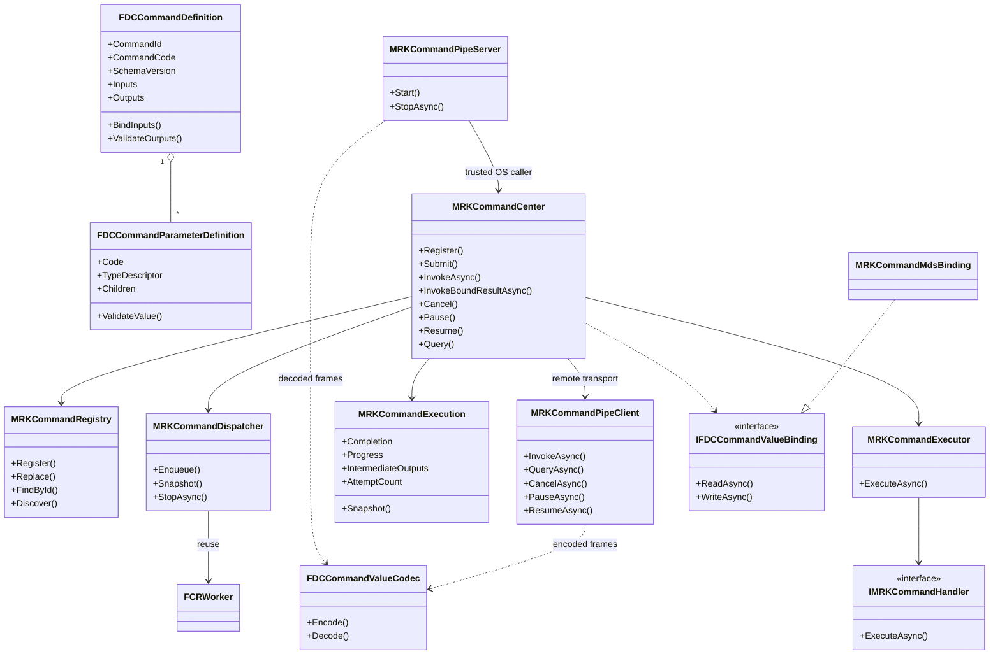
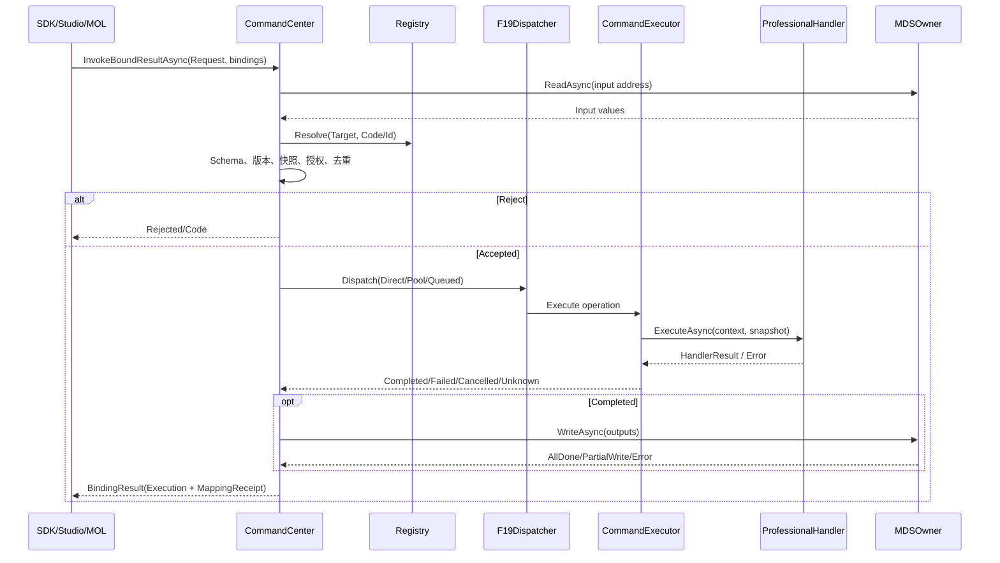
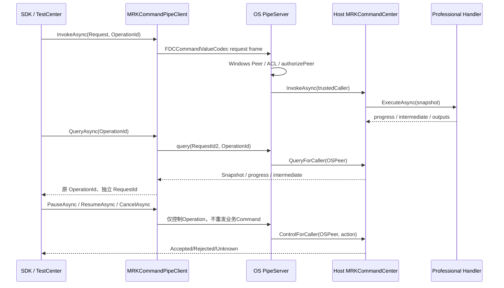

# CxVisual 数据与交互体系#4命令中心——完整设计与验收 V1.0

> **统一五份主设计文件之一｜2026-10-26｜Unified Data & Interaction System。**
> 本版完整保留原文的设计、对象/API、决议与历史审计；其历史时点的“当前”只对应原文标明的SHA，不能自动外推到最新master。
> **总体边界**：此处的数据特指运行时变量/堆栈，交互特指消息/命令及其跨模块协作；数据库、工程配置、日志、WPF UI、Channel/Protocol独立承担各自职责。
> 本次是文档归档与命名收敛，**没有因重命名产生新的代码实现、Windows CI或跨进程验收事实**。
> **体系主导航**：[#0 总体架构 V1.5](CxVisual_数据与交互体系%230总体架构——完整设计与验收_V1.5.md) · [#1 变量体系 V1.1](CxVisual_数据与交互体系%231变量体系——完整设计与验收_V1.1.md) · [#2 运行时数据 V3.0](CxVisual_数据与交互体系%232运行时数据体系——完整设计与验收_V3.0.md) · [#3 消息中心 V1.7](CxVisual_数据与交互体系%233消息中心——完整设计与验收_V1.7.md) · [#4 命令中心 V1.0](CxVisual_数据与交互体系%234命令中心——完整设计与验收_V1.0.md)

> 2026-10-24；代码归属批准：命令**专属类**限于现有 `CxVisual.Foundation.Data` + `CxVisual.Mechanism.Runtime` 两个项目。
>
> 规则：**需求 ≠ 源码实现 ≠ Windows 自动测试通过 ≠ Studio/UI 或现场设备通过**。本文只认实际代码和对应SHA的Windows CI，未验证项明确标注。此文件作为统一需求/设计/差距导航，不复制第二套数据/调度/工程真源。

> **实施对齐修订：2026-10-26（台北时间）**。当前主规范承接原60项完整需求，保持 **V1.0** 文件名与五份主规范导航不变；本次是代码与验收事实校准，**不表示本轮新增功能或自动测试结果**。
> **核对基准**：`master@5d017bfda83681a36c95abc77e2ed42a5482a40a`（读取时的HEAD；此分支持续并行推进）。命令核心源码及 TestCenter 命令页已核实；历史固定提交专项成功见 `5c9fedd0`（[Windows命令页及专项CI](https://github.com/oudream/cx-visual-x3/actions/runs/40169002739)）与 `946747c8`（[Windows命令页CI](https://github.com/oudream/cx-visual-x3/actions/runs/40321547813)）。最新HEAD的完整CI可能在运行或出现其他专业的失败，**不可外推旧成功至最新SHA**。
> **证据分级**：D=批准设计，I=正式源码存在，T=对应Windows专项测试成功（仅限列明的固定SHA与检查项），UI=TestCenter真实WPF/UIA成功，P=部分实现或部分验证，N=尚未完成/未找到相应证据。**TestCenter命令页UI通过 ≠ Studio/MOL编排通过 ≠ 跨PC/真机HIL通过**。

## 0. 基本原则

- Foundation.Data.Commands：无工程状态的 **Definition/Schema/Parameter、值复制、数据地址绑定接口**。
- Mechanism.Runtime.Commands：**Registry/Router/Center/Handler/Dispatcher/Executor、Request/Response、Operation、Policy、MDS绑定适配、执行观察**。
- Mechanism.Data 仍独占 MDS变量、点表、节点数据、DataHeap；本命令中心只通过 `MRKCommandMdsBinding` 调用。
- Mechanism.Runtime.Execution/F19 并发库仍负责已存在的Work、优先级、队列、Lease、Tracker与幂等重试策略。命令中心只复用，不复制。
- Mechanism.Data.Messages 的M36消息中心只发布/订阅。消息Topic不等于有授权和物理副作用的设备Command。
- Professional通过统一Handler插件实现设备、算法、CT、视觉、业务等动作；Studio、MOL、Host通过同一Center发起。不得在专业内部再建第二套Registry/数据中心。
- **设备硬件安全从不等于软件Command取消/暂停/超时/资源锁**。远程调用必须鉴权、版本一致、可审计与真实Transport；不允许伪装本地调用表示“远程完成”。

## 1. 两个项目、唯一源码目录

```text
Foundation/Data/Commands/                   -> CxVisual.Foundation.Data.dll
  FDCCommandDefinition.cs                   # FDCCommandDefinition/ParameterDefinition
  FDCCommandDefinitionCatalog.cs            # 定义目录只读快照
  FDCCommandValueSnapshot.cs                # IFDCCommandValueBinding、值隔离
  FDCCommandValueCodec.cs                   # 白名单安全值帧、版本与大小限制

Mechanism/Runtime/Commands/                 -> CxVisual.Mechanism.Runtime.dll
  MRKCommandContracts.cs                    # 请求、响应、Handler接口、Policy、运行票据等
  MRKCommandCenter.cs                       # 注册/路由/发现/提交/调用/取消/暂停/写回
  MRKCommandDispatching.cs                  # 真正Dispatcher与Executor，复用F19
  MRKCommandMdsBinding.cs                   # MDS变量/节点/FlowHeap地址读写适配
  MRKCommandAdapters.cs                     # MDS配置来源及专用SDK线程适配
  MRKCommandPipeTransport.cs                # Windows OS NamedPipe Client/Server、授权控制
```

原Mechanism.Logic/MCE命令定义和Mechanism.Data/MDS命令绑定专属文件已迁移删除。原MDS真源及MOL逻辑体系**没有迁入**命令中心。

## 2. 真实核心类型、签名与边界

| 类型 | 现有关键成员/入口 | 责任与边界 |
|---|---|---|
| `FDCCommandParameterDefinition` | Code、DataType/TypeDescriptor、Required、Default、AllowNull、ReadOnly、Unit、Min/Max、FormatPattern、Children、ValidateValue | 入/出共用定义；嵌套命名Map验证，不提供第二个TypeRegistry |
| `FDCCommandDefinition` | CommandId、CommandCode、Name、SchemaVersion、Inputs、Outputs、PermissionKey、TimeoutMilliseconds、BindInputs、ValidateOutputs | **静态定义**，绝不能保存RequestId、运行结果 |
| `FDCCommandDefinitionCatalog` | Find(Id/Code)、Snapshot | 只读定义目录，不是工程持久真源 |
| `FDCCommandValueSnapshot` | Capture(values, adapters) | 有界递归复制/拒绝未知可变DTO；复用FDT Adapter |
| `IFDCCommandValueBinding` | ReadAsync、WriteAsync | Foundation只定义地址读写契约，不引用MDS实现 |
| `MRKCommandDescriptor` | Target、Definition、Kind、Policy、Capabilities | 目标与已发布定义及执行约束的组合 |
| `MRKCommandRequest` | Target、CommandCode或CommandId、RequestId、OperationId、Inputs、Caller、Options、ExpectedSchemaVersion | 一次调用请求；Caller仅审计提示，Host负责验证调用者身份 |
| `MRKCommandOptions` | TimeoutMilliseconds、Remote、Priority | `Remote=true` + 注入真实 `MRKCommandPipeClient` 时进入Windows IPC；未注入则拒绝 `RemoteUnsupported`；不能暗示已验跨PC |
| `MRKCommandRegistry` | Register、Replace、Find、FindById、Discover、SetEnabled | Target+Command唯一；同Target不可有重复CommandId，注册令牌隔离热更新代次 |
| `MRKCommandRouter` | Resolve、ResolveById、Discover | 注册于当前Host的本地目录；**目前无跨Host授权发现/Schema协商API**；远端真实调用通过Client/Host适配 |
| `MRKCommandCenter` | Register、Replace、Submit、Invoke/InvokeAsync、InvokeBatchAsync、InvokeBroadcastAsync、InvokeBoundAsync/InvokeBoundResultAsync、InvokeConfiguredResultAsync、Query/QueryRemoteAsync、Cancel/Pause/Resume、CancelRemoteAsync/PauseRemoteAsync/ResumeRemoteAsync、GetMetrics、Dispose | 唯一命令执行入口；本地、远端（明确注入IPC）及MDS绑定复用同一机制，`Submit` 仅本地 |
| `IMRKCommandHandler` / `MRKDelegateCommandHandler` | ExecuteAsync(context, inputs, cancellation) | 专业实现业务；接收独立输入快照 |
| `MRKCommandDispatcher` | F19 Worker封装；Snapshot、StopAsync | Direct/ThreadPool由Center选择，Queued复用FCRWorker的Key FIFO/跨Key优先级/有界预算 |
| `MRKCommandExecutor` | ExecuteAsync(operation, entry) | Handler调用、资源Lease、拦截、校验、结算；不是新Workflow引擎 |
| `MRKCommandContext` | RequestId/OperationId/Caller/Target/Descriptor、ReportProgress、ReportIntermediate、WaitWhilePausedAsync | 运行上下文；Paused仅在协作检查点确认 |
| `MRKCommandExecution` | OperationId、Completion、Snapshot、Progress、ProgressMessage、IntermediateOutputs、AttemptCount | 单操作票据；原子快照报告状态/进度/中间值，RequestId和OperationId分离 |
| `MRKCommandResponse` | Stage、State、RequestId/OperationId、Outputs、BusinessSuccess/Code、Error/Code、DurationMilliseconds、ProgressPercent?、ProgressMessage、IntermediateOutputs | 受理/执行/业务/映射结果分离；真实进度可为空，中间值和最终输出防可变引用污染 |
| `MRKCommandBindingResult` | Execution、MappingAttempted、MappingSucceeded、MappedAddresses、MappingErrorCode/Error | 写回可部分成功，不能把映射失败说成设备未执行 |
| `MRKCommandOutputMappingException` | Result | 旧InvokeBoundAsync抛错仍携带完整执行与写回事实 |
| `MRKCommandPolicy` | Dispatch、MaxConcurrent、ResourceId、SupportsCancellation/Pause、RetryPolicy | 约束策略；设备自动重试在Center受理前直接拒绝 |
| `MRKCommandMetrics` | Registered、TotalOperations、Queued、Pending、Running、PauseRequested、Paused、Completed、Failed、Cancelled、Unknown | 进程内账本快照，不是跨进程持久指标 |
| `IMRKCommandInterceptor` | BeforeAsync、AfterAsync | 可插入授权外额外审计/日志，后处理异常以Unknown暴露 |
| `MRKCommandMdsBinding` | BindVariable<T>、BindNode<T>、BindHeap<T>、ReadAsync、WriteAsync、Unbind、Dispose | 数据Owner仍是原MDS和VariableTable，本类仅地址映射 |
| `MRKCommandInputSource` | Parameter、Binding(MDSDataBinding) | 不复制数据类型，引用既有可配置MDS来源，预检后解析 |
| `MRKDedicatedCommandHandler` | ExecuteAsync + FCRDedicatedExecutor | 同步SDK固定线程调用、Host管理线程生命周期，不模拟异步线程亲和 |
| `FDCCommandValueCodec` | Encode/Decode、MaxFrameBytes | Foundation.Data安全白名单值帧；拒绝任意DTO/原生句柄，当前帧最大4MiB |
| `MRKCommandPipeClient` / `MRKCommandPipeServer` | InvokeAsync、QueryAsync、CancelAsync、PauseAsync、ResumeAsync；Host的Start/StopAsync | 真实Windows命名管道、OS Peer及ACL、连接/交换/读帧超时、会话限制；同机双进程已有CI，跨PC待实测 |
| `TCTManualCommandFrame`（TestCenter应用层） | ITCTWorkspaceFrame、RegisterDemo、InvokeSelectedAsync、QueryAsync、StartChildHostAsync、VerifyLocalAsync | 专有测试实际WPF命令操作页；**只使用正式MRK/FDC/MDS，不是第二套中心，也不是Studio编辑器** |

> `Command` 是 Definition 与一次 Request/Execution 的逻辑总称；`CommandInput/Output` 是 Schema 与绑定后的字典值。**不为满足名称数目再创建两个重复数据容器**。

## 3. 类关系（实际代码）



## 4. 调用时序及四种结果



- **Accepted**仅说明进程内受理/排队，不保证执行成功。
- **Completed**说明Handler完成并输出Schema验证通过；BusinessSuccess可为false。
- **Unknown**说明调用观察超时或后置确认失败；真实外部副作用未必停止。
- **MappingFailed**只说明数据Owner写回失败；不改变之前已执行的设备/算法动作。
- **Paused**必须由Handler主动到达检查点，PauseRequested只是控制请求。
- **RemoteUnsupported** 仅在请求远端调用而未装配真实Transport时返回。已装配 `MRKCommandPipeClient` 时本机Windows IPC可实际调用，并由接收Host再次鉴权；跨PC部署仍未验收。

## 5. 三种专业场景

### 5.1 算法（现有ArchitectureSmoke真实可执行场景）

```csharp
FDCCommandDefinition def = new FDCCommandDefinition(1001, "Double", "倍乘",
    new[] { new FDCCommandParameterDefinition("Input", typeof(double), true) },
    new[] { new FDCCommandParameterDefinition("Output", typeof(double), true) });
using (MRKCommandCenter center = new MRKCommandCenter())
using (center.Register(new MRKCommandDescriptor("Vision/Detector", def),
    new MRKDelegateCommandHandler((context, args, cancellation) =>
        Task.FromResult(new MRKCommandHandlerResult(
            new Dictionary<string, object> {
                { "Output", 2.0 * (double)args["Input"] }
            })))))
{
    MRKCommandResponse reply = await center.InvokeAsync(new MRKCommandRequest(
        "Vision/Detector", 1001,
        new Dictionary<string, object> { { "Input", 3.0 } }));
    // reply.State == Completed; reply.Outputs["Output"] == 6.0
}
```
此代码位于异步方法内；按需using System/Collections.Generic/Threading.Tasks、Foundation.Data.Commands和Mechanism.Runtime.Commands。算法调用与Schema/mapping/batch等已有真实ArchitectureSmoke测试；并不表示工业专业算法框架和Studio完整联调。

### 5.2 设备动作（仍需硬件Provider/HIL）

`Professional.Automation` 可按 `MRKCommandKind.Device` 注册移动轴/曝光等Handler，`PermissionKey` 配合由Host注入的可信授权检查，并复用MRK ResourceLease。Provider自己负责PLC/运控/相机协议、模式校验、硬件联锁、反读与急停；本中心禁止 `Device` 自动重试及默认广播。当前仅用模拟Provider验证拒绝路径，**没有实机动作或安全停机证明**。

### 5.3 MOL流程节点（集成待补）

流程节点端口通过已有MDS Scope与`MRKCommandMdsBinding` 映射到命令输入/输出，编译计划仍由MOC/运行MRK Owner管理，不建第二个Graph或FlowExecutor。当前节点/变量MDS读写模拟集成已测；真实Studio拖拽定义、构建、运行、调试及SourceMap的完整闭环仍单独验收。

## 6. 原60项需求逐项源码与缺口矩阵（2026-10-26实施校准）

> T：固定SHA的命令专项CI已成功且有对应实现/覆盖路径，**不表示本条具独立完整用例**；P：有源码或部分验收，但原需求的关键部分未闭环。对每一项的正式验收须核对相关测试名和具体CI记录；未建立跨PC/真实设备HIL证据。 这份矩阵仍以用户已批准的1–60项需求原编号为准，不以新类名取代需求。完整详细用例见 `DOCS/Implementation/CxVisual_统一命令中心——源码审查与增量验收_V1.0.md` 与正式测试源码。

| # | 原需求对应能力 | 当前正式API/证据入口 | 级别 | 未关闭边界 |
|---:|---|---|:---:|---|
| 1 | Command/Handler/Dispatcher/Executor | `FDC Definition、MRK Center、Dispatcher/Executor` | T | 完整专业覆盖另验 |
| 2 | 优先进程内，扩展跨进程/跨PC | `本地Center；Windows NamedPipe双进程` | P | 跨PC真实安全部署未验 |
| 3 | 同步/异步/请求响应/批量/远程 | `Invoke、InvokeAsync、Batch/Broadcast、PipeClient` | P | 远程广播及异步推送未统一 |
| 4 | 高性能线程安全低耦合 | `F19有界队列、Operation快照、双Owner` | P | 长期稳定性/性能基准未完成 |
| 5 | 统一定义/参数/注册/调用管理 | `FDC定义与MRK注册执行` | T | 工程治理完整流程待验 |
| 6 | 命令名称/ID/版本/描述/目标/IO | `FDCCommandDefinition、MRKDescriptor` | T | 跨Host发布治理待做 |
| 7 | 命令分类 | `MRKCommandKind` | T | 全部专业Provider待验 |
| 8 | 注册/注销/查找/枚举/更新 | `MRKCommandRegistry、Replace、Discover` | T | Host重启持久目录待做 |
| 9 | 执行特性/权限/超时描述 | `MRKCommandPolicy、PermissionKey、Options` | P | 细粒度远端授权待增强 |
| 10 | 按名称/类型/目标/能力发现 | `Router.Discover（本地）` | P | 远程授权Discover待实现 |
| 11 | 统一模块/对象/设备/服务寻址 | `Descriptor.Target、Code/CommandId` | P | 跨Host目标目录待实现 |
| 12 | 创建/启停/注销/释放生命周期 | `Registry.SetEnabled、IDisposable令牌` | T | 持久目录和热部署待验 |
| 13 | 无参/单参/多参/复杂参 | `FDC Inputs、BindInputs` | T | 任意DTO需要适配器 |
| 14 | Name/Type/Description/DefaultValue | `FDCCommandParameterDefinition` | T | 动态版本迁移待建 |
| 15 | 必填/可选/只读/可空/单位/范围 | `FDC Parameter约束` | P | 参数级安全和全类型覆盖待验 |
| 16 | 基础/枚举/数组/集合/结构体/自定义 | `FDT类型描述、ValueSnapshot、Codec` | P | 任意DTO不能直接走Wire |
| 17 | 嵌套/分组/复杂数据结构 | `Children + Map递归验证` | P | 完整Graph与动态Studio编辑未完成 |
| 18 | 类型/范围/格式/自定义规则 | `ValidateValue/BindInputs` | P | 自定义规则插件覆盖待验 |
| 19 | 转换/序列化/反序列化 | `FDT Adapter + FDCCommandValueCodec` | P | 跨版本Schema协商待建 |
| 20 | 直接值/点表/堆/流程端口 | `MRKCommandMdsBinding、ConfiguredResult` | P | 工程端口真实编排未验 |
| 21 | 静态/表达式/引用/映射 | `MRKCommandInputSource、MDSDataBindingResolver` | P | Studio资源编辑与工程落盘未完成 |
| 22 | 快照/所有权/并发隔离 | `FDCCommandValueSnapshot` | T | 超大对象需专业Handle Owner |
| 23 | 无/单/多/复杂返回 | `HandlerResult、Outputs命名字典` | P | 自定义复杂返回跨Wire受限 |
| 24 | 输出Name/Type/Description/Default | `与Inputs同一FDC Schema` | T | 输出默认值实际语义需补验 |
| 25 | 输入输出统一类型体系 | `FDTDataTypeDescriptor、FDC参数模型` | T | 异构DTO转换待完善 |
| 26 | 命名/嵌套/结构化输出 | `Outputs Map、安全值快照` | P | 复杂对象Schema互操作待验 |
| 27 | 输出类型/完整性/一致性 | `ValidateOutputs` | T | 事务一致性非命令层承诺 |
| 28 | 同步/异步/回调/事件 | `Invoke/InvokeAsync、Query` | P | 结果主动事件推送未交付 |
| 29 | 结果映射变量/堆/端口/对象 | `BindingResult、MDS适配` | P | 跨Owner原子写回未实现 |
| 30 | 业务结果/执行状态/错误分离 | `Response、BindingResult` | T | 跨PC故障确认需专业配合 |
| 31 | 进度/中间/最终 | `ReportProgress/Intermediate、Query IPC扩展` | T | Push事件订阅待做 |
| 32 | 输入输出上下文关联 | `RequestId/OperationId、映射回执` | T | 跨Host持久关联待完善 |
| 33 | 同步/异步/单播/广播/批量 | `MRKCommandCenter调用系列` | T | 跨PC目标组与广播安全待验 |
| 34 | RequestId/CommandId/Target/Inputs/Options | `MRKCommandRequest` | T | 认证Caller由Host强制替换 |
| 35 | 响应Status/Outputs/Error/Duration | `MRKCommandResponse` | T | 与设备物理反馈严格区分 |
| 36 | 路由/查找/跨模块 | `MRKRouter+Registry` | P | 跨Host授权发现未交付 |
| 37 | 直接/队列/指定线程 | `MRKDispatcher、FCRDedicatedExecutor` | T | 设备SDK实际线程限制需专业验证 |
| 38 | Handler与执行上下文 | `IMRKCommandHandler、MRKCommandContext` | T | 专业实现独立验收 |
| 39 | 状态机及终态 | `MRKCommandExecution/State/Stage` | T | Unknown后的持久追踪待补 |
| 40 | 优先级/并发/顺序/超时/取消 | `MRKPolicy、F19、Lease` | P | 长稳背压及竞态矩阵待加强 |
| 41 | 进度/协作暂停/恢复/取消 | `Context.WaitWhilePausedAsync、Center控制` | T | 不代表硬件停止 |
| 42 | Correlation/异步应答/超时 | `RequestId+OperationId、PipeQuery` | P | 异步主动应答与跨重启关联待做 |
| 43 | 异常/错误码/失败隔离/重试 | `MRKExecutor、ExecutionPolicy` | P | 故障分类与压力回归待增强 |
| 44 | 幂等/去重/重试/追踪 | `OperationId账本、有限重试` | P | 重启持久幂等未做；设备禁盲重试 |
| 45 | 调用者身份/目标/命令授权 | `Windows Peer ACL + MRK授权器` | P | 跨账号/跨PC域可信授权未验 |
| 46 | Before/After/审计/日志 | `IMRKCommandInterceptor、Metrics` | P | 持久审计及回放未交付 |
| 47 | Command/Descriptor/ParameterDescriptor | `FDC Definition+Parameter、MRK Descriptor` | T | 逻辑角色不强造重复类 |
| 48 | Input/Output/ParameterSchema | `FDC Inputs/Outputs/ParameterDefinition` | T | 单一Schema无第二套容器 |
| 49 | Request/Response/Result | `MRKCommandRequest/Response/BindingResult` | T | 跨Host策略恢复待补 |
| 50 | Center/Registry/Router | `MRKCommandCenter/Registry/Router` | T | 单一权威Owner |
| 51 | Handler/Dispatcher/Executor | `IMRKCommandHandler/Dispatching` | T | 专业HIL待验 |
| 52 | Context/Execution/Target | `MRKContext/Execution/Descriptor.Target` | T | 设备侧Target授权待验 |
| 53 | Options/Validator/Interceptor | `MRKOptions、FDC验证、Interceptor` | T | 高级策略扩展待验 |
| 54 | Metrics/Policy/ParameterBinding | `MRKMetrics、Policy、Binding` | T | 跨进程指标聚合待完善 |
| 55 | 各核心类职责/API/关系 | `§2/§3类表和类图、实现文件` | P | 外部SDK说明书可继续完善 |
| 56 | Foundation契约+Mechanism完整机制 | `Foundation.Data+Mechanism.Runtime双项目` | T | 没有新增第三个命令项目 |
| 57 | 消息/点表/堆的边界与协作 | `M36/MDS Owner + IFDCBinding` | T | 跨系统治理待联合验收 |
| 58 | 复用调度/类型/序列化/权限/运行 | `F19/FDT/FDC Codec/MRK Lease` | T | 高压资源释放矩阵待做 |
| 59 | 类图/时序/完整代码/三专业案例 | `§3/§4/§5，测试算法/虚拟Handler` | P | 真设备/Studio MOL全闭环未验 |
| 60 | 绑定/执行/写回/并发/异常/超时/释放 | `ArchitectureSmoke + TestCenter命令UI CI` | P | 跨PC/HIL/长稳/全量TestCenter UIA需单验 |

## 7. Windows CI、证据等级及交付门禁

验证必须对应**准确SHA**，不能拿成功提交的结果替代新HEAD。本文仅更新设计文档，不把文档合并或 Actions 被触发当作编译/测试通过。

| 验收对象 | 真实入口 | 已核实证据及局限 |
|---|---|---|
| 正式机制、IPC、进度/中间值 | `Tests/ArchitectureSmoke/Integration/CommandCenterTests.cs`、`--command-center`、`.github/workflows/unified-runtime-windows.yml` | 2026-10-25 的命令CI有成功证据；固定提交 `5c9fedd0` 的命令工作区CI包含命令专项，不能代替今日master |
| TestCenter真实WPF工作区 | `Tests/TestCenter/Manual/Command/TCTManualCommandFrame.cs`、`--command-ui-smoke`、`--command-ui-automation` | [`5c9fedd0`命令页CI成功](https://github.com/oudream/cx-visual-x3/actions/runs/40169002739)；[`946747c8`命令页CI成功](https://github.com/oudream/cx-visual-x3/actions/runs/40321547813) |
| 独立OS双进程 | `ArchitectureSmoke.exe --command-pipe-child` + `MRKCommandPipeClient` + Host | 命令工作区 `VerifyLocalAsync` 启动子进程并完成Invoke/Query；只说明同一Windows机器 |
| TestCenter全量UIA | `.github/workflows/testcenter-windows.yml`、多专业交互与截图 | 历史有105秒超时，需每个最新SHA独立检查；**命令页专项绿不能抹平全量失败** |
| Studio/MOL/MOC正式编排 | 工程保存重开、命令端口绑定、构建运行、SourceMap诊断 | 尚无完整可视化端到端验收，TestCenter不代替Studio |
| 安全部署/跨PC/HIL | 跨用户/Windows域、网络ACL、真实设备互锁、掉线恢复、长期负载 | 本主规范未找到闭环现场证据；不得标为已完成 |

正式门禁：Windows x64 `CxVisual.Unified.sln` Rebuild → `--command-center` + 默认 ArchitectureSmoke → `--command-ui-smoke` → `--command-ui-automation` → 原 TestCenter全量UIA → 需要时跨PC/设备HIL和长稳报告。每项附SHA、Action URL、日志/结果及异常反证。

## 8. 正式参数Schema、运行绑定与数据所有权

1. **定义态**：`FDCCommandDefinition` 包含稳定CommandId/Code、SchemaVersion、Input/Output共用的 `FDCCommandParameterDefinition`；`MRKCommandDescriptor` 添加Target、Kind、Capabilities、Policy。定义不可塞入一次调用的RequestId、执行时内存值或Studio控件状态。
2. **值与类型**：复用FDT类型描述；支持已证明的基础类型、数组、命名Map、部分嵌套结构，类型/必填/可空/范围/格式/默认值由FDC验证。带未知CLR DTO、指针、SDK句柄的对象，禁止绕过安全值Codec直接远程反序列化；复杂专业数据应经适配/资源Handle明示所有权。
3. **输入来源**：`MRKCommandInputSource` 与 `InvokeConfiguredResultAsync` 可使用已有MDS变量、节点Port、FlowHeap、表达式等Resolver；所有目标/输入/输出映射先进行结构预检，之后才允许访问外部数据Owner。
4. **运行快照**：请求受理前 `FDCCommandValueSnapshot.Capture`，Handler读独立值；Query及结果读取亦返回安全快照。值对象与大数据句柄的分离仍需专业Owner管理。
5. **输出事实**：`Execution` 执行成功不意味着 `MappingResult` 写回成功；结果包含 `MappingAttempted`、`MappingSucceeded`、已写地址及错误。部分写成功不得描述为事务回滚，也不得因此重试设备动作。
6. **远程定义**：`InvokeConfiguredResultAsync(..., publishedRemoteDefinition)` 可用**调用方已持有的已发布定义**先验证远程目标/版本/映射；远端Host始终依据自身Registry再次验证。**目前不是跨Host授权Schema自动发现**。

## 9. 执行、并发、幂等与异常语义

- 唯一操作账本为 `MRKCommandCenter._operations`、`MRKCommandExecution`；Registry注册令牌支持热替换时旧操作仍沿原Handler代次结束，不额外创建持久命令仓。
- 运行路径 `Request → 预检/授权 → Submit(Accepted或Rejected) → Dispatcher(F19 Direct/ThreadPool/Queued) → Executor → Professional Handler → ValidateOutputs → Completion/MappingReceipt`。同步/异步/批量/广播共用这条机制，设备默认禁止无差别广播与自动重试。
- RequestId标识调用，OperationId标识可关联的执行。重复OperationId在Caller、目标、命令及输入一致时由原操作账本处理；不一致必须拒绝OperationConflict。Host重启后的**持久**幂等与离线确认尚未实现。
- `Queued/Running/PauseRequested/Paused/Completed/Failed/Cancelled/Unknown` 是软件命令生命周期，不是设备物理状态。收到 `PauseRequested` 必须由Handler执行 `WaitWhilePausedAsync` 才能确认 `Paused`。
- 有限重试复用MRK既有 `MRKExecutionPolicy`；设备命令不得因超时、断线或未知回执盲目自动重发。Caller观察超时的 `Unknown` 与设备动作失败必须分开处理。

## 10. 真实Windows IPC：协议、身份、超时与恢复



**已编码且有专项CI证据**：Windows OS命名管道 `MRKCommandPipeClient/Server`；身份来自OS Peer，不信任客户端声明的Caller；服务端当前用户ACL + 明确授权函数 + 目标Host原有命令授权器；独立进程可传输Request/Response/Query/Cancel/Pause/Resume；请求及响应均有RequestId/OperationId防串线关联。

安全值帧 `FDCCommandValueCodec` 有白名单类型、版本、深度和大小限制（帧上限4MiB），非任意类型对象映射。连接超时与已连接后的ExchangeTimeout独立，服务端从认证后读取完整请求帧有独立截止时间（默认5000ms）；最多8个并发会话的空闲连接不能无限占住槽位。Windows OS返回121/231且**尚未连接/从未发送命令**时可在连接预算内有限重试；发送后失败为Unknown，不自动重发业务设备命令。

**协议兼容**：原Response扩展可空 `progress`、`progressMessage`、`intermediate`，旧帧缺少时解析为空，错误进度和异常中间值结构拒绝；不代表双向完整Schema版本协商。

**尚未验收**：跨PC域凭据/SMB/网络ACL、跨身份授权阻断、Host重启的Operation持久恢复、可靠离线队列、持久审计、专业现场设备安全；不能以本机OS IPC声称这些已完成。

## 11. 实时执行观察：Query、控制和结果的分层

`MRKCommandContext.ReportProgress/ReportIntermediate` 写入原 `MRKCommandExecution`，`Snapshot()` 在同一锁内复制状态、可空百分比、进度说明、最新中间值；`MRKCommandResponse` 的 `Outputs` 是最终业务输出，不与 `IntermediateOutputs` 混合。Handler没有上报进度时，Completed仍保留 `ProgressPercent == null`，不自动填100%。

远程Query经OS Pipe获取**原操作的事实快照**，绝不发第二次Invoke。查询/控制要求OS实际调用者与原Operation相符，陌生Operation或越权返回`OperationNotFoundOrUnauthorized`；不支持操作策略返回`ControlNotSupportedOrInvalidState`；控制状态未知用`ControlUnknown`或`RemoteUnknown`表示。

**审计边界**：进度的轮询快照、Request/Operation关联、客户端显示日志，不能替代专业全链路持久审计或订阅推送。用户点击Cancel不是急停，按工业设备安全管理由Professional/PLC/运动控制卡闭环确认。

## 12. TestCenter 命令中心操作界面（代码与实测范围）

现有入口：`Tests/TestCenter/Common/Framework/TCTWorkspaceRegistry.cs` 注册 `manual.command` → 左侧「专有测试」树创建实例 → 中央 `TCTManualCommandFrame` Tab → 右侧 `ITCTWorkspaceFrame.Commands` 操作中心。真实WPF，不是重新建立页面Shell。

| 操作面 | 当前已编码体验与关键Owner | 仍需补齐 |
|---|---|---|
| 命令浏览 | 本地 `Router.Discover` 的Target/Code/ID/Version、FDC参数与Policy、已知独立进程示例契约 | **不是远程Discover**，需Host授权目录与Schema协商 |
| 参数编辑 | 基础参数、数组、嵌套JSON，FDC预检；本地MDS变量输入和输出映射 | 定制DTO、动态工程变量/Port/Expression树、完整参数编辑器 |
| 命令操作 | 注册/注销演示Handler、启停、Invoke/Query/Pause/Resume/Cancel；复用唯一Center | 多目标/批量与专业设备能力UI仍待完成 |
| 执行监视 | RequestId/OperationId、Stage/State、ProgressBar、进度消息、中间/最终输出、执行错误与映射回执 | 多Operation并列监视、Push/重连恢复与正式Trace |
| IPC验证 | 本机实际命名管道及 `ArchitectureSmoke.exe --command-pipe-child` 独立OS进程启动/停止和命令调用/查询 | 跨PC认证、模拟网络断线恢复、非Demo设备Provider |
| 测试证据 | 本次人工会话记录最多250条、TSV导出、UIAutomation控件实际可操作 | 正式TCT Run/Attempt持久证据、回放、截图视觉验收 |

该页对演示算法的数值计算和30步长任务确实调用MRK，约90ms本地、350ms远端异步查询，进度变化才记录人工观察；没有编造正式TCT Passed。正反例：参数范围/未知嵌套成员在Handler前拒绝，MDS写回与真实OS Pipe Query、长任务执行时有进度中间值，UIA通过ValuePattern/InvokePattern/Tab SelectionItemPattern实际操作。涉及其他并行UI迭代时以最新源码/对应SHA重新验证。

## 13. 正式设计待办、Owner与验收

| 优先级 | 工作包 | 设计门槛 / 正反验收 |
|---|---|---|
| P0 | 消除过期口径、维持专项与全量CI稳定 | 固定SHA说明；不将TestCenter专项成功遮蔽全量UIA失败；任何代码更新执行命令专项/默认回归 |
| P1 | **安全的远程命令发现与完整Schema协商** | Host依据OS Peer及命令权限过滤；仅公开已授权Descriptor；版本、类型、默认值、复杂子字段可安全转换；未授权命令不能泄露或执行 |
| P1 | TestCenter多Operation监视与正确历史 | 多操作关联一致，断连Unknown独立；历史复用正式TCT Run/Attempt Owner，不新建旁路仓 |
| P1 | Studio/MOL/MOC全流程命令编辑/构建/运行/调试 | 保存重开后唯一Descriptor/数据绑定保持，Output反映真实写回，断点/SourceMap可定位 |
| P2 | IPC持久可靠性与身份安全 | Host重启、重复请求、跨Windows用户/域鉴权、跨PC真实部署、断线/交换超时均有可审计失败反证 |
| P2 | 专业Handler复用及控制闭环 | 设备/算法/流程各至少一实际Provider，专业安全互锁、模式权限、不能依赖Command取消替代急停 |
| P3 | 压力/资源/长稳 | 大小边界、队列满、数万操作、注册热替换、资源回收、内存增长、长期运行可重复可量化 |

**最后裁决**：只在 `Foundation.Data.Commands` + `Mechanism.Runtime.Commands` 实现命令专属逻辑。MDS、消息中心M36、F19、Connectivity、MOL/MOC、Studio各保留唯一Owner；TestCenter是使用与验证界面，不构成第三套运行命令中心。

