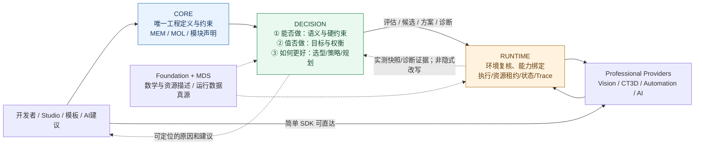
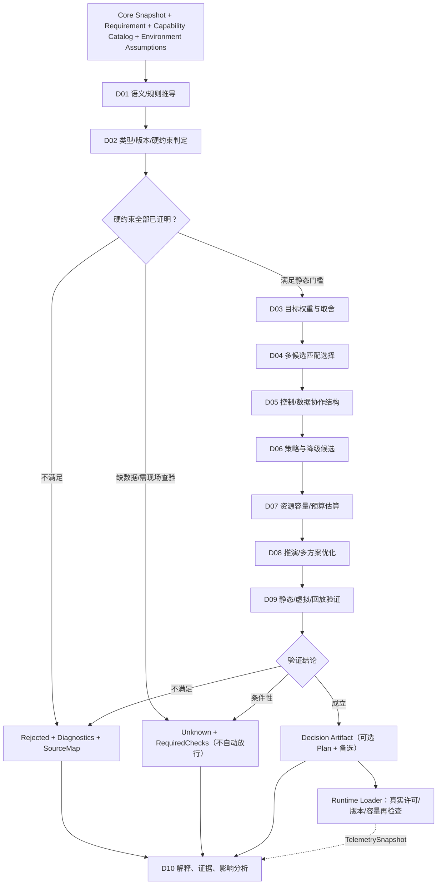
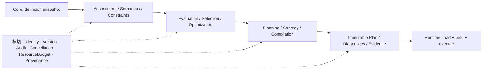

# CxVisual 统一决策与规划体系——总体架构与十项能力 V1.0

> **2026-10-28 深化修订（V1.1内容，文件路径延续V1.0）：** 本文件是 Decision 的**唯一总体架构和十大能力真源**；[对象/API](CxVisual_统一决策与规划体系%231对象合同与开发者API_V1.0.md)负责签名，[迁移规格](../Migration/CxVisual_Decision_Logic与Orchestration融合及Runtime解耦_V1.0.md)负责逐文件步骤，[测试规格](../Testing/CxVisual_Decision_功能与迁移验收矩阵_V1.0.md)负责证据。下列图和新接口均为**目标设计**，不是当前已运行代码。审计基线见文末；遇更晚 master 时须重新审查。

## 一张图看懂：Core → Decision → Runtime



> 图中实线是**业务信息/调用方向**，不是 C# ProjectReference 图。目标物理引用应为 Runtime → Decision → Core；Decision **绝不能**引用 Runtime；Provider 的真实动作不能反向依赖 Decision。简单 SDK 并非必须走三层。静态 Allowed 只表示“已知假设下检查通过”，不是现场许可。


> 名称：`CxVisual.Mechanism.Decision`；英文：Unified Decision & Planning System。
> 状态：用户已决定名称和融合方向；**目标设计，非十项能力已实现说明**。
> 三层：Core（定义）→ Decision（判断/决策/规划）→ Runtime（受控运行）。运行时数据 MDS、专业算法与实际设备动作保有唯一 Owner。
> 决议：[Decision 项目融合与归属裁决](../Decisions/CxVisual_Mechanism_Decision_项目融合与归属裁决_V1.0.md)。

## 0. 给开发者的三分钟理解

**Core** 描述“有什么、希望达到什么、允许/不允许什么”；**Decision** 根据定义与明确证据回答“能不能、该不该、怎样做更合理”；**Runtime** 在真实环境里受控加载、连接、执行、判断当前状态、结算和反馈。**三者不是所有调用必须经过的强制调用链**。

```text
C# SDK 简单调用 ----------------------------> 专业 API / 可选 Runtime
Studio / 工程 / 模板 / AI候选 ---> Core Snapshot ---> Decision
                                         |           |
                                         |   诊断/可行性/选择/策略/方案
                                         |           |
                                         +----------> Runtime（真实资源准入 + 执行）
                                                      |
                                               监控/Trace/实测反馈
                                                         └──> Decision（可选离线复评）
```

三个判断：
1. **能不能做**：硬约束、类型、依赖、资源上限和安全前置；不能做则拒绝。
2. **该不该这样做**：在可行候选中结合目标、成本、质量和风险作合理权衡；不能牺牲硬安全约束。
3. **怎样做更好**：组织协作、选择能力、制定策略、估计预算，必要时生成并验证可执行方案及替代方案。

“评估/选择”并不是允许自主执行不可逆动作；Decision 不拥有硬件控制权。

## 1. 十大完整能力与对应成果

| # | 能力域 | 核心判断/运算 | 输出产物 | 阶段门槛 |
|---|---|---|---|---|
| D01 | **语义理解与推导** | 表达式/规则/条件/端口/引用的语义，组合后推导关系、类型和副作用 | 已解析语义与逻辑关系、推导依据 | 一致的规则语义，纯函数或明确外部上下文 |
| D02 | **合法性与可行性检查** | 类型/依赖环/状态/版本/能力/权限前置/资源及安全硬约束 | 通过/拒绝/警告、问题定位、未验证条件 | 硬约束不得仅以警告放行 |
| D03 | **目标与约束协调** | 吞吐、延迟、精度、成本、可靠性、可维护性冲突与优先级 | 硬约束清单、软目标权重、取舍说明 | 明确优先级与不可妥协约束 |
| D04 | **能力匹配与方案选择** | 多个 Provider/算法/设备/版本的能力契约及候选比较 | 可用候选、选定项、备用项、版本条件 | 不凭名称匹配而忽视 schema 和版本 |
| D05 | **逻辑与协作规划** | 控制流、数据流、子流程、DAG、并行、等待、同步、状态机 | 执行结构、依赖、控制区域、协作规则 | 保留动态循环、分支、子流程及数据隔离 |
| D06 | **策略制定与协调** | 超时、重试、恢复、回退、补偿、降级、取消、优先级 | 带适用条件和限制的策略集 | 不安全/非幂等动作不得无授权自动重试 |
| D07 | **资源与性能规划** | CPU/GPU/设备/内存/带宽/队列/并发/数据保留与容量 | 资源需求、预算估计、瓶颈/容量条件 | 估算须标明实测与模型来源 |
| D08 | **预测、推演与优化** | 候选模拟、成本估计、关键路径、优化及环境变化影响 | 对比报告、预估收益/风险与优化建议 | 未测量时不能保证节拍与精度 |
| D09 | **验证、仿真与影响分析** | 不运行设备时的静态验证、Virtual/Replay仿真方案、变更影响 | 检查报告、仿真证据、变更影响图 | 仿真不冒充 HIL/实机验收 |
| D10 | **决策解释与反馈改进** | 为什么拒绝/选择/调整；Plan→工程节点映射；实测回填 | 原因码、证据引用、SourceMap、建议与可追溯性 | 反馈建议不能自动绕过发布授权 |

上述 10 项属于**能力**，不是十个项目、十个持久仓储、十个必须实例化的 Manager。某次调用只可使用 D02；完整工程才会组合多个能力。

## 2. 每项能力的边界

- **定义与组织的唯一真源：Core**。工程树、MEM/MOL对象、MTC编辑事务、Module/Port/Rule原始声明与 Revision 归 Core；Decision 只消费一致快照、产出派生报告。
- **能力描述/数据来源**：Foundation/专业 Owner 提供稳定 Capability/Descriptor 和可验证输入契约；Decision 不依赖具体 Vision、CT3D、PLC 实现，不主动打开设备。
- **数据：MDS**。Decision 分析数据需求、产生保留与复制建议；MDS/Runtime 执行实际 Frame/Heap/Stack 生命周期，不复制运行堆。
- **调度与执行：Runtime**。Decision 可提出顺序、并行、预算、重试限制，但 Worker、线程、实测背压、实时资源租约、取消和 Trace 执行均由 Runtime/Host 持有。
- **生命周期与发布：Lifecycle/Host**。Decision 生成发布候选、诊断和验证清单；Stage/Activate/Retire/Rollback 的操作权、运行安全点和授权由治理/运行侧执行。不得把发布控制做成隐藏在 Decision 内的执行器。
- **UI：Studio/TestCenter** 只编辑定义、调用统一判断入口、显示依据及可视化节点定位，不维护自己的判断真源。
- **AI / 推理** 作为辅助建议源，不取代确定性规则、工业安全验证与人工授权。

## 3. 方案决策的优先级（防止“优化出事故”）

```text
定义与版本一致性
   ↓
结构/类型/能力合法性
   ↓
安全、权限、资源上限、状态等硬约束（任一不满足则拒绝）
   ↓
可行候选集合
   ↓
软目标权衡（节拍/精度/成本/能耗/可靠性/偏好）
   ↓
选择 + 备选 + 必须满足的前置条件
   ↓
Runtime 真实环境复核 + 授权执行
```

**硬约束永不因加权得分更高而被跳过**。候选不存在时返回不可行及原因，不强制选最优；结果必须支持“不知道/数据不足/需现场验证”。没有独立实证的“自动选最优算法”只能作为建议，不能作为事实。

## 4. 三个不同成熟度的输出（不强制每次产出 Plan）

| 使用情形 | 必须/可选输出 | 不必做的事 |
|---|---|---|
| 判定两个端口能否连接 | 可行性判定、错误位置/原因及修复建议 | 不创建完整执行计划 |
| 多个 AI/CT 算法选型 | 符合硬约束的候选、权衡/成本、选择理由与备选 | 不需要打开 GPU、相机 |
| 整体工程编排 | 验证报告、选定策略/资源需求、执行结构、SourceMap；满足条件才生成 Plan | 不创建实际 Flow 或 Worker |
| Runtime 反馈超载 | 实测数据快照、方案差异、候选调整、影响分析 | 不偷偷改写正在运行的已授权 Plan |

完整输出建议采用四种可重用、不互相混淆的产物：**Assessment（判断）／Decision（选择）／Strategy（策略）／ExecutionPlan（执行方案）**；统一附 Diagnostics/Evidence/Identity/Version。

## 5. 三种专业场景：能真正体现中间能力价值

### S1：X-Ray 检测产线，节拍与安全冲突
Core 描述相机/探测器、AI/传统算法、PLC、节拍目标、NG 分选规则、禁止重复动作及预算。Decision 拒绝不满足输入/版本的算法候选，比较候选模型资源和实测耗时，分析多设备竞争与队列背压，明确超时后的安全允许路径，产生报告、候选、策略/Plan。Runtime 按现场资源及许可启动与结算；无法满足安全前置则不得继续发起危险操作。**不假定 Decision 可以单独证明产线 10 件/秒。**

### S2：CT 重建，GPU与CPU备选
Core 描述 Volume/Projection 格式、算子版本、精度目标、硬件及数据规模。Decision 比较算法需求和 CPU/GPU/内存预算、分析数据保留及分块时机，提供可行候选和回退条件。Runtime 在启动时检查真实资源及设备可用性，调用 CT3D 的专业实现；Decision 不包含 CT 重建算法本体。

### S3：嵌套流程与动态 Loop
Core 描述 MOL 条件、While、Foreach、子 Content/命名数据端口；Decision 验证边界、依赖、引用和端口契约，生成一个包含可复用 Body 及 SourceMap 的逻辑计划而非 N 个重复节点。Runtime 创建具体 Invocation/Frame、执行迭代与 Break/Continue/Return、隔离数据、按实际条件推进并记录 Trace。

## 6. 规则组合与扩展原则

- **数据驱动**：已版本化的 Capability/ResourceSnapshot、Requirements 和 Policy；不偷偷读取 Runtime 全局单例。
- **可插拔**：必要时提供规则校验器、能力解析器、候选评估器及 Plan 编译扩展；不为每个枚举值建单独 Processor 类。
- **可解释**：任何 Reject/Select 附原因码、关联 Core 定义 ID、所用配置版本与证据；可以回显到 Studio/TestCenter。
- **高性能**：优先缓存不可变派生结果，按 revision/能力版本/约束指纹失效；避免每次运行重复编译、深拷大图像/Volume 数据、没有必要的过度分层。
- **线程安全**：输入快照只读；评估上下文按请求隔离；并发不可引入共享修改；可取消、有限时预算但不将取消简单解释为决策通过。
- **安全**：拒绝/未知与通过三态明确；外部设备动作必须由 Runtime/专业 Owner 受控执行。

## 7. 当前进度与缺口（不制造实现证明）

现有 Core/MOL、MOCBuildService/MOCEngineeringCompiler/CapabilityCatalog、MRK 计划编译/执行、SourceMap、发布候选及综合测试，是 D01/D02/D05/D10 的**部分现有代码基础**。D03/D04/D06/D07/D08/D09 的系统级比较、规划、预测/仿真与反馈闭环，**不能因存在少数方法就声明完成**。十项均需按测试矩阵审查：**规划 → 源码 → Windows 编译 → 自动化回归 → 设备/现场验证**，不能混级。

实施优先：第一阶段语义/可行性/能力与版本检查及无环计划合同；第二阶段策略和资源规划；第三阶段比较/仿真/反馈优化。任何阶段不得把 Decision 变成第二运行引擎。


---

## V1.1-A 从专业工程的痛点反推独立价值

| 实际场景与用户诉求 | 如果没有 Decision，开发者需手工承担 | Decision 独有职责 | 不归 Decision 的真源 |
|---|---|---|---|
| X-Ray 多算法、探测器及 PLC 联动 | 分散的 Schema/版本比较、节拍估算、重试危险性判断、诊断回溯 | 先做硬门槛筛选，再权衡时延/精度/成本；形成超时、禁重试、备用方案和证据 | 探测器驱动、曝光许可、PLC联锁、真正分选动作由专业与 Runtime |
| CT 重建和三维处理跨 CPU/GPU | 编写不同设备组合的内存和批处理预估、临时切换逻辑 | 显式 Volume/Projection 合同，估计峰值驻留/带宽/算力、选批与算法、保留候选 | FVO/FVN/FCT 数值算法，GPU 内存分配及实机调度 |
| 复杂工程、动态循环、三层子流程 | 每个节点局部校验导致端到端资源与依赖未知；难解释改动影响 | 同一版本快照上的全局语义校验、控制/数据依赖及静态结构编译、SourceMap | MOL 定义/编辑事务；MRK 逐次调用和 MDS Frame 生命周期 |
| 多设备/功能模块/网络 | 设备与能力名义存在但 schema/版本和组资源互斥 | 判断候选可行性、排列顺序、冲突图、恢复策略和替代方案 | MFM/MHS 能力声明、MRC 权威工程对象，F17 Channel，实机设备状态 |
| AI 算法与多 Provider | 依赖 AI 推荐而跳过安全、预算、可重复性 | AI 仅作为候选来源；确定性校验/证据/可复核排序与人工批准门禁 | 模型推理执行、模型仓和训练、认证安全系统 |

**反证归属法：** 若只需计算一个 SVD、调用一次阈值检测、读取一个 MDS 值或启停一个 Worker，则无需 Decision。若需要“多个选择 + 目标冲突 + 跨节点约束 + 可追溯原因”中的任一组合，Decision 带来独立价值。不能以“包一层服务”冒充新能力。

## V1.1-B 三个判断是主脉络，十项能力是组合服务



每次调用不要求走完全流程：仅 D02 的检查可以马上返回；D03/D04 的多候选比较无需生产 Plan；只有完整工程需要 D05/编译。执行端反馈必须形成新的显式评估请求，不得直接篡改正在运行的授权方案。

## V1.1-C 十项能力的实现颗粒度和验收输出

| ID | 主要子能力（目标全集，不代表已实现） | 可独立调用的最小结果 | 组合输入/可复用组件 |
|---|---|---|---|
| D01 | 常量/表达式树、三值逻辑、类型与单位推导、端口兼容、短路、副作用/幂等声明、子流程作用域、可重复规则解释 | SemanticAssessment + 推导路径 | Core MOL/MPM、已有 MOLScalarExpression；后续可扩展纯规则解释器 |
| D02 | 结构合法性、引用存在性/依赖环、Schema/版本/能力、权限前置、资源硬上限、危险操作门槛、时效性、未知场景 | Allowed/Rejected/Unknown + 原因与阻断级别 | Snapshot/Capability/Constraint，已有 MOL ValidateExecutable 与 MOC Build |
| D03 | 多目标（吞吐/延迟/质量/精度/成本/可靠性/能耗）、量纲归一、硬软约束优先级、Pareto 支配、公平与权重、冲突/不可满足分析 | ObjectiveTradeoff（可行性、优先级、被牺牲目标） | FVN/数学算法复用；不在本层另造数值库 |
| D04 | Capability/schema/version 匹配、环境及许可证条件、候选剪枝、排序、稳定 tie-break、版本锁定、选中与备用、无候选拒绝 | CandidateSelection + rejectedCandidates + reasons | MOC Catalog/MFM 描述、专业 Provider **元数据** |
| D05 | DAG、数据依赖、分支/并行/Join、事件/状态机、动态 Loop/Foreach、子流程边界、临界区、可追溯编译、增量计划 | StructuralPlan + SourceMap | MOLWiring + 旧 MOCCompiler 静态分支 + MRK 编译器静态部分 |
| D06 | 超时、重试/退避、取消、补偿、熔断/降级、替代方案、优先级/抢占准入、故障区域、策略冲突与合法性 | StrategySet + preconditions + 禁止项 | MOLStepPolicy 声明、MRKExecutionPolicy运行语义；**不启动计时器** |
| D07 | CPU/GPU/专用设备容量、内存峰值/释放、带宽与延迟、数据留存/流式处理、并发峰值/队列、资源冲突图、预算误差 | ResourceEstimate + Bottlenecks + Assumptions | F19、MDS DataBudget 的公开约束；没有实测则显式标估算 |
| D08 | 关键路径、离散事件/蒙特卡罗候选推演、敏感性分析、Pareto 前沿、鲁棒性和情景优化、可重复随机种子、推荐替代方案 | ScenarioComparison + uncertainty + tradeoffs | Foundation.Numerics/Solvers/Statistics，必要时可插拔经验证优化库 |
| D09 | 静态规则证明、同一业务合同下 Virtual/Replay/Hybrid 仿真、故障注入、变更影响范围/回归选择、风险排序、真实设备缺项 | VerificationReport + evidenceTier + ImpactSet | Professional.Simulation Provider / MRK Replay；**不新造 SimulationFlow** |
| D10 | 决策原因码/证据链、SourceMap/身份版本、输入快照指纹、可定位诊断、对比解释、历史反馈、模型偏差、缓存失效与审计 | Explanation + EvidenceRefs + impact | MOCSourceMap、MRK Trace 只读快照、Studio/TestCenter 显示 |

**公共门槛：** (1)硬约束先于软评分；(2)未知不变成通过；(3)同输入/版本/种子产生相同可观察结果；(4)取消/超时不放行；(5)证据有单位、时间戳、适用环境、来源；(6)仅将无副作用、与 Runtime 无关的内容下沉 Decision；(7)所有现场许可仍由真实 Owner 复核。

## V1.1-D 数学、优化和第三方库的边界

- **复用优先：** 统计、矩阵、FFT、SVD/求解、插值与张量运算优先复用 Foundation.Numerics 已有能力；高阶求解器只经接口和性能/许可证/可再现性审查后接入。不把 Math.NET/OR-Tools 等“可能选型”写成已安装依赖。
- **决策建模：** 硬约束集合 H(c) 是三态约束（pass/fail/unknown）；仅 H(c)=pass 的候选进入软目标比较。可行域为空时不可选择“分数最高但违规者”。
- **多目标规则：** 先按硬约束过滤，然后标准化具有明确单位的软指标，再分析 Pareto 非支配候选；权重法仅在目标权重、测量依据和等值排序确定后使用。缺样本时结果只能标 Suggested/Estimated。
- **资源规划：** PeakMemory ≥ 同时存活缓冲之和 + 明确模型开销；带宽按读/写/拷贝次数与尺寸估算；对 CT 块、图像、GPU 需说明所有权、驻留位置和最大并发。不能用均值替代 p95/p99 尾延迟，也不能用静态预算替代 MRK 资源租约。
- **策略安全：** Retry 只在幂等、受控可重试或具有可靠去重键/设备确认条件时建议；不可逆工业动作与安全联锁永远不能因 AI 得分或软策略被放行。

## V1.1-E 四个端到端工业合同（合成示例，非真实性能数据）

| 案例 | Core 定义 | Decision 判断 / 对比 / 方案 | Runtime + Professional 动作 | 强制失败反例与可证明效果 |
|---|---|---|---|---|
| A X-Ray 在线检测 | 探测器尺寸/像素、曝光与 PLC 命令的能力声明、NG规则、目标节拍、算法版本、风险级别 | 剔除格式/精度/硬截止冲突候选；在可行候选中比较精度证据、p95耗时与资源；生成超时“停止/人工介入”安全策略与备选 | 探测器采集、Vision/AI 推理、实际安全联锁、MRK排序/取消/Trace | 审核时非法模型/未知安全许可必须拒绝或等待现场检查；无 Decision 时散落校验被统一且解释可定位；**不宣称产线节拍已达到** |
| B CT/3D | 投影尺寸、几何及单位、精度目标、CPU/GPU能力、内存上限 | 计算候选峰值驻留、分块/并发/传输估算；GPU不满足时仅选已验证CPU备选或报不可行 | FCT/专业重建、GPU驱动与分配、MDS数据传递、三维工作台显示 | 超出内存预算或输入坐标契约不兼容须明确拒绝；不把预估时间当实测 |
| C 复杂工程 | MOL动态循环、子Content、条件、端口、Try/Finally、版本和数据合同 | 有界结构Plan、端口与依赖验证、SourceMap、回收与资源预算建议；强制避免将最大迭代次数展开为等量节点 | MRK运行迭代、Frame、Break/Continue/Return、数据提交、异常结算 | 嵌套子流程未声明出口、依赖环或版本错则拒绝；对照当前 G05/G06/R05/三层命名数据回归 |
| D 多设备与模块 | MFM模块能力/版本、PLC/运动控制/采集设备声明、优先级、隔离与限额 | 多Provider匹配、全局冲突检测、资源/时间窗预测、替代与恢复策略、可解释方案 | F17连接与设备服务、专业安全控制、MRK租约与执行组、真实健康检查 | 两个并行路径超出独占设备容量应拒绝或串行；设备未就绪不能由静态分析假装可用 |

案例中指标仅为**测试输入**。实施前须收集真实 HardwareProfile、数据规模、算法版本、延迟分布、SafetyPolicy，并将每个候选拒绝原因关联 BlockId/CapabilityId。

## V1.1-F 十项能力内聚、扩展与跨切面



OOP：以不可变值对象表达 Request/Snapshot/Assessment/Plan 和具体约束，避免共享可变单例；GoF Strategy 用于候选评分或资源估算算法，Specification/Composite 用于组合硬约束，Adapter 用于旧 MOC API 迁移，Factory 用于由受控配置装配评估器；AOP/Decorator 只用于超时、审计、指标、缓存与调用跟踪，不得截获后悄悄改变 Reject/Unknown。每个扩展点必须有两个实际使用者、隔离测试及性能理由；禁止为了凑十大能力创建十个 Manager。

## V1.1-G 源码和成熟度快照（固定审计，不冒称当前 HEAD）

- 本轮只读源码取样 SHA：216963b009a94bfd2074defd0c7572fbb65a09bb（2026-10-28 UTC）。现有 Logic 工程仅 AssemblyInfo，Orchestration 为 MOC 四主要源文件；Runtime 自带 MRK 编译与执行。MOC 和 MRK 存在可复用的 D01/D02/D05/D10 局部行为，但 D03/D04/D06/D07/D08/D09 的完整系统级实现 **尚未有证据**。
- 本文件所有新增 D01～D10 表格均标记**正式目标设计**；既有专项测试即使绿灯也只证明所测用例，不能证明本轮计划的统一 Decision API。
- 唯一权威：本文件管能力与边界；对象字段、C# 签名详见 #1；逐文件 Owner 详见 Migration；正反例和量化门槛详见 Testing；融合决议详见 Decisions。避免跨文件复制公共合同。
