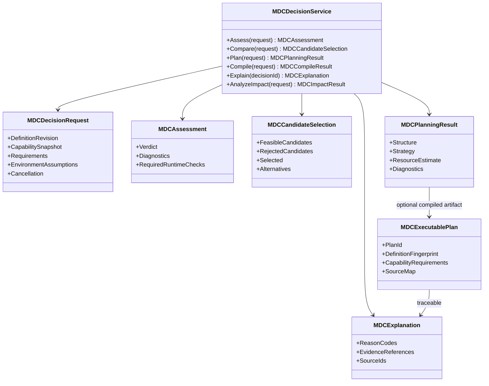
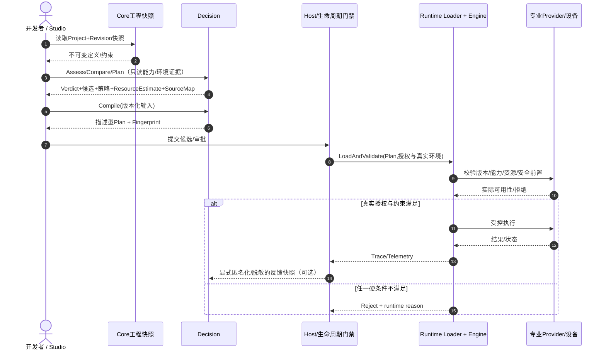
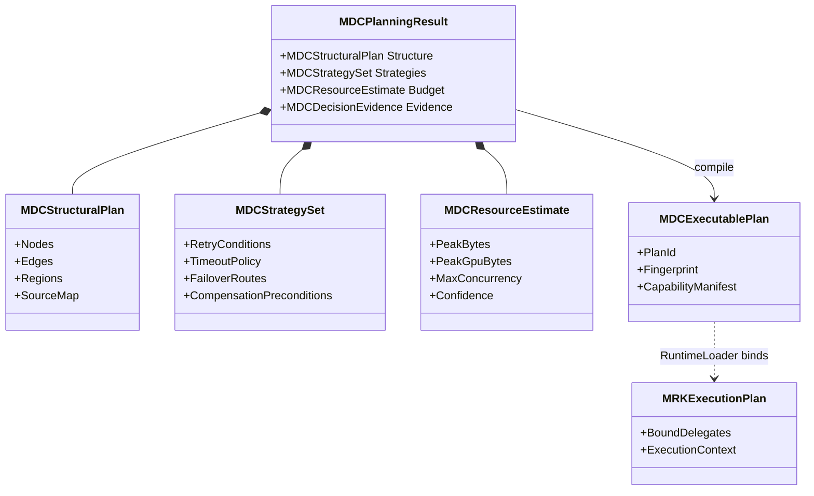
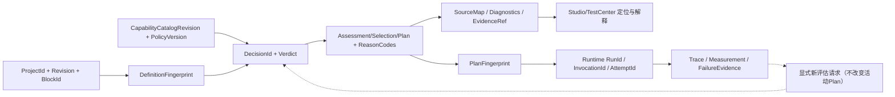

# CxVisual Decision——对象合同、开发者 API 与输入输出规格 V1.0

> 状态：**候选设计、尚非已实现 C# API**。已有真实 `MOCBuildService` / `MOCEngineeringCompiler` / `MRKExecutionPlanCompiler` / `MRKExecutionEngine` 可用，但**下列 MDC 前缀仅为待逐类实装的目标合同**。
> 设计依据：2026-10-28 Decision 裁决；主仓固定核对基线 `f081438986a201382167d95c1130ea9a284bd7e1`。
> 相关：[#0 总体架构](CxVisual_统一决策与规划体系%230总体架构与10大能力_V1.0.md)、[项目融合 ADR](../Decisions/CxVisual_Mechanism_Decision_项目融合与归属裁决_V1.0.md)。

## 一、先从开发者需要的最小调用反推

开发者不是只需要 `Build(...)`。他们希望分别询问：
1. `Assess(...)`：两个节点能否连接，为什么被拒绝，缺少什么条件？
2. `Compare(...)`：多个算法/模块/Provider 谁满足硬条件、谁更匹配目标？依据是什么？
3. `Plan(...)`：把多个任务怎样合理组合，哪些能并行，资源与回退策略是什么？
4. `Compile(...)`：需要工程执行时，生成与源定义可追溯且可复用的不可变计划。
5. `Explain(...)`：为什么选择或拒绝，修改某个参数会影响哪些节点？

**这些是候选能力入口，不是五个独立引擎，也不要求调用者依次调用五次。** API 可分 `IDecisionService` 简便入口与细分纯服务；不得为极简调用强制创建大工程对象或运行实例。

### 拟议用法 A：仅检查

```csharp
// 设计示意，MDC* 类在当前 master 尚不存在。
var assessment = decision.Assess(snapshot, request, catalog);
if (assessment.Status == MDCVerdict.Rejected)
    ShowDiagnostics(assessment.Diagnostics);
```

返回 `Allowed / Rejected / Unknown(NeedRuntimeCheck)` 而非简单 bool；错误有定位，无法静态证明时不能默认允许。

### 拟议用法 B：选算法 / 设备 / Provider

```csharp
// 设计示意，尚未实现。
var result = decision.Compare(
    objective, hardConstraints, candidates, capabilitySnapshot);
if (result.FeasibleCandidates.Count == 0)
    return RejectWithReasons(result.Diagnostics);
var chosen = result.SelectedCandidate;
```

关键：先筛硬约束（能力/版本/资源上限/权限/安全），再对可行集合做软目标排序；缺实测证据时标记为估计；可以给候选、备选与推荐，也允许返回“当前不可行”。

### 拟议用法 C：复杂工程生成执行方案

```csharp
// 设计示意，结果不是已绑定硬件/委托的运行实例。
var result = decision.Plan(snapshot, entryContentId, requirements, catalog);
if (!result.IsExecutable) return Explain(result.Diagnostics);
var artifact = result.ExecutionPlan; // 不可变；包含结构、能力要求、策略、SourceMap
runtime.LoadAndValidate(artifact, authorizedEnvironment);
```

Runtime 的真实装载 API 与合同迁移时再定；不能把上述示意当作当前 SDK。

## 二、对象分类与唯一所有权

| 层次 | 对象/合同 | 必备字段（候选） | 唯一 Owner |
|---|---|---|---|
| 定义输入 | `MEMProjectSnapshot` / `MOLLogicDefinition` | ProjectId、Revision、ContentId、Block/Port/Link、约束 | **Core 现有** |
| 能力输入 | `MDCCapabilitySnapshot`（目标） | CapabilityId、Schema/Version、参数及副作用声明、限制、来源版本 | Decision 消费快照；真实提供者 Owner 不变 |
| 环境输入 | `MDCEnvironmentAssumptions`（目标） | 资源容量/目标平台/已知约束、测量来源、时间和有效期 | Decision 请求级只读输入；实时状态不归其持有 |
| 问题输入 | `MDCDecisionRequest`（目标） | 目标、硬约束、软目标、候选、执行上下文标识、预算 | Decision |
| 判断输出 | `MDCAssessment`（目标） | Verdict、Facts、UnsatisfiedConstraints、Warnings、NeedRuntimeChecks | Decision 派生报告 |
| 选择输出 | `MDCCandidateSelection`（目标） | 可行候选、拒绝项及原因、权重/排序依据、选定与备选 | Decision 派生报告 |
| 策略输出 | `MDCStrategySet`（目标） | 超时/重试/恢复/降级/补偿约束、适用条件、风险 | Decision 制定；Runtime 执行 |
| 规划输出 | `MDCPlanningResult`（目标） | 控制/数据 DAG、资源需求、关键路径/并发建议、诊断、置信度 | Decision |
| 执行交接 | `MDCExecutablePlan`（候选名） | PlanId、Revision、源指纹、能力依赖、控制区域、数据合同、策略、SourceMap | Decision 不可变计划合同 |
| 运行中对象 | `MRKFlowHandle`、`MRKExecutionContext`、已绑定能力委托 | RunId、当前输入、状态、资源租约、Trace、取消状态 | **Runtime 现有** |
| 运行时数据 | MDS Frame / Heap / Stack | 值与版本、消费者、租约及结算 | **Mechanism.Data 唯一** |
| 结果反馈 | `MDCDecisionEvidence`（目标） | 输入版本、决策版本、原因码、实测与估计来源、追溯 ID | Decision 只读审计副本；运行 Trace 仍归 Runtime |

### 标识与版本契约

- 定义身份：ProjectId + Revision + ContentId + BlockId/PortId；不得产生第二份工程根。
- 决策身份：DecisionId + DefinitionFingerprint + CatalogVersion + RequirementsFingerprint + PolicyVersion；同样的输入与规则版本应能重现关键判断。
- 方案身份：PlanId + PlanVersion + SourceMap + CapabilityRequirements；方案可序列化的前提是**不包含 Delegate、活动 Worker 或设备句柄**。
- 运行身份：RunId/FlowId + InvocationPath + AttemptId/StepId；真实运行数据、已绑定委托和资源租约留 Runtime。
- 版本不匹配：加载与执行前再次检查；不得静默退回任意 Provider。
- 静态估计证据：值、单位、数据来源、样本时间、算法/硬件版本、环境假设及不确定性；严禁无来源的“能保证 10 件/秒”。

## 三、内部模块建议（**一个 DLL 内的代码目录**）

目标根：`Mechanism/Decision/`；最少先保留 `Properties/` 与真实的既有源码迁入目录。以下仅为功能聚类，不强制一次性创建空目录。

| 目录 | 应有内容 | 不得进入 |
|---|---|---|
| `Contracts/` | 公共判断结果、诊断、策略与 Plan DTO，版本协议 | MRKExecutionContext、设备句柄 |
| `Semantics/` | MOL/端口/规则纯语义解析与类型推导 | 第二套持久 MOL |
| `Validation/` | 可行性、依赖、Schema、版本、安全前置约束检查 | 实际执行/安全联锁动作 |
| `Evaluation/` | 目标、硬约束、候选、评分、成本与证据 | 直接调用专业算法执行 |
| `Planning/` | DAG/区域、能力组合、数据保留需求、协作及资源预算 | Worker/线程池/运行堆 |
| `Strategies/` | 超时重试降级候选及适用条件/合法性 | 实际定时器、重试执行器 |
| `Compilation/` | 工程转换、规范化、Plan 构建、优化 | 实例调度与 Flow 状态 |
| `Diagnostics/` | 结构化诊断、SourceMap、Explain、影响分析 | Runtime 实测 Trace 真源 |
| `Adapters/`（过渡） | 对既有 MOC API 的单向迁移外观 | 第二套长期编译实现 |

首期优先用已有 `MOCEngineeringCompiler`、`MOCBuildService`、`MOCCapabilityCatalog` 的可靠部分，按**实际拆分需要**增量迁移；不要一次批量造 30 个抽象接口。

## 四、面向开发者的质量合同

**验证和拒绝：** 不可行=拒绝；未知=需额外验证；通过=该版本/假设下满足已定义检查，绝不宣称现场绝对安全。

**方案选择：** 任何被硬约束淘汰的候选禁止进入 soft-score；没有可行候选就返回诊断，不选择“最不危险的违规方案”；给出每一项选择依据。

**策略：** 非幂等设备命令不得因为策略写着 Retry 就自动重发。执行前必须由 Runtime 和专业 Owner 确认许可，支持补偿但不能伪造原子外部效果。

**资源规划：** 容量、吞吐、关键路径分析只是估算与风险提示；决定是否真正分配、租约冲突、现场可用量由 Runtime/Host/专业系统负责。

**可复现：** Decision 对同一稳定快照及规则版本应产生等价确定性判断；随机优化必须有种子与算法版本；不能依赖可变单例和隐式设备查询。

**取消与预算：** 请求有时间/取消限制；耗时超限返回取消/不确定或失败，而非默认通过；后台计算无界队列禁止。

**可观测：** 返回多级错误码、严重度、Core ID、原因、可修复建议，配合 SourceMap 显示到 Studio；UI 可供人工审阅候选差异，不让 UI 隐藏硬拒绝。

## 五、Plan 与执行绑定要拆成两种物品

```text
Decision artifact（不含运行委托）
    CapabilityId / Contract / Version / DAG / Regions / Policy / SourceMap
                        ↓ 通过 Runtime.Loader 受控验证
Runtime bound plan（进程内，不保证可序列化）
    已解析的 ExecuteAsync / Context / Worker requirements / Resources
                        ↓
                 MRKExecutionEngine
```

现有 `MRKExecutionPlan` 与 `MRKExecutionStep` 含进程内执行委托，**不能直接宣称其为可移植、跨进程可序列化的最终 Plan**。第一阶段保留现有 API 与真实运行行为，并在设计中明确定义上面两类合同；迁移时逐条切割编译/绑定/执行职责。

## 六、成熟度分级与兼容

- L0：只判断 + 原因（结构、类型、版本）；不要求任何 Plan。
- L1：多候选选择、可行策略与资源预算；只需纯数据环境快照。
- L2：可执行方案编译、SourceMap、固定版本与测试回归。
- L3：基于现场历史实测的推演优化、仿真影响及建议，不自作主张控制设备。

保留原 C# 简单使用入口；图形化和代码式最终共用相同 Core 定义与判定结果。旧 MOC 类型的保留/废弃依 [迁移台账](../Migration/CxVisual_Decision_Logic与Orchestration融合及Runtime解耦_V1.0.md) 决定，**旧 API 不能在迁移计划表中被写成已经存在的新 API**。


---

# V1.1 对象合同与 SDK 实施级深化

> **合同状态：全部 MDC\* 类型及以下 C# 签名均为“拟议、待实装”，不能复制后假定现有 master 可编译。** 本文是 Decision API 的**唯一权威规格**。数值算法参考 [总体架构 D01～D10](CxVisual_统一决策与规划体系%230总体架构与10大能力_V1.0.md)，逐类迁移依据 [迁移文档](../Migration/CxVisual_Decision_Logic与Orchestration融合及Runtime解耦_V1.0.md)。固定取样 SHA：216963b009a94bfd2074defd0c7572fbb65a09bb。

## 1. 一眼看懂的对象关系（目标 UML，非实际类）



**属性名是字段语义，不是已存在的 C# Property。** Core 的 MEMProjectSnapshot/MOLWiringDefinition 保持定义真源，MRKExecutionPlan（当前含执行委托）保持运行内对象；新 MDCExecutablePlan 只能是明确版本化的纯描述。

## 2. 不可省略的基础字段与不变量

| 类型候选 | 必填字段与不变量 | Owner / 数据规则 |
|---|---|---|
| MDCDecisionRequest | RequestId、DefinitionReference（ProjectId/Revision/ContentId）、RequirementSet、CapabilityCatalogRevision、PolicyRevision、EnvironmentAssumptions、EvaluationMode、Deadline/Cancel | Decision 只读/一次性上下文；不偷偷访问 Studio 状态 |
| MDCConstraint | ConstraintId、Class=Hard/Soft、PredicateId+Version、Unit、Threshold、SourceId、Severity、EvidenceRequired | Hard 的 Unknown ≠ Passed；严格禁止将 PLC 联锁软件预测映射为 true |
| MDCObjective | MetricId、Goal(min/max/target)、Unit、Weight、Tolerance、Priority、EvidenceType | 软分数只允许基于同量纲归一及有界范围；目标冲突有诊断 |
| MDCCapabilitySnapshot | CapabilityId、ContractVersion、SchemaFingerprint、Input/Output、SideEffects、Idempotency、RequiredResources、OriginProvider、CapturedAt、ValidUntil | 专业/模块只供描述，Decision 不持有真实 DeviceHandle/Delegate |
| MDCEnvironmentAssumptions | Platform、Cpu/Gpu、MemoryCapacity、Bandwidth、DeviceProfile、MeasurementDistribution、Timestamp、Provenance | 静态/测量/模拟来源明确；过期返回 Unknown |
| MDCAssessment | Verdict=Allowed/Rejected/Unknown、ConstraintOutcomes、Diagnostics、RequiredRuntimeChecks、EvidenceRefs | Status 不能根据 Warning 自动变成 Allowed |
| MDCCandidateSelection | EvaluatedCandidates、Feasible、Rejected、Selected、Alternatives、NormalizedScores、ParetoFront、TieBreaker | 无可行候选时 Selected=null；所有 Reject 原因可复核 |
| MDCStrategySet | PolicyVersion、Timeout/Retry/Compensation/Failover、SafetyGate、ApplicableConditions、FallbackOrder | 只描述策略，不启动计时器/重试动作 |
| MDCResourceEstimate | PeakBytes、PeakGpuBytes、BandwidthBytesPerSecond、Cpu/GpuEstimate、MaxConcurrent、QueueBudget、ConfidenceInterval、Assumptions、Evidence | 所有预算带单位/样本；未测不得宣称保证 |
| MDCExecutablePlan | PlanId/Version、DefinitionFingerprint、CapabilityContractRefs、DAG+Regions、Policies、SourceMap、DependencyManifest、ArtifactFingerprint | 不可变，无 Delegate、Worker、Task、DeviceHandle、LiveMdsFrame |
| MDCDecisionEvidence | EvidenceId、SubjectId、SourceKind=Static/Measured/Virtual/Replay/HIL/Field、SnapshotFingerprint、CollectedAt、ValidUntil、Confidence、Metrics | 不允许以 Virtual 冒充 Field，不可用 Trace 直接改写当前 Plan |

**稳定判定规则：** Rejected 在任一已证明违反的 Hard 条件下成立；否则若有任何无法证明的必需 Hard 条件则 Unknown；仅全部 Hard 明确满足才 Allowed。硬拒绝优先级高于未知。副作用/认证/实机许可不可通过静态 Snapshot 最终确认，允许附 RequiredRuntimeChecks 而非“已授权”。

**指纹：** 使用规范化 UTF-8、字段排序、文化不敏感编码、确定算法与明确版本号；禁止仅靠 GetHashCode、反射枚举不确定顺序或当前时间生成逻辑结果。不得因一次无关 UI 坐标改动使非视觉的语义 Plan 不必要失效，具体指纹字段及兼容版须通过 golden 测试批准。

## 3. SDK 公开合同（C# 形状；目标设计）

```csharp
// 目标规范，尚未实现。建议保持 .NET Framework 4.8 / Task + CancellationToken。
// 单一门面仅为易用；核心计算器按职责组合，不制造十个引擎。
public interface IMDCDecisionService
{
    MDCAssessment Assess(MDCAssessmentRequest request,
                         CancellationToken cancel = default(CancellationToken));
    MDCCandidateSelection Compare(MDCComparisonRequest request,
                         CancellationToken cancel = default(CancellationToken));
    MDCPlanningResult Plan(MDCPlanningRequest request,
                         CancellationToken cancel = default(CancellationToken));
    MDCCompileResult Compile(MDCCompileRequest request,
                         CancellationToken cancel = default(CancellationToken));
    MDCExplanation Explain(MDCExplanationRequest request);
    MDCImpactResult AnalyzeImpact(MDCImpactRequest request,
                         CancellationToken cancel = default(CancellationToken));
}
// 所有请求各自承载所需最小上下文，不应强制用完整 MEMProject。
// 策略/资源/仿真可作为 IMDCDecisionService 的组合子服务，以实际复用需求决定是否公开。
public enum MDCVerdict { Allowed, Rejected, Unknown }
public enum MDCEvidenceTier { Static, Estimated, Virtual, Replay, HIL, Field }
```

### A. 单一判断：连接两个端口（不编译、不启动 Runtime）

```csharp
// 目标示意；接入现有 MPCPortDescriptor 与 MOLLink 合同需适配。
var request = MDCAssessmentRequest.ForConnection(
    sourcePort, targetPort, capabilitySnapshot, policySnapshot);
var result = decision.Assess(request, cancellationToken);
if (result.Verdict != MDCVerdict.Allowed)
{
    // Unknown 只能提示需要 RuntimeCheck；Rejected 展示明确错误位置。
    foreach (var d in result.Diagnostics) Report(d.Code, d.SourceId, d.Message);
}
```

### B. 多候选选择：先硬约束后软目标

```csharp
var comparison = decision.Compare(new MDCComparisonRequest(
    candidates: new[] { cpuReconstruction, gpuReconstruction },
    hardConstraints: new[] { volumeFormat, maxGpuBytes, safeLicense },
    objectives: new[] { latencyP95, accuracy, cost },
    capabilities: capabilitySnapshot,
    environment: measuredEnvironment), token);
if (comparison.Selected == null)
    throw new InvalidOperationException("无可验证可行候选；须显示 rejected/unknown 证据");
// Explain 能说明为什么未选 GPU，而不能仅回一个分数。
var choices = comparison.Alternatives;
```

### C. 复杂工程：只生成描述型执行方案

```csharp
var assessed = decision.Assess(MDCAssessmentRequest.ForProject(
    coreSnapshot, requirements, catalogSnapshot, environment), token);
if (assessed.Verdict != MDCVerdict.Allowed)
    return; // Unknown/Rejected 都不可自动发布
var evaluation = decision.Compare(
    MDCComparisonRequest.ForProject(coreSnapshot, requirements, catalogSnapshot, environment), token);
var planned = decision.Plan(MDCPlanningRequest.From(
    coreSnapshot, evaluation, requirements, environment), token);
var built = decision.Compile(MDCCompileRequest.From(planned), token);
if (!built.Succeeded) return;
// 以下 Runtime 接口也为目标设计：装载时执行许可、设备与版本复核。
var receipt = runtime.LoadAndValidate(built.ExecutablePlan, authorizedRuntimeEnvironment);
if (!receipt.Allowed) return;
runtime.Start(receipt); // 再按既有 MRK 生命周期与授权机制执行
```

### D. 资源规划、策略及影响分析

```csharp
var estimate = planned.ResourceEstimate;          // 含单位、证据与区间
var retryPolicy = planned.Strategy.Retry;          // 条件声明，不会执行重试
var impact = decision.AnalyzeImpact(new MDCImpactRequest(
    baselineDefinition, changedDefinition, catalogSnapshot, policySnapshot), token);
// impact.ImpactedSourceIds 用来在 Studio 高亮节点，并选取必要回归测试。
// 所有签名和字段待 P1 逐类型审核后固化；本示意不是现有编译通过代码。
```

**简单调用体验：** 最小请求仅传端口+ContractSnapshot+Policy，避免创建项目、Worker、Engine。**专业 API 直达体验：** 只需一次处理或由调用者完全控制处理逻辑的 SDK，可以直接调用 Vision/CT3D 或 MRK，Decision 为可选能力，而不是全局拦截器。

## 4. 运行交接与反馈时序（目标）



**执行侧真正生效的三道门禁：** 静态可行性只是第一道；Host/生命周期发布授权为第二道；MRK/专业实时状态与联锁为第三道。计划的静态版本签名不可替代工业现场安全 PLC / E-Stop。

## 5. 资源与策略的对象组合



## 6. 解释/溯源/增量影响（唯一追溯链）



**影响计算**：比较两个版本的定义、能力合同、策略及资源假设；从变更 BlockId/CapabilityId 沿依赖、数据流和受影响控制区域传播，得到 Changed/IndirectlyAffected/Unchanged；对隐藏外部副作用或未知依赖报告 Unknown，并触发保守回归集合，而非宣称完全无影响。

## 7. 扩展点、错误和并发合同

- **可插拔但有边界：** 允许纯 IConstraintEvaluator、ICandidateRanker、IResourceEstimator、IScenarioEvaluator 等候选扩展接口；每个实现声明 AlgorithmId/Version、可重复性、单位/时间来源和最大预算。禁止扩展点直接持有 MRKFlowHandle 或设备 DLL。
- **组合规则：** 同一评估请求含 Snapshot ID + Revision + CapabilityFingerprint + PolicyVersion + EnvironmentEpoch；不可变输入允许并行，任何随机算法需固定 Seed；同指纹同结果（排除与结果无关的耗时指标）。
- **取消与超时：** 被取消/预算超时必须返回明确 Cancelled/TimedOut 的不完成结果（不能通过）；中间缓存只保存成功且可重现的只读分析，单个请求不得永久占用共享锁。
- **异常与诊断：** 非法输入返回 ValidationDiagnostic；真实解析缺失返回 Unknown；内部程序错误不能伪装为用户规则拒绝；错误码/SourceId/Span/Severity/EvidenceRefs 可机器消费，可安全展示。
- **性能：** 流式处理声明元数据和摘要，禁止把 GB 级图像/Volume 原始数据复制到 Decision 做选型；对 100/1000/10000 节点记录 WallTime/CPU/PeakWorkingSet/AllocatedBytes/缓存率，目标阈值需通过固定硬件基准协定。
- **GoF/AOP：** Strategy 对“可替换的评分/估算算法”，Composite 对多约束规则树，Adapter 对旧 MOC，Decorator 对审计/限时/指标与安全日志；不得让拦截器改变判断结论或者增加第二个运行器。首期不因设计图单独创建 Manager/Repository/Bus DLL。

## 8. 开发者与 AI 实施门槛

P1 必须先交付真正可用的 Assess（无需 Plan/Runtime）、三态硬约束、诊断与 SourceMap；P2 后再开放 Compare/Plan/Compile 等入口；D07/D08/D09 若尚缺独立证据，只作为显式不支持能力/Unknown 返回，不得静默用常量模拟。所有已展示示例 API 名称在“逐类型源码映射 + Windows 调用测试”之前保持 **Proposed** 标签。
