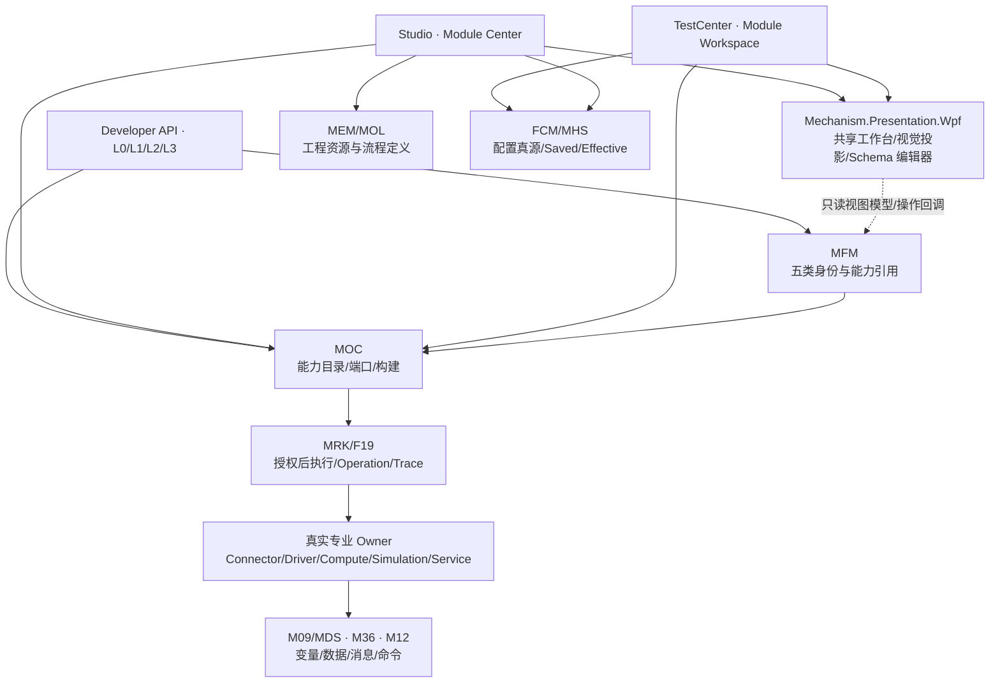
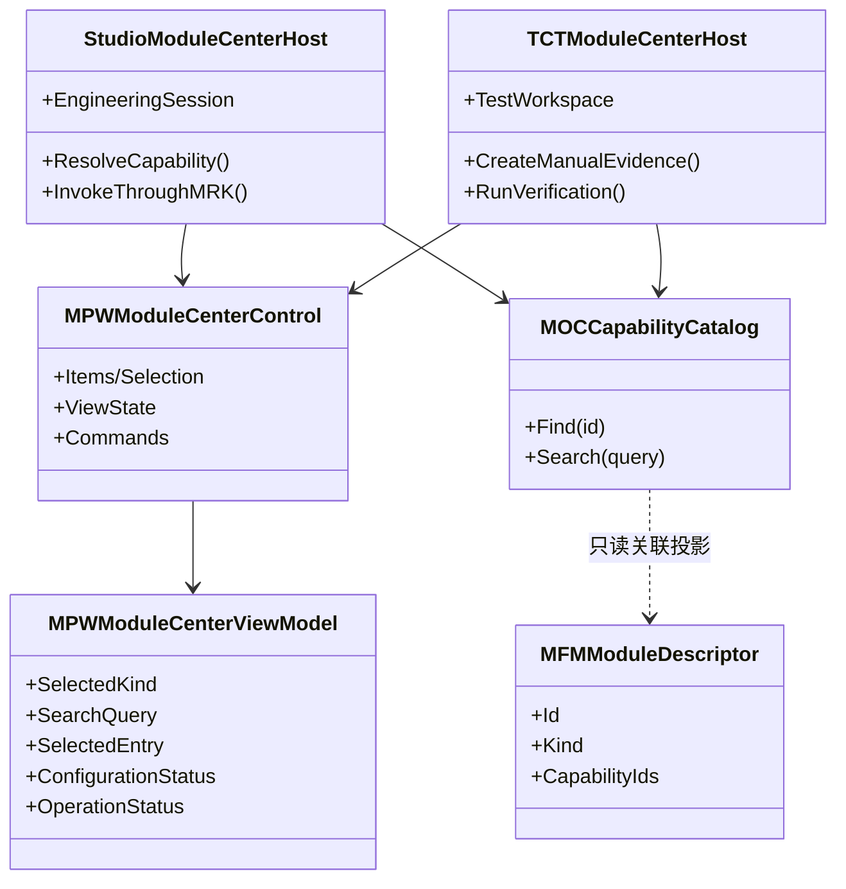
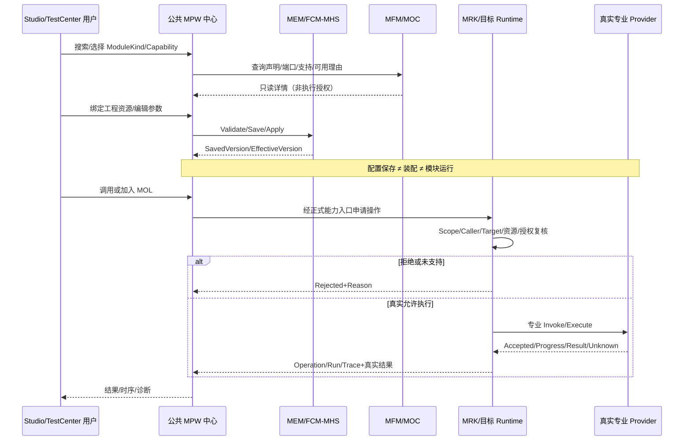

# CxVisual 统一功能模块体系——功能模块中心与三入口统一体验完整设计及验收 V1.0

> **状态：【正式实施目标设计，非已完成源码或工业验收】**  
> **日期**：2026-10-28  
> **审阅基线**：`cx-visual-x3/master@f69760ee39675ac7bbc6f9188dc0152fa75ae52e`（编写时已核对；并行 master 的新提交需实施时重新核对）  
> **适用**：Connector / Driver / Compute / Simulation / Service；C# Developer API、Studio 和 TestCenter。  
> **理念**：各方面都尽能力展现，便捷友好尽支撑各专业达到目标。  
> **同源基线**：统一功能模块体系 #0 V2.0、#1 Connector V1.0、#2～#5 专业 V1.1；DOCS/02～04；统一数据与交互 #0～#4；F17 Channel 最新 Owner、配置 V2.4、TestCenter 现有导航/控件规范。  
> **修改性质**：仅补充跨模块使用入口与共享界面的专项设计；不改变五模块分类、不更改专业文档原需求编号，不把 UI 变成第六模块或另建执行中心。此文是可复核的新增设计，未经 G1/G2/G3 证据不能写为实现。

## 00. 目标、三角色和不可突破的不变量（MC-I01～MC-I14）

功能模块中心（Module Center）是一个**组合式公共工作台 UI 与三入口使用合同**，用于回答“有什么能力、能否使用、如何配置、如何调用、结果怎样、为何失败”，而不是新的 ModuleManager/Registry、工程数据库、调度器或消息总线。

| 编号 | 正式约束 |
|---|---|
| MC-I01 | 固定五类：Connector、Driver、Compute、Simulation、Service；Channel、Protocol 是 Connector 机制，不独立增类。 |
| MC-I02 | 模块定义、Capability、工程资源、运行实例、Operation、数据句柄具有不同身份；列表可聚合但不得合并真源。 |
| MC-I03 | 依托现有 `MFMModuleDescriptor.CapabilityIds`、`IMOCCapabilityProvider`、`MOCCapabilityCatalog`、`IMRKCapabilityResolver`；不建第二套 ModuleCatalog/CapabilityCatalog。 |
| MC-I04 | 工程定义/资源引用归 MEM/MOL；FCM/MHS 是单一配置及 Saved/Effective 真源；MPW 仅显示和编辑。 |
| MC-I05 | 执行与编排归已有 MRK/F19，MOC 负责能力与构建；Service 不新建 Host/Scheduler/JobCenter；Simulation 不新建执行器。 |
| MC-I06 | Variable、Data、Message、Command 各由已批准 Owner 管理（M09/MDS、M36、M12 对应当前真实项目），模块可以 Produces/Handles 但不复制值库、Heap、Topic 或 Handler 真源。 |
| MC-I07 | WPF 只是显示、交互、投影；公共组件不引用专业设备 SDK、不直接持有 Socket/IntPtr/可变全局工程态。 |
| MC-I08 | 测试和生产使用**同一真实能力与结果合同**，TestCenter 可额外挂证据、断言、故障注入；不得使用假成功填空。 |
| MC-I09 | 声明/支持/运行可用/本次授权四种判定分开，`MOCCapabilityCatalogItem.RuntimeAvailable` 目前只是 Resolver 命中，不能当真实设备 Ready/授权。 |
| MC-I10 | 配置保存、Apply、模块装配、服务 Ready、命令 Accepted、物理执行 Verified 各有不同语义，不能使用统一“成功”绿灯代替。 |
| MC-I11 | 纯计算/普通业务函数可 L0 直接调用，无须模块实例、Host、工程文件或流程图。 |
| MC-I12 | 危险动作最终由目标 Runtime/Driver 重新校验授权、限位/硬件联锁；从 UI/远程服务发起不能绕开。 |
| MC-I13 | TestCenter 的四大根工作区及正式测试事实不改变；Studio 沿用现有菜单/Ribbon/AvalonDock 工作区，禁造独立 Module Studio 应用。 |
| MC-I14 | 不新增 .csproj、不做长期 Legacy/Porting Adapter、不重构无关专业代码；ReferTo 复用须先审计、后正式融合。 |

**体验评价**：开发者尽可能 0 样板的纯函数调用，工程用户不手写 DLL 类型全名/JSON/指针，测试人员能一键定位同一个真实 Owner 的正反测试证据。统一搜索必须同时允许从**能力**和**模块实例/资源**两条路径进入。

## 01. 已有源码事实与真实缺口（2026-10-28 仓库核查）

| 已核实文件和事实 | 当前能力 | 尚不能宣称 |
|---|---|---|
| `Mechanism/Core/Modules/MFMModuleContracts.cs` | `MFMModuleKind` 五类、`MFMModuleDescriptor` 的 Id/Name/Kind/Version/CapabilityIds、`IMFMModule` | 全量 Provider 安装/发现、Produces/Handles 四态、真实实例生命期已统一 |
| `Mechanism/Core/Modules/MFMModuleConfiguration.cs` | 公共名称、Enabled、CapabilityIds 的 FCM 配置基类 | 模块工程资源及实际运行管理已由此实现 |
| `Mechanism/Core/Modules/MFMModuleComposition.cs` | 类型化组合引用和无状态计算合同 `IMFMComputeOperation<TInput,TOutput>` | 自动装配/执行/事务闭环 |
| `Mechanism/Orchestration/MOCCapabilityCatalog.cs` | Provider 描述、Ports、Version、Find/Search、`RuntimeAvailable`(Resolver 可解析) | 实际 SDK/设备就绪、授权、结果执行一致性 |
| `Tests/TestCenter/Manual/Module/TCTManualModuleFrame.cs` | 五类模块专业分栏、MPW 动态配置、MHS Validate/Save/Apply/Reopen、草稿保护 | 启停、真采集、运行结果、设备 HIL 等已实现 |
| `Tests/TestCenter/Common/Framework/TCTWorkspaceRegistry.cs` | `manual.root→manual.module→manual.module.connector/driver/compute/simulation/service` 模板，复用一个 Frame | 五个独立专业执行工作台全部完成 |
| `Applications/Studio/MainWindow.xaml(.cs)` | 现有 AvalonDock、MOL 流程能力搜索，调用 MOC Catalog | 当前 `CurrentCatalog()` 使用 `SimulationResolver` 示例能力，不能宣称 Studio 已接入真实五类能力目录 |
| `Mechanism/Presentation.Wpf/CxVisual.Mechanism.Presentation.Wpf.csproj` | 公共 MPW 主题、配置编辑器、Viewer/FlowCanvas；依赖 Core/Data/Visual 等 | 目前无直接 Orchestration 专业依赖，不应让公共 WPF 控件生硬持有 MOC/专业运行对象 |
| `Tests/TestCenter/README.md` | 四根工作区、右键创建具体模块实例、Tab 复用与测试证据边界 | 创建导航节点不等于正式 MEM 模块资源、Device Connected 或真实 Passed |

**设计落点**：优先抽取 `TCTManualModuleFrame` 中可共用的“内容布局/专业分页/MPW 配置编辑/只读能力预览”，归入 `Mechanism.Presentation.Wpf`；MHS 会话、测试动作与证据仍由 TestCenter 装配，Studio 工程与运行装配由 Studio 使用既有 Owner 提供。**先抽取复用、再扩展运行；不平行重做 UI。**

## 02. 三个正式入口与能力等级（MC-E01～MC-E12）

| 入口 | 最短工作流 | 允许依赖的基础 | 最低交付 |
|---|---|---|---|
| **Developer API** | L0 纯函数→L1 专业 Provider→L2 暴露 MOC 能力→L3 工程/MRK 装配调用（按需） | 标准 C# 类型/Task/CancellationToken，已存在 MFM/MOC/MRK/FDT/MDS | 简单计算不需工程和模块实例；有状态 Driver/Service 显式资源配置、错误码与 Dispose |
| **Studio** | 全局模块/能力搜索→查看能力契约→工程新建/绑定→配置验证/保存/生效→装配→运行→观察/调试 | MEM/MOL + FCM/MHS/MPW + MOC/MRK + 专业 Owner | 真实目录/状态、适用操作和负例；能从 Module Center “加入流程”且复用 MOL |
| **TestCenter** | 专有测试→模块测试→选择/创建实际模块实例→复用同一 MPW 中心→配置/安全调用→测试/断言/证据 | 正式 Owner 与 TCT ManualSession/NUnit/ArchitectureSmoke/报告 | 同源界面与操作语义，更多注入/观测/黄金样本；“未实现/未测”不显示通过 |

任何三入口功能应按 **L0 已设计、L1 源码存在、L2 Windows 编译、L3 自动/人工测试、L4 现场 HIL、L5 长稳** 六项独立记事实。与体系 G0/G1/G2/G3 的对应：设计≈G0、软件编译/回归/测试≈G1、现场设备/系统集成≈G2、长期工业验证≈G3。不得把三入口“可见”写成“可调用”。

### 02.1 开发者用法与真实/候选签名的分界

**已有可用的纯 C# 方向（不要求工程 Host）**：

```csharp
// 普通业务计算独立测试；此代码是纯 C# 用法示例。
public static bool IsOverLimit(double value, double limit)
{
    return value > limit;
}
// bool ng = IsOverLimit(12.5, 10.0);
```

**现有 MOC 发现类用法（已存在的类型/方法，不表示真实 Provider 已装配）**：

```csharp
// providers: IEnumerable<IMOCCapabilityProvider>
// runtime: IMRKCapabilityResolver
var catalog = new MOCCapabilityCatalog(providers, runtime);
var matches = catalog.Search("Vision");
var ability = catalog.Find("vision.inspect");
// ability.RuntimeAvailable 只表示 Resolver 发现，不是设备 Ready/Authorized。
```

有状态专业 Provider 的 Start/Stop/Invoke/Dispose 采用现有各专业 Owner 的实际合同；统一能力向 MOC 提供元数据与可执行引用。不批准 `ModuleCenter.Run(object)`、新 `GlobalModuleManager` 或一个万能泛型总线。未来如补 SDK 便捷 Facade，必须只组合已有接口、没有自己的配置仓库/执行权/数据 Owner，并要源码查重后单独审批签名。

## 03. 统一界面导航、布局和交互（MC-UX01～UX25）

**入口**：Studio 主菜单“功能→模块中心”或工程资源树可关联资源的右键“打开模块”；TestCenter 仍走“专有测试→模块测试→五类模板→创建实例”，在 Tab 中装载同一公共工作台。建议通用页标题“功能模块中心 · Module Center”，始终包含当前 **工程/Scope、配置版本、运行目标、数据来源**。

### 03.1 页面信息架构

- **全局顶部**：标题、模块类筛选（全部/Connector/Driver/Compute/Simulation/Service）、统一搜索框（名称/CapabilityId/Category/TypeId/DeviceRef）、高级过滤（Declared/Supported/Available/授权需求、Real/Virtual/Replay、资源/实现状态）、刷新及最近操作。
- **左侧列表（可搜索、分组、虚拟化）**：“能力目录”和“工程模块/实例”两种视图；区分定义和实例；收藏/最近/按专业类别；条目显示图标、名称、类型、版本、支持/可用状态。
- **中间详情**：概览 / 能力与端口 / 配置与绑定 / 运行与结果 / 历史诊断；展示提供者、依赖、Produces/Handles、输入输出 Schema、运行实例的真实状态和操作结果。
- **右侧 Inspector（可折叠/停靠）**：当前选中能力或实例的字段、权限/危险副作用、资源预算、引用/端口类型、版本、诊断原因和快捷操作；复用现有 WPF 主题、Dock/Inspector，窄屏缩为下抽屉。
- **底部观察区（按需展开）**：Trace/状态变化/Operation 时间线、日志、性能、错误、取消/超时/Unknown 信息；图像/Volume/轨迹通过现有专业 Viewer 打开，不在中心重建渲染器。

### 03.2 参考线框（文字示意，非已实现截图）

```text
┌ 功能模块中心 / Module Center ───── 工程/Scope: A  目标: Real  [帮助] ┐
│ [全部] [Connector] [Driver] [Compute] [Simulation] [Service]      │
│ [搜索名称/能力/设备/TypeId........] [状态筛选] [分类] [+新建/绑定]   │
├ 左侧 目录/实例 ─────┬ 中央模块详情 ───────────┬ 右侧 Inspector ┤
│ ◉ 能力目录           │ [概览][能力][配置][运行][诊断] │ 身份/版本        │
│ ◯ 工程模块/实例      │ 名称、类别、描述、实现来源     │ 作用域/资源      │
│ ★ 收藏/最近          │ Declared/Supported/Available │ 参数/单位        │
│                     │ Produces/Handles            │ 权限/风险        │
│ Camera A            │ 输入→输出 / 依赖 / 结果      │ [验证] [保存]    │
│ CT Reconstruct      │ 模块专有可插入子面板         │ [加入流程]       │
│ Virtual Axis        │                             │ [调用/停止]*     │
├─────────────── 观察：Result | Operation | Trace | Log ─────────────┤
│ 仅显示真实已发生的事务；*运行按钮须完成授权、支持和可用门禁。       │
└────────────────────────────────────────────────────────────────────┘
```

### 03.3 五类专项页：同一骨架，按真实专业能力插槽呈现

| 模块 | 现有配置应直接复用 | 模块中心专业页目标 |
|---|---|---|
| Connector | Channel、Protocol、Protocol.Points、Mappings、ProcessingMode 等 | 通道连接与子通道会话、协议解析收发、点表与映射预览、接入质量/背压 |
| Driver | DriverTypeId、DeviceRef、Backend、InternalResourceRefs | 厂商 SDK/设备发现、参数/回读、触发/采集、硬件状态/联锁、FrameRef 与实际动作 |
| Compute | ProviderTypeId、Device、MaxConcurrency、MemoryBudgetMb、TimeoutMs、ExecutionGroupRef | 运行算法的强类型输入输出、模型/CPU/GPU、Preview/Golden、进度及资源统计 |
| Simulation | ModelId、ProviderTypeId、ConnectorRef、Mode、StepMilliseconds、Seed | 场景/模型、时间线、Step/Pause/Snapshot、故障注入、Real/Virtual/Replay/Hybrid 隔离 |
| Service | ProviderTypeId、DependencyRefs、StartupTimeoutMs、ShutdownTimeoutMs、MaxConcurrentRequests | 服务发现/依赖、Ready/Degraded、请求测试、队列/指标、Job/流及优雅关闭 |

“专业页”不另造五套 ConfigEditor。配置由 FCM 注解及 MPW 组件自动生成，若原有页面分组未覆盖新增字段，保留统一“扩展配置”页；专业观察控件按能力接口可选挂接。没有真实专业 Provider 时显示“待接入/不支持”，不要编造执行结果。

### 03.4 操作模型、便捷性与 WPF 人机要求

默认一级操作应是**搜索、查看、配置、验证、保存、加入流程、诊断**；直接运行、启动/停止、采集或输出控制是**有 Provider 且安全的上下文操作**，不一律显示可点。所有操作展示当前执行目标和作用域。

- 创建：先筛选 Capability/Provider（无状态能力允许只“添加能力引用”），再绑定必要 MEM 资源/FCM Section；不要为静态纯函数自动造工程顶层模块。
- 配置：所见字段由唯一 Schema 产生，强类型资源选择器/搜索、单位、默认值、校验提示、恢复默认、未保存草稿保护、保存版本与有效版本区别。保存成功只代表 Save。
- 装配：依赖图/冲突/缺失 SDK/不可用资源的静态预检查；已编译/可运行/已授权分别展示。
- 调用：快速测试可输入单能力参数并看详细 Result/Trace；复杂组合点“加入 MOL 流程”，不另建执行图；长 Job 显示 Ticket、Progress、真正 Finished 与 Unknown。
- 禁止把 UI 本地 Stopwatch、Mock 的绿色指示灯写成设备回读。危险命令提供资源/单位/目标/模式的确认上下文，必须后端再次校验。
- WPF：按既有 MPW 浅色/深色 Token、AvalonDock、键盘导航/焦点恢复、AutomationId 和 DPI 自适应；用 ListView 虚拟化和异步搜索，不能阻塞 Dispatcher；空/加载/缺权限/失败/无结果五种状态均有具体说明。右侧工具 Dock 与中央文档 Tab 的关闭/重开不能释放或删除 MEM 运行资源。
- 保存和执行操作不要重载相同“成功”颜色。至少区别配置已保存、配置已生效、Provider Available、Running、Completed/Verified、Unknown/Failed。

## 04. 三入口统一架构与现有 Owner 对照（MC-AR01～AR12）



- `Mechanism.Core.Modules`：已有 ModuleKind/Descriptor/Configuration/Composition；若扩展身份引用或能力关联，必须保持 MEM 工程真源与 existing CapabilityIds，避免第二份索引持久化。
- `Mechanism.Orchestration`：只有 MOC Catalog 等是真正能力目录；允许按需增加**只读查询投影**（关联 ModuleId/InstanceId 与 CapabilityId、Available 原因），但不储存第二份目录；其现有 `RuntimeAvailable` 只能说明 Resolver 已解析，不可代表授权或实际健康。
- `Mechanism.Runtime`：统一执行/取消/Deadline/Operation/Trace 与真正授权；Module Center 通过现有执行入口，不持有自己的永久队列/线程池。
- `Foundation.Data.Configuration` / `Mechanism.Data.Configuration`：FCM/MHS Schema、事务、版本和配置草稿真源。工程身份来自 MEM，UI 不直接持久化第二份 Resource。
- `Mechanism.Presentation.Wpf`：候选 `MPWModuleCenterControl`、`MPWModuleCenterViewModel`、通用分栏/卡片/Inspector/操作提示。这些**仅是表示和交互载体的候选名，不是已存在 API**；由于现有 MPW.csproj 不直接依赖 Orchestration/专业项目，推荐用轻量只读显示 DTO + 操作回调，由宿主装配 MOC/MRK，避免依赖倒置。
- `Applications/Studio`：将模块中心装入现有 AvalonDock 文档/Panel，使用现有工程会话、能力来源、MOL 画布和权限上下文；不可把 TestCenter 的测试会话/Mock 引进生产。
- `Tests/TestCenter`：`TCTManualModuleFrame` 保留测试入口、工作区实例与测试动作；重用 MPW 视觉/配置面板，扩展用例参数、测试证据、NUnit、ArchitectureSmoke。四根工作区及既有 `manual.module.*` 身份保持兼容。
- `Professional.*`：真实设备/算法/仿真/业务 Provider 层各自独立，静态算法、Frame、X-Ray、机器人控制、CT/Volume 和 Service 不强塞到 UI 项目。

### 04.1 公共 WPF 控件与宿主协作建议（概念图，不代表已有类）



**职责门禁**：上图 `StudioModuleCenterHost` / `TCTModuleCenterHost` 为拟议宿主装配角色，名字不是已存在类型；宿主只做 Scope/权限/调用代理和 UI 绑定，不能提供自己的 Catalog、Job 存储或设备状态机。已有 `TCTManualModuleFrame` 可先实现共享控件，不必一次性重命名/删除旧类。

## 05. 统一能力详情及 Produces/Handles 合同（MC-C01～C16）

每个能力详情必须回答：

1. **身份**：CapabilityId、版本、Category、ModuleKind、ModuleId/InstanceId、Provider/SDK/ABI、数据来源。
2. **能产生/能处理**：Variable、Data、Message、Command 四类，每类区分 Produces 与 Handles，绑定是否存在，明确 Schema/Type、单位、方向、容量和生命周期。
3. **输入输出**：强类型端口、Required/Optional、维度/颜色/坐标、结果 Quality、是否纯函数、是否有副作用、流/异步/批处理/同步、资源预算。
4. **状态四层**：Declared（静态声明）、Supported（当前 Provider 能力及版本技术支持）、Available（当前实例/依赖已装配且健康）、Authorized（本次 Scope、Caller、Target、Operation 是否授权）。
5. **当前运行动作**：Stopped/Starting/Ready/Busy/Degraded/Faulted 只用于有状态且真实支持的实例；无状态能力显示“可直接调用”而不是假“模块运行中”。
6. **结果证据**：Validated、Saved、Effective、Accepted、Submitted、BusinessConfirmed、DeviceApplied/Verified、Completed、Cancelled、Failed、UnknownOutcome，显示时间线、错误、OperationId/RunId/Trace。

| 项目 | 可做的 UI 预检 | 必须留给真正 Owner 做的终验 |
|---|---|---|
| Declared | 描述/配置/端口存在，Catalog 可检索 | 不等于 SDK 存在 |
| Supported | Provider 版本、能力要求和设备型号比较 | 真 Provider/SDK 初始化后确认 |
| Available | 运行目标/依赖/租约/健康查询 | Target Runtime 重新确认，不能缓存为永久权限 |
| Authorized | UI 可预览需要哪些权限/危险动作 | Target Runtime **每次**调用验证 Caller+Scope+Target |
| Result | 前端展示状态及进度 | Handler 的业务成功/硬件 Readback/CT 计算结果才能确定 |

**交互映射**：现有 MOC Ports 是能力输入输出的权威来源；四大交互的 Producers/Handlers 可用**只读投影或可选接口**描述，实施前查重，不新增独立 CapabilityManifest 真源。Mapping 属 Connector/数据绑定、Subscription 属 M36、命令 Handler 属 M12、执行追踪属 MRK。严禁把四种语义融成万能 EventBus。

## 06. 操作流程与错误/安全状态（MC-OP01～OP15）

### 06.1 通用创建、配置、运行流程



保存草稿时切换模块/关闭页，应复用现有草稿保护，不丢未保存内容；多个标签页不能以相同 ModuleId 跨 Scope 隐式串状态；自动刷新不能覆盖用户正在编辑的草稿。

### 06.2 各模块上下文操作及危险动作

| 类型 | 默认低风险操作 | 需条件满足才显示/启用 | 不得误导 |
|---|---|---|---|
| Connector | 连接配置检查、会话诊断、模拟/回环测试 | 真实 Connect/Send/WritePoint | Send/ACK≠外部业务确认；一个 Connector 只能绑定一个 Channel 与一个 Protocol |
| Driver | 查看型号、SDK、参数、状态 | Trigger/Move/Exposure/设备写入 | 禁将软件 Stop 当物理急停；动作完成要真实 Readback |
| Compute | 预览类型与参数、样本验证 | Invoke、GPU/AI/CT 作业、Cancel | 失败不能输出伪结果；纯函数无需启动模块 |
| Simulation | 模型/场景/时间/Seed 预览 | Initialize/Step/Pause/Replay/Fault 注入 | Virtual 不会自动回退 Real，模拟回读必须打标 |
| Service | 查看接口/依赖/Health/业务操作 Schema | Start/Stop/Request/Submit Job | Running≠Ready，Accepted Ticket≠业务完成 |

超时、断线、取消等待而无法证明目标终止时为 UnknownOutcome；**未知≠失败后自动安全重试**。所有操作记录 Source=Real/Virtual/Replay、Scope、Generation、Run/Operation、目标身份、输入/输出版本和权限决定；诊断不能复制未授权的大图/Volume 数据本体。

## 07. 质量、性能、安全与可观测性要求（MC-Q01～Q16）

- **搜索**：对现有 MOC 最多 4096 个能力的 Catalog 规模验证，关键词、类别/状态/版本过滤不阻塞 Dispatcher，建议设定参考环境 P95 交互响应 ≤200 ms（**目标阈值，需测量硬件与负载后定案**）；更大规模需分页/增量投影，不随意突破现有 Catalog 限制。
- **UI**：浅深色切换、100%～200% DPI、1280×720/1920×1080 的文字截断/Inspector Dock、键盘 Tab 顺序与自动化 AccessibilityId；搜索结果虚拟化。UI 中 >200ms 耗时工作一律异步或进度反馈，线程/UI Dispose/取消有泄漏测试。
- **配置**：FCM Schema 完整字段覆盖与唯一持久配置，Save→Reopen→Effective→版本比较；同名不同 Scope 和不同 ModuleKind 冲突拒绝，未保存草稿退出阻拦。
- **权限**：只读用户不出现可执行危险操作；用户许可和运行 Target 必须双重判定；真实设备/服务无授权操作的 Handler 调用数必须为 0。
- **多实例**：模块定义可复用，但设备租约/模型 Context/Run/Scope 隔离；跨进程只用明确 Bridge、共享资源权限与生命周期，不传原生指针。
- **资源与关闭**：查询和 UI 关闭不自动 Dispose 仍需工作的生产资源；真正 Stop/Dispose 通过专业 Owner 释放；过期 Generation 的回调/Trace 不能污染新运行。
- **诊断**：错误码、失败阶段、ModuleId、CapabilityId、InstanceId、Target、OperationId、RunId、CorrelationId、Version、时间、Source 等需可复制追溯；日志不能泄露认证信息/大型原始敏感数据。
- **稳定**：错误不会让 UI 丢失整个工程；崩溃后仅恢复已持久化的配置与真实结果；不虚构设备操作已完成、服务已 Ready 或算法输出已计算。

## 08. 端到端使用案例（MC-CASE01～CASE08）

| 案例 | 双角色工作路径 | 关键验收 |
|---|---|---|
| MC-CASE01 纯数值算法 | Developer 直接写函数/单测；Studio 从 MOC 搜索加入流程 | 无额外 Module 实例；L0 与 MRK 算法结果及精度一致 |
| MC-CASE02 X-Ray 采图 | Studio 绑定 Driver/探测器并配置、授权 Trigger、观察 FrameRef | 缺 SDK 显示不可用；真帧/触发/质量与 Data Owner、物理确认一致 |
| MC-CASE03 2D/AI 检测 | Driver FrameRef→Compute→MDS Result→Service/MES | 图像不随便深拷贝；多个输入输出、质量、Trace/Idempotency 正确 |
| MC-CASE04 CT Volume | Detector/Projection→Compute 重建→VolumeRef→Service 受控访问 | 几何/体素/版本、进度、超时/取消、数据 Lease 正确 |
| MC-CASE05 虚拟机器人 | Simulation 轴/机器人→MOL 流程→变量/消息/命令→真机目标重绑定 | Virtual 明示；转 Real 时重新授权且物理目标不被误操作 |
| MC-CASE06 Connector 多客户端 | 单 Channel/TCP Server + SubChannel + 单 Protocol + 点表映射 | 会话代次隔离、并发/背压、错路由拒绝 |
| MC-CASE07 Long Job Service | Submit→Accepted Ticket→Compute/MRK→Progress/BusinessConfirmed | Accepted/Completed/Unknown 区分；崩溃可恢复或明确 Unknown |
| MC-CASE08 Studio/TestCenter 同源配置 | 相同 ModuleId/Scope/Schema 保存、重开、移交 | 展示相同 Saved/Effective 数据、Capability 与结果，无双 Registry |

## 09. 详细可执行验收（MC-A01～A32）

| ID | 层级 | 任务、负例与通过证据 |
|---|---|---|
| MC-A01 | G1 | Studio/TestCenter 五种类型都可进入同一公共界面；源代码没有复制第二套专业 ConfigEditor。 |
| MC-A02 | G1 | MOC 查找多关键字、空串、非法字符、重复 CapabilityId、缺 Provider，结果与原 Catalog 一致。 |
| MC-A03 | G1 | ModuleId/CapabilityId/InstanceId/RunId 不混淆，展示 Scope 和版本。 |
| MC-A04 | G1 | 五类 Module 配置的全部 FCM Schema 字段覆盖，额外字段自动进入扩展配置，不丢失。 |
| MC-A05 | G1 | Save/Apply/Reopen 后保存版本、生效版本正确，操作前后无自动启动模块。 |
| MC-A06 | G1 | 切换/关闭未保存草稿被拒绝或经明确选择处理，重新打开与原配置一致。 |
| MC-A07 | G1 | 真实 MOC 查询的 RuntimeAvailable 不被误读为 Driver/Service 实时 Ready。 |
| MC-A08 | G1 | Declared/Supported/Available/Authorized 四态分别独立计算和展示缺失理由。 |
| MC-A09 | G1 | 不支持的专业操作按钮不可执行，且不能产生伪造 Result/Passed。 |
| MC-A10 | G1 | 参数 Required/Type/Unit/Dimension/Scope/Version 错误在真正 Handler 前拒绝。 |
| MC-A11 | G1 | 纯函数 L0 不启动 Host，MOC/MRK 能力选择后的结果与 L0 一致。 |
| MC-A12 | G1 | 一个能力多输入/多输出错误时，没有假完整成功、旧 Run 输出污染。 |
| MC-A13 | G1 | “加入 MOL 流程”使用现有端口/执行计划，Studio 不另建 ModuleFlow。 |
| MC-A14 | G1 | 用户禁用、授权不足或目标 Scope 不符时，命令/设备 Handler 调用数为零。 |
| MC-A15 | G1 | 配置更改为新版本，在途运行仍使用冻结版本，UI 正确解释。 |
| MC-A16 | G1 | 模块实例两份并行不串状态、配置、数据作用域、Trace 和订阅。 |
| MC-A17 | G1 | Stop/Dispose、关闭 UI、取消/超时竞态无死锁/资源泄漏；关闭 Tab 不误停生产工作。 |
| MC-A18 | G1 | 无 Provider / SDK 缺失、CPU/GPU 不可用、模型缺失、Service 未 Ready，准确诊断。 |
| MC-A19 | G1 | 假定 Provider Accepted 但未完成，UI 只能展示 Accepted/Unknown，不得 Completed。 |
| MC-A20 | G1 | FrameRef/VolumeRef 不可通过 UI 反射或日志深拷贝；失效 Lease 拒绝。 |
| MC-A21 | G1 | Studio 与 TestCenter 同一操作显示一致的错误码/阶段、RunId、Trace，不混伪证。 |
| MC-A22 | G1 | TestCenter 手动 Session 不被当自动 NUnit Passed；报告证据分别引用真 Run。 |
| MC-A23 | G1 | WPF UIA：菜单入口、Tab、五种类别、搜索、配置、加入流程、诊断及关闭草稿。 |
| MC-A24 | G1 | 深浅主题、200% DPI、键盘导航、隐藏/停靠 Inspector、1280/1920 分辨率截图。 |
| MC-A25 | G1 | 4000 能力查询、滚动、重复刷新及 UI 线程响应时间、内存峰值有实测报告。 |
| MC-A26 | G1 | 100 次创建/保存/重开/关闭、并发 UI 刷新、500 次查询后无非预期事件订阅/线程增长。 |
| MC-A27 | G1/G2 | 一个 Connector 仅一 Channel+Protocol；SubChannel 多客户端及 RS485 站号边界正确。 |
| MC-A28 | G2 | 真相机/探测器一次触发与连续采图，FrameId、设备时间、回读、丢帧与缓冲归还准确。 |
| MC-A29 | G2 | 运动/曝光 ACK 后断开实际确认，不能显示 Verified，也不能盲目重复执行危险命令。 |
| MC-A30 | G2 | 实际 AI/CT/Volume 的算法精度/设备/显存/服务数据合同达到专业 Golden 与范围。 |
| MC-A31 | G2 | Virtual/Real/Replay/Hybrid 切换与真实 MES/远程服务，授权和 Source 标记没有漂移。 |
| MC-A32 | G3 | 工业负载长期运行、压力/故障恢复、内存/句柄、操作 P95/P99、真实 HIL 与现场安全报告。 |

**TestCenter 分层结构**：Manual 真实操作页专注正确行为与观察；Automated NUnit/ArchitectureSmoke 运行可重复用例；Scenarios 用真实工程/设备组合；ReportCenter 保存人工与自动独立证据。公共中心只发起、显示与关联，不新建测试调度或结果真源。

## 10. 分阶段真实实施清单与依赖门禁（P0～P4）

| 阶段 | 最小可交付成果 | 不得提前宣称的能力 |
|---|---|---|
| **P0：共享视图及唯一能力入口** | 复用现有 TCT 模块专业分页、MPWConfigEditor；抽公共中心控件/展示 ViewModel；Studio 与 TCT 共用；MOC Catalog 搜索/选择与清晰状态；保留原 TCT 身份。 | 不宣传五类真实运行/设备 SDK 全已完成 |
| **P1：专业模块单能力真实闭环** | 先各选一个真 Owner：Connector 现有 Channel/Protocol 收发、Compute 真纯函数、Simulation 可重复 Step、Service 本地 Ready/Request；Driver 无硬件时只声明待 HIL。 | 不用 Demo/Mock 替代硬件执行 |
| **P2：四公共机制与权限/结果贯通** | Produces/Handles、Target Scope、端口 Schema、命令授权、MDS 引用与 Operation/Trace；Studio 加入 MOL。 | 不建万能 EventBus 或第二 CommandCenter |
| **P3：专业可用性和高级体验** | 设备/模型/资源选择器、生命周期/性能/故障页、专业 Viewer 插槽、结果预览和配置版本差异。 | 不以 UI 外观代替真实功能 |
| **P4：工业验收** | G1 Windows CI+UIA+并发/压力；G2 实机/跨 PC/业务对账；G3 长稳/安全。每次按 SHA 固化证据。 | 不把 G1 当 G2/G3 |

**严格依赖**：P0 首先保证真实 MOC 发现来源与 UI 绑定、两端复用、Schema 回归；P1 实际 Provider/运行 Host 需按 DOCS/02～04 核查 Owner；P2 全局四态和执行授权以真实数据实现；P3/P4 才形成工业级使用闭环。

## 11. OOP、GoF、AOP 设计原则与验收

- **OOP**：稳定的 `MFMModuleDescriptor`/`IMFMModule`/`IMOCCapabilityProvider`/`IMRKCapabilityResolver` 与可选专业接口；配置对象、运行对象、显示视图分离。继承只用于确有公共行为的基类，不强迫纯函数继承巨大 ModuleBase。
- **GoF**：Adapter 只用于必要的**当前专业 Provider → 已批准公共能力**的薄适配（不是长期 Legacy）；Factory 交由既有 Provider/配置创建机制；Strategy 用于运行后端/背压等专业策略；Observer 复用已存在 M36/状态订阅；Command 仅委托 M12；Composite 仅作界面组合或现有模块引用，不能复制 MOL 工程。
- **AOP（横切）**：Schema 验证、授权、Trace、时间/性能/错误、资源租约与审计应通过已有管道/装配边界统一处理，避免五个模块都写一份日志/异常/权限代码；不为了 AOP 发明第二套生命周期 Hook 或 AOP 容器。
- **依赖门禁**：`Mechanism.Presentation.Wpf` 不直接依赖 `Professional.*` 或设备 SDK，不通过新增 Orchestration 依赖制造循环；Studio/TestCenter 宿主装配能力投影；不新增项目与重复 Viewer。
- **失败注入**：Factory/Provider、运行网关、配置和 UI 订阅应能在自动测试中注入明确失败，不以空白数据或“成功调用了 Mock”宣称真实业务已完成。

## 12. 差距与验收台账使用规则

每项 MC-* 及原 UM/DRV/CP/SIM/SV 需求应有：正式文件/需求号 → 当前源码路径/行及 SHA → 是否实现 → 测试命令/Windows Run URL → G0/G1/G2/G3 证据 → 问题/修复 SHA → 最后验证日期。新设计文档存在只能标“G0 目标已明确”，不等于源码已经开发。更新总入口时关联本文件，但保留五类六份正式规范不变。

### 最先可实际落地的 P0 工作包

1. 保留 `TCTManualModuleFrame` 作为历史兼容的导航/测试包装；抽取共享 MPW 专业配置页面及表单逻辑，而非复制源文件。
2. 先给共享界面接入真实 `MOCCapabilityCatalog` 与合法工程/配置 Scope 的**只读显示投影**；去除 Studio 仅由 `SimulationResolver` 展示的假普遍可用性，示例能力明确标“演示”。
3. Studio 新菜单/Ribbon 入口在现有 AvalonDock 工作区打开共享中心；TestCenter `manual.module.*` 使用同一控件和现有 TCT 操作。
4. 验证双端搜索、五类 Schema、草稿保护、保存/生效版本、无能力/无 Provider/无授权、UIA/Theme/DPI；之后才增加真实操作按钮和专业 HIL。
5. 以中文提交记录一组可运行变化，附 Windows x64 编译、ArchitectureSmoke（默认与必要专项）、TestCenter/UIA 实际结果。没有日志不得宣称通过。

---

**完整交付定义**：一个开发者能用最少 C# 编写和导出能力；一个工程师能不读源代码地发现/配置/编排/运行真实能力；一个测试人员能复用相同界面而提交正反例与工业证据。三端指向相同的 Capability、配置版本、Runtime 和数据 Owner。理念是能力丰富、使用便捷、质量可信，而非页面与骨架数量。
