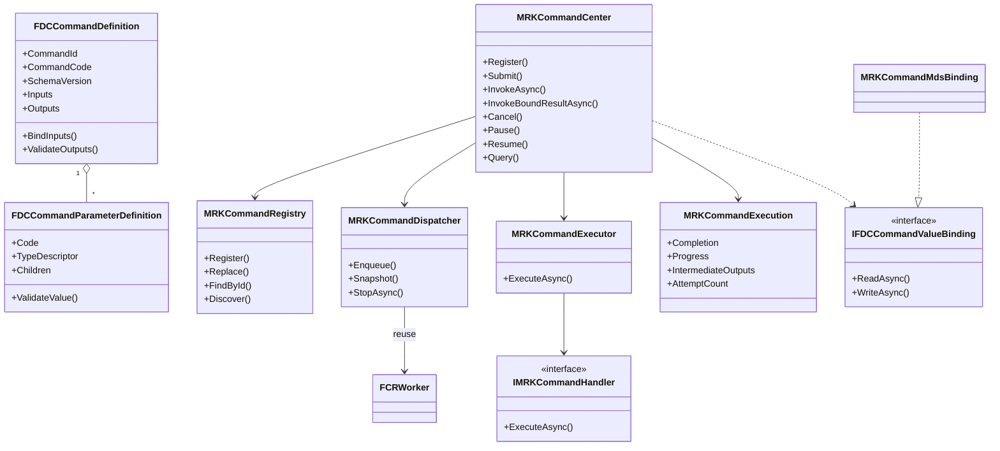
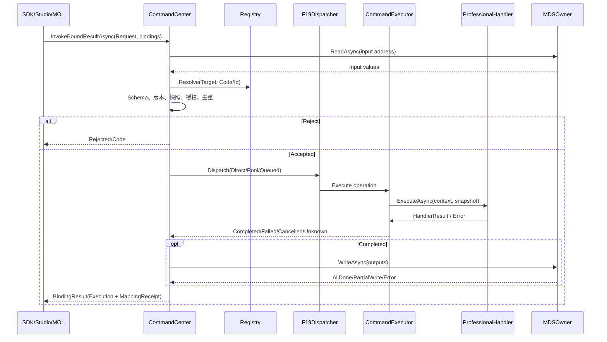

# CxVisual 统一命令中心——完整类架构与功能验收 V1.0

> **归档说明（2026-10-26）**：本文件保留原有版本、API和审计历史，五份统一主规范现以 [CxVisual 数据与交互体系 #4](CxVisual_数据与交互体系%234命令中心——完整设计与验收_V1.0.md) 为后续设计入口。本页不是新增独立权威版本；涉及旧Owner或旧SHA应以主规范及最新源码/CI复核。


> 2026-10-24；代码归属批准：命令**专属类**限于现有 `CxVisual.Foundation.Data` + `CxVisual.Mechanism.Runtime` 两个项目。
>
> 规则：**需求 ≠ 源码实现 ≠ Windows 自动测试通过 ≠ Studio/UI 或现场设备通过**。本文只认实际代码和对应SHA的Windows CI，未验证项明确标注。此文件作为统一需求/设计/差距导航，不复制第二套数据/调度/工程真源。

## 0. 基本原则

- Foundation.Data.Commands：无工程状态的 **Definition/Schema/Parameter、值复制、数据地址绑定接口**。
- Mechanism.Runtime.Commands：**Registry/Router/Center/Handler/Dispatcher/Executor、Request/Response、Operation、Policy、MDS绑定适配、执行观察**。
- Mechanism.Data 仍独占 MDS变量、点表、节点数据、DataHeap；本命令中心只通过 `MRKCommandMdsBinding` 调用。
- Mechanism.Runtime.Execution/F19 并发库仍负责已存在的Work、优先级、队列、Lease、Tracker与幂等重试策略。命令中心只复用，不复制。
- Mechanism.Data.Messages 的M36消息中心只发布/订阅。消息Topic不等于有授权和物理副作用的设备Command。
- Professional通过统一Handler插件实现设备、算法、CT、视觉、业务等动作；Studio、MOL、Host通过同一Center发起。不得在专业内部再建第二套Registry/数据中心。
- **设备硬件安全从不等于软件Command取消/暂停/超时/资源锁**。远程调用必须鉴权、版本一致、可审计与真实Transport；不允许伪装本地调用表示“远程完成”。

## 1. 两个项目、唯一源码目录

```text
Foundation/Data/Commands/                   -> CxVisual.Foundation.Data.dll
  FDCCommandDefinition.cs                   # FDCCommandDefinition/ParameterDefinition
  FDCCommandDefinitionCatalog.cs            # 定义目录只读快照
  FDCCommandValueSnapshot.cs                # IFDCCommandValueBinding、值隔离

Mechanism/Runtime/Commands/                 -> CxVisual.Mechanism.Runtime.dll
  MRKCommandContracts.cs                    # 请求、响应、Handler接口、Policy、运行票据等
  MRKCommandCenter.cs                       # 注册/路由/发现/提交/调用/取消/暂停/写回
  MRKCommandDispatching.cs                  # 真正Dispatcher与Executor，复用F19
  MRKCommandMdsBinding.cs                   # MDS变量/节点/FlowHeap地址读写适配
```

原Mechanism.Logic/MCE命令定义和Mechanism.Data/MDS命令绑定专属文件已迁移删除。原MDS真源及MOL逻辑体系**没有迁入**命令中心。

## 2. 真实核心类型、签名与边界

| 类型 | 现有关键成员/入口 | 责任与边界 |
|---|---|---|
| `FDCCommandParameterDefinition` | Code、DataType/TypeDescriptor、Required、Default、AllowNull、ReadOnly、Unit、Min/Max、FormatPattern、Children、ValidateValue | 入/出共用定义；嵌套命名Map验证，不提供第二个TypeRegistry |
| `FDCCommandDefinition` | CommandId、CommandCode、Name、SchemaVersion、Inputs、Outputs、PermissionKey、TimeoutMilliseconds、BindInputs、ValidateOutputs | **静态定义**，绝不能保存RequestId、运行结果 |
| `FDCCommandDefinitionCatalog` | Find(Id/Code)、Snapshot | 只读定义目录，不是工程持久真源 |
| `FDCCommandValueSnapshot` | Capture(values, adapters) | 有界递归复制/拒绝未知可变DTO；复用FDT Adapter |
| `IFDCCommandValueBinding` | ReadAsync、WriteAsync | Foundation只定义地址读写契约，不引用MDS实现 |
| `MRKCommandDescriptor` | Target、Definition、Kind、Policy、Capabilities | 目标与已发布定义及执行约束的组合 |
| `MRKCommandRequest` | Target、CommandCode或CommandId、RequestId、OperationId、Inputs、Caller、Options、ExpectedSchemaVersion | 一次调用请求；Caller仅审计提示，Host负责验证调用者身份 |
| `MRKCommandOptions` | TimeoutMilliseconds、Remote、Priority | 请求覆盖项；Remote目前明确拒绝，不伪装IPC |
| `MRKCommandRegistry` | Register、Replace、Find、FindById、Discover、SetEnabled | Target+Command唯一；同Target不可有重复CommandId，注册令牌隔离热更新代次 |
| `MRKCommandRouter` | Resolve、ResolveById、Discover | 查找唯一Handler；当前不跨进程 |
| `MRKCommandCenter` | Register、Replace、Submit、Invoke/InvokeAsync、InvokeBatchAsync、InvokeBroadcastAsync、InvokeBoundAsync、InvokeBoundResultAsync、Query、Cancel、Pause、Resume、GetMetrics、GetQueueSnapshot、StopQueueAsync、Dispose | **唯一进程内入口**；单播/广播/批量/绑定统一流水线 |
| `IMRKCommandHandler` / `MRKDelegateCommandHandler` | ExecuteAsync(context, inputs, cancellation) | 专业实现业务；接收独立输入快照 |
| `MRKCommandDispatcher` | F19 Worker封装；Snapshot、StopAsync | Direct/ThreadPool由Center选择，Queued复用FCRWorker的Key FIFO/跨Key优先级/有界预算 |
| `MRKCommandExecutor` | ExecuteAsync(operation, entry) | Handler调用、资源Lease、拦截、校验、结算；不是新Workflow引擎 |
| `MRKCommandContext` | RequestId/OperationId/Caller/Target/Descriptor、ReportProgress、ReportIntermediate、WaitWhilePausedAsync | 运行上下文；Paused仅在协作检查点确认 |
| `MRKCommandExecution` | OperationId、Completion、Snapshot、Progress、IntermediateOutputs、AttemptCount | 单操作票据；RequestId和OperationId分离 |
| `MRKCommandResponse` | Stage、State、RequestId/OperationId、Outputs、BusinessSuccess/Code、Error/Code、DurationMilliseconds | 受理/执行状态与业务返回分离，输出对外深快照 |
| `MRKCommandBindingResult` | Execution、MappingAttempted、MappingSucceeded、MappedAddresses、MappingErrorCode/Error | 写回可部分成功，不能把映射失败说成设备未执行 |
| `MRKCommandOutputMappingException` | Result | 旧InvokeBoundAsync抛错仍携带完整执行与写回事实 |
| `MRKCommandPolicy` | Dispatch、MaxConcurrent、ResourceId、SupportsCancellation/Pause、RetryPolicy | 约束策略；设备自动重试在Center受理前直接拒绝 |
| `MRKCommandMetrics` | Registered、TotalOperations、Queued、Pending、Running、PauseRequested、Paused、Completed、Failed、Cancelled、Unknown | 进程内账本快照，不是跨进程持久指标 |
| `IMRKCommandInterceptor` | BeforeAsync、AfterAsync | 可插入授权外额外审计/日志，后处理异常以Unknown暴露 |
| `MRKCommandMdsBinding` | BindVariable<T>、BindNode<T>、BindHeap<T>、ReadAsync、WriteAsync、Unbind、Dispose | 数据Owner仍是原MDS和VariableTable，本类仅地址映射 |
| `MRKCommandInputSource` | Parameter、Binding(MDSDataBinding) | 不复制数据类型，引用既有可配置MDS来源，预检后解析 |
| `MRKDedicatedCommandHandler` | ExecuteAsync + FCRDedicatedExecutor | 同步SDK固定线程调用、Host管理线程生命周期，不模拟异步线程亲和 |

> `Command` 是 Definition 与一次 Request/Execution 的逻辑总称；`CommandInput/Output` 是 Schema 与绑定后的字典值。**不为满足名称数目再创建两个重复数据容器**。

## 3. 类关系（实际代码）



## 4. 调用时序及四种结果



- **Accepted**仅说明进程内受理/排队，不保证执行成功。
- **Completed**说明Handler完成并输出Schema验证通过；BusinessSuccess可为false。
- **Unknown**说明调用观察超时或后置确认失败；真实外部副作用未必停止。
- **MappingFailed**只说明数据Owner写回失败；不改变之前已执行的设备/算法动作。
- **Paused**必须由Handler主动到达检查点，PauseRequested只是控制请求。
- **RemoteUnsupported**是真实返回，不是已具备跨进程/跨PC的证据。

## 5. 三种专业场景

### 5.1 算法（现有ArchitectureSmoke真实可执行场景）

```csharp
FDCCommandDefinition def = new FDCCommandDefinition(1001, "Double", "倍乘",
    new[] { new FDCCommandParameterDefinition("Input", typeof(double), true) },
    new[] { new FDCCommandParameterDefinition("Output", typeof(double), true) });
using (MRKCommandCenter center = new MRKCommandCenter())
using (center.Register(new MRKCommandDescriptor("Vision/Detector", def),
    new MRKDelegateCommandHandler((context, args, cancellation) =>
        Task.FromResult(new MRKCommandHandlerResult(
            new Dictionary<string, object> {
                { "Output", 2.0 * (double)args["Input"] }
            })))))
{
    MRKCommandResponse reply = await center.InvokeAsync(new MRKCommandRequest(
        "Vision/Detector", 1001,
        new Dictionary<string, object> { { "Input", 3.0 } }));
    // reply.State == Completed; reply.Outputs["Output"] == 6.0
}
```
此代码位于异步方法内；按需using System/Collections.Generic/Threading.Tasks、Foundation.Data.Commands和Mechanism.Runtime.Commands。算法调用与Schema/mapping/batch等已有真实ArchitectureSmoke测试；并不表示工业专业算法框架和Studio完整联调。

### 5.2 设备动作（仍需硬件Provider/HIL）

`Professional.Automation` 可按 `MRKCommandKind.Device` 注册移动轴/曝光等Handler，`PermissionKey` 配合由Host注入的可信授权检查，并复用MRK ResourceLease。Provider自己负责PLC/运控/相机协议、模式校验、硬件联锁、反读与急停；本中心禁止 `Device` 自动重试及默认广播。当前仅用模拟Provider验证拒绝路径，**没有实机动作或安全停机证明**。

### 5.3 MOL流程节点（集成待补）

流程节点端口通过已有MDS Scope与`MRKCommandMdsBinding` 映射到命令输入/输出，编译计划仍由MOC/运行MRK Owner管理，不建第二个Graph或FlowExecutor。当前节点/变量MDS读写模拟集成已测；真实Studio拖拽定义、构建、运行、调试及SourceMap的完整闭环仍单独验收。

## 6. 60项需求状态（按原编号合并）

| 原需求 | 已有可编译能力与对应Owner | 仍未完成/待实测 |
|---|---|---|
| 1–5 总目标 | Command/Handler/Dispatcher/Executor、进程内同步/异步/批量/广播、有界并发；双项目 | 跨PC实际Transport、性能长稳压测、统一专业覆盖 |
| 6–12 定义/发现/注册 | FDC Definition+Catalog、MRK Registry/Router、目标/类目/能力/ID/Code/版本查找、启停/替换令牌 | 工程发布治理、权限审计、持久目录、跨Host发现 |
| 13–18 输入结构 | 统一Schema；基本值/数组/命名Map、默认值、必填/可空/范围/单位/格式、子字段递归 | 类型约束全覆盖、复杂Graph Schema、动态Studio字段编辑 |
| 19–22 转换/绑定/所有权 | FDT Adapter、FDC有界快照、MDS变量/节点/Heap绑定、直传 | 跨机器稳定序列化/SchemaWire、表达式和流程Port完整自动绑定、复杂DTO正式Adapter |
| 23–27 输出定义验证 | 输入输出共用FDC参数模型、Output Schema验证、结构化返回快照 | 更丰富约束/DTO Codec、跨节点一致性事务 |
| 28–32 输出交付映射 | 同步/异步结果、进度/中间快照、MDS输出映射、独立MappingResult、RequestId/OperationId | 推送式进度订阅、跨Owner原子映射、完整Studio实时监视 |
| 33–38 调用分发 | Invoke/InvokeAsync、Batch、Broadcast、Target+Code/Id、Handler、Direct/ThreadPool/Queued | 指定线程亲和SDK的正式命令Adapter、真正远程调用 |
| 39–42 状态控制/关联 | Queued/Running/Completed/Failed/Cancelled/Unknown、优先级、并发、协作暂停/恢复/取消、超时、操作去重 | 持久化Correlation、异步远程应答、持久队列 |
| 43–46 异常可靠权限 | 捕获Handler异常、MRKExecutionPolicy幂等有限重试、设备禁自动重试、Host授权、Before/After钩子 | 策略化重试分类、真实身份信任体系、跨进程持久幂等/审计 |
| 47–55 核心类 | 表2真实类/API覆盖逻辑角色，避免重复Container和Graph | 持久化Schema兼容、更多专业增强接口；不强制为每个名词创建类 |
| 56–60 工程与验收 | 双项目归属，复用现有MRK/MDS/F19；ArchitectureSmoke/Windows Runtime TDD | UI完整、跨PC/HIL、性能、部署升级与资源长稳验证 |

## 7. 验收路径与门禁

1. `msbuild CxVisual.Unified.sln /t:Rebuild /m:1 /p:Configuration=Release /p:Platform=x64`。
2. `Output/Release/x64/CxVisual.Tests.ArchitectureSmoke.exe --command-center`：要求命令专项PASS。
3. `Output/Release/x64/CxVisual.Tests.ArchitectureSmoke.exe`：要求默认回归PASS；交互第一阶段亦可 `--interaction-stage1`。
4. 单独核对 `.github/workflows/unified-runtime-windows.yml` 最新固定SHA Windows CI、TestCenter UI Automation、Studio现场操作。**不得用上一个SHA的通过结果替代后续提交的验证**。
5. G2高压：多线程一致性、优先级公平、队列满/停机、重复Cancel/Resume/Replace、内存泄露/长时间稳定性，应安排专门跑。
6. G3/G4：真实设备/跨进程网络异常/安全联锁和UI双端闭环必须另行实测并保留证据。

### 下一步建议

P1已新增命令运行时MDS表达式/Port输入绑定与专用线程同步SDK Adapter（须以Windows对应SHA测试为准）；后续优先推进Studio真正可视调用；P2：可信身份/认证Transport与稳定序列化、远程恢复/持久审计；P3：跨专业、长稳、设备安全验收。**不拆散这两个命令项目**。

## 8. 后续增量：运行时MDS来源绑定与SDK同步线程亲和

新增的 `InvokeConfiguredResultAsync` 使用已有 `MDSDataBindingResolver` 将常量、节点Port、FlowHeap、变量、表达式及工程资源接到同一个命令Input Schema；通过现有 `IMDSExternalBindingResolver` 接入表达式和变量Owner。完整参数预检发生在外部解析器之前，防止错误端口触发副作用；输入和输出沿用既有快照和OutputMappingResult机制。空输出绑定无需虚构写回Owner。

`MRKDedicatedCommandHandler` 使用已有 F19 `FCRDedicatedExecutor` 执行同步工业SDK委托；只保证同步调用所在线程，取消不会强杀正在执行的设备动作，外部Host负责Executor关闭。两类适配均在 `Mechanism.Runtime.Commands`，不新增项目。

**仍然不是** Studio端到端参数面板、真实PLC采图与跨PC远程命令。相关测试只覆盖运行时源绑定与固定线程模拟SDK；实际结果以 Windows CI 为准。

## 9. Foundation.Data安全命令值格式

正式新增 `FDCCommandValueCodec`，提供受限 `Encode/Decode` 白名单值帧，拒绝任意CLR DTO和Native句柄反序列化。此类属于Foundation.Data.Commands，和MRK命令机制项目仍严格两项目归属；目前还没有实际跨进程/跨PC传输，也不得将wire值格式写为已完成远程命令。

## 10. 真实Windows IPC实现与能力边界

`MRKCommandPipeClient` + `MRKCommandPipeServer` 位于 `Mechanism.Runtime.Commands`，通过 `FDCCommandValueCodec` 定义的有界、安全白名单值帧传输Request/Response；服务端要求Windows当前用户ACL与另一个明确的OS调用者策略，禁止Caller字段伪造。命令中心配置 `remoteClient` 时 `InvokeAsync` 可选远程；`Submit` 仍仅本地同步受理，不静默转远程。支持远程 `QueryAsync(OperationId)` 并按原可信调用者授权。

`MRKCommandStage.Unknown` 是不可确认远端是否受理的新状态，防止连接故障被误认为拒绝或已完成。已加入真实命名管道回环专项（客户端/服务端在同一Windows测试进程中，使用OS管道）。**尚未验证两个独立进程、跨PC域/SMB认证、安全防火墙、远程持久状态/设备现场、任意自定义类型/大数据传输**；不得把这些写为完成项。

## 11. 两个独立Windows进程的命名管道协议测试

专项新增独立进程Host（ArchitectureSmoke.exe `--command-pipe-child`）：父进程/子进程经Windows命名管道完成带SchemaVersion的算法请求、结果关联和OperationId查询，避免仅用同进程回环代替IPC证明。交付证据依赖对应SHA的Windows CI。跨PC Windows域/SMB网络配置、硬件授权与重启持久化仍未验收。

## 10. 远程参数绑定的运行时契约

`InvokeConfiguredResultAsync` 支持 `Remote=true` + 注入真实`MRKCommandPipeClient` + `publishedRemoteDefinition`。不再要求客户端注册复制的Handler，也不为远端另建CommandRegistry。客户端以发布定义完成CommandId/Code/Schema和MDS输入/输出预检；入参复用MDS Owner，结果经IPC回来后写回本地MDS Owner；服务端以自己的正式定义和授权为唯一执行裁决。缺Transport或缺远程定义均拒绝，不通过消息中心广播或伪造本地运行冒充远程成功。

本机OS IPC通过及跨PC现场认证/断线设备状态追踪/Studio UI全闭环是不同验收等级；本轮测试以具体Windows CI SHA为准。

## 11. 远程连接的连接超时与消息交换超时分离

命名管道远程客户端具有`connectTimeoutMilliseconds`和`exchangeTimeoutMilliseconds`两个不同语义：前者约束连接建立，后者约束连接后发送帧和等待完整应答。失去应答统一视为`RemoteUnknown`或`RemoteExchangeTimeout`，不是命令失败或设备停机；远端继续由其Host、Tracker和设备回读确定真实状态，不经网络层盲目重发。测试覆盖远程“连接成功但保持沉默”的异常反证。
