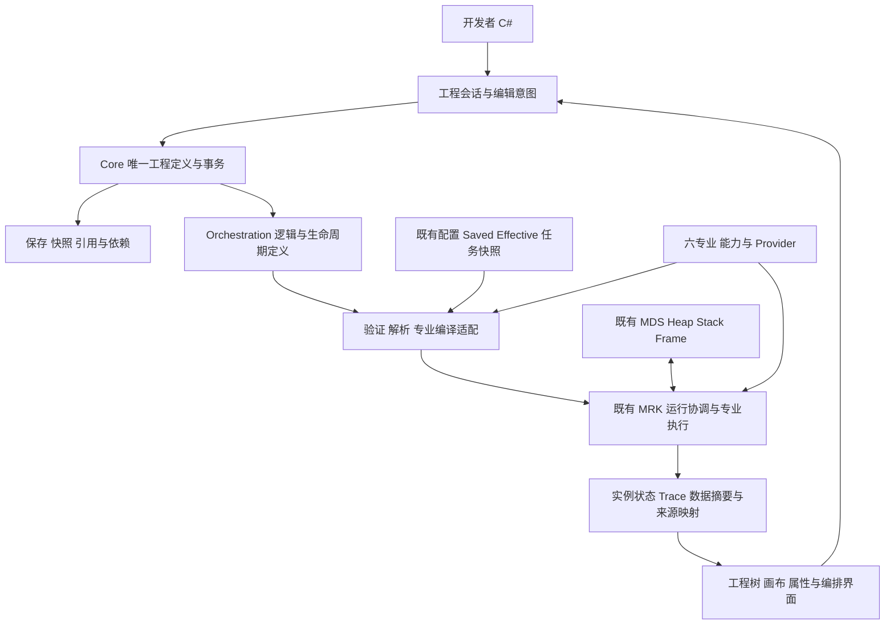
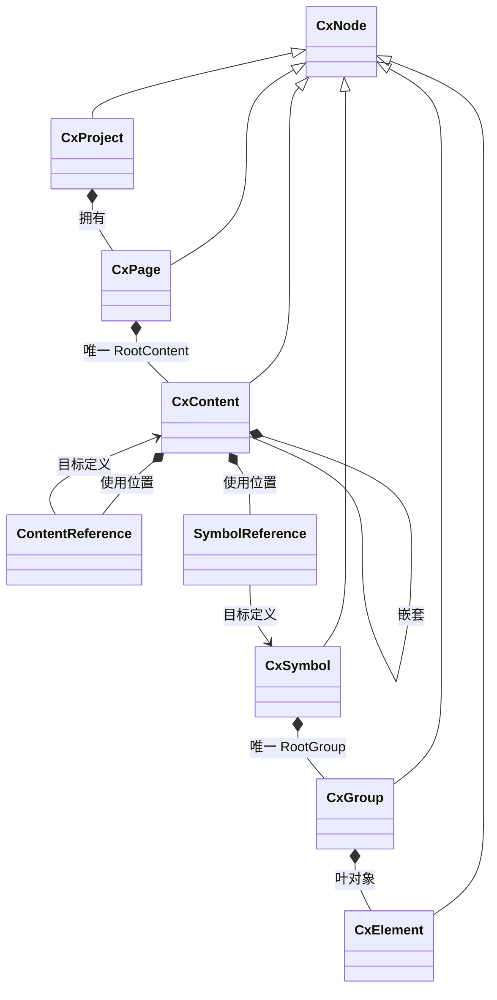

# CxVisual 统一工程组织体系：完整架构设计与开发使用指南 V1.0

> 日期：2026-10-17；主仓库：[oudream/cx-visual-x3](https://github.com/oudream/cx-visual-x3)。
> 源码审计基线：`master / 464b2e8d1575736a1885e01ac00a239e22f29c79`；已于本轮 fetch 核对远端 `origin/master / ebb9bb4`，并正常合并保留本地提交。提交本指南会产生新的文档 SHA；下列源码结论绑定此审计基线。
> 性质：**设计、实际 API 使用指南和差距审计的统一入口**。V1.0 是文档版本，不表示整个工程组织体系已实现、架构候选已批准或工业验收已完成。
> 变更范围：只编写文档和导航，不修改业务 C#、项目依赖、SDK、工程格式。已有未跟踪 V0.2 草稿保留，不将其中的 API 想象当作本次源码事实。

## 0. 先读：现在能做什么，怎样使用本指南

当前可以直接使用：六类节点的样例工程、矩形增删/改位置、基础内存批量事务、Undo/Redo、schema 1 XML 保存加载；可以独立使用现有配置服务、CPU Vision 检测，以及代码方式的 MRK 能力/流程/子流程和 MDS 数据能力。

当前不能据此认定已具备：通用新建多页面 API、唯一 RootContent/RootGroup 约束、共享 Content/Symbol 引用、一般属性/端口编辑、四 Aspect 持久化、工程到运行的完整翻译、六专业可视化编排、跨工程资源包、完整迁移发布和生产级恢复。**本指南能指导现有闭环的实际开发，并给出完整工程的目标设计与落地路径；在不改业务代码的本次任务中，不能将这些缺口伪装成可直接使用的 SDK。**

### 0.1 状态与证据

| 标记 | 含义 | 不代表什么 |
|---|---|---|
| 当前 API | 本轮实际源文件中有相应公开声明，示例注明其验证编号 | 不自动代表所有边界已测或现场可用 |
| 已实现（有限范围） | 有具体方法体及对应行为说明 | 不外推到所有节点、资源或专业 |
| 部分实现 | 核心行为存在，指定范围仍缺失 | 不能按完整需求验收 |
| 规划中 / 建议 API | 源码没有该入口，或本稿提出的契约设计 | 不可直接复制到当前程序集编译 |
| 待验证 | 尚无本轮对应行为/环境证据 | 旧 CI、旧仓记录不能代替本轮实测 |

文中的“目标规则”依据统一模型、V4.9 和工程规范；“建议”用于补齐尚未裁决的类型、交互与格式。当前源码与目标不一致时同时列出，不以任一方静默覆盖另一方。

### 0.2 阅读与入门路径

- 软件开发者：先读 §2 对象关系、§4 当前 API，再运行 §8.1/8.2；需要执行流程时读 §8.8 的独立运行示例。
- 工程编排用户：先读 §3 操作过程、§6 六角色、§8 案例；先使用当前 Studio 的矩形/保存功能，目标流程编辑器尚未完成。
- 专业开发者：读 §5 类型与扩展、§7 协同、§8.5～8.8；不要通过修改 CxNodeKind 或持久化 SDK 句柄接入能力。
- 维护者与审查者：读 §9 追溯矩阵、§10 兼容/冲突、§11 实测与自审、§12 来源及附录。

本指南包含必要概念、代码、目标结构和差距；外部文档链接用于追溯，不是理解案例的前提。

## 1. 目标、原则和整体架构

### 1.1 目标与明确边界

工程组织体系描述“工程是什么、由什么组成、引用谁、如何组合、使用哪个版本、怎样找到来源”。它为各机制及专业提供共同的工程身份、所有权、资源、编辑和持久化基础。

配置值与生效由 FCM/MHS/MVB 管理；运行数据由 MDS Heap/Stack/Frame 等拥有；编排定义由 Orchestration 负责；实际运行由现有 MRK/FCR 与专业适配负责。工程保存不等于配置生效、启动执行、设备接受命令或正式发布。

遵守既有 F/M/P、28 项目/135 子方面 Owner 规范。当前仓库结构脚本实际检查 31 项目，包含后续测试工程；本稿不据此修改产品项目规划或增加新项目。

### 1.2 必须保持的不变量

1. 只有一份权威工程定义；Parent/Children、引用和连接各有唯一存储位置。
2. `Project/Page/Content/Symbol/Group/Element` 是组织主线，**不是所有对象都必须穿过的强制六层链**。
3. 拥有、引用、调用、连接和运行实例分别表达；引用不转移目标所有权。
4. 图拓扑是同一工程逻辑关系的表达/编译投影，不再建第二套持久 Graph 业务树。
5. Definition → 固定快照/解析模型/编译制品 → Runtime；可变编辑对象不直接进入在途生产任务。
6. 四 Aspect 按需装配；简单符号不被强制附加逻辑、通信或运行实例。
7. 普通操作经过同一提交管线，界面不绕过结构/引用/版本/权限检查。
8. 专业保留算法、设备和执行语义；Core 不引用 Professional，Visual 不依赖 WPF/Runtime，运行可 headless。
9. 数据端口、控制推进、状态、事件、命令和流的语义可检查，不靠画布位置猜测。
10. 设计、声明、编译、自动测试、虚拟目标及真实设备验收分别记录。

### 1.3 整体架构图（目标职责，含现有部件）



以上为职责协作图，不表示 Core 直接引用所有框，也不表示图中的目标桥接已实现。实际 Core 只有基础节点/事务；Orchestration 当前项目仅有 AssemblyInfo。MRK 已有代码编排编译，但尚无持久 CxNode 工程到完整计划的桥接。

## 2. 完整工程组织模型

### 2.1 权威对象、从属记录与投影

| 对象 | 职责与目标成员 | 所有权/实例及生命周期 | 当前事实 |
|---|---|---|---|
| Project | 工程身份、资源/依赖登记、页面、共享定义及版本策略 | 工程定义根；不拥有设备活跃会话或产品运行数据 | CxProject 仅是 Id/Name/Kind 节点 |
| Page | 专业工作视图、尺寸/背景/导航、唯一 RootContent | 根内容归该页面；页面不是 Runtime 必需入口 | CxPage 无尺寸/专业归属/RootContent 属性 |
| Content | 业务组合、复用、作用域与逻辑边界；拥有子 Content、引用及视觉内容 | 可本地嵌套或作为共享定义被引用；运行时按使用链实例化 | CxContent 为空壳，允许部分拥有关系 |
| Symbol | 可复用视觉/语义模板；RootGroup、公开属性/端口 | 本身是定义；位置/参数差异属于 SymbolReference | CxSymbol 是普通拥有节点，没有共享引用或唯一根 |
| Group | 视觉组合、局部变换、选择/布局边界 | 只含 Group/Element；不冒充设备/业务作用域 | CxGroup 无变换等属性，基础包含规则存在 |
| Element | 叶对象的专业/视觉能力载体 | 不拥有其它工程节点；专业能力按类型/Aspect 扩展 | CxElement 目前只实现矩形 X/Y/Width/Height |
| ContentReference / SymbolReference | 某次使用、目标定义/版本、实例 ID、覆盖与映射 | 是拥有者下的从属引用记录，不复制目标 Children | x3 未实现；x2 有真实来源 |
| ResourceEntry | 可独立保存/版本化的资源身份、根地址或外部制品引用、依赖 | 登记不复制另一份业务内容；可不依赖 Page | x3 尚无通用登记和独立制品 API |
| Property/Port/Connection/Aspect | 对象的契约和能力定义 | 从属于同一工程，拥有者、版本和序列化明确 | 配置/运行端有相关契约，Core 通用模型未完成 |
| 工程树/Outline/画布/依赖图 | 不同任务的导航和投影 | 可重建，不独立保存可写业务真源 | 当前场景投影只遍历整个树的矩形 |
| Runtime Instance/Scope/Result | 某次执行的状态、数据与证据 | MRK/MDS/专业拥有，按运行和目标释放 | 存在内核实现；未完整映射至工程视图 |

### 2.2 包含、引用和实例图



组合实线表示拥有；关联表示引用。图省略共享定义的工程级登记、Group 嵌套及合法的视觉叶对象。Workbench 是专业工作环境/注册与导航上下文；旧设计存在其物理拥有关系争议，**本稿不将它增加为第七种 CxNode，不创建 WorkbenchRef**。目标以 Project 登记共享资源、页面携带 WorkbenchId 的方式继续裁决。

### 2.3 合法关系：目标与当前分开

| 关系 | 目标规则 | 当前 CxNode.Allows |
|---|---|---|
| Project → Page/共享定义/资源 | 允许；独立资源可以无页面 | 只允许 Page |
| Page → 根内容 | 恰好一个 Content；由合法创建动作自动建立 | 可有多个 Content 或 Symbol；不验证唯一根/非空 |
| Content → Content | 可嵌套，单 Parent，无拥有环 | 允许 |
| Content → 引用/Group/Element | 支持业务复用和视觉内容；引用有自己身份 | 当前仅允许 Content/Symbol 节点，无引用记录 |
| Symbol → Group | 恰好一个 RootGroup | 允许多个 Group；不检查恰好一个 |
| Group → Group/Element | 允许；只做视觉组合 | 允许 |
| Group → Symbol/Content | 不允许；需要业务组合时用 Content | 不允许 |
| Element → 任意子节点 | 不允许 | 不允许 |

**符号嵌套的正确用法**：通过嵌套 Content 组织多个 SymbolReference，或在 Symbol 的 RootGroup 内嵌套视觉 Group/Element。不能为满足“嵌套符号”而悄悄允许 Group 拥有 SymbolReference/业务子流程。若确需另一种符号实例包含语义，必须形成单独兼容裁决。

### 2.4 四 Aspect 怎样融合

| Aspect | 表达什么 | Owner 与使用方式 | 不能放什么 |
|---|---|---|---|
| Visual | 布局、几何、样式、显示状态/Viewer 绑定 | Visual 定义/投影，专业贡献渲染，WPF 仅适配 | 正在运行的控件、显存或设备句柄 |
| Logic | 流程、状态机、规则引用、触发和调用 | Orchestration/Logic 提供语义，按专业模型编译 | 另一套可写 GraphNode 树、不可序列化 Func |
| Data | 端口、Schema、绑定及作用域声明 | 数据/变量 Owner 解析，运行时注入 DataContext | 当前 Flow 的 Heap/Stack 内容和大型数组 |
| Collaboration | 跨对象/跨专业调用、资源/契约引用和边界 | 稳定 Capability/Resource/Contract 引用 | 对其它专业内部类、远端对象指针的直接持有 |

数据或逻辑专业可使用同一 Content 而没有视觉；一个状态灯可只有 Visual/Data。定义端只存“如何绑定/调用”，执行数据和当前状态留在实例侧。

### 2.5 工程树与逻辑图共存

工程资源浏览器回答“有什么资源”；对象 Outline 回答“当前资源内部拥有什么”；逻辑图回答“怎样推进和传数据”；运行视图回答“哪一次执行发生了什么”。同一对象 ID 在这些视图中关联，选择、查找、诊断能互相跳转。

树中第一个孩子不是自动先执行；布局移动不改变依赖；引用图不改变 Parent。SourceMap 应固定“资源/定义版本＋实例引用链＋节点/端口”到计划步骤的映射；再与 FlowId/WorkId 关联。重复使用同一模板必须能区分使用位置和运行次数。

## 3. 工程全过程、资源与一致性

### 3.1 创建、打开、编辑、保存、运行、发布

| 阶段 | 用户动作与体系责任 | 当前入口/限制 |
|---|---|---|
| 创建 | 选模板、名称/专业；建立合法根和必要占位；也允许无页面后台工程 | CreateSample 可用；通用 Create/AddPage/AddResource 待补 |
| 打开 | 校验格式/Schema/插件/依赖；恢复身份；未知内容保真；迁移显式预览 | Load 仅 schema 1 XML；不具备通用迁移或未知插件保真 |
| 编辑 | 准备草稿、预检影响、同一提交管线、形成历史/通知和未保存状态 | Element Add/Remove/Move；一般结构/引用/属性编辑待补 |
| 保存 | 固定指定工程修订，保存成功返回 SavedRevision；失败保持可恢复旧文件 | 同步 Save，有同目录临时替换；无 SavedRevision 结果及完整并发保护 |
| 运行检查 | 解析绑定，固定定义/配置/能力/目标版本，按模型编译 | MRK 代码定义可编译运行；工程 XML 不会自动转成流程 |
| 启动/运行 | 初始化、服务、产品触发、主/子流程；可查状态/数据/原因 | MRK 会话/触发/内核存在，完整工程生命周期桥接待补 |
| 发布 | 构建依赖闭包与证据，目标预检，授权 Stage→安全点 Activate，失败回退 | 有内存 Plan 发布/授权/版本租约；不是完整工程部署服务 |
| 关闭 | 处理未保存修改；释放创作订阅/草稿；按宿主策略处理在途业务 | 当前 Studio 更换 Editor；无完整工程关闭协调 |

新建、模板和导入都应进入同一结构校验；“保存了工程”“已编译”“发布被接纳”“版本已激活”“设备生效确认”分别反馈。

### 3.2 资源、模板、库和跨工程协作

Project 登记页面、共享 Content、Symbol、流程、模型、配方绑定、设备定义、标定等独立制品。内嵌 Element/ROI 等归宿主资源；普通值不因可选中就提升为独立工程资源。外部模型/静态文件可固定版本/散列引用；运行产生的图像/Volume/报告是数据或 Artifact，不复制进节点 XML。

- 模板：实例化生成新工程/对象 ID，并保留模板来源；模板占位不得伪造已连接设备。
- Symbol/Content 库：保存定义、公开成员、依赖和版本；拖入默认创建引用实例。
- 独立复制：重新分配所复制集合的 ID，重映射其内部引用；外部引用按明确策略保留/导入/拒绝。
- 提取复用：先预览公开属性/端口与外部连接，再建立定义并以引用替换原内容；整体可撤销。
- 跨工程：导入依赖闭包并检测 ID/版本冲突，或引用只读固定版本包；跨工程 Move 不能偷偷搬走来源工程资源。
- 协作：发布库/包是分发固定制品；多用户同时修改需要版本冲突与合并规则。当前 Revision 不是跨进程协作锁，不承诺在线共同编辑。

### 3.3 作用域与寻址

| 范围 | 可拥有/声明 | 查找与共享规则 |
|---|---|---|
| 工程级 | 全局资源、共享定义、依赖、配置身份绑定 | 稳定工程/资源/对象 ID；不使用进程全局 CurrentProject |
| 页面级 | RootContent、页面参数与导航上下文 | 页面切换不换对象身份；页面间调用用引用 |
| 内容级 | 局部名称、变量/资源可见性、公开边界、子流程参数 | 先按显式作用域和映射解析；私有成员不可由外部字符串穿透 |
| 对象级 | 属性、端口、专业能力绑定 | 稳定 MemberId/PortId；显示名可改，不是身份 |
| 引用实例级 | 目标定义、固定版、参数/位置差异 | 引用链确定使用位置；不写回共享定义 |
| 运行级 | Session/Flow/Frame、Local/Pending/Committed/Heap | 由 MRK/MDS 拥有；不从工程 Parent 链自动继承数据 |

建议地址含 ProjectId、ResourceId、ObjectId，必要时附实例引用链及 DefinitionVersion。新 x3 使用 Guid；x2 字符串 ID 显式映射并保留来源。物理资产 ID、部署目标 ID、产品 SN、FlowId 与工程对象 ID 分开关联。

拥有环、多 Parent、重复 ID 永远非法。展开型 Content 引用环应拒绝；变量反馈、状态机循环和资源依赖环按模型分别验证，不能把“所有环非法”推广到整个系统。当前 MRK DAG 不接受有环依赖，不等于状态机需求应被删掉。

### 3.4 编辑、历史、增量与线程

目标管线：领域动作 → 草稿/变更集 → 结构/引用/权限/版本检查 → 一次提交 → Revision/ChangeSet → 索引与视图。一次用户意图对应一个历史单元；拖动过程预览，确认时提交；取消预览不改真源。

Core 维护提交及逆变更，Visual M37 维护用户历史。当前 CxVisualEditor 仅记录经过其 Run 的操作；直接 Session.Apply 不自动入历史。应用不能混用多个 Editor 操作同一 Document 后仍假设历史总是正确。

当前 Commit 有 expectedRevision 检查，**没有线程同步/CAS 提交保证**；调用方须串行使用。同一内存树的逆操作补偿不等于数据库事务、跨文件原子保存或设备补偿。目标后台修改先计算提案，再在明确 Revision 上提交；冲突显示差异，不能覆盖新修改。

增量 ChangeSet 可用于通知、索引/视图刷新、历史和差异；当前 XML 每次全量保存。增量磁盘日志、崩溃恢复与压缩尚未设计实现，不能把 CxChangeOperation 列表直接称为可靠 WAL。

### 3.5 持久化、迁移和部署设计

当前格式：`CxVisualProject(schema=1, revision)` → `Node(id, kind, name)`；Element 另存 x/y/width/height。Load 禁用 DTD/XmlResolver，检查 schema，恢复六类节点并校验已有规则。没有引用、端口、Aspect、未知字段、资源版本和完整 Schema 迁移。

目标制品结构（建议格式，不是当前输出）：

```text
ProjectPackage/
  Manifest                   # 工程身份、格式版本、资源/插件依赖、散列
  Definitions/               # 唯一工程定义，内嵌对象随所属资源保存
  Libraries/                 # 固定版本引用或随包带出的依赖
  ConfigBindings/            # 配置身份/层级契约，敏感值使用既有 SecretRef
  Evidence/                  # 环境、Case、结果及证据引用
  Artifacts/                 # 可选编译/静态制品，体数据等按引用管理
```

格式和序列化策略仍需裁决；不在本次将 XML 改为 JSON。迁移按“读旧版 → 原件备份/散列 → 确定性 ID/成员映射 → 新版验证 → 临时输出/回读 → 明确切换”实施；未知插件保留原负载但阻断所需能力的运行；降级不支持时明确拒绝。

发布包固定工程修订、资源/插件/Schema、配置来源向量、编译器/模型/Provider、目标要求与验证证据。部署遵守平级 App-Vx.y 与独立 AppData，不把构建 Output 当成正式发布目录。回滚也生成可审计切换；在途任务保留原版，设备切换/Readback 由专业与授权边界确认。

## 4. 当前类、接口、枚举与真实 API

### 4.1 工程与编辑：逐类型核查

| 类型 | 当前公开属性/方法 | 真实职责与限制 | 源码 |
|---|---|---|---|
| CxNode（abstract） | Id:Guid、Name、Parent、Kind、只读 Children；Find(Guid)、Allows(parent,child) | Find 递归遍历；Attach/Detach 为 internal；不含 Ref/Aspect/资源索引 | [CxNode.cs](../../Mechanism/Core/CxNode.cs) |
| CxProject/CxPage/CxContent/CxSymbol/CxGroup | 各自构造函数 `(Guid id,string name)`、Kind；继承基类 | 五个 sealed 薄节点；new 对象不自动挂入工程 | [Core](../../Mechanism/Core/CxProject.cs) |
| CxElement | 构造 `(Guid,string,double x,double y,double width,double height)`；X/Y/Width/Height | 拒绝 NaN/Infinity 和非正宽高；SetPosition 为 internal，无公开 Resize | [CxElement.cs](../../Mechanism/Core/CxElement.cs) |
| CxNodeKind（enum） | Project/Page/Content/Symbol/Group/Element | 工程种类；不能替代专业 TypeId | [NodeKinds.cs](../../Mechanism/Core/NodeKinds.cs) |
| CxProjectDocument | Project、Revision:int；Commit(IList<CxChangeOperation>,int expectedRevision) | 批次逆序补偿/最终树验证；不处理通用资源、引用或授权 | [CxProjectDocument.cs](../../Mechanism/Core/CxProjectDocument.cs) |
| CxEngineeringSession | 构造(Document)、Document、Apply(operations,expectedRevision) | 仅转发 Commit；没有 Edit/AddPage/Open/SaveAsync/Watch/Close | [CxEngineeringSession.cs](../../Mechanism/Core/CxEngineeringSession.cs) |
| CxChangeOperation / CxChangeKind | Add(parentId,element)、Remove(id)、Move(id,x,y)；AddElement/RemoveElement/MoveElement | Move 是改坐标，不是 Reparent；操作没有任意属性写入能力 | [CxChangeOperation.cs](../../Mechanism/Core/CxChangeOperation.cs) |
| CxCommitResult | Success、ErrorCode、Message、Revision、InverseOperations；Reject(code,revision) | 无泛型 Value、Issues 集合或 ChangeSet；不能照抄旧稿相应成员 | [CxCommitResult.cs](../../Mechanism/Core/CxCommitResult.cs) |
| CxDocumentFactory | CreateSample()、FirstGroup(document) | 创建固定六层样例和两个矩形；FirstGroup 取全树第一个组 | [CxDocumentFactory.cs](../../Mechanism/Core/CxDocumentFactory.cs) |
| CxDocumentSerializer | static Save(document,path)、Load(path) | 同步 schema 1 XML；临时文件替换不是完整包/迁移服务 | [CxDocumentSerializer.cs](../../Mechanism/Core/CxDocumentSerializer.cs) |
| CxVisualEditor | Document、CanUndo/CanRedo、Scene；AddRectangle、Move、Remove、Undo、Redo | UI 无关；每 Editor 自己的历史；AddRectangle 自动选 FirstGroup | [CxVisualEditor.cs](../../Mechanism/Visual/CxVisualEditor.cs) |
| CxSceneProjection / CxSceneItem | Project(document)、HitTest(items,point)；Id/Name/Bounds | 将全工程 Element 平铺，不过滤当前 Page 或实例上下文 | [CxSceneProjection.cs](../../Mechanism/Visual/CxSceneProjection.cs) |

当前业务调用应检查 CxCommitResult.Success，并在失败时使用 ErrorCode/Message。代码不能调用 internal Attach、new 若干节点后假设已经形成工程，或将 AddRectangle 当作指定 Page/Group 的通用创建入口。

### 4.2 可协作的真实类型族

| 类型族/接口/枚举 | 已有入口与功能 | 必须保留的限制 |
|---|---|---|
| MRKCodeRuntimeBuilder / MRKCodeFlowBuilder | Capability、Capability<T>、CapabilityForRequest<TReq,TResult>、Flow、Step、Subflow、Add、Freeze、Build | 代码优先的进程内定义；不是工程文件存储 |
| MRKCodeRuntimeBlueprint / MRKDevelopmentRuntime | FlowIds、BuildForDevelopment、StartFlow、RunAsync、RunRequestAsync、StopAsync | 单引擎/Worker 复用；停止需 await；生产不绕过授权 |
| IMRKCapabilityResolver / IMRKFlowCompileCatalog | TryResolve、TryGet；Blueprint 实现两者 | 解析仍需契约/版本/Provider 上下文；不是完整插件目录 |
| MRKStepCompileRequest / MRKFlowCompileDefinition | 依赖、能力/子流程、输入、策略、资源/组、专用线程等 | 瞬时编译输入，不是新的持久节点树 |
| MRKExecutionOrchestrationCompiler / MRKExecutionPlanCompiler | Compile；递归子流程展开/诊断并编成既有计划 | 没有完整工程 Aspect → Catalog 的适配 |
| IMRKExecutionEngine / MRKExecutionEngine | Submit、StartFlow/带数据/控制入口、StopAsync | 共用 F19；不负责工业算法或硬件安全 |
| MRKExecutionPlan / MRKExecutionStep | 只读步骤关系、InlineSubflow；DataOutputs、EnableDataContext | 当前基础是 DAG 与声明的组合语义，不代表任意流式/状态机均可编译 |
| MRKInputSource（enum） | FlowInput/StepResult/**StepOutput** | 旧稿只列两项已经过时；StepOutput 通过显式绑定读具名输出 |
| MRKFlowHandle / MRKFlowResult | Completion、RequestCancel、GetSnapshot；State/Error/Results/CommittedOutputs/GetCommittedOutput<T> | 单结果 Results 与成功导出具名输出分别处理；取消请求不等于设备停止 |
| MRKExecutionPlanPublisher / MRKPlanPublishAction | CompileAndStageBlueprint/Orchestration、TryActivate、StageRollback；Stage/Activate/Rollback | 受保护软件 PlanSlot 的进程内发布，不是跨机台工程部署 |
| MRKRuntimeSession/FlowMetadata/FlowSnapshot/StepObservation | 会话接纳、产品/关联 ID、状态/等待原因 | Ready 不代表所有设备初始化完成；无完整工程地址映射 |
| IMDSDataContext / MDSDataContext | Get/TryGet、Set、Return、Search/Inspect、Heap/文件/转移入口 | Return 暂存，由 Runtime 确认成功后提交；不让普通节点手动提交 |
| MDSDataStack/Frame/Heap、MDEExecutionDataScope | Flow 已提交输出、节点 Local/Pending、显式 Heap 与 Scope 生命周期 | 不强迫每个输出经 Heap；DataSpace 是作用域协作概念，不增设另一数据管理器 |
| MDSDataBinding / MDSBindingSource / IMDSExternalBindingResolver | 常量、当前槽、节点输出、Heap、变量、工程资源、表达式 | 变量/工程资源/表达式转给既有 Owner；绑定对象不是新数据库 |
| FCMConfigReference / MHSConfigService / MVBConfigAtomicLayerProfile<T> | 配置身份、Open、编辑/保存/生效、层级合成与任务快照 | Saved/Effective/TaskPinned 分离，层级可自定义；工程不得重做配置服务 |
| FCRWorker/WorkHandle/DedicatedExecutor；FCRWorkState/FCROverflowPolicy | 调度、队列/等待、专用同步 SDK 线程及接纳策略 | 是基础执行能力，不变成节点的 Runtime 字段 |

代码位置和测试见 §9、§11；附录给出 Core/Visual 公开声明的源级索引。此清单不枚举每个无关配置字段或全部测试框架类型，以免掩盖工程组织接口的真正差距。

## 5. 目标类、接口与关键 API 设计

本节全部为**建议设计/复用方向**，不在本次生成 C# 文件，不改变既有架构。优先扩展当前类型；名称和完整 FQN/迁移别名仍需 Owner 裁决。只在存储、插件、专业校验、授权和编译等存在替换实现处建立接口。

### 5.1 建议的最小类型分工

| 类型/形态 | 唯一 Owner 与必要成员/动作 | 为何存在/如何复用 |
|---|---|---|
| 现有 CxNode 及六节点（扩展） | Core M01 的根/Page，M02 的 Content/Symbol/Group/Element；补合法根、只读完整枚举和按需能力 | 不再造 ProjectModel 平行体系，不为 Axis/FDK/AI 增加 CxNodeKind |
| CxReference（abstract）、CxContentReference/CxSymbolReference | Core M03 基础、M02 专用使用；引用 Id、TargetAddress、VersionBinding、覆盖 | x2 有真实对应类型；引用集合从属于拥有者，完整索引/事务/序列化都要包含 |
| CxObjectAddress/CxObjectHandle/CxResolveResult | Core M03；工程/资源/对象/引用链/版本；解析状态与问题 | 替代手写路径和可写实体长期引用；不复制物理资产或运行身份 |
| CxResourceEntry/CxResourceLifecycleDescriptor | Core M01 资源登记、M04 生命周期元数据；本地根或外部固定制品、依赖、Resolver/Compiler/Provider 契约 ID | 支持无页面工程；生命周期可直接使用/解析/编译/外部/共享，不强制一节点一 Runtime |
| CxAspectDefinition/CxUnknownAspect | Core M04 扩展承载；类型/Schema/宿主及未知原负载 | 具体专业字段归专业；仅存定义，不存活动状态 |
| CxObjectTypeDescriptor/CxPropertyDescriptor | Core M04；稳定类型/成员/单位/默认来源/约束/编辑提示 | 投影既有 FCM 类型/Schema，不再建第三套类型与配置系统 |
| CxPortDescriptor/Endpoint/Connection/PortMapping | Core M05；方向/基数/契约/端点/稳定 ID/公开映射 | 专业提供语义规则，唯一连接存储；State/Stream 可为 Data 契约，不机械增加线种类 |
| CxPropertyOverride | Core M02；MemberId 与显式常量/配置或变量绑定 | 只描述覆盖意图；实际参数来源/优先级由既有配置解析 |
| CxEditSession/CxProjectSnapshot/CxObjectSnapshot | Core M07 草稿、M01 工程快照、M03 对象查询快照；BaseRevision、变更/预检/提交 | 普通回调与长编辑共用草稿；快照不得暴露可变子对象 |
| CxChangeSet/CxEditResult<T> | Core M07；前后版、操作关联、前向/逆向与影响地址；泛型结果包装现有 CxCommitResult | 保留当前收据，不再同时引入 MutationReceipt/TransactionalMutation 平行入口 |
| CxSaveResult | Core M01；Success、SavedRevision、Location、Issues | 分开内存提交与持久化结果，保存旧快照成功不清除较新编辑的未保存状态 |
| CxIssue/CxValidationReport | Core M08；Code/Severity/Address/Member/FixHint/阻断阶段 | 结构问题阻断提交；未完成草稿可保存但不能启动依赖缺失的任务 |
| CxProjectIndex/CxReferenceResolver/CxNodePolicy | Core M03 索引/解析、M01 拥有策略；FindUsages/依赖/环/删除影响 | 派生、可重建，结果绑定 Revision；不为内部纯算法机械增加 I* |
| CxLogicAspect/CxLifecycleAspect/Binding/CxTriggerDefinition | Orchestration M18 拓扑/生命周期，M23 触发、M24 调用；逻辑 TypeId、入口、长期服务、主/结束流程、能力映射 | 挂接唯一工程身份，专业模型规则由 M19～M22 提供，不保存第二树 |
| 工程编译协调（候选 MRKEngineeringPlanCompiler） | Runtime M29；固定快照/实例展开、模型分派、SourceMap、依赖/目标检查 | 调用现有 MRK 编译器或专业编译扩展；不把全部专业压成一个 DAG |
| 现有 CxVisualEditor（扩展） | Visual M37；消费同一文档提交事实、管理历史/选择/导航 | Core 不引用 Visual；headless 可不挂历史，交互宿主每文档只有一个历史 |

非视觉叶能力仍可依附 Element 身份，但其几何应按 Visual Aspect 按需提供；不能要求每个逻辑步骤、纯数据对象都创建矩形坐标。当前 CxElement 的几何构造必须保留兼容入口，目标的身份/能力与几何分离须按 Core/Visual Owner 细化，不新增平行 StepNode 业务树。

### 5.2 真正需要的接口和枚举

| 候选接口 | Owner/输入输出与边界 |
|---|---|
| ICxProjectStore | Core M01：Load/Save 固定快照与制品位置，返回 SavedRevision/问题；适配现有 Serializer，支持文件/包和故障注入 |
| ICxObjectTypeProvider / ICxAspectCodec | Core M04：专业元数据与按 TypeId/Schema 编解码；类型描述关联默认定义工厂/模板和规则；未知类型保真；注册/卸载生命周期仍归 M40 |
| ICxValidationRule | Core M08：给定不可变快照和检查阶段，返回可定位 Issues，无设备副作用 |
| ICxEngineeringAccessPolicy | Core M01 契约、M07 提交检查：主体/动作/地址 → 决定，衔接现有身份和配置/运行权限，不自建角色数据库 |
| ICxResourceCompiler | Runtime M29：固定定义、依赖和目标 → 专业编译制品/诊断/SourceMap；公共制品载体与 CLR 签名仍待专业 Owner 共同裁决 |
| 现有 IMRKCapabilityResolver/IMRKFlowCompileCatalog/IMRKExecutionEngine | 继续复用，不创建 GUIExecutor、FlowManager、TaskExecutor 等第二入口 |

默认定义工厂只准备未提交的合法定义，由 Edit 统一采用和校验；不能直接写 Parent/List、注册活跃设备或启动执行。通用工厂的公共签名与创作上下文须由 M01/M40 和专业 Owner 共同裁决，当前不存在可直接调用的统一资源工厂 SDK。

候选枚举：CxReferenceKind(Content/Symbol/Variable/Resource)、CxReferenceStatus(Resolved/Missing/Stale/WrongType/ForbiddenCycle/AccessDenied)、CxPortKind(Data/Event/Command/Flow/Resource/Visual)、CxPortDirection(Input/Output/Bidirectional)、CxPortMultiplicity(One/Many)、CxIssueSeverity(Info/Warning/Error)、CxValidationStage(Structure/Save/Run)、CxAccessAction(Read/Edit/Save/Export)、CxLifecycleRole(Startup/Service/Main/Shutdown)。生命周期种类按架构宪法的 ValueObject/DefinitionOnly/Resolved/Compiled/Runtime/ExternalRuntime/SharedService 适配。

保留现有 CxChangeKind 数值/名称，按需要补 Reparent、SetProperty、Reference、Connection、Aspect 操作；不要把旧 MoveElement 重新解释为改变父容器。TypeId/CapabilityId/MemberId/错误 Code 可扩展，使用稳定标识而非“所有专业值”的封闭枚举。

当前工程 Revision 为 int，MRK 计划版和配置修订有自己的表示；保留各自兼容性并记录映射，不将它们合并成一个全局版本号。名称查询明确范围、大小写与歧义处理，不能以“取第一个同名对象”替代稳定身份解析。

### 5.3 建议 API：先保持简单，再按需展开

以下形状均**不存在于当前 CxEngineeringSession**。宿主加载/创建 Document、注入存储/策略/注册服务；普通业务只见一个工程会话和对象句柄。保留 Apply 的兼容路径，但所有新编辑、权限、引用与历史必须收敛到一条提交管线。

```csharp
// [建议API：签名草案，不能在当前程序集编译]
CxEditResult<T> Edit<T>(string intent, Func<CxEditSession, T> build);
CxCommitResult Edit(string intent, Action<CxEditSession> build);
CxEditSession BeginEdit(string intent, int expectedRevision);
CxObjectSnapshot Read(CxObjectHandle target);
CxProjectSnapshot GetSnapshot();
IDisposable Watch(CxObjectHandle scope, Action<CxChangeSet> observer);
Task<CxSaveResult> SaveAsync(CancellationToken cancellation);

// 草稿中的代表动作：
CxObjectHandle AddPage(string workbenchId, string name);
CxObjectHandle AddResource(string resourceTypeId, string name);
CxObjectHandle AddContent(CxObjectHandle parent, string name);
CxObjectHandle GetRootContent(CxObjectHandle page);
CxObjectHandle PlaceContent(CxObjectHandle parent, CxObjectHandle definition, string name);
CxObjectHandle PlaceSymbol(CxObjectHandle parent, CxObjectHandle definition, string name);
void Rename(CxObjectHandle target, string name);
void Move(CxObjectHandle target, CxObjectHandle newParent, int index);
void SetPlacement(CxObjectHandle target, double x, double y);
void SetOverride(CxObjectHandle instance, string memberId, object declaredValue);
void Connect(CxPortEndpoint source, CxPortEndpoint target);
CxValidationReport Preview();
CxCommitResult Commit();
```

SetOverride 的 declaredValue 必须先经过已声明类型/单位/显式性校验，不是任意反射写内部对象。Duplicate/ExtractReusable/Import 的参数策略应包含深浅复制、外部引用与 ID 映射；普通 Duplicate 默认新 ID，保留 ID 只用于受控恢复/迁移等明确场景。

Edit 回调同步准备草稿，不执行 IO/await/设备操作；会话拥有提交。BeginEdit 由调用者明确 Commit/Dispose。提交结果包含 Receipt、有效 Value、Revision 与 Issues；失败临时句柄全部失效。观察回调在写锁外执行；通知失败记录为刷新错误，不偷偷回滚已经发布的事实。

## 6. 六种角色：期望、操作、能力与差距

### 6.1 R1 软件开发者（重点）

| 期望编号 | 期望与操作 | 必需能力 | 当前差距/可用替代 |
|---|---|---|---|
| D01 | 一份小程序创建工程，少依赖即可开始 | 合法工厂/模板、headless 会话 | 目前从 CreateSample 或 XML 导入开始 |
| D02 | 选目标页面/容器后添加对象 | 类型化句柄、AddPage/Add/目标校验 | 只能 FirstGroup 的 AddRectangle；不能指定页面 |
| D03 | 批量修改全部成功或全部失败 | Edit/事务/预检/结果 | 仅 Element 三种操作有批次补偿 |
| D04 | 自然查询、重命名、移动、复制 | Read/稳定地址/索引/克隆/引用重映射 | Find(Guid) 有；重命名/Reparent/Clone 缺失 |
| D05 | 复用组件并隔离实例差异 | 定义/引用/覆盖/公开接口 | x3 Core 无对应实现 |
| D06 | 连接公开输入输出而非操作内部 List | 端口/连接契约与作用域 | 运行端端口存在，工程端未形成闭环 |
| D07 | 代码和界面编辑能接续 | 单定义、共同提交和历史 | 仅当前 Editor 的基础操作可共用 |
| D08 | 保存加载不丢身份/扩展 | Snapshot/Store/Schema/回读检查 | 节点/矩形 XML 可用，扩展保真不足 |
| D09 | 普通业务直接调用或简洁运行 | MRK Builder、typed request、结果处理 | 独立代码流程可用；不能自动保存成工程 XML |
| D10 | 普通数据只用 Get/Set/Return | 运行注入 Frame、端口绑定与输出提交 | MDS/MRK 已有；工程参数选择器未完整接入 |
| D11 | 后台生成/修改不覆盖用户新编辑 | 明确 Revision、串行提交/冲突 | 当前需调用者自行串行；无后台草稿合并 |
| D12 | 错误能处理，资源/订阅能释放 | Issues、关联 ID、Scope/Stop/Dispose | 运行有 Handle/Trace；Core 仅字符串错误 |
| D13 | 示例可复制、可编译、可自动回归 | 完整 using/引用/命令、失败断言 | 本指南提供当前示例并报告实际验证，目标示例不伪装 |
| D14 | 项目/插件升级有明确兼容路径 | 依赖/Schema/迁移和未知类型保真 | 当前 Core 缺完整实现 |

推荐过程：先跑 §8.1 的基础工程 → §8.2 保存/修改/重开 → §8.8 的独立运行 → 将需求对应 §9 缺口，不从不存在的 Edit API 开始排查编译错误。

### 6.2 R2 专业能力开发者

期望：业务实现一次；提供稳定输入输出/参数、版本和错误；声明设备/内存/GPU/线程/取消/真实完成约束；允许 C++/Go/远端服务适配，不强制重写；提供专业编辑与编译、虚拟 Provider 和边界用例。

操作：实现算法或 Provider → 声明契约/版本 → 注册能力/类型/规则 → 代码运行验证 → 接入工程资源/端口/专业编译 → 保存依赖及真实证据。算法事实与 Inspection 最终判定分别输出。

当前可用：MRK Capability/Resolver、专用 SDK 执行器、配置 Schema、Data Adapter/FileLoader、CPU Vision 类。缺口：Core 通用专业 Type/Aspect/端口/资源注册、完整专业编译制品契约、插件生命周期及工程界面消费。普通对象包进 Func 或可序列化 object 不等于专业能力已完整接入。

### 6.3 R3 工程编排用户（重点）

| 期望编号 | 实际操作与期望反馈 | 当前情况 |
|---|---|---|
| E01 | 打开总览看入口、主阶段、长期服务和异常出口 | 尚无完整工程总览/生命周期视图 |
| E02 | 从模板创建，只填业务必要项 | Studio New 创建固定样例 |
| E03 | 按业务搜索能力，查看端口/参数/依赖 | 未有完整能力库和专业资源浏览器 |
| E04 | 拖入、放置、连线、填参数 | 矩形添加/拖动有；业务端口/连线缺 |
| E05 | 设置主/子流程、条件/并行/等待/触发 | 内核有部分能力；真实 Flow 编辑 UI 未完成 |
| E06 | 看到参数来源、单位、数据质量和覆盖范围 | 配置编辑有部分能力；与工程对象关联未闭环 |
| E07 | 分清引用、复制、实例参数与共享定义 | Core/素材交互待实现 |
| E08 | 修改前预览，随时取消/撤销/重做 | 基础矩形历史可用；一般结构/影响预览缺 |
| E09 | 未完成也能保存；问题可定位；重开继续 | XML 节点保存可用，复杂草稿/未知插件缺 |
| E10 | 用样例/虚拟目标验证，真实运行前检查目标 | 代码/测试有虚拟行为；工程级目标选择未完 |
| E11 | 选择一个产品实例，看运行位置/等待原因 | MRK 观察存在；工程叠加和实例导航缺 |
| E12 | 超时/失败后知道能否重试/续跑/停止 | 内核有策略/取消/补偿；生产恢复语义要专业确认 |
| E13 | 改参数看清保存/生效/在途版本 | 配置有对应机制；工程版关联与 UI 未闭环 |
| E14 | 打包交给同事，能定位缺依赖/升级影响 | 当前无完整工程包/交接/部署 UI |

目标过程：模板 → 无页面资源与页面 → 放置共享组件 → 端口/参数绑定 → 整体流程 → 问题列表 → 样例运行 → 实例定位 → 目标预检/授权发布 → 交接。默认只展示必要参数，线程组/队列/亲和等在需要时展开；默认约束来自能力，不猜测设备可并发。

当前 Studio 的可操作最短路径如下，按 MainWindow.xaml/StudioViewModel 源码核对，**本轮未做真实 WPF 交互验收**：

1. 构建 `Applications/Studio/CxVisual.Studio.csproj`（相同 Debug/x64 参数），启动 `Output/Debug/x64/CxVisual.Studio.exe`。
2. 点“新建工程”得到固定样例；当前没有完整未保存保护，重要修改先保存。
3. 点“添加矩形”，鼠标选中/拖动或点“右移20”；右侧显示图元数、选中对象和 Revision。
4. 点“撤销/重做”，检查位置与数量；这只覆盖现有矩形命令。
5. 点“保存XML”，默认保存到程序目录 `Data/demo-project.xml`；“加载XML”读取同一路径并新建 Editor。当前没有任意路径文件选择器，其他路径使用程序 API Load(path)。
6. “配置编辑 V2.4”等入口操作独立配置服务和 StudioDemo 机台上下文，不把配置写进该工程 XML。
7. “发布示例配置 (L4)”和“回滚发布”当前处理器主要显示尚未接入/操作指引，不能因按钮存在就认定完整发布已实现。

### 6.4 R4 调试工程师

期望：从工程对象找到其定义/使用者/运行实例，从某个 FlowId 找到版本/产品/输入输出/日志/等待原因；可检查分支、资源、队列和耗时；断点/单步只在允许的逻辑或专业安全点；故障包可复现。

过程：选择目标与运行实例 → 看快照/Trace/数据摘要 → 跳转来源/公开绑定 → 重现失败 → 选择契约支持的恢复动作 → 留证据。已有 MRK 调试控制、快照、Journal/Trace、MDS Search/Inspect 与 TestCenter 观察；缺完整 SourceMap、WPF 联动和专业故障语义覆盖。Inspect 不自动加载大型文件，调试暂停不等于停止设备。

### 6.5 R5 生产操作用户

期望：工程、产品/配方、运行模式与目标明确；启动失败原因具体；当前执行版与候选版可辨；停止请求和设备确认分别显示；报警/超时有可执行处置，不要求理解框架。

过程：选择已批准工程包 → 选产品/配方 → 预检设备/模式/权限 → 在安全边界切换 → 启动接纳 → 查看结果/报警 → 停止接纳并处理在途 → 确认结束。当前仅有运行门禁/软件计划切换/配置机制等底层，**不存在完整生产工程切换 UI/发布闭环**；不能把 Studio 的 Load XML 当生产切换。

### 6.6 R6 平台维护者

期望：唯一 Owner/依赖 DAG 可查；类型/Schema/插件/能力/资源版本有 Manifest；迁移可审查/回退；权限、敏感值和审计不绕过；包、工厂、订阅和大资源生命周期可维护。

过程：检查依赖/版本 → 导入旧工程并预览迁移 → 在隔离目标回归 → 固定包与证据 → 授权部署/观察 → 按策略回滚/清理。当前有结构/依赖脚本、配置/运行审计和测试；Lifecycle 项目仍是壳，通用工程迁移/部署/插件注册需补。不得用“文件里已有 TypeId”替代兼容和加载行为验收。

## 7. 与其它体系的协同、Owner 和依赖

### 7.1 Owner 与实际调用方式

| 体系 | 唯一职责/Owner | 工程组织保存/提供 | 实际协作方式与差距 |
|---|---|---|---|
| 工程 Core | M01～M08/M38；身份/组织/引用/契约/事务 | 定义、资源、端口/覆盖与固定快照 | 当前基础节点/事务；其余按 §9 补齐 |
| 配置 | Foundation.Data FCM；Mechanism.Data MHS/MVB | 配置身份/层级/成员绑定，候选运行需固定版本 | Open/编辑/Commit/按边界生效/CaptureForTask；不在工程内实现 ConfigManager |
| 运行数据 | Foundation.Data FDT；Mechanism.Data MDS/MDE | 仅数据绑定与类型、作用域声明 | 节点 Input/Local/Pending → 成功 Output 入 Flow Stack；共享/文件才显式 Heap；不序列化活跃容器 |
| 逻辑 | Mechanism.Logic M11/M12 | 表达式/规则/命令/事件引用 | 专业解析/授权；当前工程与逻辑定义衔接不足 |
| 可视化编排 | Orchestration M18～M25 | 拓扑、触发、子流程、跨模型调用 | 代码 Blueprint/Catalog 已有；项目壳和持久 Aspect 编辑待接入 |
| 统一运行 | Runtime M26～M34，F19 执行基础 | 固定快照、依赖与工程来源 | MRK Builder/Compiler/Engine/Session；工程到计划映射仍缺 |
| 通信/专业能力 | Connectivity 公共契约，六专业具体 Provider | 端点/能力/资源/目标与专业定义引用 | 外部设备会话与真实完成条件由专业保证；不能把图上连接当硬件 ACK |
| Visual/WPF/Studio | M16/M17/M37 与 UI 适配/宿主 | 同一对象视图、编辑意图、选择/导航 | Core 无 UI；专业 Viewer 通过贡献接口装配，不让 WPF 持有第二工程树 |
| 生命周期 | Lifecycle M39/M40 | Schema/资源/插件版本、包依赖和迁移意图 | 当前尚无完整实现，需按规范渐进接入 |
| 测试与证据 | 生产契约＋Tests/TestCenter | 对象位置、环境、版本、Case 及证据关联 | Tests 可以引用生产项目，生产不得引用 TCT |

### 7.2 依赖方向与跨专业语义

Foundation 不向上引用；Mechanism 不依赖 Professional 实现；Core 不引用 Visual/WPF/Runtime；Visual 无 UI；Professional 通过公共契约使用机制；宿主装配依赖。候选 Orchestration→Core、Runtime→Orchestration 的引用要按实际编译适配需要审 DAG，本次不改 csproj。当前 Runtime 已引用 Data 等实际项目，以项目文件为准。

六专业分别保留：Automation 的控制器/设备/联锁，HMI 的 Binding/状态/交互，Vision 的 typed 流/标定/GPU，CT 的几何/重建/大作业，Inspection 的产品质量/复检/长期业务，Simulation 的虚拟时钟/确定性/虚实路由。IoT 属 Automation/通信能力，AI 推理通过专业能力或服务接入，不因重要就增加一级 Workbench。

跨专业通过 ResourceRef、Capability/Invocation、Command、State、Event、Stream、Result、Artifact 引用协作。Command 要明确结果/权限/超时，State 有质量/时戳，Event 是事实，Stream 有容量/顺序/背压；不能统一成一条没有语义的 EventBus。

### 7.3 数据与配置的当前规则：避免沿用旧稿

1. DataSpace 是协作/作用域概念；现在实际 API 为 MDS Heap/Stack/Frame/Context 与 MDE Scope，不新增 DataSpaceManager。
2. 普通数据由端口直连；Get/Set/Return 为开发者主要入口；Return 是 Pending，不是提交。
3. 已提交 Output 由 Flow Stack 保活；当前为保守 Flow 生命周期，不宣称最后消费者精确回收。
4. 显式共享、转移或文件定位才进 Heap；Move 转移所有权，Copy 独立复制，Unload 不删磁盘原文件。
5. 不以 DataRef/Lease 作为普通数据必经入口。未来非托管/GPU/跨进程生命周期另由专业适配验证。
6. 配置层级是可定义的 Name/ScopeId/Priority 契约，不能强行固定为工程树的四层继承。
7. 保存工程、保存配置、生效配置、固定任务参数是不同动作/版本；联合操作未实现原子协调时显示部分完成，不能假装统一回滚。

当前 MDSDataBinding.ValueType 使用 CLR Type；未来持久工程应保存稳定 TypeId/Schema 与来源引用，再在已校验插件环境解析为 CLR Type。不能直接序列化活动 Type、委托、DataContext 或外部 Provider 指针，也不能把“Binding 类存在”认作工程保存绑定已完成。

## 8. 八个完整使用案例

各案例都给出目标、结构、过程、API 分类和运行/持久化边界。当前 API 的完整程序标记 `REAL-*`，建议 API 明确标注；测试结果统一记录在 §11，不能仅因代码位于本章就视作已验证。

### 8.1 最简单工程：一个页面、三个矩形（REAL-01）

**目标**：不依赖设备建立可编辑、可保存的工程，验证身份、Undo/Redo 和重开。

```text
Demo Project
└─ Main Page
   └─ Main Content
      └─ Rectangle Symbol       # 当前样例拥有的普通 Symbol，不是共享实例
         └─ Drawing Group
            ├─ Detector
            ├─ Source
            └─ Status          # 本例新增
```

当前工厂自动创建前两个 Element；本例增加第三个，移动后撤销/重做，再保存和加载。中间 Content/Symbol/Group 来自现有工厂，不能假装当前允许 Page 直接拥有 Element。

```csharp
// [当前API REAL-01] 完整控制台程序；参数为输出目录。
using System;
using System.IO;
using CxVisual.Mechanism.Core;
using CxVisual.Mechanism.Visual;

public static class RealProjectGuide
{
    public static void Main(string[] args)
    {
        string dir = args.Length == 0 ? "Output/Debug/x64/OrganizationGuideAudit" : args[0];
        Directory.CreateDirectory(dir);
        var document = CxDocumentFactory.CreateSample();
        var editor = new CxVisualEditor(new CxEngineeringSession(document));
        Require(editor.AddRectangle("Status", 10, 20, 30, 40));
        Guid id = editor.Scene[editor.Scene.Count - 1].Id;
        Require(editor.Move(id, 90, 100));
        Require(editor.Undo());
        Require(editor.Redo());
        string path = Path.Combine(dir, "guide-project.xml");
        CxDocumentSerializer.Save(document, path);
        CxProjectDocument loaded = CxDocumentSerializer.Load(path);
        if (loaded.Project.Id != document.Project.Id || loaded.Revision != document.Revision)
            throw new InvalidOperationException("工程身份或修订未往返保持");
        var reopened = new CxVisualEditor(new CxEngineeringSession(loaded));
        var element = loaded.Project.Find(id) as CxElement;
        if (reopened.Scene.Count != 3 || element == null || element.X != 90 || reopened.CanUndo)
            throw new InvalidOperationException("加载结果或会话历史边界错误");
        Console.WriteLine("PASS REAL-01 rectangles=3 revision=" + loaded.Revision);
    }
    private static void Require(CxCommitResult result)
    {
        if (!result.Success) throw new InvalidOperationException(result.ErrorCode + ":" + result.Message);
    }
}
```

重开的历史为空是当前会话边界，不是“历史持久化失败”；文件只保存定义。工程运行目前只可用 Studio/SceneProjection 显示这些矩形，**保存这个 XML 不会自动执行检测逻辑**。复用可复制整个文件为另一个工程，但不能据此获得共享 Symbol 引用。

### 8.2 开发者批量创建、保存、加载、修改（REAL-02）

**目标**：直接使用 Session.Apply，而非绕过事务修改 Parent/Children。前置结构仍由样例工厂建立；没有通用页面创建 API。

```text
样例工程的 Drawing Group
└─ DeveloperElement：Add → 保存 → Load → Move
```

```csharp
// [当前API REAL-02] 完整控制台程序；批次操作不自动进入 Visual 历史。
using System;
using System.IO;
using CxVisual.Mechanism.Core;

public static class RealTransactionsGuide
{
    public static void Main(string[] args)
    {
        string dir = args.Length == 0 ? "Output/Debug/x64/OrganizationGuideAudit" : args[0];
        Directory.CreateDirectory(dir);
        var document = CxDocumentFactory.CreateSample();
        var session = new CxEngineeringSession(document);
        CxGroup group = CxDocumentFactory.FirstGroup(document);
        var element = new CxElement(Guid.NewGuid(), "DeveloperElement", 1, 2, 10, 20);
        CxCommitResult added = session.Apply(new[] {
            CxChangeOperation.Add(group.Id, element),
            CxChangeOperation.Move(element.Id, 5, 6)
        }, document.Revision);
        if (!added.Success) throw new InvalidOperationException(added.ErrorCode);
        string path = Path.Combine(dir, "developer-project.xml");
        CxDocumentSerializer.Save(document, path);
        var loaded = CxDocumentSerializer.Load(path);
        var reopened = new CxEngineeringSession(loaded);
        CxCommitResult moved = reopened.Apply(new[] {
            CxChangeOperation.Move(element.Id, 7, 8)
        }, loaded.Revision);
        if (!moved.Success || ((CxElement)loaded.Project.Find(element.Id)).X != 7)
            throw new InvalidOperationException("修改加载后的工程失败");
        CxDocumentSerializer.Save(loaded, path);
        Console.WriteLine("PASS REAL-02 revision=" + loaded.Revision);
    }
}
```

预期：Add+Move 一批只提升一次 Revision，加载后 Move 再提升一次。不存在目标、错修订等返回失败。开发者不要将这个局部闭环当成所有节点都支持结构事务；若需 Undo，使用同一 CxVisualEditor 的受支持操作，不能给 Session.Apply 再补一份手工 UI 树。

### 8.3 多页面、多内容、多符号的工程（REAL-03＋目标补充）

**目标**：组织两个页面并保持独立 ID；目标进一步支持共享工位、实例参数和页面导航。

```text
Project
├─ Page A → Content A → Owned Symbol A → RootGroup → Element A
└─ Page B → Content B → Owned Symbol B → RootGroup → Element B
目标另有：共享检测单元定义，A/B 通过 ContentReference 使用
```

当前没有 public AddPage。下面通过公开 XML Load 导入一个明确的 schema 1 模板，是**当前格式导入示例**，不是推荐生产系统绕过未来的编辑会话。两个 Symbol 是独立拥有对象，不是共享模板的两个实例。

```csharp
// [当前API REAL-03] 完整控制台程序；用当前 XML 格式创建两页。
using System;
using System.IO;
using System.Xml.Linq;
using CxVisual.Mechanism.Core;
using CxVisual.Mechanism.Visual;

public static class RealMultiPageGuide
{
    public static void Main(string[] args)
    {
        string dir = args.Length == 0 ? "Output/Debug/x64/OrganizationGuideAudit" : args[0];
        Directory.CreateDirectory(dir);
        string path = Path.Combine(dir, "multi-page.xml");
        new XDocument(new XElement("CxVisualProject",
            new XAttribute("schema", 1), new XAttribute("revision", 0),
            Node("Project", "Two pages", Page("A"), Page("B")))).Save(path);
        var document = CxDocumentSerializer.Load(path);
        if (document.Project.Children.Count != 2 || CxSceneProjection.Project(document).Count != 2)
            throw new InvalidOperationException("多页面结构未保持");
        CxDocumentSerializer.Save(document, path);
        Console.WriteLine("PASS REAL-03 pages=2 rectangles=2");
    }
    private static XElement Page(string name)
    {
        var element = Node("Element", name + " rectangle");
        element.Add(new XAttribute("x", 10), new XAttribute("y", 20),
            new XAttribute("width", 100), new XAttribute("height", 60));
        return Node("Page", name, Node("Content", name + " content",
            Node("Symbol", name + " symbol", Node("Group", "RootGroup", element))));
    }
    private static XElement Node(string kind, string name, params XElement[] children)
    {
        return new XElement("Node", new XAttribute("id", Guid.NewGuid()),
            new XAttribute("kind", kind), new XAttribute("name", name), children);
    }
}
```

使用过程：按当前格式导入 → 选择页面/容器的功能需上层自行实现 → 修改受支持 Element → 保存重开。当前 SceneProjection 会将两页全部平铺，AddRectangle 只写第一组；完整多页面编辑器必须补当前页面上下文及定向编辑。共享复用、导航/页面参数和内容多层公开契约属于目标设计。

### 8.4 符号库、实例参数、嵌套和跨工程复用（建议）

**目标**：同一 Motor 定义用在两台设备，修改参数只影响当前实例；共享升级可查看影响；跨工程带依赖或固定版本引用。

```text
Project.Resources
├─ Symbol Motor@1：RootGroup → Group → 灯/文字/按钮 Element
└─ Page.Main → RootContent
   └─ Content Cabinet
      └─ Content Row
         ├─ SymbolRef Motor-A → Motor@1；Device=PumpA
         └─ SymbolRef Motor-B → Motor@1；Device=PumpB
```

创建/使用：创作定义并声明公开 Device/State/StartCommand → 保存库版本 → 两次放置 → 各自绑定设备 → 验证公开映射 → 下钻实例/定义并返回 → 保存工程 → 升级前比较使用者。嵌套发生在 Content/视觉 Group 层，不突破 Symbol 唯一 RootGroup 规则。

```csharp
// [建议API CASE-04] root、motorDefinition、deviceA/deviceB 由宿主解析为固定版本句柄/绑定。
engineering.Edit("放置两个电机面板", edit =>
{
    var cabinet = edit.AddContent(root, "Cabinet");
    var row = edit.AddContent(cabinet, "Row");
    var a = edit.PlaceSymbol(row, motorDefinition, "Motor-A");
    var b = edit.PlaceSymbol(row, motorDefinition, "Motor-B");
    edit.SetOverride(a, "Device", deviceA);
    edit.SetOverride(b, "Device", deviceB);
});
```

AddContent 与上述句柄/库版本/公开成员均是建议接口。保存要保留实例 Id、TargetVersion、覆盖、映射和依赖；跨工程导入必须重映射内部 ID、处理已有版本并验证来源。运行时两条实例链分别关联设备状态。**当前 x3 不支持这个闭环**；可复用 x2 的引用、克隆/重映射和保护删除行为，但需适配 Guid/XML 及 Owner。

### 8.5 视觉检测：采图、算法、结果及界面

**目标**：工程组织相机资源、算法/参数、检测流程、结果和 HMI；当前先验证真实 CPU 检测与 MRK 适配。

```text
VisionProject
├─ Resources：CameraDefinition / DetectorConfig / Model或Calibration
├─ Content Inspection：Acquire → Detect → Result（目标端口/流程）
└─ Page.Operator：ImageViewer / Overlay / ResultFaceplate
运行数据：Frame 及结果属于 Flow/MDS；不放进 Page XML
```

当前下面程序使用固定像素作为离线输入，经真实阈值/四邻接算法检测，返回标量缺陷数；**没有相机采集、AI/GPU、图像端口或完整 HMI**。专业配置使用现有服务；运行步骤共享同一 MRK 引擎。

```csharp
// [当前API REAL-04] 完整控制台程序；输出目录中存本例独立配置。
using System;
using System.IO;
using System.Threading;
using System.Threading.Tasks;
using CxVisual.Mechanism.Data.Configuration;
using CxVisual.Mechanism.Runtime.Execution;
using CxVisual.Professional.Vision;

public static class RealVisionGuide
{
    public static void Main(string[] args)
    {
        string dir = args.Length == 0 ? "Output/Debug/x64/OrganizationGuideAudit" : args[0];
        var service = new MHSConfigService(Path.Combine(dir, "VisionConfig"));
        var config = service.ForMachine("GuideVision").Open<CxVisionInspectionOptions>();
        using (var edit = config.BeginEdit("设置离线检测参数"))
        {
            edit.WorkingCopy.PixelDepth = CxVisionPixelDepth.Bits8;
            edit.WorkingCopy.GrayThreshold = 200;
            edit.WorkingCopy.MinDefectArea = 2;
            edit.WorkingCopy.MaxDefectArea = 100;
            edit.WorkingCopy.UseAi = false;
            var saved = edit.CommitAsync(CancellationToken.None).GetAwaiter().GetResult();
            if (!saved.Success) throw new InvalidOperationException(saved.ErrorCode);
        }
        config.ApplyPendingAtTaskBoundary();
        var detector = new CxVisionInspectionRuntime(config);
        var frame = new CxVisionGrayFrame(5, 3, CxVisionPixelDepth.Bits8,
            new ushort[] {210,210,0,0,0,210,0,0,0,0,0,0,0,0,250});
        var runtime = new MRKCodeRuntimeBuilder()
            .Capability<int>("Detect", (context, token) =>
            {
                token.ThrowIfCancellationRequested();
                using (var task = detector.BeginInspection())
                    return Task.FromResult(task.Inspect(frame).Regions.Count);
            })
            .Flow("Vision.Offline", f => f.Step("detect", "Detect")).Build();
        try
        {
            var result = runtime.RunAsync("Vision.Offline").GetAwaiter().GetResult();
            if (result.State != MRKFlowState.Completed || (int)result.Results["detect"] != 1)
                throw new InvalidOperationException("离线检测失败", result.Error);
            Console.WriteLine("PASS REAL-04 defects=1");
        }
        finally { runtime.StopAsync().GetAwaiter().GetResult(); }
    }
}
```

完整工程过程：新增相机/模型资源 → 公开输入输出/资源约束 → 连接采集/检测/输出 → HMI 绑定结果 → 固定配置/模型/标定版本 → 样例验证 → 实机预检。工程保存描述/引用，配置服务保存参数，图像/Overlay 由数据与专业管理；重开后重新解析能力和目标。模型、ROI、标定可以作为固定版本库资源复用。当前尚无持久工程到上述流程与界面的全链路。

### 8.6 CT：采集、重建、三维处理、显示与共享（目标）

**目标**：组织扫描配方、几何/标定、投影、重建 Job、Volume 处理和 MPR/体绘；保持长任务固定版本并允许大数据延迟加载。

```text
CTProject.Resources：Scanner / Geometry@v / Calibration@v / Recipe@v
Content.Scan：Prepare → AcquireProjections → ReconstructJob → Analyze3D
Page.View：ProjectionViewer / MPR / VolumeViewer / Progress
数据：Projection/Volume 端口直连；确需文件/共享时使用 Heap Locator
```

过程：绑定扫描设备/几何/配方 → 声明重建能力及 GPU/内存/目标 → 组织子流程 → 设置 Volume 输出/Viewer 数据绑定 → 固定几何和参数 → 运行并查看进度/取消边界 → 保存定义和制品引用 → 重开按需 Load，复用重建/分析定义。

```csharp
// [建议API CASE-06] 专业能力、公开端点与资源句柄由已注册专业契约提供。
engineering.Edit("建立CT业务组合", edit =>
{
    var scan = edit.PlaceContent(root, scanDefinition, "Scan");
    var reconstruct = edit.PlaceContent(root, reconstructionDefinition, "Reconstruct");
    var view = edit.PlaceContent(pageRoot, viewerDefinition, "CT Viewer");
    edit.Connect(scanProjectionOutput, reconstructionProjectionInput);
    edit.Connect(reconstructionVolumeOutput, viewerVolumeInput);
});
```

句柄和端点必须带当前实例上下文，不能因为复用同一算法就共享活跃作业。当前 x3 CT3D 有配置模型；MDS 有文件定位/Load/Unload 与自定义安全适配；未实现完整 CT 重建/Viewer 工程。现行默认二进制 Loader 不等于 CT 格式/ROI 算法。x2 CT 和 cx-cct-x3 的 VolumeDocument/原始 Volume 与显示缓存分离行为可作为专业适配来源，不能照搬其 UI 或宣称已接入 x3。

### 8.7 IoT/自动化：设备、通信、变量、流程与监控（目标）

**目标**：后台服务可以无页面长期运行，设备状态/变量持续更新，操作命令有回执，监控界面可选。

```text
AutomationProject
├─ Resources：PLC/Camera/Gateway 定义、Channel/Protocol绑定、点表、配方
├─ Service Content：Connect / Subscribe / Monitor / Alarm
├─ Product Content：等待到站 → 设备动作 → 检测调用 → 结果回写
└─ 可选 Page：Mimic / Faceplate / Trend
```

过程：导入设备与点表 → 明确通道/协议/Provider/部署目标 → 绑定变量与质量/时戳 → 定义启动/长期订阅/产品触发/关闭 → 加入命令权限和外部完成条件 → 用虚拟 Provider 验证 → 实机预检并运行。不能把长期 IoT 订阅简化成跑一次 Start→End。

```csharp
// [建议API CASE-07] 非页面资源和业务组合；不是现有自动化Driver SDK。
engineering.Edit("组织网关与设备工程", edit =>
{
    var plc = edit.AddResource("automation.plc", "PLC-01");
    var gateway = edit.AddResource("automation.gateway", "Gateway-01");
    var monitor = edit.PlaceContent(serviceRoot, monitorDefinition, "Monitor");
    edit.SetOverride(monitor, "DeviceResource", plc);
    edit.SetOverride(monitor, "GatewayResource", gateway);
});
```

配置保存端点/点表/参数；工程保存绑定/生命周期/权限意图；运行实例管理重连、订阅和结果。跨工程复用监控定义时重新绑定设备，不复用旧工程活跃连接。当前 Automation 有配置模型、MRK 有资源/关联/外部结果追踪基础，但 Connectivity/Logic 等项目仍主要为壳，工业协议/设备联调和这些 UI 没有完整接入。gcl3/device_communicator 的设备与协议会话可保留外部进程/服务，通过稳定契约适配。

### 8.8 综合工程：多专业、多子流程与协同运行

**目标**：Inspection 管理产品与质量，Automation 负责采集设备，Vision/CT 提供算法，HMI 观察，Simulation 复用同一工程绑定虚拟目标。

```text
Project
├─ Resources：产品/配方、设备、Vision/CT方案、虚拟目标、依赖版本
├─ Content ProductFlow
│  ├─ Acquisition 子流程 → Vision 子流程
│  ├─ 必要时 CT 子流程 → Inspection 判定/证据/MES
│  └─ 超时/结果未确认/人工复核路径
└─ Pages：操作总览 / 图像与CT Viewer / 调试证据
```

完整过程：各专业提供公开契约 → 保存共享子流程 → 组合产品流程并声明资源/数据/参数 → 检查依赖/目标 → 固定版本运行 → 选择产品实例追踪 → 保存证据及工程包 → 再加载/授权部署。复用是引用专业公开方案，不让 Inspection 调 Vendor SDK 或拥有专业算法。

下面是真实的**代码子流程组织示例**，用标量运算验证组合/请求/结果；其名字和算术不代表实现了多专业工业业务。Blueprint 尚不能作为工程资源自动保存和加载。

```csharp
// [当前API REAL-05] 完整控制台程序；两个子流程通过同一引擎执行。
using System;
using System.Threading.Tasks;
using CxVisual.Mechanism.Runtime.Execution;

public static class RealRuntimeGuide
{
    public static void Main(string[] args)
    {
        var blueprint = new MRKCodeRuntimeBuilder()
            .CapabilityForRequest<int, int>("Read", (request, token) => Task.FromResult(request))
            .Capability<int>("Analyze", (context, token) => Task.FromResult(20))
            .Flow("AcquirePart", f => f.Step("read", "Read"))
            .Flow("AnalyzePart", f => f.Step("analyze", "Analyze"))
            .Flow("Product", f => f.Subflow("acquire", "AcquirePart")
                .Subflow("analysis", "AnalyzePart", "acquire"))
            .Freeze();
        var runtime = blueprint.BuildForDevelopment();
        try
        {
            var result = runtime.RunAsync("Product", 7).GetAwaiter().GetResult();
            if (result.State != MRKFlowState.Completed ||
                (int)result.Results["acquire.read"] != 7 ||
                (int)result.Results["analysis.analyze"] != 20)
                throw new InvalidOperationException("子流程执行失败", result.Error);
            Console.WriteLine("PASS REAL-05 subflows=2 result=20");
        }
        finally { runtime.StopAsync().GetAwaiter().GetResult(); }
    }
}
```

对具名输出使用当前 `MRKExecutionStep.dataOutputs`、`MRKInputSource.StepOutput` 和 `context.Data.Get/Return`，不要绕开端口查询其它节点私有数据；§7 已给出现行保活/提交规则。工程资源固定身份到子流程展开步骤的 SourceMap、产品最终判定、MES 幂等及人工恢复，仍属于缺口和专业验收范围。

发布侧当前调用形状如下。`publisher` 由可信宿主注入授权策略、受保护 PlanSlot、安全点；本片段不包含生产环境配置，**不属于 REAL-01～05 的独立程序**：

```csharp
// [当前API片段 PUB-01] 需可信Host提供 publisher、principal、blueprint 和新修订。
MRKPlanPublicationReceipt receipt = publisher.CompileAndStageBlueprint(
    principal, "Product", blueprint, nextRevision);
if (!receipt.Accepted) throw new InvalidOperationException("发布编译未被接纳");
bool activated = publisher.TryActivate(principal);
// false 可能表示尚未达到激活条件；不得显示“设备已生效”。
```

此处是进程内计划的授权 Stage/Activate；完整工程包、目标部署和设备确认需 §3.5 的发布流程。不能因 Builder.Build 可开发运行就让生产按钮绕过 Publisher/Gateway。

### 8.9 案例共用的编译运行方法

REAL-01～05 都是独立程序，命名空间引用以各段 using 为准；传统 .NET Framework 4.8、C# 7.3、x64。先构建本仓解决方案，再在相同输出目录或可解析相依程序集的位置运行。不能用 `dotnet run` 假设当前传统 .NET Framework 工程是 SDK-style。

```powershell
$vswhere = Join-Path ${env:ProgramFiles(x86)} 'Microsoft Visual Studio/Installer/vswhere.exe'
$msbuild = & $vswhere -latest -products '*' -requires Microsoft.Component.MSBuild -find 'MSBuild/**/Bin/MSBuild.exe' | Select-Object -First 1
# 先构建本章示例的依赖闭环，不要求 TestCenter 的 NUnit 包：
& $msbuild .\Tests\ArchitectureSmoke\CxVisual.Tests.ArchitectureSmoke.csproj /m:1 /t:Build /p:Configuration=Debug /p:Platform=x64
# 将一个 REAL-* 完整程序单独保存为 GuideExample.cs：
$csc = Join-Path (Split-Path $msbuild) 'Roslyn/csc.exe'
$out = Join-Path (Get-Location) 'Output/Debug/x64'
$refs = Get-ChildItem -LiteralPath $out -Filter 'CxVisual*.dll' | ForEach-Object { '/r:' + $_.FullName }
& $csc /nologo /langversion:7.3 /platform:x64 /target:exe "/out:$out/GuideExample.exe" /r:System.Xml.Linq.dll $refs .\GuideExample.cs
& "$out/GuideExample.exe" (Join-Path (Get-Location) 'Output/Debug/x64/OrganizationGuideAudit/ExampleData')
```

示例文件只用于验证/开发者自己的测试项目，不纳入本次业务代码修改。PUB-01 与建议 API 不应混入完整程序直接编译；前者需要宿主上下文，后者需要先实现并审定对应契约。

完整解决方案的 TestCenter 使用已声明的 NUnit 4.4.0 / NUnit.Engine.Api、Engine 3.22.0，CI 在 Build 前执行 TestCenter 项目的 `/t:Restore`。需要完整解决方案时，在具备依赖源访问的环境另行执行：

```powershell
& $msbuild .\Tests\TestCenter\CxVisual.TestCenter.csproj /t:Restore /p:Configuration=Debug /p:Platform=x64
if ($LASTEXITCODE -ne 0) { throw '依赖还原失败，不能视作完整构建通过' }
& $msbuild .\CxVisual.Unified.sln /m:1 /t:Build /p:Configuration=Debug /p:Platform=x64
```

本轮未先还原的全解 Build 在 NUnit 引用处失败；随后尝试还原约 172 秒仍停留于“正在确定要还原的项目”，本轮中止且未取得还原成功证据。这不是五个工程示例已失效，也不能据此确定具体网络/还原图故障原因。聚焦项目包含本文使用的 Core/Visual/Runtime/Data/Vision 并已构建通过。本次不修改包版本或项目文件来掩盖还原前提。

## 9. 最新源码审计与完整追溯

### 9.1 源码/测试索引

| 索引 | 源码位置与关键事实 | 直接测试/验证位置 |
|---|---|---|
| S01 | [CxNode](../../Mechanism/Core/CxNode.cs)：六类关系、Guid/Parent/Children/Find、internal Attach/Detach | [ArchitectureSmoke Program](../../Tests/ArchitectureSmoke/Program.cs)：HierarchyTransactionPersistence |
| S02 | [CxProjectDocument](../../Mechanism/Core/CxProjectDocument.cs)：Commit、树验证、逆操作补偿 | 同上：失败回滚、错修订拒绝；REAL-02 |
| S03 | [CxEngineeringSession](../../Mechanism/Core/CxEngineeringSession.cs)：仅 Apply | REAL-02；当前无通用 Edit/Create/SaveAsync |
| S04 | [CxDocumentFactory](../../Mechanism/Core/CxDocumentFactory.cs)：固定样例/FirstGroup | REAL-01、REAL-02 |
| S05 | [CxDocumentSerializer](../../Mechanism/Core/CxDocumentSerializer.cs)：schema 1 XML | HierarchyTransactionPersistence；REAL-01～03 |
| S06 | [CxVisualEditor](../../Mechanism/Visual/CxVisualEditor.cs)：矩形操作、每 Editor 历史 | Program.UndoRedo/RejectedCommand；REAL-01 |
| S07 | [CxSceneProjection](../../Mechanism/Visual/CxSceneProjection.cs)：全树矩形平铺 | REAL-03；无按页面/引用实例投影验收 |
| S08 | [MRKDeveloperRuntime](../../Mechanism/Runtime/Execution/MRKDeveloperRuntime.cs)：Builder/Blueprint/DevelopmentRuntime | [RuntimeDeveloperExperienceTests](../../Tests/ArchitectureSmoke/RuntimeDeveloperExperienceTests.cs)；REAL-05 |
| S09 | [MRKExecutionComposition](../../Mechanism/Runtime/Execution/MRKExecutionComposition.cs)、[Compiler](../../Mechanism/Runtime/Execution/MRKExecutionCompiler.cs) | ExecutionCompilerTests、ExecutionFlowTests；REAL-05 |
| S10 | [MRKExecutionPlan](../../Mechanism/Runtime/Execution/MRKExecutionPlan.cs)、[Ports](../../Mechanism/Runtime/Execution/MRKExecutionPorts.cs)、[Engine](../../Mechanism/Runtime/Execution/MRKExecutionEngine.cs) | ExecutionPortTests、RuntimeDataLifecycleTests；具名输出/取消/边界测试 |
| S11 | [MRKExecutionPublishing](../../Mechanism/Runtime/Execution/MRKExecutionPublishing.cs)、[RuntimeAccess](../../Mechanism/Runtime/Execution/MRKRuntimeAccess.cs) | Blueprint 生产发布、RuntimeSession/Identity 等现有测试；不是工程部署验收 |
| S12 | [MHSConfigSection](../../Mechanism/Data/Configuration/MHSConfigSection.cs)、[AtomicLayerProfile](../../Mechanism/Data/Configuration/MVBConfigAtomicLayerProfile.cs) | ConfigurationIntegrationTests、ConfigArchitectureCompletionTests 等；REAL-04 |
| S13 | [MDSDataContext](../../Mechanism/Data/RuntimeData/MDSDataContext.cs)、[Stack](../../Mechanism/Data/RuntimeData/MDSDataStack.cs)、[Bindings](../../Mechanism/Data/RuntimeData/MDSDataBindings.cs) | RuntimeDataLifecycleTests、RuntimeDataStorageTests、ExecutionDataScopeTests |
| S14 | [StudioViewModel](../../Applications/Studio/StudioViewModel.cs)、[MainWindow](../../Applications/Studio/MainWindow.xaml.cs) | 本轮只读 UI 源码；未人工验收 WPF |
| S15 | [Vision CPU Runtime](../../Professional/Vision/CxVisionInspectionRuntime.cs)、[Options](../../Professional/Vision/CxVisionInspectionOptions.cs) | REAL-04；实际像素结果，非 AI/相机/现场证据 |
| S16 | [Orchestration csproj](../../Mechanism/Orchestration/CxVisual.Mechanism.Orchestration.csproj)、[Lifecycle csproj](../../Mechanism/Lifecycle/CxVisual.Mechanism.Lifecycle.csproj) | 当前仅编入 AssemblyInfo，不能作为完整功能证据 |
| S17 | [自动化配置](../../Professional/Automation/CxAutomationDeviceOptions.cs)、[CT 配置](../../Professional/CT3D/CxCtReconstructionOptions.cs) | 配置检查有测试；没有完整 PLC/CT 执行验收 |
| S18 | [Runtime Host](../../Applications/Runtime.Host/Program.cs)、[UnifiedRuntimeHost](../../Applications/Runtime.Host/UnifiedRuntimeHost.cs) | demo/save/load/vision 与 Blueprint 宿主入口；本轮不宣称全套部署/恢复 |

下表中的“源码检索未见”指本轮当前 x3 的相关 Core/Visual/Orchestration 源文件及项目编译项，不把 x2 同名类或 V6.4 候选列成已实现。测试标记 V* 对应 §11 实际执行记录；测试文件存在与本轮执行通过仍分开描述。

### 9.2 28 项核心能力：需求 → 对象 → 方法 → 源码 → 状态 → 证据 → 缺口

CapabilityId 直接取 V4.9 `02C_Mechanism细节!C6:F33`，不替换为其它旧稿 CA- 前缀，也不由类数量推导覆盖率。

| 使用需求 / CapabilityId | 工程对象 | 类/接口/方法及源码索引 | 当前状态 | 验证依据 | 待完善 |
|---|---|---|---|---|---|
| 创建/打开/关闭 CAP-ORG01-001 | Project | CxProject/Factory/CreateSample、Serializer.Load；S03～05 | 部分实现 | V03、V04 REAL-01/02 | 通用新建、关闭/未保存/宿主协调 |
| 页面唯一根 CAP-ORG01-002 | Page/Content | CxPage/CxNode.Allows；S01 | 部分实现 | 基础层级测试，不验证唯一根 | 尺寸/专业归属、唯一 RootContent |
| 独立制品 CAP-ORG01-003 | Resource | 当前无通用 ResourceEntry/Store；S01/05/16 | 规划中 | 源码范围检索 | 独立创建/版本/比较/发布与非页面资源 |
| 拥有树 CAP-ORG01-004 | 全部节点 | CxNode/Document；S01/02 | 部分实现 | V03 层级/回滚；V04 | 公开一般 Add/Remove/Reparent、并发提交 |
| 克隆 CAP-ORG01-005 | 定义/资源 | 未见工程 Clone/Duplicate API | 规划中 | x2 来源有；x3 无对应验收 | 深浅复制、ID/内部外部引用策略 |
| 修改与撤销 CAP-ORG01-006 | Document/历史 | Commit、Editor.Undo/Redo；S02/06 | 部分实现 | V03、V04 REAL-01/02 | 所有入口共享历史、一般操作/观察一致性 |
| 往返保真 CAP-ORG01-007 | 定义/扩展 | Serializer.Save/Load；S05 | 部分实现 | V03、V04 REAL-01～03 | 引用/端口/Aspect/未知字段与故障保存 |
| 显式依赖 CAP-ORG01-008 | ResourceDependency | Core 未见通用依赖声明；S16 | 规划中 | 配置/运行依赖不是工程依赖证明 | 依赖闭包、排序/缺失/影响 |
| 全工程枚举 CAP-ORG01-009 | 节点/资源 | Children/Find、SceneProjection；S01/07 | 部分实现 | V04 两页/元素 | 资源/引用/连接/Aspect 全量稳定枚举 |
| 内容组合 CAP-ORG02-001 | Content | CxContent、Allows；S01 | 部分实现 | 现有 Content→Content 源码 | Ref/Element/作用域/公开接口与编辑 |
| 内容引用 CAP-ORG02-002 | ContentReference | x3 无；目标 §5 | 规划中 | x2 UnifiedObjectModel，有行为来源 | 稳定目标、版本、缺失引用、编译 |
| 符号定义 CAP-ORG02-003 | Symbol/Group | CxSymbol、Allows；S01/04 | 部分实现 | 样例与 V03/V04 | 唯一 RootGroup、共享定义及公开接口 |
| 符号实例 CAP-ORG02-004 | SymbolReference | x3 无；普通 CxSymbol 是拥有对象 | 规划中 | 不把两次深复制当实例证明 | 实例身份/状态/地址/参数隔离 |
| 公开属性 CAP-ORG02-005 | Content/Symbol | 配置有元数据，Core 未有统一公开成员 | 规划中 | S12 只证明配置能力 | MemberId、可见/只读、兼容与访问 |
| 公开端口 CAP-ORG02-006 | Content/Symbol | MRKExecutionInput/Output；S10 | 部分实现（运行侧） | V03 端口测试 | 工程端六类契约、持久连接、公开映射 |
| 端口映射 CAP-ORG02-007 | 公共/内部端点 | MRK 具名输入/输出；S10/13 | 部分实现（运行侧） | V03 的具名输出/子流程屏障 | 工程引用实例端点和公开映射 |
| 实例覆盖 CAP-ORG02-008 | 引用实例 | MVB 层级配置；S12 | 部分实现（协作侧） | V03 配置测试 | 工程实例到固定配置/成员的绑定 |
| 复用下钻 CAP-ORG02-009 | 引用/定义 | 当前 Studio 仅元素选择；S14 | 规划中 | UI 源码检查，未做交互测试 | 保留调用链的进入/返回/运行定位 |
| 作用域 CAP-ORG02-010 | Content/Symbol | MDE/MDS 运行 Scope；S13 | 部分实现（运行侧） | V03 Scope/隔离测试 | 工程名称/资源/连接作用域与运行映射 |
| 稳定 ID CAP-ORG03-001 | 节点/引用/资源 | CxNode.Id、XML id；S01/05 | 部分实现 | V03、V04 身份往返 | 新增引用/资源身份、旧字符串迁移 |
| 稳定地址 CAP-ORG03-002 | ObjectAddress | 当前只用 Guid Find；S01 | 规划中 | Find 不等于跨资源地址 | 资源/实例链/版本、地址格式与解析 |
| 全工程索引 CAP-ORG03-003 | ProjectIndex | Find 是递归遍历；S01 | 部分实现 | 源码算法审查 | 类型/名称/资源索引、修订与增量 |
| 引用解析 CAP-ORG03-004 | 四类引用 | x3 Core 无通用 Resolver；配置已有特定引用 | 规划中 | S12 不能替代本需求 | 工程/库/版本解析和范围 |
| 坏引用保真 CAP-ORG03-005 | Missing/Unknown | schema 1 未保存该记录；S05 | 规划中 | 源码字段/读取分支审查 | 占位、原 Target/负载保留、修复路径 |
| 依赖图 CAP-ORG03-006 | 派生依赖投影 | MRK DAG 是执行依赖；S09/10 | 规划中（工程侧） | 运行 DAG 检查不等于工程资源图 | 分类环、发布排序、影响分析 |
| 查找使用 CAP-ORG03-007 | 引用/连接/调用 | x3 Core 未见 FindUsages | 规划中 | 源码范围检索 | 反向索引、删除/升级影响 |
| 搜索/定位 CAP-ORG03-008 | Resource/对象视图 | Studio.Select/Find；S01/14 | 部分实现 | 源码声明；未交互验收 | 跨资源搜索/Reveal 和歧义诊断 |
| 运行映射 CAP-ORG03-009 | 定义/实例/Flow | MRK 元数据/快照已有；S08～11 | 部分实现 | V03 执行身份测试 | 工程 SourceMap、定义版本与实例链 |

### 9.3 跨体系需求的追溯

| 使用需求 | 对象/方法与源码 | 状态与验证 | 剩余工作 |
|---|---|---|---|
| D09：简单 C# 运行/子流程 | Builder/Freeze/RunAsync；S08/09 | 有限已实现，V03/REAL-05 | 持久工程编辑/编译桥接 |
| D10：输入输出直连/原子发布 | StepOutput、Data.Get/Return、Frame.Commit；S10/13 | 核心已实现，V03 | 工程绑定 UI、专业类型/格式接入 |
| 配置保存与任务固定 | MHS/MVB；S12 | 有限已实现，V03/REAL-04 | 工程版/实例绑定及联合操作解释 |
| E05/E11：图形编排/调试 | Orchestration 项目、Studio、MRK Debug/Trace | 部分底层，UI 规划中 | 正常/异常界面闭环与 SourceMap |
| R5：生产切换/发布 | Publisher/Gateway/PlanSlot；S11 | 软件级已有，V03 | 工程包/目标预检/设备确认/部署授权 |
| R6：迁移、插件、资源包 | Lifecycle/Serializer；S05/16 | 部分格式，整体规划中 | Schema/依赖 Manifest、未知内容、注册/升级 |
| 六专业真实集成 | Vision CPU；S15；Automation/CT 配置 S17 | Vision 离线子集实测，其余不能外推 | 各专业可执行用例、设备与跨专业验收 |

### 9.4 从机制与专业外部检查覆盖

机制按 Owner 分组检查：Core M01～M08/M38；Data M09/M10/M35/M36；Logic M11/M12；Connectivity M13～M15；Visual M16/M17/M37；Orchestration M18～M25；Runtime M26～M34；Lifecycle M39/M40。总计 40 个类别。已给出共同组织和协作入口，**不是全部机制细节已实现或测试**。

| 专业范围（共 73 子方面） | 组织基础可统一提供 | 必须保留/验证的专业差异 |
|---|---|---|
| Automation P01～P18 | 资源/资产关联、能力、配置、命令/变量绑定 | 协议会话、触发/回执、控制器/联锁与真实停止 |
| HMI P19～P29 | Page/Symbol/属性、导航/状态连接 | 质量/时戳、动画/刷新、操作 Readback、报警历史和 Viewer |
| Vision P30～P42 | Pipeline/ROI/模型/标定资源、端口和版本 | 连续帧、背压/GPU/Batch、图像坐标与结构化算法事实 |
| CT3D P43～P53 | 几何/扫描/重建参数、Job/Volume/Viewer 引用 | 大数据分块/显存/多进程、专业重建和长任务恢复边界 |
| Inspection P54～P65 | 产品/配方、工位/路线、能力调用、证据 | SN/质量判定/人工审核/MES 幂等与业务恢复 |
| Simulation P66～P73 | 原工程、场景/输入/预期和虚拟绑定 | 虚拟时钟、确定性回放、HIL/SIL/Twin 和真实输出隔离 |

完整性应逐级证明：准确表达并保真保存 → 能检查/解析且保留专业编译语义 → 目标执行与故障可解释 → 六专业及跨专业有复现证据。通用节点或 Func 能容纳专业对象，不等于这四步完成；不能用 CPU Vision 一个案例替代其它专业。

## 10. 冲突、缺失与优化顺序

### 10.1 必须正视的差异

| 编号 | 审查发现 | 处理方向；不在本次改业务代码 |
|---|---|---|
| C01 | 已确定统一主线被误读为强制线性六层 | 关系由 §2.3 校验；简单业务按需装配，无页面资源合法 |
| C02 | CxPage/CxSymbol 类存在，但根非空/唯一未验证 | 完善工厂/提交/加载三处相同不变量，旧 XML 显式迁移 |
| C03 | Content 当前拥有 Symbol 节点，缺 Content/Symbol 引用 | 引入受控引用/版本/覆盖，逐份定义迁移；不无提示改变旧对象含义 |
| C04 | Group 只能 Group/Element，用户又期待嵌套 Symbol | 用 Content 组合/引用和视觉 Group 嵌套；不随意放宽 Group |
| C05 | 反向 API 设计把工程创建写得比源码完整 | 当前/建议严格分栏；不能调用 internal Attach，不能伪造 AddPage |
| C06 | Core 收据无 Value/Issues，旧伪代码直接访问 | 仅建议泛型包装/诊断；当前示例用 Success/ErrorCode/Message |
| C07 | Move 名称有歧义 | 保留原改坐标语义；新 Reparent 单独定义、保持序列化编码 |
| C08 | Session.Apply 与 Editor 私有 Run 不共用历史 | 设计唯一已提交 ChangeSet 通知和每文档历史，不让 Core 依赖 Visual |
| C09 | expectedRevision 被误认为线程安全 | 规范调用方串行；后续明确锁/快照/冲突与重入规则 |
| C10 | Scene/FirstGroup 没有页面上下文 | 补定向容器创建、按页面/实例投影与选择恢复；REAL-03 只证明加载结构 |
| C11 | Save 全量/固定 .tmp，并发及降级替换未全面保障 | 定义保存快照和 SavedRevision、同目标协调/恢复；不能宣称跨文件原子性 |
| C12 | Blueprint/编译计划被误当持久工程 | 只作固定代码快照/运行制品；唯一工程定义桥接同一 Catalog/Compiler |
| C13 | 单一 DAG 会压缩流式、状态机和长期工作流 | 按模型/生命周期注册专业编译扩展；保留公共接纳/追踪，不造第二通用调度器 |
| C14 | 旧数据稿 DataRef/Lease 与现行 Heap/Stack 默认相冲突 | 以最新 V2.0/源码为准；普通端口直连，显式 Heap，Return 待成功提交 |
| C15 | 保存/配置生效/软件激活/实机确认被混用 | 各版本及回执独立；联合操作明确部分完成、补偿和对账 |
| C16 | 28 项目规范与当前结构检查 31 项不一致 | 保留产品规划及新增测试工程现实；不因数量改 Owner 或删除测试 |
| C17 | x2 字符串 ID/JSON format 6 与 x3 Guid/XML schema 1 不兼容 | 保留历史来源映射/Schema/未知类型，单独迁移决策与回读测试 |
| C18 | 简单元数据/Codec 尚不足完整插件生命周期 | M40 负责注册冲突/版本/依赖/卸载；M39 负责包/升级；组织不再建 Manager |
| C19 | 当前 Element 必须带矩形几何，纯逻辑/数据对象也会承担视觉字段 | 保留当前构造兼容，目标几何按 Visual Aspect 装配，稳定身份不依赖画布 |
| C20 | 当前 Document.Commit/Session.Apply 无工程主体授权上下文 | 不向不受信任插件/远端暴露底层可写入口；目标在读取、提交、保存/导出统一检查授权，不只隐藏 UI 按钮 |

### 10.2 分批优化，先闭环再增加类型

1. **P0 工程真源**：唯一根/合法包含、一般创建/定位、资源/引用身份、结构事务和公开一致性；对应 CAP-ORG01/02/03 基础项。
2. **P0 保存/使用**：共享定义与实例差异、公开端口/映射、快照/保真保存、问题列表、定向页面/容器；先走通一个“能保存重开”的业务组件。
3. **P1 工程到运行**：固定配置/能力/依赖版本，定义到计划的 SourceMap、相同编译器与 MRK/MDS，失败/取消与数据输出边界。
4. **P1 三案例协同**：PLC+HMI、双工位 Vision、CT 长任务，分别覆盖无页面服务/数据流/大数据与专业生命周期。
5. **P2 维护生产**：包/迁移/专业扩展/目标预检/授权部署/交接与跨工程协作，再形成六专业的完整证据。

只提交一个可运行且失败边界明确的能力增量，不按 V6.4 待审核类型总数一次建空壳。普通开发者的目标是少量领域动作，工程师的目标是少填业务参数、看清整体和问题；性能/易用性通过必要概念、重复代码、手填项、定位步数、加载/保存耗时度量，不虚构“80%已覆盖”或固定毫秒承诺。

### 10.3 尚缺的关键验收

| 验收组 | 正例与必须包含的反例 | 当前证据边界 |
|---|---|---|
| 结构 | 自动唯一根、合法嵌套；重复 ID/多父/环/空根/多根原子拒绝 | 仅基础树、Element 批次补偿已测 |
| 一般编辑 | 结构 Move、重命名、删除/撤销；引用被使用、跨工程句柄、失败回调 | 当前只覆盖三种 Element 操作 |
| 复用 | 同定义双实例、嵌套引用、内部重映射、外部共享、公开映射/升级 | x3 缺完整实现；x2 测试只作迁移素材 |
| 持久化 | 所有定义/引用/覆盖/扩展往返；缺插件、未知字段、保存中断、并发保存 | 当前只证明 schema 1 基础字段 |
| 版本/协作 | 陈旧草稿/后台提案冲突，保存时继续编辑，在途固定版 | 运行/配置部分已测；工程会话完整行为缺 |
| 编译/运行 | 工程保存加载后同义编译，多实例 SourceMap，缺能力/版本/目标拒绝 | 代码 Blueprint/运行内核有测试，工程桥接没有 |
| 六专业 | §9.4 每专业正常、失败/取消、虚实切换和交接；跨专业产品案例 | 本轮只实测 CPU Vision 子集/标量流程 |
| 发布/恢复 | 包/依赖/权限、安全点、回滚、重复命令、未确认结果、断电/外部副作用 | 内存 Plan 发布不是正式部署/崩溃恢复证据 |
| 真实 UI | 多页面/对象选择、拖拽/参数/连线/诊断跳转/实例下钻与返回 | 本轮未操作 WPF，不以 headless 代替 |

## 11. 本轮验证记录与自审

### 11.1 实际执行：2026-10-17，审计基线 464b2e8

本轮使用 Windows x64、VS2022 MSBuild 17 工具、.NET Framework 4.8/C# 7.3。日志/示例源码/结果位于本机 `Output/Debug/x64/OrganizationGuideAudit/`；日志为本地证据，不宣称远端 CI 本次通过。示例执行使用正常 Windows 权限；默认沙箱曾出现启动异常，正常权限重跑通过，不将那次失败归因于工程 API 已失效。

| 编号 | 命令/内容 | 本轮实际结果 | 证据/限制 |
|---|---|---|---|
| V01 | MSBuild CxVisual.Unified.sln /m:1 /t:Build /p:Configuration=Debug /p:Platform=x64 | **失败，exit 1**：TestCenter CS0246，NUnit/相关 Attribute/TestPackage 未解析 | build.log / build-console.log；当前项目已声明 PackageReference，CI 另有 Restore 步骤；未取得成功还原，不报全解通过 |
| V02 | 同参数构建 Tests/ArchitectureSmoke/CxVisual.Tests.ArchitectureSmoke.csproj | **通过，exit 0**；包含本文示例所需依赖 | focused-build.log；不是 TestCenter/所有发布制品验收 |
| V03 | CxVisual.Tests.FoundationSmoke.exe --concurrency；CxVisual.Tests.ArchitectureSmoke.exe | **均通过，exit 0** | foundation-concurrency.log：PASS F19 concurrency tests；architecture-smoke.log：PASS architecture tests (UI-free visual editing and contract checks) |
| V04 | 从本指南提取 REAL-01～05，逐个 csc /langversion:7.3 /platform:x64 编译并运行 | **5/5 编译、5/5 执行通过，全部 exit 0**；PUB-01 另在具备宿主形参的夹具中编译通过 | example-results.json、publication-snippet.log；未编译建议 API，未执行生产发布 |
| V05 | Build/Verify-Structure.ps1；Build/Verify-OwnerDependencies.ps1 | **通过**：31 项目、76 引用、无非法向上边/环 | structure.log、dependencies.log、DependencyAudit.csv |
| V06 | 本指南链接、代码分类/围栏、表格、需求编号、当前 API 源索引与导航检查 | **通过**：六角色/八案例、28 项需求、138 个本地链接、83 个源行链接及三处导航 | document-check.json；不把文档静态检查当作功能或专业验收 |
| V07 | MSBuild Tests/TestCenter/CxVisual.TestCenter.csproj /t:Restore /p:Configuration=Debug /p:Platform=x64 | **未完成**：约 172 秒仅输出“正在确定要还原的项目”，本轮主动中止 | nunit-restore.log；不推断确定故障原因，不虚报 Restore/完整方案成功 |

V04 的直接输出：

```text
PASS REAL-01 rectangles=3 revision=4
PASS REAL-02 revision=2
PASS REAL-03 pages=2 rectangles=2
PASS REAL-04 defects=1
PASS REAL-05 subflows=2 result=20
```

ArchitectureSmoke 在一个 Main 内实际执行包括：ExecutionFlow/Compiler、RuntimeDeveloperExperience、Placement、DataScope、RuntimeDataLifecycle/Storage、Journal、Control/Policy/Trigger/Compensation、Group/Port/Identity、Session/Coordination、配置集成与工程 HierarchyTransactionPersistence/UndoRedo/RejectedCommand。未为这些子测试虚构独立次数或覆盖率。

### 11.2 文档完整性、一致性、可实现性与易用性自审

| 维度 | 本轮核查和已做修正 | 保留的诚实边界 |
|---|---|---|
| 完整性 | 六角色、八案例、28 项核心需求、机制/六专业、资源/运行/迁移/部署均有对应章节与追溯 | 包/迁移/专业接入等尚需实施，文档覆盖不等于实现覆盖 |
| 一致性 | 统一主线与合法关系分开；纠正唯一根/内部 Attach、Move 含义、独立 Symbol、历史入口和数据新规则 | Workbench 物理归属等旧设计分歧列为裁决，不擅自增加节点 |
| 可实现性 | 5 个当前程序从文档原文提取编译运行；复用现有 Builder/Compiler/配置/数据，不另建执行或数据管理器 | 建议签名尚未形成全部兼容/扩展实现；工业硬件、跨进程与完整工程桥接待验收 |
| 易用性 | 入门路径、using/工具链/运行方法、真实结果与失败处理明确；案例先小后大 | 当前只能完整跑通有限功能，明确指出不得调用的目标 API |
| 证据 | 固定 SHA/文档版本、实际命令/结果与源码位置；记录完整构建失败 | 不使用他次 CI、历史生产经验或 TestCenter 旧记录冒充本轮成功 |

### 11.3 完成边界

本次交付是完整指南与源码审计，不是完成所有待实施功能。没有修改业务代码、csproj、包版本或已确定原则；没有访问真实设备、进行完整 WPF 交互验收、触发部署或宣称新提交 CI 成功。后续代码任务应先选定 §10 的一个闭环及测试范围，再按 Owner 实现。

## 12. 权威来源、版本及历史复用

### 12.1 四大基线与工程规范

“最新”以本轮 fetch 后 master 中实际文件为准。四份主基线仍是下列版本；同目录另有其它架构工作簿，不能只因版本号相似便替换其权威范围。

| 来源 | 核对范围与证据身份 | SHA256（本轮文件内容） |
|---|---|---|
| [01 架构宪法 V1.0 Review](../01_CxVisual_平台灵魂与架构宪法_V1.0_Review.md) | 资源/生命周期、六专业、跨域、编译/运行/部署约束；Review 状态；历史 Graph 用语按后续唯一对象原则解释 | 7abb97c0ad1ec6160d466a72febd5459eba7c7d81196187d41db01e3bccbb3ea |
| [02 统一规格 V4.9](../02_CxVisual_01至05_统一规格基线_V4.9_Foundation_Mechanism_ProfessionalDomain_轻量黑底彩色边框.xlsx) | 02C_Mechanism细节!C6:F33 的 28 项；02B_Mechanism!A6:H45 的 40 类；01_Workbench_ProfessionalDomain!A7:G79 的六专业 73 项 | 71a9fc40543fe2552821ea57ba00dd2d0f8e667ca91b5718efca6e4b90f8252e |
| [03 阶段与原归属 V2.01](<../03_CxVisual_三方面逐阶段 · 原结构归属完善 V2.01.xlsx>) | M1_统一工程 的旧记录/AG～AI 处置与复用字段；保留候选/待审核状态，不当作已完成 | b8c1ec4bb8639a210bdbe3de88e5335055b8fc3732cc34145e8e56680236f4d9 |
| [04 F/M 对象 API V6.4](<../04_CxVisual Foundation与Mechanism 统一架构与对象API设计规格 V6.4.xlsx>) | M_Core、M_Visual、M_Orchestration、M_Runtime 及 Owner；M_Core 273 项是待审核来源，不是本次必须创建的类数 | d582f686f4b5b77fd60525ee7b13f08b0eb37b82d0c83fe644c5a2ccf04ba90d |
| [工程项目代码与资源规范 V1.0](../CxVisual_统一工程项目代码与资源规范_V1.0.md) | 135 子方面/项目 Owner、依赖、WPF/headless、输出/部署、验证边界；本轮读 §0～4 与相关约束 | 作为工程规范，不作为功能通过记录 |

### 12.2 较新专项决议与历史设计的取舍

- [运行时数据完整总文档 V2.0](CxVisual_运行时数据体系_完整设计与实施总文档_V2.0.md)：本轮远端新增，明确 Heap/Stack 所有权、端口直连与 M1～M5 实施边界；替代旧 DataRef/Lease 默认入口的引用口径。
- [配置完整设计 V2.4](<CxVisual_统一配置体系——完整设计与验收 V2.4.md>)：配置身份/Schema、层级、Saved/Effective/TaskPinned、编辑及权限；与 [实施侧 V2.4](../Implementation/CxVisual_统一配置体系_完整设计与验收_V2.4.md) 和源码对照，不将两份同版本文档的设计要求全视为已实施。
- [运行简洁入口与编排共源](CxVisual_统一运行体系_开发者简洁入口与编排共源_V0.1.md)：Builder/Blueprint、开发与授权发布的当前入口；旧六角色运行稿仍用于目标，源码/本轮测试用于状态。
- [统一对象与多维能力 V1.1](../统一对象模型与多维能力架构/CxVisual_统一对象模型与多维能力架构设计_V1.1.md)：六节点、按需 Aspect、Graph 投影、复用与 RuntimeProjection 的设计依据；其 Workbench 拥有关系与现有代码不一致，已在 §2 标明。
- V0.2 工程综合讨论稿：本工作目录有未跟踪的历史草稿，使用其角色/外部覆盖思路并重新核对源码；其旧 SHA、建议 API 和旧数据类型不能作为最新实现证明。本次不删除或提交该用户文件。

### 12.3 七仓复用核查（本轮为定向静态审查）

| 仓库与本地核对基线 | 本轮实际看到的相关来源 | 复用建议与未核实部分 |
|---|---|---|
| x3：464b2e8d1575 | Core/Visual、MRK、MDS/FCM/MHS、Studio、测试/项目文件 | 唯一新平台主仓；本轮结果见 §11 |
| cx-visual-x2：2626734d0fd5 | Platform/Core/CxNode*.cs、CxNodePolicy、UnifiedObjectModel、Projects/Symbols；Persistence/Project/CxNodeSerializer；Archs 统一对象 V1.3 | 复用结构/引用/克隆/事务/未知类型行为与反例；字符串 ID、format 6 JSON、可写集合及旧 UI 依赖要适配；本轮未重跑 x2 测试 |
| cx-vision-x2：8caf9e8cbc6f | CxECTStudio/Business/ProjectPageBusiness.cs、CheckPageModels 等工程/点检入口 | 本轮命中的 ProjectPageBusiness 是静态显示样例，不是完整生产工程存储实现；不能以它证明可直接迁移 |
| gcl3：511ea4af40f0 | src/vdi/protocol_base.h、terminal_base.h、measure_base.h 的设备/协议/测点边界 | 作为分布式 ICS 适配线索，本轮只定位相关声明，不做全仓行为/现场审计 |
| ccxx | D:/cyg/ccxx 本轮不存在；只读 [既有档案](../Codebases/01_ccxx.md)，档案基线 26cecfb02e86 | 没有本轮实体源码/编译证据，不声称已迁移或复测；通用线程/传输不必翻译重写 |
| device_communicator：18b5313d8c0c | tk/iot.go 的 IotDeviceTable 以及会话类型定向定位 | 设备/点模型与协议会话可保留外部服务；本轮未核实全部业务持久化/部署 |
| cx-cct-x3：24ba15c9e312 | volume_viewer/domain/volume_document.h：原始 Volume 与显示缓存/交互降采样分离 | 复用数据/显示边界，保留原生专业库；没有本轮重建、VTK、GPU 或现场验证 |

历史生产经验按仓库导航中的负责人说明保留；本轮静态命中不否定其生产资产身份，也不使新平台自动继承原系统验收。源码路径均相对各历史仓根，只有 x3 的本轮运行结果按 §11 认定。

## 附录 A. Core/Visual 当前公开声明源级索引

以下索引由审计基线的真实源文件生成，只列工程组织与场景/编辑相关文件；声明位置便于核查，完整行为和可用性仍以正文及实测为准。内部 Attach/Detach 不列为外部 API。


| 当前公开声明（源级形状） | 位置 |
|---|---|
| `public enum CxChangeKind` | [CxChangeKind.cs:L6](../../Mechanism/Core/CxChangeKind.cs#L6) |
| `public sealed class CxChangeOperation` | [CxChangeOperation.cs:L6](../../Mechanism/Core/CxChangeOperation.cs#L6) |
| `public CxChangeKind Kind` | [CxChangeOperation.cs:L12](../../Mechanism/Core/CxChangeOperation.cs#L12) |
| `public Guid Id` | [CxChangeOperation.cs:L13](../../Mechanism/Core/CxChangeOperation.cs#L13) |
| `public Guid ParentId` | [CxChangeOperation.cs:L14](../../Mechanism/Core/CxChangeOperation.cs#L14) |
| `public CxElement Element` | [CxChangeOperation.cs:L15](../../Mechanism/Core/CxChangeOperation.cs#L15) |
| `public double X` | [CxChangeOperation.cs:L16](../../Mechanism/Core/CxChangeOperation.cs#L16) |
| `public double Y` | [CxChangeOperation.cs:L17](../../Mechanism/Core/CxChangeOperation.cs#L17) |
| `public static CxChangeOperation Add(Guid parentId, CxElement element)` | [CxChangeOperation.cs:L18](../../Mechanism/Core/CxChangeOperation.cs#L18) |
| `public static CxChangeOperation Remove(Guid id)` | [CxChangeOperation.cs:L23](../../Mechanism/Core/CxChangeOperation.cs#L23) |
| `public static CxChangeOperation Move(Guid id, double x, double y)` | [CxChangeOperation.cs:L27](../../Mechanism/Core/CxChangeOperation.cs#L27) |
| `public sealed class CxCommitResult` | [CxCommitResult.cs:L6](../../Mechanism/Core/CxCommitResult.cs#L6) |
| `public static CxCommitResult Reject(string errorCode, int revision)` | [CxCommitResult.cs:L14](../../Mechanism/Core/CxCommitResult.cs#L14) |
| `public bool Success` | [CxCommitResult.cs:L18](../../Mechanism/Core/CxCommitResult.cs#L18) |
| `public string ErrorCode` | [CxCommitResult.cs:L19](../../Mechanism/Core/CxCommitResult.cs#L19) |
| `public string Message` | [CxCommitResult.cs:L20](../../Mechanism/Core/CxCommitResult.cs#L20) |
| `public int Revision` | [CxCommitResult.cs:L21](../../Mechanism/Core/CxCommitResult.cs#L21) |
| `public ReadOnlyCollection<CxChangeOperation> InverseOperations` | [CxCommitResult.cs:L22](../../Mechanism/Core/CxCommitResult.cs#L22) |
| `public sealed class CxContent : CxNode` | [CxContent.cs:L4](../../Mechanism/Core/CxContent.cs#L4) |
| `public CxContent(Guid id, string name) : base(id, name)` | [CxContent.cs:L6](../../Mechanism/Core/CxContent.cs#L6) |
| `public override CxNodeKind Kind` | [CxContent.cs:L7](../../Mechanism/Core/CxContent.cs#L7) |
| `public static class CxDocumentFactory` | [CxDocumentFactory.cs:L7](../../Mechanism/Core/CxDocumentFactory.cs#L7) |
| `public static CxProjectDocument CreateSample()` | [CxDocumentFactory.cs:L9](../../Mechanism/Core/CxDocumentFactory.cs#L9) |
| `public static CxGroup FirstGroup(CxProjectDocument document)` | [CxDocumentFactory.cs:L24](../../Mechanism/Core/CxDocumentFactory.cs#L24) |
| `public static class CxDocumentSerializer` | [CxDocumentSerializer.cs:L10](../../Mechanism/Core/CxDocumentSerializer.cs#L10) |
| `public static void Save(CxProjectDocument document, string path)` | [CxDocumentSerializer.cs:L12](../../Mechanism/Core/CxDocumentSerializer.cs#L12) |
| `public static CxProjectDocument Load(string path)` | [CxDocumentSerializer.cs:L32](../../Mechanism/Core/CxDocumentSerializer.cs#L32) |
| `public sealed class CxElement : CxNode` | [CxElement.cs:L4](../../Mechanism/Core/CxElement.cs#L4) |
| `public CxElement(Guid id, string name, double x, double y, double width, double height) : base(id, name)` | [CxElement.cs:L6](../../Mechanism/Core/CxElement.cs#L6) |
| `public override CxNodeKind Kind` | [CxElement.cs:L11](../../Mechanism/Core/CxElement.cs#L11) |
| `public double X` | [CxElement.cs:L12](../../Mechanism/Core/CxElement.cs#L12) |
| `public double Y` | [CxElement.cs:L13](../../Mechanism/Core/CxElement.cs#L13) |
| `public double Width` | [CxElement.cs:L14](../../Mechanism/Core/CxElement.cs#L14) |
| `public double Height` | [CxElement.cs:L15](../../Mechanism/Core/CxElement.cs#L15) |
| `public sealed class CxEngineeringSession` | [CxEngineeringSession.cs:L6](../../Mechanism/Core/CxEngineeringSession.cs#L6) |
| `public CxEngineeringSession(CxProjectDocument document)` | [CxEngineeringSession.cs:L8](../../Mechanism/Core/CxEngineeringSession.cs#L8) |
| `public CxProjectDocument Document` | [CxEngineeringSession.cs:L10](../../Mechanism/Core/CxEngineeringSession.cs#L10) |
| `public CxCommitResult Apply(IList<CxChangeOperation> operations, int expectedRevision)` | [CxEngineeringSession.cs:L11](../../Mechanism/Core/CxEngineeringSession.cs#L11) |
| `public sealed class CxGroup : CxNode` | [CxGroup.cs:L4](../../Mechanism/Core/CxGroup.cs#L4) |
| `public CxGroup(Guid id, string name) : base(id, name)` | [CxGroup.cs:L6](../../Mechanism/Core/CxGroup.cs#L6) |
| `public override CxNodeKind Kind` | [CxGroup.cs:L7](../../Mechanism/Core/CxGroup.cs#L7) |
| `public abstract class CxNode` | [CxNode.cs:L8](../../Mechanism/Core/CxNode.cs#L8) |
| `public Guid Id` | [CxNode.cs:L19](../../Mechanism/Core/CxNode.cs#L19) |
| `public string Name` | [CxNode.cs:L20](../../Mechanism/Core/CxNode.cs#L20) |
| `public CxNode Parent` | [CxNode.cs:L21](../../Mechanism/Core/CxNode.cs#L21) |
| `public abstract CxNodeKind Kind` | [CxNode.cs:L22](../../Mechanism/Core/CxNode.cs#L22) |
| `public ReadOnlyCollection<CxNode> Children` | [CxNode.cs:L23](../../Mechanism/Core/CxNode.cs#L23) |
| `public CxNode Find(Guid id)` | [CxNode.cs:L42](../../Mechanism/Core/CxNode.cs#L42) |
| `public static bool Allows(CxNodeKind parent, CxNodeKind child)` | [CxNode.cs:L53](../../Mechanism/Core/CxNode.cs#L53) |
| `public sealed class CxPage : CxNode` | [CxPage.cs:L4](../../Mechanism/Core/CxPage.cs#L4) |
| `public CxPage(Guid id, string name) : base(id, name)` | [CxPage.cs:L6](../../Mechanism/Core/CxPage.cs#L6) |
| `public override CxNodeKind Kind` | [CxPage.cs:L7](../../Mechanism/Core/CxPage.cs#L7) |
| `public sealed class CxProject : CxNode` | [CxProject.cs:L4](../../Mechanism/Core/CxProject.cs#L4) |
| `public CxProject(Guid id, string name) : base(id, name)` | [CxProject.cs:L6](../../Mechanism/Core/CxProject.cs#L6) |
| `public override CxNodeKind Kind` | [CxProject.cs:L7](../../Mechanism/Core/CxProject.cs#L7) |
| `public sealed class CxProjectDocument` | [CxProjectDocument.cs:L7](../../Mechanism/Core/CxProjectDocument.cs#L7) |
| `public CxProjectDocument(CxProject project, int revision)` | [CxProjectDocument.cs:L9](../../Mechanism/Core/CxProjectDocument.cs#L9) |
| `public CxProject Project` | [CxProjectDocument.cs:L17](../../Mechanism/Core/CxProjectDocument.cs#L17) |
| `public int Revision` | [CxProjectDocument.cs:L18](../../Mechanism/Core/CxProjectDocument.cs#L18) |
| `public CxCommitResult Commit(IList<CxChangeOperation> operations, int expectedRevision)` | [CxProjectDocument.cs:L20](../../Mechanism/Core/CxProjectDocument.cs#L20) |
| `public sealed class CxSymbol : CxNode` | [CxSymbol.cs:L4](../../Mechanism/Core/CxSymbol.cs#L4) |
| `public CxSymbol(Guid id, string name) : base(id, name)` | [CxSymbol.cs:L6](../../Mechanism/Core/CxSymbol.cs#L6) |
| `public override CxNodeKind Kind` | [CxSymbol.cs:L7](../../Mechanism/Core/CxSymbol.cs#L7) |
| `public enum CxNodeKind` | [NodeKinds.cs:L4](../../Mechanism/Core/NodeKinds.cs#L4) |
| `public sealed class CxVisualEditor` | [CxVisualEditor.cs:L9](../../Mechanism/Visual/CxVisualEditor.cs#L9) |
| `public CxVisualEditor(CxEngineeringSession session)` | [CxVisualEditor.cs:L20](../../Mechanism/Visual/CxVisualEditor.cs#L20) |
| `public CxProjectDocument Document` | [CxVisualEditor.cs:L22](../../Mechanism/Visual/CxVisualEditor.cs#L22) |
| `public bool CanUndo` | [CxVisualEditor.cs:L23](../../Mechanism/Visual/CxVisualEditor.cs#L23) |
| `public bool CanRedo` | [CxVisualEditor.cs:L24](../../Mechanism/Visual/CxVisualEditor.cs#L24) |
| `public ReadOnlyCollection<CxSceneItem> Scene` | [CxVisualEditor.cs:L25](../../Mechanism/Visual/CxVisualEditor.cs#L25) |
| `public CxCommitResult AddRectangle(string name, double x, double y, double width, double height)` | [CxVisualEditor.cs:L27](../../Mechanism/Visual/CxVisualEditor.cs#L27) |
| `public CxCommitResult Move(Guid id, double x, double y)` | [CxVisualEditor.cs:L34](../../Mechanism/Visual/CxVisualEditor.cs#L34) |
| `public CxCommitResult Remove(Guid id)` | [CxVisualEditor.cs:L36](../../Mechanism/Visual/CxVisualEditor.cs#L36) |
| `public CxCommitResult Undo()` | [CxVisualEditor.cs:L50](../../Mechanism/Visual/CxVisualEditor.cs#L50) |
| `public CxCommitResult Redo()` | [CxVisualEditor.cs:L58](../../Mechanism/Visual/CxVisualEditor.cs#L58) |
| `public static class CxSceneProjection` | [CxSceneProjection.cs:L8](../../Mechanism/Visual/CxSceneProjection.cs#L8) |
| `public static ReadOnlyCollection<CxSceneItem> Project(CxProjectDocument document)` | [CxSceneProjection.cs:L10](../../Mechanism/Visual/CxSceneProjection.cs#L10) |
| `public static Guid? HitTest(IList<CxSceneItem> items, CxPoint2D point)` | [CxSceneProjection.cs:L17](../../Mechanism/Visual/CxSceneProjection.cs#L17) |
| `public sealed class CxSceneItem` | [CxSceneItem.cs:L6](../../Mechanism/Visual/CxSceneItem.cs#L6) |
| `public CxSceneItem(CxElement source)` | [CxSceneItem.cs:L8](../../Mechanism/Visual/CxSceneItem.cs#L8) |
| `public Guid Id` | [CxSceneItem.cs:L13](../../Mechanism/Visual/CxSceneItem.cs#L13) |
| `public string Name` | [CxSceneItem.cs:L14](../../Mechanism/Visual/CxSceneItem.cs#L14) |
| `public CxRect2D Bounds` | [CxSceneItem.cs:L15](../../Mechanism/Visual/CxSceneItem.cs#L15) |

本附录索引 18 个源文件、83 条公开声明行；不计 private HistoryEntry 的公开字段，不把源级计数当作功能覆盖率。
