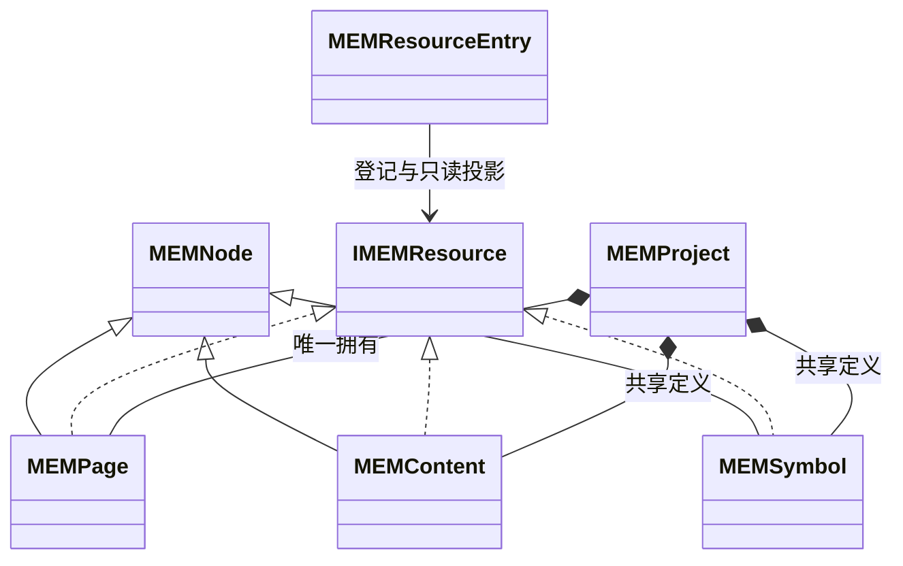
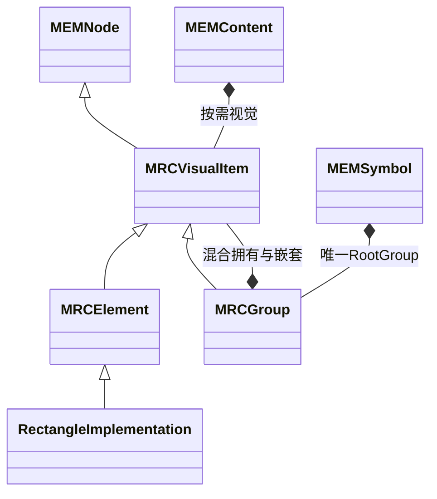

# CxVisual 工程组织体系 V1.1：H00 架构待裁决清单

> 2026-10-17；配套[完整主文档 V1.1](CxVisual_统一工程组织体系_完整架构设计与开发使用指南_V1.1.md)、[x2 复用映射](CxVisual_统一工程组织体系_x2至x3复用映射_V1.1.md)、[H00～H07 实施指南](CxVisual_统一工程组织体系_H00至H07分阶段实施与验收指导_V1.1.md)。
> **确认更新：2026-10-17，用户明确指令“H00架构定案，立即开始H01代码开发”已批准D01～D04，并以本页下列最新结构覆盖旧D02推荐。** D05～D07仍按后续阶段处理；H01获准实施。下文原方案比较是历史设计依据，不得覆盖本条确认。
>
> 最终结构：MEMNode → MEMProject/MEMPage/MEMContent/MEMSymbol/MRCVisualItem；MRCVisualItem → MRCElement/MRCGroup；MRCGroup拥有MRCVisualItem混合子集合。MEMNode无可选能力/容器预分配；Group不继承Element或MEMContainer。Page/Content/Symbol实现IMEMResource；ResourceEntry仅登记元信息。代码/事务/保存实例必须只有一个真源。

## 1. 已确定的不变量

基础/机制新增组织代码分别在现有 Foundation.Core / Mechanism.Core；不新增项目；新类型保留 FOI/MEM/MRC/MRI/MPM/MPC/MTU/MTC/MVE/MTI 前缀，接口用 I＋前缀。只有一个工程真源，Graph/目录/资源浏览器/运行图都是投影；不重做 FCM/MDS/MRK。H06/H07 的 Visual/Studio/运行/专业适配维持原 Owner。

CxNode 是组织身份与拥有关系；IResource 是可被资源目录认识的能力。二者不是互斥的物理树。以下分析不因为 x2 字符串 ID、Newtonsoft.Json 或文件格式不同而否定其成熟语义。

## 2. 裁决与后续专项总表

| ID | 问题与推荐 | 影响及需确认内容 | 状态 / 阻断 |
|---|---|---|---|
| D01 | **推荐 Page/Content/Symbol 继承 MEMNode 并实现 IMEMResource；保留 MEMResourceEntry 作为登记/存储元数据。** 不要求每个 Group/Element 都是独立资源 | 确认接口属性、Embedded/Standalone 判定与目录默认范围；本地 FindResource 返回原节点的资源能力，不能返回另一份可写包装对象 | 2026-10-17用户已确认；H03扩展仍须独立验收 |
| D02 | **用户最终确认：MRCVisualItem : MEMNode；MRCElement与MRCGroup分别继承MRCVisualItem**，Group拥有Children<MRCVisualItem>，不继承Element | 共用轻量视觉基类而保留叶/容器职责差异；旧Cx名称转接同一实体，普通叶不可拥有 | 2026-10-17用户已确认；最终结构覆盖旧推荐 |
| D03 | **推荐 Element 主要承担图元/显示；算法、控制、IoT 无视觉业务由 Content＋Logic/Data/Collaboration 定义组织** | 不给每个算法强制矩形；确认轻量叶 Content 合法，Symbol 可选 Logic 行为保留；不等于把所有逻辑都做成一个 Content 树或删除专业模型 | 2026-10-17用户已确认；完整专业翻译留H07 |
| D04 | **推荐便捷 Session 方法＋Project 只读强类型投影，复杂操作仍 Edit/BeginEdit** | 便捷方法逐次调用同一提交器；不引入隐式环境事务、可写 List 或持久 facade 树。确认默认 AddRectangle 能接 Page 并自动选其唯一根 | 2026-10-17用户已确认；便利方法共享Session事务 |
| D05 | **推荐领域 Watch(ChangeSet) 与 UI 捕获/冒泡事件分工**；保留 x2 事件能力的迁移路线 | H02 只保证已提交事实；H06 UI 保留取消默认动作/选择/交互事件，不允许提交后 PreventDefault 回滚事实。是否将通用交互事件置于 M01/M37 的具体公开 FQN，留 H06 专项确认 | 分工推荐；不阻断 H01，阻断声称“已完整继承所有事件” |
| D07 | **建议H03在确有组变换计算需要时，增加Mechanism.Core→现有Foundation.Geometry的基础引用**，不修改Geometry业务代码，不新建项目 | 当前Core只引用Core/Data，CxAffine2D只有Identity/Transform，不谎称已有Compose/Inverse；组特定坐标变更复用x2算法适配现有数值载体。是否接纳此既有基础依赖由Owner确认，复杂通用几何仍归F05 | 待确认；不阻断H01/H02，阻断H03完整Group/Ungroup变换验收 |
| D06 | **推荐 x3 新格式 ZIP＋XML 与 x2 JSON format 6 显式迁移适配并存** | 新包格式不是改名即可；确认不要求 x2/x3 双向无损写回。未知 x2 负载保存原始来源，未支持字段不能静默丢弃；不复制 x2 整套持久化框架进 Foundation | 格式方向推荐；迁移细节 H04/H05 审批，H01 不声称完整 x2 导入 |

确认依据是本次用户明确给出的最终继承结构及“D01～D04现正式确认，允许开始H01实现”。H01允许实施，不再等待同一确认；D05～D07不阻断H01。

## 3. D01：Node 与 Resource 应结合，不再二选一

x2 已有 Project.Pages、ContentDefinitions、SymbolDefinitions 和资源目录的 SourceObject 投影，但本次在 Platform/Host/Workbenches 的 C# 中未发现名为 `IResource` 的通用接口声明。实际有 IResourceFactory、IProjectResourceCatalog、ResourceDescriptor、CxResourceDefinition 与物理 ResourceStore.ResourceEntry；不得写成“x2 已实现 IResource”。

| 方案 | 开发者 / 工程用户 | 一致性与长期代价 | 结论 |
|---|---|---|---|
| 只有节点，靠类型分支识别资源 | 新类型不断修改 if/else；库/保存/引用入口不统一 | 专业扩展受 Core 类型分支限制 | 不推荐 |
| 只有 ResourceEntry，所有操作先找登记再找根 | 小工程需理解目录、根和句柄才能建页 | 可行，但节点本身缺资源能力，容易制造包装对象和双身份 | V1.0 方案保留价值，补能力接口 |
| Node 实现资源能力，登记只承载存储/版本元数据 | `Project.Pages` 与 `FindResource(page.Id)` 指向同一节点；资源浏览器能统一操作 | 内嵌内容随StorageRoot保存；H01 Entry只按需快照 | 已确认；最小能力已实现 |

```csharp
// [H01真实契约] namespace CxVisual.Mechanism.Core
public interface IMEMResource
{
    Guid Id { get; }
    string Name { get; }
    string TypeId { get; }
    Guid StorageRootId { get; }
    MEMResourceScope Scope { get; }
}
// H01枚举：Standalone=1, Embedded=2；PinnedExternal为后续规划。
// Page、共享Content、Symbol：Standalone；Page.RootContent/嵌套Content：Embedded。
```

同一个内嵌 Content 的 Id 是对象身份，StorageRootId 是其页面/共享资源文件根；不把二者混同。MEMNode需同时具有稳定TypeId；Page为core.page，Content/Symbol为其已注册类型，Entry本地TypeId从根投影，不双写。接口仅描述资源能力，不附 Save()/Start() 等有副作用方法；保存完整定义仍从 Session 进行。提升内嵌 Content 为独立资源必须通过 ExtractReusable 预览/重映射事务，不能切换一个可写 bool。

本地 Entry 的 Id/RootObjectId 与同一节点根关联；Name 从节点投影，不再另存可编辑名称；Entry 管物理位置/固定版/散列/依赖。外部静态资产没有 Node 根，以其**已有外部登记记录**提供只读 IMEMResource 适配；不新建 ResourceNode 父子树。目录本地优先返回节点、外部返回登记适配，每 Id 一项；禁止把本地 Entry 再计为第二项资源。



独立与嵌入的案例：操作页包含 RootContent→设备区 Content→指示灯；默认 Resources 只有操作页及共享 Motor 符号，**不是每个节点一条可发布资源**。`FindResource(设备区Id, includeEmbedded:true)` 可以定位嵌入内容，但保存/版本仍随操作页。外部模型文件以固定版/散列登记，查询同一目录，运行张量/Volume 则仍属于 MDS/专业。

## 4. Project 应自然提供强类型导航

推荐的 MEMProject 只读成员：`IReadOnlyList<MEMPage> Pages`、`IReadOnlyList<MEMContent> Contents`（只含共享根）、`IReadOnlyList<MEMSymbol> Symbols`、`IReadOnlyList<IMEMResource> Resources`（默认独立资源）；以及 `FindPage(Guid)`、`FindContent(Guid)`、`FindSymbol(Guid)`、`FindResource(Guid,bool includeEmbedded=false)`、`FindResources(string typeId,bool includeEmbedded=false)`。

FindContent 可以定位合法嵌入内容，但不改变 Contents 的“共享根集合”含义；Find* 单 Id 缺失返回 null，重复 Id 是验证错误，不返回首项。名称搜索返回全部命中、范围显式、Ordinal 比较；x2 的 OrdinalIgnoreCase 字符串身份转换不得直接套到 Guid/稳定 TypeId。

Pages/Contents/Symbols 是唯一拥有集合的只读分类投影，不是持久存储四份 Children/List。Resources 是统一能力索引、可重建。FolderPath/Category/Tags/WorkbenchId 只作检索/展示元数据，不能通过虚拟文件夹暗改 Parent；依赖图与使用者由引用索引派生。

工程用户看见“页面、共享内容、符号、文件/模型资源”，默认创建页就带根；软件开发者通过这些只读成员理解工程，通过 Session 方法修改；平台增加 CT/IoT 类型只注册 TypeId/工厂，不修改全部类型分支。

## 5. D02：旧方案比较与最终用户裁决

x2 `Elements.cs` 明确 `ElementModel : CxNode`、`GroupElementModel : ElementModel`，SvgVectorElementModel 进一步继承 Group。共享字段包括 Bounds、Transform、Style、LayerId、ZIndex、IsVisible/Locked/Selectable、Semantics、Behavior、Parameters、Connections。CxGroupOperations 处理局部坐标、缩放、分组/解组、锁定/图层/端口映射保护。

| 维度 | Group : Element | Group/Element 平级 |
|---|---|---|
| 开发者遍历/编辑 | 一个视觉集合、统一位置/变换/可选中；与 x2 一致 | 需共同 Visual 契约或重复属性，但 x3 当前简单模型迁移较少 |
| 用户分组/嵌套 | Group 与叶子同样拖动、隐藏、锁定、绑定、动画；可保持世界几何 | UI 也能实现，但默认多态能力不能自然继承 |
| 平台扩展 | SVG/复杂图元复用复合图元；必须明确 Kind 与 CanHaveChildren | 结构干净，但容易再造 VisualNode 基类或复制能力 |
| 风险 | Element 不能继续定义为“一定叶子”；不可让所有 Element 都有可写 Children | 不可仅为维持当前 sealed 类而抹掉 x2 能力 |

原推荐曾把Element作为视觉基类；用户最终选择共同MRCVisualItem，保留x2的共有视觉操作并明确叶/容器区别。下图是唯一最终继承；旧Group:Element仅作为上表比较，不保留另一张可被误用的目标图。



此UML已获确认并由H01实现。验证断言改为：MRCVisualItem集合包含Group/Element，`OfType<MRCElement>()`不包含Group，普通叶不可拥有，Group.Kind正确，组移动不改子项局部坐标。SVG、Group/Ungroup的完整世界变换等价及x2旧坐标迁移按H03/H05/H06后续验证。

## 6. D03：Element 的显示定位不妨碍业务统一

统一的应是身份、资源、引用、端口、事务与来源定位，**不是所有业务节点的 CLR 类型**。

| 概念 | 推荐表达 | 不能混淆 |
|---|---|---|
| 算法/控制步骤 | Content（可以无子项）＋可选 Logic/专业能力声明＋Data 端口 | 内容列表顺序不代表控制推进；不要求 Bounds/Style |
| 后台 IoT 服务 | Project 共享 Content＋服务生命周期/通信与数据绑定 | 不创建隐藏 Page/矩形，不把长订阅压成一次性 DAG |
| 页面图元/按钮/Viewer | Element/Group＋视觉及可选绑定/事件行为 | 允许图元事件引用业务 Content；不把算法执行器塞进图元 |
| 可复用面板/部件 | Symbol＋RootGroup、公开属性/端口、可选 Logic/Data/Collaboration | Symbol 不是所有跨专业流程的替代对象 |
| 可复用业务组合/子流程 | Content 定义＋ContentReference＋公开边界 | 子流程调用由编排语义解释；包含/引用不等于“执行它” |

真实工业目标案例：后台 Acquisition/Detect/Report 各是 Content 的能力/逻辑定义；主流程用公开端口和模型语义关联；操作页放 Viewer/灯 Element，绑定结果。没有操作页也能构造相同业务定义。CT 的 Volume 共享使用数据来源绑定，Viewer 不拥有重建 Job。

x2 Content、Symbol 和 Project 已有按需 Logic/Data/Collaboration；应继承此能力。x2 元素上的 Behavior/事件/动画也不删除，但生效与运行由原专业/运行适配负责；Core 只持久化其定义/来源。

## 7. D04：便利 API 如何不破坏严谨性

推荐只增加 Session 的薄便利方法，不再造六种可写 facade 实体：

```text
MEMEngineeringSession.Project                       // 当前冻结 MEMProject 视图
AddPage(string name,string workbenchId="core.canvas")
AddContent(MRIObjectHandle parent,string name)
AddSymbol(string name)
AddRectangle(MRIObjectHandle pageOrContentOrGroup,string name,
             double x=0,double y=0,double width=120,double height=80)
PlaceSymbol(MRIObjectHandle content,MRIObjectAddress definition,string name)
Rename(MRIObjectHandle target,string name)
Group(IReadOnlyList<MRIObjectHandle> selection,string name)
Ungroup(MRIObjectHandle group)
```

这些方法分别返回 `MTCEditResult<MRIObjectHandle>`；Rename 返回 `MTCEditResult<bool>`，Ungroup 返回 `MTCEditResult<IReadOnlyList<MRIObjectHandle>>`。便利方法将一次调用包装成**同一 Edit**；不另外提交多个半成品操作，不维护平行历史。AddRectangle 接 Page 时取得其唯一 RootContent，接 Content/Group 时使用该容器，拒绝 Symbol 句柄的含糊放置。

批量使用进入 `Edit`，重复使用同一 MTCEditSession 的领域动作。便利方法不能在 Edit 回调内再同步调用 Session.Edit；错误为重入，提示使用当前 draft。单操作不用手填 expectedRevision；长编辑必须显式处理冲突。

```csharp
// [H00 易用性建议 EASE-01；未实现]
var project = MEMEngineering.Create("监控工程");
var pageResult = project.AddPage("操作页");
if (!pageResult.Success) return; // 宿主显示 Issues 并保留会话
var lampResult = project.AddRectangle(pageResult.Value, "运行灯", 20, 40);
if (!lampResult.Success) return;
var saved = await project.SaveAsAsync(path, CancellationToken.None);
if (!saved.Success) return;
// 关闭、异常及重开处理见主文档 TARGET-01；此片段不伪装完整程序。
```

对照 V1.0：普通页面/矩形从“Edit→AddPage→GetRootContent→AddElement→SetProperty”收敛为两个领域调用；高级场景仍可完整检查草稿、句柄、地址和提交结果。返回值中的 var 不要求初学者先掌握句柄实现；跨工程/实例链才需要学习 Address。没有放宽授权、类型检查、引用一致性或保存失败反馈。

## 8. H00 的验收与边界

H00 完成需：D01～D04 的最终决定及签名有确认记录；资源/继承 UML 唯一；x2 关键能力映射无遗漏或有明确后续阶段；H01 最小保存重开用例无悬空概念；没有“既支持两套继承，开发时再选”的模糊结论。

D01～D04已由本次用户明确确认；H00基础对象模型已定案，H01正在实施。D05～D07的扩展问题留后续阶段，不外推为已实现。
