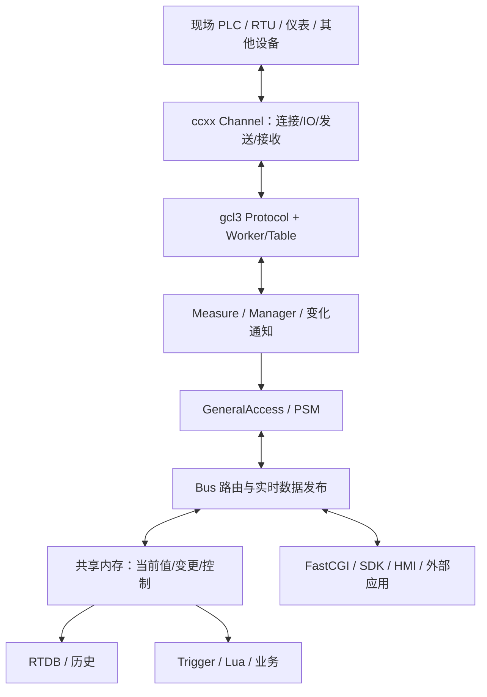
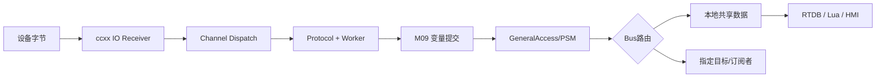

# 03 · gcl3 分布式 ICS/SCADA 技术能力与代码资产档案（V1.0）

> **定位**：CxVisual 七仓代码资产中的 gcl3 专项档案；唯一主文件 `DOCS/Codebases/03_gcl3.md`。本文是**真实历史系统的技术资产调查、源码导航、复用与归属候选依据**，不是新的设计批准书，也不是声称 CxVisual 已经实现这些能力的验收报告。  
> **旧仓库**：[oudream/gcl3](https://github.com/oudream/gcl3)（访问可能需要 GitHub 授权；请勿公开原仓内部敏感配置）。  
> **gcl3 源码基线**：`master`，`511ea4af40f0184686fda9b904254d9372019e2a`；提交时间 2023-01-12 UTC；研究核对日期 2026-10-14。  
> **底层依赖基线**：[ccxx](https://github.com/oudream/ccxx/tree/master/ccxx)，`26cecfb02e861ce6b821b33350493bac4793e997`。ccxx 基础库详见 [01_ccxx.md](01_ccxx.md)；两份档案职责不重复。  
> **目标主仓基线**：[cx-visual-x3](https://github.com/oudream/cx-visual-x3)，`f5a08f966f7b39a227e961502ab895dfb1c14eb4`；28 项目目录/子方面以仓内 `DOCS/ProjectCatalog.csv`、`DOCS/DirectoryLayout_V1.1.md` 为准。  
> **规格参照**：`DOCS/04_CxVisual Foundation与Mechanism 统一架构与对象API设计规格 V6.4.xlsx`、V4.9 统一规格、V2.01 逐阶段和 V5.2 唯一类型审核（以仓库与已提供文件可读的相应版本为参照，必要时复核最新版）。  
> **证据边界**：已核查目录树、主要 C++ 头/实现、若干进程入口、部署配置、C# SDK 示例和 ccxx 通道实现；未逐行遍历全部源码、未在本轮编译、单测、压测或连接实机。项目负责人明确说明 gcl3 曾用于多个实际项目；这一历史事实**不能替代本次迁入 CxVisual 后的验证证据**。

## 00. 档案说明、结论与快速导航

### 00.1 一分钟结论

**gcl3 是建立在 ccxx 上的一套分布式工业 ICS/SCADA 运行软件资产。** 它不仅有规约驱动，还有 Terminal/Protocol/Worker/Measure/TBI 抽象，模板和工厂装配，通信、实时测点与变化通知，GeneralAccess/PSM/Bus，跨进程共享内存，RTDB、Lua、任务和触发，以及部署与守护配套。

关键资产是**完整运行链**而不是某一个 `.h`：`配置装配 → 通道 IO → 规约解析 → 地址/测点映射 → 变量变化 → PSM 发布/Bus 路由 → 共享内存/RTDB/脚本/业务 → 控制反馈`。迁入 CxVisual 时优先保留此链的行为和边界，用 F/M/P 唯一 Owner 拆分其职责，**不需要全部改写为 C#**。

**最重要的三个定案前提**：
1. ccxx 通道存在独立 IO 接收与可选发送/处理线程；gcl3 规约接收路径默认直接回调，不能混称“规约已有独立工作线程”。
2. 一个旧类可能承载多个新 Owner 能力；`ProtocolBase`、`MeasureShareMemory<T>`、`GeneralAccess`、`BusTerminal`必须分能力裁决。
3. V6.4 已有 Channel/Protocol/Variable/DataHandle/Trigger/Runtime 等候选类型；迁移先复核现有 FQN、功能、接口与依赖，再决定复用/拆分/增构，禁止只按名字再造一套。

### 00.2 阅读线路与章节导航

| 想弄清楚 | 推荐章节 |
|---|---|
| 仓库做了什么、由什么组成 | 01、02 |
| C++ 抽象、模板、工厂、观察者 | 03 |
| IO 收发、Queue、线程在哪里运行 | 04、05、08 |
| 测点、数据、发布、共享内存、RTDB | 06、07、09 |
| 业务、脚本、定时触发与任务 | 10 |
| EXE/配置/守护/启动退出 | 11 |
| 工业规约与设备清单 | 12 |
| 实际调用链 | 13 |
| **gcl3 → F/M/P → 28 项目 → 候选类型与迁移/验收** | **14** |
| 风险清单、下一轮源码审核与 Codex 工作要求 | 15 |

### 00.3 证据和状态规则

| 标记 | 精确定义 |
|---|---|
| **S：源码证实** | 指向固定仓库版本的文件/方法/配置，且已读相应代码；只证实代码存在与该段行为 |
| **D：设计推导** | 根据已有行为、CxVisual 职责推得的建议，**不是现有实现** |
| **P：规划候选** | V4.9/V6.4 规格里有名称/属性/方法；**不等于已批准或写完代码** |
| **H：历史项目事实** | 用户确认历史项目实际使用；**不等于本次重新验证** |
| **V：实证验证** | 有构建命令、测试日志、结果、平台/环境和必要实机证据；本版未授予此状态 |

**跨库查阅时的事实优先级**：源码/运行证据决定“现在是什么”；最新获批规范/裁决决定“目标归属是什么”；旧库的类名只决定“待研究对象”，不能直接指定新 Owner。对同名/同义候选采取“待查重”而非自动新增。

### 00.4 源码入口（最常用）

| 主题 | 仓内主要入口 |
|---|---|
| 终端装配 | `src/vdi/terminal_loader.cpp`、`terminal_manager.cpp`、`terminal_base.h` |
| 规约抽象 | `src/vdi/protocol_base.h/.cpp`、`protocol_factorymanager.cpp` |
| Worker 与值转换 | `src/vdi/worker_base.h`、`measure_address_worker.h` |
| 测点模板 | `src/vdi/measure_template.h`、`measure_manager_template.h` |
| 规约发送/Cases/Cycle | `src/vdi/cases_base.h`、`cycle_base.cpp`、`send_measure_cases_template.h` |
| PSM/业务发布 | `src/psm/psm_explain.h/.cpp`、`general_access.h/.cpp`、`src/vdi/measure_manager_psm.cpp` |
| Bus | `src/main/gcl_bus/bus_terminal.cpp`、`bus_data_deal.cpp`、`bus_measure_publish.cpp`、`bus_measure_control.cpp` |
| 实时共享内存 | `src/shm/measure_sharememory.h`、`measure_sharememory_all.cpp` |
| RTDB | `src/main/gcl_rtdbs/rtdb_service.cpp`、`rtdb_logfile.cpp` |
| Lua/触发/调度 | `src/script/gcl_lua_*.cpp`、`src/main/gcl_rttrigger/gcl_rttrigger.cpp`、`src/vdi/schedule_task_manager.cpp` |
| 工业规约 | `src/protocol/`、`src/vxd/modbus/`、`src/vxd/iec104/` |
| C# 接口 | `src/test/sdk_csharp/gcl_comm_sdk.cs` |
| 部署 | `deploy/config/`、`deploy/terminal/`、`deploy/daemon/ygct_daemon.ini` |
| ccxx IO 真正线程 | `ccxx/cxchannel.h/.cpp`、`cxchannel_tcpclient.cpp`、`cxchannel_udp.cpp` |

路径链接模板：`https://github.com/oudream/gcl3/blob/511ea4af40f0184686fda9b904254d9372019e2a/<相对路径>`。例如 [ProtocolBase 实现](https://github.com/oudream/gcl3/blob/511ea4af40f0184686fda9b904254d9372019e2a/src/vdi/protocol_base.cpp)。切换新 HEAD 前不得无提示沿用旧核查结论。

## 01. 系统定位与能力总览

gcl3 的系统定位是**工业监控、遥测/遥信/遥控、规约接入、实时数据共享、事件与业务分发、历史记录及运维支撑**。这里的“分布式”有实证：Bus、RTDB、FastCGI、VXD/脚本等有独立进程入口，GeneralAccess 承担应用间消息/数据交互；同机共享内存与网络通信协同使用。并不意味着每个实例必须跨机器部署。

| 能力簇 | gcl3 实际组成 | 能力输出/边界 |
|---|---|---|
| 终端与设备接入 | Terminal/Factory/Loader/Manager | 按配置实例化、组合并管理运行设备终端 |
| Channel | 复用 ccxx Channel | TCP/UDP/串口等物理传输、IO线程、收发及状态 |
| Protocol | ProtocolBase、具体协议 | 规约编解码、会话行为、周期收发、请求/控制 |
| 地址/测点映射 | AddressWorker、WorkerTable | 将外部地址与平台测点关联、值转换 |
| 实时变量 | Monsb/Ycadd/Straw、MeasureManager | 值、旧值、品质、时间、来源、变化通知 |
| 消息/文件/实时数据 | PsmExplainer、GeneralAccess | 消息命令、文件传输、实时数据发布/请求 |
| 路由与订阅 | BusManager、BusDataDeal、Publisher | 来源/目标路由、条件转发、实时数据订阅发布 |
| 跨进程共享 | MeasureShareMemory、FileInfoShareMemory | 本机共享内存中的实时值、变化/控制记录 |
| RTDB/历史 | RtdbService、RtdbLogFile | 变化索引追踪、历史文件/记录及查询入口 |
| 脚本与规则 | gcl_lua_*、gcl_calc、RTTrigger | Lua 接入数据/服务、测点变化触发、定时执行 |
| 任务与周期 | ScheduleTask、Cases、Cycle | 定期发送、软实时定时、任务状态 |
| 接口/服务 | FastCGI、SDK、Nginx 配套 | 第三方访问、Web/HTTP 和本机跨语言调用 |
| 运维 | CommonService、daemon 配置、工具 | 心跳、进程守护配置、日志、诊断/查看工具 |
| 专业实现 | Modbus、IEC104、FINS/PLC、RFID 等 | 有源码实现，但协议完整度需按用例实测 |

**注意**：目录包含的 `src/qtgraphics` 是 Qt 图元/页面数据与解析代码，不能据此认定仓库包含全部完整可运行的图形组态设计软件；也不能把第三方代码/示例计作自研成熟能力。

## 02. 系统架构、模块组织与依赖

### 02.1 源码真实布局（目录树快照）

使用固定提交读取递归树：**2,155 个树条目，其中 1,865 个 blob 文件**，没有截断；以下统计是相应目录下文件数，不是类数、有效功能数或测试通过数。

| 路径 | 文件数 | 职责 |
|---|---:|---|
| `src/vdi/` | 126 | 终端、规约、Worker、Measure、Case/Cycle、任务、设备应用框架 |
| `src/psm/` | 5 | PSM 消息编码/解释与统一应用访问 |
| `src/shm/` | 12 | 测点和文件信息共享内存 |
| `src/protocol/` | 41 | 现场专用规约及设备接口 |
| `src/vxd/` | 40 | 专业规约运行程序、Modbus/IEC104实现 |
| `src/main/` | 74 | Bus、RTDB、FastCGI、触发、派发、脚本、数据库服务、NTP 等入口 |
| `src/script/` | 63 | Lua 与消息、测点、共享内存、数据及业务的绑定 |
| `src/business/` | 23 | TBI/CBI、ICS及项目业务 |
| `src/qtgraphics/` | 41 | Qt 图形数据对象、图元、解析 |
| `src/test/` | 122 | 测试代码和多语言SDK样例 |
| `deploy/` | 371 | 配置、终端、脚本、Web、守护等现场部署资产 |
| `build/` | 198 | CMake/qmake 等构建配置 |

### 02.2 逻辑协作架构



这是**源码支持的概念图**：路径依据实际路由/部署配置变化；数据不保证每次都同时进入Bus、共享内存、RTDB和所有订阅者。反向控制另外经过专门路由和发送路径。

### 02.3 主要依赖关系

- **ccxx → gcl3**：应用事件循环、Socket/Channel、Timer、Thread、配置、文件、日志、基础数据结构。
- **VDI**：依赖 Channel、基础配置与协议/测点类；为不同规约和业务提供统一组合入口。
- **PSM + GeneralAccess**：承担跨进程/跨模块报文、消息、文件与数据的统一访问。
- **Bus / SHM / RTDB**：Bus独立路由/更新共享数据；RTDB独立读变化并写历史。
- **专业业务/Lua/FastCGI**：通过通用访问/共享数据/测点服务协作，仍存在历史静态管理的耦合。

重点保留**依赖方向和运行语义**，不要把旧库的宏、全局初始化次序或裸指针集合变成 CxVisual 的通用公共 API。

## 03. 代码抽象、模板、工厂、组合与设计模式

### 03.1 核心抽象实际结构

| 模式 | 代码证据 | 核心机制 | 迁移提示 |
|---|---|---|---|
| 抽象类与虚钩子 | `ProtocolBase`、`WorkerTableBase`、`CycleBase`、`TBIBase` | 公共生命周期+派生实现 | 保留稳定契约，不复制巨型继承树 |
| 泛型模板 | `MeasureTemplate<T>`、`MeasureManagerTemplate<MeasureSon,T>`、`MeasureAddressWorkerTableTemplate` | 将相同算法应用于不同数据类型 | C# 泛型类型与数据快照契约，减少全局静态 |
| 工厂注册 | `TerminalFactoryManager`、`ProtocolFactoryManager`、`TBIFactoryManager` | 按类型名动态构造 | 区分定义、运行会话和插件发现 |
| 组合 | Terminal 内 Protocol/Business；Protocol 内 Channel/Cases/Cycle/Worker | 可装配而非单层继承 | 形成独立模块/运行实例；所有权要明确 |
| 观察者 | Channel Publisher；Measure/Manager Subject | 多订阅者变化通知 | 订阅ID、反订阅、异常隔离与线程规则 |
| 模板方法 | `CycleBase::cycleSendImpl()`、任务 `runImpl()` | 公共调度/状态，差异由派生扩展 | 调度与业务算法分离 |
| 配置与描述 | `TerminalLoader::loadTerminal`、`fromContext/toContext`、`describeSelf` | 数据驱动组合与编辑 | 配置Schema版本和验证 |

### 03.2 代表性真实接口

- `TerminalManager::createTerminal(name, terminalType, protocolType, businessType, channelType)` 在 `terminal_manager.cpp` 中通过工厂分别创建 Terminal、Protocol、Channel 和 TBI 后装配。
- `ProtocolBase` 同时继承 `ICxTimerNotify`、`CxIChannelSubject`、三类 Measure Manager Subject；可创建/注册 Cases、Cycle、WorkerTable，存在 `protocolReceivedData(...)`、`protocolAfterStart/Stop()` 和在线检测钩子。
- `MeasureTemplate<T>` 提供 `setValue`、`oldValue`、`quality`、时间、来源和抽象 `valueChanged/valueIsChange`；`MeasurePublisherTemplate`负责变化通知。
- `MeasureManagerTemplate<MeasureSon,T>` 通过静态 `loadFromFile`、`receiveValue`、`receiveValues` 和订阅回调，复用不同类型测点管理。
- `MeasureAddressWorkerTemplate<MeasureSon,T>` 中 `toMeasureValue` 可在Worker侧转换协议值；具体地址、数据区语义不是通用变量本身。
- `CasesBase` 提供 start/stop 钩子；`CycleBase` 提供计时框架与 `cycleSendImpl`；`ScheduleTaskBase` 提供 `doIt`、`runImpl`、任务状态/取消观察者。

### 03.3 哪些已有设计应保留、哪些应改造

保留**类型安全的值/测点模型、协议的专业扩展点、配置工厂、独立收发、观察者、周期任务与业务装配**。但源码含大量全局/静态管理（如终端集合、MeasureManager模板静态容器），以及跨模块多重职责。新平台应允许一个 Runtime.Host 内**多工程、多会话并存**，将运行状态放在实例级 Context/Session。

**代表性待核代码风险**：`MeasureBase` 析构声明及多态删除路径、WorkerTable的类型转换、`TerminalManager::stop`的状态幂等、Measure批量变化集合并发、订阅者异常隔离。它们是审查入口；未做动态故障确认，不得写作已在现场复现。

## 04. IO 通道、连接、接收、发送与队列

**本节的线程证据主要属于 ccxx**，gcl3通过 Channel 组合使用；详细底层以 [01_ccxx.md](01_ccxx.md) 为准。

### 04.1 Channel的实际执行模型

| 模块/情形 | 真正的执行机制 | 是否独立线程 |
|---|---|---|
| TCP Client接收 | `CxChannelTcpclient::ReceiverThread` | 是 |
| TCP Client连接管理 | `ConnecterThread` | 是 |
| TCP Server监听/多连接接收 | `AccepterThread`、`SelecterThread` | 是，具体组织见ccxx |
| UDP接收 | `ReceiverThread` | 是 |
| Channel发送 | `IsSendQueue=true` 时 `SenderThread`，否则走直接写出 | **可选** |
| 已接收事件处理 | `IsProcessQueue=true` 使用 `ProcesserThread`；否则交 `CxApplication` 事件队列 | **可选** |
| Channel重连/状态检查 | 定时器及连接线程/重开逻辑 | 不能一概理解为每通道独立线程 |

事实依据：[ccxx/cxchannel.cpp](https://github.com/oudream/ccxx/blob/26cecfb02e861ce6b821b33350493bac4793e997/ccxx/cxchannel.cpp) 的 `threadEventNotify`、`SenderThread::run`、`ProcesserThread::run`，以及 `cxchannel.h` 配置。

**必须注意**：
- `IsProcessQueue=false`不是“在Socket接收线程直接跑完全部业务”，而是**将事件投递到应用主事件处理机制**，再执行Channel观察者；
- `IsProcessQueue=true`才可能由独立ProcesserThread处理数据观察者；
- 旧实现中 `IsProcessQueue` 与 `IsMultiRoad` 被写成互斥设置；它是历史代码约束，不应成为新平台普适约束；
- 旧 `SenderThread::push` 返回长度表示成功入队，**不代表Socket写出、远端接收或设备执行完成**；
- 旧线程内双缓冲队列的具体容量、停止排空、异常、取消及回调释放时序均需审查。

### 04.2 CxVisual目标IO契约（D/P，非现有已完成功能）

**M13**对每个通道拥有连接与自管理职责：`Open/Close/Reconnect/Receive/Send`、IO监测、队列和路由对象关联；**F17**只提供无会话语义的地址、帧/Buffer与传输基础；**F19**提供通用并发与容量计算基础；**M30**提供共享的执行上下文/工作者调度服务。

| 策略维度 | 可选候选 | 约束 |
|---|---|---|
| 接收IO | Dedicated / SharedAsync | 不将耗时DB/专业算法放在IO线程 |
| 发送 | Direct / Queued | 明确入队、实际写出、协议ACK、业务完成四层状态 |
| 接收派发 | Application / Dedicated / SharedSerial | 同Channel需要的顺序语义必须明确 |
| 背压 | Wait / Reject / LatestWins（仅允许合并的状态流） | 控制命令与报警不能默认丢弃 |
| 重连 | 延迟/退避/次数限制/断线代际 | 旧会话请求不得错误匹配到新连接 |
| 退出 | StopAccept → Cancel/Drain → Close → Dispose | 不产生悬挂回调和句柄泄漏 |

不要无条件为每个Channel创建三四条常驻线程；使用线程池/异步IO时仍需维护**会话顺序与隔离**。

## 05. 规约框架、执行策略与地址绑定

### 05.1 gcl3现有协议抽象

`ProtocolBase` 同时管理：Channel事件、规约收发、WorkerTable、Cases、Cycle、`_sendTm`、`_workTm`、`_checkProtocolTm`、报文待发队列、在线状态等。[protocol_base.h](https://github.com/oudream/gcl3/blob/511ea4af40f0184686fda9b904254d9372019e2a/src/vdi/protocol_base.h) / [protocol_base.cpp](https://github.com/oudream/gcl3/blob/511ea4af40f0184686fda9b904254d9372019e2a/src/vdi/protocol_base.cpp)。

真实代码中：
- `channel_receivedData` 进入 `protocolReceivedData`，默认未统一移交独立Protocol工作线程。
- `push` 将待发原始数据加入 `_qDataEm`，`_sendTm` 驱动取队列并调用Channel发送；默认发送定时周期100ms、work周期50ms、check定时用于在线检查（是源码默认，不等于真实最坏时延）。
- `_workTm` 相应工作队列处理代码被注释，不得表述为已实现完整协议专用工作线程。
- `protocolAfterStart/Stop`、`protocolTimerTimeOut`、`checkProtocol`为专业规约扩展点。

### 05.2 新平台应区分三部分

| Owner | 负责 | 不应负责 |
|---|---|---|
| **M13 Channel** | IO/连接/字节收发/Buffer/诊断 | Modbus寄存器和业务测点意义 |
| **M14 Protocol** | 通用帧解析、Codec、Session、超时、请求关联、协议事件入口 | P13的具体工业协议语义；无限占用专属线程 |
| **P13 Industrial Protocol** | Modbus/IEC104/FINS等专业报文、地址和控制规则 | 重造公共Channel/运行调度 |

工厂/Provider装配属于M15，其生命周期由M30协同；软件定时器由M25；专业设备模型（PLC/DAQ/相机/仪表）根据P01/P02/P09/P11及其他对应子方面分配。

### 05.3 规约执行策略——目标建议，不是当前gcl3已有

`Inline`（在可控派发上下文中短时执行）、`DedicatedSerial`（每会话专属串行工作线程）与`SharedSerial`（跨会话共享池、会话内部串行）三者应作为**同一规约会话可选执行策略**。规约无须认识Thread；相同会话的接收、超时、断线、请求和控制事件经过单一顺序管理入口，避免协议内部竞态。策略具体类型优先对照V6.4 `M14/M25/M30`，**不先批准新接口**。

### 05.4 Worker不是Variable

`Worker`代表规约内部数据区、地址映射、设备值转换；`Measure`代表平台统一测点值及变化。旧 `MeasureAddressWorkerTemplate::toMeasureValue` 值得保留，但必须拆出：
- M14：公共地址绑定、WorkerTable容器与规约会话协议；
- P13：Modbus寄存器、IEC104信息体等具体地址解释与设备语义；
- M09：标准变量身份、类型/单位/质量/时间和转换器；
- P02/P03：PLC/SCADA的专业测点目录与控制业务。

## 06. 变量模型与正向/反向数据流

### 06.1 gcl3三种测点

| 类型 | 泛型实参 | 典型表示 |
|---|---|---|
| `MonsbMeasure` | `int` | 遥信/离散状态 |
| `YcaddMeasure` | `double` | 遥测/模拟量 |
| `StrawMeasure` | `std::string` | 字符串测点 |

`MeasureTemplate<T>`包含值、旧值、默认/范围、品质、更新时间/变化时间和来源原因；`MeasureManagerTemplate`提供集合、ID查询、批量变化与订阅。具体字段及枚举的细节以源码为准，**不能认为gcl3质量值与新V6.4的`Good/Uncertain/Bad/Disconnected`天然同值**。

### 06.2 接收链（有证据的典型路线）

`设备 → ccxx IO线程 → Channel观察者 → ProtocolBase::protocolReceivedData → 专业规约解包 → AddressWorkerTable → MeasureManagerTemplate::receiveValue(s) → 测点变化 → MeasureManagerPsm::measures_valueChanged → GeneralAccess::postRealtimeDataPost → Bus按规则处理 → SHM或目标终端/消费者`。

这是组合源码后抽出的**典型条件路径**，不是声明所有规约实现逐帧必经此全链。必须按具体Modbus/IEC104报文另做动态断点/日志验证。

标准变量事件应区分 `ObservedAt` / `SourceTimestamp` / `CommittedAt`、Quality、Source、Reason、Version、Trace/Correlation。它们是**新平台建议契约**，不是旧结构每项都已具备。

### 06.3 反向控制链

`专业业务/HMI命令 → 命令身份与许可 → GeneralAccess/Bus路由 → 规约操作/地址Worker → Channel发送 → 协议应答 →（如有）设备状态回读 → 命令结果/历史/审计`。

**关键语义**：`Received / Accepted / Enqueued / Sent / ProtocolAcknowledged / Applied / Observed`不能压缩成一个成功布尔量；超时后结果可能未知，需要幂等策略与回读。机器安全联锁必须由符合要求的PLC/控制器与现场安全措施确保，不能仅依赖一般业务线程。

### 06.4 变量唯一权威

- **M09**只拥有统一 VariableDefinition、Value/Quality/Change/Subscription等平台变量模型。
- **P03**拥有SCADA测点业务含义、告警规则等专业定义；使用M09公共状态，不创建平行的通用变量真源。
- **HMI P22/P25/P26**分别承担专业数据绑定显示、报警事件呈现、趋势历史，不重复定义变量写入提交规则。
- 数据批量提交、跨线程快照和事务/可靠交付与**M07**协同。

## 07. GeneralAccess、PSM、Bus与业务发布

### 07.1 源码证实

`GeneralAccess`暴露 `postMessage`、`postFile`、`postRealtimeDataRequest`、`postRealtimeDataPost` 与多类 `register*Deal` 回调；它是网络通道、PSM编解码和业务回调的**组合入口**，并非一项纯消息总线算法。

`PsmExplainer`用 `PsmPacketData` 等分包类型处理 heartbeat、message、realtime data、file，支持 ACK/NACK 的一部分报文处理。`GeneralAccess::register*Deal` 为业务消费者提供回调入口。

`BusDataDeal::dealRealtimeDataPost`按 `RealdataTransferStrategy` 的目标判断：
- 目标为本Bus本地端点时可写共享内存；
- 有目标终端时可能按目标转发；
- 广播/订阅配置可能导致多个目的地；
- 未配置订阅的分支可落共享内存。

因此，不允许把逻辑图固化为“所有数据必经共享内存然后广播”。

### 07.2 业务发布的四类语义

| 类型 | 表现 | 建议契约Owner |
|---|---|---|
| VariableChanged | M09变量版本、质量和值变化 | **M09** 发布来源，M36负责跨模块投递 |
| CommandRequest/Result | 请求身份、参数、状态及执行结果 | **M12**；安全检查M28 |
| RuntimeEvent | Host内部运行实例事件/状态转换 | **M31** 运行总线；公共事件契约M12 |
| Notification/Message | 面向模块、进程、外部系统的路由和传输 | **M36**；底层Transport M13/14 |

必须明确**事件身份只定义一次**。M12是公共命令/事件语义；M31是Host内部运行事件分发；M36是通用消息的路由与跨边界交付；M23是专业订阅触发。四者不是四套互不兼容的事件本体。

### 07.3 建议的发布包络

新平台可复用V6.4已有 `MCCCxMessageEnvelope`、`MCEEventEnvelope<T>` 等候选身份，先确认是否已有唯一权威模型。最小字段候选：
`MessageId / TypeId / SchemaVersion / Source / Target(or Topic) / Sequence / Timestamp / Quality / CorrelationId / CausationId / Headers / PayloadRef / DeliveryPolicy`。
其中 **PayloadRef** 对图像/CT大体数据应是句柄/租约，不是盲目全量复制。

必须附有界队列、消费者隔离、允许/禁止丢弃策略、重放/幂等标识、死信与可观测性；这属于**目标要求，未证明gcl3已全部实现**。

## 08. 线程、队列、执行上下文与故障隔离

### 08.1 真正在哪里运行

| 阶段 | gcl3/ccxx实际机制 | 线程归属说明 | CxVisual候选Owner |
|---|---|---|---|
| Socket收取 | ccxx Receiver/Selecter | IO专属线程/Socket服务线程 | M13（底层F17/F19） |
| Socket连接/监听 | Connecter/Accepter | 独立连接/监听工作线程 | M13 |
| 发送 | SenderThread可选；或直接写出 | 有`IsSendQueue`设置 | M13 |
| Channel数据回调 | ProcesserThread可选，否则`CxApplication` | **处理队列≠默认独立线程** | M13/M30 |
| gcl3规约解包 | `channel_receivedData → protocolReceivedData` | 在Channel派发上下文同步执行 | M14 + M30 |
| Protocol定时 | `CxTimer`及应用事件回调 | 定时回调不自动等于每规约专属线程 | M25 |
| Variable变更 | 模板管理器与观察者同步通知路径 | 线程取决于调用者上下文，须隔离慢回调 | M09 + M30 |
| Bus发布 | 自身独立服务进程/定时发布 | 独立**进程**不意味着每业务独立线程 | M36 + M25 |
| RTDB处理 | 独立进程，定时轮询变化记录 | 具体调用在其应用事件机制 | M35 + M25 |
| RTTrigger | 独立进程/定时器处理Lua | 需要防止慢Lua阻塞该执行上下文 | M23/M11/M30 |
| 业务TBI/专业 | 运行回调/业务逻辑 | 旧代码未统一建立可选专业专属线程 | Pxx + M30 |

### 08.2 目标执行策略（建议）

- **IO**：Dedicated或SharedAsync，连接和缓冲按Channel自治；
- **Protocol**：Inline / DedicatedSerial / SharedSerial，可选而且会话内串行；
- **Professional**：Inline / SharedSerial / Dedicated / ParallelPool / ExternalProcess，按**运行实例/能力**选择，不是“一个专业子方面必有一个线程”；
- **Runtime/Queue**：M30拥有执行上下文和调度执行资源；M25拥有周期、排队与调度政策；M20拥有**业务DataFlow上的背压编排**；M13拥有**Channel局部收发队列**。

### 08.3 四条不可放松的执行约束

1. **进程隔离与线程隔离不同**：跨进程需要版本化IPC、超时、健康与恢复；进程内需要线程安全、阻塞隔离和所有权。
2. **同一规约会话串行、不同会话可并行**：Receive、Timer、Disconnect、Command、ACK必须顺序受控。
3. **IO不等待重业务**：慢AI、DB、文件、Lua不能占满Channel接收线程；队列容量、延迟和可丢弃性要具体配置。
4. **发布不等于执行完成**：数据提交、事件排队、交付消费者、专业执行、设备回读都有独立指标/错误。

**性能与实时性**：软件周期只是调度设定，不提供硬实时保证；PLC安全逻辑、运动插补/采样严格同步须交给具备确定性能力的控制器/板卡。最终延迟与吞吐阈值由设备需求和基准测试确定，本文不凭空填数字。

## 09. 共享内存、RTDB与历史一致性

### 09.1 `MeasureShareMemory<T>`真实结构

核心文件：[measure_sharememory.h](https://github.com/oudream/gcl3/blob/511ea4af40f0184686fda9b904254d9372019e2a/src/shm/measure_sharememory.h)。

| 结构 | 内容要点 | 新平台语义Owner（不是原结构整体Owner） |
|---|---|---|
| `MeasureShareMemoryHead` | 共享区的头和布局相关信息 | M10 |
| `MeasureData` | MeasureId、值、Quality、时间、来源/原因 | **M09** 变量快照；物理存放M10 |
| `ChangedData` | 变化序号、测点、新值/旧值、Quality、时间 | **M09** 变化事件 + **M35**可靠变化日志/持久化 |
| `ControlData` | 控制目标/值/来源/原因/策略/方法 | **M12**控制请求；物理队列M10 |
| `ConfigData` | 测点数量、比较/默认等配置 | M09配置语义；映射布局M10 |
| `MemoryManagerBase` | 创建/查看/访问共享内存、发布/检查变化和控制 | **M10**跨进程载体与数据一致性接口 |

`MeasureShareMemoryAll::open(true)` 在Bus入口创建共享内存；RTDB入口不带 `true` 打开现有内存。三种主要值类型对应Monsb/Ycadd/Straw共享区，另有FileInfo。

### 09.2 当前一致性和恢复机制

`checkChangeds` 消费变化索引；`RtdbService::timerTimeout` 间隔200ms进入检查函数，内部按余数轮换Monsb/Ycadd/Straw变化和维护工作，`RtdbLogFile`会加载/保存已处理的变化索引。

这说明存在**变化日志消费与索引恢复思想**，但不能由此宣称端到端“恰好一次交付”。断电时更要验证环形缓冲覆盖、写一半、索引先于持久化、重复消费与跨进程重启顺序。

**源码级疑点（须测试确认）**：`measure_sharememory.h` 的 `setValue` 代码更新 `measureValue.value` 后再给 `ChangedData.oldValue` 赋 `measureValue.value`，可能导致记录中的旧值被覆写为新值。迁移时不能复制这个潜在行为作为目标规范；先加旧实现对照测试和新实现回归测试。

### 09.3 CxVisual正式应规定的内存/数据契约

- 头部 `Magic/SchemaVersion/Endian/ABI/WriterEpoch/Generation/Capacity/Sequence` 等字段**作为新平台候选**，不虚称旧结构已有；
- 写端所有权、单写多读或多写仲裁、内存屏障/发布序号、读快照一致性；
- 读者租约、重复打开/跨进程恢复、数据生命周期、内存不足与溢出/丢失告警；
- M09负责变量正确值与版本，M10负责Buffer/SHM的实际传输，M35负责Journal/Historian，M07负责可靠交付与事务一致性，M26负责资源租约/容量；
- 控制命令不能与普通历史变更共用不加鉴权的“写一块共享内存即表示可执行”的路径；
- 对大图像/CT体数据仅共享句柄、元数据与受控租约；释放权、保活、跨进程失效规则必须显式。

## 10. 任务、脚本、触发和业务扩展

| 资产 | 源码现状 | 目标归属候选 |
|---|---|---|
| `ScheduleTaskBase/Manager` | 状态/DoIt/RunImpl/取消/Observer；Manager定时检查、删除完成任务 | M25 Scheduler；M30执行上下文；专业Job语义归专业 |
| `CasesBase` / 发送Cases模板 | 命令操作抽象、启动停止、测点发送 | M12通用操作合同 + P13专业操作 |
| `CycleBase` / SendCycle模板 | 周期发送与定时回调/统计 | M25周期策略 + P13专业实现 |
| `gcl_lua_measure/msg/db/shm/ga/psm` | Lua读写测点、消息、数据库、共享数据、脚本间桥接 | M11脚本引擎与安全沙箱接口，外部能力经M15授权 |
| `RTTrigger` | 定期扫描变化索引、映射到Lua函数、处理定时规则 | M23 Trigger + M11脚本，P03配置具体SCADA联动 |
| `gcl_calc/MathParser`、`calc_measure` | 表达式解析、测点相关计算 | M11表达式；纯独立数值算法才可考虑F03 |
| `src/business/*` / TBI | 具体ICS/现场业务回调与任务 | P03等专业域，不能上移为公共Mechanism |

运行链示例：`共享内存ChangedData → RTTrigger::timerTimeout(100ms周期检查入口) → fn_measureChangeds_impl → dealMeasureID → Lua函数`。这是实际源码逻辑；慢Lua执行导致的延迟、重复触发与失败策略必须专项验证。

迁入CxVisual后应通过公共触发/执行上下文暴露 **Rule/Action/Capability**，但不要把旧的纯代码Cases/Cycle误当成已经实现“Project/Page/Content/Symbol/Group/Element统一对象树上的跨类型流程编排”。

## 11. 部署结构、进程关系、启动/停止与运行资源

### 11.1 真实入口和配置

| 运行实体 | 已见源码/配置 | 作用 |
|---|---|---|
| `gcl_svr_bus` | `src/main/gcl_bus/main.cpp` | 创建共享内存、Bus路由、实时/控制发布、网络服务 |
| `gcl_svr_rtdbs` | `src/main/gcl_rtdbs/main.cpp` | 接入共享内存、历史/变化索引、持久化 |
| `gcl_svr_fastcgi` | `src/main/fastcgi/main.cpp` 及子文件 | Web/FastCGI入口、部分实时/历史/SQL等服务 |
| `gcl_rttrigger` | `src/main/gcl_rttrigger/main.cpp` | Lua及实时变化/定时触发 |
| `gcl_dispatch` | `src/main/gcl_dispatch/` | 脚本/调度相关运行 |
| `gcl_db_sync` | `src/main/gcl_db_sync/` | 数据库同步 |
| 专业 VXD | `src/vxd/vxdmain.cpp`、`src/vxd/modbus/`、`src/vxd/iec104/` | 具体规约/通信进程 |
| 守护服务 | `deploy/daemon/ygct_daemon.ini` | 声明多个进程、等待、心跳和恢复条件 |
| `nginx-gcl` | `deploy/nginx/` | Web代理/静态入口，具体实际拓扑需按配置对照 |

**示例守护配置**列出 Nginx、Bus、RTDB、FastCGI 的启动位置、等待参数与心跳；不能将它外推为gcl3全部部署组合。其他规约/脚本进程需要查具体工程配置。仓库内含Windows绝对路径和其他系统的配置模板；**示例配置不等于可直接部署的统一发布包**。

### 11.2 逻辑部署目录（归纳，不是声明仓库恰好具有此树）

```text
deployment/
  bin/            exe/dll/native
  config/         apps + process INI/XML/JSON
  terminal/       实例配置和协议/通道组合
  measure/        测点定义或由配置指向的表
  script/         Lua与现场业务规则
  data/ model/ database/
  log/ report/ temp/
  nginx/ daemon/
```

`GclConfig`负责应用部署与配置/日志/数据路径推导；实际 `deploy/config/apps.config.ini`有共享内存名称与容量等项目参数，属于部署配置，不得写死到通用程序集。

### 11.3 有依据的启动依赖链

`Daemon/服务 → Bus先创建测点/文件共享内存 → Bus配置路由、发布订阅及通信监听 → RTDB以查看方式打开共享内存并恢复变化索引 → VXD加载Terminal/Protocol/Channel/Measure并连接设备 → 其他脚本/业务/外部接口订阅`。

**这是建议的依赖顺序，与源码各入口相吻合；不等于实际所有Daemon部署严格执行这一时序**。相互依赖的进程应按 Readiness/Health 而非单纯 sleep 等待。

### 11.4 运行与退出

- Bus源码启动实时变化检查30ms、控制检查50ms、路由例行任务1000ms；数字为调用的Timer周期，不是端到端实时性承诺；
- RTDB入口打开共享内存，服务定时轮询记录；进程停止时执行记录服务关闭与定时器停止；
- Protocol启动时先准备Worker、Cases/Cycle和检查，再开启Channel、发送与工作定时器；停止时反向停止定时器和Channel；
- 守护层现有UDP心跳；未来应区分 **Alive（存活）/Ready（就绪）/Healthy（业务可用）**；
- 强制终止时要保证控制指令不被错误重放；设备安全状态由专业设备及安全系统保证。

### 11.5 部署风险及新平台规则

- Nginx配置与某些Daemon示例的FastCGI端口并不形成统一一一对应（可能不同部署版本），需要每个发布包的端口依赖自动检查；
- 存在开发机器绝对路径，发布时应全部改成发行包相对路径或版本化配置；
- 旧配置可能包含明文数据库连接等敏感值，**不得复制到本档案或新公开仓库**；新发布采用独立SecretProvider/受控密钥；
- 旧Web/SQL接口必须重新审核鉴权、注入、输入限制和审计；
- CxVisual的 `M39`拥有部署包/版本/回滚，`M27`拥有运行故障策略，`M31`拥有健康与快照，`M33`拥有日志/跟踪；不得一个Daemon类包办所有机制。

## 12. 实际专业规约、设备与扩展清单

| 现有文件/模块 | 代码证实内容 | 目标专业候选 | 验证要求 |
|---|---|---|---|
| `src/protocol/modbus_protocol.*`、`src/vxd/modbus/*` | Modbus基础协议及运行模块；含RTU/TCP相关实现 | P13 + P02 | 主从方向、读写功能码、异常码、分帧、重连、边界测试 |
| `src/protocol/iec104_protocol.*`、`src/vxd/iec104/*` | IEC104规约相关实现 | P13 / P03 | 初始化、总召、遥测遥信、遥控、序号、对时等逐项验证 |
| `src/protocol/plc_protocol.*`、`plc_fins_*` | PLC/FINS地址及帧 | P13 / P02 | PLC型号/端口/读写、批量地址及超时 |
| `src/protocol/camera_protocol.*` | 相机协议相关代码 | P09 | 数据/指令与真正图像采集SDK边界 |
| `src/protocol/rfid_*` | RFID设备协议及帧 | P11/P13待判断 | 设备语义与通用协议能力拆分 |
| `src/protocol/iccard_*` | IC卡设备接口 | P11/P13待判断 | 具体现场设备属性和数据契约 |
| `src/protocol/cdt_protocol.*` | CDT规约实现线索 | P13 | 规约范围与实际测试报文 |
| `src/protocol/wfs_protocol.*` | 专用WFS规约/设备处理线索 | P13或专业项目待调查 | 现场协议文档与行为 |
| `src/protocol/simu_screen_protocol.*` | 模拟屏通信线索 | P03 / P19待裁决 | 与通用HMI视图模型不混淆 |
| `src/protocol/print_protocol.*` | 打印/设备协议线索 | P01/P11/P13依场景裁决 | 打印任务和规约本身拆分 |

**重要限制**：表明“存在相应代码”，不自动表示该标准的全部功能已实现。IEC104源头中存在待办/受限路径提示；优先按协议原始规范、真实设备报文和自动化回归确认成熟度。具体协议的 License/第三方依赖需逐项核验。

## 13. 真实业务案例与可追踪调用链

下面是**源码拼接得出的复现用例设计**，并非本轮已跑通的现场测试。执行时应使用对应项目实际 INI/测点表/设备或仿真器，记录版本、Trace与结果。

### CASE-GCL-01：配置加载及Terminal装配

`TerminalLoader::loadTerminal → TerminalManager::createTerminal → TerminalFactory/ProtocolFactory/CxChannelManager/TBIFactory → fromContext → loadProtocolTables → Protocol::start → Channel::open`。

验证类型名解析、缺失配置、重复实例、部分创建失败清理、重复start/stop以及场景运行实例隔离。

### CASE-GCL-02：Modbus采集和测点变化

`设备返回 → Channel ReceiverThread → 事件派发 → Modbus Protocol → Worker地址映射 → MeasureManager/MeasureTemplate::setValue → Publisher → MeasureManagerPsm`。

验证单/多寄存器、单位缩放、质量与时间、数据序号、重复帧、断线、码流拆包与粘包。源码分段验证后再宣称完整贯通。

### CASE-GCL-03：分布式实时数据到Bus/RTDB

`MeasureManagerPsm::measures_valueChanged → GeneralAccess::postRealtimeDataPost → PsmExplainer → BusDataDeal::dealRealtimeDataPost → 依路由配置写SHM或转发 → RtdbService::timerTimeout → RtdbLogFile`。

验证不同路由分支、无订阅、本机/远端、历史索引恢复、覆盖和重复消费；不得写成只有一条固定路径。

### CASE-GCL-04：订阅发布与HMI趋势

`共享变量/变化 → BusMeasurePublisher订阅处理 → 接收者 → HMI/SCADA显示或历史查询`。验证初始快照、增量、失去连接、恢复后补偿、时间和质量显示，不应将HMI渲染策略算作Bus所有。

### CASE-GCL-05：反向控制

`HMI/脚本提出命令 → BusMeasureControl/GeneralAccess/PSM → 指向专业规约 → AddressWorker → Channel::sendData → 协议应答/设备回读`。验收中区分“命令排队”“报文发出”“协议应答”“动作完成”；未知结果不能误报成功。

### CASE-GCL-06：实时变化触发Lua业务

`共享内存ChangedData → RTTrigger::timerTimeout/checkChangeds → dealMeasureID → Lua函数 → 业务操作/数据发布`。验证重复变化过滤、慢脚本隔离、失败、循环触发和事件顺序。

### CASE-GCL-07：周期采集/任务

`CycleBase/CxTimer/ScheduleTaskManager → 专业发送操作 → Channel → 设备应答 → 任务状态`。验证周期漂移、背压、停止、取消、超时与同时运行多个终端。

### CASE-GCL-08：进程故障及重启

`Daemon心跳监控 → Bus或RTDB停止/异常 → 重启 → 共享内存重新打开/代际检查 → 索引/订阅恢复`。这是**目标验收链**；旧代码中有守护与恢复线索，但必须补齐实测才能声明已覆盖。

## 14. CxVisual复用、唯一Owner、迁移与验收（重点）

> **本章工作原则**：先判“原资产有什么”，再判“新平台需要的能力”，然后比对V6.4已有候选，最后裁决唯一Owner与复用/实施方式。**表里的Owner为本次审查建议，未经单独批准不能升级为项目正式裁决。**
>
> **极重要**：`F/M/P子方面Owner`、`C#程序集Owner`、`运行进程Owner`、`执行线程Owner`、`数据物理存放Owner`是不同维度。一个gcl3源类可以映射多项能力，但新平台每项权威身份只有一个设计Owner。

### 14.1 复用准则、来源与状态

复用策略使用五种稳定值：**Direct** 原生实现依赖可验证时复用；**Adapter** C ABI/IPC/服务或接口包装；**ExternalService** 保留成熟C++独立进程；**Refactor** 按F/M/P职责拆/并且保持行为；**Reimplement** 必须有充分原因且有对照测试的重写。可组合使用，例如 `Native Protocol + C# Adapter + External Host`。

裁决状态：`发现源码 → 理清API/线程/数据/调用 → Owner待定 → Owner批准 → 契约批准 → 集成实现 → 构建测试 → 运行/现场验收`。任何阶段不依赖“候选数量”自动晋级。

所有下面的源资产ID（`GCL-xxx-###`）在后续迁移中保持稳定，**即使目标名称变化也不重编号**。gcl3资产使用 `GCL-`，底层ccxx使用 `CCXX-`，避免重复统计原创资产。

### 14.2 源资产 → 能力 → 候选Owner总表（双向追溯主表）

下表每行对应**可单独验收的能力单元**，不强制与源文件/类一一对应。`项目`列是 CxVisual 的真实目标项目（去掉 `CxVisual.` 公共前缀便于阅读）；`目标`是已有规格候选或需审核的能力缺口，并不表示已经实现。

#### A. Terminal、Channel、装配及配置

| 资产ID | gcl3/ccxx源码与真实能力 | 主要Owner（项目 · 子方面） | 已有目标候选/目标职责 | 复用与理由 |
|---|---|---|---|---|
| GCL-ENG-001 | `terminal_loader.cpp`：从INI获取终端、协议、业务、通道类型与Worker表 | Mechanism.Core · **M01** | 工程定义/配置资源及引用 | Refactor：定义与运行实例分离，实例装配转M15 |
| GCL-ENG-002 | `terminal_manager.cpp#createTerminal`：四类工厂配置装配 | Mechanism.Connectivity · **M15** | Provider/Factory/RuntimeAdapter契约 | Refactor：允许多工程上下文，去进程级静态表 |
| GCL-ENG-003 | `terminal_base.h`：终端定义及Protocol/Business持有 | Professional.Automation · **P01** | Device Lifecycle；连接会话组合借M15 | Refactor：设备身份不是通用Channel身份 |
| GCL-ENG-004 | `protocol_factorymanager.cpp`、Factory模板注册 | Mechanism.Connectivity · **M14** | ProtocolProvider/ProtocolDescriptor | Adapter/Refactor：通用规约工厂归M14，插件发现与M40协同 |
| CCXX-IO-001 | `ccxx/cxchannel.h/.cpp`：通道Open/Close/收发事件 | Mechanism.Connectivity · **M13** | `IMCCChannel`、`MCCCxChannelSession` | Adapter/Direct：不是Foundation的纯Transport值类型 |
| CCXX-IO-002 | `cxchannel_tcpclient/udp/serial`：实际TCP/UDP/Serial IO | Mechanism.Connectivity · **M13** | 具体Channel适配；`MCCCxChannelFactory` | Adapter/Direct，底层Socket值/Buffer在F17 |
| CCXX-IO-003 | `SenderThread`：可选发送队列 | Mechanism.Connectivity · **M13** | `MCCCxBufferPolicy` / ChannelDiagnostics | Refactor：必须区分入队和写出完成，队列有界 |
| CCXX-IO-004 | `ProcesserThread`：可选接收数据派发 | Mechanism.Connectivity · **M13** | 通道派发策略；M30提供可复用执行资源 | Refactor：会话派发职责留M13 |
| CCXX-IO-005 | `CxApplication` 应用事件循环与异步回调 | Mechanism.Runtime · **M30** | `MRKExecutionRuntimeKernel/Context` | Adapter/Refactor：不能绑死WPF UI线程 |
| CCXX-IO-006 | `CxTimerManager` 定时回调 | Mechanism.Orchestration · **M25** | `MSQCyclicTaskDefinition`等 | Refactor：软件调度而非硬实时 |
| GCL-ENG-005 | `src/common/gcl_config.cpp` 路径和配置 | Foundation.Data · **F15** | Config模型/读取辅助；部署归M39 | Adapter：不把设备运行路径写入基础值对象 |

#### B. 规约、Worker和设备专业能力

| 资产ID | 原源码与实际能力 | 主要Owner | 已有目标候选/职责 | 复用与边界 |
|---|---|---|---|---|
| GCL-PRO-001 | `protocol_base.h/.cpp` 的规约会话状态、解码入口 | Mechanism.Connectivity · **M14** | `IMPAProtocol`、`MPACxProtocolSession` | **Refactor**：Channel/Cycle/Worker/Cases须拆职责 |
| GCL-PRO-002 | `protocol_base.cpp#push`：待发帧队列及发送定时 | Mechanism.Connectivity · **M14** | ProtocolSession发送/排队；M13实际发送 | Refactor：区分规约序列化与底层发送队列 |
| GCL-PRO-003 | `protocol_base.cpp#timer_timeOut`：超时、检查、周期钩子 | Mechanism.Orchestration · **M25** | 软实时调度/周期策略；M14提供回调 | Refactor：线程/Timer不固定于具体规约 |
| GCL-PRO-004 | `worker_base.h`、`WorkerTableTemplate`：通用地址/表结构 | Mechanism.Connectivity · **M14** | `MPACxProtocolBinding`与Frame/Session候选 | Refactor：协议侧地址容器归M14 |
| GCL-PRO-005 | `measure_address_worker.h`：设备值→Measure值转换 | Mechanism.Data · **M09** | Variable/ValueConverter/Binding候选 | Refactor：仅变量转换语义归M09，设备地址留P13 |
| GCL-PRO-006 | `src/psm/psm_explain.h/.cpp`：消息/文件/实时数据帧处理 | Mechanism.Connectivity · **M14** | `IMPAProtocolCodec`、`MPACxProtocolFrame` | Adapter/Refactor：解析M14，消息路由M36 |
| GCL-PRO-007 | `src/protocol/modbus_protocol.*`、`src/vxd/modbus/*` | Professional.Automation · **P13** | Modbus专业规约/Driver | Direct或Adapter，现场规约测试必需 |
| GCL-PRO-008 | `iec104_protocol.*`、`src/vxd/iec104/*` | Professional.Automation · **P13** | IEC104专业规约 | Adapter，逐功能审核TODO和报文用例 |
| GCL-PRO-009 | `plc_protocol.*`、`plc_fins_*` | Professional.Automation · **P13** | FINS协议；设备功能由P02组合 | Adapter/Refactor |
| GCL-PRO-010 | `camera_protocol.*` | Professional.Automation · **P09**（待核） | 相机/采集专业指令；共性帧机制M14 | 需判明是否专属设备才批准Owner |
| GCL-PRO-011 | `rfid_*/iccard_*/cdt_*/wfs_*/print_*` | Professional.Automation · **P11/P13等待拆** | 根据设备属性与规约用途决定 | 保留待审核，不硬指定同一Owner |
| GCL-PRO-012 | `cases_base.h`、SendCases模板：专业发送操作 | Mechanism.Logic · **M12** | Action/Command契约，具体报文P13 | Refactor：不等价于完整编排节点树 |
| GCL-PRO-013 | `cycle_base.h/.cpp`、SendCycle模板：周期发报 | Mechanism.Orchestration · **M25** | 周期定义/调度/取消 | Refactor：具体规约发送仍P13 |

#### C. 测点、数据、共享内存和历史

| 资产ID | 原源码与实际能力 | 主要Owner | 已有候选身份 | 复用与边界 |
|---|---|---|---|---|
| GCL-DAT-001 | `measure_base.h`、`MeasureTemplate<T>`：统一值语义 | Mechanism.Data · **M09** | `MVBVariable<TValue>`、VariableState | Refactor：保留Quality/OldValue/Time/Source意义 |
| GCL-DAT-002 | `MeasureManagerTemplate`：查找/批量更新/订阅 | Mechanism.Data · **M09** | VariableStore/Registry/Manager | Refactor：静态容器→实例级，跨线程快照 |
| GCL-DAT-003 | `MeasurePublisherTemplate`：值变化观察者 | Mechanism.Data · **M09** | `MVBVariableChange`、VariableSubscription | Refactor：同步事件语义与异步外投递分离 |
| GCL-DAT-004 | `measure_manager_psm.cpp`：变化编码并调用发布 | Mechanism.Data · **M36** | `MNMNotificationMessage/Topic`候选，**消息契约缺口待判** | Refactor：业务消息桥，变量提交仍M09 |
| GCL-DAT-005 | `measure_sharememory.h#MeasureData`：当前值快照 | Mechanism.Data · **M09** | `MVBVariableQuality`、VariableSnapshot | 物理所在M10不改变值语义Owner |
| GCL-DAT-006 | `measure_sharememory.h#MemoryManagerBase` | Mechanism.Data · **M10** | DataCarrier/Lease/Stream | Refactor/Adapter：SHM ABI版本化 |
| GCL-DAT-007 | `measure_sharememory.h#ChangedData`：变化序列 | Mechanism.Data · **M35** | `MHSChangeJournal`；M09变量变化事件 | 逻辑拆分：历史序列与瞬时通知不同 |
| GCL-DAT-008 | `measure_sharememory.h#ControlData`：控制队列 | Mechanism.Logic · **M12** | CommandRequest/Status候选 | 存储容器M10；权限联锁M28 |
| GCL-DAT-009 | `measure_sharememory_all.cpp`：不同测点共享区/IPC | Mechanism.Data · **M10** | `MDSCxDataHandleLease`、DataCarrier | Adapter或Refactor，必须压测及ABI核对 |
| GCL-DAT-010 | `fileinfo_sharememory.*`：文件信息共享 | Mechanism.Data · **M10** | DataDescriptor/ArtifactRef候选 | 文件实体存储M35/F18另审 |
| GCL-DAT-011 | `bus_measure_publish.cpp`：订阅/变化发布 | Mechanism.Data · **M36** | Notification/MessageTopic及可靠投递能力 | Refactor：按路由和订阅，不重复定义Variable |
| GCL-DAT-012 | `bus_realtimedata_publish.cpp`：实时数据外发 | Mechanism.Data · **M36** | Message分发契约 | Adapter/Refactor，关注丢失/恢复 |
| GCL-DAT-013 | `rtdb_service.cpp`：检查变化与索引 | Mechanism.Data · **M35** | `MHSHistorianRuntime`、ChangeJournal | 保留游标恢复，检验重复/丢失 |
| GCL-DAT-014 | `rtdb_logfile.cpp`：历史记录/维护 | Mechanism.Data · **M35** | HistoryWriter/Store/Retention | Adapter/Refactor，明确存储格式 |
| GCL-DAT-015 | `src/main/gcl_db_sync/db_sync.cpp` | Mechanism.Data · **M35**（待细分） | Historian/StoreForward及DB适配 | 数据同步与业务SQL逻辑分离 |

#### D. Bus、业务、脚本、触发和调度

| 资产ID | 原源码与实际能力 | 主要Owner | 已有目标候选/职责 | 复用与边界 |
|---|---|---|---|---|
| GCL-BUS-001 | `general_access.h/.cpp`：组合Channel/PSM/回调 | Mechanism.Data · **M36** | Message/Notification层 | **拆分**：Channel M13、PSM M14、消息M36 |
| GCL-BUS-002 | `bus_terminal.cpp`：Bus终端与会话连接 | Mechanism.Connectivity · **M13** | ChannelSession/连接状态 | 拆出Bus消息路由交M36 |
| GCL-BUS-003 | `bus_data_deal.cpp`：消息/实时数据/文件路由 | Mechanism.Data · **M36** | Topic/Delivery/Router能力待审核 | Refactor：M36目前候选较少，须检查API缺口 |
| GCL-BUS-004 | `bus_measure_control.cpp`：控制分发 | Mechanism.Logic · **M12** | CommandRequest/Status/Result | 安全M28、消息M36、专业动作P03 |
| GCL-BUS-005 | `psm_business.cpp`、`cics_business.cpp`：ICS业务命令 | Professional.Automation · **P03** | SCADA控制与现场专业策略 | 保留专业语义，不提升到M36 |
| GCL-BUS-006 | `src/business/tbi_base.h`：专业业务插件钩子 | Mechanism.Connectivity · **M15** | CapabilityProvider/Operation Adapter候选 | Refactor：具体业务对象Pxx |
| GCL-BUS-007 | `gcl_lua_*`：脚本读取数据/消息/配置/DB | Mechanism.Logic · **M11** | `IMERCxScriptHost`、ScriptContext候选 | Adapter，脚本权限及执行隔离 |
| GCL-BUS-008 | `src/main/gcl_calc/math_parser.cpp`、`calc_measure.cpp` | Mechanism.Logic · **M11** | Expression/Rule候选 | 纯数学从规则引擎拆出后才讨论F03 |
| GCL-BUS-009 | `gcl_rttrigger.cpp`：变化/定时触发 | Mechanism.Orchestration · **M23** | `MTSCxTriggerRuntime` | Refactor：Trigger公用，SCADA规则归P03 |
| GCL-BUS-010 | `schedule_task_manager.cpp` | Mechanism.Orchestration · **M25** | Schedule/Queue/Concurrency候选 | Refactor：task状态与运行上下文M30协同 |
| GCL-BUS-011 | `gcl_dispatch/gcl_lua_dispatch.cpp` | Mechanism.Runtime · **M30**（待细分） | Host执行/调度实例 | 实际脚本逻辑M11；运行入口M30 |

#### E. 运行、部署、诊断、UI和SDK

| 资产ID | 原源码与实际能力 | 主要Owner | 目标能力 | 迁移处理 |
|---|---|---|---|---|
| GCL-RUN-001 | `TerminalManager::start/stop` | Mechanism.Runtime · **M30** | 运行会话生命周期 | 实例级Host；专业设备定义P01 |
| GCL-RUN-002 | `common_service.cpp`：心跳服务 | Mechanism.Runtime · **M31** | Runtime Health/Worker状态 | Adapter，Alive/Ready/Healthy分开 |
| GCL-RUN-003 | `deploy/daemon/ygct_daemon.ini`：多进程配置 | Mechanism.Lifecycle · **M39** | DeployPlan/Manifest | 保留部署拓扑；不是通用Host代码 |
| GCL-RUN-004 | 进程失联/重启与恢复行为 | Mechanism.Runtime · **M27** | RecoveryPolicy/CircuitBreaker | **待复核实际Daemon实现和自动恢复证据** |
| GCL-RUN-005 | `src/main/fastcgi/*`：Web/查询服务 | Professional.Automation · **P03**（业务接口部分） | SCADA外部服务；HTTP通用接入M13/36 | 方法级拆分，权限和SQL重点审核 |
| GCL-RUN-006 | `src/vdi/gcl_data_server.cpp`：数据服务 | Mechanism.Data · **M35/M36待细分** | 历史/消息协作 | 未逐函数裁决，不擅定唯一类Owner |
| GCL-RUN-007 | ccxx `CxInterinfo/CxLog`：日志/信息 | Foundation.Infrastructure · **F16** | 结构化日志基础，M33负责运行追踪 | 不把运行会话和业务总线塞入F16 |
| GCL-RUN-008 | `src/qtgraphics/*`：Qt图元与解析 | Mechanism.Visual · **M16/M17待拆** | 公共几何显示/图表，专业画面P19 | 旧资源保持兼容，以导入为主 |
| GCL-RUN-009 | 旧图形工程资源/格式迁移 | Mechanism.Core · **M38** | ImportExport/Template | 不恢复旧Graph为独立持久工程真源 |
| GCL-RUN-010 | `src/test/sdk_csharp/gcl_comm_sdk.cs` | Mechanism.Connectivity · **M15**（适配装配） | Native SDK接入Provider | 保留`gcl_sdk1.dll` C ABI；复核x64/回调/封送 |
| GCL-RUN-011 | `ntp_client/ntp_server` | Foundation.Core · **F08**（基础时间契约）+ P03/运行集成 | 时间与同步 | **具体NTP服务不直接归基础值类型**，需按服务拆分 |
| GCL-RUN-012 | SCADA趋势、报警、过程显示调用 | Professional.HMI · **P19/P25/P26** | Mimic/Alarm/Trend | 仅显示语义归HMI；数据真源仍M09/M35 |

**完整性声明**：主表是gcl3**关键能力源资产清单**，覆盖平台骨干及代表性专业模块，不是仓库所有类/函数的逐行普查。“候选待审”项目在原始完整接口未查完前保留，不能被空表/省略解读为“不需要”。

### 14.3 从CxVisual 28项目反查gcl3资产（反向总表）

本表避免只从旧库出发；以后讨论任何项目可直接用资产ID定位源代码。

| 新平台正式项目 | 子方面 | 可从gcl3/ccxx复用的主要资产ID | 重点决策/排除 |
|---|---|---|---|
| `CxVisual.Foundation.Core` | F01/F02/F08/F09 | GCL-RUN-011（时间合同）、ccxx基础类型（看01档案） | 时钟/量纲等**纯基础契约**；NTP服务器是运行服务 |
| `CxVisual.Foundation.Numerics` | F03/F04/F10/F13 | `gcl_calc`仅纯运算片段候选，ccxx `cxmath`（见01档案） | 表达式语法/测点规则**不归Numerics** |
| `CxVisual.Foundation.Geometry` | F05/F06/F07 | 旧qtgraphics几何数据需要对照，非主要贡献 | 不把图形节点/运行状态引入Foundation |
| `CxVisual.Foundation.Imaging` | F11/F22 | Qt颜色/画布值类型片段待审 | 通用图像/颜色值，非SCADA编辑器 |
| `CxVisual.Foundation.Volume` | F12 | 本库无可信完整体数据算法资产 | 不虚报 |
| `CxVisual.Foundation.Data` | F14/F15/F18/F21 | GCL-ENG-005、PSM/配置中的独立Codec/文件计算片段 | 无状态格式/Codec；PSM会话归M14 |
| `CxVisual.Foundation.Infrastructure` | F16/F19/F20 | GCL-RUN-007、ccxx线程/日志基础 | 并发原语可以在基础，运行调度不应在此 |
| `CxVisual.Foundation.Transport` | F17 | CCXX-IO-001～004的Buffer/Endpoint基础片段 | **Channel生命周期不归F17** |
| `CxVisual.Mechanism.Core` | M01～M08/M38 | GCL-ENG-001、GCL-RUN-009（兼容/导入思想） | **不引入第二套CxNode或Terminal工程树** |
| `CxVisual.Mechanism.Data` | M09/M10/M35/M36 | GCL-DAT-001～015、GCL-BUS-001/003、GCL-RUN-006 | 变量/Carrier/历史/消息**分清唯一身份** |
| `CxVisual.Mechanism.Logic` | M11/M12 | GCL-PRO-012、GCL-DAT-008、GCL-BUS-004/007/008 | 业务脚本通用执行与专业授权分开 |
| `CxVisual.Mechanism.Connectivity` | M13/M14/M15 | GCL-ENG-002/004、CCXX-IO-001～004、GCL-PRO-001/002/004/006、GCL-BUS-002/006、GCL-RUN-010 | IChannel/IProtocol/Provider已存在候选，先查重 |
| `CxVisual.Mechanism.Visual` | M16/M17/M37 | GCL-RUN-008部分图元/解析 | 图元只是历史资源，不能替代当前Visual设计 |
| `CxVisual.Mechanism.Orchestration` | M18～M25 | GCL-PRO-003/013、GCL-BUS-009/010 | gcl3的Cycle不是完整可视编排定义 |
| `CxVisual.Mechanism.Runtime` | M26～M34 | CCXX-IO-005、GCL-RUN-001/002/004、GCL-BUS-011 | 调度、执行、健康/错误、资源/追踪；具体Thread策略与子方面对应 |
| `CxVisual.Mechanism.Lifecycle` | M39/M40 | GCL-RUN-003、各Factory插件发现实践 | 部署和注册；避免全局静态单例 |
| `CxVisual.Mechanism.Presentation.Wpf` | WPF技术适配（无M-ID） | Qt旧图元作为行为/样式输入 | 不在Foundation或纯Mechanism引入WPF |
| `CxVisual.Professional.Automation` | P01～P18 | GCL-ENG-003、GCL-PRO-007～011、GCL-BUS-005、GCL-RUN-005 | P01设备、P02 PLC、P03 SCADA、P09相机、P13规约等按实际用途 |
| `CxVisual.Professional.HMI` | P19～P29 | GCL-RUN-012、Qt历史可复用资源 | 工业趋势/告警/画面；不是历史RTDB真源 |
| `CxVisual.Professional.Vision` | P30～P42 | 仅个别相机/数据接入协同 | 图像算法主要查cx-vision-x2，不强行从gcl3挖 |
| `CxVisual.Professional.CT3D` | P43～P53 | 主要是数据/IPC与时序思路 | 重建算法主要查cx-cct-x3 |
| `CxVisual.Professional.Inspection` | P54～P65 | 采集/报警/规则/任务复用思路 | 质量判定/复测不属于gcl3公共算法 |
| `CxVisual.Professional.Simulation` | P66～P73 | RTTrigger/调度思想可作真实工况 | 模拟器应基于新Simulation能力建立 |
| `CxVisual.Studio` | 应用 | 旧图形资源、参数界面/导入行为 | 只是集成/编辑入口，不是数据和算法Owner |
| `CxVisual.Runtime.Host` | 应用 | 旧Bus/RTDB/VXD多进程装配与诊断案例 | Host只负责组合/启动，不吞并FMP代码 |
| `CxVisual.Intelligence` | 非FMP子方面 | 规则/事件证据可作为诊断输入 | 不能将gcl3称为AI算法实现 |
| `CxVisual.Tests.FoundationSmoke` | 测试 | 数据/基础序列化样例 | 验证目标基础库，不计生产类型 |
| `CxVisual.Tests.ArchitectureSmoke` | 测试 | 真实调用链和反向依赖测试 | 验证程序集Owner和业务闭环 |

### 14.4 旧类/API → V6.4既有类型候选的详细裁决表

下列V6.4名称**保留其规格前缀和原始来源身份作为核对线索**，不是要求C#新增同名类。以V6.4 Sheet+原始FQN为证据，目标FQN在Owner最终批准后另记录于 `DOCS/Migration/`。

| 原始类型/方法 | 新能力语义 | V6.4可优先核对的候选身份 | 候选Owner | 裁决前的关键核查 |
|---|---|---|---|---|
| `CxChannelBase::open/close/sendData` | Channel公共运行 | `IMCCChannel`、`MCCCxChannelSession` | M13 | 无重复Channel权威；释放、异步语义 |
| `CxChannelManager::createChannel` | Channel工厂 | `IMCCChannelFactory`、`MCCCxChannelFactory` | M13 | 类型注册/实例级注册表 |
| `SenderThread::push` | 发送缓冲与背压 | `MCCCxBufferPolicy`、`MCCCxChannelDiagnostics` | M13 | 入队≠写出；容量、取消 |
| `CxChannelRoad` | 多路径Endpoint/Route | `MCCCxChannelEndpoint`、`MCCCxChannelDescriptor` | M13（路由策略另M36） | Road是连接信息还是消息Topic？ |
| `ProtocolBase::protocolReceivedData` | 协议会话入口 | `IMPAProtocol`、`MPACxProtocolSession` | M14 | Inline/Dedicated/SharedSerial可选 |
| `ProtocolBase::push` | 待发规约帧 | `MPACxProtocolFrame`、`IMPAProtocolCodec` | M14 | 帧边界/控制请求关联 |
| `ProtocolFactoryManager` | 协议工厂/Provider | `IMPAProtocolProvider`、`MPACxProtocolProvider` | M14/M15职责拆分 | M14协议提供、M15装配入口 |
| `WorkerTableTemplate` | 协议地址绑定 | `MPACxProtocolBinding` | M14 | P13具体地址/寄存器解释 |
| `MeasureAddressWorkerTemplate::toMeasureValue` | 类型和值映射 | `IMVBValueConverterEx`、绑定与Variable候选 | M09 | 设备标定/量程/单位由专业配置 |
| `MeasureTemplate<T>` | 当前值/旧值/版本 | `MVBVariable<TValue>`、`MVBCxVariableRuntimeState<T>` | M09 | 与`MVBVariableValue`等归一，不并立两套 |
| `MeasureManagerTemplate::receiveValues` | 多变量更新 | `MVBCxVariableStore`、`MVBVariableManager` | M09 | 事务、同步回调、批次 |
| `MeasurePublisherTemplate` | 变量订阅 | `MVBVariableChange`、`MVBVariableSubscription` | M09 | 订阅寿命与消息总线衔接 |
| `GeneralAccess::postRealtimeDataPost` | 跨进程实时数据发出 | `MNMMessageTopic/NotificationMessage`（不足以覆盖全部Bus） | M36 | **缺口，先复用现有Envelope与RuntimeEvent，不另造总线** |
| `PsmExplainer` | 帧与消息Codec | `IMPAProtocolCodec`、`MPACxProtocolFrame` | M14 | 协议版本、原生编解码和ACK |
| `BusDataDeal::dealRealtimeDataPost` | 选择转发或本地提交 | M36候选 + M07可靠交付候选 | M36 | M36需补明确的Delivery/Router规格 |
| `MeasureShareMemory<T>::MeasureData` | 变量实时快照 | `MVBVariableQuality`、`MVBVariableSnapshot`候选 | M09 | 不等同共享内存物理布局 |
| `MeasureShareMemory<T>::MemoryManagerBase` | 跨进程数据承载 | `MDSDataHandle<T>`、`MDSCxDataHandleLease` | M10 | 版本化ABI/Lease/Generation |
| `MeasureShareMemory<T>::ChangedData` | 变化日志/历史 | `MHSChangeJournal`、`MHSCxChangeJournalEntry` | M35 | 变量变化瞬时通知M09 |
| `MeasureShareMemory<T>::ControlData` | 控制请求/状态 | `MCECommandRequest<T>`、`MCECxCommandStatus` | M12 | M28写入/安全联锁 |
| `RtdbService/RtdbLogFile` | 变化历史写入 | `MHSHistorianRuntime`、`MHSHistoryStore` | M35 | checkpoint、重复/重放 |
| `RTTrigger::timerTimeout` | 变化/时间触发 | `MTSCxTriggerRuntime`、`MTSCxTriggerDefinition` | M23 | 触发准入、防循环和调度策略 |
| `ScheduleTaskManager` | 周期任务 | `MSQCyclicTaskDefinition`、`MSQQueuePolicy` | M25 | 是否可以取消/检查/回调隔离 |
| `gcl_lua_*` | 脚本宿主与接口暴露 | `IMERCxScriptHost`、`MERRoslynScriptEngine`等 | M11 | Lua/Roslyn不是同一运行时；只复用合同 |
| `gcl_calc/MathParser` | 表达式/规则 | `MERCxCompiledExpression`、`MERCxRuleEngine` | M11 | 禁止和F03纯数学混放 |
| `TBIBase` | 专业业务能力Provider | `IMDPCapabilityProvider`、`MDPCxCapabilityRegistry` | M15 | 具体P03业务由专业提供 |
| `CxApplication::exec` | Host事件执行 | `MRKExecutionRuntimeKernel`、`MRKExecutionContext` | M30 | WPF主线程不是其替代 |
| `CommonService` | 健康/心跳 | `MRDWorkerHealthState`、`MRDRuntimeEventBus` | M31 | 健康≠进程存活 |
| `Daemon配置` | 部署/恢复计划 | `MVDDeployPlan`、`MVDManifest`、`MFRRecoveryPolicy` | M39+M27分别Owner | 配置与恢复动作分离 |
| `CxInterinfo/CxLog` | 日志与跟踪 | `FLDLogRecord`、`MDTStructuredLogger` | F16基础/M33运行跟踪 | 关联ID与sink权限/脱敏 |
| `gcl_comm_sdk.cs` | C#与Native C ABI | M15 Adapter，M13/14底层按协议调用 | M15 | Cdecl、结构布局、x64、回调寿命 |

**重点查重清单**：V6.4中`IMCCChannel`与`MCCIChannel`、`MCCCxChannelSession`与`MCCChannelSession`、`MCCCxMessageEnvelope`与`MCCMessageEnvelope`等存在同义或同名候选；M09/M10也有不同版本的Variable/Handle。这些记录**先判同一/不同语义，再决定唯一公开身份**，不能见到两行就新增两个类。

### 14.5 四条数据流、线程切换和运行Owner对应

#### FLOW-1 采集/变量发布



- 实际源码：`cxchannel.cpp#threadEventNotify`、`protocol_base.cpp#channel_receivedData`、`measure_address_worker.h`、`measure_manager_psm.cpp`、`bus_data_deal.cpp#dealRealtimeDataPost`。
- 新Owner按边界：M13 → M14/P13 → M09 → M36/M14 → M10或外部目的地 → M35/M23/P03/P19。
- 线程切换：IO接收后在Channel派发层切换（可Processer或主事件循环）；**旧Protocol默认不强制独立线程**；新Protocol执行策略由M14/M30配置。

#### FLOW-2 反向控制/应答

`业务Command(M12/P03) → M28权限/联锁 → M36发布/路由 → M14/P13命令编解码/请求关联 → M13发送队列/IO → 设备 → 协议应答 → 状态回读/结果`。

每一段分别记录 `MessageId/CommandId/SessionGeneration/CorrelationId/Deadline`；若控制失败/超时需采用设备状态回读、幂等和未知结果处理。不能在M36消息投递完成时提前把M12命令标记为执行成功。

#### FLOW-3 变化触发/专业执行（可选线程）

`M09提交 → M23 Trigger → M30选择专业执行策略 → Pxx订阅者执行 → M12/M36发布结果 →（若有设备控制）M28→M14→M13`。

允许 `Inline / SharedSerial / Dedicated / ParallelPool / ExternalProcess`，但**专业子方面Owner不拥有硬编码线程数量**。慢消费者有隔离队列、容量、失败重试与可观测性。

#### FLOW-4 跨进程共享/历史/恢复

`Bus Writer → M10 SHM Carrier（包含generation/lease建议）→ RTDB Consumer Cursor → M35 Journal/Historian → 重启加载Cursor/审计重放`。通过M07事务/去重可靠投递合同和M27恢复策略处理重启、中断/覆盖；`generation`等是目标设计，不是旧代码已声明。

### 14.6 Owner争议和批准前的裁决问题（必须保留）

| 争议ID | 候选范围 | 建议 | **必须核查的事实** |
|---|---|---|---|
| OWN-01 Terminal | M01/M15/M30/P01 | 定义M01、装配M15、运行M30、设备专业P01 | 旧Terminal的属性/生命周期与现有CxNode定义是否冲突 |
| OWN-02 Protocol | M13/M14/M15/P13 | Channel M13、协议机制M14、装配M15、具体工业语义P13 | V6.4 `IProtocol/Session/Provider`现有API能否无环依赖 |
| OWN-03 Worker | M09/M14/P13 | 规约地址M14、变量转换M09、工业地址语义P13 | Worker映射和Binding是否有重复权威表 |
| OWN-04 SHM | M09/M10/M12/M35/M07 | 值M09、载体M10、控制M12、历史M35、一致性M07 | 内存布局、写入权、跨进程ABI |
| OWN-05 Bus | M12/M13/M14/M31/M36 | 命令M12、IO M13、编码M14、运行内部事件M31、跨边界路由M36 | 不建立两个“统一消息总线”真源 |
| OWN-06 Event/Envelope | M12/M31/M36 | **单一事件/消息身份**，分语义、运行分发和远端传递职责 | V6.4重复Envelope候选的Identity、Owner和Schema |
| OWN-07 Thread/Queue | F19/M13/M20/M25/M30 | 原语F19、通道队列M13、DataFlow背压M20、调度M25、执行器M30 | 线程池/专属线程编排是否会循环引用 |
| OWN-08 Daemon | M27/M31/M33/M39 | 恢复M27、健康M31、追踪M33、部署M39 | 心跳/就绪/恢复/回滚是否有独立接口 |
| OWN-09 Lua/Rule | F03/M11/M23/P03 | 数学F03、规则M11、触发M23、现场业务P03 | 旧表达式是否带设备/变量上下文 |
| OWN-10 图形旧资产 | F05/F22/M16/M17/M38/P19 | 纯值F、公共可视M16/M17、导入M38、专业画面P19 | 不额外引入独立持久化Graph树 |

### 14.7 迁移方式、依赖方向和实施阶段

**目标程序集边界**以x3 `DOCS/ProjectCatalog.csv`为准；实施时必须跑 `.csproj`引用/架构测试，不因文档有映射就静默变更依赖：

`Foundation → 不依赖 Mechanism/Professional；Mechanism → 使用 Foundation，不能反向依赖 Professional；Professional → 组合公共能力；Studio/Runtime.Host → 装配专业Provider和公共机制；Native服务 → 通过Adapter/IPC接入，不能假装是C#程序集。`

建议最小依赖闭环逐级实现：

| 迁移批次 | 范围 | 方式 | 进入下一批的门禁 |
|---|---|---|---|
| MIG-00 | 固定gcl3/ccxx版本、记录许可/原生依赖、测试样本和源API | Audit | 可追溯源码清单与风险记录 |
| MIG-01 | F17/F19 + M13 Channel Adapter，验证IO | Direct/Adapter | 连接/发送/接收/重连/取消/资源清理 |
| MIG-02 | M14 Session、P13 Modbus最小协议链 | Adapter/Refactor | 采集/规约帧/地址/控制往返（用安全仿真器） |
| MIG-03 | M09变量+M10共享数据/Lease | Refactor | 多测点、质量/时间、并发/跨进程及版本 |
| MIG-04 | M12/M31/M36消息/事件边界 + M35 RTDB | Refactor/ExternalService | 订阅/路由/变化历史/断线恢复 |
| MIG-05 | M11/M23/M25/M30专业触发与执行策略 | Refactor | 可选线程、次序、背压、慢消费者不阻塞IO |
| MIG-06 | M39/M27/M31部署监督+P03/HMI真实案例 | ExternalService/Adapter | 启停、重启、回滚、业务闭环证据 |

**保留旧系统行为的优先级高于代码形式统一**。旧C++规约或Bus可以先以Native/ExternalService运行；只有API、许可证、性能、可靠性和测试明确允许时才重写。对于用户正在推进的单独项目，可按依赖截取其中一批，而不是强制整仓一次搬入。

### 14.8 可执行验收矩阵（以业务链判定，而非类数）

| 验收ID | 工作链 | 正常/边界/异常重点 | 证据与通过口径 |
|---|---|---|---|
| VAL-01 | Terminal配置→创建→启动 | 缺失类型、重复ID、半创建失败 | 实例配置、装配日志、启停/资源快照 |
| VAL-02 | Channel IO | TCP/UDP/串口、断链重连、半包、粘包、突发 | 原始/解析帧对照、收发计数、错误统计 |
| VAL-03 | 可选线程策略 | Inline/DedicatedSerial/SharedSerial，单会话顺序 | 线程ID、序号、重入/竞态与时延 |
| VAL-04 | Modbus采集 | 常规/边界地址、异常码、量程转换 | 真实报文/仿真器参考值对比 |
| VAL-05 | 标准变量变化 | 值/旧值、品质、时间、源、版本、批次 | 同一提交内一致快照、无二次提交 |
| VAL-06 | PSM/Bus路由 | 本地/定向/多订阅、重试、消费者故障 | 路由配置及投递跟踪、无意外广播 |
| VAL-07 | 共享内存读写 | 多进程、序列溢出、重启代际、读写冲突 | 读写压力、进程中断恢复、ABI校验 |
| VAL-08 | RTDB Historian | 游标/断电/重复/覆盖/留存清理 | Journal条数/序号/历史查询一致 |
| VAL-09 | Lua触发 | 测点变化与定时、慢脚本、脚本异常 | 触发原因、幂等、次数、耗时与错误 |
| VAL-10 | 专业工作线程 | 专用/共享/进程隔离，慢任务不阻断采集 | IO延迟/队列峰值/专业失败独立统计 |
| VAL-11 | 反向控制 | 发送/ACK/设备回读、超时未知结果 | CommandId每阶段状态、权限/联锁审计 |
| VAL-12 | 进程守护 | 依赖启动、Crash、重启、就绪、退出排空 | 每个进程生命周期/心跳/恢复日志 |
| VAL-13 | C# Native ABI | x64、结构体对齐/编码、Callback、Dispose | C++/C#双端契约测试、内存泄漏检查 |
| VAL-14 | 归属/引用 | 28项目依赖无环、唯一变量/事件模型 | 自动架构检查、候选FQN冲突清单 |
| VAL-15 | SCADA完整演示 | 设备采集→显示/报警/趋势→控制→记录 | 端到端操作录像/日志/结果与回归 |
| VAL-16 | 兼容与回滚 | 旧配置/测点ID/历史/协议行为 | 转换/兼容测试、回滚前后数据校验 |

**阈值规则**：吞吐、时延、Jitter、数据丢失率、重连时间、内存上限须来自具体机台/业务性能要求；文档不填未经验证的目标数字。每个 VAL 必须记录 `环境、旧仓SHA、新仓SHA、测试命令、输入、输出、结果、失败与未覆盖`。软件/仿真验证与真实设备验证分开呈现。

### 14.9 正式批准与追溯记录

在 `DOCS/Migration/` 建议建立**一条记录对应一项 GCL资产能力**，字段如下（不要求现在额外创建文件；在实际迁移批次中执行）：

`AssetId, SourceRepo, SourceCommit, SourcePath, OriginalFQN, SourceAPIs, Caller, Callee, ThreadModel, PayloadOwnership, TargetProject, SubareaId, ExistingCandidateFQN, ProposedTargetFQN, ReuseMode, CompatibilityContract, Tests, Risks, DecisionStatus, DecisionOwner, DecisionDate, EvidenceLinks`。

- 一项功能可分拆到多个候选Owner：**拆成多行**，每行只能有一个主要Owner；协作Owner单独列；
- 只有经批准才写入 `DOCS/Decisions/`，并同步V6.4/迁移表的对应记录；
- 仓库主仓当前若只是 Assembly-only skeleton，状态仍是**待迁移/未验证**；
- 在执行过 Windows MSBuild + 测试 + 真实场景验收前，不得标注“已完整落地”。

## 15. 代码风险、验证缺口与后续实施指引

### 15.1 风险列表（按风险而非断言缺陷）

| 风险 | 证据/位置 | 处置建议 |
|---|---|---|
| 旧静态管理/全局生命周期 | TerminalManager、MeasureManager模板 | 迁移为Runtime实例上下文；多Host隔离测试 |
| 规约与线程耦合 | ProtocolBase通道回调、Timer/发送队列 | 可选会话执行策略；串行事件队列 |
| 旧线程队列能力有限 | ccxx SenderThread/ProcesserThread | 容量、写出完成、取消、排空/故障注入 |
| 数据历史旧值疑点 | `measure_sharememory.h#setValue` | 建立旧值/新值对照用例，不静默照搬 |
| 共享内存布局和一致性 | `MeasureShareMemory<T>` 原生结构 | ABI版本、写读并发、不同编译器/进程位数 |
| 全局变化批次竞态 | MeasureManager模板/Subject静态集合 | 事务快照、隔离与高并发测试 |
| 多态析构/裸指针 | MeasureBase/Worker/Terminal所有权 | 检查删除路径与崩溃/泄漏 |
| IEC104/设备规约未完全覆盖 | 专业源码中的TODO/分支 | 按功能码和实机或仿真逐一验收 |
| 发布/控制语义不统一 | GeneralAccess/Bus/SHM控制记录 | 分离命令接受/实际完成，权限/幂等 |
| 丢失、重复消费与恢复 | SHM环区、RTDB索引 | 增量序号/重放/死信/断电测试 |
| 进程与部署配置不一致 | Daemon、Nginx、FastCGI示例 | 端口/路径/版本一致性校验 |
| Web和Native ABI安全 | FastCGI、C# SDK | 授权、输入验证、Native调用约定、回调生存期 |
| 三层Owner歧义/重复类型 | V6.4中Channel/Envelope等候选 | 唯一FQN、行为等价对照、架构测试 |
| 将旧例子误报为新实现 | x3部分项目是骨架 | 明确源码/编译/测试/现场各自状态 |

### 15.2 下一轮源码审核的优先级

1. **通信线**：固定具体Modbus/IEC104报文，逐函数走 `Channel→Protocol→Worker→Measure`，以调用栈与输入输出确认线程和转换语义；
2. **消息线**：逐函数查 `GeneralAccess/BusDataDeal/BusMeasurePublisher` 的路由、ACK和缓冲策略，裁决M12/M31/M36；
3. **数据线**：逐字段核对 `MeasureShareMemory/RTDB` 的内存头、变化索引、覆盖/跨进程一致性；
4. **运行线**：按源码和配置验证Daemon/各进程的就绪、心跳、异常和退场；修正发布资源清单；
5. **目标类对齐**：在新仓逐项打开M13/M14/M15/M09/M10/M35/M36/M25/M30候选代码、注册表、`.csproj`与实际测试，并记录Owner批准过程。

### 15.3 给Codex的单项目执行要求

进入任何CxVisual子项目时，先读 `DOCS/00_CxVisual_协同开发入口与七仓复用基线.md`、`DOCS/ProjectCatalog.csv`、相应V6.4 Sheet和本文件**14.2/14.3/14.4**；按资产ID查回固定gcl3源码，列出需要复用的真实方法和数据流。**先查重 → 提交Owner/API/线程/资源设计 → 获批后实现 → 编译/自动测试 → 提供真实业务证据**。

一个合格的迁移任务产出至少包含：`SourceCommit + SourceClass/API + TargetProject/Subarea + ExistingCandidate + OwnershipDecision + ReuseMode + CompatibilityTests + MeasuredResults + KnownLimitations`。仅“新增了若干类、通过静态文本搜索、能打开示例窗体”不足以验收。

### 15.4 长期维护约束

- 重新审核时先核对旧仓/新仓 HEAD，更新本文件顶部SHA与差异；不能使用漂移的master链接替代固定版本证据。
- 保持**一份gcl3总档案、16章**；细节以附加表格与锚点扩充，避免拆出多份互相矛盾的同一资产档案。
- 如需记录正式代码任务/测试报告，放到新仓 `DOCS/Decisions/`、`DOCS/Migration/`、`DOCS/Testing/` 中；本文件的14章保留索引/决策状态，不虚构已批准结果。
- **不公开历史项目连接口令、私网地址、客户业务秘密、实机安全门禁绕过方式**。已有历史源码链接仅供授权读者，不等于获准将私有文件全文复制到公开仓库。
- 该档案的“完整”指16个章节、主要核心资产、正反映射、关键数据流、迁移/风险/验收已经形成**可用研究底稿**，**不等于所有1865个文件、每个类、每个协议已完成逐行审计**。

---

**本版交付状态**：16章技术档案、源码索引、主要设计和线程证据、重点14章双向能力映射、旧新候选API查重入口、迁移路线与16项验收用例。**未执行C++/C#构建、端到端性能或真实设备测试；Owner均为待审建议，后续须按项目批准。**
