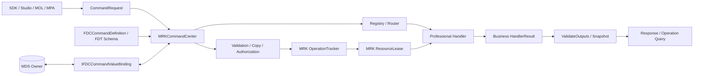
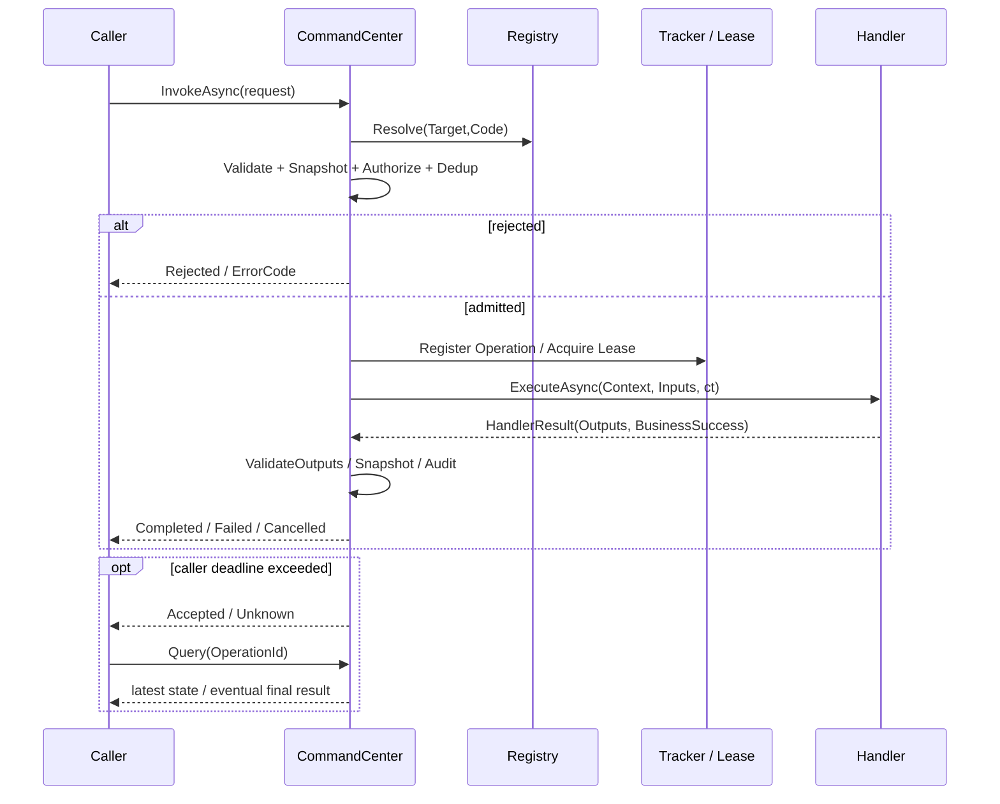

# CxVisual_公共机制体系#命令中心——进程内实现与验收_V1.0

> 状态：2026-10-24 新增 P0 可执行实现；以本次实际提交 SHA、Windows CI 日志为准。本文不把跨进程/跨PC、真实PLC动作、现场安全联锁或Studio完整界面冒充已完成。
> 上位规范：`DOCS/Architecture/CxVisual_公共机制体系#统一交互——四大能力与双层总线完整设计及验收_V1.5.md`；已存在 M12 命令定义和 M28/MRK 运行约束。

## 1. 设计裁决：不建第二套命令/执行/数据体系

- 唯一**命令定义**：`Foundation.Data.Commands/FDCCommandDefinition`，含稳定命令 ID、Code、名称、版本、输入/输出 Schema、权限、默认超时。FDCCommandParameterDefinition 是输入输出的同一种参数定义；所在 Inputs/Outputs 决定方向。新增 TypeDescriptor 来自已有 `FDTDataTypeDescriptor`，不再建立 TypeRegistry。
- **通用数据边界**：`Foundation.Data.Commands/FDCCommandValueSnapshot` 与 `IFDCCommandValueBinding`。快照依托已存在的 `FDTDataValueSafety/FDTDataAdapterRegistry`；在一次操作受理前深复制受支持的值，拒绝没有安全复制机制的 DTO 或原生指针；绑定接口由 MDS/专业 Owner 提供真实读写。
- **运行命令 Owner**：`Mechanism.Runtime.Commands`，命令注册与对象发现、发起、结果、操作跟踪、资源/容量仲裁及取消；已有 `MRKExternalOperationTracker`、`MRKResourceLeaseCoordinator` 被复用。一个 Host 内实例化、`IDisposable` 生命周期；不设静态全局中心。
- **专业 Handler**：由 Automation / Vision / CT3D / Inspection / HMI / Simulation 或宿主注册。通用层不调用厂商 SDK，不隐式执行硬实时或安全动作。
- **消息 M36**：只通知/订阅，不可因订阅一个名字相同的 Topic 而执行命令。MDS 数据/变量仍属于 MDS；MPA Mapping 的 Invoke 仍依靠宿主显式装配回调和授权，当前不增加新的适配仓库。
- **可扩展性**：P0 `Options.Remote=true` 明确拒绝；后续在 Runtime.Host 侧实现经过认证的 IPC/Transport，不能将请求在同进程假处理来宣称远程支持。

## 2. 类与职责（现有 MCE 类保留，新增类复用已存在两个 Owner 项目）

| 类/接口 | 唯一Owner | 核心成员/行为 |
|---|---|---|
| FDCCommandDefinition | Foundation.Data/Commands | CommandId、CommandCode、Name、SchemaVersion、Inputs/Outputs、PermissionKey、TimeoutMilliseconds、BindInputs、ValidateOutputs |
| FDCCommandParameterDefinition | Foundation.Data/Commands | Code、DataType、TypeDescriptor、Required、HasDefaultValue、DefaultValue、Unit、MinValue、MaxValue、ValidateValue |
| FDCCommandDefinitionCatalog | Foundation.Data/Commands | 只读定义快照，Find(id/code)、Snapshot |
| FDCCommandValueSnapshot | Foundation.Data | Capture(values, adapters)：有界递归防可变引用泄漏 |
| IFDCCommandValueBinding | Foundation.Data | ReadAsync(address,ct)、WriteAsync(address,value,ct)：由现有数据Owner实现 |
| MRKCommandDescriptor | Mechanism.Runtime | Target、Definition、Kind、Policy、Capabilities |
| MRKCommandPolicy | Mechanism.Runtime | MaxConcurrent、ResourceId、Dispatch、SupportsCancellation；限流不使用无界队列 |
| MRKCommandRegistry | Mechanism.Runtime | Register、Find、Discover、SetEnabled、Dispose；注销令牌防止代次串扰 |
| MRKCommandRouter | Mechanism.Runtime | Resolve(Target,Code)、Discover；不持有第二份定义 |
| MRKCommandCenter | Mechanism.Runtime | Register、Submit、InvokeAsync、InvokeBatchAsync、InvokeBoundAsync、Query、Cancel、AddInterceptor、Dispose |
| MRKCommandSubmission | Mechanism.Runtime | Response（受理回执）、Operation（可查询操作票据） |
| MRKCommandRequest | Mechanism.Runtime | Target、CommandCode、Inputs、Caller、RequestId、OperationId、Options |
| MRKCommandOptions | Mechanism.Runtime | TimeoutMilliseconds、Remote（P0明确拒绝） |
| IMRKCommandHandler / MRKDelegateCommandHandler | Mechanism.Runtime | ExecuteAsync(Context,Inputs,ct) → HandlerResult |
| MRKCommandHandlerResult | Mechanism.Runtime | Outputs、BusinessSuccess、BusinessCode；业务否定不等于执行失败 |
| MRKCommandResponse | Mechanism.Runtime | Stage、State、Outputs、BusinessSuccess、ErrorCode、Error、DurationMilliseconds |
| MRKCommandExecution | Mechanism.Runtime | OperationId、Snapshot、Completion、Progress、ProgressMessage；执行状态有界留存 |
| MRKCommandContext | Mechanism.Runtime | RequestId、OperationId、Caller、Target、Descriptor、ReportProgress |
| MRKCommandParameterBinding | Mechanism.Runtime | Parameter、DataAddress，连接真实数据 Owner |
| IMRKCommandInterceptor | Mechanism.Runtime | BeforeAsync、AfterAsync；日志/审计/仪表授权等可插拔钩子 |

Command / Input / Output / Dispatcher / Executor / Validator 的逻辑角色并未另行各复制一份业务状态：定义与参数由 FDC 提供；请求/响应由 MRKCommandRequest/Response 提供；分发与执行由 MRKCommandCenter 管线、Router、MRK ResourceLease、Handler 提供；验证由 FDC BindInputs/ValidateOutputs 与 FDT Capture 提供。未来有独立策略或线程变化点时，再从管线提取类型，不为满足模式数量制造空壳。

## 3. 生命周期及调用关系





定义与调用实例分离；相同 CommandId 可以在两个不同 Target 下由两个专业实例分别注册 Handler。命令执行完成不表示厂商驱动真实运动/曝光完成；业务输出 Success 不等于执行状态，设备现场确认要走专业反读及联锁。

## 4. 最短可编译使用示例：算法模块

```csharp
using System;
using System.Collections.Generic;
using System.Threading.Tasks;
using CxVisual.Foundation.Data.Commands;
using CxVisual.Mechanism.Runtime.Commands;

FDCCommandDefinition definition = new FDCCommandDefinition(1001, "Add", "加法",
    new[] {
        new FDCCommandParameterDefinition("A", typeof(double), true),
        new FDCCommandParameterDefinition("B", typeof(double), false, true, 2.0)
    },
    new[] { new FDCCommandParameterDefinition("Sum", typeof(double), true) });
using (MRKCommandCenter center = new MRKCommandCenter())
using (center.Register(new MRKCommandDescriptor("algorithm/math", definition,
    MRKCommandKind.Module, new MRKCommandPolicy(maxConcurrent: 4)),
    new MRKDelegateCommandHandler((context, inputs, cancellation) =>
        Task.FromResult(new MRKCommandHandlerResult(
            new Dictionary<string, object> {
                { "Sum", (double)inputs["A"] + (double)inputs["B"] }
            })))))
{
    MRKCommandResponse response = center.InvokeAsync(new MRKCommandRequest(
        "algorithm/math", "Add",
        new Dictionary<string, object> { { "A", 5.0 } }))
        .GetAwaiter().GetResult();
    // response.State == Completed; response.Outputs["Sum"] == 7.0
}
```

示例作为方法内部代码块粘贴执行；WPF UI应使用 await 而非阻塞 GetResult。

设备命令以 `MRKCommandKind.Device` 注册且无 Host 授权器时直接 Rejected(Unauthorized)。硬件 Provider 负责联锁、资源确认、紧急停止；进程内 MRKLease 不是安全级互锁。

## 5. 入参、出参、复杂数据、数据映射

- 无参数/单参数/多参数：`FDCCommandDefinition.Inputs/Outputs` 为独立 Schema；Missing 与显式 0/false/null 区分，范围/Type/必填等先校验。
- 嵌套：字典 `Dictionary<string,object>`、`List<object>`、一维数组及简单值支持有界安全副本；专业DTO必须在单个 Host/Flow 的 `FDTDataAdapterRegistry` 注册深复制/冻结规则。禁止将 Image/Volume/SDK句柄直接当可复制参数，使用正式 MDS DataHandle/受控引用。
- 参数所有权：中心取得入参快照；Handler 输出先校验再复制，返回值通过 ReadOnlyDictionary 观察。数组快照不与调用方共享可变内存。当前不提供统一跨进程序列化器；外部序列化须采用稳定 TypeId/SchemaVersion/Codec，不以 CLR Type.Name 充当 wire protocol。
- `InvokeBoundAsync` 的参数地址由宿主实现 `IFDCCommandValueBinding`，用已有 MDSVariableTable / Heap / Frame、MOL 端口；执行完成时才向输出地址写入。数据回写失败会抛错，但**不能将已经发生的业务副作用解释为未执行**；未来需要专门 MappingResult、事务/补偿闭环。
- 用户自定义格式、范围关联、表达式、FCM 反射编辑与强类型 MOL 端口的自动生成，须继续复用原配置/构建机制，P0 不建立平行的动态参数定义仓库。

## 6. 可靠性和安全边界

1. Host作用域唯一Registry；注册返回可释放令牌、Enable/Disable，新请求按确切Target+Code寻找。
2. 有界并发（MaxConcurrent），超出立即 Busy；共享资源使用 MRKResourceLease；不存在无限积压队列。
3. OperationId重复请求需 Caller/Target/Code/参数完全一致；同进程只执行一次，同操作返回票据，冲突拒绝。复杂Adapter DTO缺稳定值相等能力时拒绝重放；不是跨崩溃 exactly-once。
4. 默认等待超时继承：请求 > 定义 > Host。超时返回 Unknown；允许取消时发送协作取消。若设备不能取消，Operation继续可查询；取消绝不等于硬件停止。
5. Device 或设置 PermissionKey 时授权回调必需；所有命令可由Host提供授权器。Caller字符串只是诊断提示，生产必须由Host把它关联到认证身份、模式和权限；不能把请求自带Caller当凭证。
6. 拦截器前置阻止Handler执行，后置失败不能谎称副作用从未发生；使用Unknown及诊断。非幂等设备操作不自动重试。
7. 历史操作表有界但暂不自动清退：容量达到MaxOperations时拒绝新命令，不能靠删未确认操作释放容量；正式长期Host需要带审计的归档/保留策略。
8. 广播到多设备、进程间远程寻址、持久重试/补偿/权限中心集成、长任务暂停恢复、真实现场确认、跨进程数据快照、完整监控指标仍属于后续实施项。

## 7. 专项验收与执行入口

- 命令行：`Output/Debug/x64/CxVisual.Tests.ArchitectureSmoke.exe --command-center`
- 默认回归：`Output/Debug/x64/CxVisual.Tests.ArchitectureSmoke.exe`
- Windows正式构建：`msbuild CxVisual.Unified.sln /t:Rebuild /p:Configuration=Debug /p:Platform=x64`
- 用例：发现、注册与禁用、默认值、范围/类型、未注册/未授权/远程拒绝、同一操作ID去重与冲突、业务失败与执行错误分离、真实MDSVariable绑定和写回、批量、并发Busy、超时Unknown后完成、byte[]安全快照。
- 验证结果：必须以提交之后同 SHA 的 Windows CI / 实际运行日志更新，不以本设计文件写入成功宣称已验收。实机、跨PC、Studio操作、生产级安全及长期性能未在上述单测中验收。

## 8. 后续与特别风险

- A：补齐命令ID精确别名寻址、原生MOL编排端口/FCM Studio可视表单的端到端流程。
- B：正式的Host授权身份注入、审计流水、可持久化结果归档与幂等密钥、Metrics + Query/Cancel运维接口。
- C：设备Provider确认、超时Unknown对账、不支持取消设备的补偿；真实HIL/断线恢复。
- D：经鉴权的IPC/远端桥接、稳定Codec、协议版本及跨PC异常/网络分区测试。
- E：具名受控广播/队列调度、可停止/暂停长流程只通过对应MRK已存在能力组合，不在命令中心造平行Runner。

> **2026-10-24 新Owner裁决**：命令相关代码正式收敛至 `Foundation.Data.Commands`（FDC参数/定义/契约）与 `Mechanism.Runtime.Commands`（MRK中心/执行/MDS适配）两个已有项目；历史M12/MCE归属不再是当前实现。详见 `DOCS/Decisions/CxVisual_统一命令中心双项目归属裁决_V1.0.md`。
