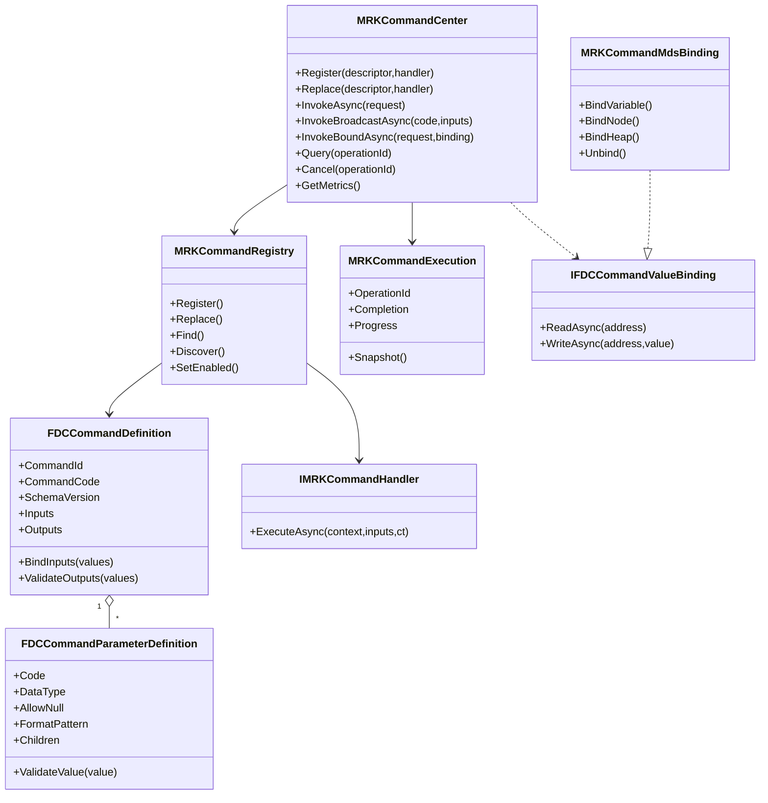
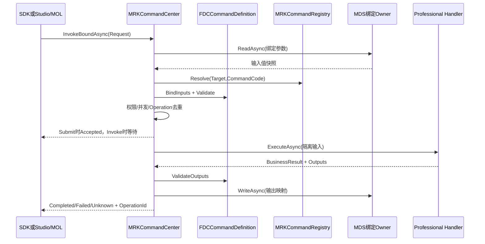

# CxVisual 统一命令中心——代码增量与验收 V1.0

> 2026-10-24；基于 GitHub master `f9f3f330e4c82007d097eb01167ca7b98b41568c` 审计及后续提交。文档、源代码、实际 Windows CI、设备实测分别分级；不以代码存在冒充全部60条功能已完成。

## 1. Owner 与现存代码

- Foundation.Data/Commands：`IFDCCommandValueBinding`、`FDCCommandValueSnapshot`，复用 `FDTDataTypeDescriptor`、`FDTDataValueSafety`，不另建一个参数数据仓库。
- Foundation.Data/Commands：`FDCCommandDefinition`、`FDCCommandParameterDefinition`、`FDCCommandDefinitionCatalog` 是静态命令定义与输入/输出契约。不能把编辑器Definition混成运行中Request。
- Mechanism.Runtime/Commands：`MRKCommandCenter`、`MRKCommandRegistry`、`MRKCommandRouter`、`IMRKCommandHandler`、`MRKCommandExecution` 是一次命令的正式运行入口/跟踪。
- Mechanism.Data：现有 MDS/变量 Owner 通过 `IFDCCommandValueBinding` 提供参数源/输出映射，不新造数据堆。
- Mechanism.Runtime.Execution：复用 `MRKExternalOperationTracker`、`MRKResourceLeaseCoordinator` 管理运行账本与资源租约，不复制流程调度器。
- ReferTo 中 `MessageInterfaces/MessageCenter`、`DeviceVariable` 仅作历史实现参考；实时消息属现有 M36 `MNMMessageCenter`，不把Command当Event广播处理。

## 2. 典型调用

```csharp
FDCCommandDefinition definition = new FDCCommandDefinition(
    1001, "Calculate", "计算",
    new[] { new FDCCommandParameterDefinition("Input", typeof(double), true) },
    new[] { new FDCCommandParameterDefinition("Output", typeof(double), true) });
using (MRKCommandCenter center = new MRKCommandCenter())
using (center.Register(new MRKCommandDescriptor("algorithm", definition),
    new MRKDelegateCommandHandler((ctx, input, ct) =>
        Task.FromResult(new MRKCommandHandlerResult(
            new Dictionary<string, object> { { "Output", (double)input["Input"] * 2 } })))))
{
    MRKCommandResponse result = await center.InvokeAsync(
        new MRKCommandRequest("algorithm", "Calculate",
            new Dictionary<string, object> { { "Input", 5.0 } }));
    // 只有 Stage==Accepted 且 State==Completed 说明执行成功；
    // BusinessSuccess 可独立为 false；输出数据仍受快照保护。
}
```

## 3. P0现有功能与本次强化

- 命令注册、注销令牌、启停、目标/类别/能力发现、无参/多参及数组快照；
- 直接/线程池调度、进程内异步请求-响应、批量、并发限流、操作去重、取消/超时与晚到结果查询；
- Handler输出Schema验证、业务结果独立于执行状态、参数数据Owner绑定与输出映射、回调/进度；
- 新增 `Registry.Replace` / `Center.Replace`，热替换Handler不影响已受理旧调用，旧令牌不得删除新代次；
- 新增名称和命令Code发现过滤、进程内 `GetMetrics` 运行账本只读统计；
- 幂等重放返回本次调用的 `RequestId`，保留原 `OperationId`；
- 输入分别复制给拦截器和Handler，避免修改幂等比对的输入快照；输出每次读取隔离复制嵌套可变值；
- 输出绑定名称与重复目标在执行前验证，错误配置不得先触发设备副作用；
- 中心锁外触发取消回调，降低阻塞/重入风险。

## 4. 显式未完成或不得宣称

1. 真正的跨进程/跨PC transport/身份认证：`Remote=true` 当前拒绝并返回 `RemoteUnsupported`，没有隐式退回本地。
2. 完整嵌套可编辑参数树、表达式选择器、复杂DTO序列化及跨机器Schema兼容尚需和既有FCM/MDS/Studio方案结合验收；DTO必须具备值Adapter。
3. 排队调度、优先级、公平性、暂停恢复、流式中间结果、跨Host状态持久化、真正分布式幂等和状态恢复未完成。
4. 设备真实HIL、权限体系完整集成、硬件联锁和急停未做；现有目标侧授权器只是一层明确防线，不代表完整身份安全验证。
5. `InvokeBoundAsync` 的多个输出写入不是跨MDS目标事务。命令执行成功与输出写入失败应分别追踪，不能以输出映射异常认定设备动作未发生。
6. 尚未实现独立`CommandDispatcher`/`CommandExecutor`可替换接口；现有Center组合MRK运行机制，后续如需拆分应先识别独立复用价值。
7. 全部要求完成的判据仍是固定SHA Windows编译、专项 `--command-center`、默认回归、Studio实交互、设备/网络对应HIL。

## 5. 验收

`Tests/ArchitectureSmoke/Integration/CommandCenterTests.cs` 覆盖原有正反用例及新增热替换代次、名称查询、请求/操作身份隔离、参数变异隔离、可变输出保护、映射反证和Metrics。

运行：
```powershell
msbuild CxVisual.Unified.sln /m:1 /t:Rebuild /p:Configuration=Debug /p:Platform=x64
.\Output\Debug\x64\CxVisual.Tests.ArchitectureSmoke.exe --command-center
.\Output\Debug\x64\CxVisual.Tests.ArchitectureSmoke.exe
```

CI状态以对应提交的实际工作流结论为准，未核实结果不写“通过”。

## 6. 正式MDS绑定适配器（增量）

`Mechanism/Data/Variables/MRKCommandMdsBinding.cs` 新增生产级薄适配器，复用 `MDSVariableTable`、`IMDSDataContext`，提供 `BindVariable<T>`、`BindNode<T>`、`BindHeap<T>`、`Unbind`。地址只作命令入/出参别名；MDS中的变量、节点作用域、堆、类型与读写权限仍然由其现有Owner管理。绑定生命周期与数据Owner生命周期独立；Unbind/Dispose仅释放地址索引。

测试用正式 `MDSVariableTable` 检查进出参数映射、只读拒绝、重复地址拒绝、类型不符拒绝、解绑后不存在拒绝。节点与Heap直接使用各自 `IMDSDataContext`，仍需对应运行Session更完整的集成场景。

## 7. 结构化参数 Schema 验证（增量）

`FDCCommandParameterDefinition` 保持向后兼容的构造函数，新增长尾可选参数 `allowNull`、`readOnly`、`formatPattern`、`children`。使用同一个输入/输出描述对象，嵌套的命名Map支持递归必填、类型、数值范围、字符串Regex（限50ms）及未知成员拒绝，输出同样校验。安全快照仍由Foundation.Data统一处理，深度/容量受到限制。

`ReadOnly` 是Studio呈现元数据，不能代替目标侧认证；自定义DTO跨PC序列化以及复杂Graph Schema、数组元素Schema、数据单位转换仍属后续专门验收。新增的CommandCenterTests覆盖嵌套正常/超范围/格式/必填/未知键/结果隔离六种路径。

## 8. 同步与广播调用（进程内正式增量）

`MRKCommandCenter.Invoke` 是SDK的同步等待入口，UI线程不可调用此阻塞入口；`InvokeBroadcastAsync` 使用唯一Registry发现并逐目标创建独立请求（最多256），复用 `InvokeBatchAsync` 和各目标受理、授权、限流、超时语义。默认禁止任何设备广播，显式开启也必须逐目标通过Host授权，不允许以广播规避安全门禁。没有订阅目标时返回零项，不伪造成功目标。

### 运行关系与类图



### 命令时序



**设备场景**：`Automation` 注册轴移动Handler，固定的Definition指定位置/速度约束，Host必须注入授权和专业安全校验。不能把超时、取消视为轴停止。

**算法场景**：`Vision` 可注册图像检测/参数化计算Handler，返回缺陷/分数或受控Handle，图片或大数据不能当作普通可变对象随意深拷贝。

**流程场景**：`MOL` 运行节点编译为MRK调用目标Command，参数从节点Input/FlowHeap映射，结果通过MDS返回；不得构造第二套Graph Executor。

这些为正式API使用方式与待覆盖场景边界，未完成的专业设备/实际Studio拖拽操作不得冒称已HIL验收。

> **2026-10-24 新Owner裁决**：命令相关代码正式收敛至 `Foundation.Data.Commands`（FDC参数/定义/契约）与 `Mechanism.Runtime.Commands`（MRK中心/执行/MDS适配）两个已有项目；历史M12/MCE归属不再是当前实现。详见 `DOCS/Decisions/CxVisual_统一命令中心双项目归属裁决_V1.0.md`。

## 10. 稳定命令ID和版本检查（继续实施）

- Registry 不允许同一 Target 下不同 Code 占用相同 CommandId；热替换也不得引入冲突。不同Target的CommandId可重复。
- Router.ResolveById 与 Discover(commandId:,schemaVersion:) 可用于Studio发布前查找及能力筛选。
- MRKCommandRequest.expectedSchemaVersion>0 时执行前校验目标 SchemaVersion，版本不符返回 SchemaVersionMismatch 且 Handler 未执行；绑定调用透传该值。
- ArchitectureSmoke专项新增正反断言。远程Transport、版本迁移和多版本并存仍未实现。

## 11. F19驱动的正式Dispatcher / Executor（增量P1）

新增 `Mechanism/Runtime/Commands/MRKCommandDispatching.cs`，仍属 `CxVisual.Mechanism.Runtime`（没有第三个命令项目）。

- `MRKCommandDispatcher` 只包裹已有 `FCRWorker`：`Enqueue`、`Snapshot`、`StopAsync`，不实现新的Queue/优先级/线程池。Host可以注入共享Dispatcher，也可以由Center持有其生命周期。
- `MRKCommandExecutor` 从原Center抽取真正的Handler执行管线，保留MRK ResourceLease、MRK Tracker、输入隔离、Before/After拦截、业务结果与执行状态、异常/取消。
- `MRKCommandDispatch` 追加 `Queued`（旧枚举值保持）；`MRKCommandOptions(priority)` 控制F19跨目标调度优先级，限定[-1000,1000]。`Queued` 对同一Target+Code严格FIFO、`MaxConcurrent=1`，不同命令可跨Key并行；不作为高实时PLC运动控制的替代品。
- `MRKCommandCenter(queuedConcurrency, queueCapacity, dispatcher)` 控制Host有界容量。排队满即 `Rejected/QueueFull`，不进入执行账本/Tracker；受理为 `Accepted/Queued`，未运行取消经F19结算为 `CancelledBeforeExecute`，若开始则进 `Running`。
- 超时只是调用观察Unknown，底层的实际操作仍保持OperationId查询；设备停止仍由Professional设备联锁/反馈确认。
- `GetQueueSnapshot` 返回F19已有快照，`StopQueueAsync` 支持关闭排队；`Dispose` 协作取消且不阻塞调用者等待危险硬件操作。

### 示例

```csharp
MRKCommandPolicy policy = new MRKCommandPolicy(dispatch: MRKCommandDispatch.Queued);
using (MRKCommandCenter center = new MRKCommandCenter(
    queuedConcurrency: 2, queueCapacity: 32))
using (center.Register(new MRKCommandDescriptor("algorithm/modelA", definition,
    policy: policy), handler))
{
    MRKCommandRequest request = new MRKCommandRequest("algorithm/modelA", "Detect",
        inputs, options: new MRKCommandOptions(priority: 20));
    MRKCommandResponse response = await center.InvokeAsync(request);
    // 若Accepted + Unknown必须用OperationId继续查询，禁止据此认为设备已停止。
}
```

`definition/handler/inputs` 必须来自正式注册与专业模块，例子不是伪造设备SDK。

### 本轮仍未实现的完整要求

跨PC Transport、真实权限身份/安全联锁、持久化队列/掉电恢复、命令暂停恢复（需要Handler协作契约）、长任务流式中间结果、跨目标原子事务、Studio可视化命令属性面板、通用可配置重试均未完成；不能因调度接口存在而冒称已通过现场验收。

## 12. 长任务协作暂停/恢复与中间结果

本次只对明确声明 `MRKCommandPolicy(supportsPause: true)` 的Handler启用协作暂停。 `MRKCommandCenter.Pause(OperationId)` 将状态设为 `PauseRequested`；**只有Handler实际调用 `MRKCommandContext.WaitWhilePausedAsync(token)` 才进入 `Paused`**。 `Resume` 释放等待检查点；`Cancel` 可通过同一CancellationToken打断检查点。运行中若无检查点，PauseRequested并不代表设备停止，也不会强行停止物理运动。

Handler可调用 `ReportProgress` 和 `ReportIntermediate`；Execution暴露最新中间结果快照 `IntermediateOutputs`，复用Foundation.Data值复制规则，不另建流式数据存储。中间输出不等于最终Outputs、不经过最终输出Schema约束；完成时由原有 `ValidateOutputs` 校验Final结果。进度和中间值是有界最新状态，不记录无限历史。

专项正反测试覆盖：请求与确认状态区分、Resume后继续同一次命令、byte[]中间值快照隔离、暂停中协作取消、未声明暂停能力时拒绝控制。

**未完成**：真实设备暂停/恢复驱动回执、跨进程任务恢复、持久化进度/状态、流式多帧历史、Studio Watch同步、暂停时安全联锁以及在执行前主动暂停排队的策略。
