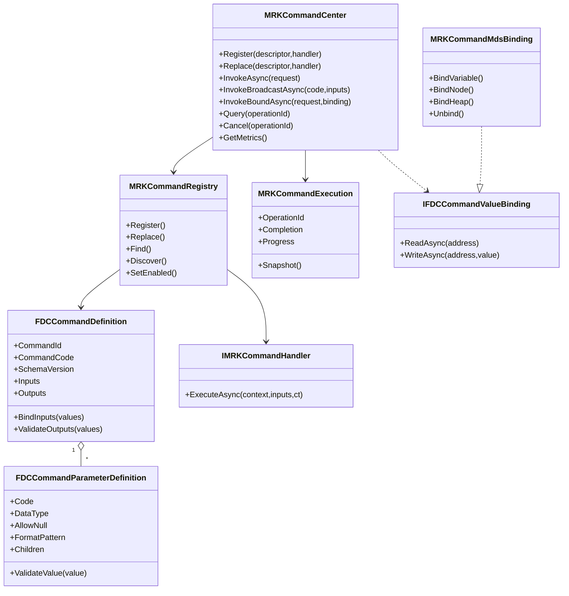
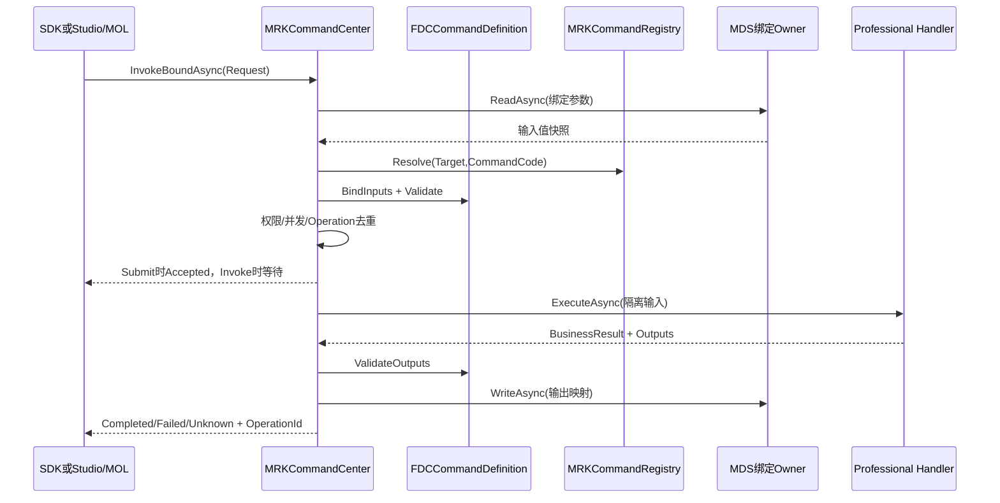

# CxVisual 统一命令中心——代码增量与验收 V1.0

> 2026-10-24；基于 GitHub master `f9f3f330e4c82007d097eb01167ca7b98b41568c` 审计及后续提交。文档、源代码、实际 Windows CI、设备实测分别分级；不以代码存在冒充全部60条功能已完成。

## 1. Owner 与现存代码

- Foundation.Data/Commands：`IFDCCommandValueBinding`、`FDCCommandValueSnapshot`，复用 `FDTDataTypeDescriptor`、`FDTDataValueSafety`，不另建一个参数数据仓库。
- Foundation.Data/Commands：`FDCCommandDefinition`、`FDCCommandParameterDefinition`、`FDCCommandDefinitionCatalog` 是静态命令定义与输入/输出契约。不能把编辑器Definition混成运行中Request。
- Mechanism.Runtime/Commands：`MRKCommandCenter`、`MRKCommandRegistry`、`MRKCommandRouter`、`IMRKCommandHandler`、`MRKCommandExecution` 是一次命令的正式运行入口/跟踪。
- Mechanism.Data：现有 MDS/变量 Owner 通过 `IFDCCommandValueBinding` 提供参数源/输出映射，不新造数据堆。
- Mechanism.Runtime.Execution：复用 `MRKExternalOperationTracker`、`MRKResourceLeaseCoordinator` 管理运行账本与资源租约，不复制流程调度器。
- ReferTo 中 `MessageInterfaces/MessageCenter`、`DeviceVariable` 仅作历史实现参考；实时消息属现有 M36 `MNMMessageCenter`，不把Command当Event广播处理。

## 2. 典型调用

```csharp
FDCCommandDefinition definition = new FDCCommandDefinition(
    1001, "Calculate", "计算",
    new[] { new FDCCommandParameterDefinition("Input", typeof(double), true) },
    new[] { new FDCCommandParameterDefinition("Output", typeof(double), true) });
using (MRKCommandCenter center = new MRKCommandCenter())
using (center.Register(new MRKCommandDescriptor("algorithm", definition),
    new MRKDelegateCommandHandler((ctx, input, ct) =>
        Task.FromResult(new MRKCommandHandlerResult(
            new Dictionary<string, object> { { "Output", (double)input["Input"] * 2 } })))))
{
    MRKCommandResponse result = await center.InvokeAsync(
        new MRKCommandRequest("algorithm", "Calculate",
            new Dictionary<string, object> { { "Input", 5.0 } }));
    // 只有 Stage==Accepted 且 State==Completed 说明执行成功；
    // BusinessSuccess 可独立为 false；输出数据仍受快照保护。
}
```

## 3. P0现有功能与本次强化

- 命令注册、注销令牌、启停、目标/类别/能力发现、无参/多参及数组快照；
- 直接/线程池调度、进程内异步请求-响应、批量、并发限流、操作去重、取消/超时与晚到结果查询；
- Handler输出Schema验证、业务结果独立于执行状态、参数数据Owner绑定与输出映射、回调/进度；
- 新增 `Registry.Replace` / `Center.Replace`，热替换Handler不影响已受理旧调用，旧令牌不得删除新代次；
- 新增名称和命令Code发现过滤、进程内 `GetMetrics` 运行账本只读统计；
- 幂等重放返回本次调用的 `RequestId`，保留原 `OperationId`；
- 输入分别复制给拦截器和Handler，避免修改幂等比对的输入快照；输出每次读取隔离复制嵌套可变值；
- 输出绑定名称与重复目标在执行前验证，错误配置不得先触发设备副作用；
- 中心锁外触发取消回调，降低阻塞/重入风险。

## 4. 显式未完成或不得宣称

1. 真正的跨进程/跨PC transport/身份认证：`Remote=true` 当前拒绝并返回 `RemoteUnsupported`，没有隐式退回本地。
2. 完整嵌套可编辑参数树、表达式选择器、复杂DTO序列化及跨机器Schema兼容尚需和既有FCM/MDS/Studio方案结合验收；DTO必须具备值Adapter。
3. 排队调度、优先级、公平性、暂停恢复、流式中间结果、跨Host状态持久化、真正分布式幂等和状态恢复未完成。
4. 设备真实HIL、权限体系完整集成、硬件联锁和急停未做；现有目标侧授权器只是一层明确防线，不代表完整身份安全验证。
5. `InvokeBoundAsync` 的多个输出写入不是跨MDS目标事务。命令执行成功与输出写入失败应分别追踪，不能以输出映射异常认定设备动作未发生。
6. 尚未实现独立`CommandDispatcher`/`CommandExecutor`可替换接口；现有Center组合MRK运行机制，后续如需拆分应先识别独立复用价值。
7. 全部要求完成的判据仍是固定SHA Windows编译、专项 `--command-center`、默认回归、Studio实交互、设备/网络对应HIL。

## 5. 验收

`Tests/ArchitectureSmoke/Integration/CommandCenterTests.cs` 覆盖原有正反用例及新增热替换代次、名称查询、请求/操作身份隔离、参数变异隔离、可变输出保护、映射反证和Metrics。

运行：
```powershell
msbuild CxVisual.Unified.sln /m:1 /t:Rebuild /p:Configuration=Debug /p:Platform=x64
.\Output\Debug\x64\CxVisual.Tests.ArchitectureSmoke.exe --command-center
.\Output\Debug\x64\CxVisual.Tests.ArchitectureSmoke.exe
```

CI状态以对应提交的实际工作流结论为准，未核实结果不写“通过”。

## 6. 正式MDS绑定适配器（增量）

`Mechanism/Data/Variables/MRKCommandMdsBinding.cs` 新增生产级薄适配器，复用 `MDSVariableTable`、`IMDSDataContext`，提供 `BindVariable<T>`、`BindNode<T>`、`BindHeap<T>`、`Unbind`。地址只作命令入/出参别名；MDS中的变量、节点作用域、堆、类型与读写权限仍然由其现有Owner管理。绑定生命周期与数据Owner生命周期独立；Unbind/Dispose仅释放地址索引。

测试用正式 `MDSVariableTable` 检查进出参数映射、只读拒绝、重复地址拒绝、类型不符拒绝、解绑后不存在拒绝。节点与Heap直接使用各自 `IMDSDataContext`，仍需对应运行Session更完整的集成场景。

## 7. 结构化参数 Schema 验证（增量）

`FDCCommandParameterDefinition` 保持向后兼容的构造函数，新增长尾可选参数 `allowNull`、`readOnly`、`formatPattern`、`children`。使用同一个输入/输出描述对象，嵌套的命名Map支持递归必填、类型、数值范围、字符串Regex（限50ms）及未知成员拒绝，输出同样校验。安全快照仍由Foundation.Data统一处理，深度/容量受到限制。

`ReadOnly` 是Studio呈现元数据，不能代替目标侧认证；自定义DTO跨PC序列化以及复杂Graph Schema、数组元素Schema、数据单位转换仍属后续专门验收。新增的CommandCenterTests覆盖嵌套正常/超范围/格式/必填/未知键/结果隔离六种路径。

## 8. 同步与广播调用（进程内正式增量）

`MRKCommandCenter.Invoke` 是SDK的同步等待入口，UI线程不可调用此阻塞入口；`InvokeBroadcastAsync` 使用唯一Registry发现并逐目标创建独立请求（最多256），复用 `InvokeBatchAsync` 和各目标受理、授权、限流、超时语义。默认禁止任何设备广播，显式开启也必须逐目标通过Host授权，不允许以广播规避安全门禁。没有订阅目标时返回零项，不伪造成功目标。

### 运行关系与类图



### 命令时序



**设备场景**：`Automation` 注册轴移动Handler，固定的Definition指定位置/速度约束，Host必须注入授权和专业安全校验。不能把超时、取消视为轴停止。

**算法场景**：`Vision` 可注册图像检测/参数化计算Handler，返回缺陷/分数或受控Handle，图片或大数据不能当作普通可变对象随意深拷贝。

**流程场景**：`MOL` 运行节点编译为MRK调用目标Command，参数从节点Input/FlowHeap映射，结果通过MDS返回；不得构造第二套Graph Executor。

这些为正式API使用方式与待覆盖场景边界，未完成的专业设备/实际Studio拖拽操作不得冒称已HIL验收。

> **2026-10-24 新Owner裁决**：命令相关代码正式收敛至 `Foundation.Data.Commands`（FDC参数/定义/契约）与 `Mechanism.Runtime.Commands`（MRK中心/执行/MDS适配）两个已有项目；历史M12/MCE归属不再是当前实现。详见 `DOCS/Decisions/CxVisual_统一命令中心双项目归属裁决_V1.0.md`。

## 10. 稳定命令ID和版本检查（继续实施）

- Registry 不允许同一 Target 下不同 Code 占用相同 CommandId；热替换也不得引入冲突。不同Target的CommandId可重复。
- Router.ResolveById 与 Discover(commandId:,schemaVersion:) 可用于Studio发布前查找及能力筛选。
- MRKCommandRequest.expectedSchemaVersion>0 时执行前校验目标 SchemaVersion，版本不符返回 SchemaVersionMismatch 且 Handler 未执行；绑定调用透传该值。
- ArchitectureSmoke专项新增正反断言。远程Transport、版本迁移和多版本并存仍未实现。

## 11. F19驱动的正式Dispatcher / Executor（增量P1）

新增 `Mechanism/Runtime/Commands/MRKCommandDispatching.cs`，仍属 `CxVisual.Mechanism.Runtime`（没有第三个命令项目）。

- `MRKCommandDispatcher` 只包裹已有 `FCRWorker`：`Enqueue`、`Snapshot`、`StopAsync`，不实现新的Queue/优先级/线程池。Host可以注入共享Dispatcher，也可以由Center持有其生命周期。
- `MRKCommandExecutor` 从原Center抽取真正的Handler执行管线，保留MRK ResourceLease、MRK Tracker、输入隔离、Before/After拦截、业务结果与执行状态、异常/取消。
- `MRKCommandDispatch` 追加 `Queued`（旧枚举值保持）；`MRKCommandOptions(priority)` 控制F19跨目标调度优先级，限定[-1000,1000]。`Queued` 对同一Target+Code严格FIFO、`MaxConcurrent=1`，不同命令可跨Key并行；不作为高实时PLC运动控制的替代品。
- `MRKCommandCenter(queuedConcurrency, queueCapacity, dispatcher)` 控制Host有界容量。排队满即 `Rejected/QueueFull`，不进入执行账本/Tracker；受理为 `Accepted/Queued`，未运行取消经F19结算为 `CancelledBeforeExecute`，若开始则进 `Running`。
- 超时只是调用观察Unknown，底层的实际操作仍保持OperationId查询；设备停止仍由Professional设备联锁/反馈确认。
- `GetQueueSnapshot` 返回F19已有快照，`StopQueueAsync` 支持关闭排队；`Dispose` 协作取消且不阻塞调用者等待危险硬件操作。

### 示例

```csharp
MRKCommandPolicy policy = new MRKCommandPolicy(dispatch: MRKCommandDispatch.Queued);
using (MRKCommandCenter center = new MRKCommandCenter(
    queuedConcurrency: 2, queueCapacity: 32))
using (center.Register(new MRKCommandDescriptor("algorithm/modelA", definition,
    policy: policy), handler))
{
    MRKCommandRequest request = new MRKCommandRequest("algorithm/modelA", "Detect",
        inputs, options: new MRKCommandOptions(priority: 20));
    MRKCommandResponse response = await center.InvokeAsync(request);
    // 若Accepted + Unknown必须用OperationId继续查询，禁止据此认为设备已停止。
}
```

`definition/handler/inputs` 必须来自正式注册与专业模块，例子不是伪造设备SDK。

### 本轮仍未实现的完整要求

跨PC Transport、真实权限身份/安全联锁、持久化队列/掉电恢复、命令暂停恢复（需要Handler协作契约）、长任务流式中间结果、跨目标原子事务、Studio可视化命令属性面板、通用可配置重试均未完成；不能因调度接口存在而冒称已通过现场验收。

## 12. 长任务协作暂停/恢复与中间结果

本次只对明确声明 `MRKCommandPolicy(supportsPause: true)` 的Handler启用协作暂停。 `MRKCommandCenter.Pause(OperationId)` 将状态设为 `PauseRequested`；**只有Handler实际调用 `MRKCommandContext.WaitWhilePausedAsync(token)` 才进入 `Paused`**。 `Resume` 释放等待检查点；`Cancel` 可通过同一CancellationToken打断检查点。运行中若无检查点，PauseRequested并不代表设备停止，也不会强行停止物理运动。

Handler可调用 `ReportProgress` 和 `ReportIntermediate`；Execution暴露最新中间结果快照 `IntermediateOutputs`，复用Foundation.Data值复制规则，不另建流式数据存储。中间输出不等于最终Outputs、不经过最终输出Schema约束；完成时由原有 `ValidateOutputs` 校验Final结果。进度和中间值是有界最新状态，不记录无限历史。

专项正反测试覆盖：请求与确认状态区分、Resume后继续同一次命令、byte[]中间值快照隔离、暂停中协作取消、未声明暂停能力时拒绝控制。

**未完成**：真实设备暂停/恢复驱动回执、跨进程任务恢复、持久化进度/状态、流式多帧历史、Studio Watch同步、暂停时安全联锁以及在执行前主动暂停排队的策略。

## 13. 执行完成与输出映射结果明确分层

新增 `MRKCommandCenter.InvokeBoundResultAsync` 返回 `MRKCommandBindingResult`：

- `Execution`：原命令受理、执行状态、业务结果与最终输出；**不因写回失败而改写**。
- `MappingAttempted`、`MappingSucceeded`：是否尝试写回及是否全部写回成功。
- `MappedAddresses`：确实已经成功写入的地址集合，便于运维查询局部副作用。
- `MappingErrorCode`、`MappingError`：区分未找到所需输出、数据Owner写入失败、取消等。

输出字段在首次写入之前全部检查是否存在，防止“缺字段”造成一半写回；但对真实MDS、PLC或多数据Owner写回仍不承诺跨目标事务。旧 `InvokeBoundAsync` 继续返回 `MRKCommandResponse`；写回失败时抛 `MRKCommandOutputMappingException`，异常内携带同一 `MRKCommandBindingResult`，调用者仍能明确知道命令已经执行成功。

验收：模拟输出第一个写回成功、第二个写回异常时，`Execution.Completed`、`MappedAddresses`保留第一目标、执行账本仍可查询完成；若可选输出未返回，任何写回之前拒绝并报告 `OutputMissing`。**不能因输出映射失败重发设备命令**，重新映射需要独立受控恢复策略。

## 14. 稳定CommandId与CommandCode双寻址

`MRKCommandRequest` 保留原Code构造函数并追加可选 `commandId`，另提供 `MRKCommandRequest(Target,long CommandId,...)` 的ID-only入口。Controller/Registry将 `Target + CommandId` 解析为已有唯一的正式Handler；同时给出Code+ID时二者必须匹配，否则在执行前返回 `Rejected/CommandIdentityMismatch`。不存在的ID返回 `HandlerNotFound`；版本仍通过 `ExpectedSchemaVersion` 校验。

Operation账本继续以OperationId去重，同一OperationId的身份比较包括CommandId，避免调用方更换寻址身份后错配。F19排队Key使用**已解析命令Code**而不是空的ID-only请求Code；ID-only命令的 `InvokeBoundResultAsync` 同样通过正式Router匹配参数契约，不复制定义。

专项反例：ID-only成功、Code/ID冲突、未知ID、ID-only绑定读写。跨进程稳定ID注册/SchemaWire、版本协商仍需真实Transport验收。

## 15. 复用MRKExecutionPolicy的受控重试

命令策略 `MRKCommandPolicy(retryPolicy: MRKExecutionPolicy)` 复用已有MRK重试约束，不新增第二套 RetryPolicy。默认 `MaxAttempts=1`；只有明确 `Idempotent=true` 才允许超过一次，命令最多5次。每次Handler尝试都使用新输入快照；`MRKCommandExecution.AttemptCount` 可观察实际次数。

重试仅针对Handler抛出的、符合RetryCondition的普通异常，不重复调用前置授权/BeforeHook，不重发最终结果映射，不重试 `TimeoutException`、`OperationCanceledException`、`UnauthorizedAccessException`，后置拦截器故障也不重试。原Handler可有外部副作用，故只有专业明确宣告幂等才可启用。

**设备命令明确禁止机制层自动重试**：任何 `MRKCommandKind.Device` 配置 `MaxAttempts>1`，在执行前返回 `Rejected/DeviceAutoRetryForbidden`。设备断线/应答丢失应由专业Provider读取真实状态、确认安全之后人工或业务显式重发，不因网络Unknown直接再次发运动命令。

本轮专项验收：算法故障两次→第三次成功、尝试数3；Timeout不重试；非幂等构造直接拒绝；设备命令即使Host授权也拒绝自动重试。跨Host幂等、审计落盘、持久去重、补偿与硬件状态核对仍未完成。

## 16. MDS可配置入参来源 + F19专用线程同步SDK适配（本轮）

归属仍是两个已定案项目，不增加 `.csproj`；只新增机制层 `Mechanism/Runtime/Commands/MRKCommandAdapters.cs`。

### 16.1 统一可配置来源，不写第二套表达式引擎

- `MRKCommandInputSource(Parameter, MDSDataBinding)` 直接复用 `Mechanism.Data.RuntimeData.MDSDataBinding` 的 `Constant`、`CurrentSlot`、`NodeOutput`、`FlowHeap`、`Variable`、`EngineeringResource`、`Expression` 来源类型、声明Type和常量值隔离。
- `MRKCommandCenter.InvokeConfiguredResultAsync(request, data, inputSources, outputOwner, outputBindings, external, cancellation)` 先验证正式 Command Target/ID/Code/Schema、端口名称与类型、重复绑定，再经**现有** `MDSDataBindingResolver.Resolve<object>` 解析来源；表达式和变量仍委托 `IMDSExternalBindingResolver` 的已授权Owner，**不执行任意脚本**。
- 不向Handler暴露可变MDS引用：直传输入先经 FDCCommandValueSnapshot.Capture，来源使用MDS自己的值快照，最终请求仍通过CommandCenter统一参数Schema验证与授权。
- 继续复用 `InvokeBoundResultAsync` 进行最终输出写回与局部失败追踪；无任何输出绑定时允许 `outputOwner=null`，结果 `MappingAttempted=false`、`MappingSucceeded=true`。如果执行尚未完成/被拒绝，均不执行输出映射。
- 当前MDS中的 `NodeOutput` 已有MRK端口/作用域可见性边界，但完整Studio流程端口Selector以及表达式编辑和发布仍待专业集成；这里实现的是**运行时来源绑定**，不是一套新的MOL编译器。

### 16.2 指定线程亲和的同步设备SDK

- `MRKDedicatedCommandHandler(FCRDedicatedExecutor, syncHandler)` 实现已有 `IMRKCommandHandler`，只将**同步**SDK委托提交给F19 `FCRDedicatedExecutor` 的固定 MTA/STA 专用线程，不重建线程池或队列，Token取消未启动工作，不在运行中的同步SDK内强制停止线程。
- SDK所属Executor的`StopAsync`仍由创建它的Host负责，Handler不会擅自释放共享线程；F19的自调用死锁检测、队列有界容量、失败隔离仍原样生效。
- 对异步的 `await` 续体**不保证**线程亲和；WPF UI线程应使用WPF Dispatcher，不应将此适配当作UI Dispatcher或硬件急停。

### 16.3 正反验收

`Tests/ArchitectureSmoke/Integration/CommandCenterTests.cs` 新增：
- 真MDS Scope → 命令输入Port + 已授权表达式 → 真变量写回，返回ExpectedSchemaVersion验证；
- Constant/Variable双来源，错误端口、重复静态与动态参数、缺少表达式Resolver、过期版本在解析外部来源前拒绝；
- 真实FCRDedicatedExecutor同线程连续调用、一次SDK同步异常后仍能恢复执行、Stop后拒绝新工作。

**验收证据分类**：编译与测试结果仅引用本次实际Git SHA的Windows CI；未有真实工业设备SDK、Studio UI操作或跨PC Transport，不得称这些场景已验收。

## 17. Foundation.Data 命令值Wire V1（真实安全序列化契约）

`Foundation/Data/Commands/FDCCommandValueCodec.cs` 定义 `FDCCommandValueCodec.Encode/Decode` 的稳定二进制值帧（Header=`CMD1`，版本1），复用 `FDCCommandValueSnapshot.Capture`；没有网络、身份认证或设备执行入口，不能据此称远程调用已完成。

白名单涵盖：null、bool、整数(int/long/short/byte/uint/ulong/ushort/sbyte)、float/double/decimal、string、byte[]、Guid、DateTime、一维基础类型数组、`Dictionary<string,object>` 嵌套和 `List<object>`。Map按Ordinals排序编码，易于确定性比对。严禁BinaryFormatter、反射加载任意Type或Native Handle传输，未声明DTO/Enum需未来可信Schema与Adapter才允许远程通信。帧最多4MiB、Binary最多2MiB、文本最多64KiB、集合最多10000项、嵌套最多16层；读取验证版本、类型Tag、截断、重复Key与尾随字节。

专项新增：值/嵌套/类型化数组回环、确定性Map编码、调用方修改byte[]后的隔离、截断帧/无效Header/未知Tag拒绝、体积上限和未知CLR对象拒绝。此项只解决 **远程的安全值格式基础**，跨进程命令请求/响应帧、身份授权、Transport路由与ACK/Query协议仍是未完成阶段。

## 18. Windows真实命名管道IPC命令通道（受约束P2首阶段）

在 **Mechanism.Runtime.Commands** 新增 `MRKCommandPipeTransport.cs`，正式 `MRKCommandPipeClient/Server`；读取/写入 `Foundation.Data.Commands.FDCCommandValueCodec` 的有界值帧，使用 Windows `System.IO.Pipes` 真正OS管道，并非进程内委托假装IPC。

- 客户端需使用 `MRKCommandRequest(options: new MRKCommandOptions(remote:true))`；既可直接 `PipeClient.InvokeAsync`，也可在 `new MRKCommandCenter(remoteClient:client)` 上统一 `InvokeAsync`。没有显式注入Transport的Center仍按原规则返回 `RemoteUnsupported`。
- 服务端：创建当前Windows用户专属ACL（PipeSecurity，禁止无权用户），额外 **必须** 注入 `Func<string,bool> authorizePeer`。服务端读取 OS 提供的 `GetImpersonationUserName()` 替代请求中可伪造的Caller；目标侧MRK授权器仍独立检查设备/权限命令。
- 独立RequestId与OperationId经过线协议保留并校验，服务端复用原Handler、SchemaVersion、授权、幂等Operation账本；一个管道连接只允许一个请求/应答；最多8个会话，传输总帧4MiB上限，拒绝未知Tag与错误关联。
- `PipeClient.QueryAsync(OperationId)` 使用全新RequestId查询原操作，服务端 **按认证后的原Caller匹配**，不允许任意用户窥探其他操作。命令受理、设备动作、异步应答依旧可通过原 `MRKCommandResponse` 区分。
- 无回应/流断开/超时/取消时返回 **`MRKCommandStage.Unknown` + `MRKCommandState.Unknown`**，不伪称 Rejected（肯定没受理）或 Completed（肯定完成）。严禁对设备自动重发，需要携OperationId核对。
- `Server.StopAsync` 请求停止监听并等待已接受会话结算，不强杀Handler/真实硬件。测试并行上限/认证策略/用户权限由Host配置，不把自定义Caller字符串当认证。
- Windows命名管道可在受控Windows LAN跨机器使用，但 **当前没有完成跨PC SMB/Kerberos/防火墙/凭据/域ACL现场验收**，因此只能宣称 OS IPC 接口代码和 Windows本机管道通信；不宣称外网、TLS或跨平台传输。
- 现有WireCodec暂不支持任意CLR DTO/Enum/Native资源Handle通过网络，失败要提前拒绝；图像/CT大数据应使用受控共享内存或文件/体数据传输，不经4MiB命令值帧。

专项测试在 `CommandCenterTests.NamedPipeRun` 中使用**真实Windows系统命名管道**并在同一测试进程启动服务端与客户端验证：IPC调用、真实系统调用方覆盖伪造Caller、同OperationId重放去重、同Id参数冲突、未知目标拒绝、按Caller查询和未经授权会话拒绝。**这不等于两个独立进程或两台PC已实测成功**；下一阶段需增加独立进程互操作测试并落地专业Host的认证部署配置。

## 19. 真实独立Windows进程IPC验收增量

`Tests/ArchitectureSmoke/Program.cs` 增加专用 `--command-pipe-child <name>` 子进程入口。CommandCenter专项通过 `System.Diagnostics.Process` 启动第二个完全独立的ArchitectureSmoke.exe，子进程自己创建CommandCenter、注册算法Handler、启动带Windows当前用户ACL的命名管道服务，父进程通过真正的系统管道发送 `Target+CommandId` 请求并单独查询 `OperationId`，检查业务结果、请求关联及子进程正常退出。测试进程控制用stdin/stdout仅启动/停止Host，命令请求和业务结果严格通过管道。

这比同进程的OS命名管道回环更强，可以作为**本机双进程真实IPC**证据；仍不是跨PC两台主机、域用户/SMB网络、工控设备HIL、现场运行与长期掉线恢复的验收。只有对应新Git SHA Windows CI真的PASS后，才把该条记为自动测试通过。

## 20. 远程命令复用本地MDS/流程Port绑定（双项目连续增量）

`MRKCommandCenter.InvokeConfiguredResultAsync` 增加**末尾可选参数** `FDCCommandDefinition publishedRemoteDefinition = null`，兼容此前全部本地调用（无破坏性签名移动）。远程调用要求：
1. `request.Options.Remote=true`、Center显式注入真实 `MRKCommandPipeClient`；无Transport原样返回 `Rejected/RemoteUnsupported`，绝不降级为本地执行。
2. 必须传入Studio/MOC/工程已发布的`FDCCommandDefinition`作**调用方预检**；缺失时 `RemoteDefinitionRequired`，Code/Id/版本不一致时执行前拒绝。未指定ExpectedSchemaVersion时自动固定为定义版本。此定义不拥有远程Handler；**服务端仍独立验证自己的Registry、Schema及身份授权**。
3. 保留原 `MDSDataBindingResolver` 数据来源类型、引用和表达式Owner，检查所有输入端口身份/类型后再解析来源；输出映射先检查定义内声明的端口，结果返回独立的 `MRKCommandBindingResult`。
4. 远端Handler完成而调用方输出MDS写回失败，`Execution.Completed`与`MappingErrorCode`分开回报；可以用`MRKCommandPipeClient.QueryAsync(OperationId)`核对原Operation，**不得重发有副作用命令**。

专项测试增加 Windows真实命名管道：没有本地Handler的Center + 调用方MDS端口和Expression -> 远程Handler -> 调用方MDS变量写回；以及缺定义、旧版本、错误ID、未声明输出和映射失败反例。它复用此前已通过的两个独立进程真实IPC基础，但这批配置绑定反例目前仍在同一台Windows主机测试，不代表跨PC或PLC现场运行。

源代码只修改 `Mechanism.Runtime.Commands/MRKCommandCenter.cs` 和既有 `Tests/ArchitectureSmoke`，无新第三项目和第二套数据层。

## 21. Windows命名管道请求/查询IO端到端时限

`MRKCommandPipeClient(serverName, pipeName, connectTimeoutMilliseconds=5000, exchangeTimeoutMilliseconds=30000)` 保留旧构造兼容参数；新增**独立读写/应答最大等待时限**（1ms～10分钟，默认30秒）。只设Connect超时不足以防止服务已建立连接但对端无响应。现在Connect结束后，使用`Task.WhenAny`对发送和响应整体约束时限，且释放未完成的PipeStream，避免.NET48异步PipeStream某些情况下忽略Token取消而永久阻塞UI/流程调用线程。保留异常观测，防止取消后延迟IOException成为未观测任务异常。

- 对端无回应：`MRKCommandStage.Unknown/MRKCommandState.Unknown/RemoteExchangeTimeout`，**绝不报告Handler失败或自动重发设备命令**。
- 用户取消：`CallerCancelled`，远端状态同样未知；应使用`QueryAsync(OperationId)`核实执行结果。
- 在测试中增加已连接不应答的真实Windows系统命名管道反例，要求限定时间内返回Unknown，不要求可强制终止已执行的远端业务。

跨主机带宽、设备指令执行时间以及双向认证仍需独立测试，不以当前本机测试替代。

## 22. 配置绑定的完整预检边界

对 `InvokeConfiguredResultAsync` 输入端口与输出映射均先做全量、无副作用的结构校验（目标、Code/Id、Schema版本、输入参数名、来源类型、重复映射、输出端口声明、输出Owner是否存在），之后才调用可能访问变量、表达式、工程资源等外部Owner的 `MDSDataBindingResolver`。

- 不能因无效的输出映射或缺少写回Owner，先触发外部表达式/变量访问。
- 预检通过不代表执行已获授权，接收Host仍独立执行参数、身份/命令和设备联锁检查。
- 新增反例检查：未声明输出和缺失Owner都不得调用外部表达式解析器或远端Handler。

该项是命令运行时来源与输出绑定的防御性约束，不新建数据管理/Schema项目。


## 23. 2026-10-25 服务端IPC慢帧占用防护（本轮增量）

- 既有PipeClient已有Connect/Exchange独立截止时间，但PipeServer认证后读取请求头/帧原先没有独立截止时间；8个已连接不写入的客户端可以长期占满8个并发会话槽位。
- 在原`MRKCommandPipeServer`构造函数末尾添加兼容性可选参数`requestReadTimeoutMilliseconds=5000`（1～600000毫秒），对从连接认证后到读完整帧采用绝对截止时间，不以收到部分字节重复续期。
- 请求读入超时直接释放OS Pipe会话和槽位，未建立操作时不执行Handler、不写入Operation、更不伪造设备失败回执。接收时限仅限制请求帧输入，不限制已被正式受理的Handler业务运行。
- 对.NET Framework 4.8异步PipeStream可能忽略Token取消的边界，使用WhenAny防止会话任务永久等待、释放Stream并观测迟到IO异常。
- `CommandCenterTests.PipeIdleSessionBudgetRun` 采用8个真实Windows命名管道空闲连接、随后第9个有效命令验证会话恢复，校验仅执行一次、服务端停止可排空，另验证非法读时限参数拒绝。
- **验证纪律**：本段描述为新增源码与测试意图；只有本次提交SHA的Windows x64 Rebuild、`--command-center`和默认回归真实成功后才能上升为CI通过。此项不等于跨PC现场、网络隔离、恶意高压攻击或真实设备HIL验证。

### Windows饱和连接反例修正：连接前的可识别繁忙重试

Windows对8个命名管道实例全部被占用的情况，可能直接抛出IOException / Win32 121 (ERROR_SEM_TIMEOUT) 或231 (ERROR_PIPE_BUSY)，而不按ConnectAsync传入的完整超时继续等待。初次提交`f69cfb8e`的真实CI就观察到约60ms的`RemoteUnknown`，0次Handler执行，并非执行侧未知。因此客户端在 **确认尚未连接且从未发送请求帧时**，仅对这两个OS繁忙代码做最多到`connectTimeoutMilliseconds`为止的短延时重新Connect，每次尝试使用全新PipeStream；连接成功后严格保持只发送一次，交换超时仍返回Unknown且禁止设备自动重发。其他IOException、ACL拒绝、取消不进入繁忙重试。

此项与服务端绝对读帧时限组合，可让8个空闲Pipe会话释放后正常用户请求恢复接入；真实结果仍必须看修复提交SHA的Windows CI。不能将连接前重试误描述为命令幂等重试或远端设备动作补偿。

## 24. 60项需求逐项源码核对矩阵（当前代码事实与剩余边界）

> 本表以现行主规格§6的编号区间逐项展开；条目短名是核对索引，而非重新发明原始需求定义。`源码+命令专项`表示当前有对应实现和命令专项覆盖路径，不代表每一条都有独立用例；`部分实现/待闭环`表示剩余专业/可靠性/远程/可视化验收；`未验收`不代表完全没有相关共性机制。固定SHA运行证据必须另查GitHub Actions。

| 序号 | 需求核对点 | 当前正式Owner/API/证据入口 | 状态 |
|---:|---|---|---|
| 1 | Command/Handler机制 | `FDCCommandDefinition；MRKCommandCenter/Handler` | 源码+命令专项 |
| 2 | 进程内、跨进程、跨PC | `Center；PipeClient/Server；本机双进程` | 部分实现/待闭环 |
| 3 | 同步异步与请求响应 | `Center.Invoke/InvokeAsync` | 源码+命令专项 |
| 4 | 批量与远程 | `InvokeBatchAsync/Broadcast；PipeClient` | 部分实现/待闭环 |
| 5 | 高性能、线程安全、低耦合 | `F19 Worker、MRK Policy、双项目` | 部分实现/待闭环 |
| 6 | 稳定ID及Code | `FDCCommandDefinition；MRKCommandRequest` | 源码+命令专项 |
| 7 | 名称、版本、描述 | `FDCCommandDefinition；SchemaVersion` | 源码+命令专项 |
| 8 | 系统/模块/对象/设备分类 | `MRKCommandKind/Descriptor` | 源码+命令专项 |
| 9 | 目标寻址 | `MRKCommandRouter.Resolve/ResolveById` | 源码+命令专项 |
| 10 | 注册、注销与代次更新 | `MRKCommandRegistry.Register/Replace` | 源码+命令专项 |
| 11 | 发现枚举与能力查找 | `Registry.Discover；Catalog.Snapshot` | 源码+命令专项 |
| 12 | 启停、生命周期、权限、超时 | `SetEnabled；Policy；Center.InvokeAsync` | 部分实现/待闭环 |
| 13 | 输入统一参数Schema | `FDCCommandParameterDefinition` | 源码+命令专项 |
| 14 | 基础数值字符串等值类型 | `FDT类型体系；FDCCommandValueCodec` | 源码+命令专项 |
| 15 | 数组和列表 | `FDCCommandValueSnapshot/Codec` | 源码+命令专项 |
| 16 | 复杂对象/嵌套/分组 | `FDC参数Children；受限命名Map` | 部分实现/待闭环 |
| 17 | 必填与默认值 | `FDCCommandDefinition.BindInputs` | 源码+命令专项 |
| 18 | 单位、范围、格式等约束 | `FDCCommandParameterDefinition.ValidateValue` | 部分实现/待闭环 |
| 19 | 类型转换和自定义Adapter | `FDTDataAdapterRegistry；Schema验证` | 部分实现/待闭环 |
| 20 | 稳定序列化/反序列化 | `FDCCommandValueCodec安全值帧V1` | 部分实现/待闭环 |
| 21 | 变量点表、MDS绑定 | `MRKCommandMdsBinding；MDSVariableTable` | 源码+命令专项 |
| 22 | 表达式、端口、来源快照 | `MRKCommandInputSource；MDSDataBindingResolver` | 部分实现/待闭环 |
| 23 | Output共用参数Schema | `FDCCommandDefinition.Outputs` | 源码+命令专项 |
| 24 | 无返回与单返回 | `MRKCommandHandlerResult/Response` | 源码+命令专项 |
| 25 | 多返回与复杂结构 | `Outputs字典；FDC快照/Codec` | 部分实现/待闭环 |
| 26 | 输出类型验证 | `FDCCommandDefinition.ValidateOutputs` | 源码+命令专项 |
| 27 | 同步异步结果交付 | `Center.Invoke/InvokeAsync` | 源码+命令专项 |
| 28 | 进度 | `MRKCommandContext.ReportProgress` | 源码+命令专项 |
| 29 | 中间结果 | `ReportIntermediate；Execution.IntermediateOutputs` | 源码+命令专项 |
| 30 | 结果映射回MDS | `InvokeBoundResultAsync/ConfiguredResultAsync` | 部分实现/待闭环 |
| 31 | 业务成功与执行失败独立 | `Response.BusinessSuccess/State；MappingResult` | 源码+命令专项 |
| 32 | 结果事件与实时推送 | `现有M36只负责Pub/Sub；未统一推送` | 未验收 |
| 33 | 请求响应受理 | `Center.Submit/InvokeAsync` | 源码+命令专项 |
| 34 | 路由与目标分发 | `MRKCommandRouter/Registry` | 源码+命令专项 |
| 35 | 专业Handler调用 | `IMRKCommandHandler` | 源码+命令专项 |
| 36 | Dispatcher | `MRKCommandDispatcher` | 源码+命令专项 |
| 37 | Executor | `MRKCommandExecutor` | 源码+命令专项 |
| 38 | 指定线程、线程池 | `FCRDedicatedExecutor；MRKDedicatedCommandHandler` | 部分实现/待闭环 |
| 39 | 队列与优先级 | `MRKCommandDispatching；FCRWorker` | 源码+命令专项 |
| 40 | 并发与顺序限制 | `MRKCommandPolicy/ResourceLease` | 部分实现/待闭环 |
| 41 | 暂停、恢复、取消、超时 | `Center.Pause/Resume/Cancel；Context等待` | 部分实现/待闭环 |
| 42 | RequestId/OperationId关联 | `MRKCommandRequest/Execution；IPC Query` | 部分实现/待闭环 |
| 43 | 异常与有条件重试 | `Executor；MRKExecutionPolicy` | 部分实现/待闭环 |
| 44 | 幂等与重复拒绝 | `Center OperationId去重；设备禁自动重试` | 部分实现/待闭环 |
| 45 | 身份和权限控制 | `Host授权；Pipe OS身份/ACL` | 部分实现/待闭环 |
| 46 | 拦截审计与监控 | `IMRKCommandInterceptor；GetMetrics` | 部分实现/待闭环 |
| 47 | Command与Descriptor | `FDCCommandDefinition；MRKCommandDescriptor` | 源码+命令专项 |
| 48 | ParameterSchema/Validator | `FDCCommandParameterDefinition.ValidateValue` | 源码+命令专项 |
| 49 | Request/Options | `MRKCommandRequest/Options` | 源码+命令专项 |
| 50 | Response/Result | `MRKCommandResponse/BindingResult` | 源码+命令专项 |
| 51 | Center/Registry | `MRKCommandCenter/Registry` | 源码+命令专项 |
| 52 | Router/Handler | `MRKCommandRouter/IMRKCommandHandler` | 源码+命令专项 |
| 53 | Dispatcher/Executor | `MRKCommandDispatcher/Executor` | 源码+命令专项 |
| 54 | Context/Execution/Target | `MRKCommandContext/Execution/Descriptor.Target` | 源码+命令专项 |
| 55 | Metrics/Policy/Binding/Interceptor | `MRKCommandMetrics/Policy/MdsBinding/Interceptor` | 源码+命令专项 |
| 56 | 正式双项目源码与csproj | `Foundation.Data/Commands；Mechanism.Runtime/Commands` | 源码+命令专项 |
| 57 | 设备/算法/流程案例 | `ArchitectureSmoke算法/MDS；真机与Studio待验` | 部分实现/待闭环 |
| 58 | Windows编译/并发异常测试 | `unified-runtime-windows.yml；--command-center` | 部分实现/待闭环 |
| 59 | Studio可视化使用 | `应用/Studio完整命令编辑执行闭环` | 未验收 |
| 60 | IPC跨PC/设备/性能资源验收 | `本机命名管道；跨PC/HIL/长稳未验` | 部分实现/待闭环 |

**P0/P1优先级**：P0当前服务端慢帧会话资源耗尽与TestCenter UIA超时；P1跨Host发现/稳定Schema协议/认证与审计、远端控制及查询可靠性、MOL/Studio真正可视闭环；P2跨PC认证/Host重启后的持续幂等恢复；P3设备HIL、长稳与性能。所有远端设备动作必须由接收端实际安全控制确认，Unknown不可自动重发。
