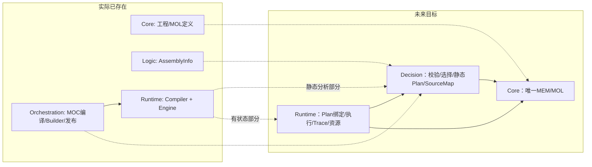
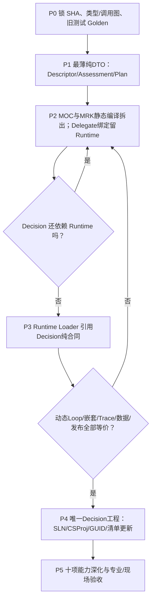

# CxVisual Decision——Logic/Orchestration 融合、Runtime 解耦与项目改名迁移台账 V1.0

> 目标：把 `Mechanism.Logic`、`Mechanism.Orchestration` 合并改名为 **`Mechanism.Decision`**，使 Core 定义、Decision 判断与规划、Runtime 运行形成真实的单向职责及无环依赖。
> **当前状态：规划/逐文件迁移清单，尚未更改 .sln/.csproj、程序集、DLL 名或任何公开类型。** 真实基础：2026-10-28 master `f081438986a201382167d95c1130ea9a284bd7e1`。
> 上级裁决：[Decision融合ADR](../Decisions/CxVisual_Mechanism_Decision_项目融合与归属裁决_V1.0.md)；验收：[Decision测试矩阵](../Testing/CxVisual_Decision_功能与迁移验收矩阵_V1.0.md)。

## 1. 目标工程形态

```text
Mechanism/
├── Core/                         原工程与MOL定义，保留
├── Decision/                     新物理目录，单个 DLL（原MOC+Logic归并）
│   ├── CxVisual.Mechanism.Decision.csproj
│   ├── Properties/
│   ├── Contracts/                 计划描述/判断/诊断/策略等必要公共合同
│   ├── Semantics/ Validation/     逐需落地，不一次建空类
│   ├── Evaluation/ Planning/     目标/候选/资源/流程规划
│   ├── Strategies/ Compilation/  策略、规范化、不可变计划
│   ├── Diagnostics/               编译错误、映射、Explain
│   └── Adapters/                  仅过渡期兼容
├── Data/                         MDS，不动唯一运行数据Owner
├── Runtime/                      MRK真实执行、调度/资源/控制/Trace
└── Lifecycle/                    服务/发布治理，不扩散到Decision
```

原 `Mechanism/Logic/`、`Mechanism/Orchestration/` 在迁移完成、无引用且回归通过后**不再作为项目存在**。最终目标为 27 个项目，Mechanism 从9变8，40个机制子方面应重新映射归属但不是删掉目标能力。

## 2. 已确认的真实项目/依赖问题

| 工程 | 当前真实状态 | 迁移目标 |
|---|---|---|
| `Mechanism/Logic/CxVisual.Mechanism.Logic.csproj` | 目前仅 AssemblyInfo 业务源码为空；引用 Foundation.Data；GUID `{71A7BD54-3D24-50DC-B60D-42A9848E8DB0}` | 去掉独立工程及SLN入口；不存在可迁移的“旧Logic算法” |
| `Mechanism/Orchestration/CxVisual.Mechanism.Orchestration.csproj` | MOC四份主源码；目前引用 Core、Data 和 **Runtime**；GUID `{6E9A7006-3AD6-5F5B-A452-1C89847495A0}` | 主干迁入 Decision；推荐沿用这一 GUID；最终不得引用 Runtime |
| `Mechanism/Runtime/CxVisual.Mechanism.Runtime.csproj` | 工程引用 Core、Data、Foundation.Data、F19；包含 MRKExecutionPlanCompiler、执行器及 Commands | 编译静态责任逐步收敛至 Decision；最终 Runtime 可以引用 Decision，不得反向依赖 |
| `CxVisual.Unified.sln` | 仍登记 Core/Logic/Orchestration/Runtime 四个物理工程 | 删除两个旧项目条目、加入一个 Decision，更新项目配置/引用并静态验无环 |

**立即改 `Orchestration.csproj` 名字而不解开 `Orchestration → Runtime` 会产生潜在循环依赖。严禁先改依赖再想办法修编译。**

## 3. 逐文件/类型审计映射（目标/未搬）

| 当前来源 | 主要类型/职责（源码可见） | 目标与处理方式 | 风险/测试 |
|---|---|---|---|
| `Mechanism/Core/Engineering/MOLLogicDefinition.cs` | MOL定义、表达式、控制块、逻辑持久化 | **保留 Core**；Decision只读快照及引用 | 工程保存/重开、ID/Revision |
| `Mechanism/Orchestration/MOCEngineeringCompiler.cs` | `MOCEngineeringCompiler`、`MOCFlowBuilder`、MOCExpressions、MOCSourceMap、MOCTraceView 等集中实现 | **分割职责**：纯语义/编译/SourceMap/Builder外观在Decision；运行Trace的读取与映射接口明确分别归Runtime/Decision。Core编辑事务仍唯一 | 文件较大；谨慎分拆，不更改已有分支/循环结果 |
| `Mechanism/Orchestration/MOCBuildService.cs` | `MOCBuildService`、诊断、Build结果 | Decision 验证/编译门面；提出较简洁的 Assess/Plan API | Diagnostics与SourceMap定位 |
| `Mechanism/Orchestration/MOCCapabilityCatalog.cs` | 能力元数据目录/发现 | Decision 候选匹配与Snapshot；不拥有专业真实行为 | CapabilityId、Version、Schema |
| `Mechanism/Orchestration/MOCProjectRelease.cs` | 发布候选及 `MOCProjectRelease.Stage`，当前直接依赖MRK发布控制 | **必须拆分**：候选/指纹/验证归Decision；Stage/Activate/授权及操作门禁留Lifecycle/Runtime.Host及运行Owner；过渡适配要单向 | 不可误把Stage调用动作当成纯决策 |
| `Mechanism/Runtime/Execution/MRKExecutionCompiler.cs` | `MRKExecutionPlanCompiler`、`IMRKCapabilityResolver`、输入/诊断/编译Request/Result | 静态请求、契约、验证与编译逐步迁入Decision；真正进程内绑定移至Runtime Loader | 现有MOC依赖MRK类型，迁移顺序敏感 |
| `Mechanism/Runtime/Execution/MRKExecutionPlan.cs` | `MRKExecutionStep`、`MRKExecutionPlan`、Try/LoopRegion、委托 | 分割**可版本化纯描述合同**和**运行已绑定执行对象**；运行对象留MRK，不直接序列化Delegate | 取消、Try/Finally、动态Loop |
| `Mechanism/Runtime/Execution/MRKExecutionComposition.cs` | 编排编译/Builder 与运行入口混合 | 按职责拆分静态组织/计划 vs 动态执行/装配；保留旧代码调用兼容段 | 三层嵌套子流程、数据传递 |
| `Mechanism/Runtime/Execution/MRKDeveloperRuntime.cs` | 开发者方便入口 | 运行Facade继续属于 Runtime；仅移出其中静态的规则/Plan组合职责 | 代码式体验不退化 |
| `Mechanism/Runtime/Execution/MRKExecutionPolicy.cs` | 执行策略与运行行为 | **策略声明/静态合法性**可被Decision消费；运行重试/超时/计时/取消仍MRK | 幂等、异常传播、取消 |
| `Mechanism/Runtime/Execution/MRKExecutionEngine.cs`、`MRKExecutionGroups.cs`、`MRKExecutionTrigger.cs` | 唯一执行、并发、触发 | **全部留 Runtime** | 不建立第二个Worker、触发器 |
| `Mechanism/Runtime/Execution/MRKRuntimeCoordination.cs`、`MRKExecutionJournal.cs`、`MRKExecutionPlanSlot.cs` | 运行协同、Journal、计划槽与激活相关 | 运行状态/事务/激活留 Runtime；输入方案合同读取Decision | 生产中Plan版本稳定 |
| `Mechanism/Runtime/Commands/*` | CommandCenter、命令注册/路由/执行 | **保持既有 Runtime Owner**；Decision只验证声明与策略 | 不颠覆已批准命令中心裁决 |
| `Mechanism/Data/*` | MDS数据与交互 Owner | **原地保留**；Decision只作需求分析 | Flow/Frame/Heap唯一真源 |
| `Applications/Studio`、`Tests/TestCenter` | 工程编辑、操作与观察 | 入口替换及状态解释；复用旧MOC行为，不造新流程数据 | WPF/Headless同义 |

每一行实施时必须补：**原类型/方法签名、调用项目、迁后唯一签名、兼容方式、提交SHA、对应测试、CI链接、剩余风险**。没有这些证据不得从“规划”改成“已迁移”。

## 4. 无环依赖改造的分阶段实际顺序

### P0——基线锁定与风险清单
- 固定master SHA，扫描整个解决方案的旧Logic/MOC/MRK引用、`using`/反射/配置字符串/序列化/测试，生成真实符号表与调用关系。
- 原工程运行：`--organization`、`--organization-wpf`、`--concurrency`、`--command-center`、默认ArchitectureSmoke；记录SHA与失败归因。
- 与并行Owner协作：禁止在迁移时静默覆盖其他分支的新源码。

### P1——定义新的“可声明决策/计划”合同
- 确认 Decision 核心 Assessment/Strategy/Plan 的**不含可执行委托**的最小合同，按现有调用场景实现，先用原 MOC/MRK 兼容入口校验。
- 禁止为了满足理想图而一口气把 Core 或 Runtime 全部类型移动；优先拆出静态语义/类型/版本验证部分。
- 现有 Runtime 可在过渡期继续接受原MRKExecutionPlan；新增计划合同待有单向Adapter后接入。

### P2——把静态决策/编译逻辑从MRK逐步迁出
- 移动并验证 `MRKExecutionPlanCompiler` 的可静态部分、MOC 编译分支与解析，保持原 Plan 执行结果一致。
- 能力解析分成**仅元数据/合约校验**与**真实执行Delegate绑定**两个阶段；不允许 Decision 引用 MRK Context 执行设备。
- Build/Compile结果与SourceMap的错误码、身份映射保持不变或显式迁移。

### P3——固定运行端 Loader 与单向引用
- 最终 `Decision → Core`、`Runtime → Decision`，移除Decision对Runtime的全部程序集/类型依赖；用纯DTO/受控绑定处理暂时需要的旧行为。
- 单独 `Runtime.LoadAndValidate` 进行真实能力版本/权限/环境/资源复核，再将描述式计划转换为只在进程内有效的已绑定计划。
- 并行、动态Loop/Foreach、Try/Catch/Finally、命名数据端口和取消语义保持一致。

### P4——项目实际合并与重命名
- 把Orchestration中的真实源码迁入 `Mechanism/Decision/`，按 P1～P3 的分割结果整理目录；项目名/AssemblyName/RootNamespace改为 `CxVisual.Mechanism.Decision`。
- 更新 SLN、全部引用 .csproj、AssemblyInfo、GUID/ProjectConfigurationPlatforms、Build脚本、Owner目录和既有文档；删除旧Logic与Orchestration项目及不再需要的空目录。
- 更新 `DOCS/ProjectCatalog.csv`、`DOCS/DirectoryLayout_V1.1.md`、02/03/04电子规格中所涉原项目条目，建立旧新Owner映射；子方面数量逐项复核。
- 源码引用、产物输出和VS解决方案中**只能有一个** Decision 项目；剩余MOC旧符号仅允许明示过渡兼容层。

### P5——功能深化与现场验收
- 在正确的唯一Owner上逐步实现D03～D10中的目标协调、策略/资源/性能规划、评估、仿真与解释，不为凑数量新增空壳。
- 迁移后的Studio/TestCenter提供原因说明、候选比较、Plan/SourceMap可视化及自动化反例；真实设备安全/跨PC/长稳由专业Owner验收。

## 5. 必须严格检验的迁移风险

| 风险 | 处理 |
|---|---|
| 依赖环 | 项目 DAG 每个阶段验证；不能通过新建空 DLL 掩盖 |
| 二套计划/执行器 | 先建立清晰的声明Plan vs 运行绑定Plan的唯一转换边界；只允许一个MRK运行引擎 |
| API/序列化/命名空间破坏 | 逐类迁移映射、源ID/诊断码保真、旧工程打开-重新构建 |
| 运行期间工程修改 | 已授权运行方案保持版本锁定，重新编译产物需走发布授权和安全点 |
| 运行时数据错乱 | 复用MDS Frame/Stack/Heap、消费者计数与提交回收测试 |
| 非幂等设备动作重试 | Decision仅验证策略合法；专业及Runtime受控执行 |
| 并行协作冲突 | 只在当前master上增量提交，确认文件版本和旧新Owner，不覆盖他人的改动 |

## 6. 停止线与完成定义

- **P0～P3未通过时，不应宣称 P4 改名融合完成。**
- 任一P阶段出现功能回退、旧工程无法保存重开、失去SourceMap、重复执行设备动作、跨层循环引用或Windows构建失败，暂停扩展并修复当前阶段。
- 仅在**真实 SLN 中仅有一个 Decision DLL、旧 Logic/Orchestration 不再编译、Runtime不再反向承担静态编译、无循环依赖、关键集成测试全部通过**后，才可宣布“项目融合完成”；新十项能力中的尚未实装部分仍须标明“规划”。


---

## V1.1 实施级源码、依赖与回归深化（本轮仅文档）

> 审计固定点：216963b009a94bfd2074defd0c7572fbb65a09bb。目标是**一个 Decision DLL、一个 Runtime 执行器、一个 Core 定义真源**。下一次实装前须重新核实 master 的全部消费者与源文件指纹。

### 一、现状和目标一张图



图中实线箭头是项目引用方向，虚线是拟议迁移方向。当前 Orchestration → Runtime，不可先改名再令 Runtime → Decision，否则形成工程依赖环。

### 二、按真实源码的 Owner 映射（不是一股脑迁移）

| 当前源文件 / 已存在类型 | 目标 Owner | 实际迁移动作与禁止事项 |
|---|---|---|
| Core/Engineering/MOLLogicDefinition.cs：MOLExpression、MOLControlBlock、MOLLoopDefinition、MOLWiringDefinition、MOLStateMachineDefinition、MOLStepPolicy、Codec | **Core 保留** | 只供 Decision 读取不可变快照；工程 ID、Schema、动态 Loop、状态机和配置不动；不建立第二套 MOL |
| Core/Engineering/MEMProjectSnapshot.cs：MEMProjectSnapshot/MEMNodeSnapshot | **Core 保留** | 快照身份与 Revision 保真；不在 Decision 复制工程树 |
| Orchestration/MOCEngineeringCompiler.cs：MOCStepOrigin、MOCSourceMap、MOCCompiledPlan | **Decision 纯编译/溯源；Runtime 已绑定计划** | 显式拆 Static SourceMap/Plan 与 MRK 执行委托；StepId 和 BlockId 必须保持映射 |
| 同文件：MOCTraceView、MOCObservedStep、ReadTrace | **Runtime Trace 事实 + Decision 只读映射** | Trace 数据不能让 Decision 反向引用 Runtime；由上层传入只读 TraceDTO |
| 同文件：MOCExpressions、MOCResolver、MOCEngineeringCompiler.Compile | **Decision 静态语义/编译 + Runtime 真正委托绑定** | IMRKResolver 的执行委托与 Capability 元数据分离；不能破坏分支/Join/嵌套与数据端口 |
| 同文件：MOCWiringFragment、MOCFlowBuilder、Edit/Paste/Group/Align/ExtractLinearContent | **Core 编辑事务唯一真源；上层便捷适配** | 注意这些方法会修改工程定义，不能因为位于旧 MOC 文件就全部归 Decision；需逐方法审计事务/保存副作用 |
| Orchestration/MOCBuildService.cs：MOCDiagnostic/MOCBuildResult/MOCBuildService | **Decision** | 保留诊断码和定位语义；新 Assess 不强制编完整 Plan |
| Orchestration/MOCCapabilityCatalog.cs：MOCCapabilityDescriptor/IMOCCapabilityProvider/MOCCapabilityCatalog | **Decision 只读目录投影；MFM/专业声明真源** | RuntimeAvailable 是运行状态提示，不能用作静态许可的唯一证据或第二模块注册中心 |
| Orchestration/MOCProjectRelease.cs：Prepare/Stage | **Prepare→Decision；Stage→Lifecycle/Host/MRK** | 将发布候选指纹与实际授权/安全点切开；不得让 Decision 直接激活设备 |
| Runtime/Execution/MRKExecutionCompiler.cs：MRKStepCompileRequest/MRKCompileResult/MRKExecutionPlanCompiler | **Decision 静态部分** | 与 MOC 编译收敛为一个实现；兼容外观有移除条件，不保留第二套 Compiler |
| 同文件：MRKResolvedCapability/IMRKCapabilityResolver | **Runtime 绑定；Decision 消费独立 CapabilityContract** | 真实 ExecuteAsync/SynchronousSdk 不得进入描述型 Plan |
| Runtime/Execution/MRKExecutionPlan.cs：MRKExecutionStep/MRKExecutionPlan/LoopRegion/TryRegion | **Runtime 保留进程内绑定；Decision 拥有纯 DTO 描述** | 禁止序列化 Delegate/Handle/Worker；Loop 不按 MaxIterations 重复展开 |
| Runtime/Execution/MRKExecutionComposition.cs：MRKExecutionOrchestrationCompiler/MRKFlowCompileDefinition | **静态结构→Decision；运行适配→Runtime** | 三层子流程、具名端口、作用域和静态数据回收的结果须保真 |
| Runtime/Execution/MRKExecutionPolicy.cs、Groups.cs、Engine.cs、Journal.cs、Publishing.cs | **Runtime 保留** | Decision 只提策略和预算；真正重试/调度/租约/审计/Plan激活留原内核 |
| Runtime/Commands/*、Mechanism/Data/RuntimeData/* | **原 Owner 保留** | 不迁 CommandCenter，也不复制 MDS Frame/Heap/Stack |
| Studio/TestCenter/ArchitectureSmoke | **消费者/测试层** | 统一诊断视图与源 ID 定位，保留 Headless/Windows 原有入口，UI 不自行重建判定引擎 |

**对 V1.0 的一处明确修正：** 将 MOCFlowBuilder 整个归入 Decision 不妥，因为其含会改变 MEMEngineeringSession 的 Edit/Move/Paste/Group 等操作；最终必须按副作用将编辑权留 Core 唯一事务，Decision 只消费定义/可提供便利包装。这是正式 Owner 迁移门禁，不能被目录重命名掩盖。

### 三、必须按此顺序断环后合并



依赖目标（箭头为 C# ProjectReference）：Runtime → Decision → Core / Data / 基础契约；Runtime → Core / Data / F19；Studio 可依赖所需基础设施，专业 Provider 不反向引用 Decision。P0须按真实 csproj 路径构造拓扑图并拒绝环，不能以命名空间相似度判断依赖。

### 四、真实 API 拆分与版本兼容

1. **P0：** 固定 SHA 和旧结果 Golden：诊断码/SourceMap、StepIds、工程保存-重开、三层命名数据、循环/子流程、权限与异常。扫描 using、ProjectReference、反射、XAML、序列化、测试、发布脚本，登记调用方。
2. **P1：** 先定义不可变纯能力描述与 MDCAssessment，且最小端口/节点验证无需 Plan。禁止 Decision 引入 MRKExecutionContext、MRKFlowHandle、Delegate 或真实设备 API。
3. **P2：** 将 MOC 编译/静态验证和 MRK 静态 Compiler 合并为单一编译职责。现有 MOCBuildService、MOCEngineeringCompiler 的调用暂由单向 Adapter 代理；对动态 For/While/Foreach、Branch Join、Try/Finally 按原 Golden 比较。
4. **P3：** MRK Loader 消费不可变描述型 MDCExecutablePlan 并进行真实环境、权限、资源、版本、指纹复核；运行中不接受 Decision 直接改写活动 Plan。原 MRKExecutionPlan 仍为进程内绑定结果。
5. **P4：** 仅在目标 DAG 无环后，创建 Mechanism/Decision（沿用经核实的 Orchestration GUID）、更新 Unified.sln 及所有 csproj、AssemblyName、RootNamespace、资源路径、ProjectCatalog、DirectoryLayout、02/03/04 规格表和 CI 校验；移除两个旧独立工程，目标数 27/8。
6. **P5：** D03/D04/D06/D07/D08/D09 逐项以真实多专业案例和性能证据交付，不将名字存在视为实现完成。

**Plan 双合同：**

```text
Core Snapshot + Capability Descriptors + Requirements
     → Decision（静态校验/规划/编译）
     → MDCExecutablePlan [纯数据：PlanId/Version/DAG/Regions/Policy/SourceMap/Manifest]
     → Host 发布授权 + Runtime.Loader 现场二次检验
     → MRKExecutionPlan [ExecuteAsync / Context / 实际资源租约]
     → MRKExecutionEngine → MDS Frame/Heap + Trace
```

可序列化 Plan 不得包含 Delegate、Task、CancellationTokenSource、GPU buffer、PLC/相机句柄、MDS live Frame。静态 Allowed 不能证明现场许可。迁移兼容只允许**一个方向**的 Adapter，不得在长期构建中保留两个编译引擎。

### 五、执行时的核查命令与追踪字段

```powershell
git rev-parse HEAD
git grep -n -E 'CxVisual\.Mechanism\.(Logic|Orchestration)|MOC(Build|Engineering|ProjectRelease|Capability|Flow|Trace)' -- '*.cs' '*.csproj' '*.sln' '*.xaml'
git grep -n -E 'MRKExecutionPlanCompiler|IMRKCapabilityResolver|MRKResolvedCapability|MRKExecutionOrchestrationCompiler' -- '*.cs'
# 从全量 csproj ProjectReference 构建有向图，拓扑排序拒绝任何循环。
# 在 MSBuild x64 / net48 下实际重建，之后运行 --organization、--organization-wpf、--concurrency、--command-center 和默认回归。
```

每行源码迁移记录必须包含：OldPath、OldType、旧签名/消费者、目标 Owner 与新签名、兼容窗口、原 Revision/Schema/SourceMap、测试ID、实际提交 SHA、Windows CI链接、剩余风险。

### 六、不可绕过的停止线

当前事实：Unified.sln 仍为28项目；Logic.csproj 只编译 AssemblyInfo；Orchestration.csproj 含 MOC 四源码并引用 Runtime；Runtime.csproj 同时包含 MRK 编译与执行；这只是**源码存在**证据，不等于本轮测试通过。

任何一个阶段只要出现有向环、MDS 数据丢失/双重释放、不可逆设备动作重复、SourceMap/ID 错位、旧工程不能恢复、动态嵌套行为退化或正式 Windows 编译失败，立即停止后续物理融合。回滚该阶段代码，保留日志与诊断归因。本轮文档提交不代表项目融合已经实施。


---

## V2.0 专业轻声明与Decision使用的迁移附加门禁（2026-10-29）

依赖目标与P0～P5迁移次序保持不变；新增架构入口：[Decision总纲#0](../Architecture/CxVisual_统一决策与规划体系%230总体架构与全类需求_V2.0.md)、[专业声明#3](../Architecture/CxVisual_统一决策与规划体系%233专业能力声明与注册_V2.0.md)、[编排#4](../Architecture/CxVisual_统一决策与规划体系%234上下文编排与智能引导_V2.0.md)、[运行协同#5](../Architecture/CxVisual_统一决策与规划体系%235运行调试模拟与反馈_V2.0.md)。

| 增量审计点 | 现有真实Owner | 未来迁移必须守住什么 |
|---|---|---|
| FCM注解/Schema/Validate | Foundation.Data.Configuration、MHS | 新Capability注解不复制参数Schema，绑定生效版本的只读投影 |
| MFM模块/五类身份 | Mechanism.Core.Modules | 不再增加第二个ModuleRegistry/ModuleKind；普通函数允许无模块实例 |
| MOC能力/端口目录 | Mechanism.Orchestration MOCCapabilityCatalog | 逐步归Decision静态只读目录，真实MRK Resolver拆开，保留CapabilityId/Port一致性 |
| MEMSymbol/Content与MOLFlowCanvas | Core + Presentation.Wpf | Symbol/Content/Capability分类不合并，画布只消费候选/Diagnostics，Core是唯一Edit/Undo真源 |
| F19/MRK/Trace/Journal/调试 | Runtime | Decision新增纯计划/解释，不复制执行器、状态或DebugController |
| Simulation虚拟模型/设备安全 | Professional.Simulation / Automation | 静态推演不冒充虚拟/现场执行，未知外部命令不能自动重发 |

在P0逐类调用方清单中增加：`FCMConfigSchemaBuilder/FCMConfigCatalog`、`MFMModuleDescriptor`、`MOCCapabilityCatalog`、`CxVisionThresholdProvider`、`MRKCodeRuntimeBuilder`、`MOLRuntimeOverlay`、`PSMSimulationModule`。P4合并后执行REG/CST/AUT/RUN及六专业场景Goldens；**不得以“工程数27”替代功能验收**。