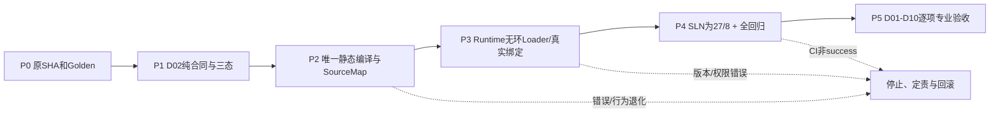

# CxVisual Decision——功能、融合迁移及分级验收矩阵 V1.0

> 2026-10-28 建立；当前为**验收计划**，不是通过报告。
> 三层：Core定义唯一真源；Decision判断/决策/规划；Runtime加载/运行唯一内核。
> 设计源：[Decision裁决](../Decisions/CxVisual_Mechanism_Decision_项目融合与归属裁决_V1.0.md)、[能力规格](../Architecture/CxVisual_统一决策与规划体系%230总体架构与10大能力_V1.0.md)、[逐文件迁移](../Migration/CxVisual_Decision_Logic与Orchestration融合及Runtime解耦_V1.0.md)。
> 证据级别：未开始 / 设计 / 源码存在 / 编译通过 / 自动测试通过 / 跨专业联调 / HIL与现场验收。**禁止以文档代替结果**。

## 一、十项能力可验收合同

| ID | 输入/场景与正例 | 必须拒绝或提示的反例 | 产物/通过标准 |
|---|---|---|---|
| D01 | 表达式、端口/规则推导与Core版本一致，逻辑短路和条件可复现 | 错类型/非法空值/未知规则/前后判断不一致 | 语义及来源/原因码可复现 |
| D02 | 兼容的端口、完整能力、依赖及合法版本 | 必需输入缺失、版本错、依赖环、硬安全前置未知或失败 | Allowed/Rejected/Unknown清晰；无安全误放行 |
| D03 | 在既定硬约束下比较节拍/精度/成本优先级 | 以软分数突破硬约束、优先级循环或缺目标 | 权重、取舍与拒绝原因明确 |
| D04 | 2+种 Provider/算法的Schema/Version/环境匹配 | 无候选可行、能力不可用/不兼容、版本变化 | 只从可行集合选择，备选/解释可查 |
| D05 | Sequence/If/Switch、Loop/Foreach、子Content、并行、DataFlow与Join | 错误依赖、无界展开、错误调用层级/端口、并行冲突 | 唯一结构Plan，行为/身份/Trace与旧版等价 |
| D06 | 声明可用重试、超时、回退、降级与补偿策略 | 非幂等设备动作自动重试、取消后继续运行、无授权补偿 | 策略适用条件与Runtime执行限制一致 |
| D07 | 已知硬件及数据大小下资源/线程/队列/内存保留估计 | 过量容量/资源冲突/无实测来源却给出保证 | 预算单位、来源、瓶颈与不确定性明确 |
| D08 | 对多个可行策略作成本/关键路径估算 | 不足样本/过期数据/错误置信区间 | 预测与实测可比，不能伪称现场节拍 |
| D09 | 只读快照验证、Virtual/Replay模拟、改动影响清单 | 仿真成功冒充真实设备安全验收 | 模拟/静态/现场证据严格分级 |
| D10 | 拒绝/选择原因码映射Core BlockId，回显Studio | 丢失SourceMap、理由不可复现、运行反馈隐式修改活动方案 | 可定位可解释，方案版本稳定 |

测试覆盖不仅看数量：必须同时检查正确性、异常、并发、性能、可取消、版本和硬安全约束；不适用项目须写明原因。

## 二、必须保留的真实业务回归案例

| ID | 当前入口/用例 | 目标门禁 |
|---|---|---|
| R01 | `OrganizationLogicIntegrationTests.G05aConditionalBranchesAndJoin` | True/False仅选中一侧，Join只执行一次；错误条件拒绝 |
| R02 | `OrganizationLogicIntegrationTests.G06CpuVisionThroughMOC` | 真实CPU视觉阈值Provider、byte[]数据、Width/Height缺失拒绝、SourceMap |
| R03 | `OrganizationLogicIntegrationTests.R05DynamicLoopAndExit` | 100000最大迭代约束、实际220轮、无100000步展开、Break/Continue/Return |
| R04 | `V2ThreeLevelNamedData` 等集成用例 | Top/Mid/Leaf命名端口数据隔离与失败不提交 |
| R05 | `G07ProjectReleaseLockAndAuthorization` | 工程版本/能力版本/发布授权不跳过，活动Plan稳定 |
| R06 | 现有 `--organization`、`--organization-wpf`、`--concurrency`、`--command-center` | C#与Studio/Runtime现有功能不回退 |
| R07 | 默认ArchitectureSmoke | 全平台未绕过其他Owner的任何失败；失败时定责、整改而非假通过 |

用例方法/CLI名称来自当前已有源码和已有工作流入口；未来执行时按该SHA重新核实其存在，单独报告各类Windows测试结论。

## 三、项目融合/唯一Owner验收

| ID | 要求 | 检查方式 |
|---|---|---|
| M01 | 由2项目合并为1 Decision；最终27项目/Mechanism 8 | .sln、项目 GUID/路径及ProjectCatalog与权威规格差异 |
| M02 | 旧 Logic、Orchestration DLL不再独立生成 | .csproj、SLN、Output目录、引用扫描 |
| M03 | Decision不引用Runtime，Runtime只引用必要的Decision合同 | csproj DAG无环、引用与using静态审计、编译 |
| M04 | Core/MOL工程真源不重复，MDS保持数据Owner | 项目/类型唯一性、保存-重开、数据并发隔离 |
| M05 | MRK编译器职责只在Decision，唯一执行器留Runtime | 逐类Owner映射及实例执行引用审计 |
| M06 | Plan声明/运行绑定分离；Plan不可序列化Delegate/Worker/Handle | DTO序列化、指纹、版本、运行Loader测试 |
| M07 | SourceMap、诊断码、版本ID/指纹保真 | 迁移前后对照及Trace回溯测试 |
| M08 | C# SDK、Studio/TestCenter统一使用接口，不需三套规则 | 端到端操作/Debug和开发者API测试 |
| M09 | 旧`MOC*`符号均有Owner/兼容/移除决策 | 逐文件迁移表、编译与消费者扫描 |
| M10 | 简单专业调用不强制经过Decision | 直接专业API/Runtime路径测试 |
| M11 | Runtime加载时对真实环境、权限、能力/版本进行最终验证 | 虚拟环境错版本/资源不足/未授权拒绝 |
| M12 | 回归无损/重试幂等、取消结算、活动Plan锁定 | 压力、并发与负例测试 |

## 四、Decision自有用例与质量量化指标

| 场景 | 最少指标（建议验收门槛在实测前协定） |
|---|---|
| 结构/能力检查 | 100%已列硬拒绝例应在任何专业动作执行前拦截；输出具体原因码/源ID |
| 大工程100/1000/10000节点 | 编译耗时、峰值内存、诊断数量、Plan大小、GC分配记录；不能预设未经实验的速度结果 |
| 动态Loop/Foreach | 编译规模不随最大迭代次数线性扩大；运行轮次与数据隔离正确 |
| 多候选选型 | 无可行项必拒绝；固定输入/约束/规则版本时决策可重现 |
| 资源与成本估算 | 估计来源、模型/硬件版本、p50/p95采样、已知限制，有实测才允许声明提升 |
| 计划复用与版本切换 | 不修改正在运行的授权计划；旧计划版本仍可追溯 |
| 并发/取消 | 请求时限、单次取消、并行评估不共享可变状态、缓存失效正确 |
| 工业安全 | 不可逆动作、未知权限/联锁、非幂等重试一律拒绝或要求真实授权与运行端复核 |
| Studio/TestCenter | 选择节点看到诊断、修复建议、候选比较、方案差异，开发者可复制诊断证据 |

## 五、分阶段的Windows验证计划（实施时填写实际结果）

| 迁移阶段 | 必须执行 | 允许宣布的完成情况 |
|---|---|---|
| P0 基线 | 固定SHA、SLN和Owner扫描、原`--organization`/默认回归 | “现状已审计”，不等于融合 |
| P1 纯合同/判定 | 编译+M01/M03/M06初步验证+D01/D02正反例 | “Decision合同已建立” |
| P2 编译迁移 | 编译/组织、R01～R05、动态/嵌套/SourceMap | “静态编译职责已迁” |
| P3 Runtime解耦 | M03～M12、版本校验、资源/异常/并发测试 | “依赖无环/Runtime可消费Decision” |
| P4 工程改名合并 | Unified.sln x64 Release Rebuild、上面所有CLI、WPF、默认回归、静态工程数量/Owner/输出扫描 | “项目融合完成”，**不代表D01～D10全部实现** |
| P5 完整能力 | D01～D10、仿真/性能/专业联调、HIL/现场及长稳 | 按能力独立分级验收，不能整体一键标生产通过 |

每条记录字段：用例ID、源码/配置、需求/输入、期望、实际、执行命令、Windows SHA/Actions链接、环境、失败原因、Owner及是否已修复。**只允许记录真实运行结果**。

## 六、失败及证据处理

- 仅设计说明不能写“通过”；GitHub Actions没有最终success不能声明完整CI通过。
- Numerics/Channel等其他Owner的历史CI失败不自动归为Decision缺陷；但默认回归未绿时，必须说明影响并不得标全量验收成功。
- 不因避免单一测试失败而跳过`--organization`、默认ArchitectureSmoke或硬约束负例。
- 迁移存在中间提交时，每个步骤必须以其**准确SHA**单独报告，不能混用不同SHA的通过证据。
- 实机PLC/X-Ray、跨进程发布、工业硬实时控制与安全联锁的验证必须单独标记“未验证”，不能用Virtual仿真冒称。

---

## V1.1 可执行验收合同（新增测试编号 D-T、C-A～D；全部待实施）

**事实标识**：本文前半段已列出的既有 MOC/MRK 用例为可复用测试入口；以下 D-T01～D-T30 为**目标测试设计**，本轮没有新增测试代码或 Windows CI 成功记录。基线源码 SHA：216963b009a94bfd2074defd0c7572fbb65a09bb。测试证据须精确到运行的 commit，而非采用邻近绿色提交代替。

### 一、每项能力的可自动化门禁

| ID / 测试ID | 正例（必须产生的断言） | 反例/边界（必须失败或明确Unknown） | 性能/稳定性判据 |
|---|---|---|---|
| D01 / D-T01～03 | 相同表达式+输入快照返回相同推导树、端口/单位、短路和解释 SourceId | 空引用/隐式窄化/类型不匹配/无单位阈值、规则循环 | 1k/10k表达式基准记录耗时与最大内存；无递归栈爆 |
| D02 / D-T04～06 | 每项硬条件 pass 时 Allowed，且记录每项证据、版本与来源 | 任一 hard fail→Rejected；未知/过期/缺许可→Unknown，绝不能 Allowed | 100%列示硬拒绝在专业动作前阻止；取消与预算超时不放行 |
| D03 / D-T07～09 | 单位归一、目标优先级和 Pareto 支配可算出固定可解释结果 | 无法比较不同单位/约束相互矛盾/权重无效/非法数值 | 同输入/权重/排序号结果稳定；10/100/1000候选基准 |
| D04 / D-T10～12 | 先按 Schema/Version/Resource 硬过滤，再按软目标稳定排序；保留选中/备选/拒绝项 | 无候选可行、版本过期、相同名称但合同冲突；不能选“最高分违规项” | 1k 候选快照检索性能、内存和失效正确性报告 |
| D05 / D-T13～15 | DAG+分支/Join、三层子流程、Try/Catch/Finally、For/While/Foreach 结构结果与旧 MRK 等价 | 环、错误子 Content、动态循环错误越界、数据作用域跨层泄漏 | 100/1000/10000节点编译曲线；最大迭代1e5时Plan节点数不随其线性膨胀 |
| D06 / D-T16～18 | 幂等能力超时/取消/受控重试、降级/补偿条件产出明确策略集 | 非幂等 PLC/运动控制自动Retry、未知安全前置、恢复循环必须 Reject/Unknown | 策略生成无执行副作用，取消不启动回调；故障注入无重复设备动作 |
| D07 / D-T19～21 | 以字节为单位的 CPU/GPU/队列预算，冲突图和瓶颈指向正确能力 | 单位混淆、内存超限、隐藏数据副本、MDS retention 冲突、资源未知 | 输出峰值/分位与假设；基准误差分别记录不以预测冒充实测 |
| D08 / D-T22～24 | Pareto/固定 seed 推演与敏感性分析可重复；备选更换对应影响清单 | 数据不足/过期/估计置信区间缺失、禁止自动声称“最优” | 规定 seed、算法/模型版本、推演次数/误差；记录每轮耗时/CPU/内存 |
| D09 / D-T25～27 | Static/Virtual/Replay 多级证据可区分；修改影响集包含全部受影响 BlockId | Simulation 成功冒充 HIL、漏算隐式依赖、异常设备状态无法观测 | 影响回归集合包含所有 Golden 受影响测试，保守扩大允许 |
| D10 / D-T28～30 | Reject/Select/Plan 能还原输入版本、规则、原因、证据和 SourceMap | SourceId丢失、Trace指向旧Plan、反馈隐式改活动Plan | 重放同输入产生等价解释；审计量有界、日志脱敏不阻塞生产 |

**每项能力完成** = 可调用 API + 核心正例 + 反例 + 资源/取消/版本/安全测试 + 文档示例编译 + 对应 CI SHA 为 success。**完成设计** 仅需规格与可追踪验收，不等于通过。**现场就绪** 需相关专业 Owner 的 HIL/Field/长稳与许可记录，不能由本表自动升级。

### 二、四个完整端到端验收场景

| 案例及准备输入 | 必经 Decision 验证和产物 | Runtime/Provider 必须保持的 Owner | 强制故障与 Golden 断言 |
|---|---|---|---|
| C-A X-Ray：合成 4096×4096×16bit 图像、检测节拍目标、两个算法 Capability（版本/精度/耗时直方图）、PLC NG 禁重复指令、探测器安全合同 | 端口/格式检查→目标冲突→能力过滤→p95预算→策略/替代→诊断+源 ID、SafetyGate | Vision/AI执行与真实探测器/PLC；MRK计时/取消/安全许可 | 算法 GPU 内存超限拒绝；NG重发策略拒绝；无许可 Unknown；纯 Decision 测试中 Provider Execute 调用次数为0 |
| C-B CT：合成 ProjectionSet 和 Volume 的 dimensions/strides/spacings、CPU/GPU重建能力及带宽/显存上限、精度目标 | 单位/几何校验→估算输入/输出+中间缓冲峰值→块大小/并发→CPU/GPU选择与 fallback | CT3D 重建算法、GPU/内存真实分配、MDS传输 | 某显存配置不满足硬上限 → 不选GPU；未知GPU余量→Unknown/NeedRuntimeChecks；禁止实际构造GB级数组来做 Decision |
| C-C 工程：Project+Revision、多层 Invoke Content、While/ForEach、Try/Finally、Data.Return及SourceMap | 静态验证→有界结构Plan→隔离作用域/端口→版本指纹及受影响节点 | MRK Flow/Invocation/Frame、取消、Join、Try/Finally；MDS提交/回收 | R05动态循环含 Break/Continue/Return；G05真假分支 Join 一次；三层命名数据失败不提交；计划规模与最大迭代无关 |
| C-D 多设备：MFM模块与 Provider Schema、单设备独占资源组、两个并行工作流、主备网络端点、控制优先级与恢复策略 | 全局资源冲突图→并行/串行备选→能力版本检查→策略约束→影响解释 | F17 Channel/实际设备会话、MRK租约、Automation 许可 | 双路独占同时进入拒绝或串行计划；断线未知不得静态允许危险动作；取消后资源释放且无重复命令 |

**合成输入说明：** 数字是拟议测试夹具而非真实性能保证；工厂目标节拍、CT重建精度、设备级安全认证必须另有实测来源。效果验收比较“原有手工分散校验”与“统一 Decision 判断”时，记录开发者调用步骤、重复规则数量、错误捕获定位率和方案比较信息完整率，不随意声称节约百分比。

### 三、性能测量方法与分级阈值

- 测试固定 Win x64 / .NET 4.8、CPU/GPU、内存容量、进程隔离、热身、数据规模及随机种子；每用例至少记录 Warm/Cold、p50/p95/p99、PeakWorkingSet、AllocatedBytes、GC counts、Cache hit/miss；使用中位数和分布，不能用单次最优耗时宣布性能。
- **建议门槛**：所有明确的 Hard Negative 100%拒绝；静态 Decision 的真实 Provider/Device 动作调用数严格 0；同输入指纹/规则版本 deterministic 结果严格一致；任一失败取消不得产生 Allowed；Plan 无 Delegate/Handle/Worker/可变 Frame；GPU或内存硬上限不允许因软优化超支。
- **量化但尚待硬件基线定案**：100、1000、10000节点编译耗时/分配曲线；10、100、1000候选选择复杂度；关键路径和 PeakBytes 估算误差（对比 HIL /真实运行）；不同输入尺度下缓存收益。缺固定参考环境前**不伪造 100ms、1GB 等数值承诺**。
- 需要在 P0 保存旧版 A/B 版本 Golden；P4 再比较输出语义、控制图、数据回收、SourceMap 及时延退化。若旧基线本身失败，记录原 SHA/日志和原因，不从数值比较中删除失败点。
- 独立长稳：稳定运行、版本热切换、并发评估取消风暴、内存增长/释放、弱网络/重连、模拟与真实设备故障注入；工业安全/HIL 由拥有设备的专业负责人批准并归档，默认标未验证。

### 四、融合迁移 M01～M12 的自动门禁与证据字段

| Gate | 必须提供的客观输出 | 不满足则 |
|---|---|---|
| M01–M03 | 27项目SLN、旧DLL不存在、ProjectReference DAG 的拓扑排序无环、程序集和 GUID 无重复 | 禁止称“项目合并成功” |
| M04–M06 | Core/MDS/RMK 唯一 Owner 检查、纯Plan字节序列化/重建/版本对照、动态流程完整运行 | 回滚当前迁移分段 |
| M07–M09 | 逐类型/逐方法旧→新、源 ID 与诊断码 Golden、Studio/TestCenter SDK 等价，旧 API 兼容窗口有移除时间 | 不删除旧入口 |
| M10–M12 | 简单 SDK 无需 Decision 直达、Runtime 真实授权版本校验拒绝、取消/幂等/活动Plan锁定/资源回收 | 不允许生产启用 |
| 默认全量 | Unified.sln x64 Release 实际 rebuild；ArchitectureSmoke 默认与全部特定 CLI；Windows WPF STA；需要的专业 CI | 只报告所通过 job，不冒称全量成功 |

每条实测结果必须记录：需求 ID、代码路径/测试函数、输入夹具与固定 Seed、期望/实际、硬件/系统/环境、执行命令、GitHub commit SHA、Actions Run URL、证据级别（Design/Source/Build/Automated/Integrated/HIL/Field）、缺陷 Owner、是否有未清安全风险。

### 五、测试中的最重要反模式

禁止把一份 Markdown、“已知的绿色 CI”、Static Allowed、Virtual Replay、MOCCatalog 的 RuntimeAvailable、AI 优化建议或没有现场证据的性能预算当成真实 PLC/X-Ray/运动控制安全许可。静态未知必须在 Host/MRK/专业端形成未通过门禁，直到有可审计的运行现场证据。
