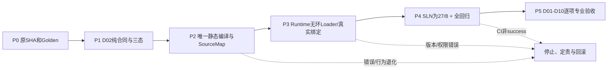

# CxVisual Decision——功能、融合迁移及分级验收矩阵 V1.0

> 2026-10-28 建立；当前为**验收计划**，不是通过报告。
> 三层：Core定义唯一真源；Decision判断/决策/规划；Runtime加载/运行唯一内核。
> 设计源：[Decision裁决](../Decisions/CxVisual_Mechanism_Decision_项目融合与归属裁决_V1.0.md)、[能力规格](../Architecture/CxVisual_统一决策与规划体系%230总体架构与10大能力_V1.0.md)、[逐文件迁移](../Migration/CxVisual_Decision_Logic与Orchestration融合及Runtime解耦_V1.0.md)。
> 证据级别：未开始 / 设计 / 源码存在 / 编译通过 / 自动测试通过 / 跨专业联调 / HIL与现场验收。**禁止以文档代替结果**。

## 一、十项能力可验收合同

| ID | 输入/场景与正例 | 必须拒绝或提示的反例 | 产物/通过标准 |
|---|---|---|---|
| D01 | 表达式、端口/规则推导与Core版本一致，逻辑短路和条件可复现 | 错类型/非法空值/未知规则/前后判断不一致 | 语义及来源/原因码可复现 |
| D02 | 兼容的端口、完整能力、依赖及合法版本 | 必需输入缺失、版本错、依赖环、硬安全前置未知或失败 | Allowed/Rejected/Unknown清晰；无安全误放行 |
| D03 | 在既定硬约束下比较节拍/精度/成本优先级 | 以软分数突破硬约束、优先级循环或缺目标 | 权重、取舍与拒绝原因明确 |
| D04 | 2+种 Provider/算法的Schema/Version/环境匹配 | 无候选可行、能力不可用/不兼容、版本变化 | 只从可行集合选择，备选/解释可查 |
| D05 | Sequence/If/Switch、Loop/Foreach、子Content、并行、DataFlow与Join | 错误依赖、无界展开、错误调用层级/端口、并行冲突 | 唯一结构Plan，行为/身份/Trace与旧版等价 |
| D06 | 声明可用重试、超时、回退、降级与补偿策略 | 非幂等设备动作自动重试、取消后继续运行、无授权补偿 | 策略适用条件与Runtime执行限制一致 |
| D07 | 已知硬件及数据大小下资源/线程/队列/内存保留估计 | 过量容量/资源冲突/无实测来源却给出保证 | 预算单位、来源、瓶颈与不确定性明确 |
| D08 | 对多个可行策略作成本/关键路径估算 | 不足样本/过期数据/错误置信区间 | 预测与实测可比，不能伪称现场节拍 |
| D09 | 只读快照验证、Virtual/Replay模拟、改动影响清单 | 仿真成功冒充真实设备安全验收 | 模拟/静态/现场证据严格分级 |
| D10 | 拒绝/选择原因码映射Core BlockId，回显Studio | 丢失SourceMap、理由不可复现、运行反馈隐式修改活动方案 | 可定位可解释，方案版本稳定 |

测试覆盖不仅看数量：必须同时检查正确性、异常、并发、性能、可取消、版本和硬安全约束；不适用项目须写明原因。

## 二、必须保留的真实业务回归案例

| ID | 当前入口/用例 | 目标门禁 |
|---|---|---|
| R01 | `OrganizationLogicIntegrationTests.G05aConditionalBranchesAndJoin` | True/False仅选中一侧，Join只执行一次；错误条件拒绝 |
| R02 | `OrganizationLogicIntegrationTests.G06CpuVisionThroughMOC` | 真实CPU视觉阈值Provider、byte[]数据、Width/Height缺失拒绝、SourceMap |
| R03 | `OrganizationLogicIntegrationTests.R05DynamicLoopAndExit` | 100000最大迭代约束、实际220轮、无100000步展开、Break/Continue/Return |
| R04 | `V2ThreeLevelNamedData` 等集成用例 | Top/Mid/Leaf命名端口数据隔离与失败不提交 |
| R05 | `G07ProjectReleaseLockAndAuthorization` | 工程版本/能力版本/发布授权不跳过，活动Plan稳定 |
| R06 | 现有 `--organization`、`--organization-wpf`、`--concurrency`、`--command-center` | C#与Studio/Runtime现有功能不回退 |
| R07 | 默认ArchitectureSmoke | 全平台未绕过其他Owner的任何失败；失败时定责、整改而非假通过 |

用例方法/CLI名称来自当前已有源码和已有工作流入口；未来执行时按该SHA重新核实其存在，单独报告各类Windows测试结论。

## 三、项目融合/唯一Owner验收

| ID | 要求 | 检查方式 |
|---|---|---|
| M01 | 由2项目合并为1 Decision；最终27项目/Mechanism 8 | .sln、项目 GUID/路径及ProjectCatalog与权威规格差异 |
| M02 | 旧 Logic、Orchestration DLL不再独立生成 | .csproj、SLN、Output目录、引用扫描 |
| M03 | Decision不引用Runtime，Runtime只引用必要的Decision合同 | csproj DAG无环、引用与using静态审计、编译 |
| M04 | Core/MOL工程真源不重复，MDS保持数据Owner | 项目/类型唯一性、保存-重开、数据并发隔离 |
| M05 | MRK编译器职责只在Decision，唯一执行器留Runtime | 逐类Owner映射及实例执行引用审计 |
| M06 | Plan声明/运行绑定分离；Plan不可序列化Delegate/Worker/Handle | DTO序列化、指纹、版本、运行Loader测试 |
| M07 | SourceMap、诊断码、版本ID/指纹保真 | 迁移前后对照及Trace回溯测试 |
| M08 | C# SDK、Studio/TestCenter统一使用接口，不需三套规则 | 端到端操作/Debug和开发者API测试 |
| M09 | 旧`MOC*`符号均有Owner/兼容/移除决策 | 逐文件迁移表、编译与消费者扫描 |
| M10 | 简单专业调用不强制经过Decision | 直接专业API/Runtime路径测试 |
| M11 | Runtime加载时对真实环境、权限、能力/版本进行最终验证 | 虚拟环境错版本/资源不足/未授权拒绝 |
| M12 | 回归无损/重试幂等、取消结算、活动Plan锁定 | 压力、并发与负例测试 |

## 四、Decision自有用例与质量量化指标

| 场景 | 最少指标（建议验收门槛在实测前协定） |
|---|---|
| 结构/能力检查 | 100%已列硬拒绝例应在任何专业动作执行前拦截；输出具体原因码/源ID |
| 大工程100/1000/10000节点 | 编译耗时、峰值内存、诊断数量、Plan大小、GC分配记录；不能预设未经实验的速度结果 |
| 动态Loop/Foreach | 编译规模不随最大迭代次数线性扩大；运行轮次与数据隔离正确 |
| 多候选选型 | 无可行项必拒绝；固定输入/约束/规则版本时决策可重现 |
| 资源与成本估算 | 估计来源、模型/硬件版本、p50/p95采样、已知限制，有实测才允许声明提升 |
| 计划复用与版本切换 | 不修改正在运行的授权计划；旧计划版本仍可追溯 |
| 并发/取消 | 请求时限、单次取消、并行评估不共享可变状态、缓存失效正确 |
| 工业安全 | 不可逆动作、未知权限/联锁、非幂等重试一律拒绝或要求真实授权与运行端复核 |
| Studio/TestCenter | 选择节点看到诊断、修复建议、候选比较、方案差异，开发者可复制诊断证据 |

## 五、分阶段的Windows验证计划（实施时填写实际结果）

| 迁移阶段 | 必须执行 | 允许宣布的完成情况 |
|---|---|---|
| P0 基线 | 固定SHA、SLN和Owner扫描、原`--organization`/默认回归 | “现状已审计”，不等于融合 |
| P1 纯合同/判定 | 编译+M01/M03/M06初步验证+D01/D02正反例 | “Decision合同已建立” |
| P2 编译迁移 | 编译/组织、R01～R05、动态/嵌套/SourceMap | “静态编译职责已迁” |
| P3 Runtime解耦 | M03～M12、版本校验、资源/异常/并发测试 | “依赖无环/Runtime可消费Decision” |
| P4 工程改名合并 | Unified.sln x64 Release Rebuild、上面所有CLI、WPF、默认回归、静态工程数量/Owner/输出扫描 | “项目融合完成”，**不代表D01～D10全部实现** |
| P5 完整能力 | D01～D10、仿真/性能/专业联调、HIL/现场及长稳 | 按能力独立分级验收，不能整体一键标生产通过 |

每条记录字段：用例ID、源码/配置、需求/输入、期望、实际、执行命令、Windows SHA/Actions链接、环境、失败原因、Owner及是否已修复。**只允许记录真实运行结果**。

## 六、失败及证据处理

- 仅设计说明不能写“通过”；GitHub Actions没有最终success不能声明完整CI通过。
- Numerics/Channel等其他Owner的历史CI失败不自动归为Decision缺陷；但默认回归未绿时，必须说明影响并不得标全量验收成功。
- 不因避免单一测试失败而跳过`--organization`、默认ArchitectureSmoke或硬约束负例。
- 迁移存在中间提交时，每个步骤必须以其**准确SHA**单独报告，不能混用不同SHA的通过证据。
- 实机PLC/X-Ray、跨进程发布、工业硬实时控制与安全联锁的验证必须单独标记“未验证”，不能用Virtual仿真冒称。

---

## V1.1 可执行验收合同（新增测试编号 D-T、C-A～D；全部待实施）

**事实标识**：本文前半段已列出的既有 MOC/MRK 用例为可复用测试入口；以下 D-T01～D-T30 为**目标测试设计**，本轮没有新增测试代码或 Windows CI 成功记录。基线源码 SHA：216963b009a94bfd2074defd0c7572fbb65a09bb。测试证据须精确到运行的 commit，而非采用邻近绿色提交代替。

### 一、每项能力的可自动化门禁

| ID / 测试ID | 正例（必须产生的断言） | 反例/边界（必须失败或明确Unknown） | 性能/稳定性判据 |
|---|---|---|---|
| D01 / D-T01～03 | 相同表达式+输入快照返回相同推导树、端口/单位、短路和解释 SourceId | 空引用/隐式窄化/类型不匹配/无单位阈值、规则循环 | 1k/10k表达式基准记录耗时与最大内存；无递归栈爆 |
| D02 / D-T04～06 | 每项硬条件 pass 时 Allowed，且记录每项证据、版本与来源 | 任一 hard fail→Rejected；未知/过期/缺许可→Unknown，绝不能 Allowed | 100%列示硬拒绝在专业动作前阻止；取消与预算超时不放行 |
| D03 / D-T07～09 | 单位归一、目标优先级和 Pareto 支配可算出固定可解释结果 | 无法比较不同单位/约束相互矛盾/权重无效/非法数值 | 同输入/权重/排序号结果稳定；10/100/1000候选基准 |
| D04 / D-T10～12 | 先按 Schema/Version/Resource 硬过滤，再按软目标稳定排序；保留选中/备选/拒绝项 | 无候选可行、版本过期、相同名称但合同冲突；不能选“最高分违规项” | 1k 候选快照检索性能、内存和失效正确性报告 |
| D05 / D-T13～15 | DAG+分支/Join、三层子流程、Try/Catch/Finally、For/While/Foreach 结构结果与旧 MRK 等价 | 环、错误子 Content、动态循环错误越界、数据作用域跨层泄漏 | 100/1000/10000节点编译曲线；最大迭代1e5时Plan节点数不随其线性膨胀 |
| D06 / D-T16～18 | 幂等能力超时/取消/受控重试、降级/补偿条件产出明确策略集 | 非幂等 PLC/运动控制自动Retry、未知安全前置、恢复循环必须 Reject/Unknown | 策略生成无执行副作用，取消不启动回调；故障注入无重复设备动作 |
| D07 / D-T19～21 | 以字节为单位的 CPU/GPU/队列预算，冲突图和瓶颈指向正确能力 | 单位混淆、内存超限、隐藏数据副本、MDS retention 冲突、资源未知 | 输出峰值/分位与假设；基准误差分别记录不以预测冒充实测 |
| D08 / D-T22～24 | Pareto/固定 seed 推演与敏感性分析可重复；备选更换对应影响清单 | 数据不足/过期/估计置信区间缺失、禁止自动声称“最优” | 规定 seed、算法/模型版本、推演次数/误差；记录每轮耗时/CPU/内存 |
| D09 / D-T25～27 | Static/Virtual/Replay 多级证据可区分；修改影响集包含全部受影响 BlockId | Simulation 成功冒充 HIL、漏算隐式依赖、异常设备状态无法观测 | 影响回归集合包含所有 Golden 受影响测试，保守扩大允许 |
| D10 / D-T28～30 | Reject/Select/Plan 能还原输入版本、规则、原因、证据和 SourceMap | SourceId丢失、Trace指向旧Plan、反馈隐式改活动Plan | 重放同输入产生等价解释；审计量有界、日志脱敏不阻塞生产 |

**每项能力完成** = 可调用 API + 核心正例 + 反例 + 资源/取消/版本/安全测试 + 文档示例编译 + 对应 CI SHA 为 success。**完成设计** 仅需规格与可追踪验收，不等于通过。**现场就绪** 需相关专业 Owner 的 HIL/Field/长稳与许可记录，不能由本表自动升级。

### 二、四个完整端到端验收场景

| 案例及准备输入 | 必经 Decision 验证和产物 | Runtime/Provider 必须保持的 Owner | 强制故障与 Golden 断言 |
|---|---|---|---|
| C-A X-Ray：合成 4096×4096×16bit 图像、检测节拍目标、两个算法 Capability（版本/精度/耗时直方图）、PLC NG 禁重复指令、探测器安全合同 | 端口/格式检查→目标冲突→能力过滤→p95预算→策略/替代→诊断+源 ID、SafetyGate | Vision/AI执行与真实探测器/PLC；MRK计时/取消/安全许可 | 算法 GPU 内存超限拒绝；NG重发策略拒绝；无许可 Unknown；纯 Decision 测试中 Provider Execute 调用次数为0 |
| C-B CT：合成 ProjectionSet 和 Volume 的 dimensions/strides/spacings、CPU/GPU重建能力及带宽/显存上限、精度目标 | 单位/几何校验→估算输入/输出+中间缓冲峰值→块大小/并发→CPU/GPU选择与 fallback | CT3D 重建算法、GPU/内存真实分配、MDS传输 | 某显存配置不满足硬上限 → 不选GPU；未知GPU余量→Unknown/NeedRuntimeChecks；禁止实际构造GB级数组来做 Decision |
| C-C 工程：Project+Revision、多层 Invoke Content、While/ForEach、Try/Finally、Data.Return及SourceMap | 静态验证→有界结构Plan→隔离作用域/端口→版本指纹及受影响节点 | MRK Flow/Invocation/Frame、取消、Join、Try/Finally；MDS提交/回收 | R05动态循环含 Break/Continue/Return；G05真假分支 Join 一次；三层命名数据失败不提交；计划规模与最大迭代无关 |
| C-D 多设备：MFM模块与 Provider Schema、单设备独占资源组、两个并行工作流、主备网络端点、控制优先级与恢复策略 | 全局资源冲突图→并行/串行备选→能力版本检查→策略约束→影响解释 | F17 Channel/实际设备会话、MRK租约、Automation 许可 | 双路独占同时进入拒绝或串行计划；断线未知不得静态允许危险动作；取消后资源释放且无重复命令 |

**合成输入说明：** 数字是拟议测试夹具而非真实性能保证；工厂目标节拍、CT重建精度、设备级安全认证必须另有实测来源。效果验收比较“原有手工分散校验”与“统一 Decision 判断”时，记录开发者调用步骤、重复规则数量、错误捕获定位率和方案比较信息完整率，不随意声称节约百分比。

### 三、性能测量方法与分级阈值

- 测试固定 Win x64 / .NET 4.8、CPU/GPU、内存容量、进程隔离、热身、数据规模及随机种子；每用例至少记录 Warm/Cold、p50/p95/p99、PeakWorkingSet、AllocatedBytes、GC counts、Cache hit/miss；使用中位数和分布，不能用单次最优耗时宣布性能。
- **建议门槛**：所有明确的 Hard Negative 100%拒绝；静态 Decision 的真实 Provider/Device 动作调用数严格 0；同输入指纹/规则版本 deterministic 结果严格一致；任一失败取消不得产生 Allowed；Plan 无 Delegate/Handle/Worker/可变 Frame；GPU或内存硬上限不允许因软优化超支。
- **量化但尚待硬件基线定案**：100、1000、10000节点编译耗时/分配曲线；10、100、1000候选选择复杂度；关键路径和 PeakBytes 估算误差（对比 HIL /真实运行）；不同输入尺度下缓存收益。缺固定参考环境前**不伪造 100ms、1GB 等数值承诺**。
- 需要在 P0 保存旧版 A/B 版本 Golden；P4 再比较输出语义、控制图、数据回收、SourceMap 及时延退化。若旧基线本身失败，记录原 SHA/日志和原因，不从数值比较中删除失败点。
- 独立长稳：稳定运行、版本热切换、并发评估取消风暴、内存增长/释放、弱网络/重连、模拟与真实设备故障注入；工业安全/HIL 由拥有设备的专业负责人批准并归档，默认标未验证。

### 四、融合迁移 M01～M12 的自动门禁与证据字段

| Gate | 必须提供的客观输出 | 不满足则 |
|---|---|---|
| M01–M03 | 27项目SLN、旧DLL不存在、ProjectReference DAG 的拓扑排序无环、程序集和 GUID 无重复 | 禁止称“项目合并成功” |
| M04–M06 | Core/MDS/RMK 唯一 Owner 检查、纯Plan字节序列化/重建/版本对照、动态流程完整运行 | 回滚当前迁移分段 |
| M07–M09 | 逐类型/逐方法旧→新、源 ID 与诊断码 Golden、Studio/TestCenter SDK 等价，旧 API 兼容窗口有移除时间 | 不删除旧入口 |
| M10–M12 | 简单 SDK 无需 Decision 直达、Runtime 真实授权版本校验拒绝、取消/幂等/活动Plan锁定/资源回收 | 不允许生产启用 |
| 默认全量 | Unified.sln x64 Release 实际 rebuild；ArchitectureSmoke 默认与全部特定 CLI；Windows WPF STA；需要的专业 CI | 只报告所通过 job，不冒称全量成功 |

每条实测结果必须记录：需求 ID、代码路径/测试函数、输入夹具与固定 Seed、期望/实际、硬件/系统/环境、执行命令、GitHub commit SHA、Actions Run URL、证据级别（Design/Source/Build/Automated/Integrated/HIL/Field）、缺陷 Owner、是否有未清安全风险。

### 五、测试中的最重要反模式

禁止把一份 Markdown、“已知的绿色 CI”、Static Allowed、Virtual Replay、MOCCatalog 的 RuntimeAvailable、AI 优化建议或没有现场证据的性能预算当成真实 PLC/X-Ray/运动控制安全许可。静态未知必须在 Host/MRK/专业端形成未通过门禁，直到有可审计的运行现场证据。

---

## V2.0 对齐：专业轻声明、约束驱动编排、调试与仿真使用验收（目标设计）

此节作为原有D-T01～D-T30、迁移M01～M12的扩充索引；**不代表测试已经编写或CI通过**。架构来源为 [Decision总纲V2](../Architecture/CxVisual_统一决策与规划体系%230总体架构与全类需求_V2.0.md)，其中#2～#6的专业用例均为待验。

| 测试组 | 具体必须完成的正反例 | 证据与阻断标准 |
|---|---|---|
| REG-01～10：专业注册 | 普通方法直调、一次Capability注册、五类模块、FCM自动表单、版本/端口一致、重复Id拒绝 | 同一目录/Schema真源；不得新建第二注册中心；声明≠实机授权 |
| CST-01～10：约束与策略 | Gray16/8不匹配、CPU/GPU预算、硬软冲突、未知许可证、单位、Pareto、非幂等Retry | HardFail必拒绝、Unknown不得自动放行、选择理由与RuleId可复核 |
| AUT-01～10：编排引导 | Symbol/Content/Capability分类、拖线过滤、范围提示、推荐解释、延迟建议过期、Build同图定位 | 不修改Core真源；旧结果不可跨Revision应用；错误候选可见原因 |
| RUN-01～12：运行与调试 | 断点/单步、三层子流程、TraceGap、实际输入输出、外部Unknown、Replay/Virtual、版本切换 | 唯一MRK执行/调试，实际设备动作须授权，虚拟模式真实设备调用为0 |
| CASE-V/C/A/I/H/S：六专业贯穿 | 声明→发现→编排→Decision→MRK/MDS→Trace/仿真→效果对照 | 实际源码/用例/真实RunId、专业安全测试等级分别登记 |
| UX-01～08：易用与性能 | 5节点工程操作数、新增专业代码/适配量、100/1000/10000节点、10/100/1000候选、取消并发 | 统一Windows硬件记录p50/p95、CPU/内存/时间，未基线定案不写虚构指标 |

**每条验收的七个必填属性**：做什么、何时触发、在哪里、谁调用、怎样使用、结果由谁应用、实际效果如何。每条记录Owner、源码路径、测试名、固定夹具、Expected/Actual、提交SHA、CI Run、EvidenceTier(Design/Source/Build/Automated/Integrated/HIL/Field)和风险。通过标准必须包括**真实调用入口、逻辑正确、结果应用与效果测量**，仅有接口/文档不算完成。

测试示例及专业输入详见 [#3](../Architecture/CxVisual_统一决策与规划体系%233专业能力声明与注册_V2.0.md)、[#4](../Architecture/CxVisual_统一决策与规划体系%234上下文编排与智能引导_V2.0.md)、[#5](../Architecture/CxVisual_统一决策与规划体系%235运行调试模拟与反馈_V2.0.md)、[#6](../Architecture/CxVisual_统一决策与规划体系%236专业应用与完整案例_V2.0.md)。真实设备/安全验证必须单独验收，不能因模拟成功升为现场通过。

---

## V2.0审评追溯补充：ARC-01～12 + REV-01～12（全部为目标测试）

[正式审评报告](../Architecture/CxVisual_统一决策与规划体系%23V2全类反推与OOP-GoF-AOP架构审评_V1.0.md)为发现/反例/责任链索引，本文件继续是**唯一正式测试验收母表**。下列测试**尚未实施**；必须与原D-T、M、REG、CST、AUT、RUN、UX进行双向关联，避免重复建立执行器或测试名簿。

| Gate及测试 | 要求的证据 | 失败即停止的条件 |
|---|---|---|
| REV-01 简单直达 | 真实普通专业函数和MRKCodeRuntimeBuilder的L0/L1调用无需Decision/完整MEM工程 | 新增架构使简单算法多依赖/初始化 |
| REV-02/03 注册与换专业 | Vision/CT3D/Automation两个以上真实/受控Provider同一只读静态合同，`MPC TypeId↔MRK CLR Type`确定性，版本/端口/输出一致 | Descriptor与运行解析冲突、专业硬编码、重复Registry |
| REV-04 约束/证据 | HardFail拒绝/Unknown不放行、不同来源硬约束合取、软权重不能覆盖、单位与时效可验证 | 未知设备/显存自动推荐或选择 |
| REV-05 Studio | 异步旧Revision/Selection/Policy失效、Core唯一Undo/Edit、候选原因可见 | 过期建议自动改变工程或发布 |
| REV-06 Plan与DAG | ProjectReference拓扑无环、Decision Plan不含Delegate/Handle/Task、运行Loader真实绑定 | Decision引用MRK或出现第二静态编译实现 |
| REV-07 调试身份 | RunId/InvocationPath/Iteration/StepId/AttemptId/SourceMap定位多层循环及具名数据 | TraceGap伪造旧历史、数据跨帧误读 |
| REV-08 仿真等级 | Static/Virtual/Replay/HIL/Field的Tier及版本/种子，虚拟运行真实设备动作严格0 | 无模型却返回Virtual Passed/实际触达PLC |
| REV-09 OO/模式必要性 | 每个新接口/Manager记录Owner、需求、变化点、两个现实实现或明确兼容例、删除反证 | 大量空壳Manager/重复RuleDSL |
| REV-10 性能并发 | 固定Windows环境候选10/100/1000、节点100/1000/10000，冷/热p50/p95、PeakAllocated、取消 | UI主线程被耗时求解阻塞、缓存越界、动态Loop展开 |
| REV-11 六专业闭环 | 每专业至少一例接口→能力发现→编排→MRK→观察/解释，且正反/效果对照；Inspection/HMI须实际先有Provider | 空工程或示意图充当功能证据 |
| REV-12 工业安全 | 非幂等设备ACK未知需对账、实机安全权限/联锁专业HIL签署 | 未经授权重发、将静态Allowed当现场许可 |

**证据登记列**：ScenarioId、RequirementId、Dxx、Owner、源码路径/签名、实际测试方法、失败/正常夹具、环境/设备、SHA/CI URL、Expected/Actual、EvidenceTier、性能对照与缺陷Owner；未有运行证据的一律标Design。**门槛**：P0/P1未解决前，不得宣称可直接完整实现或工业验收完成。

---

## P0正式源码切片：离线目录与三态静态筛选的证据记录（2026-10-29）

**实际变更**：`MOCCapabilityCatalog(providers)`、`AvailabilityKnown`、`MDCDecisionService.AssessConnection/FindCandidates/AssessHardConstraints`、`MDCDecisionTests`。对应[实施记录](../Implementation/CxVisual_Decision_P0离线能力发现与静态约束筛选_实现验收_V1.0.md)。首批静态合同不执行设备、不更改MEM工程，不替代主MOC/MRK编译/运行。

| Case | 真实专项用例 | 期望 |
|---|---|---|
| MDC-01 | 无Resolver的Descriptor查询 | 离线Catalog完整，AvailabilityKnown=false |
| MDC-02 | 原Resolver构造保持兼容 | 查询结果正确，AvailabilityKnown=true |
| MDC-03 | 重复CapabilityId | 拒绝，不覆盖旧描述 |
| MDC-04 | Gray16/Gray8 TypeId不一致 | Rejected + MDC_PORT_TYPE |
| MDC-05 | 单位声明缺失/不一致 | Unknown或Rejected，不隐式换算 |
| MDC-06 | 方向不符合Output→Input | Rejected + MDC_PORT_DIRECTION |
| MDC-07 | 多候选中可用/拒绝/未知 | 三者保留，返回目标Port及原因 |
| MDC-08 | 硬Fail与Unknown同时存在 | 聚合Rejected优先，不软评分越过Hard |
| MDC-09 | 重复ConstraintId | 抛出明确异常，防止不一致规则覆盖 |
| MDC-10 | 不存在输入端口 | Rejected + MDC_NO_INPUT |

**验收运行入口**：`CxVisual.Tests.ArchitectureSmoke.exe --decision`；默认ArchitectureSmoke也会调用。文档更新时若无对应Actions日志，必须继续标记“源码存在/待Windows编译验收”，不可写“测试通过”。后续还需复核外部主仓并行CI阻断、MOC SourceMap/Runtime Golden和设备安全边界。

### P0进阶专项：D03/D04多目标比较（软件用例）

| Case | 目的 | 验收断言 |
|---|---|---|
| MDC-11 | 质量与延迟两个目标冲突 | 两个实测可行方案同属Pareto，按用户Priority选首选 |
| MDC-12 | GPU预算Hard失败但速度快 | Rejected，绝不在Pareto或Selected |
| MDC-13 | 只有Estimated、Virtual、缺证据ID | Unknown，不自动成为最优 |
| MDC-14 | 缺指标或单位不可比较 | Selected为空，给MDC_METRIC_MISSING/UNIT_MISMATCH |
| MDC-15 | 两个候选指标完全一致 | 按OptionId稳定、可复现地破平 |
| MDC-16 | 超过256候选或16目标 | 明确拒绝超预算，不做无界搜索 |

源码入口\`MDCChoiceService.Compare\`；运行入口仍为\`ArchitectureSmoke.exe --decision\`及默认回归，完整V2优化目标的预测模型/业务证据有效性验证/资源真实预测器尚未实现。

### P0实际Windows软件验收（已通过的范围）

- **基础P0（MDC-01～10）**：\`master@74277727d93903618cd19c47c3765fc0d9bd27c1\`，Windows [Run 40813421838](https://github.com/oudream/cx-visual-x3/actions/runs/40813421838) = Success；全解决方案Release/x64 Build、\`--decision\`、默认ArchitectureSmoke三步均成功。
- **多目标P0（MDC-11～15）**：\`master@57d99a3ad6414ab95136550470698803b802e8fd\`，Windows [Run 40813828127](https://github.com/oudream/cx-visual-x3/actions/runs/40813828127) = Success；上述三步全部成功。
- MDC-16输入上限的构造规则存在于真实代码（256候选、16目标），**未有显式自动测试证明极限输入负例**，不得将它合并标为MDC-11～15已覆盖。
- **证据等级：Automated（单独的软件SDK/约束/比较逻辑）**。WPF候选面板、真实第三方专业Provider映射、运行加载、资源优化实测、HIL及跨进程仍是目标，不得从本CI成功推断已验证。

### MPC↔MRK绑定一致性专项（阶段性）

| Case | 期望 |
|---|---|
| MDC-17 | 完整已知原语输入/具名输出，静态绑定匹配但ExecuteAsync调用次数仍为0 |
| MDC-18 | 运行端Required而MPC声明Optional → Rejected |
| MDC-19 | CLR输入/具名输出与MPC TypeId冲突 → Rejected，精确到端口 |
| MDC-20 | MRK额外输入不存在于静态端口 → Rejected |
| MDC-21 | 只有StepResult没有相应具名Data.Return → Unknown，而非编造输出 |
| MDC-22 | 真实Vision领域TypeId缺明确映射 → Unknown；即使显式映射了语义类型，Legacy `object`输入仍 Unknown |

本检查由Host在MRK边界消费，非纯Decision自创第二套Runtime；当前CI和软件测试只能证明签名差异诊断，不能证明设备副作用/授权安全。下一阶段须让专业端收敛宽泛`object`签名并建立全局版本指纹。

### D07资源预算首批专项（新增软件用例）

| Case | 期望 |
|---|---|
| MDC-23 | 硬证据上界可容纳 → Allowed |
| MDC-24 | 硬证据下界超出Host剩余容量 → Rejected |
| MDC-25 | 需求上下界跨越剩余容量 → Unknown |
| MDC-26 | 缺Host预算、单位冲突、需求证据缺失 → Unknown |
| MDC-27 | GPU速度更快但确定资源超限 → MDCChoiceService只选满足Hard的CPU方案 |
| MDC-28 | 重复资源Id → 拒绝，不静默覆盖 |

备注：此时只验证调用方提供的证据、区间与静态数学结果，不代表实际GPU余量、运行资源锁或硬件HIL通过；证据等级须附本批Windows CI。

### 版本一致性与能力变更影响专项（新增测试）

| Case | 必须断言 |
|---|---|
| MDC-29 | Capability描述反序、Port声明顺序变化，指纹稳定；长度64位十六进制 |
| MDC-30 | TypeId、单位、必填等静态语义改变，目录指纹变化 |
| MDC-31 | 增删改能力返回精确Added/Removed/Modified及稳定顺序 |
| MDC-32 | 完全相同Project/Revision/Catalog/Policy/Environment可复用同版本候选 |
| MDC-33 | Core Revision变化，旧建议拒绝应用 |
| MDC-34 | 目录版本、策略或环境Epoch变化，旧建议拒绝应用 |
| MDC-35 | 提供与当前Catalog不同的Stamp，FindCandidatesStamped拒绝请求 |
| MDC-36 | 重复CapabilityId拒绝，不创建第二模块目录 |

测试入口：`ArchitectureSmoke.exe --decision`及默认回归。未在Studio端到端实现前，此组只能认定SDK版本/内容一致性，不代表全部Studio画布编辑已防止并发变化。

### D02/D03/D04/D07轻量推荐门面测试（新增）

| Case | 验收断言 |
|---|---|
| MDC-37 | 一个调用返回端口候选、Hard原因、Pareto和确定的首选 |
| MDC-38 | GPU资源已证实超限、速度更快仍Rejected，不能Selected |
| MDC-39 | 输入TypeId冲突即Rejected，不可由性能指标覆盖 |
| MDC-40 | 未提供专业资源/性能/规则Record的候选为Unknown，不可自动推荐 |
| MDC-41 | 多次传入相同版本及完整输入得到同一指纹与选择 |
| MDC-42 | 工程Revision或Host资源容量/占用变化后旧推荐RequireCurrent失败 |
| MDC-43 | 实测性能数值、目标或证据Id变化后旧推荐失效 |
| MDC-44 | 同一能力重复专业记录或传入不存在的能力Id被拒绝 |

全部属于静态软件验证，不能据此宣称专业实机HIL/安全授权通过。明确`MDCRecommendationResult.RequireCurrent(stamp,inputHash)`在正式Core编辑前由Host/Studio调用，环境变更不能由Decision自行嗅探。

### D10工程能力影响分析（软件验证范围）

| Case | 验收断言 |
|---|---|
| MDC-45 | 同一真实MEM快照中的V1 MOL Action，变更Capability后精确定位ContentId/BlockId |
| MDC-46 | V2 MOLWiring真实节点对应被移除能力，定位原BlockId |
| MDC-47 | 父Content通过Invoke引用被影响子Content，影响集保守向上传播 |
| MDC-48 | 与变更无关的Content不误标；目录无变化时没有无故影响 |
| MDC-49 | 无法读取的逻辑Schema、引用缺失、分析预算溢出须IsComplete=false，不能报告为“安全” |

D10首批只对Core快照和静态能力声明作分析。工程实际运行差异、专业算法性能或现场事故原因，仍须MRK事实、MDS数据和专业Owner证据。

### 已核验固定SHA的Decision专项Windows证据（截至2026-10-29）

| 交付项 | 提交与Run（该提交的自动软件测试） | 实际状态 |
|---|---|---|
| D07资源区间/硬约束与目标选择 | [4f4fc3ee](https://github.com/oudream/cx-visual-x3/commit/4f4fc3ee4da2ac266c1ea78069ad170d68e6d7c7) / [Run 40821840370](https://github.com/oudream/cx-visual-x3/actions/runs/40821840370) | Windows .NET48 Build + Decision专项 + 默认ArchitectureSmoke成功 |
| 能力目录指纹、工程/策略/环境过期失效 | [21d1fb8d](https://github.com/oudream/cx-visual-x3/commit/21d1fb8d0ee6bc9605d0b090f4ab1c73b6ebdaa6) / [Run 40822268636](https://github.com/oudream/cx-visual-x3/actions/runs/40822268636) | 同上成功 |
| 简便综合推荐、输入/测量/预算变更失效 | [1cbfab7b](https://github.com/oudream/cx-visual-x3/commit/1cbfab7bcfc8a1998f1cc56fb5835fe1ba5e47eb) / [Run 40822851898](https://github.com/oudream/cx-visual-x3/actions/runs/40822851898) | 同上成功 |
| 真实Core V1/V2/Invoke工程影响分析 | [cd2c012e](https://github.com/oudream/cx-visual-x3/commit/cd2c012e8e1851c0da39ea5ea89fead57b2a2a13) / [Run 40823510242](https://github.com/oudream/cx-visual-x3/actions/runs/40823510242) | 同上成功 |

**MDC-49反向补验**：后续增补无关内容/空变更/失效Invoke的自动测试，必须另登记实际SHA/Run，未验证前仍不能将此项视为通过。以上软件证据等级Automated，不代表全部Studio/TetsCenter及专业设备HIL/Field已完成。[实施覆盖与未完成台账](../Implementation/CxVisual_Decision_V2_实施覆盖与未完成验收台账_20261029.md)作为动态状态导航。

### D06安全重试静态资格（新增负例）

| Case | 预期 |
|---|---|
| MDC-50 | 已知无外部副作用且确认失败，可作为Runtime控制下静态重试候选 |
| MDC-51 | 非幂等外部命令ACK未知，Rejected并要求对账，绝不自动重发 |
| MDC-52 | 已声明幂等但ACK未知，至少Unknown，不能自动获选 |
| MDC-53 | 未取得Host批准、未证实幂等、未知副作用分别Unknown |
| MDC-54 | 已确认成功、尚未发送不得伪装为Retry |
| MDC-55 | 非幂等动作即使“确认未完成”，仍需要专业额外批准 |

此测试只验证决策结果和ReasonCode，不能代替实际PLC、轴运动、人工许可、通信故障注入或HIL。代码未在MRK引擎里发起任何重试，不会改变现有运行策略。

### P0静态MOLWiring构建前预检（新增正反用例）

| Case | 断言 |
|---|---|
| MDC-56 | 合法V2草稿的现有CapabilityId/Port TypeId/Direction/Required与静态目录一致 → Allowed |
| MDC-57 | 同一Port MemberId静态TypeId不符 → Rejected + MDC_PREFLIGHT_PORT_MISMATCH |
| MDC-58 | 必需输入端口未在MOL定义中声明 → Rejected |
| MDC-59 | 离线目录没有对应专业Capability → Unknown（非任意隐式注册） |
| MDC-60 | 若要求Executable而MOL仍是不完整草稿 → 由原Core校验拒绝，不生成MRK Plan |

该结果无任何设备/Provider执行，也不宣称跨子流程/真实权限完整通过。源代码阶段新增`MDCStaticBuildPreflight`，其专项和默认ArchitectureSmoke实际结果以提交SHA的Windows Run为准。

### D09静态路径场景（不等同Virtual/HIL）

| Case | 软件测试断言 |
|---|---|
| MDC-61 | 无分支假设时保留所有可能分支，标出未决定BranchId |
| MDC-62 | 显式bool:true/false分别缩小候选路径，Join原始BlockId准确 |
| MDC-63 | 不存在的分支标签标Invalid，不冒充成功推演 |
| MDC-64 | 无条件节点设置分支假设应判Invalid；不可达节点不能据此被认为已执行 |
| MDC-65 | 静态探索没有任何专业Provider、MRK调用或设备命令 |

`HasCompleteAssumptions`仅表示此静态探索的已访问条件都有假设，不能提高Virtual/Replay/HIL的证据等级。物理仿真/场景模型/真实设备安全依然未验收。

### P0静态来源清单（MDC-66～73）

| 编号 | 预期与不退化条件 |
|---|---|
| MDC-66 | 真实MEM快照中V1 Logic父Content → V2 Wiring子Content，闭包精确为两项 |
| MDC-67 | 原ProjectId/Revision、ContentId、BlockId、CapabilityId与Logic Aspect Schema保真 |
| MDC-68 | 对同一工程/目录重复提取生成相同SHA-256指纹，未运行Provider/Resolver |
| MDC-69 | 缺少静态专业Capability声明保留UnknownCapabilityIds，不伪称可绑定运行 |
| MDC-70 | Capability目录或子Content定义/工程Revision变化，`RequireCurrent`拒绝旧Manifest |
| MDC-71 | 指向不存在Content的Invoke显式拒绝，禁止产生“无缺陷”来源合同 |
| MDC-72 | 引用环拒绝，禁止无限展开或将Loop迭代复制成运行Step |
| MDC-73 | 旧D10影响分析仍使用同一V1 Core遍历而不丢Source/Block定位，默认回归不退化 |

证据等级仅为Windows自动构建与Core真实软件测试；不代表已经具有完整纯静态Plan、MRK Binder或CT/HIL。测试通过后才可在实施台账记录对应Run。

### P0目录源码与MRK探测兼容拆分

| Case | 断言 |
|---|---|
| MDC-74 | `MOCCapabilityCatalog.cs`静态类定义/搜索无需导入MRK.Execution类型 |
| MDC-75 | `MOCCapabilityCatalog.Runtime.cs`仍保留原`(providers,IMRKCapabilityResolver)`构造及AvailabilityKnown语义 |
| MDC-76 | `OfflineCatalogAndLegacyResolver`离线探测数为0、旧构造调用次数和可用结果与迁移前一致 |
| MDC-77 | `MDCStaticSourceManifest`、D10和Studio/ModuleCenter回归不因partial源码拆分而变化 |

以上是**源码组织/兼容性阶段**，不得借此宣称Orchestration.csproj→Runtime的引用已消失。实际结果按本批固定SHA的Windows CI登记。

### 子Content正式引用安全补验（MDC-78～79）

| Case | 期望 |
|---|---|
| MDC-78 | V1父Content调用V2子Content：使用真实`session.Edit(...Reference(...))`声明Core ContentReference后闭包才能提取成功 |
| MDC-79 | 目标Content虽然实际存在，但父Content没有`MRIReferenceKind.Content`引用时显式拒绝；绝不误把字符串GUID当授权引用 |

原MOC编译的`moc.invoke.missing_content_ref`及`moc.deep.missing_content_ref`约束是源事实依据，源提取必须与之对齐；环路也须由Core原引用规则或静态遍历保护。此项只测试软件工程定义，不涉及专业设备安全授权。

### P0静态源码禁止回流Runtime的CI门禁（MDC-80）

`.github/workflows/decision-windows.yml`在Windows Build前检查已经过审的Decision静态源文件，包括静态能力目录、目录快照、约束、选择、资源、恢复策略、工程影响、来源清单与路径推演。若重新引入`CxVisual.Mechanism.Runtime.*`命名空间、MRK Resolver、MRK执行计划/引擎/Handle等类型则提前失败；MRK探测兼容适配明确留在`MOCCapabilityCatalog.Runtime.cs`。同时维持整仓.NET48构建、`--decision`及默认ArchitectureSmoke的真实验证。**仅检查受控文件清单**，不等于全局27项目DAG已无环；文件改名/新增时必须更新清单。

### V2真实MOCFlowBuilder子流程引用闭包（MDC-81）

通过原`MEMEngineeringSession.Edit(...Reference(parent,child))`登记正式Core ContentReference，并使用`MOCFlowBuilder.Edit(...InvokeContent(child))`生成V2连线父流程；`MDCStaticSourceManifestBuilder`应识别`moc.invoke:<ContentGuid>`，只读收敛为父、子两个原始Content，不把Invoke虚构成专业Provider、执行Step或设备回执。这是对MDC-66（V1→V2）在V2→V2方向的真实工程补充。复用原MOL/Codec和MOCFlowBuilder，专项CI状态以对应SHA记录。
